# Foundational Mathematics for AI, ML, and LLMs

**Version 2 · October 2026** · Volume 1 of the PM + AI Master Library

> The mathematics behind machine learning, taught picture first, worked by hand, checked in code, and tied to the product decisions it informs.

---

## Start here

### Who this is for

You are a product manager who works with machine-learning teams, or wants to. You have met this mathematics before, in a degree or a course, and much of it has faded. You want two things:

- To follow, and when needed challenge, the technical choices your team makes: which features, which loss, which metric, how much data, what it will cost.
- To explain the ideas out loud in an AI product interview, where "what is an embedding?" or "why cross-entropy?" has to be answered in two minutes without notes.

This is not a proof-based textbook, and it will not turn you into a research scientist. It gets you to the point where you can read a formula, run it on small numbers, and tie it to a product decision.

### What you need before you start

- High-school algebra: rearranging an equation, powers and square roots. Everything else is built up in the book. If symbols make you uneasy, read "How to read the math" first.
- Basic Python: variables, loops and functions. You can also read the book without running anything, because the output of every listing is printed right under it.
- Optional, to run the code: every listing was run on Python 3.13 with NumPy. The example scripts live in the folder `volume-1-examples`, next to this book's PDF in `01-curriculum/01-ai-ml-foundations/`. There is one script per chapter, named by chapter number (`ch08_pca.py` is Chapter 8), and each one checks the book's hand-worked answer against the computed one. A requirements file in the same folder pins the library versions.
- Paper and a pen. The worked examples are small enough to follow by hand, and doing so is the fastest way to make them stick.

### What you will be able to do

After the full path you will be able to:

- Read a formula aloud, say what each symbol is, and turn it into a few lines of NumPy.
- Explain vectors, embeddings and cosine similarity, and size a vector index for a given number of items (Part I).
- Use Bayes' theorem on a fraud alert, read a confidence interval, and judge whether an A/B test result can be trusted (Part II).
- Explain how gradients and backpropagation train a network (Part III) and what an optimizer such as Adam adds (Part IV).
- Explain entropy, cross-entropy loss, KL divergence and perplexity, the numbers on every language-model dashboard (Part V).
- Reason about graphs, pipelines and rule engines (Part VI), and read a time-series forecast with its uncertainty (Part VII).
- Connect each of these to a decision, a number to ask your team for, and a mistake to avoid.

### How this book is organized

The front matter (this section, "Meet PayFlow" and "How to read the math") takes about 30 minutes. Chapter times assume about 15 minutes each, with a pen in hand.

| Part | What you learn | Time |
|---|---|---|
| I. Linear algebra (Ch. 1-12) | Vectors, matrices, eigenvectors, PCA, SVD, cosine similarity, embeddings and vector search | 3 hr |
| II. Probability and statistics (Ch. 13-23) | Probability rules, Bayes' theorem, distributions, estimation, hypothesis tests, A/B testing | 2 hr 45 min |
| III. Calculus (Ch. 24-31) | Derivatives, gradients, the chain rule and backpropagation, Jacobians, Hessians, Taylor series | 2 hr |
| IV. Optimization (Ch. 32-37) | Convexity, gradient descent and its variants, Adam, constraints, support vector machines | 1 hr 30 min |
| V. Information theory (Ch. 38-43) | Entropy, cross-entropy loss, KL divergence, mutual information, perplexity | 1 hr 30 min |
| VI. Discrete mathematics (Ch. 44-50) | Graphs, trees, graph search, pipelines, logic, rule engines | 1 hr 45 min |
| VII. Time series (Ch. 51-56) | Stationarity, ARMA models, returns, volatility, risk-adjusted ratios, forecasting | 1 hr 30 min |
| VIII. Practice (Ch. 57-58) | Labs and worked cases that combine the earlier parts | 4 hr |
| IX. Interview kit (Ch. 59-60) | One complete spoken answer, and a question bank | 1 hr 15 min |
| Reference | Formula sheet, notation, glossary, answers, course map, syllabus map, references | As needed |

### Three ways to read it

**The 90-minute pre-interview path.** For the night before. In each chapter read "The idea" and "In one line", and skim the worked example.

1. "How to read the math" (5 min).
2. Chapter 1, Vectors; Chapter 11, Cosine similarity; Chapter 12, Embeddings and vector search in production (25 min).
3. Chapter 15, Bayes' theorem; Chapter 22, Hypothesis testing (15 min).
4. Chapter 28, The chain rule and backpropagation; Chapter 33, Gradient descent (15 min).
5. Chapter 40, Cross-entropy loss; Chapter 43, Perplexity (15 min).
6. Chapter 59, Explaining math out loud (10 min), then the formula sheet in the Reference part (5 min).

**The weekend path.** About ten hours over two days.

- Day one: the front matter, then Chapters 1-3, 7-9, 11 and 12 from Part I, and Chapters 13-17, 19, 22 and 23 from Part II.
- Day two: Chapters 25, 26 and 28 from Part III; Chapters 32-35 from Part IV; Chapters 38, 40, 41 and 43 from Part V. Finish with Chapter 59 and two labs from Chapter 57.

**The full path.** All 60 chapters in order, about four weeks at 45 minutes a day. Answer the "Check yourself" questions on paper before you look them up. After Part VII, work through the labs in Chapter 57 and the cases in Chapter 58, then finish with Part IX, answering question-bank prompts out loud against a timer.

### How each chapter works

Chapters 1 to 56 follow the same seven steps, so you always know where you are:

1. **Why it matters.** The concrete problem or decision the idea serves.
2. **The idea.** Plain words and usually a picture first, then a sub-section called "The formal definition" that states the mathematics exactly.
3. **Worked example.** By hand with small PayFlow numbers, then the same calculation in Python with its printed output.
4. **Common mistakes.** What goes wrong in practice, and what to do instead.
5. **Where a PM meets it.** The decision the idea informs and the number to ask your team for.
6. **Check yourself.** Two or three questions, numbered by chapter (Q8.2 is the second question in Chapter 8). The answers are in the Reference part.
7. **In one line.** The single sentence to remember.

### What's new in Version 2

- **Intuition first.** Every chapter opens in plain words, usually with a picture, before any symbol appears.
- **One running company.** Every example uses PayFlow and the same few small tables, so context builds from chapter to chapter.
- **Numbers you can check.** Each worked example is done by hand and again in code. The output shown is what the script printed.
- **Questions with answers.** Each chapter ends with questions, and every one has a worked answer in the Reference part.
- **Practice and interview parts.** Labs, worked cases, one complete spoken answer and a question bank.
- **A reference part.** A formula sheet, a notation guide and a glossary in which each term is defined in a sentence or two.

## Meet PayFlow

PayFlow is a fictional payments company and the only example in this book. Every number attached to it is invented for teaching and describes no real company.

### What PayFlow does

Businesses, called **merchants**, use PayFlow to accept card payments in stores and online. For each successful payment PayFlow keeps 2.9% of the amount plus USD 0.30 and pays the rest to the merchant. Around that core it runs a risk model that scores every payment, an onboarding check for new merchants called **KYB** ("know your business"), payouts, disputes, a merchant dashboard, and an AI assistant for its support agents.

### How a card payment moves

A customer pays USD 120.00 at Summit Cycles.

1. **Risk score.** Within milliseconds PayFlow's model estimates the probability that the payment is fraud. A high score blocks the payment or sends it to review.
2. **Authorization.** The customer's bank approves or declines. The share of attempts that are approved is the **approval rate**.
3. **Settlement.** The card network moves the money to PayFlow, usually within a day or two.
4. **Payout.** PayFlow sends the merchant the amount minus its fee. The fee is $0.029 \times 120 + 0.30 = 3.78$, so Summit Cycles receives USD 116.22.

Weeks later a customer can ask their bank to reverse a payment. That is a **dispute**. Confirmed fraud usually arrives this way, which means the fraud label for a payment is known long after the payment itself.

### The six datasets

The book keeps returning to six small tables. Later chapters call them by the names in bold.

**The payments table.** One row per card payment. The column `is_fraud` is the label: 1 if the payment was later confirmed as fraud.

| payment_id | merchant | amount (USD) | channel | risk_score | approved | is_fraud |
|---|---|---|---|---|---|---|
| P-1001 | Juniper Bakery | 12.50 | in-store | 0.02 | yes | 0 |
| P-1002 | Summit Cycles | 120.00 | online | 0.05 | yes | 0 |
| P-1003 | Northwind Outfitters | 640.00 | online | 0.31 | yes | 0 |
| P-1004 | Harbor Books | 899.00 | online | 0.64 | yes | 1 |

**The merchant table.** One row per merchant. Read across a row and you have that merchant's vector, so these rows are also called **the merchant vectors**.

| merchant | in-store per day | online per day | average ticket (USD) | refund rate | months on PayFlow |
|---|---|---|---|---|---|
| Juniper Bakery | 120 | 50 | 9 | 0.5% | 38 |
| Corner Hardware | 80 | 60 | 42 | 2.0% | 61 |
| Northwind Outfitters | 40 | 80 | 86 | 4.0% | 27 |
| Harbor Books | 60 | 80 | 24 | 3.0% | 14 |
| Summit Cycles | 100 | 80 | 310 | 2.5% | 9 |

Part I uses the first two columns counted in tens, so Juniper Bakery is the vector $(12, 5)$.

**The daily volume series.** One row per day for the whole company.

| date | payments | volume (USD) | approval rate |
|---|---|---|---|
| Mon 2026-09-28 | 41,200 | 2,348,000 | 94.1% |
| Tue 2026-09-29 | 40,800 | 2,301,000 | 94.3% |
| Sat 2026-10-03 | 52,600 | 2,893,000 | 93.2% |

**The support tickets.** One row per message from a merchant, with a category set by a support agent.

| ticket_id | text | category |
|---|---|---|
| T-301 | "My payout is four days late. Where is my money?" | payout delay |
| T-302 | "A customer says they never placed this order." | dispute |
| T-303 | "Still waiting on Friday's deposit." | payout delay |

T-301 and T-303 share almost no words and mean the same thing. That gap is why Part I ends with embeddings.

**The KYB applications.** One row per business that applies to join.

| application_id | business type | years trading | documents complete | decision |
|---|---|---|---|---|
| K-88 | bakery | 6 | yes | approve |
| K-89 | online electronics | 0.3 | no | review |
| K-90 | travel agency | 2 | yes | approve |

**The payout log.** One row per payout, with the number of days it took to arrive.

| payout_id | merchant | amount (USD) | delay (days) |
|---|---|---|---|
| PO-501 | Juniper Bakery | 1,284.40 | 1 |
| PO-502 | Northwind Outfitters | 16,969.12 | 2 |
| PO-503 | Summit Cycles | 8,410.00 | 5 |

## How to read the math

Mathematical notation is shorthand. Each mark stands for a few plain words, and this section gives you the words.

### What the letters are

- A **scalar** is a single number, written as an italic lowercase letter: $x$, $n$, $\lambda$.
- A **vector** is an ordered list of numbers, written in bold lowercase: $\mathbf{v}$.
- A **matrix** is a table of numbers, written as an italic capital: $A$, $X$.

A subscript picks out one item: $v_3$ is the third entry of $\mathbf{v}$, and $a_{ij}$ is the entry of $A$ in row $i$ and column $j$. A superscript is usually a power, as in $x^2$, with two exceptions: $A^\top$ is $A$ with rows and columns swapped, and $A^{-1}$ is the matrix that undoes $A$.

### The marks you will meet most

| Notation | Read it as | Meaning |
|---|---|---|
| $\mathbb{R}$, $\mathbb{R}^n$ | "R", "R n" | The real numbers; lists of $n$ real numbers |
| $x \in \{0, 1\}$ | "x is in the set of 0 and 1" | $x$ is a member of the set; braces list the members |
| $\sum_{i=1}^{n} x_i$ | "the sum, for i from 1 to n, of x i" | $x_1 + x_2 + \dots + x_n$ |
| $\prod_{i=1}^{n} x_i$ | "the product, for i from 1 to n, of x i" | $x_1 \cdot x_2 \cdots x_n$ |
| $f: \mathbb{R}^n \to \mathbb{R}$ | "f maps R n to R" | $f$ takes a list of $n$ numbers and returns one number |
| $x \mapsto x^2$ | "x maps to x squared" | The rule that a function applies |
| $\lVert \mathbf{v} \rVert$, $\lvert x \rvert$ | "norm of v", "absolute value of x" | Length of a vector; size of a number |
| $\hat{y}$, $\bar{x}$ | "y hat", "x bar" | An estimate or prediction; an average |

Greek letters are just more names. These are used most:

| Letter | Name | Usually stands for |
|---|---|---|
| $\theta$ | theta | A model's parameters, or an angle |
| $\lambda$ | lambda | An eigenvalue, a rate, or a penalty strength |
| $\mu$, $\sigma$ | mu, sigma | A mean; a standard deviation ($\sigma^2$ is a variance) |
| $\Sigma$ | capital sigma | A covariance matrix, or the stretch matrix of an SVD. The larger $\sum$ is the sum sign |
| $\alpha$, $\eta$ | alpha, eta | A chosen level or rate, such as a learning rate |
| $\varepsilon$ | epsilon | A small quantity, often an error or a tolerance |
| $\nabla$, $\partial$ | "del", "partial" | Not Greek: a gradient and a partial derivative |

### Read a formula in three passes

1. **Name the objects.** For each symbol, say whether it is a scalar, a vector or a matrix, and what it measures.
2. **Say the operations aloud.** Work from the inside out.
3. **Plug in the smallest example.** Two or three numbers are enough to see what the formula does.

Try it on the mean squared error, a measure of how far predictions miss:

$$
\text{MSE} = \frac{1}{n} \sum_{i=1}^{n} (y_i - \hat{y}_i)^2
$$

*Pass 1.* $n$ is a count, $y_i$ is the true value for item $i$, and $\hat{y}_i$ is the model's prediction for it. All are scalars.

*Pass 2.* "One over n, times the sum, for i from 1 to n, of y i minus y hat i, squared." In plain words: the average squared miss.

*Pass 3.* Three payments had amounts 10, 20 and 30, and a model predicted 12, 18 and 33. The misses are $-2$, $2$ and $-3$, their squares are 4, 4 and 9, and the mean is $17/3 = 5.67$.

### How the code mirrors the math

Each piece of notation has a NumPy twin. A sum sign becomes `np.sum` or `np.mean`, and a subscript becomes an index (Python counts from 0, so $v_1$ is `v[0]`). Both $\mathbf{u} \cdot \mathbf{v}$ and $A\mathbf{x}$ use `@`, $A^\top$ is `A.T`, and $\lVert\mathbf{v}\rVert$ is `np.linalg.norm(v)`. Here is the formula above:

```python
y = np.array([10.0, 20.0, 30.0])        # actual amounts
y_hat = np.array([12.0, 18.0, 33.0])    # predicted amounts
mse = np.mean((y - y_hat) ** 2)         # (1/n) * sum of squared misses
print(round(mse, 2))
```

Output:

```text
5.67
```

# Part I — Linear algebra

## 1. Vectors

### Why it matters

Before a model can score a payment, group merchants or search support tickets, each of those things has to become a list of numbers. Which numbers go in the list, and how two lists are compared, decides what the model can see and what "similar" means. Once you can read a vector, you can question both choices.

### The idea

A **vector** is an ordered list of numbers that describes one thing. Take two columns of the merchant table from "Meet PayFlow": in-store and online payments per day, counted in tens. Corner Hardware is $(8, 6)$ and Juniper Bakery is $(12, 5)$. The order is fixed for every merchant: in-store first, online second.

The same list is also an arrow. Start at zero, go 8 to the right and 6 up, and you have drawn Corner Hardware. Geometry now answers business questions. The arrow's length says how big the merchant is, and its direction says how its volume splits between in-store and online.

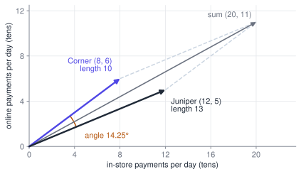

*Figure 1.1 — Two merchants as arrows. Length measures size, direction measures channel mix, and adding the arrows gives their combined volume.*

Real vectors are longer: 40 features for a merchant, or a thousand numbers for an **embedding**, a vector that a model learns to produce (Chapter 12). The rules below stay the same.

#### The formal definition

A vector $\mathbf{v}$ in $\mathbb{R}^n$ is a list of $n$ real numbers $(v_1, \dots, v_n)$, and $n$ is its **dimension**. A single number is a **scalar**. For vectors $\mathbf{u}$ and $\mathbf{v}$ of the same dimension and a scalar $c$:

$$
\mathbf{u} + \mathbf{v} = (u_1 + v_1, \dots, u_n + v_n), \qquad c\,\mathbf{v} = (c\,v_1, \dots, c\,v_n)
$$

The **dot product** multiplies matching entries and adds the results. The **norm** is the length of the arrow:

$$
\mathbf{u} \cdot \mathbf{v} = \sum_{i=1}^{n} u_i v_i, \qquad \lVert \mathbf{v} \rVert = \sqrt{\mathbf{v} \cdot \mathbf{v}} = \sqrt{\sum_{i=1}^{n} v_i^2}
$$

The dot product also has a geometric form, where $\theta$ is the angle between the two arrows:

$$
\mathbf{u} \cdot \mathbf{v} = \lVert \mathbf{u} \rVert \, \lVert \mathbf{v} \rVert \cos\theta
$$

This follows from the law of cosines applied to the triangle with sides $\mathbf{u}$, $\mathbf{v}$ and $\mathbf{u} - \mathbf{v}$. The dot product is large when both arrows are long and point the same way, zero when they are perpendicular, and negative when they point apart.

### Worked example

Let $\mathbf{c} = (8, 6)$ be Corner and $\mathbf{j} = (12, 5)$ be Juniper.

- Sum: $\mathbf{c} + \mathbf{j} = (20, 11)$, the combined daily volume of the two.
- Scaling: a holiday week lifts Corner by half, $1.5\,\mathbf{c} = (12, 9)$.
- Lengths: $\lVert\mathbf{c}\rVert = \sqrt{64+36} = 10$, $\lVert\mathbf{j}\rVert = \sqrt{144+25} = 13$ and $\lVert 1.5\,\mathbf{c}\rVert = 15$.
- Dot product: $8\cdot 12+6\cdot 5 = 126$.
- Angle: $\cos\theta = 126/(10\cdot 13) = 0.9692$, so $\theta = 14.25^\circ$.

The small angle says the two merchants have a similar mix: both lean in-store.

```python
corner = np.array([8.0, 6.0])     # Corner Hardware
juniper = np.array([12.0, 5.0])   # Juniper Bakery

combined = corner + juniper       # add matching components
holiday = 1.5 * corner            # scale every component
dot = corner @ juniper            # multiply matching components, then add
len_c = np.linalg.norm(corner)    # length, also called the Euclidean norm
len_j = np.linalg.norm(juniper)
cos = dot / (len_c * len_j)
angle = np.degrees(np.arccos(cos))

print("corner + juniper =", combined)
print("1.5 * corner     =", holiday, "with length", np.linalg.norm(holiday))
print("dot product      =", dot)
print("lengths          =", len_c, "and", len_j)
print(f"cosine           = {cos:.4f}")
print(f"angle            = {angle:.2f} degrees")
```

Output:

```text
corner + juniper = [20. 11.]
1.5 * corner     = [12.  9.] with length 15.0
dot product      = 126.0
lengths          = 10.0 and 13.0
cosine           = 0.9692
angle            = 14.25 degrees
```

### Common mistakes

| Mistake | Why it bites | Do this instead |
|---|---|---|
| Mixing units in one vector, such as payments per day next to a refund rate | The feature with the biggest numbers decides every dot product and distance | Put features on a common scale first (Chapter 8) |
| Reading a large dot product as "similar" | It is also large when either vector is simply long | Compare directions with the cosine (Chapter 11) |
| Changing the feature order between two tables | Entry 3 of one vector meets entry 4 of another, and nothing raises an error | Fix one schema and check it in code |

### Where a PM meets it

- The decision: which features describe a merchant, a payment or a ticket. A model cannot use a signal that never made it into the vector.
- Ask for the feature list with units, and the share of rows where each feature is missing.
- Watch for features whose scale or meaning shifts over time. Old and new vectors then stop being comparable.

### Check yourself

**Q1.1** Harbor Books is $(6, 8)$ and Northwind Outfitters is $(4, 8)$. Compute their dot product and both lengths.

**Q1.2** In this two-feature space, what kind of merchants have a dot product of zero?

**Q1.3** A teammate appends average ticket in USD, so Corner becomes $(8, 6, 42)$, and compares merchants by dot product. What goes wrong?

> [!IMPORTANT]
> **In one line:** A vector is a list of numbers you can also read as an arrow, and the dot product and norm turn "how big" and "how alike" into arithmetic.

## 2. Matrices

### Why it matters

Every dataset your team trains on is a table of numbers, and every layer of a neural network is a rule that turns one vector into another. Both are the same object, a matrix. Three questions about any matrix (what is a row, what is a column, how big is it) expose most data and cost problems before anyone writes code.

### The idea

A **matrix** is a rectangle of numbers, and it has two readings.

*As a table.* Stack the five merchant vectors as rows and you get a matrix $X$ with 5 rows and 2 columns. Each row is a merchant and each column is a feature.

*As a machine.* Multiply a matrix by a vector and you get a new vector. This one turns (in-store, online) into (total, online minus in-store):

$$
T = \begin{bmatrix}1&1\\-1&1\end{bmatrix}
$$

To see what a machine does, watch where it sends the unit arrows $(1, 0)$ and $(0, 1)$. They land on the columns of the matrix, and every other vector follows from those two.

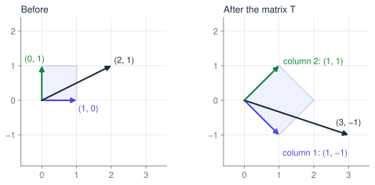

*Figure 2.1 — A matrix as a machine. The unit arrows land on the columns of T, and the whole plane moves with them.*

#### The formal definition

A matrix $A \in \mathbb{R}^{m \times n}$ has $m$ rows and $n$ columns. Its entry in row $i$ and column $j$ is $a_{ij}$. The **transpose** $A^\top$ swaps rows and columns, so it is $n\times m$.

For a vector $\mathbf{x} \in \mathbb{R}^n$, the product $A\mathbf{x}$ is a vector in $\mathbb{R}^m$. Its entry $i$ is the dot product of row $i$ with $\mathbf{x}$:

$$
(A\mathbf{x})_i = \sum_{j=1}^{n} a_{ij}\,x_j
$$

The same product is a mix of the columns $\mathbf{a}_1, \dots, \mathbf{a}_n$ of $A$, with the entries of $\mathbf{x}$ as the amounts:

$$
A\mathbf{x} = x_1\mathbf{a}_1 + x_2\mathbf{a}_2 + \dots + x_n\mathbf{a}_n
$$

The **identity matrix** $I$ has ones on its diagonal and zeros elsewhere, so $I\mathbf{x} = \mathbf{x}$. A map $\mathbf{x} \mapsto A\mathbf{x}$ is a **linear transformation**: it keeps sums and scalings, meaning $A(\mathbf{u} + \mathbf{v}) = A\mathbf{u} + A\mathbf{v}$ and $A(c\,\mathbf{u}) = c\,A\mathbf{u}$.

### Worked example

*Table reading.* Suppose PayFlow earns about USD 5 on ten in-store payments and USD 20 on ten online payments, so $\mathbf{w} = (5, 20)$. One product gives the daily fees from all five merchants:

$$
X\mathbf{w} = \begin{bmatrix}12&5\\8&6\\4&8\\6&8\\10&8\end{bmatrix}\begin{bmatrix}5\\20\end{bmatrix} = \begin{bmatrix}160\\160\\180\\190\\210\end{bmatrix}
$$

Row 1 is $12\cdot 5+5\cdot 20 = 160$. Summit Cycles, the last row, earns PayFlow the most. Juniper Bakery is the busiest in store and still ties for the least.

*Machine reading.* Apply $T$ to Juniper, $\mathbf{j} = (12, 5)$. The first entry is $12+5 = 17$ and the second is $-12+5 = -7$: 170 payments a day, with online trailing in-store by 70. The columns give the same answer, $12\cdot(1, -1)+5\cdot(1, 1) = (17, -7)$.

```python
X = np.array([[12, 5],
              [8, 6],
              [4, 8],
              [6, 8],
              [10, 8]], dtype=float)

# View 1: the matrix as a table. One product scores every merchant at once.
w = np.array([5.0, 20.0])         # USD of fees per ten in-store / online payments
fees = X @ w
print("shape of X:", X.shape, " shape of X transposed:", X.T.shape)
print("fees per day (USD):", fees)
print("column totals:", X.sum(axis=0))

# View 2: the matrix as a machine. T turns (in-store, online) into
# (total, online minus in-store).
T = np.array([[1.0, 1.0],
              [-1.0, 1.0]])
juniper = X[0]
print("T @ juniper:", T @ juniper)
by_columns = juniper[0] * T[:, 0] + juniper[1] * T[:, 1]
print("same thing from the columns of T:", by_columns)
```

Output:

```text
shape of X: (5, 2)  shape of X transposed: (2, 5)
fees per day (USD): [160. 160. 180. 190. 210.]
column totals: [40. 35.]
T @ juniper: [17. -7.]
same thing from the columns of T: [17. -7.]
```

### Common mistakes

| Mistake | Why it bites | Do this instead |
|---|---|---|
| Swapping rows and columns | `X[i, j]` is row `i`, column `j`; reversed, the code still runs and returns the wrong merchant | Print `X.shape` and name both axes |
| Writing `*` when you mean `@` | `*` multiplies entry by entry, and NumPy may stretch shapes to make it work | Use `@` for matrix products |
| Calling a dataset and a model's weights "the matrix" in one document | Readers confuse data with parameters | Say "feature table" and "weight matrix" |

### Where a PM meets it

- Size is cost. Memory is rows times columns times bytes per number, so 5 million merchants with 200 features at 8 bytes each need 8 GB.
- For any table a model reads, ask what one row is, what one column is, and how many cells are empty.
- A model's parameters are mostly entries of weight matrices. "A 7-billion-parameter model" is a statement about matrix sizes.

### Check yourself

**Q2.1** Apply $T$ to Northwind Outfitters, $(4, 8)$. What do the two outputs mean?

**Q2.2** Which weight vector $\mathbf{w}$ makes $X\mathbf{w}$ return each merchant's total payments? What is the result for Harbor Books, $(6, 8)$?

**Q2.3** A feature table has 5 million rows and 200 columns of 8-byte numbers. How much memory does it need?

> [!IMPORTANT]
> **In one line:** A matrix is a table of vectors and also a machine that turns one vector into another, so always ask what its rows and columns mean and how big it is.

## 3. Matrix multiplication

### Why it matters

A model is rarely one step. Features are cleaned, combined and then scored, and a neural network repeats that pattern in every layer. Matrix multiplication is how steps are chained. It explains why the order of steps matters and where most of a model's compute bill comes from.

### The idea

If a matrix is a machine, multiplying two matrices bolts two machines together. The product $AB$ means "first $B$, then $A$", read from right to left, and it is itself a single matrix that does both jobs.

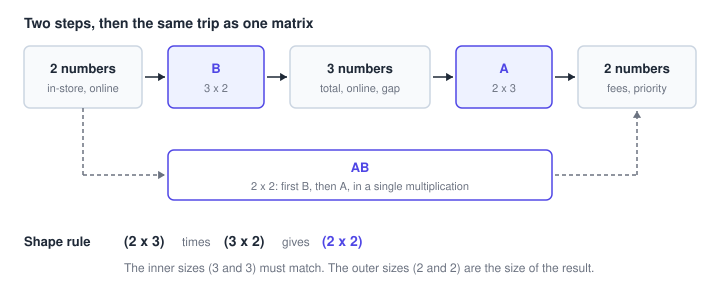

*Figure 3.1 — Two steps collapse into one matrix. The sizes must meet in the middle.*

This matters for neural networks. Any chain of purely linear layers collapses into one matrix, so stacking them adds no power. Networks put a nonlinear function between layers to prevent the collapse.

#### The formal definition

For $A \in \mathbb{R}^{m \times n}$ and $B \in \mathbb{R}^{n \times p}$, the product $C = AB$ is an $m\times p$ matrix with entries

$$
c_{ij} = \sum_{k=1}^{n} a_{ik}\,b_{kj}
$$

Entry $(i, j)$ is the dot product of row $i$ of $A$ with column $j$ of $B$. The number of columns of $A$ must equal the number of rows of $B$.

Four rules cover most uses:

- Grouping is free: $(AB)C = A(BC)$.
- It distributes over sums: $A(B+C) = AB+AC$.
- Order is not free: in general $AB \neq BA$, and one of the two may not even exist.
- Transposing reverses the order: $(AB)^\top = B^\top A^\top$.

The schoolbook method uses $m \cdot n \cdot p$ scalar multiplications, which is $n^3$ for two square matrices. Strassen showed in 1969 that fewer are possible, but in practice the speed comes from hardware-tuned libraries and GPUs.

### Worked example

Step 1 is a matrix $B$ that turns (in-store, online) into three numbers: total, online, and online minus in-store. Step 2 is a matrix $A$ that turns those three into two scores: fee revenue in USD and a review priority.

$$
B = \begin{bmatrix}1&1\\0&1\\-1&1\end{bmatrix}, \qquad A = \begin{bmatrix}5&15&0\\1&0&2\end{bmatrix}
$$

Multiply each row of $A$ by each column of $B$:

$$
AB = \begin{bmatrix}5+0+0&5+15+0\\1+0-2&1+0+2\end{bmatrix} = \begin{bmatrix}5&20\\-1&3\end{bmatrix}
$$

The first row is the fee vector $(5, 20)$ from Chapter 2. Check with Juniper, $\mathbf{j} = (12, 5)$. Step by step, $B\mathbf{j} = (17, 5, -7)$ and then $A(17, 5, -7) = (85+75,\ 17-14) = (160, 3)$. In one step, $AB\,\mathbf{j} = (60+100,\ -12+15) = (160, 3)$.

The other order, $BA$, is a $3\times 3$ matrix that means something else. Square matrices disagree too. If $P$ doubles the first number and $Q$ adds the second number to the first, then doubling last also doubles the amount that was added.

```python
# Step 1: (in-store, online) -> (total, online, online minus in-store).
B = np.array([[1.0, 1.0],
              [0.0, 1.0],
              [-1.0, 1.0]])
# Step 2: those three numbers -> (fee revenue, review priority).
A = np.array([[5.0, 15.0, 0.0],
              [1.0, 0.0, 2.0]])

AB = A @ B                       # "first B, then A" as a single 2 x 2 matrix
juniper = np.array([12.0, 5.0])

print("A @ B =")
print(AB)
print("step by step:", A @ (B @ juniper))
print("in one step: ", AB @ juniper)
print("shapes:", A.shape, "@", B.shape, "->", AB.shape, "| B @ A ->", (B @ A).shape)

# Order matters even when both products have the same shape.
P = np.array([[2.0, 0.0], [0.0, 1.0]])    # double the first number
Q = np.array([[1.0, 1.0], [0.0, 1.0]])    # add the second number to the first
print("P @ Q =", (P @ Q).tolist(), " Q @ P =", (Q @ P).tolist())
```

Output:

```text
A @ B =
[[ 5. 20.]
 [-1.  3.]]
step by step: [160.   3.]
in one step:  [160.   3.]
shapes: (2, 3) @ (3, 2) -> (2, 2) | B @ A -> (3, 3)
P @ Q = [[2.0, 2.0], [0.0, 1.0]]  Q @ P = [[2.0, 1.0], [0.0, 1.0]]
```

### Common mistakes

| Mistake | Why it bites | Do this instead |
|---|---|---|
| Assuming $AB = BA$ | Swapping two pipeline steps changes the result, or the shapes stop fitting | Write the order down and read products right to left |
| Trusting code because it ran | NumPy can stretch mismatched shapes into a wrong answer with no error | Assert the shape of every intermediate result |
| Planning model size without the arithmetic | Doubling a layer's width roughly quadruples its multiplications | Estimate $m \cdot n \cdot p$ before promising a latency |

### Where a PM meets it

- Latency and GPU cost are dominated by matrix products. When a team proposes a wider or deeper model, ask how the matrix shapes change and what that does to cost per request.
- The order of steps in a feature pipeline is a design choice, and each order gives a different result. Ask for it in writing.

### Check yourself

**Q3.1** Use $AB$ to score Northwind Outfitters, $(4, 8)$.

**Q3.2** $A$ is $4\times 3$ and $B$ is $3\times 5$. What is the shape of $AB$? Does $BA$ exist?

**Q3.3** One layer multiplies a $768\times 768$ weight matrix by 1,000 token vectors of length 768. Roughly how many scalar multiplications is that?

> [!IMPORTANT]
> **In one line:** Multiplying matrices chains transformations, the inner sizes must match, the order matters, and the cost grows with the product of the three sizes.

## 4. Linear independence and bases

### Why it matters

Feature lists grow. Someone adds daily fees next to daily volume and payment count, or a total next to its parts. A redundant column adds no information, yet it can make a model's weights unstable and its explanations meaningless. Linear independence tests whether a column tells you anything new.

### The idea

A set of vectors is **linearly independent** when none of them can be built from the others by scaling and adding. Add a "total" column to the merchant table and the set becomes dependent, because total is in-store plus online.

The **span** of a set of vectors is everything you can build from them. Two independent arrows in the plane span the whole plane. Two dependent arrows span only a line.

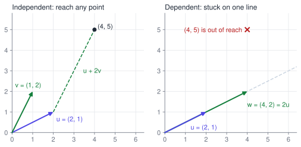

*Figure 4.1 — Independent vectors reach every point of the plane. Dependent vectors are stuck on a line.*

A **basis** is an independent set that spans the space: the smallest complete toolkit. For a data table, the **rank** counts the independent columns, which is how many columns' worth of information the table really holds.

#### The formal definition

Vectors $\mathbf{v}_1, \dots, \mathbf{v}_k$ are linearly independent when the only weights that combine them into the zero vector are all zero:

$$
c_1\mathbf{v}_1 + \dots + c_k\mathbf{v}_k = \mathbf{0} \quad \text{only when} \quad c_1 = \dots = c_k = 0
$$

Otherwise they are dependent, and at least one equals a weighted sum of the others. The span is the set of all such weighted sums.

Every basis of a space has the same number of vectors, and that number is the space's dimension. The rank of a matrix is the dimension of the span of its columns, which always equals the dimension of the span of its rows.

### Worked example

Take three days for one merchant.

| Day | Payments | Volume (USD) | Fees (USD) |
|---|---|---|---|
| 1 | 100 | 2,000 | 88 |
| 2 | 50 | 3,000 | 102 |
| 3 | 200 | 1,000 | 89 |

Is the fees column new information? Look for weights $a$ and $b$ such that fees equal $a$ times payments plus $b$ times volume. Days 1 and 2 give two equations:

$$
100a + 2000b = 88, \qquad 50a + 3000b = 102
$$

Double the second and subtract the first: $4000b=116$, so $b=0.029$. Then $a=(88-58)/100=0.30$. Day 3 confirms it: $0.30\cdot 200+0.029\cdot 1000=89$.

The weights are PayFlow's price, USD 0.30 per payment plus 2.9% of volume. Fees can be rebuilt exactly from the other two columns, so the three columns have rank 2.

Average ticket, volume divided by payments, also repeats what the table knows. But a ratio is not a weighted sum, so adding it keeps the rank at 3. Linear dependence only catches straight-line redundancy.

```python
count = np.array([100.0, 50.0, 200.0])
volume = np.array([2000.0, 3000.0, 1000.0])
fees = 0.029 * volume + 0.30 * count          # 2.9% + USD 0.30 per payment
F = np.column_stack([count, volume, fees])

print("fees column:", fees)
print("rank with the fees column:   ", np.linalg.matrix_rank(F))
print("rank without the fees column:", np.linalg.matrix_rank(F[:, :2]))

# Recover the weights that rebuild the fees column from the other two.
weights, *_ = np.linalg.lstsq(F[:, :2], fees)
print("fees = %.3f * count + %.3f * volume" % tuple(weights))

# A product of columns is redundant in meaning but not linearly dependent.
ticket = volume / count                       # average ticket, USD
G = np.column_stack([count, ticket, volume])  # volume = count * ticket
print("rank of [count, ticket, volume]:", np.linalg.matrix_rank(G))
```

Output:

```text
fees column: [ 88. 102.  89.]
rank with the fees column:    2
rank without the fees column: 2
fees = 0.300 * count + 0.029 * volume
rank of [count, ticket, volume]: 3
```

### Common mistakes

| Mistake | Why it bites | Do this instead |
|---|---|---|
| Keeping a total next to its parts, or every category flag next to a column of ones | The columns are dependent, so a linear model has no unique weights | Drop one column from each dependent group |
| Expecting rank to catch all redundancy | Products and ratios pass the test and still duplicate signal | Also check correlations between features |
| Testing only for exact dependence | After rounding, the rank looks full while the weights still swing | Check the condition number (Chapter 6) |

### Where a PM meets it

- When a new feature is proposed, ask whether it is a weighted sum of columns you already have. If so, a linear model gains nothing.
- Ask for the rank of the feature table next to its column count.
- Distrust "feature importance" for features that carry the same information. A model can split the credit between them in any proportion.

### Check yourself

**Q4.1** Three merchants have columns (in-store, online, total) with rows $(12, 5, 17)$, $(8, 6, 14)$ and $(4, 8, 12)$. What is the rank, and which weights combine the columns to zero?

**Q4.2** A table has a column of ones and two flags, "in-store merchant" and "online merchant". Every merchant has exactly one flag set. Why are the three columns dependent?

**Q4.3** Do $(8, 6)$ and $(4, 3)$ form a basis of the plane?

> [!IMPORTANT]
> **In one line:** Columns are independent when none is a weighted sum of the others, and rank counts how many independent columns a table really has.

## 5. Determinants and trace

### Why it matters

Two single numbers summarize a square matrix. The determinant tells you whether a transformation can be undone and how much it stretches space. The trace adds up what happens along the axes, and for a covariance matrix it is the total variance, the denominator behind every "explains 90% of the variance" claim.

### The idea

Apply a $2\times 2$ matrix to the unit square and the square becomes a parallelogram. The **determinant** is the area of that parallelogram, so it is the factor by which the matrix scales every area. A negative sign means the shape was also flipped over. In three dimensions it scales volumes.

A determinant of zero means the square was squashed flat onto a line. Different inputs now land on the same output, so the step cannot be undone. Such a matrix is called **singular**.

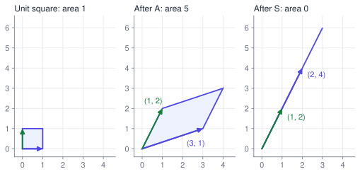

*Figure 5.1 — The determinant is the area factor. Matrix A multiplies areas by 5. Matrix S flattens the plane onto a line.*

The **trace** is plainer: add the entries on the main diagonal.

#### The formal definition

For a $2\times 2$ matrix:

$$
\det\begin{bmatrix}a&b\\c&d\end{bmatrix} = ad - bc
$$

For a $3\times 3$ matrix, expand along the first row. Each entry multiplies the determinant of the $2\times 2$ block left after deleting its row and column, with signs $+, -, +$. Larger matrices follow the same pattern, though software uses a factorization instead.

Four facts do most of the work: $\det(I) = 1$, $\det(AB) = \det(A)\det(B)$, $\det(A^\top) = \det(A)$, and $\det(A) = 0$ exactly when the columns of $A$ are linearly dependent (Chapter 4).

The trace of an $n\times n$ matrix is

$$
\operatorname{tr}(A) = \sum_{i=1}^{n} a_{ii}
$$

It is additive, $\operatorname{tr}(A+B) = \operatorname{tr}(A)+\operatorname{tr}(B)$, and it allows a swap inside a product, $\operatorname{tr}(AB) = \operatorname{tr}(BA)$. Also, $\operatorname{tr}(A^\top A)$ is the sum of the squares of all entries of $A$. Its square root is the **Frobenius norm** $\lVert A\rVert_F$, the usual measure of a matrix's overall size.

### Worked example

- $A = \begin{bmatrix}3&1\\1&2\end{bmatrix}$ has $\det(A) = 3\cdot 2-1\cdot 1 = 5$, the area of the parallelogram in Figure 5.1.
- $S = \begin{bmatrix}2&1\\4&2\end{bmatrix}$ has $\det(S) = 4-4 = 0$. Its second row is twice its first.
- $M$ holds in-store, online and total for three merchants, with rows $(12, 5, 17)$, $(8, 6, 14)$ and $(4, 8, 12)$. Expanding along the first row: $12(72-112)-5(96-56)+17(64-24) = -480-200+680 = 0$. The total column is redundant, as Chapter 4 predicted.
- $C = \begin{bmatrix}10&-3\\-3&2\end{bmatrix}$ is the covariance matrix of the merchant table, derived in Chapter 8. Its trace is $10+2 = 12$, the total variance, and $\det(C) = 20-9 = 11$.

```python
A = np.array([[3.0, 1.0],
              [1.0, 2.0]])            # stretches the unit square to area 5
S = np.array([[2.0, 1.0],
              [4.0, 2.0]])            # second row is twice the first
M = np.array([[12, 5, 17],
              [8, 6, 14],
              [4, 8, 12]], dtype=float)   # in-store, online, total
C = np.array([[10.0, -3.0],
              [-3.0, 2.0]])           # covariance of the merchant table

det_M = np.round(np.linalg.det(M), 6) + 0.0     # rounds away float noise
print(f"det(A) = {np.linalg.det(A):.1f}   det(S) = {np.linalg.det(S):.1f}")
print(f"det(M) = {det_M:.1f}   rank(M) = {np.linalg.matrix_rank(M)}")
print(f"trace(C) = {np.trace(C):.1f}   det(C) = {np.linalg.det(C):.1f}")

# A tiny determinant does not mean "nearly singular".
small = 0.1 * np.eye(10)
print(f"det(0.1 * I) = {np.linalg.det(small):.1e}   condition number = "
      f"{np.linalg.cond(small):.1f}")
```

Output:

```text
det(A) = 5.0   det(S) = 0.0
det(M) = 0.0   rank(M) = 2
trace(C) = 12.0   det(C) = 11.0
det(0.1 * I) = 1.0e-10   condition number = 1.0
```

The last line is a warning: one tenth of the $10\times 10$ identity matrix has a tiny determinant, yet its condition number (Chapter 6) is the best possible.

### Common mistakes

| Mistake | Why it bites | Do this instead |
|---|---|---|
| Reading a tiny determinant as "nearly singular" | The value depends on scale and dimension, as the last output line shows | Use the condition number |
| Treating a negative determinant as an error | The sign only records a flip | Use the absolute value for "how much it scales" |
| Computing the determinant of a large matrix directly | A product of many numbers overflows or underflows | Use the log-determinant, `np.linalg.slogdet` |

### Where a PM meets it

- A feature step with determinant zero, such as replacing in-store and online by their total, throws information away for good. Ask which pipeline steps cannot be undone.
- "Three components explain 90% of the variance" means 90% of the trace of a covariance matrix. Ask which features went into it and on what scale.
- The trace adds the variances of the separate features. It is not the variance of their sum, which also counts how they move together.

### Check yourself

**Q5.1** For $T = \begin{bmatrix}1&1\\-1&1\end{bmatrix}$ from Chapter 2, what is $\det(T)$, and what is the determinant of its inverse?

**Q5.2** A matrix swaps the two coordinates of every vector. What is its determinant, and what does the value say?

**Q5.3** The daily volumes of three payment methods have variances 4.0, 2.5 and 1.0 on the diagonal of their covariance matrix. What is the trace? Does it change if the methods become more correlated?

> [!IMPORTANT]
> **In one line:** The determinant is the factor by which a matrix scales volume, with zero meaning information is lost for good, and the trace is the diagonal sum that gives a covariance matrix its total variance.

## 6. Inverses and linear systems

### Why it matters

"PayFlow charged this merchant USD 35 on Monday and USD 76 on Tuesday. What is the fee schedule?" That is a question about undoing: the outputs are known and the inputs are not. Reconciliation, attribution and regression all have this shape. Linear algebra tells you when such a question has exactly one answer, none, or infinitely many.

### The idea

A linear system is written $A\mathbf{x} = \mathbf{b}$. The matrix $A$ and the outputs $\mathbf{b}$ are known, and $\mathbf{x}$ is wanted. If $A$ has an **inverse**, a matrix $A^{-1}$ that undoes it, then $\mathbf{x} = A^{-1}\mathbf{b}$.

With two unknowns each equation is a line, and the solution is where the lines cross. If the equations are dependent, the lines coincide or run parallel, and there are infinitely many solutions or none.

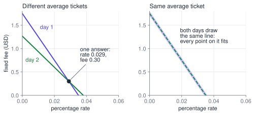

*Figure 6.1 — Each day of fee data is one line. Two days pin down the fee schedule only if their average tickets differ.*

Real data is noisy, and you usually have more equations than unknowns, so no $\mathbf{x}$ fits them all. **Least squares** picks the $\mathbf{x}$ with the smallest total squared miss. That is linear regression.

#### The formal definition

A square matrix $A$ is invertible when a matrix $A^{-1}$ exists with $A^{-1}A = AA^{-1} = I$. This holds exactly when $\det(A) \neq 0$, that is, when its columns are linearly independent. For a $2\times 2$ matrix:

$$
\begin{bmatrix}a&b\\c&d\end{bmatrix}^{-1} = \frac{1}{ad - bc}\begin{bmatrix}d&-b\\-c&a\end{bmatrix}
$$

When $A$ has more rows than columns and its columns are independent, the least-squares solution $\hat{\mathbf{x}}$ minimizes $\lVert A\mathbf{x} - \mathbf{b}\rVert^2$. Setting the gradient to zero (Chapter 26) gives the **normal equations**:

$$
A^\top A\,\hat{\mathbf{x}} = A^\top\mathbf{b}
$$

The **condition number** $\kappa(A)$ is the ratio of the largest to the smallest singular value of $A$ (Chapter 9). It is at least 1, and it bounds how much a small relative error in $\mathbf{b}$ can grow in $\mathbf{x}$. A huge $\kappa$ means "nearly singular".

### Worked example

On day 1 a merchant has USD 1,000 of volume in 20 payments and pays USD 35 in fees. On day 2 the figures are USD 2,000, 60 payments and USD 76. With the rate $p$ and the fixed fee $f$ as unknowns:

$$
\begin{bmatrix}1000&20\\2000&60\end{bmatrix}\begin{bmatrix}p\\f\end{bmatrix} = \begin{bmatrix}35\\76\end{bmatrix}
$$

The determinant is $1000\cdot 60-20\cdot 2000 = 20{,}000$, so the inverse exists:

$$
\begin{bmatrix}p\\f\end{bmatrix} = \frac{1}{20{,}000}\begin{bmatrix}60&-20\\-2000&1000\end{bmatrix}\begin{bmatrix}35\\76\end{bmatrix} = \frac{1}{20{,}000}\begin{bmatrix}580\\6000\end{bmatrix} = \begin{bmatrix}0.029\\0.30\end{bmatrix}
$$

That is 2.9% plus USD 0.30, PayFlow's price.

Now suppose both days had an average ticket of USD 50: 20 payments on day 1 and 40 on day 2. The determinant becomes $1000\cdot 40-20\cdot 2000 = 0$. Volume and count move in lockstep, so no amount of such data can separate the percentage from the fixed fee.

```python
A = np.array([[1000.0, 20.0],
              [2000.0, 60.0]])
b = np.array([35.0, 76.0])            # fees charged each day (USD)
x = np.linalg.solve(A, b)             # solves A x = b without forming the inverse
print("rate and fixed fee:", x, f" condition number: {np.linalg.cond(A):.0f}")

# Four days with small errors in the recorded fees: more equations than unknowns.
A4 = np.array([[1000.0, 20.0], [2000.0, 60.0], [1500.0, 45.0], [800.0, 10.0]])
b4 = np.array([35.10, 75.80, 57.20, 26.10])
fit, *_ = np.linalg.lstsq(A4, b4)
normal = np.linalg.solve(A4.T @ A4, A4.T @ b4)
print("least squares:", np.round(fit, 4), " normal equations:", np.round(normal, 4))

# Two days with the same average ticket (USD 50): the columns are dependent.
same_ticket = np.array([[1000.0, 20.0],
                        [2000.0, 40.0]])
try:
    np.linalg.solve(same_ticket, np.array([35.0, 70.0]))
except np.linalg.LinAlgError as err:
    print("equal tickets:", err)
```

Output:

```text
rate and fixed fee: [0.029 0.3  ]  condition number: 250
least squares: [0.029  0.3008]  normal equations: [0.029  0.3008]
equal tickets: Singular matrix
```

With four days of slightly noisy fees, least squares still recovers 2.9% and about USD 0.30. With equal tickets, NumPy refuses to solve.

### Common mistakes

| Mistake | Why it bites | Do this instead |
|---|---|---|
| Computing `inv(A) @ b` | It is slower and less accurate than solving directly | `np.linalg.solve(A, b)` |
| Ignoring the condition number | About $\log_{10}\kappa$ digits of accuracy are lost; at $\kappa = 10^{8}$ half of a 16-digit number is noise | Check `np.linalg.cond(A)` and collect more varied data |
| Solving least squares through the normal equations | Forming $A^\top A$ squares the condition number | `np.linalg.lstsq`, which avoids forming it |
| Leaving out the column of ones | The fitted line is forced through zero | Add an intercept column |

### Where a PM meets it

- Attribution questions, such as "how much of the rise in disputes came from new merchants and how much from the holiday?", are linear systems. They have an answer only if the causes moved separately somewhere in the data. Ask that first.
- Ask how much an estimate changes when one day or one merchant is removed. A large swing is a high condition number in plain words.

### Check yourself

**Q6.1** Invert $G = \begin{bmatrix}2&1\\1&1\end{bmatrix}$ and solve $G\mathbf{x} = (10, 7)$.

**Q6.2** Two days with the same average ticket gave a determinant of zero. In business terms, what can you not learn, and what data fixes it?

**Q6.3** Disputes on days $t = 1, 2, 3$ were $y = 2, 3, 5$. Fit $y = a\,t + c$ by least squares.

> [!IMPORTANT]
> **In one line:** A linear system has one answer only when its columns are independent, and when the data is noisy or plentiful, least squares gives the best compromise.

## 7. Eigenvalues and eigenvectors

### Why it matters

Apply the same transformation again and again (a month of merchant churn, one round of a ranking algorithm) and a few special directions decide what happens in the long run. Those directions are eigenvectors. They are also the "components" of principal component analysis in the next chapter.

### The idea

Most arrows change direction when a matrix acts on them. A few do not. They stay on their own line and only get longer, shorter or flipped. Such an arrow is an **eigenvector** of the matrix, and its stretch factor is the matching **eigenvalue**.

Take $A = \begin{bmatrix}2&1\\1&2\end{bmatrix}$. It sends $(1, 1)$ to $(3, 3)$, the same direction and three times as long. It sends $(1, -1)$ to itself. It sends $(1, 0)$ to $(2, 1)$, which has turned.

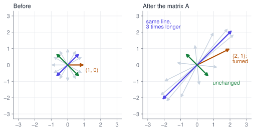

*Figure 7.1 — The eigenvectors of A are the directions it only stretches (purple, by 3) or leaves alone (green). Every other arrow turns, like the orange one.*

Along its eigenvectors a matrix is plain scaling, so once you know them you understand the whole transformation.

#### The formal definition

A nonzero vector $\mathbf{v}$ is an eigenvector of a square matrix $A$ with eigenvalue $\lambda$ when

$$
A\mathbf{v} = \lambda\mathbf{v}
$$

Rewrite this as $(A-\lambda I)\mathbf{v} = \mathbf{0}$. A nonzero solution exists only when $A-\lambda I$ is singular, which gives the **characteristic equation** $\det(A-\lambda I) = 0$. For a $2\times 2$ matrix it is a quadratic:

$$
\lambda^2 - \operatorname{tr}(A)\,\lambda + \det(A) = 0
$$

In any dimension the eigenvalues add up to the trace and multiply to the determinant.

A matrix is symmetric when $A = A^\top$, as every covariance matrix is. The **spectral theorem** says a symmetric matrix has real eigenvalues and a full set of perpendicular unit eigenvectors. Put those eigenvectors in the columns of $Q$ and the eigenvalues on the diagonal of $\Lambda$, and $A = Q\Lambda Q^\top$.

### Worked example

Use the covariance matrix of the merchant table, $C = \begin{bmatrix}10&-3\\-3&2\end{bmatrix}$, with trace 12 and determinant 11.

1. The characteristic equation is $\lambda^2-12\lambda+11 = (\lambda-11)(\lambda-1) = 0$, so $\lambda_1 = 11$ and $\lambda_2 = 1$.
2. For $\lambda_1 = 11$, the first row of $(C - 11I)\mathbf{v} = \mathbf{0}$ reads $-v_1-3v_2 = 0$. So $\mathbf{v}_1$ lies along $(3, -1)$, and scaled to length 1 it is $(3, -1)/\sqrt{10} = (0.949, -0.316)$.
3. For $\lambda_2 = 1$, the first row reads $9v_1-3v_2 = 0$, so $\mathbf{v}_2 = (1, 3)/\sqrt{10}$.
4. Check: $C\,(3, -1) = (30+3,\ -9-2) = (33, -11) = 11\cdot(3, -1)$. The eigenvectors are perpendicular, since $3\cdot 1+(-1)\cdot 3 = 0$.

```python
C = np.array([[10.0, -3.0],
              [-3.0, 2.0]])           # covariance of the merchant table (Chapter 8)

values, vectors = np.linalg.eigh(C)   # for symmetric matrices; ascending order
print("eigenvalues:", values)
print("eigenvectors (columns):")
print(np.round(vectors, 4))

v_top = vectors[:, 1]
print("C @ v :", np.round(C @ v_top, 4))
print("11 * v:", np.round(11 * v_top, 4))

# Power iteration: keep applying C and rescaling. Any start drifts to the top
# eigenvector, because that direction is stretched the most at every step.
v = np.array([1.0, 1.0])
for step in range(1, 6):
    v = C @ v
    v = v / np.linalg.norm(v)
    print(f"step {step}: {np.round(v, 4)}")
```

Output:

```text
eigenvalues: [ 1. 11.]
eigenvectors (columns):
[[-0.3162 -0.9487]
 [-0.9487  0.3162]]
C @ v : [-10.4355   3.4785]
11 * v: [-10.4355   3.4785]
step 1: [ 0.9899 -0.1414]
step 2: [ 0.9538 -0.3005]
step 3: [ 0.9492 -0.3148]
step 4: [ 0.9487 -0.3161]
step 5: [ 0.9487 -0.3162]
```

NumPy returned $(-0.9487, 0.3162)$, the hand answer with its sign flipped. Both are correct.

The loop is **power iteration**. Each pass stretches the top eigenvector's direction the most, so any starting arrow drifts toward it. Large systems find top eigenvectors this way; PageRank, which Brin and Page published in 1998 to rank web pages, is the best-known example.

### Common mistakes

| Mistake | Why it bites | Do this instead |
|---|---|---|
| Reading meaning into an eigenvector's sign or length | $(3, -1)$, $(-3, 1)$ and $(0.949, -0.316)$ are the same eigenvector | Compare directions and fix a sign convention |
| Assuming every matrix has real, perpendicular eigenvectors | Only symmetric matrices are guaranteed them; a rotation has no real ones | For general matrices use the SVD (Chapter 9) |
| Calling `np.linalg.eig` on a symmetric matrix | It is slower and returns eigenvalues in no particular order | `np.linalg.eigh`, which sorts them ascending |

### Where a PM meets it

- Long-run behavior. If a matrix describes how merchants move between "active" and "dormant" each month, the mix it settles into is its eigenvector with eigenvalue 1. Ask for that steady state, not only next month's forecast.
- Ask about the gap between the two largest eigenvalues. A wide gap means one dominant, stable pattern. A narrow gap means the "top direction" can swing when the data is refreshed.

### Check yourself

**Q7.1** Verify that $(1, 1)$ is an eigenvector of $A = \begin{bmatrix}2&1\\1&2\end{bmatrix}$, and find both eigenvalues from the trace and the determinant.

**Q7.2** Each month 90% of active merchants stay active and 10% go dormant, while 40% of dormant merchants reactivate and 60% stay dormant. What share is active in the long run?

**Q7.3** Why does a quarter-turn rotation of the plane have no real eigenvector?

> [!IMPORTANT]
> **In one line:** Eigenvectors are the directions a matrix only stretches, eigenvalues are the stretch factors, and together they describe everything the matrix does.

## 8. Principal component analysis

### Why it matters

A merchant table can have hundreds of columns, and many of them move together. Principal component analysis (PCA) finds a few new axes that keep most of the variation, so you can plot merchants, compress them and spot odd ones. How many axes to keep is a product choice between fidelity and cost.

### The idea

Picture the merchants as a cloud of points. The direction along which the cloud is most spread out is the first **principal component**. The second is the most spread-out direction perpendicular to it, and so on. Keep each merchant's position along the first few and drop the rest.

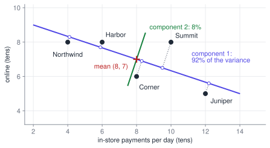

*Figure 8.1 — PCA on the merchant table. Sliding each merchant onto the long line keeps 92% of the variance in one number.*

Karl Pearson described the method in 1901; Harold Hotelling developed and named it in the 1930s.

#### The formal definition

Start with a data matrix $X$ of $n$ rows and $d$ columns.

1. *Center.* Subtract each column's mean to get $X_c$.
2. *Covariance.* Compute the **covariance matrix** $C = \frac{1}{n-1}X_c^\top X_c$, which is symmetric and $d\times d$.
3. *Objective.* For a unit vector $\mathbf{w}$, the projections $X_c\mathbf{w}$ have variance $\mathbf{w}^\top C\mathbf{w}$. Maximize it subject to $\mathbf{w}^\top\mathbf{w} = 1$.
4. *Solve.* With a Lagrange multiplier $\lambda$ (Chapter 36), $L = \mathbf{w}^\top C\mathbf{w}-\lambda(\mathbf{w}^\top\mathbf{w}-1)$. Setting the gradient $2C\mathbf{w}-2\lambda\mathbf{w}$ to zero gives

$$
C\mathbf{w} = \lambda\mathbf{w}
$$

So $\mathbf{w}$ is an eigenvector of $C$, and the variance it captures is $\mathbf{w}^\top C\mathbf{w} = \lambda$. The best direction is the eigenvector with the largest eigenvalue, and the later components are the remaining eigenvectors in order.

5. *Explained variance.* Component $k$ holds the share $\lambda_k/(\lambda_1+\dots+\lambda_d)$ of the trace of $C$. This is its **explained variance ratio**.
6. *Scores.* A merchant's coordinate on component $k$ is its **score** $z_k = (\mathbf{x}-\bar{\mathbf{x}})\cdot\mathbf{w}_k$, and the entries of $\mathbf{w}_k$ are the **loadings**. The first $k$ components rebuild $\hat{\mathbf{x}} = \bar{\mathbf{x}}+z_1\mathbf{w}_1+\dots+z_k\mathbf{w}_k$.

### Worked example

The merchant table has rows $(12, 5)$, $(8, 6)$, $(4, 8)$, $(6, 8)$ and $(10, 8)$.

1. The column means are $(8, 7)$, so the centered rows are $(4, -2)$, $(0, -1)$, $(-4, 1)$, $(-2, 1)$ and $(2, 1)$.
2. The sums of squares and products are $16+0+16+4+4 = 40$, $4+1+1+1+1 = 8$ and $-8+0-4-2+2 = -12$. Dividing by $n-1 = 4$ gives $C = \begin{bmatrix}10&-3\\-3&2\end{bmatrix}$.
3. Chapter 7 found its eigenvalues, 11 and 1, with $\mathbf{w}_1 = (3, -1)/\sqrt{10}$.
4. Component 1 explains $11/12 = 91.7\%$.
5. Juniper's score is $(4\cdot 3+(-2)(-1))/\sqrt{10} = 14/\sqrt{10} = 4.43$. The others are $0.32$, $-4.11$, $-2.21$ and $1.58$.
6. Rebuild Juniper from that one number: $(8, 7)+4.43\cdot(0.949, -0.316) = (12.2, 5.6)$, against the true $(12, 5)$.

Component 1 reads "more in-store, slightly less online", and one number per merchant keeps 92% of the variation.

```python
# 1. Center each column.
mean = X.mean(axis=0)
Xc = X - mean
# 2. Covariance matrix (divide by n - 1).
C = Xc.T @ Xc / (len(X) - 1)
# 3. Eigenvectors of the covariance, largest eigenvalue first.
values, vectors = np.linalg.eigh(C)
order = np.argsort(values)[::-1]
values, vectors = values[order], vectors[:, order]
vectors = vectors * np.sign(vectors[0])      # convention: first entry positive
# 4. Share of the variance on each component.
share = values / values.sum()
# 5. Scores: each merchant's coordinate along component 1.
w1 = vectors[:, 0]
z1 = Xc @ w1
# 6. Rebuild the table from one number per merchant.
X_hat = np.outer(z1, w1) + mean
```

Output:

```text
mean: [8. 7.]
covariance: [[10.0, -3.0], [-3.0, 2.0]]
eigenvalues: [11.  1.]  share: [0.9167 0.0833]
component 1: [ 0.9487 -0.3162]
scores: [ 4.427  0.316 -4.111 -2.214  1.581]
Juniper rebuilt: [12.2  5.6]  actual: [12.  5.]
SVD check, variances: [11.  1.]  direction: [ 0.9487 -0.3162]
```

The last line repeats the calculation with the singular value decomposition of Chapter 9, and agrees.

### Common mistakes

| Mistake | Why it bites | Do this instead |
|---|---|---|
| Skipping the centering step | The first component points at the mean, not along the spread | Subtract column means |
| Mixing units without scaling | The column with the biggest numbers becomes component 1 | First standardize each column to mean 0, variance 1 |
| Reading a component as one original feature, or trusting its sign | It blends all features, and its sign is arbitrary | Name it from its loadings |

### Where a PM meets it

- Choosing $k$: ask for the cumulative explained variance and the downstream metric at each $k$. Variance kept is not accuracy kept, since a low-variance direction can hold the fraud signal.
- Typical uses: a two-dimensional map of merchants, compression before clustering, and an anomaly flag for merchants that rebuild badly.
- Components change when the data is refreshed, so a dashboard's "component 3" needs a version.

### Check yourself

**Q8.1** With eigenvalues 11 and 1, what share of the variance does component 2 explain? What is the total squared error over the five merchants if you keep only component 1?

**Q8.2** Why are the scores on component 1 and component 2 uncorrelated?

**Q8.3** Someone records online payments singly instead of in tens, so that column is multiplied by 10. What happens to component 1?

> [!IMPORTANT]
> **In one line:** PCA centers the data, takes the eigenvectors of its covariance matrix, and keeps the few directions that hold most of the variance.

## 9. Singular value decomposition

### Why it matters

PCA needed a square, symmetric covariance matrix. Most matrices are neither. The singular value decomposition (SVD) factors any matrix, and it tells you the best way to replace a big matrix with a small one. Compressed embeddings, recommenders and cheap fine-tuning all rest on that.

### The idea

Every matrix, whatever its shape, does three simple things in a row: it rotates, it stretches along the axes, and it rotates again.

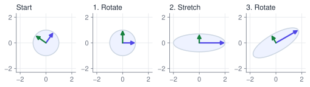

*Figure 9.1 — Any matrix as rotate, stretch, rotate. The two arrows become the long and short axes of the ellipse.*

The stretch factors are the **singular values**. A large one marks a direction the matrix cares about, and one near zero marks a direction it nearly ignores. Drop the small ones and you get a **low-rank approximation**: a much smaller description that does almost the same job.

#### The formal definition

Any real $m\times n$ matrix $A$ can be written as

$$
A = U\Sigma V^\top
$$

$U$ ($m\times m$) and $V$ ($n\times n$) are **orthogonal matrices**: their columns are perpendicular unit vectors, so they only rotate or reflect. $\Sigma$ is $m\times n$ and zero except for the singular values $\sigma_1\ge\sigma_2\ge\dots\ge 0$ on its diagonal. The columns $\mathbf{v}_i$ of $V$ are input directions, the columns $\mathbf{u}_i$ of $U$ are output directions, and $A\mathbf{v}_i = \sigma_i\mathbf{u}_i$. The rank $r$ is the number of nonzero singular values.

Equivalently, $A$ is a sum of rank-one pieces, strongest first:

$$
A = \sum_{i=1}^{r} \sigma_i\,\mathbf{u}_i\mathbf{v}_i^\top
$$

Keep the first $k$ pieces and call the result $A_k$. The Eckart-Young theorem (1936) says no rank-$k$ matrix is closer to $A$, and the miss is

$$
\lVert A-A_k\rVert_F = \sqrt{\sigma_{k+1}^2+\dots+\sigma_r^2}
$$

SVD contains PCA. For a centered data matrix $X_c$ with $n$ rows, the $\mathbf{v}_i$ are the eigenvectors of $X_c^\top X_c$, so they are the principal components, and the variances are $\lambda_i = \sigma_i^2/(n-1)$.

### Worked example

Take the centered merchant table $X_c$ from Chapter 8. There, $X_c^\top X_c = \begin{bmatrix}40&-12\\-12&8\end{bmatrix} = 4C$, with eigenvalues $4\cdot 11 = 44$ and $4\cdot 1 = 4$. So

$$
\sigma_1 = \sqrt{44} = 6.633, \qquad \sigma_2 = \sqrt{4} = 2
$$

The first input direction is $\mathbf{v}_1 = (3, -1)/\sqrt{10}$, component 1 of the PCA. The matching output direction is $\mathbf{u}_1 = X_c\mathbf{v}_1/\sigma_1$, the PCA scores scaled to length 1.

Keep only the first piece: the miss is $\sigma_2 = 2$, and the share of squared size kept is $44/48 = 91.7\%$, the explained variance from Chapter 8.

The code repeats this, then factors a second table: payments per weekday for the five merchants.

```python
U, s, Vt = np.linalg.svd(Xc, full_matrices=False)
rank1 = s[0] * np.outer(U[:, 0], Vt[0])          # keep only the strongest piece
print("singular values:", np.round(s, 4), " squared / (n - 1):", s**2 / 4)
print(f"rank-1 error: {np.linalg.norm(Xc - rank1):.4f}")

# Payments per weekday (Mon..Sun, in tens) for the five merchants.
week = np.array([[14, 14, 15, 15, 18, 24, 19],
                 [12, 12, 13, 13, 16, 20, 12],
                 [11, 11, 12, 12, 14, 13, 11],
                 [12, 13, 13, 14, 16, 17, 13],
                 [16, 16, 17, 18, 22, 22, 15]], dtype=float)
Uw, sw, Vtw = np.linalg.svd(week, full_matrices=False)
kept = np.cumsum(sw**2) / np.sum(sw**2)
print("week singular values:", np.round(sw, 2))
for k in (1, 2):
    approx = (Uw[:, :k] * sw[:k]) @ Vtw[:k]      # best rank-k approximation
    worst = np.abs(week - approx).max()
    print(f"rank {k}: keeps {kept[k - 1]:.2%}, worst cell error {worst:.2f}")
```

Output:

```text
singular values: [6.6332 2.    ]  squared / (n - 1): [11.  1.]
rank-1 error: 2.0000
week singular values: [90.62  5.69  2.94  0.8   0.71]
rank 1: keeps 99.49%, worst cell error 3.03
rank 2: keeps 99.88%, worst cell error 1.64
```

Rank 1 says every merchant's week is one shared weekly shape times that merchant's size. It stores 13 numbers instead of 35, keeps 99.49% of the squared size, and still misses one cell by 3.03, about 30 payments. Rank 2 adds a weekend-heavy pattern and nearly halves that miss.

### Common mistakes

| Mistake | Why it bites | Do this instead |
|---|---|---|
| Running SVD on uncentered data and calling it PCA | The first piece mostly reproduces the average row | Center first when you want directions of variation |
| Judging an approximation only by "share kept" | 99.49% kept still left a 30-payment miss | Check the worst error on what you care about |

### Where a PM meets it

- Rank is a cost and quality dial. A rank-$k$ copy of an $m\times n$ table stores $k(m+n+1)$ numbers instead of $mn$: for a million merchants over 365 days, rank 10 needs about 10 million numbers, not 365 million.
- Low rank runs through AI products. Recommenders learn a short vector per user and per item, fitted only to observed cells because a missing cell is not a zero. LoRA (Hu and colleagues, 2021) fine-tunes a large model by training two thin matrices whose product is a low-rank change to its weights.
- Ask for the top singular values, which a truncated SVD finds cheaply. A sharp drop shows how many real patterns the data has.

### Check yourself

**Q9.1** What are the singular values of $D = \begin{bmatrix}3&0\\0&-2\end{bmatrix}$?

**Q9.2** A table of 1,000,000 embeddings with 768 dimensions uses 4-byte numbers. How much memory does it need, and how much after a truncated SVD reduces it to 64 dimensions?

> [!IMPORTANT]
> **In one line:** SVD writes any matrix as rotate, stretch, rotate, and keeping only the largest stretches gives the best small approximation of the matrix.

## 10. High-dimensional spaces

### Why it matters

Embeddings have hundreds or thousands of dimensions, and intuition built on maps and charts fails there. A rule like "flag merchants within distance 5 of a known fraudster" behaves nothing like it does on a scatter plot. Similarity thresholds, embedding size and search indexes all depend on knowing why.

### The idea

Three things change as the number of dimensions $d$ grows. Together they are called the **curse of dimensionality**.

1. Distances bunch up. For points scattered at random, the nearest and the farthest neighbor of a query end up at almost the same distance.
2. Random directions are nearly perpendicular. The cosine between two of them is close to zero.
3. Space empties out. A ball fills a vanishing share of the box around it, so covering space with data takes exponentially more points.

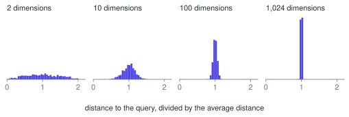

*Figure 10.1 — Distances from one query to 1,000 random points. In 2 dimensions some are near and some far. In 1,024 dimensions all are about equally far.*

The good news is that real data is not random. Tickets about late payouts share structure, so their embeddings sit near a surface of far lower dimension. That structure is the only reason nearest-neighbor search works.

#### The formal definition

Take two independent points drawn uniformly from the unit cube $[0, 1]^d$. Each coordinate adds $1/6$ to the expected squared distance:

$$
\mathbb{E}\,\lVert\mathbf{x}-\mathbf{y}\rVert^2 = \frac{d}{6}
$$

The typical distance grows like $\sqrt{d/6}$ while the spread around it stays about the same. Beyer and colleagues (1999) showed that under broad conditions the gap between the farthest and nearest neighbor, divided by the nearest distance, goes to zero as $d$ grows. This is **distance concentration**.

For two independent random unit vectors in $\mathbb{R}^d$, the dot product has mean 0 and variance $1/d$, so their cosine has standard deviation $1/\sqrt{d}$.

The unit ball in $d$ dimensions has volume $\pi^{d/2}/\Gamma(d/2+1)$, where $\Gamma$ is the gamma function. The cube around it has volume $2^d$.

The **Johnson-Lindenstrauss lemma** (1984) says that $n$ points in any dimension can be mapped into $k$ dimensions with every squared distance kept within a factor $1 \pm \varepsilon$. In the form proved by Dasgupta and Gupta, it is enough that

$$
k \ge \frac{4\ln n}{\varepsilon^2/2-\varepsilon^3/3}
$$

### Worked example

By hand:

- Typical distance in the unit cube: $\sqrt{6/6} = 1$ for $d = 6$, and $\sqrt{600/6} = 10$ for $d = 600$.
- Cosine noise: $1/\sqrt{4} = 0.5$ for $d = 4$, and $1/\sqrt{1024} = 1/32 = 0.031$ for $d = 1{,}024$. There, a cosine of 0.25 between random vectors would sit 8 standard deviations out.
- Ball's share of its cube: $\pi/4 = 0.79$ for $d = 2$.

The script simulates all three. Its `random_cosines` function, not shown, draws pairs of random directions.

```python
def distances_to_query(d, n, rng):
    """Distances from one random query to n random points in the unit cube."""
    points = rng.random((n, d))
    query = rng.random(d)
    return np.linalg.norm(points - query, axis=1)

rng = np.random.default_rng(7)
print("   d  nearest  farthest  ratio  sqrt(d/6)  cosine std  1/sqrt(d)")
for d in (2, 10, 100, 1024):
    dist = distances_to_query(d, 1000, rng)
    cos = random_cosines(d, 20000, rng)
    print(f"{d:4d}  {dist.min():7.3f}  {dist.max():8.3f}  "
          f"{dist.max() / dist.min():5.1f}  {sqrt(d / 6):9.3f}  "
          f"{cos.std():10.4f}  {1 / sqrt(d):9.4f}")
```

Output:

```text
   d  nearest  farthest  ratio  sqrt(d/6)  cosine std  1/sqrt(d)
   2    0.021     0.896   43.5      0.577      0.7061     0.7071
  10    0.475     2.065    4.3      1.291      0.3153     0.3162
 100    3.381     5.026    1.5      4.082      0.0985     0.1000
1024   12.319    13.728    1.1     13.064      0.0311     0.0312
ball's share of its cube, d = 2, 3, 10, 20: 0.79, 0.52, 0.0025, 2.5e-08
JL bound for 1,000,000 points at 10% distortion: 11,842 dimensions
```

The ratio of farthest to nearest falls from 43.5 to 1.1: with no structure, "nearest" barely means anything. The cosine spread matches $1/\sqrt{d}$, and by 20 dimensions the ball fills 0.0000025% of its cube.

The last line is the lemma for a million points at 10% distortion: 11,842 dimensions, far more than embedding models use. It is a worst-case guarantee, not a sizing recipe, because real data has structure it does not assume.

### Common mistakes

| Mistake | Why it bites | Do this instead |
|---|---|---|
| "We switched to cosine, so the curse is gone" | For unit vectors, cosine and distance rank neighbors identically (Chapter 11); both concentrate on structureless data | Rely on structure in the data, and measure it |
| Using $1/\sqrt{d}$ as the bar for real embeddings | Language-model vectors tend to crowd into one region, so unrelated texts can score well above zero (Ethayarajh, 2019) | Measure the cosine of unrelated pairs in your own data |

### Where a PM meets it

- Similarity thresholds do not transfer between models or dimensions. When the embedding model changes, budget time to recalibrate them on labeled pairs.
- Embedding size is a cost dial with diminishing returns. Ask for search quality at each candidate size.

### Check yourself

**Q10.1** For two random unit vectors in 400 dimensions, what is the standard deviation of their cosine? How many standard deviations is a cosine of 0.25?

**Q10.2** What is the typical distance between two random points in the unit cube in 96 dimensions?

**Q10.3** A colleague says: "We normalized our vectors and use cosine, so high dimensionality is no longer a problem." What is wrong with that?

> [!IMPORTANT]
> **In one line:** In high dimensions random points are all about equally far apart and nearly perpendicular, so similarity search works only because real data has structure.

## 11. Cosine similarity

### Why it matters

"Find merchants like this one" has at least three reasonable meanings, and they can return three different merchants. Every vector search product makes you pick a similarity measure, and picking one means deciding whether size should count.

### The idea

There are three common rulers for comparing two vectors.

- **Euclidean distance** asks how far apart the tips of the arrows are. Both size and mix matter.
- The dot product asks how far one arrow's shadow reaches along the other. It rewards pointing the same way, and it rewards being big.
- **Cosine similarity** looks only at the angle between the arrows. Size is ignored.

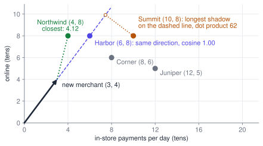

*Figure 11.1 — Three rulers, three winners. Harbor has the same direction as the new merchant, Northwind is nearest, and Summit has the largest dot product.*

Use cosine when size is a nuisance, as with a long and a short ticket about the same problem. Use distance or the dot product when size is part of the meaning.

#### The formal definition

For nonzero vectors $\mathbf{u}$ and $\mathbf{v}$:

$$
\cos(\mathbf{u}, \mathbf{v}) = \frac{\mathbf{u} \cdot \mathbf{v}}{\lVert\mathbf{u}\rVert\,\lVert\mathbf{v}\rVert}
$$

The Cauchy-Schwarz inequality, $\lvert\mathbf{u} \cdot \mathbf{v}\rvert \le \lVert\mathbf{u}\rVert\,\lVert\mathbf{v}\rVert$, keeps the value between $-1$ and $1$. It is 1 for the same direction, 0 for perpendicular vectors and $-1$ for opposite ones. The Euclidean distance is $\lVert\mathbf{u} - \mathbf{v}\rVert$.

One expansion ties the three rulers together:

$$
\lVert\mathbf{u} - \mathbf{v}\rVert^2 = \lVert\mathbf{u}\rVert^2 + \lVert\mathbf{v}\rVert^2 - 2\,\mathbf{u} \cdot \mathbf{v}
$$

To **normalize** a vector is to divide it by its length, which gives a **unit vector**. For two unit vectors the expansion becomes

$$
\lVert\mathbf{u} - \mathbf{v}\rVert^2 = 2 - 2\cos(\mathbf{u}, \mathbf{v})
$$

So after normalizing, the largest cosine, the largest dot product and the smallest distance all pick the same neighbor. Search systems use this: they normalize once and then compute plain dot products.

One caution. "Cosine distance", $1 - \cos$, is not a true distance, because it can break the triangle inequality. The angle itself is one.

### Worked example

A new merchant applies with 30 in-store and 40 online payments a day, $\mathbf{q} = (3, 4)$, so $\lVert\mathbf{q}\rVert = 5$. Which existing merchant is it most like? Take three of the five by hand.

- Harbor $(6, 8)$: dot product $18+32 = 50$, length 10, cosine $50/(5\cdot 10) = 1$, distance $\sqrt{9+16} = 5$.
- Northwind $(4, 8)$: dot product $12+32 = 44$, length $\sqrt{80} = 8.94$, cosine $44/44.72 = 0.984$, distance $\sqrt{1+16} = 4.12$.
- Summit $(10, 8)$: dot product $30+32 = 62$, length $\sqrt{164} = 12.81$, cosine $62/64.03 = 0.968$, distance $\sqrt{49+16} = 8.06$.

Each ruler names a different winner. Summit has the largest dot product because it is the biggest. Harbor has the largest cosine because it has the same 3-to-4 mix at twice the size. Northwind has the smallest distance because its raw counts are closest. The last output line confirms that normalizing ends the disagreement.

```python
merchants = ["Juniper", "Corner", "Northwind", "Harbor", "Summit"]
X = np.array([[12, 5], [8, 6], [4, 8], [6, 8], [10, 8]], dtype=float)
q = np.array([3.0, 4.0])              # a new merchant: 30 in-store, 40 online

def cosine(u, v):
    return (u @ v) / (np.linalg.norm(u) * np.linalg.norm(v))

dot = X @ q
cos = np.array([cosine(x, q) for x in X])
dist = np.linalg.norm(X - q, axis=1)

print("merchant     dot  cosine  distance")
for name, a, b, c in zip(merchants, dot, cos, dist):
    print(f"{name:10s} {a:5.0f}  {b:6.4f}  {c:8.3f}")
print("largest dot product: ", merchants[np.argmax(dot)])
print("largest cosine:      ", merchants[np.argmax(cos)])
print("smallest distance:   ", merchants[np.argmin(dist)])

Xn = X / np.linalg.norm(X, axis=1, keepdims=True)    # scale every row to length 1
qn = q / np.linalg.norm(q)
dist_n = np.linalg.norm(Xn - qn, axis=1)
print("after normalizing:", merchants[np.argmax(Xn @ qn)], merchants[np.argmin(dist_n)])
```

Output:

```text
merchant     dot  cosine  distance
Juniper       56  0.8615     9.055
Corner        48  0.9600     5.385
Northwind     44  0.9839     4.123
Harbor        50  1.0000     5.000
Summit        62  0.9683     8.062
largest dot product:  Summit
largest cosine:       Harbor
smallest distance:    Northwind
after normalizing: Harbor Harbor
```

### Common mistakes

| Mistake | Why it bites | Do this instead |
|---|---|---|
| Using cosine when size is the signal | A merchant with 3 payments a day looks identical to one with 3,000 | Keep size as a separate feature, or use distance |
| Mixing normalized and unnormalized vectors in one index | The dot product then favors the long ones | Normalize when writing and when querying |
| Comparing cosine scores across embedding models | Each model has its own range of scores | Set thresholds per model (Chapter 10) |

### Where a PM meets it

- The similarity measure is a product decision. Write down whether "similar" should include size, then pick.
- Use the measure the embedding model was trained with. Its documentation says which.
- Ask for the scores of known-similar pairs and known-different pairs. The gap between the two groups is what any threshold stands on.

### Check yourself

**Q11.1** Merchant A is $(2, 1)$ and merchant B is $(200, 100)$. What is their cosine similarity? Should a risk team treat them as the same?

**Q11.2** Use $\mathbf{a} = (1, 0)$, $\mathbf{b} = (1, 1)$ and $\mathbf{c} = (0, 1)$ to show that $1 - \cos$ breaks the triangle inequality.

**Q11.3** Two unit vectors have cosine similarity 0.92. What is the Euclidean distance between them?

> [!IMPORTANT]
> **In one line:** Cosine similarity compares direction and ignores size, and once vectors are normalized it ranks neighbors exactly as the dot product and Euclidean distance do.

## 12. Embeddings and vector search in production

### Why it matters

PayFlow's support assistant has to find the past tickets most like a new one, among 10 million, within milliseconds. That is vector search, the retrieval step behind semantic search, recommendations and retrieval-augmented generation. A PM signs off its three dials: quality, speed and memory.

### The idea

An **embedding model** turns an item, such as a ticket, into a vector so that similar items land close together. A **vector index** stores those vectors and answers one question: which $k$ stored vectors are nearest to this query? That is **nearest-neighbor search**.

Exact search compares the query with every stored vector: always right, but the cost grows with the index. **Approximate nearest-neighbor (ANN)** search looks at a small part of the data instead, and pays for the speed by missing some true neighbors. Products combine three methods:

- Clustering. Group the vectors into cells and search only the cells nearest the query (the inverted file, or IVF).
- Graphs. Link each vector to its near neighbors and walk the links toward the query. HNSW (Malkov and Yashunin, 2016) is the best-known design.
- Compression. **Quantization** stores each number in fewer bits. Product quantization (Jégou, Douze and Schmid, 2011) replaces chunks of a vector with short codes.

One rule has no exceptions: never mix embedding models in one index. Each model lays out its own coordinate system, so a distance between vectors from two models means nothing. A model change means embedding every item again and rebuilding the index.

#### The formal definition

**Recall@k** is the share of the true $k$ nearest neighbors that a search returns:

$$
\text{recall@}k = \frac{\lvert\text{returned}\cap\text{true top }k\rvert}{k}
$$

The raw vectors need $N\times d\times b$ bytes of memory, where $N$ is the number of vectors, $d$ the dimension and $b$ the bytes per number: 4 for 32-bit floats, 1 for 8-bit integers, $1/8$ for single bits. Index structures add more: the Faiss library's guidelines, for example, count $8M$ extra bytes per vector for an HNSW graph with setting $M$.

### Worked example

Size an index for 10 million tickets at 768 dimensions.

- 32-bit floats: $10^7\times 768\times 4$ bytes, which is 30.72 GB.
- 8-bit integers: 7.68 GB. Single bits: 0.96 GB.
- An HNSW graph with $M = 32$ adds $10^7\times 256$ bytes, or 2.56 GB.

The script checks these numbers, runs exact search on the five normalized merchant vectors of Chapter 11 (the cosines there put Harbor first, then Northwind), and builds an IVF index of 100 cells over 20,000 synthetic 64-dimensional vectors. The listing shows its three search functions.

```python
def exact_search(vectors, query, k):
    """Compare the query with every stored vector: always right, cost grows with N."""
    scores = vectors @ query
    return np.argsort(-scores)[:k]

def approximate_search(vectors, centers, cells, query, k, n_probe):
    """Look only inside the n_probe cells whose centers are closest to the query."""
    nearest_cells = np.argsort(-(centers @ query))[:n_probe]
    candidates = np.concatenate([cells[c] for c in nearest_cells])
    scores = vectors[candidates] @ query
    return candidates[np.argsort(-scores)[:k]], len(candidates)

def recall_at_k(found, truth):
    """Share of the true top k that the approximate search also returned."""
    return len(set(found) & set(truth)) / len(truth)
```

Output:

```text
10M x 768 in GB as float32, int8, 1 bit: [30.72, 7.68, 0.96]
two nearest merchants to (3, 4): ['Harbor', 'Northwind']
cells probed  share scanned  recall@10
           1           1.3%      0.590
           2           2.2%      0.848
           5           5.1%      0.977
          10          10.1%      0.988
          20          20.0%      0.995
         100         100.0%      1.000
recall, query and index from model B: 1.000
recall, query from B, index from A:   0.000
```

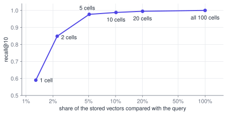

*Figure 12.1 — The trade an approximate index makes. Scanning 5% of the vectors finds 98% of the true neighbors.*

The last two lines test the no-mixing rule. Model B is model A with every vector rotated the same way, so it is exactly as good. B's queries on B's index are perfect. On A's index they find nothing, and no error is raised.

### Common mistakes

| Mistake | Why it bites | Do this instead |
|---|---|---|
| Mixing embedding models or versions in one index | Recall collapses silently | Store the model name and version with every vector |
| Reporting latency without recall | An index can be fast because it is missing answers | Report recall@k against exact search on sample queries |
| Filtering after the search | "Top 10, then keep this merchant's tickets" can leave nothing | Filter inside the index, or fetch extra |

### Where a PM meets it

- Choose the operating point: a recall target, a latency limit and a memory budget. You cannot maximize all three, so ask for recall against latency at each memory option.
- Budget for model changes: an upgrade means embedding every item again, rebuilding the index and resetting thresholds.
- Tickets contain personal data, so ask how retrieval enforces who may see what, and how often changed items are embedded again.

### Check yourself

**Q12.1** How much memory do 2 million merchant embeddings of 1,024 dimensions need as 32-bit floats? How much if you keep 256 dimensions as 8-bit integers?

**Q12.2** An index answers in 5 ms with recall@10 of 0.80. What does 0.80 mean, and how is it measured?

**Q12.3** The team wants to embed new tickets with a newer model and keep the 10 million old vectors. What happens?

> [!IMPORTANT]
> **In one line:** A vector index trades a little recall for large savings in time and memory, its size is vectors times dimensions times bytes, and all its vectors must come from one embedding model.

# Part II — Probability and statistics

## 13. Probability spaces

### Why it matters

Every rate on a PayFlow dashboard is a probability: the fraud rate, the decline rate, the share of payouts that arrive late. As soon as you combine two of them ("fraud or large", "at least one of five attempts fails") you need rules, because the shortcuts of adding or multiplying are often wrong. A probability space is the bookkeeping that makes those combinations safe.

### The idea

Take one day's table of 1,000 PayFlow payments, each with an amount and a fraud label, and pick one row at random. Three things describe that experiment:

- the **sample space**: every outcome that could happen, here the 1,000 rows;
- an **event**: a set of outcomes you care about, such as "the payment is fraud" (20 rows) or "the payment is over USD 500" (100 rows);
- a **probability measure**: a rule that gives each event a number between 0 and 1. When rows are equally likely it is a count divided by 1,000.

Events are sets, so they combine like sets. "Fraud and large" is the overlap (8 rows), "fraud or large" is the union, and "not fraud" is the **complement**.

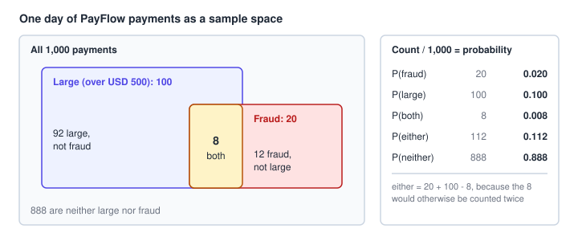

*Figure 13.1 — Events are regions of the sample space. Adding the two regions counts the overlap twice, so it is subtracted once.*

#### The formal definition

A probability space is a triple $(\Omega, \mathcal{F}, P)$: a sample space $\Omega$, a collection $\mathcal{F}$ of events (subsets of $\Omega$) and a function $P$ on events that obeys three axioms, stated by Andrey Kolmogorov in 1933:

$$
P(A) \ge 0, \qquad P(\Omega) = 1, \qquad P(A \cup B) = P(A) + P(B) \ \text{ if } A \cap B = \varnothing
$$

Here $A \cap B$ means both happen and $A \cup B$ means at least one happens; the third axiom extends to any countable list of non-overlapping events. The working rules follow:

| Rule | Formula |
|---|---|
| Complement | $P(A^c) = 1 - P(A)$ |
| Inclusion-exclusion | $P(A \cup B) = P(A) + P(B) - P(A \cap B)$ |
| **Union bound** | $P(A \cup B) \le P(A) + P(B)$ |

The union bound is what you quote when nobody has measured the overlap: the true figure cannot be higher.

### Worked example

By hand, with $F$ for fraud and $L$ for large:

- $P(F) = 20/1000 = 0.020$, $P(L) = 100/1000 = 0.100$, $P(F \cap L) = 8/1000 = 0.008$.
- Fraud or large: $0.020 + 0.100 - 0.008 = 0.112$. Count to check: 12 fraud only, 92 large only, 8 both, 112 rows.
- Neither: $1 - 0.112 = 0.888$.

A second question uses the complement. A payout is attempted five times, and each attempt fails 0.8% of the time without influencing the others (independence, defined in Chapter 14). "At least one fails" is the complement of "all five succeed": $1 - 0.992^5 = 0.0394$.

```python
rng = np.random.default_rng(13)

# 1,000 payments: 20 are fraud, 100 are over USD 500, 8 are both
n = 1000
fraud = np.zeros(n, dtype=bool)
large = np.zeros(n, dtype=bool)
fraud[:20] = True
large[12:112] = True          # rows 12-19 are both
order = rng.permutation(n)    # shuffle the rows
fraud, large = fraud[order], large[order]

def prob(event):
    """Share of the equally likely outcomes that fall inside the event."""
    return event.mean()

print(f"P(fraud)           = {prob(fraud):.3f}")
print(f"P(large)           = {prob(large):.3f}")
print(f"P(fraud and large) = {prob(fraud & large):.3f}")
print(f"P(fraud or large)  = {prob(fraud | large):.3f}")
print(f"P(neither)         = {prob(~(fraud | large)):.3f}")
print(f"union bound        = {prob(fraud) + prob(large):.3f}")

# Five independent payout attempts, each failing 0.8% of the time
exact = 1 - 0.992**5
simulated = (rng.random((200_000, 5)) < 0.008).any(axis=1).mean()
print(f"P(at least one of 5 fails) = {exact:.4f} exact, {simulated:.4f} simulated")
```

Output:

```text
P(fraud)           = 0.020
P(large)           = 0.100
P(fraud and large) = 0.008
P(fraud or large)  = 0.112
P(neither)         = 0.888
union bound        = 0.120
P(at least one of 5 fails) = 0.0394 exact, 0.0399 simulated
```

The simulated 0.0399 differs from 0.0394 only by sampling noise.

### Common mistakes

| Mistake | Why it bites | Do this instead |
|---|---|---|
| Adding probabilities of events that overlap | Double-counts the overlap: 0.120 instead of 0.112 here | Subtract the overlap, or call the sum an upper bound |
| Multiplying probabilities without checking independence | Failures cluster during incidents, so the product understates the joint rate | Measure the joint rate from data |
| Reading "probability 0" as "impossible" | A continuous quantity takes each exact value with probability 0, yet some value occurs | Ask about ranges (Chapter 16) |

### Where a PM meets it

- In an incident review, split failures into causes that cannot overlap (timeout, bank decline, client error) so the rates add up.
- Ask for the overlap, not only the separate rates. "2% fraud, 10% large" does not say how many reviews a "fraud or large" rule creates.
- Watch "at least once" metrics. A 0.8% failure per attempt is 3.9% per five-attempt payout, and the merchant experiences the payout.

### Check yourself

**Q13.1** In the 1,000-payment table, what is the probability that a payment is fraud but not large? That it is exactly one of the two?

**Q13.2** If a payout needed ten attempts instead of five, what is the probability that at least one fails?

> [!IMPORTANT]
> **In one line:** A probability is a share of a sample space; combine events as sets, subtract overlaps, and use the complement for "at least one".

## 14. Joint, marginal and conditional probability

### Why it matters

"Our dispute rate is 0.5%" hides the question that drives the decision: 0.5% among whom? Risk pricing, funnel analysis and every model score are rates inside a subgroup. Mix up which group is the condition and you can be wrong by a factor of a hundred.

### The idea

Cross two questions about the same payment and you get a table. Here are PayFlow's 10,000 payments from one week, split by whether the merchant was onboarded in the last 30 days ("new") and whether the payment was later disputed:

| | Disputed | Not disputed | Total |
|---|---|---|---|
| New merchant | 20 | 980 | 1,000 |
| Established merchant | 30 | 8,970 | 9,000 |
| Total | 50 | 9,950 | 10,000 |

Three kinds of probability live in it:

- **Joint probability**: both things at once. A cell over the grand total: new and disputed is 20 in 10,000.
- **Marginal probability**: one thing, ignoring the other. A total in the margin over the grand total: disputed is 50 in 10,000.
- **Conditional probability**: one thing among the rows where the other is known. A cell over its row or column total: disputed given new is 20 in 1,000.

Conditioning means: zoom in on one row or column, then treat it as the whole world.

#### The formal definition

For events $A$ and $B$ with $P(B) > 0$:

$$
P(A \mid B) = \frac{P(A \cap B)}{P(B)}
$$

Rearranged, this is the product rule $P(A \cap B) = P(A \mid B)\,P(B)$. If $B_1, \dots, B_k$ cut the sample space into non-overlapping pieces, the **law of total probability** rebuilds a marginal from conditionals:

$$
P(A) = \sum_{i=1}^{k} P(A \mid B_i)\,P(B_i)
$$

$A$ and $B$ are **independent** when knowing one tells you nothing about the other: $P(A \mid B) = P(A)$, or equivalently $P(A \cap B) = P(A)\,P(B)$.

### Worked example

From the table, $P(\text{new}) = 0.10$, $P(\text{disputed}) = 0.005$ and $P(\text{both}) = 0.002$.

- $P(\text{disputed} \mid \text{new}) = 0.002 / 0.10 = 0.02$. For established merchants it is $30/9000 = 0.0033$, so payments to new merchants are disputed six times as often.
- The other direction: $P(\text{new} \mid \text{disputed}) = 0.002 / 0.005 = 0.40$. Same cell, different denominator, different answer.
- Independence would require $P(\text{both}) = 0.10 \times 0.005 = 0.0005$. The data say 0.002, so merchant age carries information about disputes.

Total probability answers a routing question. PayFlow sends 60% of payments to acquiring bank A (4% declined), 30% to B (6%) and 10% to C (12%). Overall decline rate: $0.60(0.04) + 0.30(0.06) + 0.10(0.12) = 0.054$. Move five points of traffic from C to A and it becomes $0.026 + 0.018 + 0.006 = 0.050$.

```python
# 10,000 payments: merchant age by dispute outcome
#                   disputed  not disputed
counts = np.array([[20, 980],      # new merchants
                   [30, 8970]])    # established merchants
joint = counts / counts.sum()

p_new = joint[0].sum()             # marginal: add across the row
p_disputed = joint[:, 0].sum()     # marginal: add down the column
p_both = joint[0, 0]
print(f"P(new) = {p_new:.3f}   P(disputed) = {p_disputed:.4f}   P(both) = {p_both:.4f}")
print(f"P(disputed | new)         = {p_both / p_new:.4f}")
print(f"P(disputed | established) = {joint[1, 0] / joint[1].sum():.4f}")
print(f"P(new | disputed)         = {p_both / p_disputed:.2f}")
print(f"if independent, P(both) would be {p_new * p_disputed:.4f}")

# Total probability: decline rate across three banks
share = np.array([0.60, 0.30, 0.10])       # P(bank)
decline = np.array([0.04, 0.06, 0.12])     # P(declined | bank)
print(f"overall decline rate              = {share @ decline:.4f}")
rerouted = np.array([0.65, 0.30, 0.05])
print(f"after moving 5 points from C to A = {rerouted @ decline:.4f}")
```

Output:

```text
P(new) = 0.100   P(disputed) = 0.0050   P(both) = 0.0020
P(disputed | new)         = 0.0200
P(disputed | established) = 0.0033
P(new | disputed)         = 0.40
if independent, P(both) would be 0.0005
overall decline rate              = 0.0540
after moving 5 points from C to A = 0.0500
```

### Common mistakes

| Mistake | Why it bites | Do this instead |
|---|---|---|
| Swapping the condition | "Disputed given new" is 2%; "new given disputed" is 40% | Say the denominator aloud: "of the ..., what share ..." |
| Assuming independence | Here the joint rate is four times the product | Compare the joint with the product of the marginals |
| Trusting one blended rate (Simpson's paradox) | A bank can win every segment and lose overall on a harder mix | Compare within segments, then look at the mix |
| Conditioning on the future | "Disputed" is known weeks later; using it as a model input leaks the answer | Condition only on what is known at decision time |

### Where a PM meets it

- Reserves and pricing follow the segment's conditional dispute rate, not the platform's marginal rate.
- For every percentage on a dashboard, ask what the denominator is.
- Narrower conditions mean fewer rows. A segment of 40 payments cannot support a rate (Chapter 22).

### Check yourself

**Q14.1** From the table, what is the probability that a disputed payment went to an established merchant? That a payment to a new merchant was not disputed?

**Q14.2** Bank A approves 950 of 1,000 domestic and 140 of 200 international payments. Bank B approves 194 of 200 domestic and 750 of 1,000 international. Which bank is better in each segment, and which has the higher overall approval rate? Why?

> [!IMPORTANT]
> **In one line:** A conditional probability is a joint probability divided by the probability of the condition, so always know which group is in the denominator.

## 15. Bayes' theorem

### Why it matters

A fraud model that "catches 90% of fraud with a 2% false-positive rate" sounds ready to block payments automatically. On PayFlow's traffic, more than nine of every ten payments it flags are legitimate. Bayes' theorem tells you this before launch, and it sits behind every score that updates as evidence arrives.

### The idea

Testing tells you how the model behaves given the truth: how often it flags fraud, how often it flags a legitimate payment. The decision needs the reverse: given a flag, how likely is fraud? Reversing a condition needs one more ingredient, the **base rate**: how common fraud is before any evidence, also called the **prior**.

Count it out for 100,000 payments. Fraud is rare, so a small false-positive rate on 99,800 legitimate payments produces far more flags than a high true-positive rate on 200 frauds.

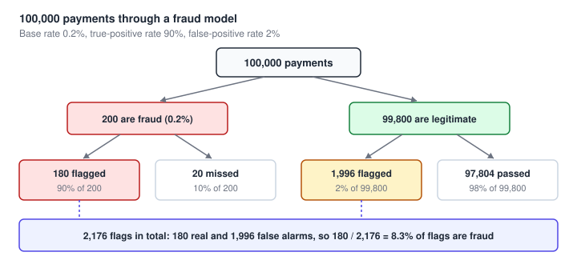

*Figure 15.1 — The base-rate trap in counts. Most flags come from the large legitimate group.*

#### The formal definition

For a hypothesis $H$ (the payment is fraud) and evidence $E$ (the model flagged it):

$$
P(H \mid E) = \frac{P(E \mid H)\,P(H)}{P(E)}, \qquad P(E) = P(E \mid H)\,P(H) + P(E \mid H^c)\,P(H^c)
$$

$P(H)$ is the prior, $P(E \mid H)$ the **likelihood**, $P(H \mid E)$ the **posterior**, and $H^c$ means "not $H$". The theorem is Chapter 14's product rule written in both orders and divided by $P(E)$. It is named for Thomas Bayes, whose essay appeared in 1763, after his death.

Dividing the formula for $H$ by the one for $H^c$ gives the odds form:

$$
\frac{P(H \mid E)}{P(H^c \mid E)} = \frac{P(E \mid H)}{P(E \mid H^c)} \times \frac{P(H)}{P(H^c)}
$$

Posterior odds equal the **likelihood ratio** times the prior odds. The likelihood ratio measures how strong the evidence is, whatever the base rate.

For a classifier, $P(\text{fraud} \mid \text{flag})$ is the **precision** and $P(\text{flag} \mid \text{fraud})$ is the **recall**, or true-positive rate.

### Worked example

Base rate 0.002, true-positive rate 0.90, false-positive rate 0.02.

- $P(\text{flag}) = 0.90(0.002) + 0.02(0.998) = 0.0018 + 0.01996 = 0.02176$.
- $P(\text{fraud} \mid \text{flag}) = 0.0018 / 0.02176 = 0.0827$. About 8% of flags are fraud.
- Odds form: prior odds $0.002/0.998 = 0.002004$; likelihood ratio $0.90/0.02 = 45$; posterior odds $0.0902$; probability $0.0902/1.0902 = 0.0827$.
- A second signal, "device never seen before", with likelihood ratio 6 lifts the odds to $0.541$, a probability of 35%.

```python
base_rate = 0.002     # P(fraud): 2 payments in 1,000
tpr = 0.90            # P(flag | fraud), the true-positive rate
fpr = 0.02            # P(flag | legitimate), the false-positive rate

n = 100_000
fraud, legit = n * base_rate, n * (1 - base_rate)
true_flags, false_flags = tpr * fraud, fpr * legit
print(f"fraud {fraud:,.0f} -> flagged {true_flags:,.0f}")
print(f"legit {legit:,.0f} -> flagged {false_flags:,.0f}")
print(f"P(fraud | flag) by counting = {true_flags / (true_flags + false_flags):.4f}")

def posterior(prior, p_e_given_h, p_e_given_not_h):
    evidence = p_e_given_h * prior + p_e_given_not_h * (1 - prior)
    return p_e_given_h * prior / evidence

print(f"P(fraud | flag) by Bayes    = {posterior(base_rate, tpr, fpr):.4f}")

# Odds form
odds = base_rate / (1 - base_rate) * (tpr / fpr)
print(f"likelihood ratio {tpr / fpr:.0f}, posterior odds {odds:.4f}")
odds2 = odds * 6      # second signal, likelihood ratio 6
print(f"after the second signal     = {odds2 / (1 + odds2):.4f}")
for b in (0.0005, 0.002, 0.01, 0.05):
    print(f"base rate {b:.2%} -> precision {posterior(b, tpr, fpr):.3f}")
```

Output:

```text
fraud 200 -> flagged 180
legit 99,800 -> flagged 1,996
P(fraud | flag) by counting = 0.0827
P(fraud | flag) by Bayes    = 0.0827
likelihood ratio 45, posterior odds 0.0902
after the second signal     = 0.3511
base rate 0.05% -> precision 0.022
base rate 0.20% -> precision 0.083
base rate 1.00% -> precision 0.312
base rate 5.00% -> precision 0.703
```

The last four lines run the same model at other base rates: precision belongs to the model and the traffic together.

### Common mistakes

| Mistake | Why it bites | Do this instead |
|---|---|---|
| Reading $P(\text{flag} \mid \text{fraud})$ as $P(\text{fraud} \mid \text{flag})$ | 90% versus 8% | Compute the posterior with the real base rate |
| Quoting accuracy for a rare event | A model that flags nothing is 99.8% accurate | Ask for precision and recall at the chosen threshold |
| Multiplying likelihood ratios of related signals | "New device" and "new IP address" largely repeat each other | Multiply only signals that are independent given the truth, or let a model combine them |
| Evaluating on a fraud-enriched sample | At a 5% base rate precision is 70%; in production it is 8% | Re-weight to the production base rate |

### Where a PM meets it

- Before approving an automatic block, ask: at this threshold and our base rate, what share of flags are real?
- $P(\text{flag})$ sizes the review queue: 2,176 per 100,000 payments here.
- Match the action to the posterior: a step-up check at 8%, manual review at 35%, a block only when it is high.

### Check yourself

**Q15.1** The team cuts the false-positive rate from 2% to 0.5% and keeps the true-positive rate at 90%. What share of flags are fraud now?

**Q15.2** Of the 2,176 flags in Figure 15.1, what share hit legitimate customers, and what does that say about blocking on a flag alone?

> [!IMPORTANT]
> **In one line:** To turn "how the model behaves on fraud" into "how likely a flag is fraud" you must bring in the base rate, and for rare events most alarms are false.

## 16. Random variables

### Why it matters

An average is the first thing a dashboard shows and the first thing that misleads. "Average payment USD 80" describes almost no actual payment. Treating a metric as a random variable, a quantity with a whole distribution, lets you ask the questions that matter: how often is it above this limit, and what does the worst 5% look like?

### The idea

A **random variable** attaches a number to each outcome. Pick a PayFlow merchant at random: "disputes received this month" is one random variable, "amount of the next payment" another.

- **Discrete random variable**: countable values such as 0, 1, 2 disputes. Described by a **probability mass function (PMF)**, one probability per value.
- **Continuous random variable**: any value in a range, such as an amount or a latency. Described by a **probability density function (PDF)**, probability per unit, so that probabilities are areas under the curve.

Both have a **cumulative distribution function (CDF)**: the probability of landing at or below $x$. A **quantile** reads the CDF backward: the median (p50) is the $x$ where the CDF reaches 0.5, and p95 is where it reaches 0.95.

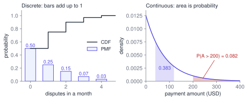

*Figure 16.1 — A PMF is a set of bars that sum to 1. A PDF is a curve whose total area is 1; a shaded area is a probability.*

#### The formal definition

A random variable $X$ is a function from the sample space to the real numbers. Its distribution is given by

$$
\begin{aligned}
\text{PMF:}\quad & p(x) = P(X = x), & \sum_x p(x) &= 1 \\
\text{PDF:}\quad & P(a \le X \le b) = \int_a^b f(x)\,dx, & \int_{-\infty}^{\infty} f(x)\,dx &= 1 \\
\text{CDF:}\quad & F(x) = P(X \le x)
\end{aligned}
$$

For a continuous variable $f(x) = F'(x)$: the density is the slope of the CDF.

### Worked example

Discrete. Let $X$ be the disputes one merchant receives in a month, with PMF 0.50, 0.25, 0.15, 0.07, 0.03 for 0 to 4. The CDF is the running sum: 0.50, 0.75, 0.90, 0.97, 1.00. So $P(X \ge 2) = 1 - F(1) = 0.25$.

Continuous. Model the payment amount $A$ as exponential with mean USD 80, a simple first model with CDF $F(a) = 1 - e^{-a/80}$.

- $P(A > 200) = e^{-2.5} = 0.0821$.
- $P(40 < A < 120) = e^{-0.5} - e^{-1.5} = 0.6065 - 0.2231 = 0.3834$.
- Median: solve $F(a) = 0.5$ to get $80 \ln 2 = 55.45$, well below the mean because the long right tail pulls the mean up.

```python
# Discrete: X = disputes one PayFlow merchant receives in a month
values = np.arange(5)
pmf = np.array([0.50, 0.25, 0.15, 0.07, 0.03])
cdf = np.cumsum(pmf)
print("x   :", values)
print("PMF :", pmf)
print("CDF :", cdf.round(2))
print(f"P(X >= 2) = {1 - cdf[1]:.2f}")

# Continuous: A = payment amount in USD, exponential with mean 80
mean = 80.0

def cdf_amount(a):
    return 1 - np.exp(-a / mean)

print(f"P(A > 200)      = {1 - cdf_amount(200):.4f}")
print(f"P(40 < A < 120) = {cdf_amount(120) - cdf_amount(40):.4f}")
print(f"median = {mean * np.log(2):.2f}   p95 = {-mean * np.log(0.05):.2f}")

rng = np.random.default_rng(16)
amounts = rng.exponential(mean, size=200_000)
print(f"simulated: P(A > 200) = {(amounts > 200).mean():.4f}, "
      f"median = {np.median(amounts):.2f}, p95 = {np.quantile(amounts, 0.95):.2f}")
```

Output:

```text
x   : [0 1 2 3 4]
PMF : [0.5  0.25 0.15 0.07 0.03]
CDF : [0.5  0.75 0.9  0.97 1.  ]
P(X >= 2) = 0.25
P(A > 200)      = 0.0821
P(40 < A < 120) = 0.3834
median = 55.45   p95 = 239.66
simulated: P(A > 200) = 0.0820, median = 55.91, p95 = 239.44
```

### Common mistakes

| Mistake | Why it bites | Do this instead |
|---|---|---|
| Reading a density as a probability | A density can exceed 1: measure these amounts in thousands of USD and it is 12.5 at zero | Integrate over a range |
| Reporting only the mean of a skewed metric | Mean 80, median 55: most payments are smaller than "average" | Report p50 and p95 next to the mean |
| Ignoring a spike in a mixed distribution | Refund amount is exactly 0 for most payments, then continuous | Report the share at zero and the rest separately |
| Dropping the unit of a density | A latency density per millisecond is 1,000 times smaller than per second | State the unit |

### Where a PM meets it

- Write service-level targets on quantiles, such as p95 payout delay, not on averages.
- Before setting a threshold on any metric, ask for its histogram or its p50, p90 and p99.
- A rule such as "review payments over USD 200" is a CDF question: under this model it selects 8.2% of payments.

### Check yourself

**Q16.1** With the dispute PMF above, what are $P(X \le 1)$ and $P(1 \le X \le 3)$?

**Q16.2** Under the exponential model, what share of payments are at or below the mean of USD 80?

> [!IMPORTANT]
> **In one line:** A random variable is a number with a distribution; the PMF or PDF says where the probability sits, and the CDF and its quantiles answer "how often below x".

## 17. Expectation, variance, covariance and correlation

### Why it matters

Four numbers carry most of what you need to say about a metric and its relationships: where it centers, how much it wobbles, whether two metrics move together, and how strongly. Each has a trap. The mean chases outliers, the variance is in squared units, and a correlation of zero does not mean "unrelated".

### The idea

- **Expectation** (the mean): the long-run average, the balance point of the distribution.
- **Variance**: the average squared distance from the mean. Its square root, the **standard deviation**, is in the metric's own units.
- **Covariance**: are two variables above their means at the same time (positive) or at opposite times (negative)?
- **Correlation**: covariance rescaled to lie between -1 and 1, with no units.

Correlation sees only straight-line association. In the third panel below, risk is high for unusually small payments (card testing) and unusually large ones. Risk depends almost completely on $x$, yet the correlation is near zero.

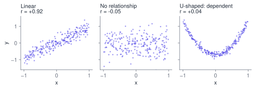

*Figure 17.1 — Correlation measures linear association. The U-shape is strong dependence with almost no correlation.*

#### The formal definition

With $\mu = \mathbb{E}[X]$ and $\sigma = \sqrt{\operatorname{Var}(X)}$:

$$
\begin{aligned}
\mathbb{E}[X] &= \sum_x x\,p(x) \ \text{ or } \int x f(x)\,dx \\
\operatorname{Var}(X) &= \mathbb{E}\big[(X - \mu)^2\big] = \mathbb{E}[X^2] - \mu^2 \\
\operatorname{Cov}(X, Y) &= \mathbb{E}\big[(X - \mu_X)(Y - \mu_Y)\big], \qquad \rho = \frac{\operatorname{Cov}(X, Y)}{\sigma_X\,\sigma_Y} \in [-1, 1]
\end{aligned}
$$

Two rules do most of the work:

- Linearity: $\mathbb{E}[aX + bY + c] = a\,\mathbb{E}[X] + b\,\mathbb{E}[Y] + c$, always, with no independence needed.
- $\operatorname{Var}(aX + c) = a^2 \operatorname{Var}(X)$ and $\operatorname{Var}(X + Y) = \operatorname{Var}(X) + \operatorname{Var}(Y) + 2\operatorname{Cov}(X, Y)$.

From data, replace expectations with averages. When the data are a sample, divide squared deviations by $n - 1$; this is the **sample variance**.

### Worked example

Five payments of USD 20, 40, 60, 80 and 300.

- Mean $500/5 = 100$; median 60.
- Deviations $-80, -60, -40, -20, 200$; squares 6,400, 3,600, 1,600, 400, 40,000; sum 52,000.
- Population variance $52{,}000/5 = 10{,}400$ (standard deviation 102.0); sample variance $52{,}000/4 = 13{,}000$ (114.0).
- PayFlow's fee is $0.029 \times \text{amount} + 0.30$, so by linearity the mean fee is $0.029(100) + 0.30 = 3.20$ without computing a single fee, and its standard deviation is $0.029 \times 102.0 = 2.96$.

Five merchants with weekly payments in thousands $x = (2, 4, 6, 8, 10)$ and disputes $y = (1, 3, 4, 4, 8)$. Means are 6 and 4. Products of deviations: $12 + 2 + 0 + 0 + 16 = 30$, so the sample covariance is $30/4 = 7.5$. Sample variances are 10 and 6.5, so $r = 7.5/\sqrt{65} = 0.930$.

```python
amounts = np.array([20.0, 40.0, 60.0, 80.0, 300.0])    # five payments, USD
mean = amounts.mean()
var_pop = ((amounts - mean) ** 2).mean()                # divide by n
var_sample = amounts.var(ddof=1)                        # divide by n - 1
print(f"mean {mean:.0f}, median {np.median(amounts):.0f}")
print(f"population variance {var_pop:.0f}, sd {np.sqrt(var_pop):.1f}")
print(f"sample variance {var_sample:.0f}, sd {np.sqrt(var_sample):.1f}")

fee = 0.029 * amounts + 0.30      # PayFlow's fee is a linear function of the amount
print(f"mean fee {fee.mean():.2f}, sd of fee {fee.std():.3f}")

# Weekly payments (thousands) and disputes for five merchants
x = np.array([2.0, 4.0, 6.0, 8.0, 10.0])
y = np.array([1.0, 3.0, 4.0, 4.0, 8.0])
cov = ((x - x.mean()) * (y - y.mean())).sum() / (len(x) - 1)
r = cov / (x.std(ddof=1) * y.std(ddof=1))
print(f"covariance {cov:.2f}, correlation {r:.3f}")

# Dependent but uncorrelated: risk is high for unusually small AND large payments
rng = np.random.default_rng(17)
u = rng.uniform(-1, 1, 5000)                 # how unusual the amount is
risk = u**2 + rng.normal(0, 0.05, 5000)
print(f"U-shape: corr(u, risk) = {np.corrcoef(u, risk)[0, 1]:+.3f}, "
      f"corr(u^2, risk) = {np.corrcoef(u**2, risk)[0, 1]:+.3f}")
```

Output:

```text
mean 100, median 60
population variance 10400, sd 102.0
sample variance 13000, sd 114.0
mean fee 3.20, sd of fee 2.957
covariance 7.50, correlation 0.930
U-shape: corr(u, risk) = +0.010, corr(u^2, risk) = +0.986
```

### Common mistakes

| Mistake | Why it bites | Do this instead |
|---|---|---|
| Reading correlation as causation | Bigger merchants have more disputes because they have more payments | Normalize (disputes per 1,000 payments), then test with an experiment |
| Reading zero correlation as independence | The U-shape has correlation 0.01, while $u^2$ tracks risk at 0.986 | Plot the data; try nonlinear terms |
| Letting one outlier set the mean | Without the USD 300 payment the mean is 50, not 100 | Report medians; use rank (Spearman) correlation |
| Quoting a variance to stakeholders | Its unit is USD squared | Quote the standard deviation |

### Where a PM meets it

- Forecasts use expectations; capacity and risk buffers use standard deviations. Ask for both.
- Linearity lets you move a mean through a linear fee. It fails for anything nonlinear, such as a tiered or capped fee: the average of the fees is not the fee of the average.
- Two input metrics correlated at 0.9 are one lever, not two.

### Check yourself

**Q17.1** Remove the USD 300 payment. What are the mean and the median of the remaining four, and which summary changed more?

**Q17.2** If $x$ were recorded in payments instead of thousands of payments, what happens to the covariance and to the correlation?

> [!IMPORTANT]
> **In one line:** Mean and standard deviation summarize one metric; covariance and correlation summarize how two move together along a straight line, and nothing more.

## 18. The distributions you will meet

### Why it matters

Choosing the wrong distribution is how a team ends up with an alert that fires every night or a forecast that ignores its largest merchants. Five shapes cover most of what a payments PM sees. For each, know what generates it and when it does not fit.

### The idea

| Distribution | What generates it | PayFlow example | Mean | Variance |
|---|---|---|---|---|
| **Binomial distribution** | Successes in $n$ independent yes/no trials | Approvals among 400 payments | $np$ | $np(1-p)$ |
| **Poisson distribution** | Independent events arriving at a steady rate | Support tickets per 10 minutes | $\lambda$ | $\lambda$ |
| **Normal distribution** | Sums and averages of many small effects | Daily approval rate | $\mu$ | $\sigma^2$ |
| **Pareto distribution**, a **power law** | Growth in proportion to size | Payment size, merchant volume | $\alpha x_m / (\alpha - 1)$ if $\alpha > 1$ | infinite if $\alpha \le 2$ |
| **Multinomial distribution** | $n$ trials, each landing in one of $k$ categories | Payment method mix | $np_i$ | $np_i(1-p_i)$ |

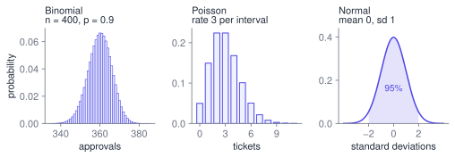

*Figure 18.1 — Two count distributions and the normal curve.*

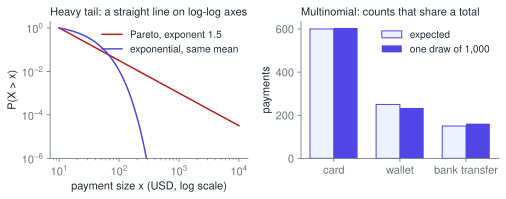

*Figure 18.2 — A power law keeps probability far out in the tail; multinomial counts share one total.*

#### The formal definition

$$
\begin{aligned}
\text{Binomial:}\quad & P(X = k) = \binom{n}{k} p^k (1-p)^{n-k} \\
\text{Poisson:}\quad & P(X = k) = \frac{\lambda^k e^{-\lambda}}{k!} \\
\text{Normal:}\quad & f(x) = \frac{1}{\sigma\sqrt{2\pi}} \exp\!\Big(-\frac{(x-\mu)^2}{2\sigma^2}\Big) \\
\text{Pareto:}\quad & P(X > x) = \Big(\frac{x_m}{x}\Big)^{\alpha} \ \text{ for } x \ge x_m \\
\text{Multinomial:}\quad & P(x_1, \dots, x_k) = \frac{n!}{x_1! \cdots x_k!}\, p_1^{x_1} \cdots p_k^{x_k}
\end{aligned}
$$

The Poisson is the binomial's limit for many trials with small probability, $np = \lambda$. A normal variable falls within 1, 2 and 3 standard deviations of its mean 68%, 95% and 99.7% of the time. A **heavy tail** means the chance of extreme values shrinks like a power of $x$, not exponentially.

### Worked example

- Binomial, $n = 400$, $p = 0.9$: mean 360, standard deviation $\sqrt{400 \times 0.9 \times 0.1} = 6$. A day with 345 approvals is 2.5 standard deviations low.
- Poisson, $\lambda = 3$: $P(0) = e^{-3} = 0.0498$. An alert at "8 or more tickets" fires in 1.19% of quiet intervals, about 1.7 times a day.
- Pareto, $x_m = 10$, $\alpha = 1.5$: mean $1.5 \times 10 / 0.5 = 30$ and $P(X > 1000) = 0.01^{1.5} = 0.001$.
- Multinomial, 1,000 payments at 60/25/15: expect 600, 250 and 150.

```python
rng = np.random.default_rng(18)

# Binomial: approvals among 400 payments, each approved with p = 0.9
n, p = 400, 0.9
mu, sd = n * p, np.sqrt(n * p * (1 - p))
print(f"binomial: mean {mu:.0f}, sd {sd:.1f}, P(X <= 345) = "
      f"{stats.binom.cdf(345, n, p):.4f} (normal approx "
      f"{stats.norm.cdf((345.5 - mu) / sd):.4f})")

# Poisson: support tickets, 3 per 10 minutes on average
lam = 3
print(f"poisson: P(0) = {stats.poisson.pmf(0, lam):.4f}, "
      f"P(X >= 8) = {stats.poisson.sf(7, lam):.4f}")

# Pareto: payment size with minimum USD 10 and tail exponent 1.5
xm, alpha = 10, 1.5
print(f"pareto: mean {alpha * xm / (alpha - 1):.0f}, "
      f"P(X > 1000) = {(xm / 1000) ** alpha:.4f}")
draws = xm * (1 - rng.random(100_000)) ** (-1 / alpha)     # inverse-CDF sampling
top = np.sort(draws)[-1000:].sum() / draws.sum()
print(f"  100,000 draws: mean {draws.mean():.1f}, largest {draws.max():,.0f}, "
      f"top 1% carry {top:.0%} of volume")

# Multinomial: 1,000 payments across card, wallet, bank transfer
probs = np.array([0.60, 0.25, 0.15])
one_draw = rng.multinomial(1000, probs)
print("multinomial: expected", 1000 * probs, "one draw", one_draw)
```

Output:

```text
binomial: mean 360, sd 6.0, P(X <= 345) = 0.0100 (normal approx 0.0078)
poisson: P(0) = 0.0498, P(X >= 8) = 0.0119
pareto: mean 30, P(X > 1000) = 0.0010
  100,000 draws: mean 29.2, largest 22,696, top 1% carry 19% of volume
multinomial: expected [600. 250. 150.] one draw [605 234 161]
```

The exact binomial tail is 0.0100, not the normal's 0.0078: with $p$ near 1 the count is skewed. The Pareto's variance is infinite, so rare giants such as the USD 22,696 payment drive its sample mean.

### Common mistakes

| Mistake | Why it bites | Do this instead |
|---|---|---|
| Mean and standard deviation on a heavy tail | With $\alpha \le 2$ the sample standard deviation never settles | Report quantiles and the top 1% share |
| Poisson limits on bursty counts | Variance above the mean makes alerts over-fire | Compare variance with mean; consider a negative binomial |
| Binomial when trials move together | One outage fails many payments at once | Count by independent unit (merchant, incident) |

### Where a PM meets it

- For any alert, ask how often it fires when nothing is wrong.
- "The average merchant" means little under a power law. Segment into head, middle and tail.
- Check a count against $\sqrt{np(1-p)}$ before reacting: with 360 expected and standard deviation 6, 355 is noise.

### Check yourself

**Q18.1** PayFlow processes 10,000 payments, each approved with probability 0.9. What are the mean and standard deviation of the number approved? Is 8,940 surprising?

**Q18.2** Tickets arrive at 3 per 10 minutes. What are the mean and standard deviation of the count in one hour?

> [!IMPORTANT]
> **In one line:** Yes/no counts are binomial, arrival counts Poisson, averages normal, sizes often power-law and category counts multinomial; check the generating story before trusting the formula.

## 19. The central limit theorem

### Why it matters

Every error bar on a dashboard and every A/B test in Chapter 22 assumes that an average of many observations behaves like a bell curve even when the observations do not. That assumption is the central limit theorem. Knowing when it holds, and how slowly it arrives for heavy-tailed payment amounts, tells you which error bars to trust.

### The idea

Take $n$ payments, average their amounts and write the average down. Repeat many times. The pile of averages:

- centers on the true mean;
- has a spread of $\sigma/\sqrt{n}$, where $\sigma$ is the standard deviation of one payment;
- looks more and more like a normal curve as $n$ grows, whatever the shape of the individual amounts.

The spread of the average is the **standard error**. Because of the square root, halving it takes four times the data. The theorem needs independent draws and a finite variance, and it does not say how large $n$ must be. That depends on the tail.

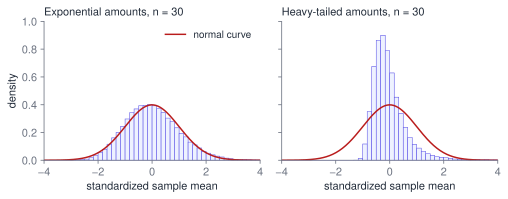

*Figure 19.1 — Averages of 30 light-tailed amounts are already close to normal. Averages of 30 heavy-tailed amounts are not.*

#### The formal definition

Let $X_1, \dots, X_n$ be independent draws from one distribution with mean $\mu$ and finite variance $\sigma^2$, and let $\bar{X}_n$ be their average. Then

$$
\frac{\bar{X}_n - \mu}{\sigma / \sqrt{n}} \ \xrightarrow{\ d\ }\ \mathcal{N}(0, 1) \quad \text{as } n \to \infty
$$

where the arrow means the distribution of the left side approaches the standard normal. In practice $\bar{X}_n$ is treated as $\mathcal{N}(\mu, \sigma^2/n)$, which gives the usual 95% **confidence interval**

$$
\bar{x} \pm 1.96\,\frac{s}{\sqrt{n}}
$$

with $s$ the sample standard deviation.

### Worked example

Approval is a 0/1 variable with $p = 0.9$, so $\sigma = \sqrt{0.9 \times 0.1} = 0.3$.

- With $n = 400$ the standard error is $0.3/20 = 0.015$ and the 95% interval is $0.90 \pm 0.029$.
- With $n = 1{,}600$ it is $0.0075$: four times the data, half the error.
- For amounts with $\sigma = 80$, the mean of 100 payments has standard error $80/10 = 8$.

The simulation tests the promise that matters: does the "95%" interval contain the true mean 95% of the time? It tries exponential amounts (skewed, light tail) and Pareto amounts with $\alpha = 2.2$ (finite variance, heavy tail).

```python
rng = np.random.default_rng(19)
reps = 10_000                       # simulated samples per setting

def expo(size):                     # payment amounts, mean 80, light tail
    return rng.exponential(80.0, size)

def pareto(size):                   # minimum 10, tail exponent 2.2: heavy tail
    return 10 * (1 - rng.random(size)) ** (-1 / 2.2)

def coverage(draw, true_mean, n):
    """Share of intervals mean +- 1.96 sd / sqrt(n) that contain the true mean."""
    x = draw((reps, n))
    m, s = x.mean(axis=1), x.std(axis=1, ddof=1)
    return np.mean(np.abs(m - true_mean) <= 1.96 * s / np.sqrt(n))

means = expo((reps, 100)).mean(axis=1)
print(f"exponential, n=100: sd of sample means {means.std():.2f}, "
      f"theory 80/sqrt(100) = {80 / np.sqrt(100):.2f}")

pareto_mean = 2.2 * 10 / (2.2 - 1)
print("coverage of the 95% interval")
print("    n   exponential   heavy tail")
for n in (10, 30, 200, 2000):
    print(f"{n:5d}   {coverage(expo, 80.0, n):11.3f}   "
          f"{coverage(pareto, pareto_mean, n):10.3f}")
```

Output:

```text
exponential, n=100: sd of sample means 7.99, theory 80/sqrt(100) = 8.00
coverage of the 95% interval
    n   exponential   heavy tail
   10         0.876        0.732
   30         0.915        0.801
  200         0.941        0.882
 2000         0.950        0.919
```

For exponential amounts the interval is honest by a few hundred observations. For the heavy tail it covers the truth only 80% of the time at $n = 30$ and is still short at 2,000. With $\alpha \le 2$ the variance is infinite and this theorem does not apply at all.

### Common mistakes

| Mistake | Why it bites | Do this instead |
|---|---|---|
| "Thirty observations are enough" | True for mild skew, false for heavy tails | Simulate or bootstrap on your own data; cap extreme values or analyze logs |
| Applying it to a median, maximum or p99 | The theorem covers sums and averages | Use bootstrap intervals for quantiles |
| Ignoring dependence | Payments from one merchant or one hour move together, so the effective $n$ is smaller | Average by independent unit first |
| Confusing standard deviation with standard error | One describes payments, the other your estimate of the mean | Label what each error bar shows |

### Where a PM meets it

- When a lift in revenue per user is reported, ask how the interval was computed and whether a few large payers drive it.
- Precision is expensive: half the error bar costs four times the traffic or four times the days.
- Rates and averages over thousands of independent users are safe ground. Sums dominated by a few giant merchants are not.

### Check yourself

**Q19.1** How many payments give a standard error of 0.005 on a 90% approval rate?

**Q19.2** Amounts have a standard deviation of USD 80. What is the standard error of the mean of 400 payments, and the half-width of its 95% interval?

> [!IMPORTANT]
> **In one line:** Averages of many independent observations are approximately normal with spread sigma over root n, but with heavy tails "many" can mean thousands.

## 20. Maximum likelihood estimation

### Why it matters

Every rate on a dashboard is an estimate, and almost every model you ship is trained by the principle that produces those rates: choose the parameter values under which the observed data would have been most probable. Seeing it on a one-parameter model makes the loss functions of later chapters, such as cross-entropy in Chapter 40, look familiar instead of arbitrary.

### The idea

Seventeen of 20 payments were approved. Which approval rate $p$ explains that best? Under $p = 0.5$, 17 of 20 would be a freak result. Under $p = 0.85$ it is what you expect. The **likelihood function** scores each candidate by the probability it gives to the data you saw, and the **maximum likelihood estimate (MLE)** is the candidate with the highest score.

The curve also shows how sure you can be. With ten times the data the peak sits in the same place and is much sharper.

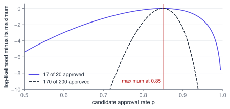

*Figure 20.1 — Same estimate, different certainty. The curvature at the peak sets the error bar.*

#### The formal definition

For independent observations $x_1, \dots, x_n$ from a model with parameter $\theta$:

$$
L(\theta) = \prod_{i=1}^{n} p(x_i \mid \theta), \qquad \ell(\theta) = \sum_{i=1}^{n} \log p(x_i \mid \theta), \qquad \hat{\theta} = \arg\max_{\theta}\, \ell(\theta)
$$

The logarithm turns the product into a sum without moving the maximum. To find it, set the derivative to zero.

Bernoulli rate, $k$ successes in $n$ trials:

$$
\ell(p) = k \log p + (n-k)\log(1-p), \qquad \ell'(p) = \frac{k}{p} - \frac{n-k}{1-p} = 0 \ \Rightarrow\ \hat{p} = \frac{k}{n}
$$

Poisson rate, counts $k_1, \dots, k_n$ with average $\bar{k}$:

$$
\ell(\lambda) = \sum_{i} \big(k_i \log\lambda - \lambda - \log k_i!\big), \qquad \ell'(\lambda) = \frac{\sum_i k_i}{\lambda} - n = 0 \ \Rightarrow\ \hat{\lambda} = \bar{k}
$$

Both estimates are sample averages. Their standard errors come from the curvature of $\ell$ at the peak: $\sqrt{\hat{p}(1-\hat{p})/n}$ and $\sqrt{\hat{\lambda}/n}$. For a normal model the same recipe gives the sample mean and a variance that divides by $n$, slightly too small, hence the $n - 1$ of Chapter 17. R. A. Fisher developed the method between 1912 and 1922.

### Worked example

- Bernoulli: $\hat{p} = 17/20 = 0.85$. The log-likelihood there is $17\ln 0.85 + 3\ln 0.15 = -8.454$, higher than $-9.049$ at 0.75 or $-9.859$ at 0.95. Standard error $\sqrt{0.85 \times 0.15/20} = 0.080$: twenty payments pin the rate down only to within about 16 points either way.
- Poisson: disputes per day of 2, 4, 3, 6, 5 give $\hat{\lambda} = 20/5 = 4$ with standard error $\sqrt{4/5} = 0.894$.

The code confirms both formulas by maximizing the log-likelihood numerically and checking that its slope is zero at the formula's answer.

```python
# Bernoulli: 17 of 20 payments approved
k, n = 17, 20

def loglik_bernoulli(p):
    return k * np.log(p) + (n - k) * np.log(1 - p)

p_hat = k / n                                    # the formula derived by hand
best = minimize_scalar(lambda p: -loglik_bernoulli(p), bounds=(0.01, 0.99),
                       method="bounded")
h = 1e-5
slope = (loglik_bernoulli(p_hat + h) - loglik_bernoulli(p_hat - h)) / (2 * h)
print(f"Bernoulli: formula {p_hat:.4f}, numerical maximizer {best.x:.4f}, "
      f"slope at the formula {abs(slope):.6f}")
print(f"  log-likelihood at 0.75, 0.85, 0.95: {loglik_bernoulli(0.75):.3f}, "
      f"{loglik_bernoulli(0.85):.3f}, {loglik_bernoulli(0.95):.3f}")
print(f"  standard error {np.sqrt(p_hat * (1 - p_hat) / n):.4f}")

# Poisson: disputes per day over five days
counts = np.array([2, 4, 3, 6, 5])

def loglik_poisson(lam):
    return np.sum(counts * np.log(lam) - lam - gammaln(counts + 1))

lam_hat = counts.mean()
best = minimize_scalar(lambda lam: -loglik_poisson(lam), bounds=(0.1, 20),
                       method="bounded")
print(f"Poisson: formula {lam_hat:.4f}, numerical maximizer {best.x:.4f}, "
      f"standard error {np.sqrt(lam_hat / len(counts)):.4f}")
```

Output:

```text
Bernoulli: formula 0.8500, numerical maximizer 0.8500, slope at the formula 0.000000
  log-likelihood at 0.75, 0.85, 0.95: -9.049, -8.454, -9.859
  standard error 0.0798
Poisson: formula 4.0000, numerical maximizer 4.0000, standard error 0.8944
```

### Common mistakes

| Mistake | Why it bites | Do this instead |
|---|---|---|
| Trusting an MLE from a tiny sample | One dispute in five payments gives 20% | Report the interval, or add a prior (Chapter 21) |
| Reading the likelihood curve as probabilities of $p$ | It need not have area 1 and ignores what you knew beforehand | Use it to rank candidates; probabilities of $p$ need Bayes |
| Forgetting the model family | The estimate is best only inside the chosen model; a Poisson fitted to bursty counts gives error bars that are too narrow | Check fit, for example variance against mean |
| Expecting one peak in a complex model | Neural-network likelihoods have many local maxima | Compare runs from several random seeds |

### Where a PM meets it

- A rate without its $n$ is not a number you can act on. Ask for $k$ and $n$, or for the interval.
- Training is maximum likelihood: minimizing cross-entropy loss maximizes the probability the model gives to the labels.
- A more flexible model always scores a higher likelihood on its training data, so judge models on held-out data.

### Check yourself

**Q20.1** With 170 approvals in 200 payments, what are the estimate and its standard error? How does the precision compare with 17 of 20?

**Q20.2** Give an approximate 95% interval for the daily dispute rate above. A target says "at most 3 disputes a day on average". Can you conclude it is being missed?

> [!IMPORTANT]
> **In one line:** Maximum likelihood picks the parameter that makes the observed data most probable; for a rate that is the sample average, and the sharpness of the peak gives the error bar.

## 21. Maximum a posteriori estimation

### Why it matters

A merchant onboarded yesterday has five payments and one dispute. The maximum likelihood estimate of its dispute rate is 20%, twenty times what is typical, and a rule acting on it would freeze an honest business. MAP estimation lets what you already know about merchants temper what five payments can tell you.

### The idea

Before seeing this merchant's data you already believe something: dispute rates across PayFlow cluster around 1%. Written as a distribution over the rate, that belief is the prior of Chapter 15. Bayes' theorem multiplies it by the likelihood to give the posterior, and the **maximum a posteriori (MAP) estimate** is the peak of the posterior.

With little data the prior dominates. With a lot, the likelihood swamps it and the MAP estimate approaches the MLE.

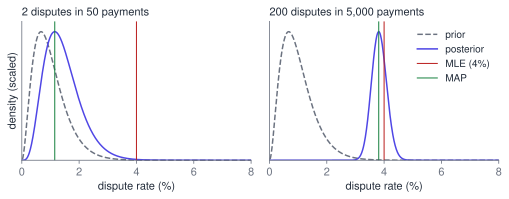

*Figure 21.1 — The same observed rate of 4% with 50 and with 5,000 payments. The prior fades as data arrive.*

#### The formal definition

$$
p(\theta \mid \text{data}) \propto p(\text{data} \mid \theta)\,p(\theta), \qquad \hat{\theta}_{\text{MAP}} = \arg\max_{\theta}\,\big[\log p(\text{data} \mid \theta) + \log p(\theta)\big]
$$

This is maximum likelihood plus one term, the log prior, which penalizes implausible values.

For a rate, the convenient prior is the Beta distribution, $p(\theta) \propto \theta^{a-1}(1-\theta)^{b-1}$. Read $a$ and $b$ as counts you pretend to have seen already: $a$ disputes and $b$ clean payments. After $k$ disputes in $n$ real payments the posterior is again a Beta, with parameters $a + k$ and $b + n - k$; a prior with this property is a **conjugate prior**. Then

$$
\hat{\theta}_{\text{MAP}} = \frac{k + a - 1}{n + a + b - 2}, \qquad \mathbb{E}[\theta \mid \text{data}] = \frac{k + a}{n + a + b}
$$

A flat prior, $a = b = 1$, returns the MLE $k/n$.

In model training the same idea is **regularization**. A normal prior centered on zero for the weights adds a penalty on their squared size (L2, ridge regression); a Laplace prior gives the L1 penalty (lasso). The script confirms the ridge case.

### Worked example

Prior: Beta with $a = 3$, $b = 297$, as if 3 disputes had been seen in 300 payments, mean 1%. New merchant: $k = 1$, $n = 5$.

- MLE: $1/5 = 0.20$.
- MAP: $(1 + 3 - 1)/(5 + 300 - 2) = 3/303 = 0.0099$.
- Posterior mean: $4/305 = 0.0131$.

Now suppose the merchant keeps running at 4%. The code shows the estimate moving from the prior toward the data.

```python
a, b = 3, 297        # Beta prior: as if 3 disputes seen in 300 payments

def estimates(k, n):
    mle = k / n
    map_ = (k + a - 1) / (n + a + b - 2)
    posterior_mean = (k + a) / (n + a + b)
    return mle, map_, posterior_mean

print("new merchant, 1 dispute in 5 payments")
print("  MLE %.4f   MAP %.4f   posterior mean %.4f" % estimates(1, 5))

# Check the formula: maximize the log posterior on a grid
grid = np.linspace(0.0001, 0.5, 500_000)
log_posterior = stats.binom.logpmf(1, 5, grid) + stats.beta.logpdf(grid, a, b)
print(f"  grid maximizer of the posterior {grid[log_posterior.argmax()]:.4f}")

print("the same 4% dispute rate with more data")
for n in (50, 500, 5000, 50_000):
    k = int(0.04 * n)
    mle, map_, _ = estimates(k, n)
    print(f"  n={n:6d}  k={k:5d}   MLE {mle:.4f}   MAP {map_:.4f}")
```

Output:

```text
new merchant, 1 dispute in 5 payments
  MLE 0.2000   MAP 0.0099   posterior mean 0.0131
  grid maximizer of the posterior 0.0099
the same 4% dispute rate with more data
  n=    50  k=    2   MLE 0.0400   MAP 0.0115
  n=   500  k=   20   MLE 0.0400   MAP 0.0276
  n=  5000  k=  200   MLE 0.0400   MAP 0.0381
  n= 50000  k= 2000   MLE 0.0400   MAP 0.0398
```

At 50 payments the estimate has barely moved from 1%. At 5,000 it is within a fifth of a point of the MLE.

### Common mistakes

| Mistake | Why it bites | Do this instead |
|---|---|---|
| A prior that is too strong | With $a + b = 3{,}000$ a truly bad merchant hides for thousands of payments | Set $a + b$ to the amount of data at which evidence should take over |
| Treating the MAP estimate as the whole answer | It is one point; a risk decision needs "how likely is the rate above 2%?" | Use the full posterior |
| Confusing MAP with the posterior mean | They differ when the posterior is skewed: 0.0099 against 0.0131 | Say which one you report |

### Where a PM meets it

- Cold start: shrink any per-merchant, per-agent or per-variant rate built on small counts toward its segment's rate before you rank or alert on it. Use a prior per segment; travel and grocery merchants differ.
- Ask what prior strength is in use and how it was chosen. Strong is stable and slow to react; weak is the reverse.
- A model's regularization strength is the same dial.

### Check yourself

**Q21.1** A merchant has 0 disputes in 20 payments. What are the MLE and the MAP estimate under the prior above, and why is the MAP estimate more useful?

**Q21.2** Repeat the new-merchant example with a prior of $a = 30$, $b = 2{,}970$. What changes, and what would this prior do to a merchant with 200 disputes in 5,000 payments?

> [!IMPORTANT]
> **In one line:** MAP is maximum likelihood plus a prior; the prior acts like extra data that steadies small samples and fades as real data accumulate.

## 22. Hypothesis testing

### Why it matters

PayFlow's new one-page checkout converted 14.0% of visitors against 12.0% for the old one. The gap could be the design, or the luck of who landed in each group. Hypothesis testing puts a number on "could this be luck" and guards against two expensive mistakes: shipping noise and discarding a real improvement.

### The idea

Assume nothing changed; this is the **null hypothesis**. If that were true, how often would random assignment alone produce a gap at least this large? That frequency is the **p-value**. When it is small, luck is a poor explanation and you reject the null.

- **Type I error**, a false positive: there is no effect and you declare one. You cap its rate in advance at the **significance level** $\alpha$, usually 5%.
- **Type II error**, a false negative: there is an effect and the test misses it. Its rate is $\beta$, and **power** is $1 - \beta$.

Power grows with sample size and with the **effect size**, the true difference. The smallest effect you plan to detect is the **minimum detectable effect (MDE)**.

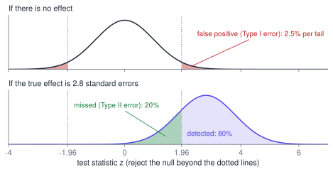

*Figure 22.1 — Both error types and power, on the scale of the test statistic.*

#### The formal definition

The two-proportion z-test compares the rates $\hat{p}_c = x_c/n_c$ and $\hat{p}_t = x_t/n_t$:

$$
z = \frac{\hat{p}_t - \hat{p}_c}{\sqrt{\bar{p}(1-\bar{p})\big(\tfrac{1}{n_c} + \tfrac{1}{n_t}\big)}}, \qquad \bar{p} = \frac{x_c + x_t}{n_c + n_t}, \qquad p\text{-value} = 2\big(1 - \Phi(\lvert z \rvert)\big)
$$

$\Phi$ is the standard normal CDF (Chapter 19). A 95% confidence interval for the difference is

$$
(\hat{p}_t - \hat{p}_c) \pm 1.96\sqrt{\frac{\hat{p}_c(1-\hat{p}_c)}{n_c} + \frac{\hat{p}_t(1-\hat{p}_t)}{n_t}}
$$

and the sample size per group to detect a move from $p_1$ to $p_2$ is

$$
n = \frac{\big(z_{1-\alpha/2} + z_{1-\beta}\big)^2\,\big[p_1(1-p_1) + p_2(1-p_2)\big]}{(p_2 - p_1)^2}
$$

with $z_{1-\alpha/2} = 1.96$ and $z_{1-\beta} = 0.84$ for 5% significance and 80% power. Unit-free effect sizes: Cohen's $h = 2\arcsin\sqrt{p_t} - 2\arcsin\sqrt{p_c}$ for proportions and Cohen's $d$, the difference in means over the standard deviation, for averages. Fisher popularized p-values in the 1920s; Neyman and Pearson added error types and power in 1933.

### Worked example

Control: 480 of 4,000 (12.0%). Treatment: 560 of 4,000 (14.0%).

- Pooled rate $1040/8000 = 0.13$; standard error $\sqrt{0.13 \times 0.87 \times 2/4000} = 0.00752$.
- $z = 0.02/0.00752 = 2.66$, p-value 0.0078: reject the null at 5%.
- Interval: $0.02 \pm 1.96(0.00752)$, from 0.0053 to 0.0347.
- Planning: to detect 12% against 13%, $n = 7.849 \times (0.1056 + 0.1131)/0.0001 = 17{,}166$ per group.

```python
n_c, x_c = 4000, 480        # control
n_t, x_t = 4000, 560        # treatment
p_c, p_t = x_c / n_c, x_t / n_t
diff = p_t - p_c

pooled = (x_c + x_t) / (n_c + n_t)
se_null = np.sqrt(pooled * (1 - pooled) * (1 / n_c + 1 / n_t))
z = diff / se_null
p_value = 2 * norm.sf(abs(z))
print(f"difference {diff:.4f}, z = {z:.3f}, two-sided p = {p_value:.4f}")

se = np.sqrt(p_c * (1 - p_c) / n_c + p_t * (1 - p_t) / n_t)
print(f"95% interval for the lift: {diff - 1.96 * se:.4f} to {diff + 1.96 * se:.4f}")
h = 2 * np.arcsin(np.sqrt(p_t)) - 2 * np.arcsin(np.sqrt(p_c))
print(f"Cohen's h = {h:.4f}")

def n_per_arm(p1, p2, alpha=0.05, power=0.80):
    z_a, z_b = norm.ppf(1 - alpha / 2), norm.ppf(power)
    return (z_a + z_b) ** 2 * (p1 * (1 - p1) + p2 * (1 - p2)) / (p2 - p1) ** 2

need = int(np.ceil(n_per_arm(0.12, 0.13)))
print(f"to detect 12% -> 13% at 80% power: {need:,} per arm")
se_1pt = np.sqrt(0.12 * 0.88 / 4000 + 0.13 * 0.87 / 4000)
print(f"power with 4,000 per arm: {norm.cdf(0.01 / se_1pt - 1.96):.3f}")
```

Output:

```text
difference 0.0200, z = 2.660, two-sided p = 0.0078
95% interval for the lift: 0.0053 to 0.0347
Cohen's h = 0.0595
to detect 12% -> 13% at 80% power: 17,166 per arm
power with 4,000 per arm: 0.272
simulated power at 17,166: 0.800
```

With 4,000 per group a real one-point lift is caught only 27% of the time. The last line simulates 20,000 experiments.

### Common mistakes

| Mistake | Why it bites | Do this instead |
|---|---|---|
| "p = 0.008 means a 0.8% chance of no effect" | It is the chance of data this extreme given no effect, not the reverse | Say "with no effect we would see this 0.8% of the time" |
| "Not significant" read as "no effect" | A test with 27% power misses most real lifts | Report the interval; size the test for the MDE |
| "Significant" read as "important" | With ten million users per group a 0.05-point lift is significant | Decide on the interval and its business value |

### Where a PM meets it

- Before launch, write down the primary metric, MDE, significance level, power, sample size and duration.
- Ask for the interval of the lift in business units, not only "it is significant".
- Match the significance level to the cost of being wrong: 1% for a risky migration, perhaps 10% for a reversible copy change.

### Check yourself

**Q22.1** Suppose the same rates had come from 1,000 visitors per group (120 and 140 conversions). What are $z$ and the decision?

**Q22.2** Roughly how does the required sample size change if the MDE is halved from one point to half a point?

> [!IMPORTANT]
> **In one line:** A p-value says how surprising the data are if nothing changed; pair it with an interval for the effect and enough sample for power.

## 23. A/B testing with many variants and metrics

### Why it matters

A real PayFlow experiment is never one variant and one metric. It is four checkout designs, a primary metric, five guardrails, three segments and an hourly dashboard. Each extra comparison and each extra look gives noise another chance to cross the 5% line, so a team that tests enough things keeps finding "winners" that do not exist.

### The idea

**Multiple comparisons.** With $m$ independent tests and no real effects, the chance of at least one false positive is $1 - 0.95^m$: 23% for 5 tests, 64% for 20. The **Bonferroni correction** tests each comparison at $\alpha/m$, controlling the **family-wise error rate**, the chance of any false positive. The **Benjamini-Hochberg procedure** (1995) controls the **false discovery rate**, the expected share of declared wins that are false; it is less strict and suits screening many variants.

**Sample-ratio mismatch (SRM).** You planned a 50/50 split and the counts differ by more than chance allows. Assignment or logging is broken, and no metric can be trusted until it is fixed.

**Peeking.** Checking a running test repeatedly and stopping the first time $p < 0.05$ gives noise many chances.

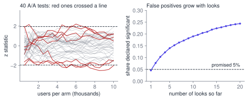

*Figure 23.1 — Each path is an A/A test, where both groups get the same experience; more looks mean more paths that cross a line.*

#### The formal definition

Benjamini-Hochberg at level $q$: sort the p-values $p_{(1)} \le \dots \le p_{(m)}$, find the largest rank $k$ with

$$
p_{(k)} \le \frac{k}{m}\,q
$$

and reject hypotheses 1 to $k$, including any that missed their own line.

SRM uses a chi-square test on observed counts $O_i$ against planned counts $E_i$:

$$
\chi^2 = \sum_i \frac{(O_i - E_i)^2}{E_i}
$$

with one degree of freedom for two groups. Microsoft's experimentation team reports an SRM in about 6% of its A/B tests and flags one at $p < 0.0005$.

### Worked example

Five comparisons give sorted p-values 0.002, 0.024, 0.028, 0.045 and 0.600.

- Uncorrected: four are below 0.05.
- Bonferroni: $0.05/5 = 0.01$, so only 0.002 survives.
- Benjamini-Hochberg: the lines are 0.01, 0.02, 0.03, 0.04, 0.05. Rank 1 passes, rank 2 fails, rank 3 passes ($0.028 \le 0.03$), the rest fail. The largest passing rank is 3, so ranks 1 to 3 are wins.
- SRM: a split of 50,600 against 49,400 gives $\chi^2 = 600^2/50{,}000 + 600^2/50{,}000 = 14.4$.

```python
p = np.array([0.002, 0.024, 0.028, 0.045, 0.600])    # sorted
m, q = len(p), 0.05
bh_line = q * np.arange(1, m + 1) / m
k = np.nonzero(p <= bh_line)[0].max() + 1            # largest passing rank
print(f"wins: uncorrected {(p <= q).sum()}, Bonferroni {(p <= q / m).sum()}, "
      f"Benjamini-Hochberg {k}")

# Sample-ratio mismatch: planned 50/50, observed 50,600 / 49,400
observed = np.array([50_600, 49_400])
expected = observed.sum() * np.array([0.5, 0.5])
chi2 = ((observed - expected) ** 2 / expected).sum()
print(f"SRM: chi-square {chi2:.1f}, p = {stats.chi2.sf(chi2, df=1):.5f}")

# Peeking: A/A tests, checked after every 500 users per arm
rng = np.random.default_rng(23)
sims, looks, step, rate = 4000, 20, 500, 0.12
a = rng.binomial(step, rate, (sims, looks)).cumsum(axis=1)
b = rng.binomial(step, rate, (sims, looks)).cumsum(axis=1)
n = step * np.arange(1, looks + 1)
pooled = (a + b) / (2 * n)
z = (a - b) / n / np.sqrt(pooled * (1 - pooled) * 2 / n)
hit = np.abs(z) > 1.96
print(f"false positives with 1, 5 and 20 looks: {hit[:, -1].mean():.3f}, "
      f"{hit[:, 3::4].any(axis=1).mean():.3f}, {hit.any(axis=1).mean():.3f}")
```

Output:

```text
wins: uncorrected 4, Bonferroni 1, Benjamini-Hochberg 3
SRM: chi-square 14.4, p = 0.00015
false positives with 1, 5 and 20 looks: 0.047, 0.141, 0.244
```

A 50.6/49.4 split looks harmless and is a clear SRM at this size. Twenty looks turn a promised 5% into 24%; fix the sample size in advance or test sequentially.

The rest of the toolkit:

| Tool | What it does |
|---|---|
| Guardrail metrics | Limits agreed in advance (latency, refunds, disputes) that a winner must not breach |
| CUPED (Deng and colleagues, 2013) | Subtracts what a pre-experiment covariate predicts; variance falls by $1 - \rho^2$, so a correlation of 0.7 halves the sample needed |
| Sequential testing | Always-valid or group-sequential p-values make peeking safe |
| Cluster randomization | Assigns whole groups when users influence each other |
| Stratification | Randomizes within segments; report effects per segment, because an average can hide opposite moves |

### Common mistakes

| Mistake | Why it bites | Do this instead |
|---|---|---|
| Declaring every $p < 0.05$ across variants, metrics and segments | 64% chance of a false win in 20 tests | Name one primary metric in advance; correct the rest |
| Averaging revenue with one giant payer in a group | One outlier decides the sign | Cap or bootstrap; rerun without top payers |

### Where a PM meets it

- Ask what was fixed before launch: primary metric, guardrails, sample size, stopping rule.
- Ask how many variants, metrics and segments were examined to find this result.
- Ask whether the SRM check passed.

### Check yourself

**Q23.1** You compare 3 variants with control on 4 metrics. What Bonferroni threshold keeps the family-wise error rate at 5%, and what is the chance of at least one false positive uncorrected?

**Q23.2** A 50/50 test logs 5,050 and 4,950 users. Compute the chi-square statistic. Is this an SRM?

> [!IMPORTANT]
> **In one line:** Every extra comparison and every extra look is another ticket in the false-positive lottery: correct for comparisons, fix the stopping rule and check the split.

# Part III — Calculus

## 24. Limits and continuity

### Why it matters

Training a model means nudging its parameters and watching the loss respond, which only works if small nudges cause small, predictable responses. Limits are the language for "what a function approaches", continuity is the promise of "no sudden jumps", and both appear in product work whenever a threshold or pricing tier makes an outcome leap.

### The idea

A **limit** is the value a function heads toward as its input approaches some point, whether or not it ever arrives. A function is **continuous** at a point if it heads toward the value it actually takes there: no hole, no jump. You can draw it without lifting the pen.

- A hard risk rule, "block if the score is above the threshold", is a step from 0 to 1. A sigmoid makes the same transition smoothly. Models are trained with smooth functions because a step is flat everywhere except at the jump, so it gives no hint about which way to move.
- A volume discount that lowers the rate on a merchant's whole month once volume reaches USD 100,000 makes the monthly fee drop at that point.

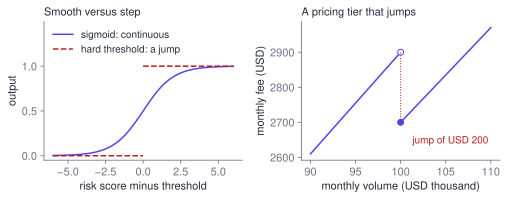

*Figure 24.1 — A continuous function and two jumps. The open circle marks a value the fee approaches but never takes.*

#### The formal definition

$$
\lim_{x \to a} f(x) = L
$$

means that for every tolerance $\varepsilon > 0$ on the output there is a distance $\delta > 0$ on the input such that $0 < \lvert x - a \rvert < \delta$ guarantees $\lvert f(x) - L \rvert < \varepsilon$. The function $f$ is continuous at $a$ when $f(a)$ is defined, the limit exists and the two agree:

$$
\lim_{x \to a} f(x) = f(a)
$$

A one-sided limit approaches from one side only; at a jump the two sides differ. Sums, products and compositions of continuous functions are continuous, so polynomials, exponentials, the sigmoid and networks built from them are too. Continuous does not mean smooth: the ReLU, $\max(0, x)$, is continuous with a corner at 0 where it has no single slope.

### Worked example

A limit by hand. For the sigmoid $\sigma(z) = 1/(1 + e^{-z})$, look at the ratio $(\sigma(h) - \sigma(0))/h$ as $h$ shrinks. At $h = 0$ it is $0/0$, undefined, which is exactly why a limit is needed.

- $h = 1$: $\sigma(1) = 0.7311$, ratio $0.2311$.
- $h = 0.1$: $\sigma(0.1) = 0.52498$, ratio $0.2498$.

The ratio is heading to 0.25, which Chapter 25 calls the derivative of the sigmoid at 0.

A jump by hand. From below USD 100,000 the fee approaches $0.029 \times 100{,}000 = 2{,}900$. At and above it the fee is $0.027 \times 100{,}000 = 2{,}700$. The one-sided limits differ by USD 200, so the fee is not continuous there.

```python
def sigmoid(z):
    return 1 / (1 + np.exp(-z))

# A limit: the slope of the sigmoid at 0 is what this ratio approaches as h shrinks
print("       h   (sigmoid(h) - sigmoid(0)) / h")
for h in (1.0, 0.1, 0.01, 0.001, 1e-6, 1e-13, 1e-17):
    print(f"{h:8.0e}   {(sigmoid(h) - sigmoid(0.0)) / h:.6f}")

# A jump: the monthly fee if the rate drops from 2.9% to 2.7% at USD 100,000
def monthly_fee(volume):
    rate = 0.029 if volume < 100_000 else 0.027
    return rate * volume

print("monthly volume -> fee")
for v in (99_000, 99_999, 99_999.99, 100_000, 100_000.01, 101_000):
    print(f"{v:12,.2f} -> {monthly_fee(v):9,.2f}")
```

Output:

```text
       h   (sigmoid(h) - sigmoid(0)) / h
   1e+00   0.231059
   1e-01   0.249792
   1e-02   0.249998
   1e-03   0.250000
   1e-06   0.250000
   1e-13   0.249800
   1e-17   0.000000
monthly volume -> fee
   99,000.00 ->  2,871.00
   99,999.00 ->  2,899.97
   99,999.99 ->  2,900.00
  100,000.00 ->  2,700.00
  100,000.01 ->  2,700.00
  101,000.00 ->  2,727.00
```

The ratio settles at 0.25 and then falls apart: at $h = 10^{-13}$ rounding error shows, and at $10^{-17}$ the computer cannot tell $\sigma(h)$ from 0.5. And one extra cent of volume lowers the fee by USD 200.

### Common mistakes

| Mistake | Why it bites | Do this instead |
|---|---|---|
| "The limit exists" taken to mean "the function is defined there" | The ratio above is undefined at 0 and still has limit 0.25 | Treat them as two separate questions |
| Shrinking the step toward zero in a numerical check | Rounding error takes over | Use a step near $10^{-5}$ |
| Running one experiment across a discontinuity | Users on each side of a tier face different rules, and the average describes neither | Analyze each side separately |

### Where a PM meets it

- Tier boundaries, caps and eligibility thresholds are discontinuities. Expect bunching on the favorable side; ask for a histogram around the threshold.
- To avoid a cliff, apply the new rate only to the volume above the threshold. That fee is continuous.
- Accuracy and approval at a threshold are step functions of a model's output, so models are trained on a smooth loss and judged on those metrics afterward.

### Check yourself

**Q24.1** Is PayFlow's per-payment fee of 2.9% plus USD 0.30 a continuous function of the amount? What about a fee of 2.9% plus USD 0.30 below USD 1,000 and 2.5% plus USD 0.30 from USD 1,000 up?

**Q24.2** Under the jumping volume discount, up to what monthly volume does a merchant above the threshold still pay less than USD 2,900?

> [!IMPORTANT]
> **In one line:** A limit says where a function is heading and continuity says it arrives; smooth functions make learning possible, and jumps make models and merchants behave oddly.

## 25. Derivatives

### Why it matters

"If we raise the risk threshold a little, how much does the approval rate move?" is a derivative question, as is every "how sensitive is this metric to that knob". The derivative is the exchange rate between a small change in an input and the change it causes in an output, and it is what a model uses to decide which way to adjust each weight.

### The idea

PayFlow blocks a payment when its risk score is above a threshold $t$. Let $A(t)$ be the share approved. Raising $t$ from 0.5 to 0.9 lifts approval from 0.875 to 0.999, an average slope of 0.31 per unit of threshold: the slope of a secant line through two points on the curve.

The **derivative** at 0.5 is the slope over a vanishingly short interval, the slope of the tangent line, and here it is 0.75. Read it as a local exchange rate: near $t = 0.5$, each 0.01 of threshold buys about 0.0075 of approval rate.

Where the derivative is zero the curve is momentarily flat, a candidate maximum or minimum. The **second derivative**, the derivative of the derivative, says which: negative at a peak, positive in a trough.

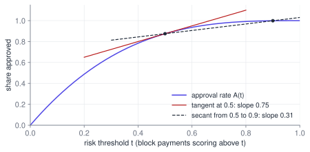

*Figure 25.1 — The secant gives an average rate over a wide move. The tangent gives the rate at a point.*

#### The formal definition

$$
f'(x) = \frac{df}{dx} = \lim_{h \to 0} \frac{f(x + h) - f(x)}{h}
$$

when the limit exists. It gives the first-order approximation $f(x + h) \approx f(x) + f'(x)\,h$ for small $h$. A few rules cover almost every function in machine learning:

| Function | Derivative |
|---|---|
| $x^n$ | $n x^{n-1}$ |
| $a f(x) + b g(x)$ | $a f'(x) + b g'(x)$ |
| $f(x)\,g(x)$ | $f'(x)\,g(x) + f(x)\,g'(x)$ |
| $e^x$ | $e^x$ |
| $\ln x$ | $1/x$ |
| $\sigma(x) = 1/(1 + e^{-x})$ | $\sigma(x)\,(1 - \sigma(x))$ |
| $f(g(x))$ | $f'(g(x))\,g'(x)$, the chain rule of Chapter 28 |

To check a derivative numerically, use the **central difference** $\dfrac{f(x + h) - f(x - h)}{2h}$ with a small $h$.

### Worked example

Take $A(t) = 1 - (1 - t)^3$ as a toy model of where scores fall.

- Derivative, by the chain and power rules: $A'(t) = 3(1 - t)^2$.
- At $t = 0.5$: $A = 1 - 0.125 = 0.875$ and $A' = 3(0.25) = 0.75$.
- Central difference with $h = 0.01$: $(0.882351 - 0.867349)/0.02 = 0.7501$.
- Prediction for raising the threshold to 0.52: $0.875 + 0.75(0.02) = 0.890$. Actual: 0.8894.
- At $t = 0.8$ the slope is $3(0.04) = 0.12$. The same nudge buys six times less approval.

The slope has its own meaning: $A$ is the CDF of the scores, so $A'$ is their density (Chapter 16), the share of payments sitting at the threshold.

```python
def approval(t):
    """Share of payments scoring at or below the threshold t."""
    return 1 - (1 - t) ** 3

def d_approval(t):
    """Derivative by the chain and power rules."""
    return 3 * (1 - t) ** 2

def central(f, x, h=1e-5):
    """Slope of a short secant centered on x."""
    return (f(x + h) - f(x - h)) / (2 * h)

print("threshold  approval  slope (rule)  slope (finite difference)")
for t in (0.3, 0.5, 0.8):
    print(f"{t:9.1f}  {approval(t):8.4f}  {d_approval(t):12.4f}  "
          f"{central(approval, t):12.4f}")

print("secant slopes from 0.5 to 0.5 + h:")
for h in (0.4, 0.1, 0.01, 0.001):
    print(f"  h = {h:<5}  {(approval(0.5 + h) - approval(0.5)) / h:.4f}")

predicted = approval(0.5) + d_approval(0.5) * 0.02
print(f"raise the threshold 0.50 -> 0.52: predicted {predicted:.4f}, "
      f"actual {approval(0.52):.4f}")
```

Output:

```text
threshold  approval  slope (rule)  slope (finite difference)
      0.3    0.6570        1.4700        1.4700
      0.5    0.8750        0.7500        0.7500
      0.8    0.9920        0.1200        0.1200
secant slopes from 0.5 to 0.5 + h:
  h = 0.4    0.3100
  h = 0.1    0.6100
  h = 0.01   0.7351
  h = 0.001  0.7485
raise the threshold 0.50 -> 0.52: predicted 0.8900, actual 0.8894
```

The secant slopes approach 0.75 as the interval shrinks: the limit in the definition.

### Common mistakes

| Mistake | Why it bites | Do this instead |
|---|---|---|
| Using a local slope for a large move | The slope 0.75 predicts +0.30 for a move to 0.9; the truth is +0.124 | Re-measure, or add curvature (Chapter 31) |
| Reading "derivative zero" as "optimum" | It can be a maximum, a minimum or a flat shoulder | Check the second derivative or the neighbors |

### Where a PM meets it

- Ask for sensitivities at today's operating point, with units: "points of approval per 0.01 of threshold, at 0.5". After a large change, ask again.
- The best threshold is where the derivative of net value is zero: the last payment you approve earns exactly as much in fees as it costs in expected fraud.

### Check yourself

**Q25.1** What is the slope of $A$ at $t = 0.9$, and what does it say about loosening an already loose threshold?

**Q25.2** A calibrated score $p$ is the probability that a payment is fraud. Approving earns USD 3.20 in fees if the payment is legitimate and loses USD 100 if it is fraud. At what $p$ is the expected value of approving exactly zero?

> [!IMPORTANT]
> **In one line:** A derivative is the local exchange rate between an input and an output: the slope of the tangent, good for small moves around the current point.

## 26. Partial derivatives and the gradient

### Why it matters

A model has millions of knobs, its weights, and each one changes the loss. Training needs to know, for all of them at once, which way is downhill. The gradient is that answer: one slope per knob, assembled into an arrow.

### The idea

With several inputs, ask the derivative question of one input at a time: nudge it, hold the others fixed, measure the slope. That is a **partial derivative**. Stack the partial derivatives into a vector and you have the **gradient**. Two properties make it the workhorse of machine learning:

- it points in the direction in which the function rises fastest, and its length is the slope in that direction;
- it is perpendicular to the contour, the curve of equal value, through the point.

So the negative gradient is the steepest way down.

The running example is a toy risk score that adds a weight $w_1$ when the device is new and $w_2$ when the card is foreign. Three payments rated by an analyst are the targets, and the loss is the mean squared gap between score and rating.

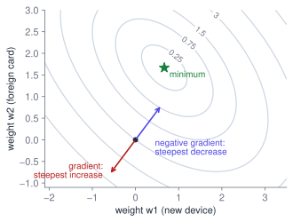

*Figure 26.1 — The gradient crosses the contour at a right angle. Its opposite is the direction of steepest decrease.*

#### The formal definition

For a function $f$ of $n$ inputs $\mathbf{x} = (x_1, \dots, x_n)$:

$$
\frac{\partial f}{\partial x_i} = \lim_{h \to 0} \frac{f(x_1, \dots, x_i + h, \dots, x_n) - f(x_1, \dots, x_n)}{h},
\qquad
\nabla f(\mathbf{x}) = \begin{bmatrix} \partial f / \partial x_1 \\ \vdots \\ \partial f / \partial x_n \end{bmatrix}
$$

The first-order approximation becomes $f(\mathbf{x} + \mathbf{h}) \approx f(\mathbf{x}) + \nabla f(\mathbf{x})^\top \mathbf{h}$: the change in $f$ is the dot product of the gradient with the step.

### Worked example

The data: a payment with only a new device, rated 1; one with only a foreign card, rated 2; one with both, rated 2. The scores are $w_1$, $w_2$ and $w_1 + w_2$, so

$$
L(w_1, w_2) = \tfrac{1}{3}\big[(w_1 - 1)^2 + (w_2 - 2)^2 + (w_1 + w_2 - 2)^2\big]
$$

Differentiate with respect to one weight while treating the other as a constant:

$$
\frac{\partial L}{\partial w_1} = \tfrac{2}{3}(2w_1 + w_2 - 3), \qquad \frac{\partial L}{\partial w_2} = \tfrac{2}{3}(w_1 + 2w_2 - 4)
$$

At $(0, 0)$:

- Loss $(1 + 4 + 4)/3 = 3$.
- Gradient $(-2, -8/3)$, with length $\sqrt{4 + 64/9} = 10/3$.
- Steepest descent direction: $(2, 8/3)$ divided by $10/3$, which is $(0.6, 0.8)$.
- A step of 0.3 times the negative gradient lands on $(0.6, 0.8)$, where the loss is $(0.16 + 1.44 + 0.36)/3 = 0.653$.
- Both partial derivatives are zero where $2w_1 + w_2 = 3$ and $w_1 + 2w_2 = 4$: at $(2/3, 5/3)$, with loss $1/9$.

```python
# Three rated payments: [new device?, foreign card?] and the rating
X = np.array([[1.0, 0.0],
              [0.0, 1.0],
              [1.0, 1.0]])
y = np.array([1.0, 2.0, 2.0])

def loss(w):
    """Mean squared error of the score X @ w."""
    return np.mean((X @ w - y) ** 2)

def grad(w):
    """Both partial derivatives at once."""
    return 2 / len(y) * X.T @ (X @ w - y)

def numerical_grad(f, w, h=1e-6):
    """Nudge one weight at a time, hold the others fixed."""
    return np.array([(f(w + h * e) - f(w - h * e)) / (2 * h) for e in np.eye(len(w))])

w = np.array([0.0, 0.0])
g = grad(w)
print(f"loss at (0, 0)       {loss(w):.4f}")
print(f"gradient             {g.round(4)}")
print(f"numerical gradient   {numerical_grad(loss, w).round(4)}")
print(f"gradient length      {np.linalg.norm(g):.4f}")
print(f"steepest descent     {(-g / np.linalg.norm(g)).round(2)}")
step = w - 0.3 * g
print(f"after w - 0.3 * gradient: w = {step.round(2)}, loss {loss(step):.4f}")
w_star = np.linalg.solve(X.T @ X, X.T @ y)
print(f"gradient is zero at  {w_star.round(4)}, loss {loss(w_star):.4f}")
```

Output:

```text
loss at (0, 0)       3.0000
gradient             [-2.     -2.6667]
numerical gradient   [-2.     -2.6667]
gradient length      3.3333
steepest descent     [0.6 0.8]
after w - 0.3 * gradient: w = [0.6 0.8], loss 0.6533
gradient is zero at  [0.6667 1.6667], loss 0.1111
```

### Common mistakes

| Mistake | Why it bites | Do this instead |
|---|---|---|
| Reading a partial derivative as the full effect | $\partial L/\partial w_1$ contains $w_2$, so it holds only while the other weight stays put | Recompute the gradient after every move |
| Following the gradient too far | It is local: a step of 1.2 times the gradient overshoots the valley and the loss rises to 5.45 | Take small steps (the learning rate, Chapter 33) |
| Taking "gradient zero" to mean "minimum" | It is also zero at maxima and saddle points | Check curvature (Chapter 30) |

### Where a PM meets it

- "Which inputs drove this prediction?" Many attribution methods start from the gradient of the output with respect to the inputs. Like any gradient it is local.
- Training dashboards plot the gradient's length. Near zero means a flat region, converged or stuck; a sudden spike means instability.
- "Which lever next?" is a gradient question. Ask for each lever's sensitivity at today's settings, in comparable units.

### Check yourself

**Q26.1** Compute the gradient of $L$ at $(1, 1)$. Which weight should change, and in which direction?

**Q26.2** From $(0, 0)$, where does a step of 1.2 times the negative gradient land, and why is the loss there worse than at the start?

> [!IMPORTANT]
> **In one line:** The gradient collects one partial derivative per input into an arrow that points uphill; step against it to reduce a loss.

## 27. Directional derivatives

### Why it matters

You can rarely move in the ideal direction. A team can change one setting this quarter, not ten, and a fine-tuning job may update a small set of weights while the rest stay frozen. The directional derivative gives the slope along the direction you are actually allowed to move, and the fraction of the best possible slope that it captures.

### The idea

Stand at a point on the loss surface of Chapter 26 and pick a direction. The **directional derivative** is the slope you would feel walking that way. It needs no new machinery: it is the projection of the gradient onto your direction.

- Walk along the gradient and you climb as steeply as possible.
- Walk against it and you descend as steeply as possible.
- Walk at a right angle to it, along the contour, and the slope is zero.
- In between, the slope shrinks with the cosine of the angle to the gradient.

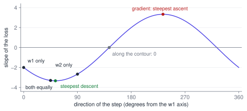

*Figure 27.1 — Turn through all directions and the slope traces a cosine. Its extremes are the gradient direction and its opposite.*

#### The formal definition

For a unit vector $\mathbf{u}$, a direction of length 1:

$$
D_{\mathbf{u}} f(\mathbf{x}) = \lim_{h \to 0} \frac{f(\mathbf{x} + h\mathbf{u}) - f(\mathbf{x})}{h} = \nabla f(\mathbf{x})^\top \mathbf{u} = \lVert \nabla f(\mathbf{x}) \rVert \cos\theta
$$

where $\theta$ is the angle between $\mathbf{u}$ and the gradient. Because $\cos\theta$ lies between $-1$ and $1$, no direction is steeper than the gradient's; this is the Cauchy-Schwarz inequality at work, and it is the proof behind Chapter 26's claim. A partial derivative is the directional derivative along one coordinate axis.

### Worked example

At $(0, 0)$ the gradient is $\mathbf{g} = (-2, -8/3)$ with length $10/3$. Take the dot product with each direction:

- Move $w_1$ only, $\mathbf{u} = (1, 0)$: slope $-2$, which is 60% of the steepest.
- Move $w_2$ only, $\mathbf{u} = (0, 1)$: slope $-8/3 = -2.667$, 80%.
- Move both equally, $\mathbf{u} = (1, 1)/\sqrt{2}$: slope $(-2 - 8/3)/\sqrt{2} = -3.300$, 99%.
- Steepest descent, $\mathbf{u} = (0.6, 0.8)$: slope $-1.2 - 2.133 = -3.333$.
- Along the contour, $\mathbf{u} = (0.8, -0.6)$: slope $-1.6 + 1.6 = 0$.

The code computes each slope as a dot product and again as a finite difference of the loss along the direction.

```python
w = np.array([0.0, 0.0])
g = grad(w)                                   # (-2, -8/3), length 10/3
directions = {
    "w1 only": (1, 0),
    "w2 only": (0, 1),
    "both equally": (1, 1),
    "steepest descent": -g,
    "along the contour": (-g[1], g[0]),
    "steepest ascent": g,
}
h = 1e-6
print("direction          unit vector      slope   finite diff   cos(angle)")
for name, d in directions.items():
    u = np.array(d, dtype=float)
    u = u / np.linalg.norm(u)                 # a direction must have length 1
    slope = g @ u                             # the directional derivative
    fd = (loss(w + h * u) - loss(w - h * u)) / (2 * h)
    cosine = slope / np.linalg.norm(g)
    print(f"{name:18s} ({u[0]:+.2f}, {u[1]:+.2f})  {slope:+.4f}  {fd:+11.4f}  "
          f"{cosine:+10.2f}")
```

Output:

```text
direction          unit vector      slope   finite diff   cos(angle)
w1 only            (+1.00, +0.00)  -2.0000      -2.0000       -0.60
w2 only            (+0.00, +1.00)  -2.6667      -2.6667       -0.80
both equally       (+0.71, +0.71)  -3.2998      -3.2998       -0.99
steepest descent   (+0.60, +0.80)  -3.3333      -3.3333       -1.00
along the contour  (+0.80, -0.60)  +0.0000      +0.0000       +0.00
steepest ascent    (-0.60, -0.80)  +3.3333      +3.3333       +1.00
```

### Common mistakes

| Mistake | Why it bites | Do this instead |
|---|---|---|
| Forgetting to normalize the direction | $(1, 1)$ has length 1.41, so the slope looks 41% larger than it is | Divide by the length first |
| Reading a zero slope in one direction as "no gradient" | Every point has a flat direction, along its contour | Check the length of the gradient |
| Quoting the gradient's length as the achievable gain | Your constraint may allow only a direction at a wide angle | Quote the slope along the allowed direction and its cosine |
| Extrapolating along the direction | The slope is local | Measure again after moving |

### Where a PM meets it

- Constrained roadmaps: when only one lever can move, ask what share of the available improvement that direction captures. Moving $w_1$ alone captured 60% here.
- Parameter-efficient fine-tuning, such as low-rank adapters, updates a small set of directions in weight space. The intuition for why it can work is the same: the allowed directions need to capture enough of the gradient.
- One lever at a time can be nearly as good as the best direction, or far worse. It depends on the angle, so ask for it.

### Check yourself

**Q27.1** What is the slope of $L$ at $(0, 0)$ in the direction $(3, 4)/5$? What is special about that direction?

**Q27.2** A direction makes a 60-degree angle with the negative gradient. What share of the steepest descent slope does it capture, and what is the slope at $(0, 0)$?

> [!IMPORTANT]
> **In one line:** The slope along any direction is the gradient's projection onto it: full along the gradient, zero along the contour, and proportional to the cosine in between.

## 28. The chain rule and backpropagation

### Why it matters

A neural network is a long chain of simple steps, and training needs the slope of the final loss with respect to every weight. The chain rule says how slopes multiply through a chain. Backpropagation applies it to all the weights in one backward sweep, which is why training billions of weights is feasible.

### The idea

If $x$ moves $u$ and $u$ moves $y$, the effect of $x$ on $y$ is the product of the two local slopes. Exchange rates compound.

A network computes its loss in a forward pass, layer by layer, keeping each intermediate value. **Backpropagation** walks the same chain in reverse: it starts from "the slope of the loss with respect to itself is 1" and at each step multiplies by that step's local slope. The gradient for a layer's weights is the slope arriving at that layer times the values fed into it.

One forward and one backward pass give every partial derivative for a small multiple of the cost of one run; nudging weights one at a time would need a run per weight.

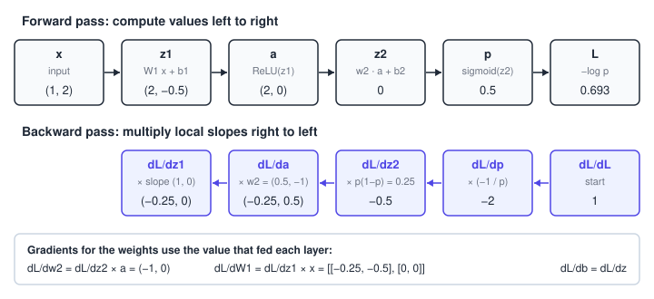

*Figure 28.1 — The worked example: values flow forward, slopes flow backward.*

#### The formal definition

For $y = f(u)$ with $u = g(x)$, and with several intermediates $u_1, \dots, u_m$:

$$
\frac{dy}{dx} = \frac{dy}{du} \cdot \frac{du}{dx}, \qquad \frac{\partial y}{\partial x_j} = \sum_{i=1}^{m} \frac{\partial y}{\partial u_i}\,\frac{\partial u_i}{\partial x_j}
$$

For a layer $\mathbf{z} = W\mathbf{a}_{\text{in}} + \mathbf{b}$ with activation $\phi$, write $\boldsymbol{\delta} = \partial L / \partial \mathbf{z}$. Then

$$
\frac{\partial L}{\partial W} = \boldsymbol{\delta}\,\mathbf{a}_{\text{in}}^\top, \qquad \frac{\partial L}{\partial \mathbf{b}} = \boldsymbol{\delta}, \qquad \boldsymbol{\delta}_{\text{prev}} = \big(W^\top \boldsymbol{\delta}\big) \odot \phi'(\mathbf{z}_{\text{prev}})
$$

where $\odot$ multiplies element by element. Linnainmaa described this reverse-mode differentiation in 1970; Rumelhart, Hinton and Williams made it famous for neural networks in 1986.

### Worked example

Two links first. A score $z = wx + b$ with $x = 2$, $w = 0.5$, $b = -1$ gives $z = 0$, a probability $p = \sigma(z) = 0.5$ and, for a fraud payment, a loss $L = -\ln p = 0.693$. The local slopes are $dL/dp = -1/p = -2$, $dp/dz = p(1 - p) = 0.25$ and $dz/dw = x = 2$. Their product is $dL/dw = -1$: raising $w$ lowers the loss.

Now a network with inputs $\mathbf{x} = (1, 2)$, two hidden ReLU units and a sigmoid output; the weights are in the listing.

Forward: $\mathbf{z}_1 = (1 + 1,\ -1 + 0.5) = (2, -0.5)$; $\mathbf{a} = (2, 0)$; $z_2 = 0.5(2) - 1(0) - 1 = 0$; $p = 0.5$; $L = 0.693$.

Backward:

- $\partial L/\partial z_2 = p - 1 = -0.5$, the first two slopes above multiplied.
- $\partial L/\partial \mathbf{w}_2 = -0.5 \times \mathbf{a} = (-1, 0)$ and $\partial L/\partial b_2 = -0.5$.
- $\partial L/\partial \mathbf{a} = -0.5 \times \mathbf{w}_2 = (-0.25, 0.5)$.
- $\partial L/\partial \mathbf{z}_1 = (-0.25, 0.5) \odot (1, 0) = (-0.25, 0)$. The second unit is off, so no slope passes through it.
- $\partial L/\partial W_1 = \boldsymbol{\delta}\,\mathbf{x}^\top$, with rows $(-0.25, -0.5)$ and $(0, 0)$.

```python
x = np.array([1.0, 2.0])            # amount (USD hundreds), payments this hour
y = 1.0                             # label: fraud
params = {"W1": np.array([[1.0, 0.5], [-1.0, 0.25]]), "b1": np.zeros(2),
          "w2": np.array([0.5, -1.0]), "b2": -1.0}

def forward(p):
    z1 = p["W1"] @ x + p["b1"]
    a = np.maximum(z1, 0)           # ReLU
    z2 = p["w2"] @ a + p["b2"]
    prob = sigmoid(z2)
    return z1, a, prob, -np.log(prob)

z1, a, prob, loss = forward(params)
print(f"forward: z1 = {z1}, a = {a}, prob = {prob:.2f}, loss = {loss:.4f}")

d_z2 = prob - y                     # dL/dz2
d_w2, d_b2 = d_z2 * a, d_z2
d_a = d_z2 * params["w2"]           # back to the hidden layer
d_z1 = d_a * (z1 > 0)               # ReLU passes slope only where z1 > 0
d_W1, d_b1 = np.outer(d_z1, x), d_z1
print(f"dL/dw2 = {d_w2 + 0.0}, dL/db2 = {d_b2}")
print(f"dL/dW1 = {(d_W1 + 0.0).tolist()}, dL/db1 = {d_b1 + 0.0}")
```

Output:

```text
forward: z1 = [ 2.  -0.5], a = [2. 0.], prob = 0.50, loss = 0.6931
dL/dw2 = [-1.  0.], dL/db2 = -0.5
dL/dW1 = [[-0.25, -0.5], [0.0, 0.0]], dL/db1 = [-0.25  0.  ]
largest gap to the numerical gradient: 8.4e-11
```

The last line compares all nine backpropagated values with central differences.

### Common mistakes

| Mistake | Why it bites | Do this instead |
|---|---|---|
| Dropping a local slope | Forgetting the activation's derivative gives a plausible, wrong gradient | Compare with a numerical gradient on a tiny case |
| Multiplying many small slopes | Sigmoid slopes are at most 0.25, so twenty layers shrink the signal toward zero | ReLU-type activations, residual connections, normalization |

### Where a PM meets it

- A training step is a forward plus a backward pass with every intermediate value kept, which is why training needs far more memory than serving.
- "Gradient check passed" is a real quality gate for a custom layer.
- A funnel is a chain too: along it sensitivities multiply, they do not add.

### Check yourself

**Q28.1** Apply one update to the output weights only: $\mathbf{w}_2 \leftarrow \mathbf{w}_2 - 0.1 \times \partial L/\partial \mathbf{w}_2$. What are the new weights and the new loss?

**Q28.2** If the label were "legitimate", with loss $-\ln(1 - p)$, what would $\partial L/\partial z_2$ be, and how would the other gradients change?

> [!IMPORTANT]
> **In one line:** Slopes multiply along a chain; backpropagation runs that multiplication from the loss backward, so one pass prices every weight.

## 29. The Jacobian

### Why it matters

Real components have many outputs. A layer turns a vector into a vector; a router turns scores into a probability for each queue. "How does each output respond to each input" is then a table, not a number. That table is the Jacobian, and it is what the chain rule multiplies when the links are vectors.

### The idea

PayFlow's support assistant scores each ticket for three queues (billing, disputes, technical), and the softmax function turns the three scores into three probabilities. Raise the billing score and the billing probability goes up while the other two go down. The **Jacobian** records all nine sensitivities: row $i$ belongs to output $i$, column $j$ to input $j$.

A column shows what one input does to every output; a row is the gradient of one output. A function with a single output has a one-row Jacobian: its gradient lying on its side.

#### The formal definition

For $\mathbf{f}$ taking $n$ inputs to $m$ outputs:

$$
J = \frac{\partial \mathbf{f}}{\partial \mathbf{x}} =
\begin{bmatrix}
\frac{\partial f_1}{\partial x_1} & \cdots & \frac{\partial f_1}{\partial x_n} \\
\vdots & \ddots & \vdots \\
\frac{\partial f_m}{\partial x_1} & \cdots & \frac{\partial f_m}{\partial x_n}
\end{bmatrix} \in \mathbb{R}^{m \times n}
$$

- It is the best local linear map: $\mathbf{f}(\mathbf{x} + \mathbf{h}) \approx \mathbf{f}(\mathbf{x}) + J\mathbf{h}$.
- The chain rule becomes a matrix product: the Jacobian of $\mathbf{f}(\mathbf{g}(\mathbf{x}))$ is $J_{\mathbf{f}}\,J_{\mathbf{g}}$. Backpropagation multiplies the row of loss slopes by each layer's Jacobian in turn, without ever storing the matrices.
- For a square Jacobian, $\lvert \det J \rvert$ is the factor by which the function stretches small volumes, as a change of variables in a density requires.

For softmax, $p_i = e^{z_i} / \sum_k e^{z_k}$, the entries are

$$
\frac{\partial p_i}{\partial z_j} = p_i\,(\mathbb{1}[i = j] - p_j), \qquad \text{that is,} \quad J = \operatorname{diag}(\mathbf{p}) - \mathbf{p}\,\mathbf{p}^\top
$$

where $\mathbb{1}[i = j]$ is 1 when $i = j$ and 0 otherwise.

### Worked example

Scores $\mathbf{z} = (\ln 5, \ln 3, \ln 2)$ give $\mathbf{p} = (0.5, 0.3, 0.2)$, since $5 + 3 + 2 = 10$.

- Diagonal entries $p_i(1 - p_i)$: $0.25$, $0.21$, $0.16$.
- Off-diagonal entries $-p_i p_j$: $-0.15$, $-0.10$, $-0.06$.

$$
J = \begin{bmatrix} 0.25 & -0.15 & -0.10 \\ -0.15 & 0.21 & -0.06 \\ -0.10 & -0.06 & 0.16 \end{bmatrix}
$$

Every column sums to zero: the probabilities must still add to 1, so what one queue gains the others lose. Raise the billing score by 0.2 and the linear prediction is 0.2 times the first column, $(0.05, -0.03, -0.02)$, giving $(0.55, 0.27, 0.18)$.

```python
def softmax(z):
    e = np.exp(z - z.max())
    return e / e.sum()

def jacobian(f, z, h=1e-6):
    """Finite differences: column j holds the change in every output per unit z_j."""
    return np.column_stack([(f(z + h * e) - f(z - h * e)) / (2 * h)
                            for e in np.eye(len(z))])

# Scores for the queues billing, disputes, technical (chosen so p is round)
z = np.log(np.array([5.0, 3.0, 2.0]))
p = softmax(z)
J = np.diag(p) - np.outer(p, p)          # the formula: J_ij = p_i (1[i=j] - p_j)
print("p =", p.round(4))
print("J =")
print(J.round(4))
print("largest gap to finite differences:",
      f"{np.abs(J - jacobian(softmax, z)).max():.1e}")
print(f"columns sum to zero: {np.allclose(J.sum(axis=0), 0)}, "
      f"rank: {np.linalg.matrix_rank(J)}")

step = np.array([0.2, 0.0, 0.0])         # raise the billing score by 0.2
print("linear prediction p + J @ step:", (p + J @ step).round(4))
print("exact softmax(z + step)       :", softmax(z + step).round(4))
```

Output:

```text
p = [0.5 0.3 0.2]
J =
[[ 0.25 -0.15 -0.1 ]
 [-0.15  0.21 -0.06]
 [-0.1  -0.06  0.16]]
largest gap to finite differences: 5.1e-11
columns sum to zero: True, rank: 2
linear prediction p + J @ step: [0.55 0.27 0.18]
exact softmax(z + step)       : [0.5498 0.2701 0.1801]
```

The prediction is within 0.0002 of the exact answer. The rank is 2, not 3: adding the same constant to all three scores changes nothing, so one input direction has no effect and the Jacobian is singular (Chapter 6).

### Common mistakes

| Mistake | Why it bites | Do this instead |
|---|---|---|
| Swapping rows and columns | Texts differ, and a transposed Jacobian multiplies in the wrong order | State "rows are outputs, columns are inputs" and check the shape $m \times n$ |
| Confusing it with the gradient or the Hessian | The gradient is one output's first derivatives; the Hessian holds second derivatives (Chapter 30) | Name the input and output sizes first |
| Using it for a large step | For a step of 2.0 in the billing score it predicts probability 1.00; the truth is 0.88 | Recompute after big moves |

### Where a PM meets it

- A table of "each lever's effect on each metric" is an estimated Jacobian. Columns answer "what does this lever do?"; rows answer "what moves this metric?".
- Score adjustments move probabilities most near $p = 0.5$, where $p(1 - p)$ peaks, and hardly at all for confident predictions.
- "Exploding" and "vanishing" gradients describe products of layer Jacobians growing or shrinking with depth.

### Check yourself

**Q29.1** Using $J$ above, what happens to the three probabilities if the disputes score rises by 0.1?

**Q29.2** A layer maps 4 inputs to 3 outputs. What is the shape of its Jacobian, and of the Jacobian of a scalar loss with respect to those 3 outputs? What does their product give?

> [!IMPORTANT]
> **In one line:** The Jacobian is the table of every output's sensitivity to every input: the local linear version of a vector function, and the thing the chain rule multiplies.

## 30. The Hessian and curvature

### Why it matters

The gradient says which way is downhill. It does not say how far you can go before the ground turns up again, or whether the flat spot you reached is a valley floor or a mountain pass. Those are questions about curvature, answered by the Hessian. It explains why some models train smoothly while others zigzag, and what step size is safe.

### The idea

The **Hessian** is the table of second derivatives: how each slope changes as you move along each input. Its eigenvalues (Chapter 7) are the curvatures along its principal directions, and their signs classify a point where the gradient is zero.

- All positive: the surface curves up every way, a bowl. The point is a local minimum and the Hessian is **positive definite**.
- All negative: a dome, a local maximum.
- Mixed signs: a **saddle point**, up one way and down another. The gradient is zero and it is not a minimum.
- A zero eigenvalue: a flat direction, and the test is inconclusive.

The ratio of the largest to the smallest curvature is the **condition number**. When it is large the bowl is a long narrow valley: gradient descent bounces between the steep walls while it crawls along the floor.

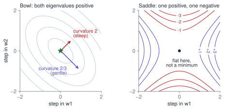

*Figure 30.1 — The loss of Chapter 26 seen from its minimum, and a saddle. Both have zero gradient at the center.*

#### The formal definition

For a function $f$ of $n$ inputs with continuous second derivatives, the Hessian is the $n \times n$ matrix

$$
H_{ij} = \frac{\partial^2 f}{\partial x_i\,\partial x_j}
$$

It is the Jacobian of the gradient, and it is symmetric. For a unit vector $\mathbf{h}$, $\mathbf{h}^\top H \mathbf{h}$ is the curvature along $\mathbf{h}$. Positive definite means $\mathbf{h}^\top H \mathbf{h} > 0$ for every nonzero $\mathbf{h}$, equivalently all eigenvalues positive.

**Newton's method** uses curvature to size its step:

$$
\mathbf{x}_{\text{new}} = \mathbf{x} - H^{-1}\,\nabla f(\mathbf{x})
$$

It steps far where the surface is flat and carefully where it bends sharply.

### Worked example

For the loss of Chapter 26 the partial derivatives were $\tfrac{2}{3}(2w_1 + w_2 - 3)$ and $\tfrac{2}{3}(w_1 + 2w_2 - 4)$. Differentiate each once more:

$$
H = \begin{bmatrix} 4/3 & 2/3 \\ 2/3 & 4/3 \end{bmatrix}
$$

- Eigenvalues: $4/3 + 2/3 = 2$ along $(1, 1)$ and $4/3 - 2/3 = 2/3$ along $(1, -1)$. Both are positive, so the zero-gradient point $(2/3, 5/3)$ is a minimum.
- Condition number: $2 \div 2/3 = 3$.
- Newton step from $(0, 0)$: $H^{-1}$ has rows $(1, -0.5)$ and $(-0.5, 1)$; applied to the gradient $(-2, -8/3)$ it gives $(-2/3, -5/3)$. Subtracting lands on the minimum $(2/3, 5/3)$ in one step, because this loss is exactly quadratic.
- For contrast, $f = x^2 - y^2$ has Hessian diagonal 2 and $-2$: a saddle.

```python
def numerical_hessian(f, w, h=1e-4):
    """Entry (i, j): how fast slope i changes along input j."""
    n = len(w)
    H = np.zeros((n, n))
    for i, ei in enumerate(np.eye(n)):
        for j, ej in enumerate(np.eye(n)):
            H[i, j] = (f(w + h * ei + h * ej) - f(w + h * ei - h * ej)
                       - f(w - h * ei + h * ej) + f(w - h * ei - h * ej)) / (4 * h * h)
    return H

w = np.array([0.0, 0.0])
H = 2 / len(y) * X.T @ X
print("Hessian           :", H.round(4).tolist())
print("numerical Hessian :", numerical_hessian(loss, w).round(4).tolist())
curvatures, directions = np.linalg.eigh(H)
print("eigenvalues       :", curvatures.round(4), "-> positive definite, a bowl")
print("condition number  :", round(curvatures.max() / curvatures.min(), 2))

newton = w - np.linalg.solve(H, grad(w))
print("one Newton step   :", newton.round(4), "gradient there:",
      np.abs(grad(newton)).round(12))

def saddle(v):
    return v[0] ** 2 - v[1] ** 2

print("saddle eigenvalues:", np.linalg.eigvalsh(numerical_hessian(saddle, w)).round(4))
```

Output:

```text
Hessian           : [[1.3333, 0.6667], [0.6667, 1.3333]]
numerical Hessian : [[1.3333, 0.6667], [0.6667, 1.3333]]
eigenvalues       : [0.6667 2.    ] -> positive definite, a bowl
condition number  : 3.0
one Newton step   : [0.6667 1.6667] gradient there: [0. 0.]
saddle eigenvalues: [-2.  2.]
```

### Common mistakes

| Mistake | Why it bites | Do this instead |
|---|---|---|
| Taking "gradient near zero" to mean "trained" | Saddles and plateaus have tiny gradients too | Compare loss curves across seeds; look at curvature |
| Newton's method where no minimum exists | Log loss on perfectly separable data keeps falling as weights grow, so steps never settle | Add regularization (Chapter 21) or damping |
| Forming the Hessian of a large model | A million weights means $10^{12}$ entries | Hessian-vector products, quasi-Newton methods, or adaptive first-order methods (Chapter 35) |

### Where a PM meets it

- A loss that oscillates or blows up means the step is too large for the sharpest curvature; one that barely moves means it is too small for the flattest. Scaling inputs and normalization narrow that gap.
- The $n^2$ cost keeps second-order methods rare for large models, which is why Adam-style optimizers dominate.
- A stalled loss is not proof of a finished model.

### Check yourself

**Q30.1** For $f(x, y) = x^2 + 4xy + y^2$, write the Hessian. Is $(0, 0)$ a minimum?

**Q30.2** Gradient descent on a quadratic is stable only when the learning rate is below 2 divided by the largest eigenvalue of the Hessian. What is that limit for the loss above?

> [!IMPORTANT]
> **In one line:** The Hessian measures how slopes change; its eigenvalues tell a bowl from a saddle and set how large a step is safe.

## 31. Taylor series and how calculus wires the AI stack

### Why it matters

Every optimizer makes the same bet: near where I stand, this complicated loss looks like a simple line or bowl. Taylor's theorem says when that bet is good and how fast it goes bad with distance.

### The idea

Around any point, a smooth function can be approximated by a polynomial built from its derivatives there: the value, then slope times step, then half the curvature times step squared, and so on. Keep two terms and you have the tangent line, the **first-order approximation**. Keep three and you have a parabola, the **second-order approximation**. Both are excellent close in and can be absurd far out.

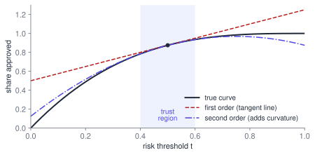

*Figure 31.1 — Local models of Chapter 25's approval curve. Outside the shaded trust region both drift away.*

#### The formal definition

For a function with enough derivatives:

$$
f(x + h) = f(x) + f'(x)\,h + \frac{f''(x)}{2}\,h^2 + \frac{f'''(x)}{6}\,h^3 + \cdots
$$

Stopping after the $h^k$ term leaves an error that shrinks like $h^{k+1}$. With several inputs, gradient $\mathbf{g}$ and Hessian $H$:

$$
f(\mathbf{x} + \mathbf{h}) \approx f(\mathbf{x}) + \mathbf{g}^\top \mathbf{h} + \tfrac{1}{2}\,\mathbf{h}^\top H\,\mathbf{h}
$$

Gradient descent takes the step $\mathbf{h} = -\eta\,\mathbf{g}$ with learning rate $\eta$, so

$$
f(\mathbf{x} - \eta\,\mathbf{g}) \approx f(\mathbf{x}) - \eta\,\lVert \mathbf{g} \rVert^2 + \tfrac{1}{2}\,\eta^2\,\mathbf{g}^\top H\,\mathbf{g}
$$

The first-order term promises a decrease; the curvature term takes it back when $\eta$ is too large. On a quadratic the method is stable only for $\eta < 2/\lambda_{\max}$, where $\lambda_{\max}$ is the largest eigenvalue of $H$. Newton's method (Chapter 30) jumps to the minimum of the second-order model.

### Worked example

For $A(t) = 1 - (1 - t)^3$ at $t = 0.5$: $A = 0.875$, $A' = 0.75$, $A'' = -6(0.5) = -3$, $A''' = 6$.

- Step 0.1: first order $0.875 + 0.075 = 0.950$; second order $0.950 - 1.5(0.01) = 0.935$; third order $0.935 + 0.001 = 0.936$, which is exact because $A$ is a cubic.
- Step 0.4: first order $0.875 + 0.30 = 1.175$, an approval rate above 100%; second order $0.935$; truth $0.999$.

The second half of the code applies the gradient-step formula to the loss of Chapter 26, where $\lambda_{\max} = 2$, so the limit is $\eta < 1$.

```python
def approval(t):
    return 1 - (1 - t) ** 3

t0 = 0.5
d1, d2, d3 = 3 * (1 - t0) ** 2, -6 * (1 - t0), 6.0

def taylor(h, order):
    terms = [approval(t0), d1 * h, d2 * h**2 / 2, d3 * h**3 / 6]
    return sum(terms[:order + 1])

print("step  order 1  order 2  order 3   exact")
for h in (0.1, 0.4):
    print(f"{h:4.2f}  {taylor(h, 1):7.4f}  {taylor(h, 2):7.4f}  {taylor(h, 3):7.4f}  "
          f"{approval(t0 + h):6.4f}")

# Second-order prediction of a gradient step on Chapter 26's loss
w = np.zeros(2)
g, H = grad(w), 2 / len(y) * X.T @ X
print("learning rate  predicted  actual   after 40 steps")
for rate in (0.3, 0.9, 1.1):
    step = -rate * g
    predicted = loss(w) + g @ step + 0.5 * step @ H @ step
    v = w.copy()
    for _ in range(40):
        v = v - rate * grad(v)
    print(f"{rate:13.1f}  {predicted:9.4f}  {loss(w + step):6.4f}   {loss(v):.4g}")
```

Output:

```text
step  order 1  order 2  order 3   exact
0.10   0.9500   0.9350   0.9360  0.9360
0.40   1.1750   0.9350   0.9990  0.9990
learning rate  predicted  actual   after 40 steps
          0.3     0.6533  0.6533   0.1111
          0.9     1.8800  1.8800   0.1111
          1.1     4.0430  4.0430   5.881e+06
```

The prediction is exact because that loss is quadratic. At a learning rate of 1.1 the first step raises the loss from 3 to 4.04, and forty steps send it into the millions.

Where each idea of this part sits in training:

| Idea | Role in training |
|---|---|
| Limits, continuity (24) | Smooth losses and activations, so slopes exist |
| Derivative (25) | Sensitivity of the loss to one weight |
| Gradient (26) | The direction of every update |
| Directional derivative (27) | Progress when only some weights may move |
| Chain rule (28) | Backpropagation |
| Jacobian (29) | How a layer hands sensitivities on |
| Hessian (30) | Curvature, conditioning, safe step size |
| Taylor series (31) | The local model each update trusts |

### Common mistakes

| Mistake | Why it bites | Do this instead |
|---|---|---|
| Extrapolating a local model | First order predicts 117.5% approval at a step of 0.4 | Stay in the range where the fit was checked |
| Raising the learning rate too far | Past $2/\lambda_{\max}$ the curvature term wins and the loss climbs | Lower the rate, warm it up or clip gradients |

### Where a PM meets it

- Any forecast of the form "move X by this much and Y moves by that much" is a first-order Taylor estimate. Ask over what range it has been validated.
- A loss that spikes early in training is often the second-order term winning. Lower learning rates and warm-up schedules manage it (Chapter 33).

### Check yourself

**Q31.1** Near $z = 0$ the sigmoid has value 0.5 and slope 0.25. Give the first-order estimate of $\sigma(0.4)$ and compare it with the true value 0.5987.

**Q31.2** Use the second-order model at $t = 0.5$ to estimate $A(0.7)$, and compare it with the exact value.

> [!IMPORTANT]
> **In one line:** Near any point a smooth function is its value plus slope times step plus half curvature times step squared; training is a long run of small steps that trust that picture.

# Part IV — Optimization

## 32. Convexity, minima and saddle points

### Why it matters

Training a model means searching a loss surface for its lowest point. The shape of that surface decides whether two training runs agree, whether "converged" means "best", and how many random seeds you have to pay for.

### The idea

Picture the loss as a landscape: one direction per parameter, height equal to the loss. Three shapes matter.

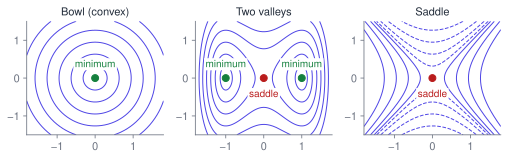

*Figure 32.1 — Contour lines join points of equal loss. Left: a bowl. Middle: two valleys with a saddle between them. Right: a saddle, uphill across the solid contours and downhill across the dashed ones.*

- A **convex** function is a bowl. Wherever you start, downhill leads to the same bottom. Linear and logistic regression have convex losses.
- A non-convex function can have several valleys. Each valley floor is a **local minimum**; the lowest one is the **global minimum**. Neural networks are non-convex.
- A **saddle point** is flat like a minimum but curves up in some directions and down in others, like a mountain pass.

#### The formal definition

A function $f$ is convex if the straight line between any two points of its graph never dips below the graph. For all points $\mathbf{a}, \mathbf{b}$ and every $\lambda \in [0, 1]$:

$$
f(\lambda \mathbf{a} + (1-\lambda)\mathbf{b}) \le \lambda f(\mathbf{a}) + (1-\lambda) f(\mathbf{b})
$$

For a convex function every local minimum is a global minimum.

A **critical point** is a point where the gradient $\nabla f$ (chapter 26) is zero. The eigenvalues (chapter 7) of the Hessian $\mathbf{H}$, the matrix of second derivatives (chapter 30), say which kind it is:

| Eigenvalues of $\mathbf{H}$ | Kind of critical point |
|---|---|
| all positive | local minimum |
| all negative | local maximum |
| some positive, some negative | saddle point |
| otherwise (some are zero) | undecided |

A twice-differentiable $f$ is convex exactly when $\mathbf{H}$ has no negative eigenvalue anywhere.

A minimum needs all $n$ eigenvalues positive at once. If each sign were a coin flip, the chance would be $2^{-n}$, and a network has millions of parameters. Dauphin and colleagues (2014) argued that this is what makes deep networks hard to train: not bad local minima, but saddle points ringed by plateaus where the gradient is tiny and training seems to stall.

### Worked example

Take $f(x, y) = (x^2 - 1)^2 + y^2$, the middle panel. Its gradient is $(4x(x^2 - 1),\ 2y)$, which is zero at $(-1, 0)$, $(0, 0)$ and $(1, 0)$. Its Hessian is diagonal, with entries $12x^2 - 4$ and $2$.

- At $(\pm 1, 0)$ the eigenvalues are $8$ and $2$: two minima, both with $f = 0$.
- At $(0, 0)$ they are $-4$ and $2$: a saddle, with $f = 1$.

Convexity fails: halfway between the two minima $f$ is 1, above the average of the endpoints, 0.

```python
def classify(eigenvalues):
    if np.all(eigenvalues > 0):
        return "local minimum"
    if np.all(eigenvalues < 0):
        return "local maximum"
    if np.any(eigenvalues > 0) and np.any(eigenvalues < 0):
        return "saddle point"
    return "inconclusive"

kinds = {}
for point in [(-1.0, 0.0), (0.0, 0.0), (1.0, 0.0)]:
    assert np.allclose(gradient(*point), 0.0)          # it is a critical point
    eig = np.linalg.eigvalsh(hessian(*point))
    kinds[point] = classify(eig)
    print(f"{point}: f = {f(*point):.0f}, eigenvalues {eig} -> {kinds[point]}")
```

Output:

```text
(-1.0, 0.0): f = 0, eigenvalues [2. 8.] -> local minimum
(0.0, 0.0): f = 1, eigenvalues [-4.  2.] -> saddle point
(1.0, 0.0): f = 0, eigenvalues [2. 8.] -> local minimum
f(midpoint) = 1.0, average of f at the ends = 0.0, convex: False
random symmetric n x n matrix: chance that every eigenvalue is positive
  n=1: 1 in 2   n=2: 1 in 7   n=3: 1 in 41   n=4: 1 in 396   n=5: 1 in 5,714
```

The last two lines use random symmetric matrices as stand-in Hessians. That is a caricature, but it shows the trend: with five parameters, only one in about 5,700 is a minimum.

### Common mistakes

| Mistake | Why it bites | Do this instead |
|---|---|---|
| Reading "the loss stopped falling" as "this is the best model" | A plateau near a saddle looks the same on a loss curve | Check the gradient size, train longer, compare seeds |
| Reporting one run of a non-convex model | Another seed can settle in a different valley | Report the mean and spread over several seeds |
| Thinking a convex loss guarantees a good model | It guarantees the best fit of that model, which may still be poor | Compare with a flexible model on held-out data |

### Where a PM meets it

- **Decision:** a convex model such as logistic regression gives the same answer on every run, which helps audits and debugging. A neural network buys accuracy at the price of run-to-run variation.
- **Ask for:** the spread of the headline metric across at least three seeds before you believe a 0.2-point improvement.
- **Watch for:** a flat loss curve offered as proof that more training cannot help.

### Check yourself

**Q32.1** At a critical point the Hessian has eigenvalues 3, 0.5 and -2. What kind of point is it?

**Q32.2** A teammate says: "It is logistic regression, so one training run is enough." Is that reasonable?

**Q32.3** Why do saddle points outnumber local minima when a model has many parameters?

> [!IMPORTANT]
> **In one line:** A convex loss has one valley, so training finds the best fit; a deep network's loss is full of saddles and plateaus, so judge it over several seeds.

## 33. Gradient descent

### Why it matters

Almost every model in this library is trained by one loop: measure the slope of the loss, step downhill, repeat. One number, the learning rate, decides whether that loop crawls, converges or blows up. Check it first when a training run fails.

### The idea

You are on a hillside in fog. You cannot see the valley, but you can feel the slope under your feet. Step in the steepest downhill direction, feel again, repeat. The gradient points uphill, so you step against it. The **learning rate** $\eta$ sets how far you move for a given slope.

#### The formal definition

To minimize a loss $J(\boldsymbol{\theta})$, use the first-order Taylor approximation (chapter 31) around the current parameters. For a small step $\boldsymbol{\Delta}$:

$$
J(\boldsymbol{\theta} + \boldsymbol{\Delta}) \approx J(\boldsymbol{\theta}) + \nabla J(\boldsymbol{\theta})^\top \boldsymbol{\Delta}
$$

Among all steps of one fixed small length, the dot product on the right is most negative when $\boldsymbol{\Delta}$ points exactly opposite to the gradient. That gives the update of **gradient descent**:

$$
\boldsymbol{\theta}_{t+1} = \boldsymbol{\theta}_t - \eta \, \nabla J(\boldsymbol{\theta}_t)
$$

The approximation holds only near $\boldsymbol{\theta}$, so $\eta$ must be small. How small depends on curvature. On a quadratic with second derivative $L$, each step multiplies the distance to the minimum by $(1 - \eta L)$. Below $\eta = 1/L$ the approach is steady. Between $1/L$ and $2/L$ it overshoots but still converges. Above $2/L$ every overshoot is larger than the last, and the run diverges.

With many parameters, $L$ is the largest eigenvalue of the Hessian, and the smallest eigenvalue sets how slowly the flattest direction converges. Their ratio is the **condition number**. Features on very different scales inflate it, which is why features are standardized before training.

### Worked example

Four PayFlow merchants had $x = (1, 1, 1, 3)$ thousand payments last week and $y = (2, 3, 4, 9)$ disputes. Fit disputes $= w \times$ payments by minimizing half the mean squared error:

$$
J(w) = \frac{1}{2n}\sum_{i=1}^{n}(w x_i - y_i)^2, \qquad J'(w) = \frac{1}{n}\sum_{i=1}^{n} x_i (w x_i - y_i) = 3w - 9
$$

because $n = 4$, $\sum x_i^2 = 12$ and $\sum x_i y_i = 36$. The best weight is $w = 3$ and the curvature is $L = 3$. Start at $w = 0$ with $\eta = 0.1$:

| Step | $w$ | $J'(w)$ | New $w$ |
|---|---|---|---|
| 1 | 0 | -9 | 0.9 |
| 2 | 0.9 | -6.3 | 1.53 |
| 3 | 1.53 | -4.41 | 1.971 |

Each step closes 30% of the remaining gap, since $1 - \eta L = 0.7$.

```python
x = np.array([1.0, 1.0, 1.0, 3.0])   # weekly payments, thousands
y = np.array([2.0, 3.0, 4.0, 9.0])   # disputes that week

def loss(w):
    return np.mean((w * x - y) ** 2) / 2

def grad(w):
    return np.mean(x * (w * x - y))

def descend(eta, steps, w=0.0):
    path = [w]
    for _ in range(steps):
        w = w - eta * grad(w)       # the whole algorithm
        path.append(w)
    return np.array(path)
```

Output:

```text
curvature L = 3.0, best w = 3.0, lowest loss = 0.25
largest stable learning rate 2/L = 0.6667
eta = 0.1, first three steps: [0.9   1.53  1.971]
eta = 0.01 (too small  ) after 20 steps: w =    1.3686, loss =   4.2421
eta = 0.1  (about right) after 20 steps: w =    2.9976, loss =   0.2500
eta = 0.7  (too large  ) after 20 steps: w =  -17.1825, loss = 611.2500
```

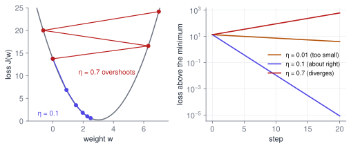

*Figure 33.1 — Left: $\eta = 0.1$ walks down the parabola; $\eta = 0.7$ jumps across it and climbs. Right: the gap to the minimum on a log scale. Too small barely moves, too large grows without limit.*

A rate of 0.7 is above $2/L = 0.667$, so every step lands farther from 3 than it started.

### Common mistakes

| Mistake | Why it bites | Do this instead |
|---|---|---|
| Training on unscaled features, such as an amount in dollars next to a 0/1 flag | The steep direction caps $\eta$, so the flat one crawls | Standardize the features |
| Treating a loss of `nan` or `inf` as a data bug | It is usually divergence from a rate that is too large | Cut $\eta$ tenfold and rerun |
| Judging a run by its first few steps | A rate that is too small looks healthy, only slow | Plot the whole loss curve on a log scale |

### Where a PM meets it

- **Decision:** training cost. A learning-rate sweep is cheap next to weeks of slow training, so ask whether one was run.
- **Ask for:** the loss curve, not only the final number. Flat from the start means the rate is too small or there is a bug. Spikes or an explosion mean it is too large.
- **Watch for:** "we need more GPUs" before anyone has checked feature scaling and the learning rate.

### Check yourself

**Q33.1** In the example $L = 3$. What happens with $\eta = 1/3$? With $\eta = 2/3$?

**Q33.2** Why is the derivation only trustworthy for small steps?

**Q33.3** One feature is the amount in USD, from 0 to 5,000. Another is a 0/1 new-device flag. Why does this slow gradient descent, and what fixes it?

> [!IMPORTANT]
> **In one line:** Gradient descent repeats "step against the gradient"; the learning rate must stay below 2 divided by the steepest curvature, and scaled features let one rate suit every direction.

## 34. Stochastic and mini-batch gradient descent

### Why it matters

A fraud model learns from millions of payments. An exact gradient touches every one of them to take a single step. Stochastic methods take thousands of cheaper, noisier steps in the same time, and every large model is trained this way. Batch size is the knob that trades noise against cost per step.

### The idea

A pollster does not ask every voter. The loss is an average over examples, so its gradient is an average too, and a random sample estimates it: right on average, with noise that shrinks as the sample grows.

- **Full-batch gradient descent** uses all $n$ examples for each step.
- **Stochastic gradient descent (SGD)** originally meant one random example per step.
- **Mini-batch gradient descent** uses $B$ random examples per step, often tens to thousands. In practice "SGD" usually means this.

An **epoch** is one pass over the data, which is $n/B$ steps.

#### The formal definition

Write the loss as an average of per-example losses, $J(\boldsymbol{\theta}) = \frac{1}{n}\sum_{i=1}^{n} \ell_i(\boldsymbol{\theta})$. For a random batch $\mathcal{B}$ of $B$ examples:

$$
\mathbf{g}_{\mathcal{B}} = \frac{1}{B}\sum_{i \in \mathcal{B}} \nabla \ell_i(\boldsymbol{\theta}), \qquad \boldsymbol{\theta}_{t+1} = \boldsymbol{\theta}_t - \eta \, \mathbf{g}_{\mathcal{B}}
$$

The estimate is unbiased: $\mathbb{E}[\mathbf{g}_{\mathcal{B}}] = \nabla J(\boldsymbol{\theta})$. Its variance falls as $1/B$, so its noise (standard deviation) falls as $1/\sqrt{B}$, the same law as the standard error in chapter 19. Quadrupling the batch halves the noise and quadruples the cost of a step. That is why very large batches are a poor trade.

### Worked example

Use the four merchants of chapter 33, where merchant $i$ contributes the gradient $x_i(w x_i - y_i)$. At $w = 0$ the four values are $-2, -3, -4, -27$. Their mean, $-9$, is the full gradient. SGD draws one of them: it might see $-2$ or $-27$. A batch of merchants 1 and 4 sees $-14.5$.

At the best weight, $w = 3$, the four values are $1, 0, -1, 0$. They average to zero without each being zero, so with a constant learning rate SGD never settles. It jitters around the minimum.

Now the same model with five correlated features on 2,000 synthetic merchants, trained three ways for five epochs at one learning rate, $\eta = 0.05$.

```python
def batch_gradient(w, idx):
    return X[idx].T @ (X[idx] @ w - y[idx]) / len(idx)

def train(batch_size, epochs=5, eta=0.05, seed=0):
    order_rng = np.random.default_rng(seed)
    w = np.zeros(d)
    seen, history = 0, [(0.0, loss(w))]
    for _ in range(epochs):
        order = order_rng.permutation(n)             # reshuffle every epoch
        for start in range(0, n, batch_size):
            idx = order[start:start + batch_size]
            w = w - eta * batch_gradient(w, idx)     # same rule as chapter 33
            seen += len(idx)
            history.append((seen / n, loss(w)))
    return w, np.array(history)
```

Output:

```text
per-example gradients at w = 0: [ -2.  -3.  -4. -27.]  mean: -9.0
per-example gradients at w = 3: [ 1.  0. -1.  0.]  mean: 0.0
lowest possible loss 0.5339; loss after epochs 1, 2 and 5:
  full batch       (     5 updates): 3.1113  2.6159  1.8304
  mini-batch of 32 (   315 updates): 0.6542  0.5468  0.5402
  single example   (10,000 updates): 0.8527  0.5767  0.5819
gradient noise (std) at batch size 1, 4, 16, 64: 3.624  1.776  0.877  0.436
```

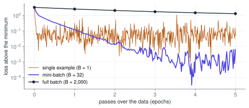

*Figure 34.1 — Same data, same learning rate, same number of passes. Full batch takes five steps. The single-example run drops fastest and then bounces. The mini-batch run ends lowest.*

After five passes, full batch is still far from the floor of 0.534. Mini-batches of 32 are within 1.2% of it. Single examples got close first, then bounced around 0.58, their noise floor. The last line shows the square-root law: each fourfold increase in batch size halves the noise. Full batch could use a larger learning rate, but only up to the stability limit of chapter 33, which cannot make up a 60-fold gap in the number of steps.

### Common mistakes

| Mistake | Why it bites | Do this instead |
|---|---|---|
| Not shuffling | Data sorted by date or merchant makes batches unrepresentative | Reshuffle every epoch |
| Reading a jagged training curve as a broken model | Mini-batch loss is noisy by construction | Judge the trend, or the validation loss |
| Keeping the learning rate constant to the end | The run bounces at a noise floor | Decay the rate late in training |
| Changing batch size without retuning | Fewer, quieter steps per epoch need a different rate | Retune $\eta$ whenever $B$ changes |

### Where a PM meets it

- **Decision:** batch size is set mostly by hardware memory. It drives training time, and so whether the fraud model can be refreshed every night.
- **Ask for:** time per epoch, and epochs needed to reach the target validation metric.
- **Watch for:** two runs compared "by steps" when their batch sizes differ. Compare by epochs or by wall-clock time.

### Check yourself

**Q34.1** The noise at $B = 16$ is 0.877. Predict it at $B = 256$.

**Q34.2** Why does the single-example run stall above the minimum when full batch would not?

**Q34.3** A dataset has 1,000,000 payments and the batch size is 500. How many updates are three epochs?

> [!IMPORTANT]
> **In one line:** A random mini-batch gives an unbiased, noisy gradient at a fraction of the cost, and since noise shrinks only with the square root of batch size, many cheap steps beat a few exact ones.

## 35. Momentum, RMSprop and Adam

### Why it matters

Plain gradient descent zigzags across steep directions while crawling along shallow ones, and it uses one step size for every parameter. Momentum fixes the first weakness, RMSprop the second, Adam both. Adam and its variant AdamW train most neural networks and LLM fine-tunes.

### The idea

Three ideas, one at a time.

- **Momentum** keeps a running sum of gradients, like a heavy ball that keeps rolling. Gradients that keep flipping sign cancel in the sum; gradients that agree add up.
- **RMSprop** gives each parameter its own step size: small where its gradients are large, large where they are small.
- **Adam** does both, and corrects a start-up bias.

#### The formal definition

Below, $\mathbf{g}_t$ is the mini-batch gradient at step $t$; squares, roots and divisions act on each parameter separately.

Momentum (Polyak, 1964), with running sum $\mathbf{u}$:

$$
\mathbf{u}_t = \beta \mathbf{u}_{t-1} + \mathbf{g}_t, \qquad \boldsymbol{\theta}_t = \boldsymbol{\theta}_{t-1} - \eta \, \mathbf{u}_t
$$

The sum can reach $1/(1-\beta)$ times one gradient, which is 10 for the usual $\beta = 0.9$.

RMSprop (Tieleman and Hinton, 2012 lecture slides), with a running average $\mathbf{s}$ of each parameter's squared gradient:

$$
\mathbf{s}_t = \rho \, \mathbf{s}_{t-1} + (1-\rho)\, \mathbf{g}_t^2, \qquad \boldsymbol{\theta}_t = \boldsymbol{\theta}_{t-1} - \eta \, \frac{\mathbf{g}_t}{\sqrt{\mathbf{s}_t} + \epsilon}
$$

The tiny $\epsilon$ prevents division by zero.

Adam (Kingma and Ba, 2014; published at ICLR 2015):

$$
\begin{aligned}
\mathbf{m}_t &= \beta_1 \mathbf{m}_{t-1} + (1-\beta_1)\,\mathbf{g}_t, & \hat{\mathbf{m}}_t &= \frac{\mathbf{m}_t}{1-\beta_1^t} \\
\mathbf{v}_t &= \beta_2 \mathbf{v}_{t-1} + (1-\beta_2)\,\mathbf{g}_t^2, & \hat{\mathbf{v}}_t &= \frac{\mathbf{v}_t}{1-\beta_2^t} \\
\boldsymbol{\theta}_t &= \boldsymbol{\theta}_{t-1} - \eta \, \frac{\hat{\mathbf{m}}_t}{\sqrt{\hat{\mathbf{v}}_t} + \epsilon}
\end{aligned}
$$

The paper's defaults are $\eta = 0.001$, $\beta_1 = 0.9$, $\beta_2 = 0.999$ and $\epsilon = 10^{-8}$. Both averages start at zero, so early on they are too small. Dividing by $1 - \beta^t$ removes that bias.

### Worked example

Take $J(\boldsymbol{\theta}) = \tfrac{1}{2}(100\,\theta_1^2 + \theta_2^2)$, a bowl 100 times steeper along $\theta_1$, as happens when one feature has much larger units than another. Start at $(1, 1)$ with $\eta = 0.1$ and take one Adam step.

| Quantity | $\theta_1$ | $\theta_2$ |
|---|---|---|
| gradient $g$ | 100 | 1 |
| $m = 0.1\,g$ | 10 | 0.1 |
| $v = 0.001\,g^2$ | 10 | 0.001 |
| $\hat{m} = m / (1 - 0.9)$ | 100 | 1 |
| $\hat{v} = v / (1 - 0.999)$ | 10,000 | 1 |
| step $= \eta\,\hat{m}/\sqrt{\hat{v}}$ | 0.1 | 0.1 |

Both parameters move by exactly $\eta$, although their gradients differ 100-fold. Without bias correction the step would be $0.1 \times 10/\sqrt{10} = 0.316$, three times the intended size.

```python
def adam(grad, eta, steps, b1=0.9, b2=0.999, eps=1e-8, correct=True):
    th, m, v, path = START.copy(), np.zeros(2), np.zeros(2), [START.copy()]
    for t in range(1, steps + 1):
        g = grad(th)
        m = b1 * m + (1 - b1) * g               # momentum's idea
        v = b2 * v + (1 - b2) * g**2            # RMSprop's idea
        m_hat = m / (1 - b1**t) if correct else m
        v_hat = v / (1 - b2**t) if correct else v
        th = th - eta * m_hat / (np.sqrt(v_hat) + eps)
        path.append(th.copy())
    return np.array(path)

loss, grad = make_bowl(100)
g1 = grad(START)
m1, v1 = 0.1 * g1, 0.001 * g1**2
m_hat, v_hat = m1 / (1 - 0.9), v1 / (1 - 0.999)
```

Output:

```text
gradient at (1, 1):       (100, 1)
m_1 and v_1:              (10, 0.1) (10, 0.001)
m_hat and v_hat:          (100, 1) (10000, 1)
theta after one step:     (0.9, 0.9)
without bias correction:  (0.6838, 0.6838)
steps until the loss stays below 0.001
  method             bowl 100:1   bowl 10,000:1
  gradient descent         162         16,353
  momentum                 102          6,195
  Adam                      94            146
```

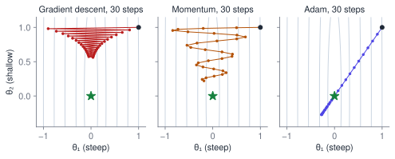

*Figure 35.1 — Thirty steps from the dot toward the star. Gradient descent zigzags and crawls, momentum covers more ground, Adam heads straight in.*

Rescale one feature so the bowl is 10,000:1, and gradient descent, re-tuned to its largest safe rate, needs 100 times more steps. Adam needs 146 with the same $\eta$, because its step does not depend on the size of the gradient.

### Common mistakes

| Mistake | Why it bites | Do this instead |
|---|---|---|
| Adding an L2 penalty to the loss with Adam | The penalty is rescaled per parameter, so regularization is uneven | Use AdamW (Loshchilov and Hutter), which applies weight decay separately |
| Treating Adam as tuning-free, or comparing optimizers at one rate | Each optimizer has its own best learning rate | Sweep $\eta$ for each; add warmup and decay |

### Where a PM meets it

- **Decision:** you seldom pick the optimizer, but you review the plan. For neural networks AdamW is the expected default; another choice deserves a sentence of reasoning.
- **Ask for:** the learning rate, its schedule and the weight decay, and how each was chosen.
- **Watch for:** hosted fine-tuning services that expose only a learning rate and a number of epochs. Their defaults are not tuned for your data.

### Check yourself

**Q35.1** With $\beta = 0.9$ and the same gradient $g$ at every step, what does momentum's running sum approach?

**Q35.2** The first gradient for one parameter is $g = -4$. With Adam's defaults, compute $\hat{m}$, $\hat{v}$ and the change in the parameter.

**Q35.3** Why did Adam's step count barely change on the 10,000:1 bowl?

> [!IMPORTANT]
> **In one line:** Momentum averages gradients to stop the zigzag, RMSprop gives each parameter its own step size, and Adam does both with a correction for its zero start.

## 36. Constrained optimization and Lagrange multipliers

### Why it matters

Product decisions are rarely "make this number as large as possible". They are "as large as possible within the budget, the risk limit or the headcount". A Lagrange multiplier solves such a problem and hands you a second number for free: what one more unit of the limited resource is worth.

### The idea

PayFlow has USD 40 thousand a month to win new merchants. It splits the money between paid search ($x_1$) and partner referrals ($x_2$), both in USD thousands. Each channel has diminishing returns, and the growth team's fitted curves say the split wins $10\sqrt{x_1} + 30\sqrt{x_2}$ merchants.

You already know the rule. If the last dollar in referrals wins more merchants than the last dollar in search, move a dollar across. Stop when the two marginal returns are equal. That common marginal return is the **Lagrange multiplier**.

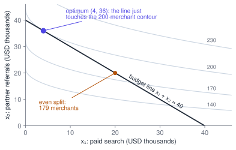

*Figure 36.1 — Every point on the dark line spends the whole budget. The best one is where the line just touches the highest contour it can reach.*

#### The formal definition

Maximize $f(\mathbf{x})$ subject to $g(\mathbf{x}) = c$. Form the **Lagrangian**

$$
\mathcal{L}(\mathbf{x}, \lambda) = f(\mathbf{x}) - \lambda \, (g(\mathbf{x}) - c)
$$

At a constrained optimum $\mathbf{x}^\star$ where $\nabla g \neq \mathbf{0}$, there is a number $\lambda$ with

$$
\nabla f(\mathbf{x}^\star) = \lambda \, \nabla g(\mathbf{x}^\star), \qquad g(\mathbf{x}^\star) = c
$$

The two gradients are parallel, which is the touching in Figure 36.1: if the contour crossed the constraint, sliding along the constraint would still improve $f$. With this sign convention

$$
\lambda = \frac{d f^\star}{d c}
$$

where $f^\star$ is the best achievable value. So $\lambda$ is the rate at which the optimum improves as the constraint is relaxed, its **shadow price**. The method goes back to Lagrange in the late 18th century.

### Worked example

Here $g(\mathbf{x}) = x_1 + x_2$ and $c = 40$. Setting each partial derivative of $f$ equal to $\lambda$ times that of $g$:

$$
\frac{5}{\sqrt{x_1}} = \lambda, \qquad \frac{15}{\sqrt{x_2}} = \lambda \quad\Longrightarrow\quad x_1 = \frac{25}{\lambda^2}, \quad x_2 = \frac{225}{\lambda^2}
$$

The budget gives $250/\lambda^2 = 40$, so $\lambda = 2.5$. Then $x_1 = 4$ and $x_2 = 36$, winning $10 \cdot 2 + 30 \cdot 6 = 200$ merchants. An even split wins 179.

The shadow price says the next USD 1,000 wins about 2.5 merchants. If a merchant is worth USD 600 of first-year margin, that is USD 1,500 back: ask for more budget. But $\lambda = \sqrt{250/c}$ falls as the budget grows. At a budget of 90 it is 1.667 and the next USD 1,000 returns exactly USD 1,000. Stop there.

```python
def merchants(x):
    return A1 * np.sqrt(x[0]) + A2 * np.sqrt(x[1])

def solve_by_lagrange(budget):
    """Stationarity gives x_i = (a_i / (2 lam))^2; the budget fixes lam."""
    lam = np.sqrt((A1**2 + A2**2) / (4 * budget))
    x = np.array([(A1 / (2 * lam)) ** 2, (A2 / (2 * lam)) ** 2])
    return x, lam

def solve_numerically(budget):
    result = minimize(lambda x: -merchants(x), x0=[budget / 2, budget / 2],
                      constraints=[{"type": "eq",
                                    "fun": lambda x: x[0] + x[1] - budget}],
                      bounds=[(1e-9, None)] * 2, method="SLSQP")
    return result.x
```

Output:

```text
best split: paid search 4.0, referrals 36.0
merchants won: 200.0
shadow price lambda: 2.50 merchants per extra USD thousand
marginal return of each channel at the optimum: 2.50, 2.50
an even 20/20 split wins 178.9
numerical solver agrees: [ 4. 36.]
actual gain from budget 40 -> 41: 2.485 merchants
budget  40: lambda = 2.500, merchants = 200
budget  90: lambda = 1.667, merchants = 300
budget 160: lambda = 1.250, merchants = 400
```

### Common mistakes

| Mistake | Why it bites | Do this instead |
|---|---|---|
| Extrapolating the shadow price | It is a marginal rate: 2.5 at a budget of 40, 1.67 at 90 | Solve again at the new budget |
| Memorizing the sign of $\lambda$ | It flips with the convention and with min versus max | Relax the constraint a little and see which way the optimum moves |
| Using this method for an "at most" limit | The limit may not bind, and then its price is zero | Use the KKT conditions (chapter 37) |
| Trusting the response curves blindly | The split is only as good as $10\sqrt{x_1}$ and $30\sqrt{x_2}$ | Fit them from experiments (chapter 23) and carry the uncertainty |

### Where a PM meets it

- **Decision:** splitting any fixed resource, such as budget, review hours or compute, across uses with diminishing returns. Equalize the marginal returns.
- **Ask for:** each channel's marginal return at the current split, not its average. Here the average is 5 merchants per USD thousand, twice what the next dollar earns.
- **Bring to the budget review:** the shadow price and the budget at which it stops paying.

### Check yourself

**Q36.1** At the optimum both channels average 5 merchants per USD thousand. Why is the shadow price only 2.5?

**Q36.2** The budget rises to 160. What is the shadow price, and is another USD 1,000 worth it if a merchant is worth USD 600?

**Q36.3** At the current split the marginal return is 4 for search and 2 for referrals. Which way should money move?

> [!IMPORTANT]
> **In one line:** At the best split of a fixed budget every use has the same marginal return, and that shared number, the Lagrange multiplier, is what one more unit of budget is worth.

## 37. KKT conditions and support vector machines

### Why it matters

Real limits are ceilings: spend at most the budget, keep false positives under 1%. The KKT conditions say which limits bind and what each one costs. They also explain why a support vector machine depends on only a handful of training points.

### The idea

A ceiling either stops you or it does not. If it stops you, relaxing it would help, so it has a positive shadow price. If you are below it, relaxing it changes nothing and its price is zero. This either-or is **complementary slackness**.

Cap referrals in chapter 36's budget at 24, below the 36 you wanted: the cap binds and has a positive multiplier. A cap of 38 is slack, and its multiplier is zero (output, first two lines).

#### The formal definition

Minimize $f(\mathbf{x})$ subject to $g_j(\mathbf{x}) \le 0$ for $j = 1, \dots, m$. Under mild regularity conditions, an optimum $\mathbf{x}^\star$ has multipliers $\mu_j$ that satisfy the **KKT conditions** (Karush, 1939; Kuhn and Tucker, 1951):

| Condition | Statement |
|---|---|
| Stationarity | $\nabla f(\mathbf{x}^\star) + \sum_j \mu_j \nabla g_j(\mathbf{x}^\star) = \mathbf{0}$ |
| Primal feasibility | $g_j(\mathbf{x}^\star) \le 0$ |
| Dual feasibility | $\mu_j \ge 0$ |
| Complementary slackness | $\mu_j \, g_j(\mathbf{x}^\star) = 0$ |

For a convex problem (convex $f$ and convex $g_j$) any point that satisfies them is a global optimum.

A **support vector machine (SVM)** separates two classes, labeled $y_i = \pm 1$, with the line that stays farthest from both:

$$
\min_{\mathbf{w},\, b} \ \tfrac{1}{2}\lVert \mathbf{w} \rVert^2 \quad \text{subject to} \quad y_i(\mathbf{w}^\top \mathbf{x}_i + b) \ge 1 \ \text{ for every } i
$$

The empty band between the classes, the **margin**, has width $2/\lVert\mathbf{w}\rVert$, so minimizing $\lVert\mathbf{w}\rVert$ widens it. Each training point $i$ has one constraint, with multiplier $\alpha_i$. The KKT conditions give

$$
\mathbf{w} = \sum_i \alpha_i y_i \mathbf{x}_i, \qquad \sum_i \alpha_i y_i = 0, \qquad \alpha_i \, [\, y_i(\mathbf{w}^\top \mathbf{x}_i + b) - 1 \,] = 0
$$

The last equation is complementary slackness. A point beyond the margin's edge has $\alpha_i = 0$ and drops out of $\mathbf{w}$. Points with $\alpha_i > 0$ sit exactly on the edge: the **support vectors**.

### Worked example

Six payments: $x_1$ is the amount in USD hundreds, $x_2$ the device's payments in the last hour. Fraud is $+1$: payments 1 to 3 at $(3,5)$, $(5,3)$, $(6,5)$. Legitimate is $-1$: payments 4 to 6 at $(2,2)$, $(1,1)$, $(3,0)$.

Try $\mathbf{w} = (0.5, 0.5)$ and $b = -3$. The values $y_i(\mathbf{w}^\top\mathbf{x}_i + b)$ are $1, 1, 2.5, 1, 2, 1.5$: all at least 1, with payments 1, 2 and 4 on the edge. Set the other three $\alpha_i$ to zero and solve the first two KKT equations for the rest: $\alpha_1 = \alpha_2 = 0.125$ and $\alpha_4 = 0.25$. All are positive and the problem is convex, so this is the optimum.

```python
def fit(X, y):
    """Hard-margin SVM: the smallest ||w|| with every margin at least 1."""
    cons = [{"type": "ineq", "fun": lambda p, i=i: y[i] * (X[i] @ p[:2] + p[2]) - 1}
            for i in range(len(y))]
    res = minimize(lambda p: 0.5 * p[:2] @ p[:2], x0=np.zeros(3), constraints=cons,
                   method="SLSQP", options={"ftol": 1e-12, "maxiter": 500})
    return res.x[:2], res.x[2]

def multipliers(X, y, w, b):
    """Solve w = sum_i alpha_i y_i x_i on the points whose margin is 1."""
    margins = y * (X @ w + b)
    on = np.isclose(margins, 1.0, atol=1e-5)
    A = np.vstack([(y[on, None] * X[on]).T, y[on]])   # also sum_i alpha_i y_i = 0
    alpha_on = np.linalg.lstsq(A, np.append(w, 0.0), rcond=None)[0]
    alpha = np.zeros(len(y))
    alpha[on] = alpha_on
    return margins, alpha
```

Output:

```text
cap 24: x = (16, 24), cap slack = 0, mu_budget = 1.250, mu_cap = 1.812
cap 38: x = (4, 36), cap slack = 2, mu_budget = 2.500, mu_cap = 0.000
w = [0.5 0.5], b = -3.0, margin width = 2.828
y(w.x+b): [1.  1.  2.5 1.  2.  1.5]
alpha:    [0.125 0.125 0.    0.25  0.    0.   ]
refit on payments 1, 2, 4 only: w = [0.5 0.5], b = -3.0000
refit without payment 4:        w = [0.3077 0.4615], b = -1.9231
```

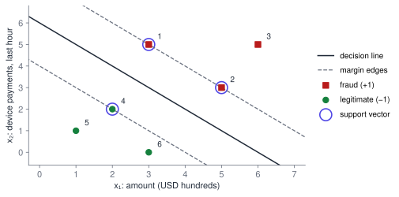

*Figure 37.1 — The widest separating band. Only the three circled payments determine it.*

Deleting payments 3, 5 and 6 changes nothing; deleting payment 4 moves the line. Real data are rarely separable, so the soft-margin SVM (Cortes and Vapnik, 1995) lets points cross the edge at a cost $C$ each.

### Common mistakes

| Mistake | Why it bites | Do this instead |
|---|---|---|
| Treating a KKT point as the optimum in a non-convex problem | There the conditions are necessary, not sufficient | Check convexity or compare candidates |
| Reading $\alpha_i$ as feature importance | It weights training points, not features | Read $\mathbf{w}$ for a linear SVM |

### Where a PM meets it

- **Decision:** rank the binding limits by multiplier and negotiate in that order. Relaxing a slack limit gains nothing.
- **Ask for:** "which constraints are active, and what is each one worth?"
- **Watch for:** label quality near the boundary. One wrong label among the support vectors moves the model; a thousand easy cases do not.

### Check yourself

**Q37.1** A reported solution shows a constraint with slack 5 and multiplier 0.3. What is wrong?

**Q37.2** Which payments could you delete without changing the classifier, and why?

> [!IMPORTANT]
> **In one line:** A limit either binds and has a price, or is slack and free; an SVM's binding limits are its support vectors, the only points that shape the boundary.

# Part V — Information theory

## 38. Entropy

### Why it matters

Before you can say how much a feature or a model reduces uncertainty, you need a number for the uncertainty itself. Entropy is that number. It tells you how hard a prediction problem is before any model exists, and the next five chapters are built on it.

### The idea

Start with surprise. If PayFlow tells you a payment succeeded, you learn little, because most do. If it tells you a payment was blocked for risk, you learn a lot, because that is rare.

Measure the surprise of an outcome that has probability $p$ as $\log_2(1/p)$ bits. A sure thing carries 0 bits, a coin flip 1 bit, a 1-in-32 event 5 bits. Halving the probability adds one bit. **Entropy** is the average surprise over the whole distribution: each outcome's surprise weighted by how often it happens.

A second reading: no strategy can learn the outcome with fewer yes/no questions, on average, than the entropy.

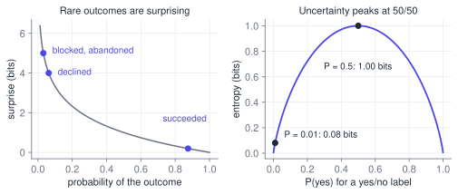

*Figure 38.1 — Left: the surprise of each PayFlow payment status. Right: the entropy of a yes/no label is highest at 50/50 and nearly zero for a 1% event.*

#### The formal definition

For a discrete random variable $X$ (chapter 16) whose outcomes $x$ have probabilities $p(x)$:

$$
H(X) = \sum_{x} p(x) \log_2 \frac{1}{p(x)} = -\sum_{x} p(x) \log_2 p(x)
$$

Outcomes with $p(x) = 0$ contribute nothing. With base-2 logarithms the unit is the **bit**. With natural logarithms it is the **nat**, the unit ML libraries use; one nat is 1.443 bits. For $K$ possible outcomes, $0 \le H(X) \le \log_2 K$: zero when one outcome is certain, $\log_2 K$ when all are equally likely. Claude Shannon introduced the measure in 1948.

### Worked example

Of every 32 PayFlow payments, 28 succeed, 2 are declined by the card issuer, 1 is blocked by PayFlow's risk rules and 1 is abandoned during authentication.

| Status | $p$ | Surprise $\log_2(1/p)$ | $p \times$ surprise |
|---|---|---|---|
| succeeded | 0.875 | 0.193 | 0.169 |
| declined | 0.0625 | 4 | 0.250 |
| blocked | 0.03125 | 5 | 0.156 |
| abandoned | 0.03125 | 5 | 0.156 |

The last column sums to $H = 0.731$ bits. Four equally likely statuses would give 2 bits. One dominant outcome makes the status mostly predictable.

```python
def entropy_bits(p):
    """H = sum of p * log2(1/p), with the convention 0 * log(1/0) = 0."""
    p = np.asarray(p, dtype=float)
    p = p[p > 0]
    return float(np.sum(p * np.log2(1 / p)))

p = np.array(list(status.values()))
assert np.isclose(p.sum(), 1.0)
print("status      p        surprise (bits)   p x surprise")
for name, prob in status.items():
    s = np.log2(1 / prob)
    print(f"{name:10} {prob:.5f}   {s:8.4f}        {prob * s:8.4f}")
H = entropy_bits(p)
print(f"entropy H = {H:.4f} bits")
```

Output:

```text
status      p        surprise (bits)   p x surprise
succeeded  0.87500     0.1926          0.1686
declined   0.06250     4.0000          0.2500
blocked    0.03125     5.0000          0.1562
abandoned  0.03125     5.0000          0.1562
entropy H = 0.7311 bits
largest possible with 4 outcomes = 2.0 bits
in nats: 0.5067
entropy of a yes/no label
  P(yes) = 0.5 : 1.0000 bits
  P(yes) = 0.1 : 0.4690 bits
  P(yes) = 0.01: 0.0808 bits
```

A fraud label with a 1% rate has only 0.081 bits of entropy. Always answering "legitimate" is 99% accurate, which is why accuracy says nothing useful about rare events.

### Common mistakes

| Mistake | Why it bites | Do this instead |
|---|---|---|
| Reading low entropy as "nothing to see" | The rare outcomes carry the surprise and often the money | Weigh each outcome by its cost, not only its probability |
| Mixing bits and nats | The numbers differ by a factor of 1.443 | State the unit; multiply bits by $\ln 2$ to get nats |
| Estimating entropy from a small sample | Rare outcomes go unseen, so the estimate is too low | Use more data per category |
| Treating entropy like variance | Entropy looks only at probabilities and ignores the values | Use variance for numeric spread, entropy for unpredictability |

### Where a PM meets it

- **Decision:** before funding a model, ask how uncertain the target is. For a 1% label, headline accuracy is meaningless and you need precision and recall.
- **Ask for:** the base rate of the label, and later how much of its uncertainty the model removes (chapter 40).
- **Watch for:** dashboards where one category dominates. The information is in the tail.

### Check yourself

**Q38.1** A decline can carry one of eight codes, all equally likely. What is the entropy of the code?

**Q38.2** Which fraud label has higher entropy, one with a 1% rate or one with a 10% rate, and why?

**Q38.3** The success rate rises from 87.5% to 99%, with the rest split evenly over the three failures. Without computing, does the entropy rise or fall?

> [!IMPORTANT]
> **In one line:** Entropy is the average surprise of a distribution in bits: zero when the outcome is certain, largest when every outcome is equally likely.

## 39. Joint and conditional entropy

### Why it matters

A feature is useful only if it tells you something about the outcome, and two features that tell you the same thing are worth one. Joint and conditional entropy do the accounting: how much uncertainty two variables hold together, and how much remains in one after you have seen the other.

### The idea

Ask two things about each PayFlow payment: where the card was issued ($X$: domestic or cross-border) and whether the payment succeeded ($Y$).

- **Joint entropy** $H(X, Y)$ is the uncertainty about the pair.
- **Conditional entropy** $H(Y \mid X)$ is the uncertainty left in the outcome once the region is known, averaged over regions.

If region and outcome were unrelated, knowing the region would leave the outcome exactly as uncertain as before. They are related, because cross-border cards fail more often, so some uncertainty disappears.

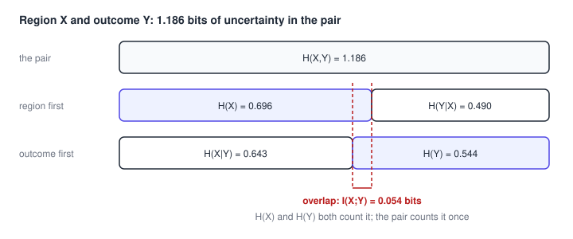

*Figure 39.1 — Bar lengths are to scale. The pair's uncertainty can be paid off in either order. The overlap is what region and outcome tell you about each other.*

#### The formal definition

With joint probabilities $p(x, y)$ (chapter 14):

$$
H(X, Y) = -\sum_{x, y} p(x, y) \log_2 p(x, y)
$$

$$
H(Y \mid X) = \sum_{x} p(x)\, H(Y \mid X = x) = -\sum_{x, y} p(x, y) \log_2 p(y \mid x)
$$

Three facts follow.

- **Chain rule:** $H(X, Y) = H(X) + H(Y \mid X) = H(Y) + H(X \mid Y)$.
- On average, knowing more never hurts: $H(Y \mid X) \le H(Y)$, with equality only when $X$ and $Y$ are independent.
- $H(Y \mid X) = 0$ exactly when $X$ determines $Y$.

Order matters: $H(Y \mid X)$ and $H(X \mid Y)$ are different quantities.

### Worked example

Shares of all payments:

| | succeeded | failed | total |
|---|---|---|---|
| domestic | 0.7500 | 0.0625 | 0.8125 |
| cross-border | 0.1250 | 0.0625 | 0.1875 |
| total | 0.875 | 0.125 | 1 |

The outcome alone: $H(Y) = 0.875 \times 0.193 + 0.125 \times 3 = 0.544$ bits.

Inside domestic, the failure rate is $0.0625/0.8125 = 1/13$, which gives 0.391 bits. Inside cross-border it is $1/3$, which gives 0.918 bits. Weight each by its share:

$$
H(Y \mid X) = 0.8125 \times 0.391 + 0.1875 \times 0.918 = 0.490 \text{ bits}
$$

Knowing the region removes $0.544 - 0.490 = 0.054$ bits, about 10% of the uncertainty.

```python
def H(p):
    """Entropy in bits of any array of probabilities that sums to 1."""
    p = np.asarray(p, dtype=float).ravel()
    p = p[p > 0]
    return float(np.sum(p * np.log2(1 / p)))

p_x = joint.sum(axis=1)                 # marginal of region: 0.8125, 0.1875
p_y = joint.sum(axis=0)                 # marginal of outcome: 0.875, 0.125
H_xy, H_x, H_y = H(joint), H(p_x), H(p_y)
print(f"H(X,Y) = {H_xy:.4f}   H(X) = {H_x:.4f}   H(Y) = {H_y:.4f}")

# conditional entropy, straight from its definition: a weighted average of the
# entropy of the outcome inside each region
H_y_given_x = 0.0
for i, region in enumerate(regions):
    within = joint[i] / p_x[i]          # P(Y | X = region)
    print(f"  {region:12} share {p_x[i]:.4f}  P(fail) = {within[1]:.4f}  "
          f"H(Y | X = {region}) = {H(within):.4f}")
    H_y_given_x += p_x[i] * H(within)
```

Output:

```text
H(X,Y) = 1.1863   H(X) = 0.6962   H(Y) = 0.5436
  domestic     share 0.8125  P(fail) = 0.0769  H(Y | X = domestic) = 0.3912
  cross-border share 0.1875  P(fail) = 0.3333  H(Y | X = cross-border) = 0.9183
H(Y|X) = 0.4901
chain rule: H(X) + H(Y|X) = 1.1863
H(X) + H(Y) = 1.2398  (larger than H(X,Y): the two overlap)
knowing the region removes 0.0535 bits = 9.8% of H(Y)
```

Look at the cross-border row: 0.918 bits, more than the 0.544 of the outcome overall. Knowing that a card is cross-border makes that payment less predictable. Conditioning helps on average, not in every segment.

### Common mistakes

| Mistake | Why it bites | Do this instead |
|---|---|---|
| Swapping $H(Y \mid X)$ and $H(X \mid Y)$ | They answer different questions: 0.490 versus 0.643 here | Say which variable is known |
| Quoting the most uncertain segment as the headline | Conditional entropy is a weighted average | Report the average and each segment's share |
| Filling a large table from little data | Thin cells look certain, so entropy is understated | Merge rare categories or gather more data |

### Where a PM meets it

- **Decision:** which features to buy or build. A feature's value is the uncertainty it removes, $H(Y) - H(Y \mid X)$, which chapter 42 names.
- **Ask for:** "what is still unknown about the outcome once we know this feature?"
- **Watch for:** near-duplicate features. If $H(X_2 \mid X_1)$ is close to zero, the second feature adds almost nothing.
- **Where it runs:** decision trees choose every split to make this drop as large as possible, under the name information gain.

### Check yourself

**Q39.1** If $X$ determines $Y$ exactly, what are $H(Y \mid X)$ and $H(X, Y)$?

**Q39.2** Use the chain rule and the output above to compute $H(X \mid Y)$.

**Q39.3** The cross-border segment has more entropy than the outcome overall. Why does that not contradict $H(Y \mid X) \le H(Y)$?

> [!IMPORTANT]
> **In one line:** Joint entropy is the uncertainty in a pair, conditional entropy is what remains in one variable after seeing the other, and the chain rule says the first equals one variable's entropy plus the remainder.

## 40. Cross-entropy loss

### Why it matters

A classifier outputs probabilities, and you need a score that rewards honest ones. Accuracy cannot tell a model that said "51% fraud" from one that said "99% fraud". Cross-entropy can. It is the loss that trains nearly every classifier and every LLM.

### The idea

Score each prediction by how surprised the model was by what actually happened: the surprise of chapter 38, computed with the model's probability for the true outcome. Confident and right costs almost nothing. Unsure costs a moderate amount. Confident and wrong costs a great deal, without limit as the probability given to the truth approaches zero. The average over examples is the **cross-entropy**, also called **log loss**.

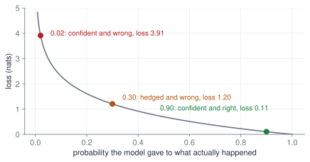

*Figure 40.1 — Loss for one example. Moving from 0.90 to 0.30 costs about one nat. Moving from 0.30 to 0.02 costs almost three more.*

#### The formal definition

For a true distribution $p$ and a model distribution $q$ over the same outcomes:

$$
H(p, q) = -\sum_{x} p(x) \log q(x)
$$

In classification $p$ puts all its weight on the true class, so one example costs $-\log q(\text{true class})$. For a binary label $y \in \{0, 1\}$ and a predicted probability $\hat{y}$ of class 1:

$$
\ell(y, \hat{y}) = -\left[\, y \log \hat{y} + (1 - y) \log(1 - \hat{y}) \,\right]
$$

averaged over examples. The logarithm is natural by convention, so the unit is nats.

Three facts make this the standard loss. First, $H(p, q) \ge H(p)$, with equality only when $q = p$ (chapter 41), so the best possible average loss is the entropy of the truth. Second, the loss is the negative log-likelihood per example, so minimizing it is maximum likelihood estimation (chapter 20). Third, with a sigmoid or softmax output, its gradient with respect to the logit (the score before that output) is $\hat{y} - y$.

### Worked example

Five PayFlow payments, scored by two fraud models:

| Payment | Fraud? | Model A | Model B |
|---|---|---|---|
| 1 | no | 0.10 | 0.10 |
| 2 | no | 0.20 | 0.20 |
| 3 | no | 0.05 | 0.05 |
| 4 | yes | 0.90 | 0.90 |
| 5 | yes | 0.02 | 0.30 |

Both miss payment 5 at a threshold of 0.5, so both are 80% accurate. Model A's losses are $-\ln 0.90 = 0.105$, $-\ln 0.80 = 0.223$, $-\ln 0.95 = 0.051$, $-\ln 0.90 = 0.105$ and $-\ln 0.02 = 3.912$, a mean of 0.879. Model B differs only on payment 5, where $-\ln 0.30 = 1.204$, for a mean of 0.338.

```python
def log_loss_each(y, p, eps=1e-12):
    """Binary cross-entropy per example, in nats."""
    p = np.clip(p, eps, 1 - eps)          # never take log(0)
    return -(y * np.log(p) + (1 - y) * np.log(1 - p))

def accuracy(y, p):
    return np.mean((p >= 0.5) == (y == 1))

for name, p in [("A", model_a), ("B", model_b)]:
    each = log_loss_each(y, p)
    print(f"model {name} losses: {np.round(each, 4)}  mean {each.mean():.4f}  "
          f"accuracy {accuracy(y, p):.0%}")

base_rate = y.mean()
baseline = log_loss_each(y, np.full(5, base_rate)).mean()
print(f"always predicting the base rate {base_rate:.1f}: mean {baseline:.4f}")
```

Output:

```text
model A losses: [0.1054 0.2231 0.0513 0.1054 3.912 ]  mean 0.8794  accuracy 80%
model B losses: [0.1054 0.2231 0.0513 0.1054 1.204 ]  mean 0.3378  accuracy 80%
always predicting the base rate 0.4: mean 0.6730
payment 5 is 89% of model A's total loss
loss when a true fraud is scored (0.9, 0.5, 0.3, 0.02, 0.001)
   0.105  0.693  1.204  3.912  6.908
```

A forecaster who always says "40% fraud", the base rate, scores 0.673, which is the entropy of these labels in nats. Model A, with its 80% accuracy, is worse than that. One confident miss supplies 89% of its loss.

### Common mistakes

| Mistake | Why it bites | Do this instead |
|---|---|---|
| Judging a model by accuracy alone | It hides confident errors, the expensive kind | Report log loss and a calibration plot too |
| Comparing log loss across datasets | The floor, the label entropy, moves with the base rate | Compare each model with its base-rate loss |
| Letting a prediction be exactly 0 or 1 | One wrong case makes the loss infinite | Clip predictions, or compute the loss from logits |
| Reweighting classes for imbalance, then reading scores as probabilities | The weights pull predictions away from the true rates | Recalibrate, or leave the loss unweighted and set the threshold by cost |

### Where a PM meets it

- **Decision:** if the product uses the probability itself, for expected loss, pricing or review queues, you need calibrated scores. Log loss measures that. Accuracy does not.
- **Ask for:** log loss next to the base-rate loss, and the ten highest-loss examples. They are often label errors or a new fraud pattern.
- **Watch for:** the same loss in LLMs, applied to each next token. Chapter 43 turns it into perplexity.

### Check yourself

**Q40.1** A model gives a true fraud a probability of 0.5. What is the loss in nats, and in bits?

**Q40.2** Why does Model A score worse than always predicting 0.4, although it is 80% accurate?

**Q40.3** What is the loss for predicting 0.001 on a true fraud, and what does that do to an average over 100 otherwise good predictions?

> [!IMPORTANT]
> **In one line:** Cross-entropy charges a model the surprise it felt at the truth, so honest probabilities are rewarded and one confident miss can outweigh many correct calls.

## 41. KL divergence

### Why it matters

A fraud model is trained on last quarter's payments and scores this month's. If the mix of payments has shifted, its probabilities are quietly wrong. You need a number for how different two distributions are, and KL divergence is the standard one. It is also the "extra" hiding inside cross-entropy.

### The idea

Suppose reality follows $p$ but you planned with $q$. Your average surprise is the cross-entropy $H(p, q)$. Someone who knew $p$ would average only $H(p)$. The gap is the price of the wrong belief, in bits per observation: the **KL divergence**. It is zero when the belief is right and positive otherwise.

#### The formal definition

$$
D_{\mathrm{KL}}(p \,\Vert\, q) = \sum_{x} p(x) \log \frac{p(x)}{q(x)} = H(p, q) - H(p)
$$

Kullback and Leibler introduced it in 1951. Three properties matter in practice.

- $D_{\mathrm{KL}}(p \,\Vert\, q) \ge 0$, with equality only when $p = q$.
- It is not symmetric. Swapping $p$ and $q$ usually changes the answer, so it is not a distance.
- It is infinite if $q(x) = 0$ for an outcome that $p$ says can happen: the belief called something impossible, and it happened.

### Worked example

Share of PayFlow payments by merchant category, last month ($q$, what the model was trained on) and this month ($p$):

| Category | $q$ | $p$ | $p \log_2 (p/q)$ |
|---|---|---|---|
| retail | 0.50 | 0.40 | -0.129 |
| food | 0.25 | 0.25 | 0 |
| travel | 0.20 | 0.15 | -0.062 |
| digital goods | 0.05 | 0.20 | +0.400 |

The last column sums to $D_{\mathrm{KL}}(p \,\Vert\, q) = 0.209$ bits. In the other direction the terms are $0.161 + 0 + 0.083 - 0.100$, so $D_{\mathrm{KL}}(q \,\Vert\, p) = 0.144$ bits. The first is larger because it puts this month's 20% weight on a category the old belief thought rare.

```python
def kl_bits(p, q):
    """D(p || q) in bits. Infinite if q is zero anywhere p is not."""
    p, q = np.asarray(p, dtype=float), np.asarray(q, dtype=float)
    if np.any((q == 0) & (p > 0)):
        return float("inf")
    keep = p > 0
    return float(np.sum(p[keep] * np.log2(p[keep] / q[keep])))

forward = kl_bits(this_month, last_month)
reverse = kl_bits(last_month, this_month)
print(f"D(this month || last month) = {forward:.4f} bits")
print(f"D(last month || this month) = {reverse:.4f} bits")
gap = cross_entropy_bits(this_month, last_month) - entropy_bits(this_month)
print(f"cross-entropy minus entropy  = {gap:.4f} bits")
psi = np.sum((this_month - last_month) * np.log(this_month / last_month))
```

Output:

```text
category        q      p     p*log2(p/q)
retail         0.50   0.40   -0.1288
food           0.25   0.25   +0.0000
travel         0.20   0.15   -0.0623
digital goods  0.05   0.20   +0.4000
D(this month || last month) = 0.2090 bits
D(last month || this month) = 0.1440 bits
cross-entropy minus entropy  = 0.2090 bits
population stability index   = 0.2446
no real drift,    500 payments a month: median D = 0.00679, 95th percentile = 0.02323
no real drift, 50,000 payments a month: median D = 0.00007, 95th percentile = 0.00023
```

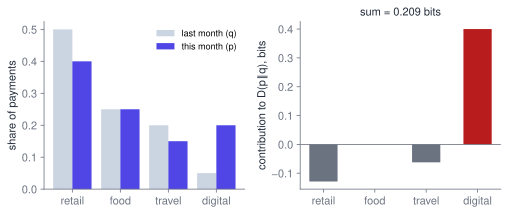

*Figure 41.1 — One category explains the whole drift. Negative bars are categories that shrank.*

Risk teams often report the **population stability index (PSI)**, which is the two directions added together, in nats: 0.245 here. A common rule of thumb treats values under 0.1 as stable and over 0.25 as a major shift.

The last two output lines are a noise floor. Two samples of 500 payments from the same distribution still differ by 0.007 bits on a typical draw and 0.023 on an unlucky one. With 50,000 payments the unlucky draw is 0.0002.

### Common mistakes

| Mistake | Why it bites | Do this instead |
|---|---|---|
| Quoting "the KL" without a direction | The two directions differ: 0.209 versus 0.144 | Name the reference, or use a symmetric measure such as PSI |
| A category with zero count in the reference | The divergence is infinite | Add a small count to every category first |
| One alert threshold for every segment | Small samples show drift that is only noise | Set thresholds from past month-to-month values at that sample size |
| Reading input drift as lost accuracy | Inputs can move while the model still works | Use drift as a trigger to check performance on fresh labels |

### Where a PM meets it

- **Decision:** when to investigate or retrain. Fraud labels arrive weeks late as chargebacks, so drift in inputs and scores is your early signal.
- **Ask for:** which features are monitored, against which reference window, and how the threshold was chosen.
- **Watch for:** the per-category breakdown. Here one category explains everything, which points to a change in merchant mix, not a broken model.

### Check yourself

**Q41.1** What is $D_{\mathrm{KL}}(p \,\Vert\, q)$ when $p = q$? What is it when $q$ gives zero probability to an outcome that occurs?

**Q41.2** Which category drove the drift in the example, and what would you check first?

**Q41.3** A segment with 500 payments a month shows a divergence of 0.02 bits. Should it page someone?

> [!IMPORTANT]
> **In one line:** KL divergence is the extra surprise you pay for believing q when the world follows p; it is zero only when they match, it depends on direction, and small samples inflate it.

## 42. Mutual information

### Why it matters

Before you build a model you want to know which candidate features say anything about the label. Correlation answers that only for straight-line relationships. Mutual information answers it for any relationship, in the same bits you have used since chapter 38.

### The idea

**Mutual information** is the number of bits of uncertainty about $Y$ that disappear when you learn $X$. You computed it in chapter 39 as $H(Y) - H(Y \mid X)$, the overlap in Figure 39.1. It is zero when the two are independent and largest when one determines the other. It is symmetric: $X$ tells you as much about $Y$ as $Y$ tells you about $X$.

#### The formal definition

$$
I(X; Y) = H(Y) - H(Y \mid X) = H(X) + H(Y) - H(X, Y) = \sum_{x, y} p(x, y) \log_2 \frac{p(x, y)}{p(x)\, p(y)}
$$

The last form is the KL divergence (chapter 41) between the joint distribution and what it would be if $X$ and $Y$ were independent.

- $I(X; Y) \ge 0$, and it is zero exactly when $X$ and $Y$ are independent. Zero correlation does not imply independence. Zero mutual information does.
- $I(X; Y) \le \min(H(X), H(Y))$. A feature cannot tell you more than it contains, or more than there is to know.
- $I(X; Y) / H(Y)$ is the share of the label's uncertainty that the feature removes.

### Worked example

Card testers try stolen cards with tiny payments, and cash-out fraud uses large ones. Suppose PayFlow sees:

| Amount bucket | Share of payments | Fraud rate |
|---|---|---|
| small (under USD 5) | 0.25 | 8% |
| medium | 0.50 | 1% |
| large (over USD 500) | 0.25 | 8% |

Code the buckets 0, 1, 2. Fraud does not rise or fall with the code, so the correlation (chapter 17) is exactly zero.

The overall fraud rate is $0.25 \times 0.08 + 0.5 \times 0.01 + 0.25 \times 0.08 = 0.045$, so $H(Y) = 0.2648$ bits. A yes/no label with an 8% rate has 0.4022 bits and one with a 1% rate has 0.0808, so

$$
H(Y \mid X) = 0.5 \times 0.4022 + 0.5 \times 0.0808 = 0.2415, \qquad I(X; Y) = 0.0233 \text{ bits}
$$

That is 8.8% of what there is to know. (For a numeric feature the result depends on the bins, so try more than one binning.) Compare a new-device flag, set on 20% of payments, with a fraud rate of 6.5% against 4%: it has a correlation of +0.048 and only 0.0015 bits. Rank by correlation and you pick the wrong feature.

```python
def mutual_information(joint):
    """I(X;Y) = H(X) + H(Y) - H(X,Y), in bits, from a joint table."""
    joint = np.asarray(joint, dtype=float)
    return H(joint.sum(axis=1)) + H(joint.sum(axis=0)) - H(joint)

rng = np.random.default_rng(42)
n = 20_000
bucket = rng.choice(3, size=n, p=share)
fraud = (rng.random(n) < fraud_rate[bucket]).astype(int)

def estimate(x, y):
    table = np.zeros((x.max() + 1, 2))
    np.add.at(table, (x, y), 1)
    return mutual_information(table / len(x))

shuffled = [estimate(bucket, rng.permutation(fraud)) for _ in range(200)]
```

Output:

```text
amount bucket: correlation = +0.0000, I = 0.0233 bits = 8.8% of H(fraud)
new device   : correlation = +0.0482, I = 0.0015 bits = 0.6% of H(fraud)
H(fraud) = 0.2648, H(fraud | bucket) = 0.2415, difference = 0.0233
sample of 20,000: correlation = -0.0140, estimated I = 0.0259 bits
same feature, labels shuffled 200 times: I = 0.00007 bits on average, 0.00034 at most
```

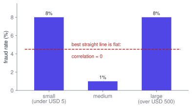

*Figure 42.1 — A U-shape. The best straight line through it is flat, so correlation sees nothing.*

On 20,000 sampled payments the estimate is 0.0259 bits against a true 0.0233. With the labels shuffled, so that no relationship exists, the estimate is still positive, 0.00007 bits on average. That is the estimator's noise floor.

### Common mistakes

| Mistake | Why it bites | Do this instead |
|---|---|---|
| Screening features by correlation only | It misses U-shapes, thresholds and categories | Add mutual information or a small tree |
| Trusting an estimate from a small sample | The estimate is biased upward; pure noise scores above zero | Compare with a shuffled-label baseline |
| Adding up the scores of single features | Redundant features share the same bits; interacting ones look useless alone | Evaluate features together |
| Reading it as cause | A common cause produces mutual information too | Run an experiment (chapter 22) |

### Where a PM meets it

- **Decision:** which data sources to pay for or integrate first. Mutual information gives a ranking in comparable units that does not depend on a model.
- **Ask for:** each feature's score against a shuffled baseline, and its overlap with features you already have.
- **Watch for:** a feature with a suspiciously high score. It may leak the label, such as a "chargeback filed" field, or stand in for a protected attribute.

### Check yourself

**Q42.1** What is $I(X; Y)$ if $X$ and $Y$ are independent? If $Y$ is an exact copy of $X$?

**Q42.2** Why is the correlation zero in the example although the mutual information is not?

**Q42.3** A feature has an entropy of 0.1 bits. Can it share 0.2 bits with the label?

> [!IMPORTANT]
> **In one line:** Mutual information counts the bits of label uncertainty a feature removes, for any shape of relationship, where correlation sees only straight lines.

## 43. Perplexity

### Why it matters

Language models are trained and compared with a number that is decades older than they are: perplexity. Teams quote it when they pick a base model, when they fine-tune on your support tickets and when they claim an improvement. You need to know what it measures and what it cannot tell you.

### The idea

A language model reads text one **token** at a time, a token being a word or a piece of one, and gives a probability to every possible next token. Look up the probability it gave to the token that actually came next. Average the surprise over the text, which is the cross-entropy of chapter 40, then undo the logarithm.

The result reads as a count. A **perplexity** of 4 means the model was, on average, as unsure as if it were choosing among 4 equally likely tokens at each step. Lower is better, and 1 would be perfect foresight.

#### The formal definition

For held-out text of $N$ tokens $w_1, \dots, w_N$, where the model gives token $w_i$ the probability $q(w_i \mid w_1, \dots, w_{i-1})$:

$$
\mathrm{PPL} = \exp\!\left( -\frac{1}{N} \sum_{i=1}^{N} \ln q(w_i \mid w_1, \dots, w_{i-1}) \right) = 2^{\,\text{cross-entropy in bits per token}}
$$

A model that spreads its probability evenly over a vocabulary of $V$ tokens has a perplexity of exactly $V$. Jelinek and colleagues at IBM introduced the measure in 1977 for speech recognition.

### Worked example

A model reads "payout is delayed again" and gives the four tokens the probabilities $1/2$, $1/4$, $1/4$ and $1/8$. Their surprises are 1, 2, 2 and 3 bits, a mean of 2 bits per token, so the perplexity is $2^2 = 4$.

Now a real, tiny model. A bigram model predicts each word from the one before it. Train it on eight PayFlow support tickets and score it on three tickets it has not seen.

```python
def perplexity(probabilities):
    """exp of the average surprise, in nats, of the tokens that occurred."""
    probabilities = np.asarray(probabilities, dtype=float)
    if np.any(probabilities == 0):
        return float("inf")
    return float(np.exp(-np.mean(np.log(probabilities))))

def p_bigram(prev, word, k=1):
    return (bigram[(prev, word)] + k) / (context[prev] + k * V)

def score(model, sentences):
    probs = []
    for sentence in sentences:
        t = tokens(sentence)
        probs += [model(prev, word) for prev, word in zip(t[:-1], t[1:])]
    return perplexity(probs), len(probs)
```

Output:

```text
hand example: 2.0 bits per token, perplexity = 4.0
vocabulary size V = 15, training tokens = 43
uniform guess  held-out perplexity =  15.00  (3.91 bits per token, 16 tokens)
unigram        held-out perplexity =  14.03  (3.81 bits per token, 16 tokens)
bigram         held-out perplexity =   7.88  (2.98 bits per token, 16 tokens)
bigram on its own training tickets = 6.27
bigram with no smoothing, held-out = inf
```

With 15 tokens in the vocabulary, guessing uniformly scores 15. Knowing word frequencies barely helps. Knowing the previous word halves the effective choice to 7.9. On its own training tickets the model scores 6.3, which is why you only ever quote held-out text. Without smoothing, one never-seen word pair gets probability zero and the perplexity is infinite.

What perplexity tells you: how well the model predicts text like the test set. It is good for comparing versions of one model, for tracking training and for measuring fit to your domain. What it does not tell you: whether an answer is correct, grounded, safe or helpful. A model can predict fluent text well and still state the wrong refund policy.

### Common mistakes

| Mistake | Why it bites | Do this instead |
|---|---|---|
| Comparing models that use different tokenizers | The average is per token, and their tokens differ | Compare bits per character on the same text, or use task evaluations |
| Quoting perplexity on training text | Memorized text scores well | Use held-out text only |
| Treating lower perplexity as a better product | Predicting text is not the same as answering correctly | Measure the task: resolution rate, groundedness, human review |
| Comparing numbers from different test sets | Chat and legal text differ in how predictable they are | Use one test set for every model |

### Where a PM meets it

- **Decision:** when choosing or fine-tuning a model for PayFlow's support assistant, perplexity on held-out tickets is a cheap first filter for domain fit. It is never the acceptance test.
- **Ask for:** the text it was measured on, whether that text was held out, and the task metrics next to it.
- **Watch for:** hosted model APIs, which often expose few token probabilities or none. You may not be able to compute perplexity for a vendor's model at all, so plan evaluations that do not need it.

### Check yourself

**Q43.1** A model's cross-entropy is 3 bits per token. What is its perplexity?

**Q43.2** A model gives each of five tokens in a sentence a probability of 0.1. What is the perplexity on that sentence?

**Q43.3** After fine-tuning on PayFlow tickets, perplexity on held-out tickets falls from 20 to 9, yet agents report more wrong answers about refund timing. How can both be true?

> [!IMPORTANT]
> **In one line:** Perplexity is the exponential of cross-entropy, the effective number of choices a language model faces per token; it measures how well the model predicts text, not whether its answers are right.

# Part VI — Discrete mathematics

## 44. Graphs

### Why it matters

Payments data is not only rows. It is connections: this merchant used that device, that device was used by another merchant, and both are paid out to the same bank account. Fraud rings hide in those connections, where a table of rows cannot show them. A graph can.

### The idea

A **graph** is a set of things, called **nodes** or vertices, and a set of links between pairs of them, called **edges**. In PayFlow's risk graph the nodes are merchants, devices and bank accounts. An edge means "this merchant logged in from this device" or "this merchant is paid out to this account".

An honest merchant is a small island: itself, its device, its bank account. A fraud ring is several merchant accounts opened by the same people. Row by row they look unrelated, but they share a device here and a bank account there, so in the graph they form one **connected component**: a group of nodes in which each can be reached from any other.

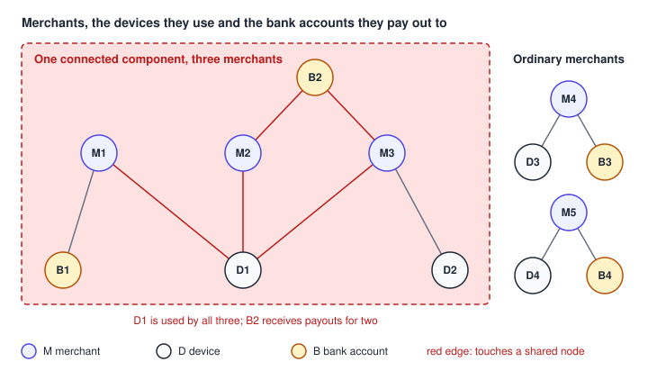

*Figure 44.1 — Thirteen nodes, eleven edges, three components. The large one links three merchants through a shared device and a shared bank account.*

#### The formal definition

A graph is a pair $G = (V, E)$: a set $V$ of nodes and a set $E$ of edges, each edge joining two nodes.

- An **undirected** edge has no direction ("shares"). A **directed** edge runs from one node to another ("paid", "depends on"). A weighted edge also carries a number, such as an amount.
- The **degree** of a node is the number of edges that touch it. Every edge has two ends, so the degrees of all nodes sum to $2\lvert E \rvert$. This is the handshake lemma, and it makes a handy data check.
- A **path** is a sequence of nodes in which each is joined to the next by an edge. Two nodes are connected if some path joins them. A path that returns to its start is a **cycle**.

There are two ways to store a graph. An **adjacency list** keeps, for each node, the list of its neighbors, and takes memory proportional to $\lvert V \rvert + \lvert E \rvert$. An adjacency matrix is a grid with a cell for every pair of nodes and takes $\lvert V \rvert^2$. Payment graphs are sparse, since each node touches a handful of the millions of others, so lists are the practical choice.

### Worked example

Count the degrees in Figure 44.1. The merchants have $2, 2, 3, 2, 2$, the devices $3, 1, 1, 1$ and the bank accounts $1, 2, 1, 1$. The total is 22, twice the 11 edges.

Now find the component of M1. Its neighbors are D1 and B1. D1 leads to M2 and M3. M2 leads to B2, and M3 leads to D2. That is seven nodes, three of them merchants. M4 and M5 reach only their own device and bank account.

```python
def connected_components(adj):
    """Group nodes that can reach each other. Chapter 46 explains the search."""
    seen, components = set(), []
    for start in sorted(adj):
        if start in seen:
            continue
        component, frontier = set(), [start]
        while frontier:
            node = frontier.pop()
            if node in component:
                continue
            component.add(node)
            frontier.extend(adj[node] - component)
        seen |= component
        components.append(sorted(component))
    return components
```

Output:

```text
13 nodes, 11 edges
degrees: B1:1 B2:2 B3:1 B4:1 D1:3 D2:1 D3:1 D4:1 M1:2 M2:2 M3:3 M4:2 M5:2
sum of degrees = 22 = 2 x 11 edges
component of 7: B1 B2 D1 D2 M1 M2 M3  <- review: several merchants linked
component of 3: B3 D3 M4
component of 3: B4 D4 M5
adjacency matrix cells: 169, adjacency list entries: 22
```

### Common mistakes

| Mistake | Why it bites | Do this instead |
|---|---|---|
| Treating every shared attribute as fraud | A bookkeeper's laptop or a payroll bank links honest merchants | Send linked groups to review; weigh how rare the shared thing is |
| Letting hub nodes into the graph | One popular bank glues thousands of merchants into a single giant component | Drop or cap nodes above a degree limit first |
| Mixing directed and undirected edges | "Paid" has a direction and "shares a device" does not | Decide per edge type and document it |
| Storing a large graph as a matrix | Ten million nodes need $10^{14}$ cells | Use adjacency lists or a graph database |

### Where a PM meets it

- **Decision:** what counts as a node and an edge. That choice defines what "linked" means in a risk review, and to a merchant who appeals.
- **Ask for:** the distribution of component sizes, and how many honest merchants sit inside flagged components.
- **Watch for:** identity resolution. One device recorded as two nodes hides a link. Two people merged into one node invents a link.

### Check yourself

**Q44.1** A graph has 8 edges. What do its node degrees sum to?

**Q44.2** M4 starts paying out to bank account B2. What happens to the components, and what should a reviewer ask before acting?

**Q44.3** Why is a matrix a poor way to store a graph of 10 million nodes with about 3 edges each?

> [!IMPORTANT]
> **In one line:** A graph stores things and the links between them; a fraud ring shows up as a connected component that contains several merchants who look unrelated row by row.

## 45. Trees

### Why it matters

Three things you review every month are trees: the decision flow that onboards a merchant, the hierarchy of a merchant's locations and terminals, and the decision-tree models inside most fraud scores. A few facts about edges, depth and leaves let you size all of them.

### The idea

A **tree** is a connected graph with no cycles, so there is exactly one path between any two nodes. Choose one node as the **root** and every other node has one parent. Nodes without children are **leaves**.

A decision flow is a tree read from the top. Each inner node asks a question, each edge is an answer and each leaf is a decision. Here is PayFlow's onboarding check for a new merchant, its KYB flow.

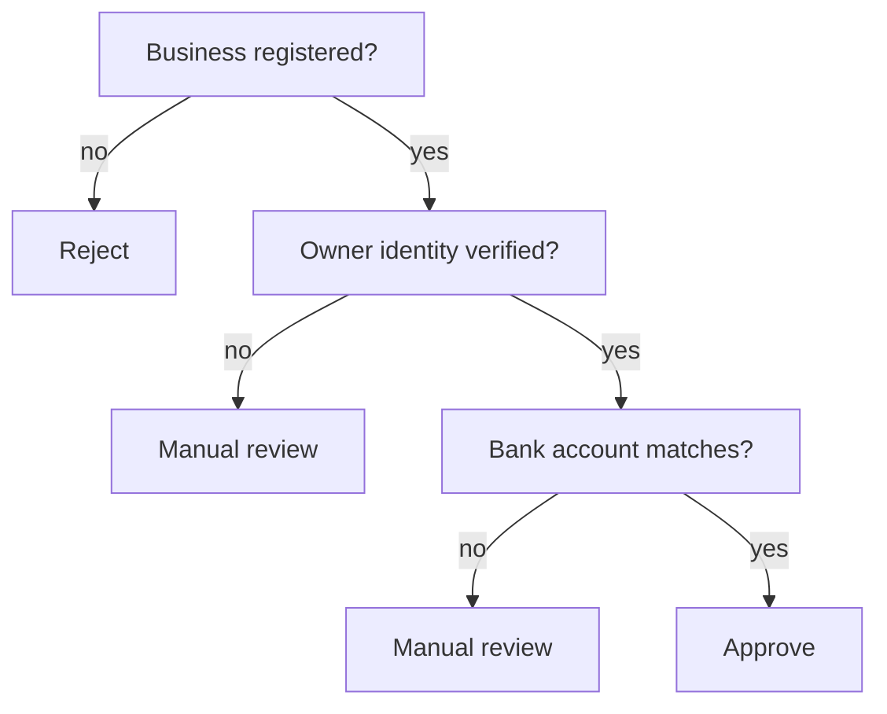

*Figure 45.1 — A decision flow as a tree: three questions, four leaves.*

#### The formal definition

- A tree with $n$ nodes has exactly $n - 1$ edges: every node except the root has one edge to its parent.
- The **depth** of a node is the number of edges on the path from the root to it. The **height** of the tree is the largest depth.
- A **binary tree**, in which each node has at most two children, has at most $2^h$ leaves if its height is $h$. Turned around, a binary tree with $L$ leaves has a height of at least $\log_2 L$.
- Visiting every node once in a fixed order is a traversal. Chapter 46 gives the two basic orders.

### Worked example

The KYB tree has 7 nodes, so 6 edges, and 4 leaves. Its height is 3. An application that is registered, with a verified owner, whose bank account does not match, ends in manual review. The path it took is the explanation.

Each check multiplies. If every check is passed 90% of the time, straight-through approval is $0.9^3 = 0.729$. Rejection is $0.10$ and manual review is $0.9 \times 0.1 + 0.81 \times 0.1 = 0.171$. A fourth check at the same pass rate cuts approval to $0.656$.

A decision-tree model is the same shape with learned questions. A depth of 6 allows at most $2^6 = 64$ leaves, and scoring a payment with 200 such trees takes at most $200 \times 6 = 1{,}200$ comparisons, which is quick enough to run inside the payment itself.

```python
def count_nodes(node):
    return 1 if is_leaf(node) else 1 + sum(count_nodes(c) for c in node[1].values())

def count_leaves(node):
    return 1 if is_leaf(node) else sum(count_leaves(c) for c in node[1].values())

def height(node):
    """Edges on the longest path from this node down to a leaf."""
    return 0 if is_leaf(node) else 1 + max(height(c) for c in node[1].values())

def decide(node, answers, path=()):
    """Walk from the root to a leaf; the path taken is the explanation."""
    if is_leaf(node):
        return node, path
    question, children = node
    answer = answers[question]
    return decide(children[answer], answers, path + (f"{question} {answer}",))
```

Output:

```text
nodes = 7, edges = 6, leaves = 4, height = 3
decision: manual review
because:  registered? yes -> identity verified? yes -> bank account matches? no
shares at 90% per check: {'reject': 0.1, 'manual review': 0.171, 'approve': 0.729}
approval with 3 checks: 0.729, with 4 checks: 0.656
binary tree of depth 6: at most 64 leaves
200 such trees: at most 1,200 comparisons per payment
```

### Common mistakes

| Mistake | Why it bites | Do this instead |
|---|---|---|
| Drawing a "retry" arrow back up the flow | It is no longer a tree, and code that assumes one can loop forever | Count retries on the node, or treat the flow as a general graph |
| Counting checks, not paths | Friction depends on the path a merchant actually takes | Report the pass rate and time for each path |
| Explaining a boosted model by drawing one of its trees | The score is a sum over hundreds of trees | Use per-prediction reason codes |
| Growing deep trees on little data | Each leaf holds too few examples to trust | Limit the depth and check leaf sizes |

### Where a PM meets it

- **Decision:** every added check multiplies the pass rate. Put cheap, decisive checks first.
- **Ask for:** volume and outcome at every leaf. A leaf that nobody owns, such as manual review without a deadline, is where applications go to wait.
- **Watch for:** depth as a cost. In a flow it is friction; in a model it is latency and the risk of overfitting.

### Check yourself

**Q45.1** A flow is drawn with 12 nodes and 13 edges. Is it a tree?

**Q45.2** A binary decision tree must end in 100 different leaves. What is its smallest possible height?

**Q45.3** Three checks in a row are passed 95%, 90% and 80% of the time. What share of applications is approved straight through?

> [!IMPORTANT]
> **In one line:** A tree has one path to every node, n minus 1 edges and at most 2 to the power h leaves at height h, and those three facts size decision flows and tree models alike.

## 46. Breadth-first and depth-first search

### Why it matters

"Which merchants are within two links of this confirmed fraudster?" "Does this ownership structure contain a loop?" Both questions are answered by walking a graph systematically. There are two classic walks, and both cost time in proportion to the part of the graph they touch. That is why such questions can be answered on millions of nodes.

### The idea

Both walks start at one node and visit everything reachable from it, never visiting a node twice.

- **Breadth-first search (BFS)** visits all neighbors first, then their neighbors, like ripples in a pond. It reaches nodes in order of distance, so it finds the path with the fewest hops.
- **Depth-first search (DFS)** follows one trail as far as it goes, backs up to the last junction and tries the next trail, like exploring a maze. It is the tool for finding cycles and ordering dependencies (chapter 47).

In code the only difference is which waiting node comes next. BFS takes the oldest, from a queue. DFS takes the newest, from a stack.

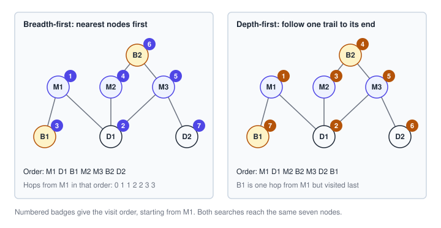

*Figure 46.1 — The fraud ring of chapter 44, searched from M1 in both ways.*

#### The formal definition

Take a graph with $V$ nodes and $E$ edges, stored as adjacency lists. Each search keeps a set of visited nodes.

- Every node is processed once. That is at most $V$ steps.
- Every node's neighbor list is scanned once. Together the lists have $2E$ entries for an undirected graph (the handshake lemma of chapter 44), or $E$ for a directed one.

So the running time is $O(V + E)$, read as "grows no faster than in proportion to nodes plus edges", and the extra memory is $O(V)$. Checking every pair of nodes would cost $O(V^2)$ instead.

BFS finds shortest paths only when every edge counts the same. For weighted edges use Dijkstra's algorithm.

### Worked example

Search the ring from M1, taking neighbors in the order the edges were recorded.

BFS: M1 has neighbors D1 and B1, at one hop. D1 adds M2 and M3, at two hops. B1 adds nothing. M2 adds B2 and M3 adds D2, at three hops. The order is M1, D1, B1, M2, M3, B2, D2.

DFS: M1 to D1 to M2 to B2 to M3 to D2. That trail is finished, so back up all the way to M1 and take B1 last.

Either way the search handles 7 nodes and looks along 14 edge ends, twice the 7 edges.

```python
def bfs(adj, start):
    """Visit in order of distance. Returns hop counts, parents and work done."""
    dist, parent = {start: 0}, {start: None}
    queue = deque([start])
    dequeued = edge_checks = 0
    while queue:
        node = queue.popleft()           # oldest first: a queue
        dequeued += 1
        for neighbor in adj[node]:
            edge_checks += 1
            if neighbor not in dist:     # the visited check: each node enters once
                dist[neighbor] = dist[node] + 1
                parent[neighbor] = node
                queue.append(neighbor)
    return dist, parent, dequeued, edge_checks

def dfs(adj, start):
    """Go as deep as possible before backing up. Returns the visit order."""
    order, seen = [], set()
    stack = [start]
    while stack:
        node = stack.pop()               # newest first: a stack
        if node in seen:
            continue
        seen.add(node)
        order.append(node)
        stack.extend(reversed(adj[node]))   # so the first neighbor is tried first
    return order
```

Output:

```text
BFS visit order: M1 D1 B1 M2 M3 B2 D2
hops from M1:    M1:0 D1:1 B1:1 M2:2 M3:2 B2:3 D2:3
DFS visit order: M1 D1 M2 B2 M3 D2 B1
shortest path to D2: M1 -> D1 -> M3 -> D2
within 2 hops of M1: B1 D1 M2 M3
work: 7 nodes dequeued + 14 edge checks (V = 7, E = 7, 2E = 14)
```

M4 and M5 never appear, because no path leads to them.

### Common mistakes

| Mistake | Why it bites | Do this instead |
|---|---|---|
| Forgetting the visited set | On a graph with a cycle the search never ends | Mark a node when you first see it |
| Using BFS for the cheapest route on weighted edges | BFS counts hops, not weights | Use Dijkstra's algorithm |
| Expanding from a hub without limits | One popular node pulls in a large share of the graph | Cap the hops and skip high-degree nodes |
| Writing DFS with deep recursion | A long chain exceeds the language's recursion limit | Keep an explicit stack |

### Where a PM meets it

- **Decision:** real time or batch. Cost follows the nodes and edges touched. A two-hop lookup from one node can run inside a payment; finding every component in the whole graph is a nightly job.
- **Ask for:** the 99th-percentile latency of the hop query and how many nodes a query touches.
- **Watch for:** "within k hops of a bad actor" features. Each extra hop multiplies the neighborhood, and false positives rise with it.

### Check yourself

**Q46.1** In the BFS from M1, which nodes are exactly two hops away?

**Q46.2** A graph has 1 million nodes and 5 million edges. About how many steps does one full BFS take, and how does that compare with examining every pair of nodes?

**Q46.3** Why does DFS visit B1 last here although B1 is a direct neighbor of M1?

> [!IMPORTANT]
> **In one line:** BFS explores a graph nearest-first and DFS explores it one trail at a time; with a visited set, both finish in time proportional to nodes plus edges.

## 47. Directed acyclic graphs and pipelines

### Why it matters

Every data and ML system you depend on is a set of steps in which some must finish before others can start. Draw the steps as nodes and "must finish before" as arrows, and you can answer three practical questions: in what order things can run, what sets the total time, and what breaks downstream when one step fails.

### The idea

A **directed acyclic graph (DAG)** is a graph whose edges have a direction and in which you can never follow the arrows around in a loop. A recipe is a DAG. So is PayFlow's nightly fraud-model pipeline, shown with minutes per step. A loop would be a step waiting for its own result.

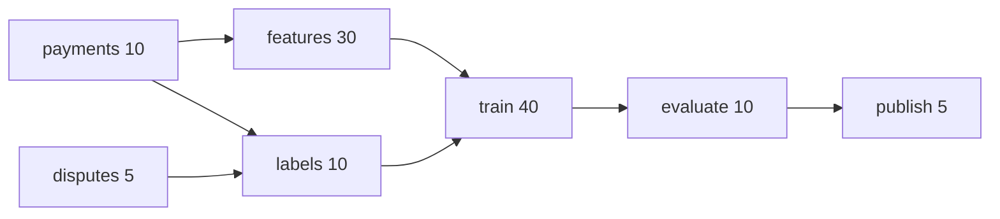

*Figure 47.1 — The nightly pipeline. An arrow means "must finish before".*

A **topological order** lists the nodes so that every arrow points forward. One exists exactly when the graph has no cycle.

ML is full of DAGs at two scales. Pipelines run from data to features to training to release, and orchestration tools such as Apache Airflow are built around this object and named their pipelines after it. Inside a neural network the computation graph is a DAG too, and backpropagation (chapter 28) walks it in reverse topological order.

#### The formal definition

- The **in-degree** of a node is its number of incoming arrows: its unmet prerequisites.
- Kahn's algorithm (1962) builds a topological order. Take any node with in-degree zero, output it, remove its outgoing arrows, repeat. If nodes remain and none has in-degree zero, the graph has a cycle. The cost is $O(V + E)$.
- With durations, a node's earliest finish is its own duration plus the latest earliest finish among its prerequisites. The chain that sets the final time is the **critical path**. A step off that path has **slack**: it can run late without delaying the end.
- The descendants of a node, everything reachable from it, are the blast radius of its failure.

### Worked example

Earliest finishes, in topological order: payments 10, disputes 5, features $10 + 30 = 40$, labels $\max(10, 5) + 10 = 20$, train $\max(40, 20) + 40 = 80$, evaluate 90, publish 95.

The critical path is payments, features, train, evaluate, publish. Labels finishes at minute 20 and is not needed until minute 40, so it has 20 minutes of slack. Making labels nine minutes faster saves nothing. Halving features saves 15.

```python
def topological_order(steps):
    """Kahn's algorithm: repeatedly run a step whose inputs are all done."""
    waiting_on = {s: len(deps) for s, (_, deps) in steps.items()}   # in-degree
    unlocks = {s: [] for s in steps}
    for s, (_, deps) in steps.items():
        for d in deps:
            unlocks[d].append(s)
    ready = deque(s for s in steps if waiting_on[s] == 0)
    order = []
    while ready:
        s = ready.popleft()
        order.append(s)
        for nxt in unlocks[s]:
            waiting_on[nxt] -= 1
            if waiting_on[nxt] == 0:
                ready.append(nxt)
    if len(order) < len(steps):          # some steps never became ready
        stuck = sorted(set(steps) - set(order))
        raise ValueError("cycle: " + ", ".join(stuck) + " wait on each other")
    return order
```

Output:

```text
run order: payments -> disputes -> features -> labels -> train -> evaluate -> publish
finish: payments:10 disputes:5 features:40 labels:20 train:80 evaluate:90 publish:95
critical path (95 min): payments -> features -> train -> evaluate -> publish
slack: labels could take 20 minutes longer and delay nothing
labels in 1 min instead of 10    -> total 95
features in 15 min instead of 30 -> total 80
cycle: evaluate, features, labels, payments, publish, train wait on each other
```

Feeding yesterday's published scores into today's features is not a cycle. Today's run depends on yesterday's finished output, which is a different node. The last line shows a real cycle: ingestion waiting for a result of the same run.

### Common mistakes

| Mistake | Why it bites | Do this instead |
|---|---|---|
| Speeding up a step that has slack | The total time does not change | Find the critical path first |
| Stopping at the first critical path | Shorten it and another chain becomes critical | Recompute after every change |
| Rerunning everything after one failure | Hours are wasted on steps that were fine | Rerun the failed step and its descendants, and make steps safe to rerun |
| Leaving a dependency undeclared | The order is right by luck and breaks on a slow night | Declare every input as an edge |

### Where a PM meets it

- **Decision:** "the model must be live by 06:00". Compare that with the critical path plus a margin, and fund speed-ups only on that path.
- **Ask for:** the pipeline drawing with durations, the critical path, and who is paged for each step.
- **Watch for:** blast radius. If payments is late, everything is late. If disputes is late by 15 minutes, nothing is.

### Check yourself

**Q47.1** Disputes now takes 30 minutes. What is the new total time, and how much slack does labels have?

**Q47.2** Give a valid run order that differs from the one printed.

**Q47.3** Features fails. Which steps cannot run, and which finished steps need no rerun?

> [!IMPORTANT]
> **In one line:** A pipeline is a DAG: a topological order says what can run when, the critical path sets the total time, and a node's descendants are what its failure breaks.

## 48. Propositional logic

### Why it matters

Every policy you write is a logical formula: "block if the amount is high and the device is new, unless the customer passed 3-D Secure". Stack a few dozen such rules and nobody can tell by reading them whether two contradict each other or whether some payments match no rule. Propositional logic turns both questions into a table a machine can check.

### The idea

A **proposition** is a statement that is either true or false for a given case, such as "the amount is over USD 1,000". Connectives build larger statements from smaller ones: NOT, AND, OR and IF-THEN. A **truth table** lists every combination of inputs with the resulting value. With $n$ propositions it has $2^n$ rows. Two formulas are equivalent when their truth tables match.

A policy is the AND of its rules, and each rule is an IF-THEN from conditions to a decision.

#### The formal definition

| $p$ | $q$ | $\neg p$ (not) | $p \land q$ (and) | $p \lor q$ (or) | $p \rightarrow q$ (if-then) |
|---|---|---|---|---|---|
| T | T | F | T | T | T |
| T | F | F | F | T | F |
| F | T | T | F | T | T |
| F | F | T | F | F | T |

- OR is inclusive: it is true when both parts are true.
- $p \rightarrow q$ is false only when $p$ is true and $q$ is false. A rule says nothing about cases where its condition does not hold.
- $p \rightarrow q$ is equivalent to $\neg p \lor q$ and to its contrapositive $\neg q \rightarrow \neg p$. It is not equivalent to its converse $q \rightarrow p$.
- De Morgan's laws: $\neg(p \land q)$ is $\neg p \lor \neg q$, and $\neg(p \lor q)$ is $\neg p \land \neg q$.
- A formula that is true in every row is a **tautology**. One that is false in every row is a **contradiction**.
- A set of rules is **consistent** on an input if some decision satisfies all of them.

### Worked example

Let $H$ be "amount over USD 1,000", $N$ "new device", $V$ "passed 3-D Secure" and $B$ "block". PayFlow has two rules:

$$
R_1:\ (H \land N) \rightarrow B \qquad\qquad R_2:\ V \rightarrow \neg B
$$

Take a payment where $H$, $N$ and $V$ are all true. $R_1$ demands $B$ and $R_2$ demands $\neg B$. No decision satisfies both: a conflict. With $H$ and $N$ true and $V$ false, $R_1$ forces a block. With $V$ true and $H \land N$ false, $R_2$ forces an allow. In the three remaining rows neither rule fires, and whatever the system does by default decides.

The fix is to make the first rule say what was meant: $(H \land N \land \neg V) \rightarrow B$.

```python
def implies(p, q):
    """p -> q is false only when p is true and q is false."""
    return (not p) or q

def check(rules):
    """For every input, list the decisions B that satisfy every rule."""
    report = {}
    for h, n, v in product([True, False], repeat=3):
        allowed = [b for b in (True, False) if all(rule(h, n, v, b) for rule in rules)]
        if not allowed:
            report[(h, n, v)] = "CONFLICT"
        elif len(allowed) == 2:
            report[(h, n, v)] = "no rule applies"
        else:
            report[(h, n, v)] = "block" if allowed[0] else "allow"
    return report
```

Output:

```text
H N V | policy {R1, R2}
T T T | CONFLICT
T T F | block
T F T | allow
T F F | no rule applies
F T T | allow
F T F | no rule applies
F F T | allow
F F F | no rule applies
conflicts before the fix: 1 | after: 0
```

Twenty conditions give about a million rows, still easy to enumerate. For far larger policies, SAT solvers answer the same question without listing every row.

### Common mistakes

| Mistake | Why it bites | Do this instead |
|---|---|---|
| Reading "if p then q" as "if q then p" | A blocked payment need not be a large one on a new device | State the converse separately if you mean it |
| Negating each part and keeping AND | NOT (high AND new) is (not high) OR (not new) | Apply De Morgan's laws |
| Shipping rules with no stated default | Inputs that no rule covers get an accidental decision | Write the default down and list the gaps |

### Where a PM meets it

- **Decision:** before a rule ships, ask which inputs make it fire, which existing rules it contradicts, and what happens where no rule applies.
- **Ask for:** the conflict list and the gap list from an automated check, not from someone reading the rules.
- **Watch for:** the same logic elsewhere: SQL `WHERE` clauses, feature-flag targeting and eligibility criteria all fail in these ways.

### Check yourself

**Q48.1** Rewrite "NOT (verified OR trusted merchant)" without the outer NOT.

**Q48.2** A rule says "if the device is new, require 3-D Secure". A payment from a known device was challenged. Was the rule broken?

**Q48.3** A policy uses 10 yes/no conditions. How many rows does a complete truth-table check have?

> [!IMPORTANT]
> **In one line:** Write each rule as an if-then over true/false conditions and a truth table will show every conflict and every gap in a policy before a customer finds them.

## 49. First-order logic and resolution

### Why it matters

Propositional logic can say "this payment is high-value". It cannot say "every business with a sanctioned owner is high-risk", because that sentence is about all businesses and all owners at once. Business verification, database queries and policy engines need that power. First-order logic provides it, and resolution lets a machine draw conclusions from it.

### The idea

First-order logic adds three things to chapter 48.

- **Objects.** Constants such as `dana` and `acme` name particular things. Variables such as $p$ and $b$ stand for any thing.
- **Predicates.** Statements with slots: $\mathrm{Owns}(p, b)$, $\mathrm{Sanctioned}(p)$, $\mathrm{HighRisk}(b)$.
- **Quantifiers.** $\forall$ means "for all" and $\exists$ means "there exists".

The sentence above becomes

$$
\forall p\ \forall b\ \big(\mathrm{Owns}(p, b) \land \mathrm{Sanctioned}(p) \rightarrow \mathrm{HighRisk}(b)\big)
$$

The order of quantifiers matters. $\forall b\, \exists p\ \mathrm{Owns}(p, b)$ says every business has some owner. $\exists p\, \forall b\ \mathrm{Owns}(p, b)$ says one person owns every business.

#### The formal definition

To reason mechanically, write every statement as a **clause**: an OR of predicates and negated predicates, with variables read as "for all". (A statement with $\exists$ is first rewritten by giving the thing that exists a name, a step called Skolemization.) Since $p \rightarrow q$ is $\neg p \lor q$, the rule above is the clause

$$
\neg\mathrm{Owns}(p, b) \lor \neg\mathrm{Sanctioned}(p) \lor \mathrm{HighRisk}(b)
$$

**Resolution** (Robinson, 1965) is a single inference rule. Take one clause containing some predicate and another containing its negation. If a substitution for the variables makes the two predicates identical, a step called **unification**, the two cancel, and what remains of both clauses, with the substitution applied, is a new true clause. The familiar modus ponens, from $p$ and $p \rightarrow q$ conclude $q$, is the simplest case.

To prove a goal, assume its opposite and resolve until nothing is left: the empty clause, a contradiction. If the goal follows from the facts, this search will find a proof. If it does not, the search may never end, because first-order logic is undecidable in general.

### Worked example

PayFlow's KYB knowledge base has the rule above as C1 and three facts: C2 $\mathrm{Owns}(\text{dana}, \text{acme})$, C3 $\mathrm{Owns}(\text{lee}, \text{birch})$ and C4 $\mathrm{Sanctioned}(\text{dana})$. The names are invented. Is $\mathrm{HighRisk}(\text{acme})$ true?

1. Assume $\neg\mathrm{HighRisk}(\text{acme})$.
2. Resolve with C1 under $b = \text{acme}$. The two HighRisk terms cancel, leaving $\neg\mathrm{Owns}(p, \text{acme}) \lor \neg\mathrm{Sanctioned}(p)$.
3. Resolve with C2 under $p = \text{dana}$, leaving $\neg\mathrm{Sanctioned}(\text{dana})$.
4. Resolve with C4. Nothing is left, so the assumption was false and acme is high-risk.

```python
def unify(args_a, args_b):
    """Find a substitution that makes two argument lists identical, or None."""
    theta = {}
    for a, b in zip(args_a, args_b):
        a, b = theta.get(a, a), theta.get(b, b)
        if a == b:
            continue
        if a.startswith("?"):
            theta[a] = b
        elif b.startswith("?"):
            theta[b] = a
        else:
            return None                     # two different constants: no match
    return theta

def substitute(clause, theta):
    return frozenset((sign, pred, tuple(theta.get(a, a) for a in args))
                     for sign, pred, args in clause)
```

Output:

```text
C1: HighRisk(?b) v ~Owns(?p, ?b) v ~Sanctioned(?p)
C2: Owns(dana, acme)
C3: Owns(lee, birch)
C4: Sanctioned(dana)
goal: HighRisk(acme)
  1. assume the opposite: ~HighRisk(acme)
  2. with C1, ?b = acme: ~Owns(?p, acme) v ~Sanctioned(?p)
  3. with C2, ?p = dana: ~Sanctioned(dana)
  4. with C4: empty clause
  contradiction, so the goal follows from the knowledge base
goal: HighRisk(birch)
  no proof found
```

No proof is found for birch. That does not prove birch is safe. Nothing in the knowledge base says lee was screened and cleared. A database query would treat the missing record as "not sanctioned", which is the **closed-world assumption**. Logic does not make it.

### Common mistakes

| Mistake | Why it bites | Do this instead |
|---|---|---|
| Treating "no record" as "false" | Missing data becomes a clean bill of health | Store "screened and clear" as its own fact |
| Swapping quantifiers when writing a rule in words | "Every account has an approver" is not "one approver for every account" | Read the rule back against a small example |
| Expecting the engine to answer every question | General proof search may not terminate | Restrict the rule language and bound the search |
| Letting one person appear under two names | Unification matches names exactly, so the chain breaks | Resolve identities first (chapter 44) |

### Where a PM meets it

- **Decision:** how expressive the rule language should be. The more it can say, the less you can guarantee about speed and termination.
- **Ask for:** the proof behind any derived fact such as "high-risk". The chain of facts and rules is the explanation you give the merchant.
- **Watch for:** SQL, which is this logic in daily use. `EXISTS` is $\exists$, and `NOT EXISTS` is where the closed-world assumption bites.

### Check yourself

**Q49.1** Translate "some device is used by every merchant in the ring" into quantifiers. Which quantifier comes first?

**Q49.2** Add the fact $\mathrm{Sanctioned}(\text{lee})$. What new conclusion follows, and through which clauses?

**Q49.3** The engine finds no proof that birch is high-risk. What can you conclude, and what can you not?

> [!IMPORTANT]
> **In one line:** First-order logic adds objects, predicates and "for all" and "there exists" to true/false logic, and resolution derives new facts by cancelling a statement against its negation.

## 50. Rule engines for fraud and business verification

### Why it matters

Payments companies run rules next to their models: sanctions blocks, velocity limits, step-up triggers, onboarding checks. Rules are where policy becomes behavior and where a merchant or an auditor gets a reason. They are also where incidents start: a new rule hidden behind an old one, or two rules that disagree.

### The idea

A **rule engine** has three parts: facts about the case, rules of the form IF condition THEN effect, and a policy for what happens when several rules fire.

- **Forward chaining** starts from the facts, fires every rule whose condition holds, adds what those rules derive and repeats until nothing new appears. (Backward chaining starts from a goal, as resolution did in chapter 49.)
- **Conflict resolution** picks the outcome when rules disagree: first match wins, explicit priorities, or most severe decision wins.
- The **explanation** is the list of rules that fired. It becomes the reason code an agent, a merchant or an auditor sees.

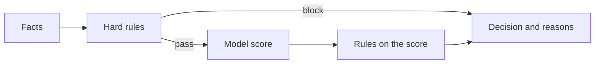

*Figure 50.1 — The usual layering: hard rules, then a model, then rules that turn its score into an action.*

#### The formal definition

A rule is a pair (condition, effect). The condition is a formula over the facts (chapter 48); the effect is a decision or a new fact. Forward chaining computes the smallest set of facts that contains the inputs and is closed under the rules. Under "most severe wins", with block above review above allow, the result is the most severe decision among the rules that fired, so rule order is irrelevant. Under "first match wins" it is decisive.

| Prefer a rule when | Prefer a model when |
|---|---|
| the policy is not negotiable: sanctions, legal limits | many weak signals must be combined |
| there is no labeled history: a new product, an attack that began this morning | labels exist and patterns drift gradually |
| the reason must be exact and stable | a score with a tunable threshold is enough |

### Worked example

PayFlow's engine has five rules. R1: a sanctioned owner means block. R2: an amount over USD 1,000 on a new device derives the fact "risky pattern". R3: a risky pattern without 3-D Secure means review. R4: a model score of 0.90 or more means block. R5: a trusted merchant means allow.

Case B is a USD 2,500 payment on a new device, unverified. R2 fires and adds "risky pattern". That new fact makes R3 fire: review, after two steps of chaining.

Case C is a trusted merchant with a score of 0.95: R4 says block, R5 says allow. "Most severe wins" blocks the payment. "First match wins" gives whichever rule is listed first.

```python
def decide(facts, rules, default="allow"):
    """Forward chaining, then the most severe decision wins."""
    facts, fired = dict(facts), []
    changed = True
    while changed:                      # keep going until no rule adds a new fact
        changed = False
        for rule in rules:
            if rule not in fired and rule.when(facts):
                fired.append(rule)
                if rule.adds_fact:
                    facts[rule.adds_fact] = True
                    changed = True
    votes = [r for r in fired if r.decision]
    if not votes:
        return default, ["no rule fired: default"]
    decision = max(votes, key=lambda r: SEVERITY[r.decision]).decision
    return decision, [r.name for r in fired]
```

Output:

```text
A ordinary payment: ALLOW
    because: no rule fired: default
B large, new device, unverified: REVIEW
    because: R2 large amount on new device; R3 risky pattern, not verified
C trusted merchant, score 0.95: BLOCK
    because: R4 model score 0.90 or more; R5 trusted merchant
D trusted merchant, sanctioned owner: BLOCK
    because: R1 sanctioned owner; R5 trusted merchant
case C under 'first match wins':
    rules in the order above -> block
    R5 moved to the top      -> allow
```

Production engines speed up the matching with the Rete algorithm (Forgy, 1982) or its descendants.

### Common mistakes

| Mistake | Why it bites | Do this instead |
|---|---|---|
| Relying on rule order that nobody remembers | A new rule below an older, broader one never fires | Use severity or explicit priority, and test with saved cases |
| Letting rules pile up | Dead and duplicate rules that nobody dares delete | Track each rule's fire rate and precision; give rules a review date |
| Allowing an "allow" rule to override a hard block | A trusted list becomes a bypass | Make some blocks impossible to override |

### Where a PM meets it

- **Decision:** you own the conflict policy and the default decision. Write both down.
- **Ask for:** per rule, its fire rate, the share of fires that were right, the losses prevented and the good customers stopped.
- **Watch for:** rule changes shipped without tests. Treat rules as code: versioned, reviewed and replayed on last month's payments before launch.

### Check yourself

**Q50.1** In case D, which rules fire, and why can R5 not rescue the payment?

**Q50.2** Under "first match wins", a new rule "amount over USD 10,000 means review" is added at the bottom of the list. Why might it never fire?

**Q50.3** A new fraud pattern appeared this morning, with 30 confirmed cases. Rule or model first, and why?

> [!IMPORTANT]
> **In one line:** A rule engine turns facts into decisions with reasons attached; choose its conflict policy on purpose, and use rules where policy is fixed or data is scarce.

# Part VII — Time series

## 51. Stationarity

### Why it matters

Every forecast assumes that the future behaves like the past. Stationarity is the precise form of that assumption, and it fails in ordinary ways: volume grows, Saturdays run busier, a pricing change moves the level. A model fitted to a series whose statistics are still moving learns the movement as if it were a law.

### The idea

A **time series** is one quantity measured at regular steps, such as PayFlow's daily payment count or approval rate. It is **stationary** when any stretch of it looks statistically like any other: same average level, same spread, same rhythm of ups and downs. Cover the dates on the chart and you could not tell March from September.

Figure 51.1 shows three cases. The approval rate wobbles around 94% throughout. The payment count climbs, so its second half averages far above its first: a **trend**. The third series repeats a weekly shape, which is **seasonality**: the expected value depends on the weekday.

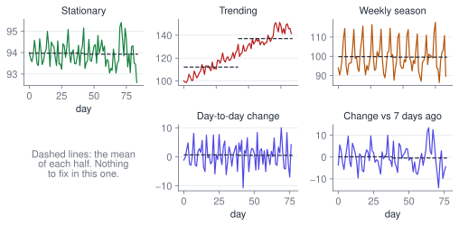

*Figure 51.1 — Dashed lines mark the mean of each half. Differencing (bottom row) levels the trend and removes the weekly shape.*

The repair is **differencing**: model the change instead of the level. Day-over-day change removes a trend; change against the same weekday last week removes a weekly pattern.

#### The formal definition

A series $X_t$ is weakly stationary when three quantities do not depend on the date $t$:

$$
\mathbb{E}[X_t]=\mu,\qquad \operatorname{Var}(X_t)=\sigma^2,\qquad \operatorname{Cov}(X_t,X_{t+h})=\gamma(h)
$$

The covariance may depend on the gap $h$, called the **lag**, but not on $t$. The **autocorrelation function** rescales $\gamma$ to lie between $-1$ and $1$:

$$
\rho(h)=\frac{\gamma(h)}{\gamma(0)}
$$

The first difference is $\nabla X_t=X_t-X_{t-1}$; the seasonal difference with period $m$ is $X_t-X_{t-m}$. A series that needs $d$ differences is called $I(d)$.

The usual test is the **augmented Dickey-Fuller test** (Dickey and Fuller, 1979; extended by Said and Dickey, 1984). Its null hypothesis is a **unit root**, the non-stationarity of a random walk $X_t=X_{t-1}+\varepsilon_t$, so a small p-value is evidence of stationarity. The KPSS test (1992) takes stationarity as its null instead.

### Worked example

Nine days of payments, in thousands: 40, 42, 43, 46, 48, 51, 52, 54, 56. The first four average 42.75 and the last four 53.25, so the mean is moving. The daily changes are 2, 1, 3, 2, 3, 1, 2, 2, and both halves average exactly 2.0. The level is not stationary; the change is.

Lag-1 autocorrelation of the changes: their deviations from 2 are 0, −1, 1, 0, 1, −1, 0, 0. The squares sum to 4 and the products of neighbors sum to −2, so $\rho(1)=-2/4=-0.5$.

The code confirms this, then diagnoses the series of Figure 51.1 (140 days each).

```python
def acf(x, h):
    """Sample autocorrelation at lag h."""
    d = np.asarray(x, dtype=float) - np.mean(x)
    return float(np.sum(d[:-h] * d[h:]) / np.sum(d * d))

# The hand example: nine days of payments, in thousands.
x = np.array([40, 42, 43, 46, 48, 51, 52, 54, 56], dtype=float)
dx = np.diff(x)
print("level:  first-4 mean", x[:4].mean(), " last-4 mean", x[-4:].mean())
print("change: first-4 mean", dx[:4].mean(), "  last-4 mean", dx[4:].mean())
print(f"lag-1 autocorrelation: level {acf(x, 1):.3f}, change {acf(dx, 1):.3f}")

# The same diagnosis on the simulated series, before and after differencing.
print(f"\n{'series':22s} half 1  half 2  acf(1)  acf(7)  ADF p")
for name, s in series.items():
    half = len(s) // 2
    p = adfuller(s, regression="c", autolag="AIC", result_object=True).pvalue
    print(f"{name:22s}{s[:half].mean():7.2f} {s[half:].mean():7.2f} "
          f"{acf(s, 1):7.2f} {acf(s, 7):7.2f}  {p:.3f}")
```

Output:

```text
level:  first-4 mean 42.75  last-4 mean 53.25
change: first-4 mean 2.0   last-4 mean 2.0
lag-1 autocorrelation: level 0.677, change -0.500

series                 half 1  half 2  acf(1)  acf(7)  ADF p
stationary              93.92   94.12    0.24   -0.09  0.000
trending               120.20  163.41    0.97    0.83  0.952
seasonal                99.50  100.71    0.35    0.76  0.075
trending, differenced    0.57    0.60   -0.33    0.07  0.000
seasonal, lag-7 diff     0.16   -0.04    0.36   -0.58  0.000
```

The trending series has halves 43 apart and a p-value of 0.95: no evidence against a unit root. Differenced, its halves agree. The seasonal series gives itself away at lag 7 (0.76). Differencing has a price, visible in the last row: it plants a correlation of −0.58.

### Common mistakes

| Mistake | Why it bites | Do this instead |
|---|---|---|
| Judging by the mean alone | A random walk keeps a flat average while its variance grows without limit | Compare level, spread and autocorrelation across windows |
| Differencing again "to be safe" | Each extra difference adds noise and negative autocorrelation | Stop at the first difference that steadies the mean |
| Testing across a known break | One pricing change makes the whole series look non-stationary | Split at the date and test each side |

### Where a PM meets it

- Before approving a forecast, ask which series was modeled: level, change or growth rate.
- Experiment readouts (Chapter 22) and drift monitors (Chapter 41) assume a stable baseline. Balance weekdays, or you compare a Tuesday with a Saturday.
- Keep a dated list of breaks: pricing changes, large merchant launches, outages.

### Check yourself

**Q51.1** A series has the same mean every month, but its swings widen every month. Is it weakly stationary?

**Q51.2** Daily dispute counts have autocorrelation 0.05 at lag 1 and 0.72 at lag 7. What would you try?

**Q51.3** An ADF test returns $p=0.60$ and a colleague concludes the series is stationary. What is wrong?

> [!IMPORTANT]
> **In one line:** A series is stationary when its mean, spread and autocorrelation do not depend on the date; when they do, model the change instead of the level.

## 52. ARMA models

### Why it matters

After a strong day of merchant sign-ups, should you expect another? After a one-day promotion, how long does the bump last? ARMA models answer both with two small numbers, and they are the baseline any larger model has to beat.

### The idea

Why does a stationary series (Chapter 51) differ from its average today? Two mechanisms.

- Memory. Today inherits a fraction of yesterday's deviation: a sales team on a roll stays on one for a while. This is the **autoregressive (AR)** part.
- Shocks. A one-off surprise, such as a press mention, echoes for a fixed number of days and is gone. This is the **moving-average (MA)** part.

An **ARMA model** combines the two. A plot of the autocorrelation function tells them apart: memory fades geometrically, while a shock echo stops dead (Figure 52.1).

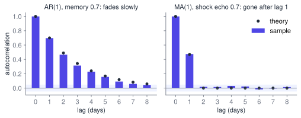

*Figure 52.1 — Autocorrelation of 2,000 simulated days. Bars are sample values, dots are theory; pure noise stays inside the shaded band 95% of the time.*

#### The formal definition

Let $\varepsilon_t$ be **white noise**: mean zero, constant variance $\sigma_\varepsilon^2$, no correlation across time. An ARMA($p,q$) model for a series with mean $\mu$ is

$$
X_t-\mu=\sum_{i=1}^{p}\phi_i\,(X_{t-i}-\mu)+\varepsilon_t+\sum_{j=1}^{q}\theta_j\,\varepsilon_{t-j}
$$

With $q=0$ it is AR($p$); with $p=0$, MA($q$). Two facts to remember:

- AR(1) is stationary only when $\lvert\phi\rvert<1$, and then $\rho(h)=\phi^h$. At $\phi=1$ it is a random walk.
- MA(1) has $\rho(1)=\theta/(1+\theta^2)$ and $\rho(h)=0$ beyond lag 1.

**ARIMA**($p,d,q$) is ARMA fitted after differencing $d$ times. The general model goes back to Peter Whittle's 1951 thesis; the 1970 book by George Box and Gwilym Jenkins made it standard practice.

### Worked example

New-merchant applications over ten days: 18, 19, 21, 23, 24, 23, 20, 19, 20, 23. The mean is 21, so the deviations are −3, −2, 0, 2, 3, 2, −1, −2, −1, 2. Their squares sum to 40; the products of neighbors sum to $6+0+0+6+6-2+2+2-2=18$.

For an AR(1), the estimate of $\phi$ is the lag-1 autocorrelation (the Yule-Walker estimate): $18/40=0.45$.

- Day 11 forecast: $21+0.45\times(23-21)=21.9$.
- Day 12 forecast: $21+0.45^2\times 2=21.405$. Forecasts slide back to the mean.
- Shock variance: $(40/10)(1-0.45^2)=3.19$, a standard deviation of 1.786, so the 95% range for day 11 is $21.9\pm1.96\times1.786$, or 18.4 to 25.4.

The code repeats the fit, then simulates pure memory and pure shock, each with coefficient 0.7.

```python
def simulate_arma(phi, theta, n, rng):
    """x[t] = phi * x[t-1] + e[t] + theta * e[t-1], with e ~ N(0, 1)."""
    e = rng.normal(0, 1, n + 1)
    x = np.zeros(n + 1)
    for t in range(1, n + 1):
        x[t] = phi * x[t - 1] + e[t] + theta * e[t - 1]
    return x[1:]

# The hand example: new-merchant applications per day, fitted as an AR(1).
y = np.array([18, 19, 21, 23, 24, 23, 20, 19, 20, 23], dtype=float)
mu = y.mean()
phi = acf(y, 1)                              # Yule-Walker estimate
shock_sd = np.sqrt(np.var(y) * (1 - phi ** 2))
day11 = mu + phi * (y[-1] - mu)
print(f"mean {mu:.0f}  phi {phi:.2f}  shock sd {shock_sd:.3f}")
print(f"day 11 forecast {day11:.2f}, 95% range "
      f"{day11 - 1.96 * shock_sd:.1f} to {day11 + 1.96 * shock_sd:.1f}")

# Simulate pure memory and pure shock echo, then read their autocorrelations.
rng = np.random.default_rng(152)
ar = simulate_arma(phi=0.7, theta=0.0, n=2000, rng=rng)
ma = simulate_arma(phi=0.0, theta=0.7, n=2000, rng=rng)
print("\nlag        1      2      3      4")
print("AR(1) " + " ".join(f"{acf(ar, h):6.3f}" for h in range(1, 5)))
print("MA(1) " + " ".join(f"{acf(ma, h):6.3f}" for h in range(1, 5)))
print(f"noise band +/- {1.96 / np.sqrt(2000):.3f}")
```

Output:

```text
mean 21  phi 0.45  shock sd 1.786
day 11 forecast 21.90, 95% range 18.4 to 25.4

lag        1      2      3      4
AR(1)  0.697  0.466  0.314  0.229
MA(1)  0.474  0.017  0.015  0.030
noise band +/- 0.044
```

The AR(1) row tracks $0.7^h$: 0.7, 0.49, 0.343, 0.24. The MA(1) row starts at $0.7/1.49=0.47$ and then drops inside the noise band of $\pm1.96/\sqrt{n}$. Read any autocorrelation plot this way: bars inside the band are indistinguishable from zero.

### Common mistakes

| Mistake | Why it bites | Do this instead |
|---|---|---|
| Fitting ARMA to a trending series | The fit chases the trend and $\phi$ lands near 1 | Difference first, or remove trend and season |
| Trusting a long-horizon forecast | Forecasts decay to the mean and cannot foresee a break | Use it for days to weeks, with its range |
| Adding lags until the fit looks perfect | Six parameters on ten points fit the noise | Choose the order with AIC or BIC; check residuals look like white noise |

### Where a PM meets it

- Campaign tails: a bump's half-life is $\ln 0.5/\ln\phi$. At 0.45 that is 0.87 days; at 0.9, 6.6 days. Ask for it before attributing revenue to a promotion.
- Baselines: ask of any forecasting proposal, "does it beat ARIMA on held-out weeks?"
- Alerts: flag a day outside the model's 95% range, not one that merely looks large.

### Check yourself

**Q52.1** An autocorrelation plot shows 0.8, 0.64, 0.51, 0.41 at lags 1 to 4. Which model fits, and with what coefficient?

**Q52.2** A metric follows an AR(1) with mean 50 and $\phi=0.6$. Today it reads 60. Forecast tomorrow and the day after.

**Q52.3** Why can an MA(1) not explain a promotion bump still visible four days later?

> [!IMPORTANT]
> **In one line:** ARMA explains a stationary series as fading memory of its own past plus a short echo of recent shocks, and the autocorrelation plot shows which is which.

## 53. Log returns and simple returns

### Why it matters

"Volume grew 15%, then 10%, then 15%, so 40% for the quarter" is wrong, and it is the most common arithmetic slip in growth reporting. There are two ways to measure change over time. One is intuitive and does not add up; the other adds up and is less intuitive. Know which one you are looking at.

### The idea

A **simple return** is the percentage change you already use: a price that goes from 100 to 110 has returned +10%. Simple returns combine by multiplication, which is why a 10% gain followed by a 10% loss leaves you at 99, not 100.

A **log return** is the natural logarithm of the growth factor. The log of a product is the sum of the logs, so log returns over consecutive periods add exactly. Statistics built on sums and averages, including the models of Chapter 52, are therefore run on log returns.

For small moves the two nearly coincide. For large moves they separate (Figure 53.1), and the log scale keeps one honest fact in view: a 50% loss is bigger than a 50% gain.

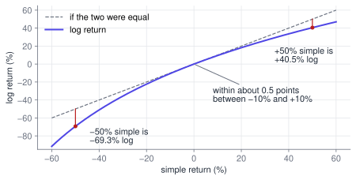

*Figure 53.1 — The log return is always below the simple return. The gap is negligible for small moves and large for big ones.*

#### The formal definition

For a positive series $P_t$ (a price, a volume, a user count), the simple return $r_t$ and log return $\ell_t$ are

$$
r_t=\frac{P_t-P_{t-1}}{P_{t-1}},\qquad \ell_t=\ln\frac{P_t}{P_{t-1}}=\ln(1+r_t)
$$

Over $n$ periods they chain differently:

$$
1+r_{0\to n}=\prod_{t=1}^{n}(1+r_t),\qquad \ell_{0\to n}=\sum_{t=1}^{n}\ell_t
$$

The Taylor expansion of Chapter 31 gives $\ell_t\approx r_t-r_t^2/2$ for small $r_t$. A simple return cannot fall below $-1$; a log return has no floor. The average growth per period is the **compound growth rate** $\exp(\ell_{0\to n}/n)-1$.

Across assets held at the same time the roles swap. A portfolio with weights $w_i$ has simple return $r_p=\sum_i w_i r_i$, and log returns do not combine that way.

### Worked example

A made-up share price closes at 100, 110, 99 and 103.95 on four days. The simple returns are +10%, −10% and +5%. Their sum is 5%, but the price rose 3.95%. Multiplying gets it right: $1.10\times0.90\times1.05=1.0395$.

The log returns are $\ln1.10=0.09531$, $\ln0.90=-0.10536$ and $\ln1.05=0.04879$. They sum to 0.03874, and $e^{0.03874}-1=0.0395$.

Now PayFlow's processed volume at four month-ends, in USD million: 80, 92, 101.2, 116.38. Monthly growth is 15%, 10% and 15%. Added up, that is 40%; the quarter actually grew $1.15\times1.10\times1.15-1=45.5\%$.

```python
# The hand example: a made-up share price over three days.
price = np.array([100.0, 110.0, 99.0, 103.95])
simple = price[1:] / price[:-1] - 1
log_r = np.log(price[1:] / price[:-1])
print("simple:", np.round(simple, 4), " sum", round(float(simple.sum()), 4))
print("log:   ", np.round(log_r, 5), " sum", round(float(log_r.sum()), 5))
print(f"true total {price[-1] / price[0] - 1:.4f}   "
      f"compounded simple {np.prod(1 + simple) - 1:.4f}   "
      f"exp(log sum) - 1 {np.exp(log_r.sum()) - 1:.4f}")

# The same rule on PayFlow's monthly processed volume, USD million.
volume = np.array([80.0, 92.0, 101.2, 116.38])
growth = volume[1:] / volume[:-1] - 1
quarter = volume[-1] / volume[0] - 1
average = np.exp(np.log(volume[-1] / volume[0]) / 3) - 1
print("\nmonthly growth:", np.round(growth, 4))
print(f"added up {growth.sum():.4f}   actual quarter {quarter:.4f}   "
      f"average month {average:.4f}")

# Across assets it is the simple returns that add.
w = np.array([0.6, 0.4])                    # portfolio weights
r_assets = np.array([0.10, -0.05])          # one-period simple returns
port = float(w @ r_assets)
print(f"\nportfolio: simple {port:.4f}, its log {np.log(1 + port):.5f}, "
      f"weighted logs {float(w @ np.log(1 + r_assets)):.5f}")
```

Output:

```text
simple: [ 0.1  -0.1   0.05]  sum 0.05
log:    [ 0.09531 -0.10536  0.04879]  sum 0.03874
true total 0.0395   compounded simple 0.0395   exp(log sum) - 1 0.0395

monthly growth: [0.15 0.1  0.15]
added up 0.4000   actual quarter 0.4547   average month 0.1331

portfolio: simple 0.0400, its log 0.03922, weighted logs 0.03667
```

The last line is the swap in action. A portfolio 60% in an asset returning +10% and 40% in one returning −5% returns exactly 4%. Weighting the two log returns gives 0.03667, which is not the portfolio's log return of 0.03922.

### Common mistakes

| Mistake | Why it bites | Do this instead |
|---|---|---|
| Adding simple returns over time | It ignores compounding; the error grows with the size and number of moves | Multiply growth factors, or add log returns |
| Averaging log returns across segments or assets | Logs add over time only | Combine segments in simple terms, weighted by size |
| Showing a log return as "percent growth" | A log return of −0.69 is a 50% loss | Convert back with $e^{\ell}-1$ before it reaches a slide |

### Where a PM meets it

- Growth narratives: a quarter is the product of its months, and the average month is the compound rate. Ask which one the dashboard shows.
- Segment mixes: total growth is the volume-weighted simple growth of the segments.
- Model inputs: forecasting and volatility models (Chapter 54) take log changes. Convert back before you present.

### Check yourself

**Q53.1** A merchant's volume falls 20% in January and rises 20% in February. What is the net change?

**Q53.2** Three monthly log returns are 0.05, 0.02 and −0.03. What is the total simple return?

**Q53.3** Why is the simple return the right one for combining two merchant segments' growth in the same month?

> [!IMPORTANT]
> **In one line:** Simple returns multiply through time and add across a portfolio; log returns add through time, which is why models use them and slides should not.

## 54. Volatility

### Why it matters

"Is this number unusual?" has no answer until you know the usual size of its moves. Volatility is that size. It sets alert thresholds, reserves and forecast ranges, and two of its properties trip people up: it grows with the square root of time, and it arrives in clusters.

### The idea

**Volatility** is the standard deviation of returns (Chapter 17): the typical size of a one-period move, in either direction. The three common estimates differ only in how much weight old data gets.

- A **rolling window** takes the standard deviation of the last $n$ returns. Each day counts equally, then drops out.
- An **exponentially weighted moving average (EWMA)** nudges yesterday's estimate toward yesterday's squared return, so old data fades smoothly.
- **GARCH** is EWMA plus a pull toward a long-run level, with fitted weights.

All three exist because of **volatility clustering**: large moves tend to follow large moves, of either sign. The direction of tomorrow's move is close to unpredictable. Its size is not (Figure 54.1).

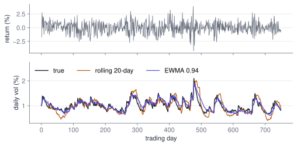

*Figure 54.1 — Simulated returns and their volatility. The rolling estimate lags and drops abruptly; the exponentially weighted one follows more closely.*

#### The formal definition

For returns $r_t$ with mean $\bar r$, the realized volatility over $n$ periods is

$$
\hat\sigma=\sqrt{\frac{1}{n-1}\sum_{t=1}^{n}(r_t-\bar r)^2}
$$

EWMA updates a variance with a decay $\lambda$ between 0 and 1. J.P. Morgan's RiskMetrics documentation (1996) used 0.94 for daily data and 0.97 for monthly.

$$
\sigma_t^2=\lambda\,\sigma_{t-1}^2+(1-\lambda)\,r_{t-1}^2
$$

GARCH(1,1), introduced by Tim Bollerslev in 1986 as a generalization of Robert Engle's 1982 ARCH model, adds a constant. For returns with mean near zero:

$$
\sigma_t^2=\omega+\alpha\,r_{t-1}^2+\beta\,\sigma_{t-1}^2,\qquad \omega>0,\ \alpha\ge0,\ \beta\ge0
$$

When $\alpha+\beta<1$ the variance keeps returning to the long-run value $\omega/(1-\alpha-\beta)$. EWMA is the case $\omega=0$, $\alpha=1-\lambda$, $\beta=\lambda$, which has no long-run level.

**Annualization** restates volatility per year. If returns in different periods are uncorrelated, variances add, so volatility over $N$ periods is $\sigma\sqrt{N}$: $\sqrt{252}$ for trading days, $\sqrt{365}$ for calendar days, $\sqrt{12}$ for months.

### Worked example

Five daily log returns of a share, in percent: 1, −1, 2, −2, 0. The mean is 0 and the squares sum to 10, so the variance is $10/4=2.5$ and the volatility is $\sqrt{2.5}=1.581\%$ a day. Annualized: $1.581\times\sqrt{252}=25.1\%$.

Next day the share falls 4%. The EWMA variance becomes $0.94\times2.5+0.06\times16=3.31$, a volatility of 1.819%. A calm day of +0.5% follows: $0.94\times3.31+0.06\times0.25=3.1264$, or 1.768%. One shock raised the estimate by 15%; one quiet day gave back a fifth of that.

The code checks this, then simulates a GARCH(1,1) with $\omega=0.05$, $\alpha=0.10$, $\beta=0.85$, whose long-run variance is $0.05/0.05=1$.

```python
# The hand example: five daily log returns, in percent.
r5 = np.array([1.0, -1.0, 2.0, -2.0, 0.0])
var5 = r5.var(ddof=1)
lam = 0.94
v1 = lam * var5 + (1 - lam) * (-4.0) ** 2      # after a -4% day
v2 = lam * v1 + (1 - lam) * 0.5 ** 2           # after a calm +0.5% day
print(f"daily vol {np.sqrt(var5):.3f}%  annualized {np.sqrt(var5 * 252):.1f}%")
print(f"EWMA vol after the shock {np.sqrt(v1):.3f}%, a day later {np.sqrt(v2):.3f}%")

# Simulate 750 days of GARCH(1,1) returns, in percent per day.
omega, alpha, beta = 0.05, 0.10, 0.85
rng = np.random.default_rng(954)
n = 750
sig2 = np.full(n, omega / (1 - alpha - beta))  # start at the long-run variance
ewma2 = sig2.copy()
r = np.zeros(n)
for t in range(n):
    if t > 0:
        sig2[t] = omega + alpha * r[t - 1] ** 2 + beta * sig2[t - 1]
        ewma2[t] = lam * ewma2[t - 1] + (1 - lam) * r[t - 1] ** 2
    r[t] = np.sqrt(sig2[t]) * rng.normal()
rolling = np.array([r[t - 20:t].std(ddof=1) for t in range(20, n)])
```

Output:

```text
daily vol 1.581%  annualized 25.1%
EWMA vol after the shock 1.819%, a day later 1.768%

long-run daily vol 1.00%   sample 1.043%   annualized 16.6%
true daily vol ranged from 0.67% to 2.10%
lag-1 autocorrelation: returns +0.029, squared +0.234
mean abs error vs true vol: rolling-20 0.134, EWMA 0.083
```

Returns barely correlate with yesterday's (+0.03), so direction is unpredictable. Squared returns do (+0.23): size clusters. One average of 1.04% hides days that ran from 0.67% to 2.10%.

### Common mistakes

| Mistake | Why it bites | Do this instead |
|---|---|---|
| Multiplying daily volatility by 252 | Volatility grows with the square root of time; here it would turn 16.6% into 263% | Multiply by $\sqrt{N}$ |
| One standard deviation for calm and stormy periods | Too wide in calm weeks, too narrow in a storm | Use a rolling or exponentially weighted estimate |
| Reading volatility as risk of loss | It counts upward moves too | Add a drawdown or worst-period measure |

### Where a PM meets it

- Alert thresholds: set the band around a refund or failure rate in units of current volatility. After an incident it should stay wide for days.
- Ranges and reserves: uncertainty over $h$ days is about $\sqrt{h}$ times one day's, once trend and weekday effects are removed.

### Check yourself

**Q54.1** A share's daily volatility is 2%. What is its annualized volatility over 252 trading days?

**Q54.2** With $\lambda=0.9$, yesterday's variance estimate was 4 and yesterday's return was 3. What is today's EWMA variance?

**Q54.3** Returns are uncorrelated but squared returns are not. Why does that justify GARCH?

> [!IMPORTANT]
> **In one line:** Volatility is the typical size of a move; it scales with the square root of time and clusters, so estimate it with recent data weighted most.

## 55. Sharpe ratio and information ratio

### Why it matters

Two bets both returned 15%, one smoothly and one with wild swings. Ranking by return alone rewards whoever took the most risk and got lucky. The Sharpe and information ratios rank by return per unit of risk. They are also among the most flattered numbers in finance.

### The idea

Divide the reward by the bumpiness. The **Sharpe ratio** takes a fund's return above the **risk-free rate** (what cash earns with no risk) and divides it by the volatility of that excess. The **information ratio** does the same against a **benchmark**, such as an index: average outperformance divided by the **tracking error**, which is how erratically the fund departs from the benchmark.

Both are signal-to-noise ratios, built like the test statistic of Chapter 22. Keep that link: the ratio times the square root of the number of periods is a t-statistic.

#### The formal definition

Let $R_t$ be the return in period $t$ and $Y_t$ the yardstick: the risk-free rate for Sharpe, the benchmark's return for the information ratio. With $D_t=R_t-Y_t$ over $T$ periods,

$$
\text{ratio}=\frac{\bar D}{s_D},\qquad s_D=\sqrt{\frac{1}{T-1}\sum_{t=1}^{T}(D_t-\bar D)^2}
$$

William Sharpe proposed the measure in 1966 as the "reward-to-variability ratio" and restated it in this differential form in 1994. To annualize, multiply by $\sqrt{N}$ for $N$ periods a year: the mean scales with $N$ and the volatility with $\sqrt{N}$ (Chapter 54). The t-statistic of $\bar D$ is $\text{ratio}\times\sqrt{T}$.

Two assumptions sit underneath: returns in different periods are uncorrelated, and a standard deviation describes the risk adequately. Each way of gaming the ratio breaks one.

### Worked example

A fund's month-end price goes 100, 103.40, 101.75, 106.22, 103.46, 105.94, 105.31: monthly returns of 3.4, −1.6, 4.4, −2.6, 2.4 and −0.6 percent. Cash pays 0.4% a month, so the excess returns are 3, −2, 4, −3, 2, −1.

- Mean: $3/6=0.5$. The deviations are $\pm2.5$, $\pm3.5$, $\pm1.5$, with squares summing to 41.5.
- Standard deviation: $\sqrt{41.5/5}=2.881$. Monthly Sharpe: $0.5/2.881=0.174$. Annualized: $0.174\times\sqrt{12}=0.601$.
- t-statistic: $0.174\times\sqrt{6}=0.43$. Six months cannot tell this fund from one with no edge.

Its benchmark returned 2.9, −1.1, 3.4, −2.1, 1.9, −0.8. The active returns are 0.5, −0.5, 1.0, −0.5, 0.5, 0.2: mean 0.2, tracking error 0.6, information ratio $0.2/0.6=0.333$ a month, or 1.155 annualized.

```python
def ratio(returns, yardstick, periods_per_year=12):
    """Annualized mean/sd of (returns - yardstick), and its t-statistic."""
    diff = np.asarray(returns, dtype=float) - yardstick
    per_period = diff.mean() / diff.std(ddof=1)
    return per_period * np.sqrt(periods_per_year), per_period * np.sqrt(len(diff))

# The hand example: six monthly returns, in percent.
fund = np.array([3.4, -1.6, 4.4, -2.6, 2.4, -0.6])
bench = np.array([2.9, -1.1, 3.4, -2.1, 1.9, -0.8])
print("Sharpe (annualized, t-stat):     %.3f, %.2f" % ratio(fund, 0.4))
print("information ratio (same pair):   %.3f, %.2f" % ratio(fund, bench))

# Gaming 1: report half of this month's move and half of last month's.
rng = np.random.default_rng(575)
honest = rng.normal(0.9, 3.0, 120)              # ten years, percent per month
smoothed = honest.copy()
smoothed[1:] = 0.5 * honest[1:] + 0.5 * honest[:-1]
d = smoothed - smoothed.mean()
lag1 = np.sum(d[:-1] * d[1:]) / np.sum(d * d)
print(f"\nhonest fund {ratio(honest, 0.3)[0]:.2f}   smoothed marks "
      f"{ratio(smoothed, 0.3)[0]:.2f}   (lag-1 autocorrelation {lag1:.2f})")

# Gaming 2: a steady premium, and a 25% loss about one month in fifty.
quiet = rng.normal(1.0, 0.3, 120)
crash = rng.random(120) < 0.02
seller = np.where(crash, -25.0, quiet)
first = int(np.flatnonzero(crash)[0])
print(f"tail-risk seller {ratio(seller[:first], 0.3)[0]:.2f} over the first "
      f"{first} months, {ratio(seller, 0.3)[0]:.2f} over all 120")
```

Output:

```text
Sharpe (annualized, t-stat):     0.601, 0.43
information ratio (same pair):   1.155, 0.82

honest fund 0.74   smoothed marks 0.97   (lag-1 autocorrelation 0.58)
tail-risk seller 8.78 over the first 70 months, 0.27 over all 120
```

Smoothing reported prices hides volatility: the Sharpe rises from 0.74 to 0.97 with no added skill. The tell is autocorrelation of 0.58 where there should be none (Andrew Lo measured the distortion in 2002). The second fund collects small premiums and occasionally loses a quarter of its value; until the first loss its Sharpe is 8.78 (Figure 55.1).


*Figure 55.1 — The smooth line has the better Sharpe ratio for 70 months and the worse outcome over ten years.*

### Common mistakes

| Mistake | Why it bites | Do this instead |
|---|---|---|
| Celebrating a high ratio from a short record | A few periods prove little: the t-statistic is ratio times $\sqrt{T}$ | Ask for the period count and the t-statistic |
| Reading a high Sharpe as "safe" | Standard deviation misses rare, large losses | Ask for the worst period, the maximum drawdown, or a Sortino ratio (downside deviation only) |
| Accepting the benchmark offered | An easy yardstick flatters any information ratio | Fix the benchmark before looking at results |

### Where a PM meets it

- Comparing bets: divide each experiment's mean weekly lift by its standard deviation. A steady 3% can beat a lumpy 4%.
- Vetting a "risk-adjusted" claim: ask for the period count, yardstick, autocorrelation and worst month.
- Leverage leaves a Sharpe ratio unchanged: it doubles mean excess and volatility together.

### Check yourself

**Q55.1** Monthly excess returns average 1% with a standard deviation of 4%. What is the annualized Sharpe ratio?

**Q55.2** A fund reports an annualized Sharpe ratio of 1.0 from two years of data. What is the t-statistic, and is it convincing?

> [!IMPORTANT]
> **In one line:** Sharpe and information ratios are mean over standard deviation against a yardstick, so they are only as trustworthy as the length of the record and the honesty of the volatility.

## 56. Forecasting revenue, pricing and seasonality

### Why it matters

PayFlow's revenue is a formula applied to volume: 2.9% of the amount plus USD 0.30 per successful payment. So every revenue plan and pricing proposal starts from a volume forecast, and two questions settle most arguments about one: does it beat the obvious baseline, and how was its error measured?

### The idea

Take the daily payment count apart. A **decomposition** splits it into a trend, seasonality (the weekly shape), a **holiday effect** (known dates such as a sale day) and a residual that should be stationary noise (Chapter 51).

Before fitting anything, write down the **seasonal naive forecast**: each day will equal the same weekday last week. A model that cannot beat it on weeks it has not seen is not worth shipping.

**Holt-Winters smoothing** (Charles Holt, 1957; Peter Winters, 1960) is the classic step up. It keeps running estimates of a level, a trend and one offset per weekday, updating each as a weighted average of old estimate and new evidence. Seasonal ARIMA (Chapter 52 with seasonal lags) is the usual alternative.

Price is a decision, so you do not extrapolate it: you forecast volume and compute revenue under each price you might choose.

#### The formal definition

The additive decomposition is $y_t=T_t+S_t+H_t+R_t$: trend, seasonal part of period $m$, holiday part, residual. Holt-Winters tracks a level $L_t$, a trend $b_t$ and an offset $s_t$ with weights $\alpha,\beta,\gamma$ between 0 and 1:

$$
\begin{aligned}
L_t&=\alpha\,(y_t-s_{t-m})+(1-\alpha)(L_{t-1}+b_{t-1})\\
b_t&=\beta\,(L_t-L_{t-1})+(1-\beta)\,b_{t-1}\\
s_t&=\gamma\,(y_t-L_t)+(1-\gamma)\,s_{t-m}
\end{aligned}
$$

The forecast $h\le m$ steps ahead is $\hat y_{t+h}=L_t+h\,b_t+s_{t+h-m}$; seasonal naive is $\hat y_{t+h}=y_{t+h-m}$. On $n$ held-out days, the **mean absolute error** and **mean absolute percentage error** are

$$
\text{MAE}=\frac{1}{n}\sum_{i=1}^{n}\lvert y_i-\hat y_i\rvert,\qquad
\text{MAPE}=\frac{100}{n}\sum_{i=1}^{n}\frac{\lvert y_i-\hat y_i\rvert}{y_i}
$$

### Worked example

One merchant, Juniper Bakery, took 100, 104, 108, 110, 130, 90 and 60 payments from Monday to Sunday last week. That is the seasonal naive forecast for this week. The actuals were 103, 108, 110, 114, 180, 94, 50; Friday was a sale.

The errors are 3, 4, 2, 4, 50, 4, −10. MAE is $77/7=11.0$ payments a day. MAPE averages 2.9, 3.7, 1.8, 3.5, 27.8, 4.3 and 20.0 percent: 9.14%.

MAPE misleads in three ways. Sunday's miss of 10 counts 20%, nearly as much as Friday's miss of 50, because Sunday is small. Forecasting high costs more than forecasting low: 60 against an actual of 50 is 20%, 50 against 60 is 16.7%. And it is undefined when an actual is zero.

The code scores three forecasts of company-wide payments (thousands) on the last two of ten simulated weeks. One sale Friday is in the history and one is held out.

```python
def holt_winters(y, m, alpha, beta, gamma, horizon):
    level = y[:m].mean()
    trend = (y[m:2 * m].mean() - y[:m].mean()) / m
    season = list(y[:m] - level)
    for i in range(m, len(y)):
        previous = level
        level = alpha * (y[i] - season[i - m]) + (1 - alpha) * (level + trend)
        trend = beta * (level - previous) + (1 - beta) * trend
        season.append(gamma * (y[i] - level) + (1 - gamma) * season[i - m])
    last = season[-m:]
    return np.array([level + (h + 1) * trend + last[h % m] for h in range(horizon)])

# Baseline: repeat the last observed week.
seasonal_naive = np.tile(train[-m:], 2)

# Measure the training sale day's lift, then replace it with a normal Friday.
clean = train.copy()
clean[25] = (train[18] + train[32]) / 2
lift = train[25] - clean[25]
hw = holt_winters(clean, m, alpha=0.3, beta=0.1, gamma=0.3, horizon=14)
hw_sale = hw.copy()
hw_sale[60 - 56] += lift                # the known sale date
```

Output:

```text
hand example: MAE 11.0  MAPE 9.14%

sale-day lift measured in training: 42.2
seasonal naive       MAE  9.03   MAPE  6.18%
Holt-Winters         MAE  6.58   MAPE  4.40%
Holt-Winters + sale  MAE  3.57   MAPE  2.68%

fee per payment USD 1.75; two-week revenue forecast USD 3.19 million
at 2.7% the fee is USD 1.65; payments must grow 6.1% to pay for the cut
```

Holt-Winters beats the baseline because it carries the trend forward; adding the measured lift on the known sale date nearly halves the error again (Figure 56.1). The last lines assume an average payment of USD 50, which earns $0.029\times50+0.30$, or USD 1.75.


*Figure 56.1 — Seasonal naive runs a week of growth behind and misses the sale; adjusted Holt-Winters catches both.*

### Common mistakes

| Mistake | Why it bites | Do this instead |
|---|---|---|
| Scoring on the fitting data | In-sample fit always flatters | Hold out the latest weeks, from several cut-off dates |
| Deleting holidays as outliers | They return every year with money attached | Model them as known events and add them back |
| Quoting MAPE alone | Small days dominate; under-forecasting is rewarded | Report MAE, bias and error relative to seasonal naive |

### Where a PM meets it

- Ask for held-out error next to the seasonal naive error, and for a range, not one number.
- A price change is a scenario: here a cut to 2.7% needs 6.1% more payments to break even.

### Check yourself

**Q56.1** Actuals are 10 and 200; forecasts are 15 and 190. Compute MAE and MAPE. Which day drives the MAPE?

**Q56.2** A model beats seasonal naive on the data it was fitted to and loses on held-out weeks. What happened, and what do you ship?

> [!IMPORTANT]
> **In one line:** Decompose volume into trend, season, holidays and noise, beat the seasonal naive baseline on unseen weeks, and score in units you can turn into money.

# Part VIII — Practice

## 57. Labs

Nine short labs, at least one for each of Parts I to VII. Each gives you a PayFlow situation with numbers, a task, and hints. Work it on paper before you read the model answer; the point is to find out which steps you cannot yet do without looking. Every model answer is backed by a script in `volume-1-examples/` named `ch57_labNN_...py`, and the output shown is what that script prints.

### Lab 1 — Three ways to say "similar"

**Scenario.** PayFlow's risk team represents each merchant as an embedding: a vector of numbers learned from how the merchant's payments behave. A merchant under review has embedding $\mathbf{q}=(3,4,0)$. Three candidates might be look-alikes: $A=(6,8,0)$, $B=(3,3,1)$ and $C=(0,5,5)$. Three engineers each propose a different measure: dot product, cosine similarity, Euclidean distance. (Chapters 1 and 11.)

**Your task.** Rank the candidates under each measure by hand and explain why the rankings disagree. Then scale every vector to length 1 and rank again.

**Hints.** $\lVert\mathbf{q}\rVert=5$, and $A$ is exactly $2\mathbf{q}$. For unit vectors, squared distance equals $2-2\cos$.

**Model answer.** Dot products: $\mathbf{q}\cdot A=18+32=50$, $\mathbf{q}\cdot B=9+12=21$, $\mathbf{q}\cdot C=20$. Lengths: $\lVert A\rVert=10$, $\lVert B\rVert=\sqrt{19}=4.359$, $\lVert C\rVert=\sqrt{50}=7.071$. Cosines: $50/(5\times10)=1$, $21/(5\times4.359)=0.9635$, $20/(5\times7.071)=0.5657$. Distances: $\lVert(-3,-4,0)\rVert=5$, $\lVert(0,1,-1)\rVert=\sqrt2=1.414$, $\lVert(3,-1,-5)\rVert=\sqrt{35}=5.916$.

Cosine ranks $A$, $B$, $C$; distance ranks $B$, $A$, $C$. $A$ points exactly where $\mathbf{q}$ points but is twice as long, so cosine calls it identical and distance calls it far. The dot product happens to agree with cosine here, but it rewards length: $C$, about 56 degrees off direction, scores 20 against $B$'s 21. On unit vectors all three measures give the single ranking $A$, $B$, $C$.

```python
def measures(q, v):
    dot = float(q @ v)
    cosine = dot / (np.linalg.norm(q) * np.linalg.norm(v))
    return dot, cosine, float(np.linalg.norm(q - v))

print("raw vectors     dot  cosine  distance")
for name, v in cands.items():
    print(f"{name:12s} {measures(q, v)[0]:6.1f}  {measures(q, v)[1]:6.4f}  "
          f"{measures(q, v)[2]:8.4f}")

print("unit vectors    dot  cosine  distance")
unit = lambda v: v / np.linalg.norm(v)
for name, v in cands.items():
    d, c, e = measures(unit(q), unit(v))
    print(f"{name:12s} {d:6.4f}  {c:6.4f}  {e:8.4f}")
```

Output:

```text
raw vectors     dot  cosine  distance
A              50.0  1.0000    5.0000
B              21.0  0.9635    1.4142
C              20.0  0.5657    5.9161
unit vectors    dot  cosine  distance
A            1.0000  1.0000    0.0000
B            0.9635  0.9635    0.2700
C            0.5657  0.5657    0.9320
```

**What a reviewer checks.** That you asked what vector length means in this embedding (merchant scale, or noise) before choosing a measure. That you normalize once, when vectors are stored, and then use the cheapest measure. That the rankings were computed, not assumed.

### Lab 2 — Three features, how many dimensions?

**Scenario.** A KYB analyst describes each new merchant with three features: monthly volume in USD thousand, payments in hundreds, and disputes. The team wants to plot merchants on a two-dimensional chart and asks how much information that loses. The eight merchants are the rows of `X` in the listing. (Chapters 8 and 9.)

**Your task.** Standardize the features, find the eigenvalues of their correlation matrix, and report the share of variance kept by one and by two principal components. Confirm with the singular values. Say what the first component means.

**Hints.** Standardize first, or the feature with the largest numbers dominates. The eigenvalues of a three-feature correlation matrix sum to 3. Each eigenvalue equals a squared singular value of the standardized matrix divided by $n-1$.

**Model answer.** Volume and payment count correlate at 0.9965, so they are nearly one feature measured twice. The eigenvalues are 2.19, 0.81 and 0.003. One component keeps 73% of the variance and two keep 99.9%; the two-dimensional chart loses almost nothing. The first component weights volume and payments about equally (0.66 and 0.65) and disputes less (0.37): read it as merchant size. The discarded third direction is the tiny difference between volume and payment count.

```python
# Eight merchants: monthly volume (USD thousand), payments (hundreds), disputes.
X = np.array([[120, 24, 3], [80, 17, 1], [200, 41, 2], [150, 29, 6],
              [60, 13, 2], [180, 35, 4], [100, 21, 5], [90, 18, 1]], dtype=float)

Z = (X - X.mean(axis=0)) / X.std(axis=0, ddof=1)     # standardize each column
C = Z.T @ Z / (len(Z) - 1)                           # correlation matrix
eigvals, eigvecs = np.linalg.eigh(C)
order = np.argsort(eigvals)[::-1]
eigvals, eigvecs = eigvals[order], eigvecs[:, order]
ratio = eigvals / eigvals.sum()
```

Output:

```text
correlation volume~payments: 0.9965
eigenvalues: [2.1897 0.8076 0.0028]  sum 3.0
explained variance: [0.7299 0.2692 0.0009]  cumulative [0.7299 0.9991 1.    ]
first component: [0.659 0.653 0.374]
singular values squared / (n - 1): [2.1897 0.8076 0.0028]
```

**What a reviewer checks.** That the features were standardized. That you report the cumulative share, not only the first. That each component gets a plain-language name. That you flag eight merchants as a toy sample whose eigenvalues would move with new data.

### Lab 3 — Why most fraud flags are wrong

**Scenario.** PayFlow's fraud model flags payments for manual review. Fraud is 0.5% of payments. The model catches 90% of fraud and wrongly flags 2% of legitimate payments. A reviewer complains that most flagged payments are fine. The model's owner answers that it is "98% right on good payments". (Chapter 15.)

**Your task.** Compute the probability that a flagged payment is fraud. Then say what happens if the false positive rate is cut to 0.5%.

**Hints.** Count out of 100,000 payments. The reviewer is talking about $P(\text{fraud}\mid\text{flag})$; the owner is talking about $P(\text{flag}\mid\text{legitimate})$.

**Model answer.** Of 100,000 payments, 500 are fraud and 450 of those are flagged. Of the 99,500 legitimate ones, 2% are flagged: 1,990. So 2,440 payments are flagged and $450/2{,}440=18.4\%$ are fraud. Both people are right; the base rate does the damage. Bayes' theorem gives the same number:

$$
P(\text{fraud}\mid\text{flag})=\frac{0.90\times0.005}{0.90\times0.005+0.02\times0.995}=\frac{0.0045}{0.0244}=0.184
$$

At a 0.5% false positive rate there are 497.5 false flags, and precision is $450/947.5=47.5\%$. Cutting false positives by a factor of four raises precision 2.6 times, with recall unchanged.

```python
def precision(base_rate, recall, false_positive_rate):
    """P(fraud | flagged) by Bayes' theorem."""
    hit = recall * base_rate
    false_alarm = false_positive_rate * (1 - base_rate)
    return hit / (hit + false_alarm)

print(f"P(fraud | flag) at 2% false positives:   {precision(0.005, 0.90, 0.02):.4f}")
print(f"P(fraud | flag) at 0.5% false positives: {precision(0.005, 0.90, 0.005):.4f}")

# The same answer by counting, on one million simulated payments.
rng = np.random.default_rng(57)
fraud = rng.random(1_000_000) < 0.005
flag = np.where(fraud, rng.random(fraud.size) < 0.90, rng.random(fraud.size) < 0.02)
```

Output:

```text
P(fraud | flag) at 2% false positives:   0.1844
P(fraud | flag) at 0.5% false positives: 0.4749
simulated: 5061 fraud, 24347 flags, 4542 true; precision 0.1866
```

**What a reviewer checks.** That recall, false positive rate and precision are kept apart. That you worked in counts. That the answer reaches the workload: 2,440 reviews per 100,000 payments to find 450 frauds.

### Lab 4 — Is a 0.7-point lift real?

**Scenario.** A new checkout flow was shown to a random half of payment attempts for one week. Control: 20,000 attempts, 18,200 approved (91.0%). New flow: 20,000 attempts, 18,340 approved (91.7%). The team wants to ship. (Chapters 19 and 22.)

**Your task.** Test whether the lift is distinguishable from chance, give a 95% interval for it, and find how many attempts per arm would be needed to detect a lift of 0.3 points with 80% power.

**Hints.** Use the pooled rate for the test and the separate rates for the interval. Per arm, $n\approx(z_{1-\alpha/2}+z_{1-\beta})^2\times2p(1-p)/\delta^2$, with $z$ values 1.96 and 0.84.

**Model answer.** The pooled rate is $36{,}540/40{,}000=0.9135$. The standard error of the difference under "no effect" is $\sqrt{0.9135\times0.0865\times2/20{,}000}=0.00281$. So $z=0.007/0.00281=2.49$ and the two-sided p-value is 0.013. The interval is $0.70\pm1.96\times0.281$, or 0.15 to 1.25 points. The lift is real; its size is uncertain by a factor of eight. For 0.3 points, $n\approx7.85\times2\times0.91\times0.09/0.003^2\approx143{,}000$ per arm.

```python
pooled = (x_a + x_b) / (n_a + n_b)
se_null = np.sqrt(pooled * (1 - pooled) * (1 / n_a + 1 / n_b))
z = diff / se_null
p_value = 2 * stats.norm.sf(abs(z))
se = np.sqrt(p_a * (1 - p_a) / n_a + p_b * (1 - p_b) / n_b)
low, high = diff - 1.96 * se, diff + 1.96 * se
print(f"lift {100 * diff:.2f} points   z {z:.2f}   p-value {p_value:.4f}")
print(f"95% interval: {100 * low:.2f} to {100 * high:.2f} points")

# Sample size per arm to detect a 0.3-point lift with 80% power at the 5% level.
delta = 0.003
z_alpha, z_power = stats.norm.ppf(0.975), stats.norm.ppf(0.80)
n_needed = (z_alpha + z_power) ** 2 * 2 * p_a * (1 - p_a) / delta ** 2
print(f"payments per arm to detect 0.3 points: {n_needed:,.0f}")
```

Output:

```text
lift 0.70 points   z 2.49   p-value 0.0128
95% interval: 0.15 to 1.25 points
payments per arm to detect 0.3 points: 142,850
```

**What a reviewer checks.** That retries by the same customer were not counted as independent attempts. That one week covers each weekday once (Chapter 51). That the interval is reported, not only the p-value. That someone has said whether the low end, 0.15 points, would still be worth shipping.

### Lab 5 — One neuron, one payment, by hand

**Scenario.** A one-neuron risk model scores a payment as $p=\sigma(\mathbf{w}\cdot\mathbf{x}+b)$. One payment has $\mathbf{x}=(2.0,\,1)$: an amount of USD 200 expressed in hundreds, and a flag for a newly added card. The weights are $\mathbf{w}=(0.5,\,-1.0)$ and $b=0.1$. The payment turned out to be fraud, $y=1$. (Chapters 26, 28 and 40.)

**Your task.** By hand: the forward pass, the cross-entropy loss, the gradient with respect to $\mathbf{w}$ and $b$, and one gradient-descent step with learning rate 0.1. Then verify the gradient numerically.

**Hints.** $\sigma(z)=1/(1+e^{-z})$. For a sigmoid followed by cross-entropy, $\partial L/\partial z=p-y$, and $\partial z/\partial\mathbf{w}=\mathbf{x}$.

**Model answer.** Forward: $z=0.5\times2-1\times1+0.1=0.1$ and $p=\sigma(0.1)=0.52498$. Loss: $-\ln0.52498=0.6444$. Backward: $\partial L/\partial z=0.52498-1=-0.47502$, so $\partial L/\partial\mathbf{w}=-0.47502\times(2,1)=(-0.95004,-0.47502)$ and $\partial L/\partial b=-0.47502$. Step: $\mathbf{w}=(0.5+0.095,\,-1+0.0475)=(0.595,-0.9525)$ and $b=0.1475$. The loss falls to 0.5191.

The gradient is the error times the input. The amount's weight gets twice the gradient of the flag's weight only because its input is twice as large, which is where Case 2 of Chapter 58 begins.

```python
z = w @ x + b
p = 1 / (1 + np.exp(-z))
grad_w = (p - y) * x               # chain rule: dL/dz = p - y, dz/dw = x
grad_b = p - y
print(f"z {z:.2f}   p {p:.5f}   loss {loss(w, b):.5f}")
print("gradient by the chain rule:  ", np.round(grad_w, 5), round(grad_b, 5))

h = 1e-6                           # central differences, one weight at a time
numeric = [(loss(w + h * e, b) - loss(w - h * e, b)) / (2 * h) for e in np.eye(2)]
print("gradient by finite difference:", np.round(numeric, 5))

w_new, b_new = w - 0.1 * grad_w, b - 0.1 * grad_b
```

Output:

```text
z 0.10   p 0.52498   loss 0.64440
gradient by the chain rule:   [-0.95004 -0.47502] -0.47502
gradient by finite difference: [-0.95004 -0.47502]
after one step of size 0.1: w [ 0.595  -0.9525]  b 0.1475  loss 0.51906
```

**What a reviewer checks.** The sign: you step against the gradient. Agreement with the finite-difference check to five decimals. That you can say in words why the gradient is "error times input".

### Lab 6 — The learning rate a loss surface can stand

**Scenario.** Near its minimum a model's loss is $f(\mathbf{w})=\tfrac12(w_1^2+25\,w_2^2)$: gentle along $w_1$ and steep along $w_2$. Training starts at $(10,1)$. An engineer plans to keep raising the learning rate until training is fast enough. (Chapters 30 and 33.)

**Your task.** Find the largest stable learning rate. Predict what happens at $\eta=0.01$, 0.07 and 0.09. Find the best fixed rate, and say what rescaling the inputs would do.

**Hints.** Each step multiplies coordinate $i$ by $1-\eta\,c_i$, where $c_i$ is its curvature. Stability needs $\lvert1-\eta\,c\rvert<1$ for the largest curvature. With smallest curvature $\mu$ and largest $L$, the best fixed rate is $2/(\mu+L)$.

**Model answer.** The curvatures (the Hessian's eigenvalues) are 1 and 25, a condition number of 25. Stability requires $\eta<2/25=0.08$. At 0.09 the steep coordinate is multiplied by $1-2.25=-1.25$ each step: it flips sign and grows by a quarter, so training diverges. At 0.01 the factors are 0.99 and 0.75; the gentle direction crawls. At 0.07 they are 0.93 and $-0.75$. The best rate is $2/26=0.0769$, where both factors have size $24/26=0.923$. No learning rate fixes a condition number of 25. Rescaling so that both curvatures are 1 does: a single step of size 1 lands on the minimum.

```python
def steps_to_converge(eta, curvature, start=(10.0, 1.0), tol=1e-6, cap=10_000):
    """Gradient descent steps until f < tol; None if it blows up."""
    w = np.array(start)
    for step in range(1, cap + 1):
        w = w - eta * curvature * w            # the gradient is curvature * w
        f = 0.5 * np.sum(curvature * w ** 2)
        if f < tol:
            return step
        if f > 1e12:
            return None
    return cap
```

Output:

```text
largest stable step 2/L = 0.080   condition number 25
eta 0.0100: 882 steps
eta 0.0700: 123 steps
eta 0.0769: 113 steps
eta 0.0900: diverges
after rescaling both curvatures to 1, eta 1.0: 1 step
```

**What a reviewer checks.** That the limit was derived, not found by trial. That you know the steep direction sets the limit and the gentle one sets the training time. That you propose fixing the conditioning (scaling, or an adaptive optimizer from Chapter 35) and not only tuning $\eta$.

### Lab 7 — Drift or sampling noise?

**Scenario.** The risk model was trained when PayFlow's payments split 50% retail, 30% food, 15% travel and 5% digital goods. In a sample of 500 payments from this month the split is 40%, 30%, 20%, 10%. Someone has to decide whether to retrain. (Chapters 38 and 41.)

**Your task.** Compute the entropy of both mixes in bits and the KL divergence in both directions. Say which direction answers "how badly does the old assumption fit what we now see". Estimate how large the divergence could be from sampling noise alone.

**Hints.** $\log_2 0.8=-0.3219$, $\log_2(4/3)=0.4150$, $\log_2 2=1$. $D_{\mathrm{KL}}(\text{new}\,\Vert\,\text{old})$ weights each term by the new mix. For the noise floor, simulate samples of 500 from the old mix.

**Model answer.** Entropy of the old mix: $0.5(1)+0.3(1.737)+0.15(2.737)+0.05(4.322)=1.648$ bits. The new mix has 1.846 bits; it is more even. Then

$$
D_{\mathrm{KL}}(\text{new}\,\Vert\,\text{old})=0.4\log_2\frac{0.4}{0.5}+0.3\log_2 1+0.2\log_2\frac{0.20}{0.15}+0.1\log_2\frac{0.10}{0.05}=0.0542\ \text{bits}
$$

The reverse direction gives 0.0487 bits: KL divergence is not symmetric. Use new against old, because it averages over the payments you now receive. Is 0.054 large? Samples of 500 drawn from the unchanged old mix exceed 0.0115 bits only 5% of the time. The observed value is nearly five times that, so this is drift.

```python
def entropy(p):
    return float(-np.sum(p * np.log2(p)))

def kl(p, q):
    """D(p || q) in bits: extra bits paid for coding p with a code built for q."""
    return float(np.sum(p * np.log2(p / q)))

print(f"entropy old {entropy(old):.4f} bits, new {entropy(new):.4f} bits")
print(f"KL(new || old) {kl(new, old):.4f} bits   "
      f"KL(old || new) {kl(old, new):.4f} bits")
print(f"cross-entropy H(new, old) {entropy(new) + kl(new, old):.4f} bits")

# Noise floor: KL of a 500-payment sample drawn from the OLD mix against old.
rng = np.random.default_rng(57)
noise = []
for _ in range(2000):
    sample = rng.multinomial(500, old) / 500
    sample = np.clip(sample, 1e-9, None)
    noise.append(kl(sample, old))
```

Output:

```text
entropy old 1.6477 bits, new 1.8464 bits
KL(new || old) 0.0542 bits   KL(old || new) 0.0487 bits
cross-entropy H(new, old) 1.9007 bits
noise floor at n=500: median 0.0034, 95th percentile 0.0115 bits
```

**What a reviewer checks.** That the direction is stated and justified. That the unit is given (bits, not nats). That the number is compared with a noise floor for the sample size. That there is a plan for a category with zero count, where the divergence is infinite.

### Lab 8 — How far does a fraud ring reach?

**Scenario.** PayFlow links merchant accounts that share a bank account, a device or an owner. Among eight merchants the links are M1–M2, M2–M3, M3–M4, M4–M7 and M5–M6. M1 has just been confirmed as fraudulent. Policy says to review every merchant within two links. (Chapters 44 and 46.)

**Your task.** Find the number of hops from M1 to every merchant it can reach. List those within two hops and those that cannot be reached. Check the handshake lemma on this graph.

**Hints.** Breadth-first search visits nodes in order of distance; use a queue. The degrees of an undirected graph sum to twice the number of edges.

**Model answer.** From M1: M2 is 1 hop away, M3 is 2, M4 is 3 and M7 is 4. The policy reviews M2 and M3. M5 and M6 form their own pair and M8 is isolated; none of the three can be reached. The degrees are 1, 2, 2, 2, 1, 1, 1, 0, which sum to $10=2\times5$. One thing to raise: M4 and M7 sit in the same connected component as a confirmed fraudster, in a chain, and a two-hop rule never looks at them.

```python
def bfs_distances(graph, start):
    """Hops from start to every merchant it can reach."""
    dist = {start: 0}
    queue = deque([start])
    while queue:
        u = queue.popleft()
        for v in graph[u]:
            if v not in dist:
                dist[v] = dist[u] + 1
                queue.append(v)
    return dist

dist = bfs_distances(graph, "M1")
print("hops from M1:", dist)
print("within 2 hops:", sorted(n for n, d in dist.items() if 0 < d <= 2))
print("never reached:", sorted(set(nodes) - set(dist)))
```

Output:

```text
hops from M1: {'M1': 0, 'M2': 1, 'M3': 2, 'M4': 3, 'M7': 4}
within 2 hops: ['M2', 'M3']
never reached: ['M5', 'M6', 'M8']
degrees M1..M8: [1, 2, 2, 2, 1, 1, 1, 0]  sum 10 = 2 x 5 edges
```

**What a reviewer checks.** Breadth-first, not depth-first, for hop counts. A record of visited nodes, so a cycle cannot loop forever. That "within $k$ hops" and "same component" were recognized as different questions, and that link strength (a shared bank account is stronger evidence than a shared device) was raised.

### Lab 9 — How long does a promotion last?

**Scenario.** A one-day promotion ran on Monday. Payments above the forecast baseline were 200, 80, 30, 12 and 5 thousand from Monday to Friday. Marketing wants credit for the week; finance wants to know when the effect is over. (Chapters 52 and 56.)

**Your task.** Fit the decay coefficient $\phi$ of an AR(1) through the origin. Compute the half-life, forecast Saturday, estimate the total extra payments including days not yet observed, and convert the total to fee revenue at USD 1.75 per payment.

**Hints.** $\phi=\sum z_t z_{t+1}/\sum z_t^2$ over consecutive pairs. A geometric tail after the last observed value $z$ sums to $z\,\phi/(1-\phi)$.

**Model answer.** Numerator: $200\times80+80\times30+30\times12+12\times5=18{,}820$. Denominator: $200^2+80^2+30^2+12^2=47{,}444$. So $\phi=0.3967$ and the half-life is $\ln0.5/\ln0.3967=0.75$ days. Saturday's forecast is $5\times0.3967=1.98$ thousand. Everything after Friday sums to $5\times0.3967/0.6033=3.29$ thousand. The total is $327+3.29=330.3$ thousand payments, 61% of them on the day itself, worth USD 578,000 in fees. The effect is over within the week, and 99% of it has already been observed.

```python
extra = np.array([200.0, 80.0, 30.0, 12.0, 5.0])   # thousand payments over baseline

# AR(1) through the origin: tomorrow's extra = phi * today's extra.
phi = np.sum(extra[:-1] * extra[1:]) / np.sum(extra[:-1] ** 2)
half_life = np.log(0.5) / np.log(phi)
tail = extra[-1] * phi / (1 - phi)                   # days 6, 7, ... summed
total = extra.sum() + tail
```

Output:

```text
phi 0.3967   half-life 0.75 days
day 6 forecast 1.98 thousand; unseen tail 3.29
total extra payments 330.3 thousand, of which day 1 was 61%
fee revenue at USD 1.75 each: USD 578,003
```

**What a reviewer checks.** The baseline: "extra" is only as good as the forecast it is measured against. That five points are thin, so $\phi$ is compared with past promotions. That revenue is fees, not payment volume. That someone looked for pull-forward, meaning days after the promotion that dip below baseline.

## 58. Worked cases

Three cases, each of which needs several parts of the book at once. They are written the way you would talk a colleague through the problem: the claim, the checks in order, the numbers, the decision. Scripts are `ch58_caseNN_...py`; all data is simulated with a fixed seed.

### Case 1 — Is this fraud model's lift real?

**Scenario.** The risk team wants to replace fraud model A with model B. Their slide reads: "In its first week B caught 406 frauds. A caught 319 the week before. That is 27% more." You are asked to approve the switch. (Parts II, V and VII.)

**Model answer.** Take the claim apart in four steps.

1. Check the comparison (Chapter 51). The two numbers come from different weeks, and the second week contained a sale: it had 547 fraud cases against 471. Model A itself would have caught 367 that week. Much of the 27% is the calendar.
2. Make it fair (Chapter 22). Score the same 200,000 payments with both models and give each the same review budget, the top 2% of scores, which is 4,000 flags. Recall is then 67.4% for A and 73.6% for B.
3. Test the difference. Both models saw the same 1,018 fraud cases, so only the cases where they disagree carry information: B caught 118 that A missed, and A caught 55 that B missed. If the models were equally good, those 173 cases would split evenly. They do not: $z=(118-55)/\sqrt{173}=4.79$. The lift is $63/1{,}018=6.2$ points of recall, with a 95% interval of 3.7 to 8.7.
4. Translate with the base rate (Chapter 15). Fraud is 0.51% of payments, so even B's flags are fraud only 18.7% of the time, against 17.2% for A. Reviewers will still see mostly good payments. What B buys is 63 more frauds caught for the same number of reviews.

```python
def flags(score, share=0.02):
    """Flag the top `share` of payments: a fixed review budget."""
    return score >= np.quantile(score, 1 - share)

flag_a, flag_b = flags(score_a), flags(score_b)

# 1. The claim as made: A's catches in week 1 against B's in week 2.
a_w1 = int((flag_a & fraud & (week == 1)).sum())
b_w2 = int((flag_b & fraud & (week == 2)).sum())
a_w2 = int((flag_a & fraud & (week == 2)).sum())
print(f"fraud cases: week 1 {fraud[week == 1].sum()}, week 2 {fraud[week == 2].sum()}")
print(f"A in week 1 caught {a_w1}; B in week 2 caught {b_w2} "
      f"({100 * (b_w2 / a_w1 - 1):+.0f}%); A in week 2 caught {a_w2}")

# 2. The fair comparison: the same payments, the same number of flags.
n_fraud = int(fraud.sum())
caught_a, caught_b = int((flag_a & fraud).sum()), int((flag_b & fraud).sum())
print(f"same {fraud.size:,} payments, {flag_a.sum()} flags each: "
      f"recall A {caught_a / n_fraud:.3f}, B {caught_b / n_fraud:.3f}")

# 3. Is the difference more than chance? Paired test on the fraud cases.
only_b = int((flag_b & ~flag_a & fraud).sum())
only_a = int((flag_a & ~flag_b & fraud).sum())
z = (only_b - only_a) / np.sqrt(only_b + only_a)
```

Output:

```text
fraud cases: week 1 471, week 2 547
A in week 1 caught 319; B in week 2 caught 406 (+27%); A in week 2 caught 367
same 200,000 payments, 4000 flags each: recall A 0.674, B 0.736
caught by B only 118, by A only 55: z 4.79
recall lift 6.2 points, 95% interval 3.7 to 8.7
precision: A 0.172, B 0.187   (base rate 0.0051)
```

The decision: approve B, and rewrite the claim as "about 6 points more recall (between 4 and 9) at the same review volume". The 27% should not go into a planning document, because next quarter's fraud losses would be forecast from it. After launch, compare the models on matched weeks, watch the input mix for drift with the KL check of Lab 7, and track log loss (Chapter 40), since a fixed review budget depends on the scores staying calibrated.

**What a reviewer checks.** That the two models were compared on the same payments at the same flag rate. That the test was paired. That the result is stated as an interval in recall points and in frauds per review, not as a percentage of a percentage.

### Case 2 — A training run that will not converge

**Scenario.** An engineer is training a logistic model that predicts whether a payment will be disputed, from two inputs: the amount in USD and the age in years of the card on file. "At learning rate 0.1 the loss jumps around. At 0.00002 it is stable and barely moves. Do we need a bigger model, or more compute?" (Parts I, III, IV and V.)

**Model answer.** Neither. Work through what the loss is telling you.

1. Read the loss curve (Chapter 33). At 0.1 the loss rose on 69 of the 199 steps and ended at 18.4. A model that knows nothing scores $\ln 2=0.693$ (Chapter 40), so this run made the model worse. Full-batch gradient descent has no sampling noise, which means a loss that goes up has one cause: the step is too long.
2. Measure the curvature (Chapters 7 and 30). For logistic loss the Hessian can be no larger than $X^\top X/(4n)$, where $X$ is the input matrix with a column of ones. Its largest eigenvalue here is 33,425, so the step must stay below $2/33{,}425=0.00006$. A rate of 0.1 is about 1,700 times too large. The condition number is 815,000: the steep direction forces a tiny step, and the shallow directions then need hundreds of thousands of steps.
3. Find the cause (Chapter 28). A weight's gradient is the error times its input (Lab 5). Amounts average about USD 300 and the other inputs are near 1, so the amount's weight sees gradients hundreds of times larger and curvature about a hundred thousand times larger.
4. Fix the inputs. Subtract each input's mean and divide by its standard deviation. The largest curvature becomes 0.25, the condition number 1.0, and any step below 7.97 is safe. At a rate of 1.0 the loss reaches 0.454 within 50 steps and never rises.

```python
def loss_and_grad(w, X):
    z = np.clip(X @ w, -500, 500)
    p = 1 / (1 + np.exp(-z))
    eps = 1e-12
    loss = -np.mean(y * np.log(p + eps) + (1 - y) * np.log(1 - p + eps))
    return loss, X.T @ (p - y) / n

def train(X, eta, steps=200):
    w = np.zeros(X.shape[1])
    history = []
    for _ in range(steps):
        loss, grad = loss_and_grad(w, X)
        history.append(loss)
        w = w - eta * grad
    return np.array(history)

def curvature(X):
    """Eigenvalues of the largest Hessian the logistic loss can have here."""
    eig = np.linalg.eigvalsh(X.T @ X / (4 * n))
    return eig.max(), eig.max() / eig.min()
```

Output:

```text
raw features: curvature 33,424.94, condition number 814,985.5, max step 0.00006
standardized: curvature 0.25, condition number 1.0, max step 7.96788

loss at step      0       10      50      199   went up on
raw, eta 0.1            0.6931  6.6176  6.6176 18.4136    69 steps
raw, eta 0.00002        0.6931  0.6493  0.6484  0.6449     0 steps
standardized, eta 1.0   0.6931  0.4646  0.4540  0.4540     0 steps
```

The decision: no new hardware and no bigger model. The same model, with standardized inputs, trains in seconds. An adaptive optimizer such as Adam (Chapter 35) would also have coped, because it rescales each weight's step; standardizing is cheaper and leaves weights you can compare with each other.

**What a reviewer checks.** That the diagnosis started from the loss curve and not from the architecture. That the safe step was computed from the curvature. That the fix was applied to the data, and that the same mean and standard deviation are stored and reused when the model scores live payments.

### Case 3 — Sizing a vector index and choosing a similarity measure

**Scenario.** PayFlow's support assistant should retrieve the ten past tickets most similar to each new one. There are 4 million tickets, each with a 768-number embedding stored as 32-bit floats. Infrastructure asks how much memory this takes and whether it can shrink. Engineering asks whether to use dot product, cosine or Euclidean distance. (Parts I, II and VI.)

**Model answer.** Start with arithmetic, then run a small experiment.

1. Count the bytes (Chapter 12). $4{,}000{,}000\times768\times4$ bytes is 12.29 GB before any index. Halving the precision gives 6.14 GB; cutting to 256 dimensions gives 4.10 GB. The search structure is a graph (Chapter 44) in which each ticket keeps a list of neighbors. By the rule of thumb in Chapter 12, $8M$ extra bytes per vector, a graph setting of $M=32$ adds 1.02 GB. The vectors dominate, so dimensions are the lever.
2. Choose the measure (Chapters 10 and 11). The experiment uses 20,000 synthetic tickets in 64 dimensions whose vector lengths vary by about 20%. On the raw vectors, the top ten by dot product and the top ten by cosine share only 11% of their members, and the dot product's picks are 60% longer than average. It is retrieving long vectors, not similar ones. Once every vector is scaled to length 1, Euclidean distance and cosine return identical neighbors, and the dot product is the cosine. So: normalize when a ticket is stored, then use the dot product, the cheapest of the three.
3. Choose the dimensions (Chapters 8 and 9). Project onto the top principal components and measure recall@10, the share of the true ten neighbors that survive. Eight dimensions keep 91.5% of the variance but only 51.5% of the neighbors. Twelve keep 99.8% and 98.8%. Variance kept is not the product metric; recall is. The cliff sits at 12 because the synthetic data was built from 12 topics. Real embeddings have no clean cliff, which is why you measure.
4. State the uncertainty (Chapter 19). Recall was measured on 200 queries, so each value has an interval: 0.983 to 0.993 at 12 dimensions. Against a requirement of 0.95, 12 dimensions pass and 8 fail without doubt. Against a requirement of 0.99 the interval straddles the bar, and you would need more queries before deciding.

```python
by_dot = top10(queries @ corpus.T)
by_cos = top10(unit(queries) @ unit(corpus).T)
norms = np.linalg.norm(corpus, axis=1)
print(f"\nraw vectors: dot and cosine top-10 agree on "
      f"{100 * overlap(by_dot, by_cos).mean():.0f}% of neighbors")
print(f"mean length of a dot-product neighbor: {norms[by_dot].mean():.2f}  "
      f"(corpus average {norms.mean():.2f})")
by_euc_unit = top10(neg_dist(unit(queries), unit(corpus)))
print(f"unit vectors: Euclidean and cosine top-10 agree on "
      f"{100 * overlap(by_euc_unit, by_cos).mean():.0f}%")

# ---- 3. Fewer dimensions: variance kept and recall@10, with its uncertainty ----
center = unit(corpus).mean(axis=0)
_, sing, vt = np.linalg.svd(unit(corpus) - center, full_matrices=False)
kept = np.cumsum(sing ** 2) / np.sum(sing ** 2)
print("\ndims  variance kept  recall@10  95% interval")
for k in (8, 12, 16, 32):
    c_k = (unit(corpus) - center) @ vt[:k].T
    q_k = (unit(queries) - center) @ vt[:k].T
    r = overlap(top10(neg_dist(q_k, c_k)), by_cos)
    half = 1.96 * r.std(ddof=1) / np.sqrt(len(r))
    print(f"{k:4d}  {kept[k - 1]:13.3f}  {r.mean():9.3f}  "
          f"{r.mean() - half:.3f} to {r.mean() + half:.3f}")
```

Output:

```text
raw float32, 768 dims: 12.29 GB
float16, 768 dims:     6.14 GB
float32, 256 dims:     4.10 GB
graph index, M = 32 at 8 * M bytes per ticket: 1.02 GB

raw vectors: dot and cosine top-10 agree on 11% of neighbors
mean length of a dot-product neighbor: 1.63  (corpus average 1.02)
unit vectors: Euclidean and cosine top-10 agree on 100%

dims  variance kept  recall@10  95% interval
   8          0.915      0.515  0.490 to 0.539
  12          0.998      0.988  0.983 to 0.993
  16          0.998      0.990  0.985 to 0.994
  32          0.999      0.991  0.987 to 0.995
```

The decision: normalize and use the dot product now. For size, repeat step 3 on a sample of real tickets at 128, 256 and 384 dimensions, and pick the smallest whose lower interval bound clears the recall requirement. The memory bill then follows from step 1.

**What a reviewer checks.** That memory was computed before anything was built. That the similarity measure was chosen from what vector length means, with the normalization done once at write time. That the dimension was chosen on recall with an interval, measured on real queries, and not on explained variance.

# Part IX — Interview kit

## 59. Explaining math out loud: one complete answer

An interview for an AI product role is far more likely to ask you to explain an idea than to derive it: "What is cross-entropy?", "Explain gradient descent." The interviewer wants to know whether you can make the idea clear and whether you know where it touches a product. This chapter gives one structure for such questions and shows it at full length once.

### The four-beat answer

Give the answer in four beats, in this order.


*Figure 59.1 — The four-beat answer.*

| Beat | What you say | About |
|---|---|---|
| 1. Picture | What the idea is for, in plain words, with one image | 30 seconds |
| 2. Formula | The one formula, naming each symbol aloud | 20 seconds |
| 3. Number | A tiny example you can do in your head | 40 seconds |
| 4. Bite | Where it goes wrong in a product, how you would notice, what you would ask for | 60 seconds |

Opening with the formula loses a listener who has forgotten the notation; stopping before the bite leaves out the part a PM is hired for.

### One complete answer

The question: "Explain gradient descent and tell me what can go wrong." The answer is about 400 spoken words, two and a half minutes.

*Picture.* "Gradient descent is how a model learns from its mistakes. Picture standing on a hillside in fog. You cannot see the valley, but you can feel which way the ground slopes under your feet, so you take a step downhill and feel again. The height is the model's error, your position is the model's weights, and the slope is the gradient."

*Formula.* "In symbols it is one line: new weights equal old weights, minus the learning rate times the gradient of the loss. The gradient points uphill, so we subtract it. The learning rate is the length of the step."

$$
\boldsymbol{\theta}_{t+1}=\boldsymbol{\theta}_t-\eta\,\nabla J(\boldsymbol{\theta}_t)
$$

*Number.* "A tiny example. Say the loss is w minus 3, squared, so the best weight is 3, and we start at zero. The slope there is minus 6. With a learning rate of 0.1 we move to 0.6. The next slope is minus 4.8 and we move to 1.08. Each step closes 20 percent of the remaining gap."

*Bite.* "What can go wrong falls into three groups. First, the step size. If I raise the learning rate to 1.1 in that same example, the first step jumps from 0 to 6.6, past the minimum and further from it than where I started, and every later step is worse. Too small a rate works, but you pay for compute you did not need. Second, the shape of the surface. If the loss is steep in one direction and nearly flat in another, usually because the inputs are on different scales, the steep direction limits the step and the flat one takes forever. Real networks also have plateaus and saddle points, where the slope is nearly zero and you are not at the bottom. Third, what you are measuring. The gradient is estimated from a small batch, so it is noisy, and a low training loss says nothing yet about new data.

"As a PM I ask for the training and validation loss curves. A loss that bounces means the step is too long. A loss that falls painfully slowly usually means badly scaled inputs. Training loss falling while validation loss rises is overfitting, which is not an optimization problem at all. A model that 'will not train' is often fixed by standardizing its inputs, not by buying hardware. I can go deeper on optimizers such as Adam if that is useful."

A short script checks every number in that answer.

```python
def descend(eta, steps, w=0.0):
    """Gradient descent on L(w) = (w - 3)^2, whose gradient is 2 * (w - 3)."""
    path = [w]
    for _ in range(steps):
        w = w - eta * 2 * (w - 3)
        path.append(w)
    return np.array(path)

print("learning rate 0.1:", np.round(descend(0.1, 4), 4))
print("learning rate 1.1:", np.round(descend(1.1, 4), 4))
```

Output:

```text
learning rate 0.1: [0.     0.6    1.08   1.464  1.7712]
learning rate 1.1: [ 0.      6.6    -1.32    8.184  -3.2208]
share of the gap closed per step at 0.1: [0.2 0.2 0.2 0.2]
```

### How an answer like this is judged

Score your practice answers against this table.

| What is judged | A strong answer | A weak answer |
|---|---|---|
| Correctness | Every statement survives a follow-up | A confident error, or vagueness at the formula |
| Order | Starts from what the idea is for | Opens with notation |
| A number | One example small enough to do aloud | "It converges eventually" |
| Failure modes | Specific causes, each with a way to detect it | A list of terms |
| Relevance | Ends on a decision or a question for the team | Ends on the math |
| Limits | Says where your knowledge stops | Bluffs past it |
| Time | Two to three minutes, then an offer of depth | Five minutes without a pause |

Expect a follow-up on the weakest beat. Likely ones here: "How would you choose the learning rate?" (Chapter 33), "How does a saddle point differ from a local minimum?" (Chapter 32) and "Why does momentum help?" (Chapter 35).

To practice, pick a question from Chapter 60, record your answer and time it. Then listen for the beat you skipped.

## 60. Question bank

Twenty "explain this" questions from across the book. Each has an outline in the four beats of Chapter 59 and the chapter to reread if the outline does not come back to you. The outlines are prompts, not scripts: say them in your own words, and swap in your own example when you have one. The numbers are checked in `ch60_question_bank_numbers.py`.

### Linear algebra

#### 1. What is an embedding, and why compare embeddings with cosine similarity?

- Picture: an embedding turns a merchant or a support ticket into a list of numbers, so that similar things point in similar directions.
- Formula: $\cos(\mathbf{u},\mathbf{v})=\mathbf{u}\cdot\mathbf{v}/(\lVert\mathbf{u}\rVert\,\lVert\mathbf{v}\rVert)$, between $-1$ and 1. It ignores length.
- Number: $(3,4)$ and $(6,8)$ have cosine 1 although they are 5 apart.
- Bite: on unnormalized vectors a dot product rewards length, so normalize when storing. And "similar" means whatever the training objective made it mean.

*Reread: Chapters 11 and 12.*

#### 2. What are eigenvalues and eigenvectors?

- Picture: the directions a matrix only stretches, without turning. The eigenvalue is the stretch factor.
- Formula: $A\mathbf{v}=\lambda\mathbf{v}$ with $\mathbf{v}\neq\mathbf{0}$.
- Number: the matrix with rows $(2,1)$ and $(1,2)$ stretches $(1,1)$ by 3 and leaves $(1,-1)$ unchanged.
- Bite: eigenvalues of a covariance matrix are the variances along its principal directions; eigenvalues of a Hessian are curvatures, and their ratio decides how hard training is.

*Reread: Chapter 7.*

#### 3. What does PCA do, and when does it mislead?

- Picture: rotate the axes to point along the directions in which the data varies most, then keep the first few.
- Formula: the components are eigenvectors of the covariance matrix; component $i$ explains $\lambda_i/\sum_j\lambda_j$ of the variance.
- Number: three merchant features with eigenvalues 2.19, 0.81 and 0.003: two components keep 99.9%.
- Bite: it needs standardized features, and the direction of most variance is not necessarily the direction that predicts fraud. Judge a reduced representation on the task, not on variance kept.

*Reread: Chapter 8.*

### Probability and statistics

#### 4. Explain Bayes' theorem.

- Picture: start from how common something is, then update on the evidence. Rare things stay fairly rare after one positive signal.
- Formula: $P(H\mid E)=P(E\mid H)\,P(H)/P(E)$.
- Number: fraud at 0.5%, a model with 90% recall and 2% false positives: only 18.4% of flags are fraud.
- Bite: ignoring the base rate is the classic error. Precision changes with prevalence, so the same model performs differently on a different merchant segment.

*Reread: Chapter 15.*

#### 5. What is a p-value, and what is it not?

- Picture: how surprising this data would be if nothing had changed.
- Formula: the probability, assuming the null hypothesis, of a result at least as extreme as the one observed. Compare it with a threshold fixed in advance.
- Number: approval rates of 91.0% and 91.7% on 20,000 attempts each give $z=2.49$ and $p=0.013$.
- Bite: it is not the probability that the null is true, and it says nothing about the size of the effect. Report the interval, here 0.15 to 1.25 points.

*Reread: Chapter 22.*

#### 6. Explain the central limit theorem and why experiments rely on it.

- Picture: averages of many independent measurements are bell-shaped, whatever the individual measurements look like.
- Formula: $\bar{X}_n$ is approximately $\mathcal{N}(\mu,\sigma^2/n)$, so the standard error is $\sigma/\sqrt{n}$.
- Number: payment amounts with a standard deviation of USD 80: the mean of 1,600 payments has a standard error of USD 2.
- Bite: it needs independence and finite variance. A few enormous payments slow the convergence, and halving the error costs four times the sample.

*Reread: Chapter 19.*

#### 7. What is maximum likelihood estimation?

- Picture: choose the parameter value under which the data you saw was most probable.
- Formula: $\hat\theta=\arg\max_\theta\sum_i\log p(x_i\mid\theta)$.
- Number: 18 approvals in 20 attempts gives an estimated approval rate of 0.9, the sample fraction.
- Bite: on small samples it is overconfident (3 out of 3 gives 100%). Adding a prior gives MAP estimation, which is regularization by another name. Minimizing cross-entropy is maximum likelihood.

*Reread: Chapters 20 and 21.*

#### 8. An experiment tracked 20 metrics and one is significant. What now?

- Picture: test enough metrics and one will cross the line by luck.
- Formula: with $m$ independent tests at level $\alpha$, the chance of at least one false positive is $1-(1-\alpha)^m$. Bonferroni tests each at $\alpha/m$.
- Number: 20 metrics at 5% give a 64% chance of at least one false alarm; the Bonferroni threshold is 0.0025.
- Bite: name the primary metric before the test. Treat the rest as guardrails, and replicate a surprise before acting on it.

*Reread: Chapter 23.*

### Calculus

#### 9. What is a gradient?

- Picture: on a hilly loss surface, the arrow that points straight uphill. Its length is the steepness.
- Formula: $\nabla f=(\partial f/\partial x_1,\dots,\partial f/\partial x_n)$.
- Number: for $f=x_1^2+3x_2$ at $(2,5)$ the gradient is $(4,3)$.
- Bite: training steps against it. A gradient near zero can be a minimum, a saddle or a plateau, and the gradient alone cannot say which.

*Reread: Chapter 26.*

#### 10. Explain backpropagation.

- Picture: a network is a chain of simple steps. Backpropagation passes the blame for an error backward through the chain, one link at a time.
- Formula: the chain rule, $\partial L/\partial w=(\partial L/\partial p)(\partial p/\partial z)(\partial z/\partial w)$.
- Number: one neuron with error $p-y=-0.475$ and input 2 has gradient $-0.95$ on that input's weight.
- Bite: one backward pass costs about as much as one forward pass, which is what makes training feasible. Long chains multiply many factors, so gradients can vanish or explode.

*Reread: Chapter 28.*

### Optimization

#### 11. Why train on mini-batches instead of all the data?

- Picture: estimate the downhill direction from a small random sample instead of the whole dataset.
- Formula: $\boldsymbol{\theta}\leftarrow\boldsymbol{\theta}-\eta\,\frac{1}{B}\sum_{i\in\mathcal{B}}\nabla\ell_i(\boldsymbol{\theta})$ for a batch $\mathcal{B}$ of size $B$. The noise in the estimate falls like $1/\sqrt{B}$.
- Number: a million payments in batches of 1,000 give 1,000 updates per pass instead of one. Quadrupling the batch only halves the noise.
- Bite: batch size and learning rate are tuned together. Batches must be shuffled; batches sorted by date are biased samples.

*Reread: Chapter 34.*

#### 12. What does Adam add to plain gradient descent?

- Picture: memory. It remembers the recent average direction (momentum) and the typical size of each weight's gradient, and scales each weight's step by that size.
- Formula: $\mathbf{m}_t=\beta_1\mathbf{m}_{t-1}+(1-\beta_1)\mathbf{g}_t$ and $\mathbf{v}_t=\beta_2\mathbf{v}_{t-1}+(1-\beta_2)\mathbf{g}_t^2$, then a step of $\eta\,\hat{\mathbf{m}}_t/(\sqrt{\hat{\mathbf{v}}_t}+\epsilon)$ with bias-corrected $\hat{\mathbf{m}}_t$ and $\hat{\mathbf{v}}_t$.
- Number: with the usual $\beta_1=0.9$ and $\beta_2=0.999$, the direction averages roughly the last 10 gradients and the scale roughly the last 1,000.
- Bite: it forgives badly scaled inputs, which is why it is a common default. It still needs a learning rate, and it can hide a data problem you would rather fix.

*Reread: Chapter 35.*

### Information theory

#### 13. What is entropy?

- Picture: average surprise, or how many yes-or-no questions you need on average to learn the outcome.
- Formula: $H(X)=-\sum_x p(x)\log_2 p(x)$ bits.
- Number: a fair coin has 1 bit. An outcome that is 99% predictable has 0.081 bits.
- Bite: decision trees choose splits by how much entropy they remove. A model with low-entropy outputs is confident, and confidence is not correctness.

*Reread: Chapter 38.*

#### 14. Why is cross-entropy the loss for classifiers?

- Picture: the penalty for the probability you gave to what actually happened. Confident and wrong costs the most.
- Formula: $-\log q(\text{true class})$, where $q$ is the model's probability, averaged over examples.
- Number: giving the true class 0.9 costs 0.105 nats; giving it 0.1 costs 2.303.
- Bite: minimizing it is maximum likelihood, and it rewards calibrated probabilities, which thresholds and review budgets depend on. A lower loss does not guarantee higher accuracy at your threshold.

*Reread: Chapter 40.*

#### 15. What is KL divergence, and where would you use it?

- Picture: the extra surprise you pay for assuming one distribution when the truth is another.
- Formula: $D_{\mathrm{KL}}(p\,\Vert\,q)=\sum_x p(x)\log\frac{p(x)}{q(x)}$. It is never negative, zero only when the two are equal, and not symmetric.
- Number: a category mix moving from 50/30/15/5 to 40/30/20/10 is 0.054 bits (base-2 logarithm).
- Bite: it is the standard drift monitor. Compare it with a noise floor for your sample size, and remember it is infinite when $q$ gives zero probability to something that happens.

*Reread: Chapter 41.*

#### 16. What is perplexity?

- Picture: the number of equally likely next tokens the model is, in effect, choosing among.
- Formula: the exponential of the average negative log-likelihood per token.
- Number: a model that spreads its probability evenly over 50 tokens has perplexity 50. A cross-entropy of 2 bits per token is a perplexity of 4.
- Bite: it is comparable only for the same tokenizer and test text. Low perplexity does not make answers correct or useful, so evaluate the task as well.

*Reread: Chapter 43.*

### Discrete mathematics

#### 17. What is a DAG, and why are pipelines built as one?

- Picture: tasks as boxes, "must finish before" as arrows, and no way to walk in a circle.
- Formula: a directed graph has no cycle exactly when its nodes can be put in a topological order. Finding one takes time proportional to nodes plus edges.
- Number: an identity check (2 hours) and a bank check (5 hours) run in parallel before a 1-hour review. The critical path is 6 hours, not 8.
- Bite: a cycle means the pipeline can never start. The longest path, not the total work, sets the latency, so that is where to spend effort.

*Reread: Chapter 47.*

#### 18. How does a rule engine reason, and when would you choose rules over a model?

- Picture: if-then rules matched against the facts of a payment or a merchant. Each rule that fires adds a fact or takes an action.
- Formula: IF conditions THEN action. Forward chaining repeats until no new rule fires.
- Number: "amount above USD 5,000 and account younger than 7 days, then hold" is two conditions that a compliance officer can read.
- Bite: rules are explainable and quick to change, but brittle at the threshold: a payment of USD 4,999 passes. Models generalize and are harder to explain. Production systems layer the two.

*Reread: Chapter 50.*

### Time series

#### 19. What is stationarity, and why does a forecaster care?

- Picture: any stretch of the series looks statistically like any other. Cover the dates and you could not tell the months apart.
- Formula: constant mean, constant variance, and autocovariance that depends only on the lag.
- Number: daily payments rising from 40 to 56 thousand are not stationary; their daily changes, averaging 2.0 in both halves, are.
- Bite: models learn the past's statistics. Trend, weekly seasonality and pricing changes all break the assumption, so difference the series, model the season and date the breaks.

*Reread: Chapter 51.*

#### 20. What is a Sharpe ratio, and how can it mislead?

- Picture: reward divided by bumpiness, a signal-to-noise ratio for returns.
- Formula: mean excess return over its standard deviation, times $\sqrt{N}$ to annualize.
- Number: a mean of 0.5% a month with a standard deviation of 2.88% is 0.60 annualized. A ratio of 1.0 from two years of data has a t-statistic of only 1.41.
- Bite: smoothed prices hide volatility, and strategies that take rare large losses look excellent until the loss arrives. Ask for the length of the record, the autocorrelation and the worst month.

*Reread: Chapter 55.*

# Part X — Reference

## Formula sheet

One row for each idea worth remembering, in chapter order.

### Part I — Linear algebra

| Ch. | Name | Formula | When you use it |
|---|---|---|---|
| 1 | Dot product | $\mathbf{u}\cdot\mathbf{v}=\sum_i u_i v_i=\lVert\mathbf{u}\rVert\,\lVert\mathbf{v}\rVert\cos\theta$ | Scoring and comparing vectors; the basic step inside every model layer |
| 1 | Norm (length) | $\lVert\mathbf{v}\rVert=\sqrt{\sum_i v_i^2}$ | Measuring the size of a vector; normalizing |
| 2 | Matrix times vector | $(A\mathbf{x})_i=\sum_j a_{ij}x_j$, also $A\mathbf{x}=x_1\mathbf{a}_1+\dots+x_n\mathbf{a}_n$ | Applying a transformation; scoring every row of a table at once |
| 3 | Matrix product | $c_{ij}=\sum_k a_{ik}b_{kj}$ with shapes $(m\times n)(n\times p)\to(m\times p)$ | Chaining two steps into one; cost is $m\cdot n\cdot p$ multiplications |
| 3 | Product rules | $(AB)C=A(BC)$, $AB\neq BA$ in general, $(AB)^\top=B^\top A^\top$ | Reordering and checking pipelines of matrices |
| 4 | Linear independence | $c_1\mathbf{v}_1+\dots+c_k\mathbf{v}_k=\mathbf{0}$ only when every $c_i=0$ | Testing whether a feature adds information |
| 4 | Rank | Number of independent columns, equal to the number of independent rows | Counting how much information a table really holds |
| 5 | Determinant, 2 by 2 | $\det\begin{bmatrix}a&b\\c&d\end{bmatrix}=ad-bc$ | Area scaling; zero means the matrix cannot be undone |
| 5 | Determinant facts | $\det(AB)=\det(A)\det(B)$, $\det(A^\top)=\det(A)$, $\det(A^{-1})=1/\det(A)$ | Reasoning about chains of transformations |
| 5 | Trace | $\operatorname{tr}(A)=\sum_i a_{ii}$, $\operatorname{tr}(AB)=\operatorname{tr}(BA)$ | Total variance of a covariance matrix; sum of eigenvalues |
| 5 | Frobenius norm | $\lVert A\rVert_F=\sqrt{\operatorname{tr}(A^\top A)}=\sqrt{\sum_{i,j}a_{ij}^2}$ | Overall size of a matrix; size of an approximation error |
| 6 | Inverse, 2 by 2 | $\begin{bmatrix}a&b\\c&d\end{bmatrix}^{-1}=\frac{1}{ad-bc}\begin{bmatrix}d&-b\\-c&a\end{bmatrix}$ | Solving two equations in two unknowns by hand |
| 6 | Normal equations | $A^\top A\,\hat{\mathbf{x}}=A^\top\mathbf{b}$ | Least squares: fitting more equations than unknowns |
| 6 | Condition number | $\kappa(A)=\sigma_{\max}/\sigma_{\min}$ | Judging how much data errors are amplified in a solution |
| 7 | Eigenvector equation | $A\mathbf{v}=\lambda\mathbf{v}$, from $\det(A-\lambda I)=0$ | Finding the directions a matrix only stretches |
| 7 | Characteristic equation, 2 by 2 | $\lambda^2-\operatorname{tr}(A)\,\lambda+\det(A)=0$ | Eigenvalues by hand; they sum to the trace and multiply to the determinant |
| 7 | Spectral theorem | $A=Q\Lambda Q^\top$ for symmetric $A$ | Covariance matrices: real eigenvalues, perpendicular eigenvectors |
| 8 | Covariance matrix | $C=\frac{1}{n-1}X_c^\top X_c$ for centered data $X_c$ | First step of PCA |
| 8 | Principal components | $C\mathbf{w}=\lambda\mathbf{w}$; explained variance ratio $\lambda_k/\sum_j\lambda_j$ | Choosing how many components to keep |
| 8 | Scores and rebuild | $z_k=(\mathbf{x}-\bar{\mathbf{x}})\cdot\mathbf{w}_k$, $\hat{\mathbf{x}}=\bar{\mathbf{x}}+\sum_{j\le k}z_j\mathbf{w}_j$ | Compressing a row to $k$ numbers and restoring it |
| 9 | Singular value decomposition | $A=U\Sigma V^\top=\sum_i\sigma_i\,\mathbf{u}_i\mathbf{v}_i^\top$ | Factoring any matrix; reading its rank and its important directions |
| 9 | Best rank-k approximation | $\lVert A-A_k\rVert_F=\sqrt{\sum_{i>k}\sigma_i^2}$ (Eckart-Young) | Compression; choosing the rank $k$ |
| 9 | SVD and PCA | $\lambda_i=\sigma_i^2/(n-1)$ for centered data with $n$ rows | Moving between singular values and variances |
| 10 | Cosine of random directions | Mean 0, standard deviation $1/\sqrt{d}$ | Baseline for similarity scores in $d$ dimensions |
| 10 | Typical distance in the unit cube | $\sqrt{d/6}$, from $\mathbb{E}\,\lVert\mathbf{x}-\mathbf{y}\rVert^2=d/6$ | Seeing why distances bunch up as $d$ grows |
| 10 | Johnson-Lindenstrauss bound | $k\ge 4\ln n/(\varepsilon^2/2-\varepsilon^3/3)$ | Worst-case dimension that keeps squared distances within $1\pm\varepsilon$ |
| 11 | Cosine similarity | $\cos(\mathbf{u},\mathbf{v})=\dfrac{\mathbf{u}\cdot\mathbf{v}}{\lVert\mathbf{u}\rVert\,\lVert\mathbf{v}\rVert}$ | Comparing direction while ignoring size |
| 11 | Distance between unit vectors | $\lVert\mathbf{u}-\mathbf{v}\rVert^2=2-2\cos(\mathbf{u},\mathbf{v})$ | Why normalized vectors rank the same under cosine, dot product and distance |
| 12 | Recall@k | $\lvert\text{returned}\cap\text{true top }k\rvert/k$ | Measuring what an approximate index misses |
| 12 | Index memory | $N\times d\times b$ bytes, plus index overhead | Sizing a vector index for $N$ vectors of dimension $d$ at $b$ bytes per number |

### Part II — Probability and statistics

| Ch. | Name | Formula | When you use it |
|---|---|---|---|
| 13 | Complement | $P(A^c) = 1 - P(A)$ | "At least one" questions: compute "none" and subtract from 1 |
| 13 | Inclusion-exclusion | $P(A \cup B) = P(A) + P(B) - P(A \cap B)$ | Combining two rates that can overlap |
| 13 | Union bound | $P(A \cup B) \le P(A) + P(B)$ | A safe upper limit when the overlap is unknown |
| 14 | Conditional probability | $P(A \mid B) = \dfrac{P(A \cap B)}{P(B)}$ | Any rate inside a segment |
| 14 | Law of total probability | $P(A) = \sum_i P(A \mid B_i)\,P(B_i)$ | Blending segment rates into an overall rate, or testing a change of mix |
| 14 | Independence | $P(A \cap B) = P(A)\,P(B)$ | Checking whether two events carry information about each other |
| 15 | Bayes' theorem | $P(H \mid E) = \dfrac{P(E \mid H)\,P(H)}{P(E)}$ | Turning a model's hit rates into the chance that a flag is real |
| 15 | Odds form of Bayes | posterior odds $=$ likelihood ratio $\times$ prior odds | Updating on several independent signals in turn |
| 16 | CDF and density | $F(x) = P(X \le x)$, $f(x) = F'(x)$ | Shares above or below a limit; quantiles such as p95 |
| 17 | Expectation | $\mathbb{E}[X] = \sum_x x\,p(x)$ | Long-run average of a metric |
| 17 | Linearity of expectation | $\mathbb{E}[aX + bY + c] = a\,\mathbb{E}[X] + b\,\mathbb{E}[Y] + c$ | Moving a mean through a linear fee or a sum of metrics |
| 17 | Variance | $\operatorname{Var}(X) = \mathbb{E}[X^2] - \mathbb{E}[X]^2$ | Spread of a metric; its square root is the standard deviation |
| 17 | Variance of a sum | $\operatorname{Var}(X + Y) = \operatorname{Var}(X) + \operatorname{Var}(Y) + 2\operatorname{Cov}(X, Y)$ | Risk of a total when its parts move together |
| 17 | Correlation | $\rho = \dfrac{\operatorname{Cov}(X, Y)}{\sigma_X \sigma_Y}$ | Strength of straight-line association, free of units |
| 18 | Binomial | $P(X = k) = \binom{n}{k} p^k (1-p)^{n-k}$, mean $np$, variance $np(1-p)$ | Counts of successes in independent yes/no trials |
| 18 | Poisson | $P(X = k) = \dfrac{\lambda^k e^{-\lambda}}{k!}$, mean and variance $\lambda$ | Counts of arrivals in an interval; alert thresholds |
| 18 | Normal | $f(x) = \dfrac{1}{\sigma\sqrt{2\pi}} e^{-(x-\mu)^2 / (2\sigma^2)}$ | Sums and averages; the 68-95-99.7 rule |
| 18 | Pareto tail | $P(X > x) = (x_m / x)^{\alpha}$ | Payment sizes and merchant volumes with heavy tails |
| 19 | Standard error of a mean | $\operatorname{SE} = \sigma / \sqrt{n}$ | Error bars; four times the data halves the error |
| 19 | Central limit theorem | $\dfrac{\bar{X}_n - \mu}{\sigma/\sqrt{n}} \to \mathcal{N}(0, 1)$ | Justifies normal-based intervals for averages with finite variance |
| 19 | 95% confidence interval | $\bar{x} \pm 1.96\, s / \sqrt{n}$ | Reporting an average with its uncertainty |
| 20 | Maximum likelihood | $\hat{\theta} = \arg\max_\theta \sum_i \log p(x_i \mid \theta)$ | Fitting a rate or a model to data |
| 20 | MLE of a rate | $\hat{p} = k/n$, $\operatorname{SE} = \sqrt{\hat{p}(1-\hat{p})/n}$ | Any approval, conversion or dispute rate |
| 20 | MLE of a Poisson rate | $\hat{\lambda} = \bar{k}$, $\operatorname{SE} = \sqrt{\hat{\lambda}/n}$ | Average events per interval |
| 21 | MAP estimate | $\hat{\theta} = \arg\max_\theta \big[\log p(\text{data} \mid \theta) + \log p(\theta)\big]$ | Small samples; the origin of regularization |
| 21 | Beta-Binomial MAP | $\hat{\theta} = \dfrac{k + a - 1}{n + a + b - 2}$ | Shrinking a new merchant's rate toward its segment |
| 22 | Two-proportion z statistic | $z = \dfrac{\hat{p}_t - \hat{p}_c}{\sqrt{\bar{p}(1-\bar{p})(1/n_c + 1/n_t)}}$ | Testing a difference between two conversion rates |
| 22 | Sample size per group | $n = \dfrac{(z_{1-\alpha/2} + z_{1-\beta})^2\,[p_1(1-p_1) + p_2(1-p_2)]}{(p_2 - p_1)^2}$ | Planning an experiment for a chosen MDE and power |
| 22 | Cohen's h | $h = 2\arcsin\sqrt{p_t} - 2\arcsin\sqrt{p_c}$ | A unit-free effect size for two proportions |
| 23 | Family-wise error for m tests | $1 - (1 - \alpha)^m$ | How fast false positives pile up across independent tests |
| 23 | Bonferroni | test each comparison at $\alpha / m$ | Few comparisons, any false positive is costly |
| 23 | Benjamini-Hochberg | largest $k$ with $p_{(k)} \le \tfrac{k}{m}\,q$; reject ranks 1 to $k$ | Screening many variants or metrics |
| 23 | SRM chi-square | $\chi^2 = \sum_i (O_i - E_i)^2 / E_i$ | Checking that group sizes match the planned split |
| 23 | CUPED variance | $\operatorname{Var}(Y_{\text{adj}}) = \operatorname{Var}(Y)(1 - \rho^2)$ | Shortening experiments with pre-experiment data |

### Part III — Calculus

| Ch. | Name | Formula | When you use it |
|---|---|---|---|
| 24 | Continuity | $\lim_{x \to a} f(x) = f(a)$ | Spotting cliffs at thresholds and pricing tiers |
| 25 | Derivative | $f'(x) = \lim_{h \to 0} \dfrac{f(x+h) - f(x)}{h}$ | Sensitivity of a metric to one knob at the current setting |
| 25 | Central difference | $f'(x) \approx \dfrac{f(x+h) - f(x-h)}{2h}$ | Checking a derivative numerically |
| 25 | Sigmoid derivative | $\sigma'(x) = \sigma(x)\,(1 - \sigma(x))$ | Backpropagation through a sigmoid; largest at 0.5 |
| 26 | Gradient | $\nabla f = (\partial f/\partial x_1, \dots, \partial f/\partial x_n)$ | Direction of steepest increase; training steps go the other way |
| 26 | First-order change | $f(\mathbf{x} + \mathbf{h}) \approx f(\mathbf{x}) + \nabla f(\mathbf{x})^\top \mathbf{h}$ | Predicting the effect of a small move in several inputs |
| 27 | Directional derivative | $D_{\mathbf{u}} f = \nabla f^\top \mathbf{u} = \lVert \nabla f \rVert \cos\theta$ | Slope along a constrained direction |
| 28 | Chain rule | $\dfrac{dy}{dx} = \dfrac{dy}{du} \cdot \dfrac{du}{dx}$ | Sensitivities through a pipeline of steps |
| 28 | Backpropagation for a layer | $\dfrac{\partial L}{\partial W} = \boldsymbol{\delta}\,\mathbf{a}_{\text{in}}^\top$, $\boldsymbol{\delta}_{\text{prev}} = (W^\top \boldsymbol{\delta}) \odot \phi'(\mathbf{z}_{\text{prev}})$ | Computing every weight's gradient in one backward pass |
| 29 | Jacobian | $J_{ij} = \partial f_i / \partial x_j$ | Sensitivity of many outputs to many inputs |
| 29 | Softmax Jacobian | $J = \operatorname{diag}(\mathbf{p}) - \mathbf{p}\,\mathbf{p}^\top$ | How class probabilities respond to a change in scores |
| 30 | Hessian | $H_{ij} = \partial^2 f / \partial x_i\,\partial x_j$ | Curvature; classifying a zero-gradient point by its eigenvalues |
| 30 | Newton step | $\mathbf{x}_{\text{new}} = \mathbf{x} - H^{-1} \nabla f(\mathbf{x})$ | Second-order optimization on small problems |
| 31 | Second-order Taylor | $f(\mathbf{x} + \mathbf{h}) \approx f(\mathbf{x}) + \mathbf{g}^\top \mathbf{h} + \tfrac{1}{2}\,\mathbf{h}^\top H\,\mathbf{h}$ | Local model behind every optimizer step |
| 31 | Learning-rate limit on a quadratic | $\eta < 2 / \lambda_{\max}$ | Why a learning rate that is too high makes the loss rise |

### Part IV — Optimization

| Ch. | Name | Formula | When you use it |
|---|---|---|---|
| 32 | Convexity | $f(\lambda \mathbf{a} + (1-\lambda)\mathbf{b}) \le \lambda f(\mathbf{a}) + (1-\lambda) f(\mathbf{b})$ | To know whether a local minimum is the global one |
| 32 | Critical-point test | Hessian eigenvalues all positive: minimum. All negative: maximum. Mixed signs: saddle point | To classify a point where the gradient is zero |
| 33 | Gradient descent | $\boldsymbol{\theta}_{t+1} = \boldsymbol{\theta}_t - \eta \, \nabla J(\boldsymbol{\theta}_t)$ | The basic training loop |
| 33 | Stability limit | On a quadratic with largest curvature $L$, converges only if $\eta < 2/L$ | To explain a diverging loss and to set the learning rate |
| 34 | Mini-batch gradient | $\mathbf{g}_{\mathcal{B}} = \frac{1}{B}\sum_{i \in \mathcal{B}} \nabla \ell_i(\boldsymbol{\theta})$, with noise that falls as $1/\sqrt{B}$ | To trade gradient noise against cost per step |
| 35 | Momentum | $\mathbf{u}_t = \beta \mathbf{u}_{t-1} + \mathbf{g}_t$, then $\boldsymbol{\theta}_t = \boldsymbol{\theta}_{t-1} - \eta \, \mathbf{u}_t$ | To damp zigzags in narrow valleys |
| 35 | RMSprop | $\mathbf{s}_t = \rho \, \mathbf{s}_{t-1} + (1-\rho)\, \mathbf{g}_t^2$, then $\boldsymbol{\theta}_t = \boldsymbol{\theta}_{t-1} - \eta \, \mathbf{g}_t / (\sqrt{\mathbf{s}_t} + \epsilon)$ | To give each parameter its own step size |
| 35 | Adam | $\hat{\mathbf{m}}_t = \mathbf{m}_t / (1-\beta_1^t)$, $\hat{\mathbf{v}}_t = \mathbf{v}_t / (1-\beta_2^t)$, $\boldsymbol{\theta}_t = \boldsymbol{\theta}_{t-1} - \eta \, \hat{\mathbf{m}}_t / (\sqrt{\hat{\mathbf{v}}_t} + \epsilon)$ | The default optimizer for neural networks |
| 36 | Lagrange condition | $\nabla f(\mathbf{x}^\star) = \lambda \, \nabla g(\mathbf{x}^\star)$ and $g(\mathbf{x}^\star) = c$ | To optimize under an equality constraint |
| 36 | Shadow price | $\lambda = d f^\star / d c$ | To value one more unit of a limited resource |
| 37 | KKT conditions | $\nabla f + \sum_j \mu_j \nabla g_j = \mathbf{0}$, $g_j \le 0$, $\mu_j \ge 0$, $\mu_j g_j = 0$ | To optimize under "at most" limits and see which ones bind |
| 37 | Maximum-margin classifier | $\min \tfrac{1}{2}\lVert \mathbf{w} \rVert^2$ subject to $y_i(\mathbf{w}^\top \mathbf{x}_i + b) \ge 1$, which gives $\mathbf{w} = \sum_i \alpha_i y_i \mathbf{x}_i$ | To see why only support vectors shape an SVM |

### Part V — Information theory

| Ch. | Name | Formula | When you use it |
|---|---|---|---|
| 38 | Entropy | $H(X) = -\sum_x p(x) \log_2 p(x)$ | To measure how uncertain an outcome is |
| 39 | Conditional entropy | $H(Y \mid X) = \sum_x p(x)\, H(Y \mid X = x)$ | To measure what is still unknown after seeing a feature |
| 39 | Chain rule for entropy | $H(X, Y) = H(X) + H(Y \mid X)$ | To move between joint and conditional entropy |
| 40 | Cross-entropy | $H(p, q) = -\sum_x p(x) \log q(x)$ | The loss for classifiers and language models |
| 40 | Binary log loss | $\ell(y, \hat{y}) = -[\, y \log \hat{y} + (1-y)\log(1-\hat{y}) \,]$ | To score predicted probabilities for a yes/no label |
| 41 | KL divergence | $D_{\mathrm{KL}}(p \,\Vert\, q) = \sum_x p(x) \log \frac{p(x)}{q(x)} = H(p, q) - H(p)$ | To measure drift between two distributions |
| 42 | Mutual information | $I(X; Y) = H(Y) - H(Y \mid X) = H(X) + H(Y) - H(X, Y)$ | To rank features by what they say about a label |
| 43 | Perplexity | $\mathrm{PPL} = \exp\left(-\frac{1}{N}\sum_{i=1}^{N} \ln q(w_i \mid w_1, \dots, w_{i-1})\right)$ | To compare language models on the same held-out text |

### Part VI — Discrete mathematics

| Ch. | Name | Formula | When you use it |
|---|---|---|---|
| 44 | Handshake lemma | $\sum_{v} \deg(v) = 2\lvert E \rvert$ | To sanity-check the edge data of a graph |
| 45 | Tree counts | A tree with $n$ nodes has $n - 1$ edges; a binary tree of height $h$ has at most $2^h$ leaves | To size decision flows and tree models |
| 46 | Cost of graph search | BFS and DFS take $O(V + E)$ time and $O(V)$ extra memory | To judge whether a graph query can run in real time |
| 47 | Earliest finish | finish(step) = its duration + the latest finish among its prerequisites | To find a pipeline's critical path |
| 48 | Implication | $p \rightarrow q$ is the same as $\neg p \lor q$ and as $\neg q \rightarrow \neg p$ | To read and rewrite if-then rules |
| 48 | De Morgan's laws | $\neg(p \land q)$ is $\neg p \lor \neg q$; $\neg(p \lor q)$ is $\neg p \land \neg q$ | To negate compound conditions correctly |
| 49 | Resolution | From $A \lor L$ and $B \lor \neg L'$, where a substitution $\theta$ makes $L$ and $L'$ identical, infer $(A \lor B)\theta$ | To derive facts mechanically from rules with variables |
| 50 | Most severe wins | Decision = the most severe decision among the rules that fired | To settle rule conflicts without depending on rule order |

### Part VII — Time series

| Ch. | Name | Formula | When you use it |
|---|---|---|---|
| 51 | Weak stationarity | $\mathbb{E}[X_t]=\mu$, $\operatorname{Var}(X_t)=\sigma^2$, $\operatorname{Cov}(X_t,X_{t+h})=\gamma(h)$ for every $t$ | Checking that a series is fit to be modeled as it stands |
| 51 | Strict stationarity | The joint distribution of any set of values is unchanged by a shift in time | The stronger definition; rarely needed in practice |
| 51 | Autocorrelation function | $\rho(h)=\gamma(h)/\gamma(0)$ | Measuring how much a series remembers at lag $h$ |
| 51 | Differencing | $\nabla X_t=X_t-X_{t-1}$; seasonal: $X_t-X_{t-m}$ | Removing a trend or a seasonal pattern |
| 51 | Augmented Dickey-Fuller regression | $\nabla X_t=\alpha+\beta t+\gamma X_{t-1}+\sum_i\delta_i\nabla X_{t-i}+\varepsilon_t$; null hypothesis $\gamma=0$ | Testing for a unit root; a small p-value supports stationarity |
| 52 | AR(p) | $X_t-\mu=\sum_{i=1}^{p}\phi_i(X_{t-i}-\mu)+\varepsilon_t$ | Modeling gradual fading of deviations |
| 52 | MA(q) | $X_t=\mu+\varepsilon_t+\sum_{j=1}^{q}\theta_j\varepsilon_{t-j}$ | Modeling shocks that echo for a fixed number of steps |
| 52 | ARMA(p, q) | $X_t-\mu=\sum_i\phi_i(X_{t-i}-\mu)+\varepsilon_t+\sum_j\theta_j\varepsilon_{t-j}$ | The baseline model for a stationary series |
| 52 | AR(1) stationarity and memory | $\lvert\phi\rvert<1$; $\rho(h)=\phi^h$; $\operatorname{Var}(X_t)=\sigma_\varepsilon^2/(1-\phi^2)$ | Reading stickiness from an autocorrelation plot |
| 52 | MA(1) autocorrelation | $\rho(1)=\theta/(1+\theta^2)$, $\rho(h)=0$ for $h>1$; invertible when $\lvert\theta\rvert<1$ | Recognizing a shock echo: the plot cuts off |
| 52 | AR(1) forecast | $\hat X_{t+h}=\mu+\phi^h(X_t-\mu)$ | Short-horizon forecasts that decay to the mean |
| 52 | Half-life | $\ln 0.5/\ln\phi$ | How long a campaign bump or a deviation lasts |
| 52 | Noise band for autocorrelations | $\pm1.96/\sqrt{n}$ | Deciding which bars of an autocorrelation plot are real |
| 53 | Simple return | $r_t=(P_t-P_{t-1})/P_{t-1}$ | Reporting growth to people |
| 53 | Log return | $\ell_t=\ln(P_t/P_{t-1})=\ln(1+r_t)$ | Feeding growth to models |
| 53 | Chaining over time | $1+r_{0\to n}=\prod_t(1+r_t)$; $\ell_{0\to n}=\sum_t\ell_t$ | Turning monthly growth into quarterly or yearly growth |
| 53 | Link between the two | $\ell_t\approx r_t-r_t^2/2$ for small $r_t$ | Knowing when the two can be used interchangeably |
| 53 | Portfolio return | $r_p=\sum_i w_i r_i$ | Combining segments or assets in the same period |
| 53 | Compound growth rate | $\exp(\ell_{0\to n}/n)-1$ | The honest average growth per period |
| 54 | Realized volatility | $\hat\sigma=\sqrt{\frac{1}{n-1}\sum_t(r_t-\bar r)^2}$ | Sizing typical moves over a window |
| 54 | Annualization | $\sigma_{\text{year}}=\sigma\sqrt{N}$ for $N$ uncorrelated periods a year | Comparing volatilities measured at different frequencies |
| 54 | EWMA variance | $\sigma_t^2=\lambda\sigma_{t-1}^2+(1-\lambda)r_{t-1}^2$ | A volatility estimate that reacts to recent moves |
| 54 | GARCH(1,1) | $\sigma_t^2=\omega+\alpha r_{t-1}^2+\beta\sigma_{t-1}^2$, with $\omega>0$, $\alpha,\beta\ge0$ | Modeling volatility that clusters and reverts |
| 54 | Long-run variance | $\omega/(1-\alpha-\beta)$ when $\alpha+\beta<1$ | The level a GARCH forecast returns to |
| 55 | Sharpe ratio | $\bar D/s_D$ with $D_t=R_t-R_{f,t}$ | Ranking bets by return per unit of risk |
| 55 | Information ratio | $\bar D/s_D$ with $D_t=R_t-R_{b,t}$; $s_D$ is the tracking error | Judging performance against a benchmark |
| 55 | Annualized ratio | per-period ratio $\times\sqrt{N}$ | Comparing ratios measured monthly, weekly or daily |
| 55 | t-statistic of a ratio | per-period ratio $\times\sqrt{T}$, or annualized ratio $\times\sqrt{\text{years}}$ | Asking whether a track record is long enough to mean anything |
| 55 | Sortino ratio | Mean excess return divided by downside deviation | When upward swings should not count as risk |
| 56 | Additive decomposition | $y_t=T_t+S_t+H_t+R_t$ (multiplicative: $y_t=T_t\times S_t\times H_t\times R_t$) | Separating trend, season, holidays and noise |
| 56 | Seasonal naive forecast | $\hat y_{t+h}=y_{t+h-m}$ | The baseline any forecasting model must beat |
| 56 | Holt-Winters level | $L_t=\alpha(y_t-s_{t-m})+(1-\alpha)(L_{t-1}+b_{t-1})$ | Tracking the deseasonalized level |
| 56 | Holt-Winters trend | $b_t=\beta(L_t-L_{t-1})+(1-\beta)b_{t-1}$ | Tracking the slope |
| 56 | Holt-Winters season | $s_t=\gamma(y_t-L_t)+(1-\gamma)s_{t-m}$ | Tracking one offset per position in the season |
| 56 | Holt-Winters forecast | $\hat y_{t+h}=L_t+h\,b_t+s_{t+h-m}$ for $h\le m$ | Forecasting with trend and season |
| 56 | Mean absolute error | $\text{MAE}=\frac{1}{n}\sum_i\lvert y_i-\hat y_i\rvert$ | Scoring a forecast in units you can cost |
| 56 | Mean absolute percentage error | $\text{MAPE}=\frac{100}{n}\sum_i\lvert y_i-\hat y_i\rvert/y_i$ | Comparing across scales; avoid with small or zero actuals |
| 56 | PayFlow fee revenue | $0.029\times\text{volume}+0.30\times\text{payments}$, in USD | Turning a volume forecast into a revenue forecast |

### Part IX — Interview kit

| Ch. | Name | Formula | When you use it |
|---|---|---|---|
| 59 | Four-beat answer | Picture, formula, number, bite | Explaining any idea in this book aloud in two to three minutes |

## Notation

A lookup table for every symbol convention in the book. "How to read the math" at the front teaches you to read notation; come here when you meet a mark and want its meaning quickly. The last table lists the letters that mean different things in different parts.

### Numbers, sets and general marks

| Symbol | Meaning |
|---|---|
| $x$, $n$, $\lambda$ | A scalar (a single number): italic lowercase |
| $\mathbf{v}$, $\mathbf{x}$ | A vector: bold lowercase. $v_i$ is its $i$-th entry |
| $A$, $X$, $W$ | A matrix: italic capital. $a_{ij}$ is the entry in row $i$, column $j$ |
| $\mathbb{R}$, $\mathbb{R}^n$, $\mathbb{R}^{m\times n}$ | The real numbers; lists of $n$ real numbers; tables with $m$ rows and $n$ columns |
| $x\in S$, $\{0,1\}$ | $x$ is a member of the set $S$; a set listed by its members |
| $\sum_{i=1}^{n}x_i$, $\prod_{i=1}^{n}x_i$ | The sum and the product of $x_1$ to $x_n$ |
| $f:\mathbb{R}^n\to\mathbb{R}$ | A function that takes $n$ numbers and returns one |
| $\lvert x\rvert$ | Absolute value of a number, or the size of a set |
| $\hat{y}$, $\bar{x}$, $\mathbf{x}^\star$ | An estimate or prediction; an average; an optimal value |
| $\approx$, $\propto$ | Approximately equal; proportional to |
| $\log$, $\ln$, $\log_2$ | Logarithms. $\ln$ and an unmarked $\log$ are natural logarithms (base $e$); $\log_2$ counts in bits |
| $\exp(x)$, $e^x$ | The exponential function, the inverse of $\ln$ |
| $\arg\max_\theta f(\theta)$ | The value of $\theta$ at which $f$ is largest (and $\arg\min$, smallest) |
| $O(n)$ | Grows no faster than a constant times $n$ |
| $\mathbb{1}[\,\cdot\,]$ | 1 when the statement in brackets is true, 0 otherwise |

### Linear algebra (Part I)

| Symbol | Meaning |
|---|---|
| $\mathbf{u}\cdot\mathbf{v}$ | Dot product: $\sum_i u_i v_i$ |
| $\lVert\mathbf{v}\rVert$ | Length (Euclidean norm) of a vector |
| $\cos\theta$ | Cosine of the angle between two vectors: their cosine similarity |
| $A^\top$, $A^{-1}$ | Transpose (rows and columns swapped); inverse (the matrix that undoes $A$) |
| $I$ | The identity matrix |
| $A\mathbf{x}$, $AB$ | Matrix times vector; matrix times matrix |
| $\det(A)$, $\operatorname{tr}(A)$ | Determinant; trace (sum of the diagonal) |
| $\lambda$, $\mathbf{v}$ in $A\mathbf{v}=\lambda\mathbf{v}$ | An eigenvalue and its eigenvector |
| $U\Sigma V^\top$, $\sigma_i$ | The singular value decomposition; the $i$-th singular value |
| $\kappa(A)$ | Condition number: largest singular value over smallest |

### Probability and statistics (Part II)

| Symbol | Meaning |
|---|---|
| $\Omega$, $A\cap B$, $A\cup B$ | The sample space; both events happen; at least one happens |
| $P(A)$, $P(A\mid B)$ | Probability of $A$; probability of $A$ given that $B$ happened |
| $X$, $x$ | A random variable; one value it can take |
| $p(x)$ | Probability mass or density at $x$ |
| $\mathbb{E}[X]$ | Expected value (probability-weighted average) |
| $\operatorname{Var}(X)$, $\operatorname{Cov}(X,Y)$ | Variance; covariance |
| $\mu$, $\sigma$, $\sigma^2$ | Mean; standard deviation; variance |
| $\rho$ | Correlation, between $-1$ and 1 |
| $\mathcal{N}(\mu,\sigma^2)$, $\Phi$ | The normal distribution; the standard normal cumulative distribution function |
| $\bar{X}_n$, $n$ | The mean of a sample; its size |
| $\hat\theta$, $\ell(\theta)$ | An estimate of a parameter; the log-likelihood |
| $\alpha$, $\beta$, $1-\beta$ | Significance level; miss rate; power |
| $z$, $z_{1-\alpha/2}$ | A standardized test statistic; the point a standard normal exceeds with probability $\alpha/2$ |

### Calculus and optimization (Parts III and IV)

| Symbol | Meaning |
|---|---|
| $\lim_{x\to a}f(x)$ | The value $f(x)$ approaches as $x$ approaches $a$ |
| $f'(x)$, $\frac{df}{dx}$ | Derivative: the slope of $f$ at $x$ |
| $\frac{\partial f}{\partial x_i}$ | Partial derivative: the slope along one input with the others held still |
| $\nabla f$ | Gradient: the vector of all partial derivatives |
| $J_{\mathbf{f}}$, $\mathbf{H}$ | Jacobian (all first derivatives of a vector-valued function); Hessian (all second derivatives) |
| $\boldsymbol{\theta}$, $\mathbf{w}$, $b$ | A model's parameters; its weights; its bias |
| $J(\boldsymbol{\theta})$, $L$ | The loss or objective being minimized |
| $\eta$ | Learning rate: the step length |
| $\mathbf{g}$, $\mathcal{B}$, $B$ | A gradient; a mini-batch of examples; its size |
| $\sigma(z)$ | The sigmoid function $1/(1+e^{-z})$ |
| $\odot$ | Element-by-element product |
| $\mathcal{L}(\mathbf{x},\lambda)$ | A Lagrangian; $\lambda$ is its multiplier |

### Information theory (Part V)

| Symbol | Meaning |
|---|---|
| $H(X)$ | Entropy, in bits when the logarithm is base 2 |
| $H(X,Y)$, $H(Y\mid X)$ | Joint entropy; conditional entropy |
| $H(p,q)$ | Cross-entropy of a model $q$ against the truth $p$ |
| $D_{\mathrm{KL}}(p\,\Vert\,q)$ | KL divergence of $q$ from $p$ |
| $I(X;Y)$ | Mutual information |
| $\mathrm{PPL}$ | Perplexity |

### Graphs and logic (Part VI)

| Symbol | Meaning |
|---|---|
| $G=(V,E)$ | A graph with node set $V$ and edge set $E$; in $O(V+E)$ the letters stand for their sizes |
| $\neg p$, $p\land q$, $p\lor q$ | Not $p$; $p$ and $q$; $p$ or $q$ |
| $p\rightarrow q$ | If $p$ then $q$ |
| $\forall x$, $\exists x$ | For all $x$; there exists an $x$ |

### Time series (Part VII)

| Symbol | Meaning |
|---|---|
| $X_t$, $y_t$ | The value of a series at time step $t$ |
| $h$, $m$ | A lag or forecast horizon in steps; the length of a season |
| $\gamma(h)$, $\rho(h)$ | Autocovariance and autocorrelation at lag $h$ |
| $\nabla X_t$ | The difference $X_t-X_{t-1}$ |
| $\varepsilon_t$ | A white-noise shock at time $t$ |
| $\phi_i$, $\theta_j$ | Autoregressive and moving-average coefficients |
| $P_t$, $r_t$, $\ell_t$ | A price or level; its simple return; its log return |
| $\sigma_t^2$ | Variance at time $t$, in EWMA and GARCH |
| $\omega$, $\alpha$, $\beta$ | The three GARCH(1,1) parameters |
| $R_t$, $Y_t$, $D_t$ | A return; its yardstick (risk-free rate or benchmark); their difference |
| $T$, $N$ | Number of periods observed; number of periods in a year |
| $L_t$, $b_t$, $s_t$ | Holt-Winters level, trend and seasonal offset |
| $\hat y_{t+h}$ | A forecast made at time $t$ for $h$ steps ahead |

### Letters with more than one meaning

| Symbol | Meanings, by part |
|---|---|
| $\lambda$ | Eigenvalue (I); rate of a distribution (II); Lagrange multiplier (IV); EWMA decay (VII) |
| $\sigma$ | Standard deviation (II, VII); singular value $\sigma_i$ (I); sigmoid function $\sigma(z)$ (III) |
| $\theta$ | An angle (I); a model's parameters (II to IV); a moving-average coefficient (VII) |
| $\alpha$, $\beta$ | Significance level and miss rate (II); smoothing and decay weights (IV, VII); GARCH parameters (VII) |
| $\rho$ | Correlation (II); a decay rate in RMSprop (IV); autocorrelation $\rho(h)$ (VII) |
| $\nabla$ | Gradient (III, IV); difference operator on a time series (VII) |
| $\ell$ | Log-likelihood or per-example loss (II, IV, V); log return $\ell_t$ (VII) |
| $H$ | Entropy $H(X)$ (V); the Hessian is written in bold, $\mathbf{H}$ (III) |
| $L$ | A loss (III); the largest curvature (IV); the Holt-Winters level $L_t$ (VII) |

## Also worth knowing

Ideas that sit just outside the chapters. Each entry says what the idea is and which chapter it extends.

### Linear algebra

| Idea | What it is | Extends |
|---|---|---|
| Vector space and subspace | A set of vectors you can add and scale without leaving the set. A subspace is such a set inside a larger one: a line or a plane through the origin. | Ch. 4 |
| Column space and null space | The column space of $A$ is everything $A\mathbf{x}$ can produce. The null space is every input that $A$ sends to $\mathbf{0}$. Rank plus the dimension of the null space equals the number of columns. | Ch. 4, 6 |
| Adjugate formula | $A^{-1} = \operatorname{adj}(A)/\det(A)$, where the adjugate is the transposed matrix of cofactors. Handy by hand for 2 by 2 and 3 by 3 matrices, never used numerically. | Ch. 5, 6 |
| Pseudoinverse | $A^{+}$ extends the inverse to matrices that are not square or not invertible. $A^{+}\mathbf{b}$ is the least-squares solution of smallest length, computed from the SVD by inverting the nonzero singular values. | Ch. 6, 9 |
| Diagonalization | Writing $A = PDP^{-1}$ with eigenvectors in the columns of $P$ and eigenvalues on the diagonal of $D$, so that $A^k = PD^kP^{-1}$. Possible when $A$ has a full set of independent eigenvectors. | Ch. 7 |
| Positive semidefinite | $A \succeq 0$ means $\mathbf{x}^\top A\mathbf{x} \ge 0$ for every $\mathbf{x}$; for a symmetric matrix, every eigenvalue is at least zero. Covariance matrices are positive semidefinite. $A \succeq B$ (the Loewner order) means $A - B \succeq 0$. | Ch. 7, 8, 30 |
| Kronecker product | $A \otimes B$ is the block matrix that replaces each entry $a_{ij}$ with $a_{ij}B$. It appears when matrix equations are flattened into vector form. | Ch. 3 |

### Probability and calculus

| Idea | What it is | Extends |
|---|---|---|
| Law of large numbers | The average of more and more independent draws settles on the expected value, provided that value is finite. It is why an average can be trusted at all; the central limit theorem then says how fast. | Ch. 17, 19 |
| z-score | $z = (x - \mu)/\sigma$: how many standard deviations a value sits from the mean. Used to standardize features and to read test statistics. | Ch. 17, 22 |
| Continuity correction | When a normal curve approximates a count, shift the cutoff by one half: $P(X \le k) \approx \Phi\big((k + 0.5 - \mu)/\sigma\big)$. It matters when counts are small. | Ch. 18, 19 |
| Lipschitz constant | The smallest $L$ with $\lvert f(x) - f(y)\rvert \le L\lvert x - y\rvert$: a cap on how fast a function can change. When the gradient is $L$-Lipschitz, a learning rate of at most $1/L$ makes every gradient step go downhill. | Ch. 25, 33 |
| Implicit function theorem | If $F(x, y) = 0$ and $\partial F/\partial y \ne 0$, then near that point $y$ is a function of $x$ with $dy/dx = -(\partial F/\partial x)/(\partial F/\partial y)$. It lets you differentiate through a solution without solving for it. | Ch. 26, 29 |
| Vector-Jacobian product | $\mathbf{v}^\top J$ computed without ever building $J$. This is the operation backpropagation performs at each layer. | Ch. 28, 29 |

### Optimization

| Idea | What it is | Extends |
|---|---|---|
| Convex set | A set that contains the whole straight segment between any two of its points. A convex function minimized over a convex set is a convex problem. | Ch. 32 |
| Strong convexity | The function curves upward at least as much as a quadratic: $f(\mathbf{y}) \ge f(\mathbf{x}) + \nabla f(\mathbf{x})^\top(\mathbf{y} - \mathbf{x}) + \tfrac{\mu}{2}\lVert\mathbf{y} - \mathbf{x}\rVert^2$. It guarantees one minimum and fast, steady convergence of gradient descent. | Ch. 32, 33 |
| Nesterov momentum | Momentum that measures the gradient at the point the momentum is about to carry you to. Introduced by Yurii Nesterov in 1983, with the best possible rate for smooth convex problems. | Ch. 35 |
| Line search and L-BFGS | A line search picks the step size by testing how far along a direction the loss still falls. L-BFGS estimates curvature from recent gradients to take near-Newton steps without storing a Hessian. | Ch. 30, 33 |
| Linear and quadratic programs | Minimizing a linear, or convex quadratic, objective under linear constraints. Solvers handle these exactly at large scale; training a support vector machine is a quadratic program. | Ch. 36, 37 |
| Duality gap and Slater's condition | The gap is the primal optimum minus the dual optimum and is never negative. For a convex problem with a strictly feasible point (Slater's condition) the gap is zero and the KKT conditions are both necessary and sufficient. | Ch. 36, 37 |
| Escaping saddle points | At a saddle the gradient is zero but some direction still curves down. The noise in stochastic gradients and the carry of momentum push the iterate off it. | Ch. 32, 34 |

### Information theory

| Idea | What it is | Extends |
|---|---|---|
| Binary and categorical cross-entropy | One loss under two names: $-[y\log p + (1 - y)\log(1 - p)]$ for two classes and $-\sum_k y_k \log p_k$ for $K$ classes. | Ch. 40 |
| Jensen's inequality | For a convex function, $f(\mathbb{E}[X]) \le \mathbb{E}[f(X)]$. It is the reason KL divergence is never negative. | Ch. 17, 41 |
| Gibbs' inequality | $-\sum_i p_i \log p_i \le -\sum_i p_i \log q_i$: cross-entropy is never below entropy. It is the same statement as $D_{\mathrm{KL}}(p\,\Vert\,q) \ge 0$. | Ch. 40, 41 |
| Jensen-Shannon divergence | A symmetric, bounded cousin of KL: $\tfrac12 D_{\mathrm{KL}}(p\,\Vert\,m) + \tfrac12 D_{\mathrm{KL}}(q\,\Vert\,m)$ with $m = (p + q)/2$. It is at most 1 bit and stays finite when a bin is empty, which makes it a safer drift score. | Ch. 41 |
| Bits, nats and hartleys | The unit depends on the base of the logarithm: 2, $e$ or 10. One nat is about 1.443 bits and one hartley about 3.322 bits. | Ch. 38 |

### Discrete mathematics

| Idea | What it is | Extends |
|---|---|---|
| Conjunctive and disjunctive normal form | Any propositional formula can be rewritten as an AND of ORs (CNF) or an OR of ANDs (DNF). Solvers and resolution work on CNF. | Ch. 48, 49 |
| Modus ponens and modus tollens | From "if P then Q" and P, conclude Q. From "if P then Q" and not Q, conclude not P. | Ch. 48 |
| Horn clauses | Rules of the shape "if A and B then C", with at most one conclusion. Rule engines and logic programming use them because inference over them is fast. | Ch. 49, 50 |
| Soundness and completeness | A sound procedure derives only true consequences; a complete one derives all of them. Resolution is sound, and complete for refutation: if the goal follows, it finds a contradiction. | Ch. 49 |
| Working memory | The current set of facts a rule engine matches rules against. Forward chaining adds to it until nothing new fires; backward chaining starts from a goal and looks for facts that prove it. | Ch. 50 |
| Graph diameter | The longest of all shortest paths between two nodes. It bounds how many hops a search needs to reach everything. | Ch. 44, 46 |
| Big-O, big-Omega and big-Theta | An upper bound, a lower bound and a tight bound on how running time grows with input size. | Ch. 46 |

## Glossary

253 terms, each in one plain sentence.

### A

- **Adam** — An optimizer that combines momentum with RMSprop's per-parameter scaling and corrects the bias from starting its averages at zero.
- **Adjacency list** — A way to store a graph: for each node, the list of its neighbors.
- **Annualization** — Restating a per-period volatility or ratio as a yearly one by multiplying by the square root of the number of periods in a year. It is exact only when the periods are uncorrelated.
- **Approval rate** — The share of payment attempts that the customer's bank approves.
- **Approximate nearest-neighbor (ANN) search** — Nearest-neighbor search that examines only part of the stored vectors, trading a little recall for large savings in time and memory.
- **ARIMA** — An ARMA model fitted after differencing the series a stated number of times, written ARIMA(p, d, q).
- **ARMA model** — A model of a stationary series as a weighted sum of its own recent values (the AR part) plus a weighted sum of recent random shocks (the MA part).
- **Augmented Dickey-Fuller test** — A hypothesis test whose null hypothesis is that a series has a unit root. A small p-value is evidence that the series is stationary.
- **Authorization** — The step in a card payment where the customer's bank approves or declines the charge.
- **Autocorrelation function** — The correlation of a series with a copy of itself shifted by a given lag, as a function of that lag.
- **Autoregressive (AR)** — Describes a model in which today's value depends on a fraction of previous values, so deviations fade gradually.

### B

- **Backpropagation** — The procedure that applies the chain rule from the loss backward through a network, giving the gradient for every weight in one pass.
- **Base rate** — How common something is before any evidence is considered, such as the share of all payments that are fraud.
- **Basis** — A set of linearly independent vectors that spans a space: the smallest complete set of building blocks for it.
- **Benchmark** — The reference return an investment is compared with, such as a market index or a peer group.
- **Benjamini-Hochberg procedure** — A multiple-testing correction that sorts the p-values and rejects up to the largest rank whose p-value is under its rising threshold, controlling the false discovery rate.
- **Binary tree** — A tree in which every node has at most two children.
- **Binomial distribution** — The distribution of the number of successes in a fixed number of independent yes/no trials with the same success probability.
- **Bit** — The unit of information when logarithms are taken in base 2. A fair coin flip carries one bit.
- **Bonferroni correction** — Testing each of m comparisons at the significance level divided by m, so that the chance of any false positive stays at the original level.
- **Breadth-first search (BFS)** — A graph search that visits nodes in order of their distance from the start, using a queue.

### C

- **Central difference** — A numerical estimate of a derivative: the change in the function between a small step forward and the same step backward, divided by twice the step.
- **Chain rule** — For entropy, the identity that a pair's uncertainty equals one variable's entropy plus what then remains of the other.
- **Characteristic equation** — The equation $\det(A - \lambda I) = 0$, whose solutions are the eigenvalues of $A$.
- **Clause** — A statement written as an OR of predicates and negated predicates.
- **Closed-world assumption** — Treating anything that is not recorded as false, as a database query does.
- **Complement** — The event that a given event does not happen; its probability is one minus the event's probability.
- **Complementary slackness** — The rule that an inequality constraint either binds or has a multiplier of zero.
- **Compound growth rate** — The constant per-period growth that would produce the observed total growth, found by averaging log returns and converting back.
- **Condition number** — The ratio of a matrix's largest to smallest singular value. It bounds how much small errors in the data can grow in the solution of a linear system.
- **Conditional entropy** — The uncertainty that remains in one variable after another is known, averaged over the values of the known one.
- **Conditional probability** — The probability of one event among only those outcomes where another event is known to have happened.
- **Confidence interval** — A range computed from data by a method that captures the true value a stated share of the time, typically 95%.
- **Conflict resolution** — The policy that picks one outcome when the rules that fired disagree.
- **Conjugate prior** — A prior that, combined with a given likelihood, produces a posterior in the same family, such as a Beta prior for a binomial rate.
- **Connected component** — A group of nodes in which every node can be reached from every other, with no link to any node outside the group.
- **Consistent** — Describes a set of rules that can all be satisfied at once on a given input.
- **Continuous** — A function is continuous at a point when its limit there equals its value there, so it has no hole or jump.
- **Continuous random variable** — A random variable that can take any value in a range, described by a density.
- **Contradiction** — A formula that is false for every combination of its inputs.
- **Convex** — Describes a function shaped like a bowl: the straight line between any two points of its graph never dips below the graph. Any local minimum of a convex function is its global minimum.
- **Correlation** — Covariance rescaled by the two standard deviations to lie between -1 and 1; it measures only straight-line association.
- **Cosine similarity** — The cosine of the angle between two vectors: their dot product divided by the product of their lengths. It compares direction and ignores size.
- **Covariance** — The average product of two variables' deviations from their means; positive when they tend to be above their means together.
- **Covariance matrix** — The symmetric table whose diagonal holds each feature's variance and whose other entries hold how pairs of features vary together.
- **Critical path** — The chain of dependent steps that sets the total duration of a pipeline.
- **Critical point** — A point where the gradient is zero. It can be a minimum, a maximum or a saddle point.
- **Cross-entropy** — The average surprise of a model's probabilities at what actually happened. It is the standard loss for classifiers and language models.
- **Cumulative distribution function (CDF)** — The probability that a random variable is at or below a given value.
- **Curse of dimensionality** — The set of effects that appear as dimensions grow: distances bunch up, random directions become nearly perpendicular, and the data needed to cover the space grows exponentially.
- **Cycle** — A path that returns to the node where it started.

### D

- **Daily volume series** — PayFlow's table with one row per day: number of payments, volume in USD and approval rate.
- **Decomposition** — Splitting a time series into trend, seasonal, holiday and residual parts that are added (or multiplied) together.
- **Degree** — The number of edges that touch a node.
- **Depth** — The number of edges on the path from the root of a tree to a node.
- **Depth-first search (DFS)** — A graph search that follows one trail to its end before backing up, using a stack.
- **Derivative** — The slope of a function at a point: the limit of the change in output divided by the change in input as the change shrinks to zero.
- **Determinant** — The factor by which a square matrix scales area or volume. It is zero exactly when the matrix cannot be undone.
- **Differencing** — Replacing a series by its change from one step to the next (or from the same point one season earlier) to remove a trend or a seasonal pattern.
- **Dimension** — The number of entries in a vector. For a space, the number of vectors in any basis of it.
- **Directed** — Describes an edge that runs from one node to another, such as "paid" or "depends on".
- **Directed acyclic graph (DAG)** — A directed graph with no cycles: following the arrows never brings you back to where you started.
- **Directional derivative** — The slope of a function along a chosen unit direction, equal to the dot product of the gradient with that direction.
- **Discrete random variable** — A random variable with countable values, described by a probability for each value.
- **Dispute** — A customer's request to their bank to reverse a card payment, also called a chargeback.
- **Distance concentration** — The tendency, in high dimensions and without structure in the data, for the nearest and farthest neighbors of a point to be almost equally far away.
- **Dot product** — The sum of the products of matching entries of two vectors. It equals the product of their lengths and the cosine of the angle between them.

### E

- **Edges** — The links between pairs of nodes in a graph.
- **Effect size** — The true magnitude of a difference, as opposed to whether a test detected it.
- **Eigenvalue** — The factor by which a matrix stretches one of its eigenvectors.
- **Eigenvector** — A nonzero vector whose direction a matrix leaves unchanged: the matrix only stretches, shrinks or flips it.
- **Embedding** — A vector that a model learns to produce for an item, placed so that similar items get nearby vectors.
- **Embedding model** — A model that turns an item such as a text, an image or a merchant profile into an embedding.
- **Entropy** — The average surprise of a distribution, in bits or nats: how uncertain an outcome is before you see it.
- **Epoch** — One full pass over the training data.
- **Euclidean distance** — The straight-line distance between two points: the norm of the difference of their vectors.
- **Event** — A set of outcomes from the sample space that you assign a probability to.
- **Expectation** — The long-run average of a random variable: each value weighted by its probability.
- **Explained variance ratio** — The share of a dataset's total variance that lies along one principal component: that component's eigenvalue divided by the sum of all eigenvalues.
- **Explanation** — The list of rules that fired for a case, shown to people as reason codes.
- **Exponentially weighted moving average (EWMA)** — A running estimate that gives the newest observation a fixed weight and shrinks all older ones by the same factor each step.

### F

- **False discovery rate** — The expected share of declared discoveries that are false positives.
- **Family-wise error rate** — The probability of at least one false positive across a whole set of tests.
- **First-order approximation** — A local model of a function that uses its value and slope: the tangent line or plane.
- **Forward chaining** — Reasoning from facts toward conclusions: fire every rule that applies, add what it derives, and repeat.
- **Four-beat answer** — This book's structure for explaining a mathematical idea aloud: picture, formula, number, bite.
- **Frobenius norm** — The square root of the sum of the squares of all entries of a matrix, a measure of its overall size.
- **Full-batch gradient descent** — Gradient descent that uses every training example for each step.

### G

- **GARCH** — A model in which today's variance depends on yesterday's squared return and yesterday's variance, with a pull toward a long-run level.
- **Global minimum** — The lowest value a function takes anywhere.
- **Gradient** — The vector of all partial derivatives of a function; it points in the direction of steepest increase.
- **Gradient descent** — Minimizing a function by repeatedly stepping against its gradient.
- **Graph** — A set of nodes together with a set of edges that link pairs of nodes.

### H

- **Half-life** — The time for a deviation to shrink by half; for an AR(1) with coefficient $\phi$ it is $\ln 0.5/\ln\phi$.
- **Heavy tail** — A distribution whose probability of extreme values falls off like a power of the value instead of exponentially, so extremes dominate sums.
- **Height** — The largest depth of any node in a tree.
- **Hessian** — The matrix of second partial derivatives of a function, describing its curvature in every direction.
- **Holiday effect** — A change in a series on known calendar dates, such as a sale day, that the regular trend and seasonal pattern do not explain.
- **Holt-Winters smoothing** — A forecasting method that keeps exponentially weighted estimates of a level, a trend and one offset per position in the season.

### I

- **Identity matrix** — The square matrix with ones on its diagonal and zeros elsewhere. Multiplying by it changes nothing.
- **In-degree** — The number of arrows that point into a node.
- **Independent** — Two events are independent when knowing that one happened does not change the probability of the other.
- **Information ratio** — Average return above a benchmark divided by the tracking error.
- **Integrated of order d** — Describes a series that becomes stationary after being differenced d times, written I(d).
- **Inverse** — For a square matrix $A$, the matrix $A^{-1}$ that undoes it, so that $A^{-1}A = I$. It exists only when the determinant is not zero.

### J

- **Jacobian** — The matrix of partial derivatives of every output of a function with respect to every input, with outputs in rows and inputs in columns.
- **Johnson-Lindenstrauss lemma** — A result saying that any $n$ points can be mapped into roughly $\log n / \varepsilon^2$ dimensions while keeping every pairwise distance within a factor $1 \pm \varepsilon$.
- **Joint entropy** — The entropy of two variables taken together as a pair.
- **Joint probability** — The probability that two events both happen.

### K

- **KKT conditions** — The four conditions (stationarity, primal feasibility, dual feasibility, complementary slackness) that an optimum of an inequality-constrained problem satisfies.
- **KL divergence** — The extra average surprise from believing one distribution when outcomes follow another. It is zero only when the two match.
- **KYB** — "Know your business": the checks a payments company runs on a new merchant before letting it accept payments.
- **KYB applications** — PayFlow's table with one row per business applying to join, including the onboarding decision.

### L

- **Lag** — The number of time steps separating two observations of the same series.
- **Lagrange multiplier** — The number that makes the gradient of the objective a multiple of the gradient of an equality constraint at the optimum. It equals the constraint's shadow price.
- **Lagrangian** — The objective minus the multiplier times the amount by which the constraint is violated. Its stationary points solve the constrained problem.
- **Law of total probability** — A marginal probability equals the sum of conditional probabilities over non-overlapping cases, each weighted by the probability of its case.
- **Learning rate** — The number that scales each gradient step. Too small is slow; too large diverges.
- **Least squares** — The method of solving a system with more equations than unknowns by choosing the solution with the smallest sum of squared errors. Linear regression is the best-known use.
- **Leaves** — The nodes of a tree that have no children.
- **Likelihood** — The probability of the observed evidence under a particular hypothesis or parameter value.
- **Likelihood function** — The probability of the observed data viewed as a function of the model's parameter, with the data held fixed.
- **Likelihood ratio** — How much more probable the evidence is under one hypothesis than under its alternative; it multiplies prior odds into posterior odds.
- **Limit** — The value a function approaches as its input approaches a point, whether or not the function is defined at that point.
- **Linear transformation** — A map from vectors to vectors that preserves sums and scalings. Every such map is multiplication by a matrix.
- **Linearly independent** — Said of a set of vectors when none of them is a weighted sum of the others.
- **Loading** — One entry of a principal component: the weight that the component puts on one original feature.
- **Local minimum** — A point that is lower than everything near it, though not necessarily the lowest point overall.
- **Log loss** — Another name for cross-entropy when it scores predicted probabilities.
- **Log return** — The natural logarithm of the ratio of a value to its previous value. Log returns add across consecutive periods.
- **Low-rank approximation** — A matrix of small rank that stays close to a larger matrix, obtained by keeping only the largest singular values.

### M

- **Margin** — The empty band on either side of an SVM's boundary, between the two classes.
- **Marginal probability** — The probability of one event regardless of what happens with any other.
- **Matrix** — A rectangular table of numbers. It can hold data, one row per item, or describe a transformation of vectors.
- **Maximum a posteriori (MAP) estimate** — The parameter value at the peak of the posterior: the most probable value given both the data and the prior.
- **Maximum likelihood estimate (MLE)** — The parameter value under which the observed data are most probable.
- **Mean absolute error** — The average size of forecast errors, in the units of the thing forecast.
- **Mean absolute percentage error** — The average of forecast errors expressed as percentages of the actual values. It overweights small actuals and is undefined at zero.
- **Merchant** — A business that accepts payments through PayFlow.
- **Merchant table** — PayFlow's table with one row per merchant and one column per feature. Its rows are the merchant vectors.
- **Merchant vectors** — The rows of the merchant table read as vectors. Part I uses in-store and online payments per day in tens, such as $(12, 5)$ for Juniper Bakery.
- **Mini-batch gradient descent** — Gradient descent that estimates the gradient from a random batch of examples at each step.
- **Minimum detectable effect (MDE)** — The smallest true effect an experiment is designed to detect with its chosen power.
- **Momentum** — An optimizer that steps along a running sum of past gradients, which damps zigzags and speeds up directions the gradients agree on.
- **Moving-average (MA)** — Describes a model in which today's value depends on recent random shocks, each of which echoes for a fixed number of steps.
- **Multinomial distribution** — The distribution of counts across several categories when each of n independent trials lands in exactly one category.
- **Multiple comparisons** — Running many tests at once, which raises the chance that at least one is significant by luck alone.
- **Mutual information** — The number of bits by which knowing one variable reduces uncertainty about another. It is zero exactly when the two are independent.

### N

- **Nat** — The unit of information when natural logarithms are used. One nat is about 1.443 bits.
- **Nearest-neighbor search** — Finding the stored vectors closest to a query vector.
- **Newton's method** — An optimization step that divides the gradient by the curvature (multiplies by the inverse Hessian), jumping to the minimum of the local quadratic model.
- **Nodes** — The things in a graph, also called vertices.
- **Norm** — The length of a vector: the square root of the sum of its squared entries.
- **Normal distribution** — The bell-shaped distribution set by a mean and a variance; sums and averages of many independent effects tend toward it.
- **Normal equations** — The equations $A^\top A\,\hat{\mathbf{x}} = A^\top \mathbf{b}$ that the least-squares solution satisfies.
- **Normalize** — To divide a vector by its length so that it becomes a unit vector.
- **Null hypothesis** — The default assumption a test tries to reject, usually that there is no difference.

### O

- **Objects** — The things a first-order statement is about, named by constants or stood for by variables.
- **Orthogonal matrix** — A square matrix whose columns are perpendicular unit vectors. It rotates or reflects without stretching.

### P

- **Pareto distribution** — A heavy-tailed distribution in which the probability of exceeding a value falls as a power of that value.
- **Partial derivative** — The derivative of a function with respect to one input while all other inputs are held fixed.
- **Path** — A sequence of nodes in which each is joined to the next by an edge.
- **Payments table** — PayFlow's table with one row per card payment, including the amount, a risk score and the fraud label `is_fraud`.
- **Payout** — A transfer of a merchant's money, minus fees, from PayFlow to the merchant's bank account.
- **Payout log** — PayFlow's table with one row per payout, including how many days it took to arrive.
- **Peeking** — Checking a running experiment repeatedly and stopping when it first looks significant, which inflates the false-positive rate.
- **Perplexity** — The exponential of a language model's cross-entropy per token: the effective number of equally likely choices it faces at each step.
- **Poisson distribution** — The distribution of the number of independent events that occur in a fixed interval at a steady average rate.
- **Population stability index (PSI)** — A drift measure used by risk teams, equal to the KL divergence in both directions added together.
- **Positive definite** — A symmetric matrix whose eigenvalues are all positive, so the surface it describes curves upward in every direction.
- **Posterior** — The probability of a hypothesis after the evidence has been taken into account.
- **Power** — The probability that a test detects an effect of a given size when that effect is real; one minus the Type II error rate.
- **Power iteration** — Finding a matrix's top eigenvector by applying the matrix again and again and rescaling after each step.
- **Power law** — A relationship in which a quantity falls as a fixed power of another, giving a straight line on log-log axes and a heavy tail.
- **Precision** — Of the items a model flags, the share that are truly positive.
- **Predicates** — Statements with slots for objects, such as Owns(p, b), that become true or false once the slots are filled.
- **Principal component** — One of the perpendicular directions found by PCA, ordered by how much of the data's variance lies along it.
- **Prior** — The probability of a hypothesis, or the distribution of a parameter, before the current evidence is considered.
- **Probability density function (PDF)** — For a continuous random variable, the curve whose area over a range is the probability of landing in that range.
- **Probability mass function (PMF)** — For a discrete random variable, the probability of each possible value.
- **Probability measure** — The rule that assigns each event a number between 0 and 1, with the whole sample space getting 1 and non-overlapping events adding.
- **Proposition** — A statement that is either true or false in a given case.
- **P-value** — The probability, if the null hypothesis were true, of data at least as extreme as what was observed.

### Q

- **Quantifiers** — The symbols for "for all" and "there exists", which say how many objects a statement covers.
- **Quantile** — The value below which a given share of a distribution falls; the median is the 0.5 quantile and p95 the 0.95 quantile.
- **Quantization** — Storing each number of a vector in fewer bits, or replacing parts of the vector with short codes, to save memory.

### R

- **Random variable** — A numerical quantity whose value depends on the outcome of a random experiment.
- **Random walk** — A series in which each value is the previous value plus a fresh shock. It has a unit root and its variance grows without limit.
- **Rank** — The number of linearly independent columns of a matrix, which equals the number of independent rows.
- **Recall** — Of the truly positive items, the share a model flags; also called the true-positive rate.
- **Recall@10** — The share of the true ten nearest neighbors that an approximate or reduced search returns.
- **Recall@k** — The share of the true $k$ nearest neighbors that a search actually returns.
- **Regularization** — A penalty added to a training objective to discourage extreme parameter values; it is equivalent to placing a prior on the parameters.
- **Resolution** — An inference rule that cancels a predicate in one clause against its negation in another and keeps what is left of both.
- **Risk score** — The probability, estimated by PayFlow's model, that a payment is fraud.
- **Risk-free rate** — The return available with no risk of loss, in practice the yield on short-term government debt or cash.
- **RMSprop** — An optimizer that divides each parameter's gradient by a running root-mean-square of its recent gradients, so each parameter gets its own step size.
- **Rolling window** — A calculation repeated over the most recent fixed number of observations, moving forward one step at a time.
- **Root** — The node chosen as the top of a tree. Every other node has one parent on the path toward it.
- **Rule engine** — Software that applies IF-THEN rules to the facts of a case and combines the rules that fire into a decision.

### S

- **Saddle point** — A point where the gradient is zero and the surface curves up in some directions and down in others, so it is neither a minimum nor a maximum.
- **Sample space** — The set of every outcome an experiment could produce.
- **Sample variance** — The variance estimated from a sample, dividing the squared deviations by n minus 1.
- **Sample-ratio mismatch (SRM)** — Group sizes in an experiment that differ from the planned split by more than chance allows, a sign that assignment or logging is broken.
- **Scalar** — A single number, as opposed to a vector or a matrix.
- **Score** — In PCA, an item's coordinate along a principal component.
- **Seasonal ARIMA (SARIMA)** — An ARIMA model with extra terms at seasonal lags and a seasonal difference.
- **Seasonal naive forecast** — The forecast that each future value will equal the value one full season earlier. It is the baseline a model must beat.
- **Seasonality** — A pattern that repeats with a fixed period, such as a weekly shape. Weekly, monthly and yearly patterns can coexist, and a model with one period sees only that one.
- **Second derivative** — The derivative of the derivative: how fast the slope itself is changing, which is the curvature.
- **Second-order approximation** — A local model of a function that uses its value, slope and curvature: a parabola or quadratic bowl.
- **Settlement** — The step in which the card network moves a payment's money to PayFlow.
- **Shadow price** — How much the best achievable value improves for each unit by which a constraint is relaxed.
- **Sharpe ratio** — Average return above the risk-free rate divided by the standard deviation of that excess return.
- **Significance level** — The false-positive rate a test is designed to allow, chosen before the data are seen and usually set at 5%.
- **Simple return** — The change in a value divided by its starting value. Simple returns multiply through time and add, weighted, across assets held together.
- **Singular** — Said of a square matrix whose determinant is zero. It flattens space and has no inverse.
- **Singular value** — One of the stretch factors in the singular value decomposition of a matrix. They are never negative and are listed from largest to smallest.
- **Slack** — How long a step can be delayed without delaying the end of the pipeline.
- **Sortino ratio** — A variant of the Sharpe ratio that divides by downside deviation only, so upward swings are not counted as risk.
- **Span** — The set of all vectors that can be built from a given set by scaling and adding.
- **Spectral theorem** — The result that a symmetric matrix has real eigenvalues and a full set of perpendicular eigenvectors.
- **Standard deviation** — The square root of the variance, in the same units as the variable.
- **Standard error** — The standard deviation of an estimate, such as a sample mean, across repeated samples.
- **Stationary** — Describes a series whose mean, variance and autocorrelation do not depend on the date. The strict version requires the whole joint distribution to be unchanged by a time shift.
- **Stochastic gradient descent (SGD)** — Gradient descent that estimates the gradient from one random example per step or, in common usage, from a small random batch.
- **Support tickets** — PayFlow's table with one row per message from a merchant, with the text and a category.
- **Support vector machine (SVM)** — A classifier that separates two classes with the boundary that leaves the widest margin between them.
- **Support vectors** — The training points on the edge of an SVM's margin, or inside it for a soft margin. They alone determine the boundary.

### T

- **Tautology** — A formula that is true for every combination of its inputs.
- **Time series** — One quantity measured at regular time steps.
- **Token** — The unit of text a language model reads and predicts: a word or a piece of a word.
- **Topological order** — An ordering of the nodes of a DAG in which every arrow points forward.
- **Trace** — The sum of the diagonal entries of a square matrix. It equals the sum of the eigenvalues.
- **Tracking error** — The standard deviation of the difference between an investment's return and its benchmark's return.
- **Transpose** — The matrix obtained by swapping the rows and columns of another.
- **Tree** — A connected graph with no cycles, so exactly one path joins any two nodes.
- **Trend** — A sustained rise or fall in the level of a series.
- **Truth table** — A table that lists every combination of true and false inputs with the resulting value of a formula.
- **Type I error** — Rejecting the null hypothesis when it is true: a false positive.
- **Type II error** — Failing to reject the null hypothesis when a real effect exists: a false negative.

### U

- **Undirected** — Describes an edge with no direction, such as "shares a device".
- **Unification** — Finding a substitution for variables that makes two predicates identical.
- **Union bound** — The probability that at least one of several events happens is at most the sum of their probabilities.
- **Unit root** — The property that makes a series such as a random walk non-stationary: shocks never fade, so the series has no fixed level to return to.
- **Unit vector** — A vector of length 1.

### V

- **Variance** — The average squared distance of a random variable from its mean.
- **Vector** — An ordered list of numbers describing one thing, which can also be read as an arrow from the origin.
- **Vector index** — A data structure that stores vectors and returns the ones nearest to a query.
- **Volatility** — The standard deviation of returns: the typical size of a one-period move, in either direction.
- **Volatility clustering** — The tendency of large moves to be followed by large moves and small by small, whatever their direction.

### W

- **White noise** — A sequence of shocks with mean zero, constant variance and no correlation from one time step to another.

### Y

- **Yule-Walker estimate** — An estimate of autoregressive coefficients from sample autocorrelations. For an AR(1) it is the lag-1 autocorrelation.

## Answers to "Check yourself"

### Chapter 1

**Q1.1** The dot product is $6 \cdot 4 + 8 \cdot 8 = 24 + 64 = 88$. Harbor's length is $\sqrt{36 + 64} = 10$ and Northwind's is $\sqrt{16 + 64} = \sqrt{80} \approx 8.94$.

**Q1.2** Merchants with no channel in common. If one takes only in-store payments, such as $(5, 0)$, and the other only online payments, such as $(0, 7)$, the dot product is $5 \cdot 0 + 0 \cdot 7 = 0$ and the arrows are perpendicular. Counts cannot be negative, so this is the only way to reach zero here.

**Q1.3** The ticket entry is several times larger than the other two, so its product dominates the sum and the comparison turns into "who has the bigger average ticket". The entries also have different units. Put the features on a common scale before comparing, for example by standardizing each one.

### Chapter 2

**Q2.1** $T\,(4, 8) = (4 + 8,\ -4 + 8) = (12, 4)$. Northwind takes 120 payments a day in total, and online leads in-store by 40.

**Q2.2** $\mathbf{w} = (1, 1)$. For Harbor Books the result is $6 + 8 = 14$, which is 140 payments a day.

**Q2.3** $5{,}000{,}000 \times 200 \times 8 = 8{,}000{,}000{,}000$ bytes, or 8 GB.

### Chapter 3

**Q3.1** $AB\,(4, 8) = (5 \cdot 4 + 20 \cdot 8,\ -4 + 3 \cdot 8) = (180, 20)$: USD 180 of fees a day and a review priority of 20.

**Q3.2** $AB$ is $4 \times 5$. $BA$ does not exist, because $B$ has 5 columns and $A$ has 4 rows, so the inner sizes do not match.

**Q3.3** $768 \times 768 \times 1{,}000 = 589{,}824{,}000$, about 590 million multiplications for that one layer.

### Chapter 4

**Q4.1** The rank is 2. Total equals in-store plus online in every row, so the weights $(1, 1, -1)$ combine the three columns to zero. The first two columns are independent, because neither is a multiple of the other.

**Q4.2** For every merchant the two flags add up to 1, which is the column of ones. The weights $(1, -1, -1)$ on (ones, in-store, online) therefore give zero, and the rank is 2. Drop one flag. This is often called the dummy variable trap.

**Q4.3** No. $(8, 6) = 2 \cdot (4, 3)$, so the two vectors lie on one line and span only that line. A basis of the plane needs two independent vectors.

### Chapter 5

**Q5.1** $\det(T) = 1 \cdot 1 - 1 \cdot (-1) = 2$, so $T$ doubles areas. Its inverse must halve them: $\det(T^{-1}) = 1/2$, because $\det(T)\det(T^{-1}) = \det(I) = 1$.

**Q5.2** The matrix is $\begin{bmatrix}0&1\\1&0\end{bmatrix}$, with determinant $0 \cdot 0 - 1 \cdot 1 = -1$. The size 1 says areas are unchanged, and the minus sign says the plane has been mirrored.

**Q5.3** The trace is $4.0 + 2.5 + 1.0 = 7.5$. It does not change, because the trace reads only the diagonal. What does change is the variance of the total volume, which is the sum of all entries of the covariance matrix. With covariances of 1.2, 0.7 and 0.4, for example, it is $7.5 + 2(1.2 + 0.7 + 0.4) = 12.1$.

### Chapter 6

**Q6.1** $\det(G) = 2 \cdot 1 - 1 \cdot 1 = 1$, so $G^{-1} = \begin{bmatrix}1&-1\\-1&2\end{bmatrix}$ and $\mathbf{x} = G^{-1}(10, 7) = (10 - 7,\ -10 + 14) = (3, 4)$. Check: $2 \cdot 3 + 4 = 10$ and $3 + 4 = 7$.

**Q6.2** You cannot tell how much of the fee is the percentage and how much is the fixed amount. Every pair that satisfies $1000p + 20f = 35$ fits both days, for example 3.5% with no fixed fee, or 2.9% with USD 0.30. One day, or one merchant, with a different average ticket breaks the tie, because volume and count then stop moving in proportion.

**Q6.3** With columns $t$ and ones, the normal equations are $14a + 6c = 23$ and $6a + 3c = 10$. Twice the second subtracted from the first gives $2a = 3$, so $a = 1.5$ and $c = (10 - 9)/3 = 1/3$. The line is $y = 1.5\,t + 0.33$, with fitted values 1.83, 3.33 and 4.83.

### Chapter 7

**Q7.1** $A\,(1, 1) = (2 + 1,\ 1 + 2) = (3, 3) = 3 \cdot (1, 1)$, so $(1, 1)$ is an eigenvector with eigenvalue 3. The trace is 4 and the determinant is 3, so $\lambda^2 - 4\lambda + 3 = (\lambda - 3)(\lambda - 1) = 0$ and the eigenvalues are 3 and 1.

**Q7.2** Write the monthly moves as $P = \begin{bmatrix}0.9&0.4\\0.1&0.6\end{bmatrix}$, where the columns are "from active" and "from dormant". The steady state is the eigenvector with eigenvalue 1. The first row of $(P - I)\mathbf{v} = \mathbf{0}$ reads $-0.1v_1 + 0.4v_2 = 0$, so $v_1 = 4v_2$. Scaled to add up to 1, that is $(0.8, 0.2)$: 80% of merchants are active in the long run. The other eigenvalue is $1.5 - 1 = 0.5$, which means the distance to the steady state halves every month.

**Q7.3** A quarter turn moves every arrow off its own line, so no direction is merely stretched. In symbols, the rotation $\begin{bmatrix}0&-1\\1&0\end{bmatrix}$ has trace 0 and determinant 1, so its characteristic equation is $\lambda^2 + 1 = 0$, which has no real solution.

### Chapter 8

**Q8.1** Component 2 explains $1/12 = 8.3\%$. The total squared error is $(n - 1)\lambda_2 = 4 \cdot 1 = 4$, the sum of the squared scores on the component you dropped.

**Q8.2** The two components are perpendicular eigenvectors of $C$. The covariance between the two sets of scores is $\mathbf{w}_1^\top C \mathbf{w}_2 = \lambda_2\,\mathbf{w}_1^\top \mathbf{w}_2 = 0$.

**Q8.3** The covariance matrix becomes $\begin{bmatrix}10&-30\\-30&200\end{bmatrix}$, with eigenvalues of about 204.6 and 5.4. Component 1 now explains 97.4% of the variance and points almost entirely along the online column, with a loading of 0.99. Nothing about the merchants changed, only the unit. This is why you standardize columns whose units differ.

### Chapter 9

**Q9.1** 3 and 2. Singular values are never negative. The minus sign moves into $U$ or $V$.

**Q9.2** $1{,}000{,}000 \times 768 \times 4$ bytes is 3.07 GB. At 64 dimensions it is $1{,}000{,}000 \times 64 \times 4$ bytes, or 0.256 GB, twelve times smaller. You also keep the $768 \times 64$ projection matrix, 49,152 numbers, to map new queries into the reduced space.

### Chapter 10

**Q10.1** The standard deviation is $1/\sqrt{400} = 0.05$. A cosine of 0.25 is $0.25 / 0.05 = 5$ standard deviations out.

**Q10.2** $\sqrt{96/6} = \sqrt{16} = 4$.

**Q10.3** For unit vectors, $\lVert \mathbf{u} - \mathbf{v} \rVert^2 = 2 - 2\cos(\mathbf{u}, \mathbf{v})$, so cosine and Euclidean distance rank neighbors identically and the switch changes nothing. Concentration comes from data without structure, not from the ruler. Search works when the embeddings have structure, and you check that by measurement, for example by comparing the cosines of known-related pairs with those of unrelated pairs.

### Chapter 11

**Q11.1** The cosine is $(400 + 100) / (\sqrt{5} \cdot \sqrt{50{,}000}) = 500 / 500 = 1$. The two merchants have the same mix, and B is 100 times larger. A risk team should not treat them as the same, because exposure grows with size: the same dispute rate on B puts 100 times the money at stake. Use cosine to find the same kind of business and keep size as a separate feature.

**Q11.2** $\cos(\mathbf{a}, \mathbf{c}) = 0$, so the "distance" from $\mathbf{a}$ to $\mathbf{c}$ is 1. $\cos(\mathbf{a}, \mathbf{b}) = \cos(\mathbf{b}, \mathbf{c}) = 1/\sqrt{2} = 0.707$, so each of those two "distances" is 0.293 and together they make 0.586. The direct route is longer than the detour through $\mathbf{b}$, which a true distance never allows.

**Q11.3** $\lVert \mathbf{u} - \mathbf{v} \rVert^2 = 2 - 2 \cdot 0.92 = 0.16$, so the distance is 0.4.

### Chapter 12

**Q12.1** $2{,}000{,}000 \times 1{,}024 \times 4$ bytes is 8.19 GB. With 256 dimensions and one byte per number it is $2{,}000{,}000 \times 256$ bytes, or 0.512 GB: 16 times smaller, a factor of 4 from the dimensions and a factor of 4 from the bytes. Whether search quality survives is something to measure with recall.

**Q12.2** On average the index returns 8 of the 10 true nearest neighbors and misses 2. It is measured by running exact search on a sample of queries to get the true top 10 for each, then comparing those with what the index returns.

**Q12.3** The new vectors live in a different coordinate system from the old ones. A query embedded with the new model will pull back meaningless neighbors from the old vectors, and nothing will raise an error. The team must embed all 10 million tickets again and rebuild the index, or run two indexes during the migration and send each query to the index built with the same model.

### Chapter 13

**Q13.1** Fraud but not large is $20 - 8 = 12$ rows, a probability of 0.012. Exactly one of the two is the 12 fraud-only rows plus the 92 large-only rows, 104 rows or 0.104. The same number comes from "either minus both": $0.112 - 0.008$.

**Q13.2** "At least one fails" is the complement of "all ten succeed": $1 - 0.992^{10} = 0.0772$, about 7.7%. With small failure rates the answer is close to ten times the single-attempt rate, which is the union bound of 8%.

### Chapter 14

**Q14.1** Of the 50 disputed payments, 30 went to established merchants: $30/50 = 0.60$. Of the 1,000 payments to new merchants, 980 were not disputed: $980/1000 = 0.98$.

**Q14.2** Bank B is better in both segments: 97% against 95% on domestic payments and 75% against 70% on international ones. Overall, bank A approves $1090/1200 = 90.8\%$ and bank B only $944/1200 = 78.7\%$. B handles mostly international payments, the harder segment, so its blended rate is dragged down. This is Simpson's paradox: compare banks within a segment, or on the same mix of traffic.

### Chapter 15

**Q15.1** False flags fall to $0.005 \times 99{,}800 = 499$, while the 180 real flags are unchanged. Precision becomes $180/(180 + 499) = 26.5\%$. At a low base rate the false-positive rate is the lever that matters: cutting it by four more than triples precision.

**Q15.2** $1{,}996 / 2{,}176 = 91.7\%$ of flags hit legitimate customers. Blocking on a flag alone would turn away eleven good payments for every fraud stopped, so a flag at this precision should trigger a cheaper action, such as a step-up check or a review, or be combined with more evidence first.

### Chapter 16

**Q16.1** $P(X \le 1) = 0.50 + 0.25 = 0.75$. $P(1 \le X \le 3) = 0.25 + 0.15 + 0.07 = 0.47$.

**Q16.2** $F(80) = 1 - e^{-1} = 0.632$. About 63% of payments are at or below the mean. In a right-skewed distribution the mean sits above the median, so it is not the midpoint.

### Chapter 17

**Q17.1** The mean is $(20 + 40 + 60 + 80)/4 = 50$ and the median is $(40 + 60)/2 = 50$. Removing one payment moved the mean from 100 to 50 and the median only from 60 to 50. The mean is far more sensitive to a single extreme value.

**Q17.2** The covariance is multiplied by 1,000, from 7.5 to 7,500, because it carries the units of both variables. The correlation stays at 0.930: rescaling a variable rescales its standard deviation by the same factor, and the two cancel.

### Chapter 18

**Q18.1** Mean $10{,}000 \times 0.9 = 9{,}000$; standard deviation $\sqrt{10{,}000 \times 0.9 \times 0.1} = 30$. A count of 8,940 is two standard deviations low, which chance alone produces only about 2% of the time. That is unusual enough to check whether something changed, though not proof that it did.

**Q18.2** An hour is six 10-minute intervals, and independent Poisson counts add, so the hourly count is Poisson with mean $6 \times 3 = 18$ and standard deviation $\sqrt{18} = 4.24$.

### Chapter 19

**Q19.1** Set $\sqrt{0.9 \times 0.1 / n} = 0.005$. Then $n = 0.09 / 0.000025 = 3{,}600$ payments.

**Q19.2** The standard error is $80/\sqrt{400} = 4$, so the half-width is $1.96 \times 4 = 7.84$. This is trustworthy only if the payments are independent and the amounts are not heavy-tailed.

### Chapter 20

**Q20.1** The estimate is the same, $170/200 = 0.85$. The standard error is $\sqrt{0.85 \times 0.15/200} = 0.025$, smaller than 0.080 by a factor of $\sqrt{10} \approx 3.2$. Ten times the data buys about three times the precision.

**Q20.2** $4 \pm 1.96 \times 0.894$ runs from 2.25 to 5.75 disputes a day. The target of 3 lies inside the interval, so five days of data cannot show that the target is being missed, or that it is being met. Collect more days before escalating.

### Chapter 21

**Q21.1** The MLE is $0/20 = 0$, which claims this merchant can never be disputed. The MAP estimate is $(0 + 3 - 1)/(20 + 300 - 2) = 2/318 = 0.0063$: twenty clean payments are mildly good news, so the estimate moves a little below the 1% prior without collapsing to zero. A rate of exactly zero would also break any ranking or expected-loss calculation built on it.

**Q21.2** With five payments, $(1 + 30 - 1)/(5 + 3000 - 2) = 30/3003 = 0.0100$, almost the same as before, because both priors have a mean of 1% and five payments are tiny next to either. The difference shows with real evidence: for 200 disputes in 5,000 payments the weaker prior gives 0.0381, while the stronger one gives $(200 + 29)/(5000 + 2998) = 0.0286$, still far below the observed 4%. A prior this strong reacts too slowly to a merchant that is truly bad.

### Chapter 22

**Q22.1** The pooled rate is still 0.13, but the standard error is $\sqrt{0.13 \times 0.87 \times 2/1000} = 0.0150$, so $z = 0.02/0.0150 = 1.33$ and the p-value is 0.18. You cannot reject the null. The observed lift is identical; with a quarter of the data the evidence is half as strong.

**Q22.2** The required sample size is proportional to one over the square of the MDE, so halving the MDE roughly quadruples it. The formula gives about 67,500 per group for 12.0% against 12.5%, compared with 17,166 for 12% against 13%.

### Chapter 23

**Q23.1** There are $3 \times 4 = 12$ comparisons, so the Bonferroni threshold is $0.05/12 = 0.0042$. Uncorrected, the chance of at least one false positive across 12 independent tests is $1 - 0.95^{12} = 46\%$.

**Q23.2** Each group should have 5,000 users. $\chi^2 = 50^2/5000 + 50^2/5000 = 1.0$, a p-value of 0.32. That is ordinary chance variation, not an SRM. The 50.6/49.4 split in the chapter was an SRM because it involved ten times as many users: for a fixed imbalance, the statistic grows with the sample.

### Chapter 24

**Q24.1** Yes. $0.029a + 0.30$ is a straight line in the amount $a$, and polynomials are continuous everywhere. The tiered fee is not: approaching USD 1,000 from below it approaches 29.30, and at USD 1,000 it is 25.30, a jump of USD 4.

**Q24.2** The fee above the threshold is $0.027 \times$ volume, which stays below 2,900 until the volume reaches $2{,}900/0.027 = 107{,}407$. A merchant anywhere between USD 100,000 and USD 107,407 pays less than one at USD 99,999, which is an incentive to push volume over the line.

### Chapter 25

**Q25.1** $A'(0.9) = 3(0.1)^2 = 0.03$. Each 0.01 of threshold adds only 0.0003 to the approval rate. Almost everything is already approved, so loosening further buys almost no extra approvals while still letting through whatever fraud sits in the highest scores.

**Q25.2** Set $3.20(1 - p) - 100p = 0$, so $p = 3.20/103.20 = 0.031$. Approve payments whose fraud probability is below about 3.1% and decline those above it. A fuller model would add dispute fees and the long-run value of the customer.

### Chapter 26

**Q26.1** $\partial L/\partial w_1 = \tfrac{2}{3}(2 + 1 - 3) = 0$ and $\partial L/\partial w_2 = \tfrac{2}{3}(1 + 2 - 4) = -\tfrac{2}{3}$. The gradient is $(0, -2/3)$: for now leave $w_1$ alone and increase $w_2$, since the loss falls as $w_2$ rises.

**Q26.2** It lands on $(0, 0) - 1.2 \times (-2, -8/3) = (2.4, 3.2)$, where the loss is $(1.96 + 1.44 + 12.96)/3 = 5.45$, worse than the starting loss of 3. The gradient describes the slope only near $(0, 0)$; this step jumped across the valley and up the far side.

### Chapter 27

**Q27.1** $(-2)(0.6) + (-8/3)(0.8) = -1.2 - 2.133 = -3.333$. The direction $(3, 4)/5 = (0.6, 0.8)$ is the steepest-descent direction itself, so the slope equals minus the length of the gradient.

**Q27.2** $\cos 60^\circ = 0.5$, so it captures half of the steepest slope: $-\tfrac{10}{3} \times 0.5 = -1.667$.

### Chapter 28

**Q28.1** $\mathbf{w}_2 = (0.5, -1) - 0.1 \times (-1, 0) = (0.6, -1)$. Then $z_2 = 0.6(2) - 1(0) - 1 = 0.2$, $p = \sigma(0.2) = 0.550$ and $L = -\ln 0.550 = 0.598$, down from 0.693.

**Q28.2** $\partial L/\partial z_2 = p - 0 = +0.5$. Every other gradient in the example is a multiple of that number, so each one flips sign, and an update would now push the predicted probability down instead of up.

### Chapter 29

**Q29.1** Multiply the second column by 0.1: the changes are $(-0.015, +0.021, -0.006)$, giving probabilities of about $(0.485, 0.321, 0.194)$. The changes sum to zero.

**Q29.2** The layer's Jacobian is $3 \times 4$ and the loss's Jacobian with respect to the three outputs is $1 \times 3$. Their product is a $1 \times 4$ row: the gradient of the loss with respect to the layer's four inputs, which is exactly what backpropagation hands to the previous layer.

### Chapter 30

**Q30.1** The Hessian has rows $(2, 4)$ and $(4, 2)$, with eigenvalues $2 + 4 = 6$ and $2 - 4 = -2$. The signs are mixed, so $(0, 0)$ is a saddle point. Along the direction $(1, -1)$ the function is $x^2 - 4x^2 + x^2 = -2x^2$, which falls away from zero.

**Q30.2** $2/2 = 1$. Learning rates below 1 converge on this loss and rates above 1 diverge. Chapter 31 demonstrates it with 0.9 and 1.1.

### Chapter 31

**Q31.1** $0.5 + 0.25 \times 0.4 = 0.600$, against a true value of 0.5987. The error is only 0.0013 because the sigmoid's second derivative is zero at $z = 0$, so the first correction is third order.

**Q31.2** $0.875 + 0.75(0.2) - 1.5(0.2)^2 = 0.875 + 0.15 - 0.06 = 0.965$. The exact value is $1 - 0.3^3 = 0.973$. The gap of 0.008 is the missing third-order term, $\tfrac{6}{6}(0.2)^3$.

### Chapter 32

**Q32.1** A saddle point. Two eigenvalues are positive and one is negative, so the surface curves up in two directions and down in the third.

**Q32.2** Mostly, yes. The loss of logistic regression is convex, so every run that converges reaches the same minimum and the random seed does not change the fitted model. What can still vary is the split of the data, so you still want more than one train and test split before you trust a small difference.

**Q32.3** A minimum needs every one of the $n$ Hessian eigenvalues to be positive, and a single negative one is enough to make a saddle. The more parameters there are, the less likely it is that all the signs agree, so almost all critical points are saddles.

### Chapter 33

**Q33.1** With $\eta = 1/3$ the factor $1 - \eta L$ is 0, so one step lands exactly on $w = 3$. With $\eta = 2/3$ the factor is $-1$, so $w$ jumps from 0 to 6 and back forever. It neither converges nor diverges. Anything larger diverges.

**Q33.2** The update comes from a first-order Taylor approximation, which describes the loss only near the current point. A large step leaves the region where that straight-line picture holds, and the loss can rise instead of fall.

**Q33.3** The loss is far more curved along the weight of the large-scale feature than along the weight of the flag. The learning rate has to be small enough for the steep direction, and that makes progress along the flat direction very slow. Standardizing both features, by subtracting the mean and dividing by the standard deviation, gives every direction a similar curvature.

### Chapter 34

**Q34.1** Going from 16 to 256 multiplies the batch by 16, so the noise falls by $\sqrt{16} = 4$, to about 0.22.

**Q34.2** At the minimum the per-example gradients are not zero. They only average to zero. A single example therefore still pushes the weights, in a direction that changes from step to step, and with a constant learning rate the run keeps bouncing. Full batch sees the exact average, which is zero at the minimum, so it stops. Lowering the learning rate over time shrinks the bounce.

**Q34.3** One epoch is $1{,}000{,}000 / 500 = 2{,}000$ updates, so three epochs are 6,000.

### Chapter 35

**Q35.1** It approaches $g + 0.9g + 0.81g + \dots = g / (1 - 0.9) = 10g$. The effective step is ten times $\eta g$, which is why the learning rate is usually set lower when momentum is on.

**Q35.2** $m = 0.1 \times (-4) = -0.4$ and $\hat{m} = -0.4 / 0.1 = -4$. $v = 0.001 \times 16 = 0.016$ and $\hat{v} = 0.016 / 0.001 = 16$. The change is $-\eta \hat{m} / \sqrt{\hat{v}} = -0.001 \times (-4)/4 = +0.001$. The parameter rises by exactly $\eta$.

**Q35.3** Adam divides each parameter's averaged gradient by the root of its averaged squared gradient, so multiplying a gradient by 100 changes the top and the bottom equally. The step in each parameter stays close to $\eta$ whatever the scale. In gradient descent the step is proportional to the gradient, so the steepest direction forces a tiny learning rate on all the others.

### Chapter 36

**Q36.1** The average includes the early, highly productive dollars. With diminishing returns the last dollar always earns less than the average one, and for a square-root curve it earns exactly half. A budget decision is about the next dollar, so the shadow price of 2.5 is the number that matters.

**Q36.2** $\lambda = \sqrt{250/160} = 1.25$ merchants per USD thousand. At USD 600 a merchant, the next USD 1,000 returns USD 750, so it is not worth it. The break-even budget was 90.

**Q36.3** From referrals to search. Each dollar moved gives up 2 units of return and gains 4. Keep moving money until the two marginal returns are equal.

### Chapter 37

**Q37.1** It breaks complementary slackness. A constraint with slack is not binding, so its multiplier must be zero. Either the solver has not converged, or the slack and the multiplier belong to different constraints.

**Q37.2** Payments 3, 5 and 6. Their values of $y_i(\mathbf{w}^\top\mathbf{x}_i + b)$ are 2.5, 2 and 1.5, all above 1, so their multipliers are zero and they do not appear in $\mathbf{w} = \sum_i \alpha_i y_i \mathbf{x}_i$. The other three give $0.125\,(3,5) + 0.125\,(5,3) - 0.25\,(2,2) = (0.5, 0.5)$, which is $\mathbf{w}$.

### Chapter 38

**Q38.1** $\log_2 8 = 3$ bits. Three yes/no questions pick out one of eight equally likely codes.

**Q38.2** The 10% label: 0.469 bits against 0.081. Entropy rises as the two outcomes come closer to equally likely and peaks at 1 bit for 50/50.

**Q38.3** It falls, to about 0.10 bits. The distribution moves closer to certainty. Each failure is now more surprising, but failures are so rare that they add less in total.

### Chapter 39

**Q39.1** $H(Y \mid X) = 0$, because nothing about $Y$ is left unknown once $X$ is seen. The chain rule then gives $H(X, Y) = H(X)$.

**Q39.2** $H(X \mid Y) = H(X, Y) - H(Y) = 1.1863 - 0.5436 = 0.6427$ bits.

**Q39.3** The inequality is about the average over segments, weighted by their shares. Domestic payments are 81% of the total and become much more predictable, at 0.391 bits, which outweighs the 0.918 bits of the cross-border segment. The weighted average, 0.490, is below 0.544.

### Chapter 40

**Q40.1** $-\ln 0.5 = 0.693$ nats, which is exactly 1 bit.

**Q40.2** Accuracy only records which side of 0.5 a prediction falls on. Log loss also charges for confidence, and Model A gave 2% to a payment that was fraud. That one case costs 3.91 nats, more than all five base-rate predictions together ($5 \times 0.673 = 3.37$).

**Q40.3** $-\ln 0.001 = 6.91$ nats. If the other 99 predictions average 0.05 nats each, the mean rises from 0.05 to about 0.12. One confident miss more than doubles the average.

### Chapter 41

**Q41.1** Zero when $p = q$. Infinite when $q$ gives zero probability to an outcome that $p$ says can occur.

**Q41.2** Digital goods, which rose from 5% to 20% of payments and contributes +0.400 bits, more than the total. First check whether the growth is one or two large new merchants, which is a change of mix, or many small ones, which may be an attack. Then check the model's performance on recent digital-goods payments.

**Q41.3** No. Two samples of 500 from an unchanged distribution reach 0.023 bits about one time in twenty, so 0.02 is inside the noise. Look again next month or pool more data before acting.

### Chapter 42

**Q42.1** Zero if they are independent. If $Y$ is a copy of $X$, knowing $X$ removes all the uncertainty, so $I(X; Y) = H(Y)$, which also equals $H(X)$.

**Q42.2** Correlation measures only a straight-line trend. The fraud rate is high at both ends and low in the middle, so the rising and falling parts cancel exactly. Mutual information compares the whole distribution of the label inside each bucket with the overall one, so it sees that the buckets differ.

**Q42.3** No. Mutual information can never exceed the entropy of either variable, so 0.1 bits is the ceiling. An estimate above it means an error or small-sample bias.

### Chapter 43

**Q43.1** $2^3 = 8$.

**Q43.2** 10. Every token has a surprise of $\log_2 10$ bits, so the average is $\log_2 10$ and the perplexity is 10. Equal probabilities $p$ always give $1/p$.

**Q43.3** Perplexity measures how well the model predicts the wording of tickets, and fine-tuning made it fluent in PayFlow's vocabulary and phrasing. It does not measure whether statements are true. The tickets may contain outdated or inconsistent refund timings, which the model now reproduces with confidence. Check answers against the current policy with a task evaluation, and ground the assistant in the policy text.

### Chapter 44

**Q44.1** 16. Every edge adds one to the degree of each of its two ends.

**Q44.2** M4's island joins the large component, which now has ten nodes and four merchants. Before acting, the reviewer should ask what kind of account B2 is: one merchant's own account, or an account at a provider that many honest merchants share. The reviewer should also ask whether anything else links M4 to the other three.

**Q44.3** A matrix needs a cell for every pair of nodes: $10^7 \times 10^7 = 10^{14}$ cells, almost all of them zero. Adjacency lists store only the real edges: about $3 \times 10^7$ edges, each stored from both ends, so about $6 \times 10^7$ entries.

### Chapter 45

**Q45.1** No. A tree with 12 nodes has exactly 11 edges. Two extra edges mean that some node has more than one parent or that the flow contains a loop.

**Q45.2** 7. A height of 6 allows at most $2^6 = 64$ leaves, which is too few, and $2^7 = 128$ is enough.

**Q45.3** $0.95 \times 0.90 \times 0.80 = 0.684$, about 68%.

### Chapter 46

**Q46.1** M2 and M3, both reached through device D1.

**Q46.2** About $V + 2E = 1$ million $+ 10$ million $= 11$ million steps. Examining every pair of nodes means about $5 \times 10^{11}$ pairs, roughly 45,000 times more.

**Q46.3** DFS takes M1's first neighbor, D1, and follows that trail through M2, B2, M3 and D2 before it backs up. Only when everything reachable through D1 is done does it return to M1's second neighbor, B1.

### Chapter 47

**Q47.1** Labels now finishes at $\max(10, 30) + 10 = 40$, the same minute as features, so train still starts at minute 40 and the total is still 95 minutes. Labels has no slack left, and both chains are critical.

**Q47.2** For example: disputes, payments, labels, features, train, evaluate, publish. Any order works in which payments comes before features and labels, disputes comes before labels, and features and labels both come before train.

**Q47.3** Train, evaluate and publish cannot run, because they are the descendants of features. Payments, disputes and labels do not depend on features, so their finished results stand.

### Chapter 48

**Q48.1** "Not verified AND not a trusted merchant", by De Morgan's law.

**Q48.2** No. The rule's condition, "the device is new", was false, so the rule says nothing about this payment. Only a new-device payment that was not challenged would break it.

**Q48.3** $2^{10} = 1{,}024$.

### Chapter 49

**Q49.1** $\exists d\ \forall m\ (\mathrm{InRing}(m) \rightarrow \mathrm{Uses}(m, d))$. "There exists" comes first: one particular device serves all of them. With the order reversed, the sentence would say only that each merchant uses some device, possibly a different one each.

**Q49.2** $\mathrm{HighRisk}(\text{birch})$. Assume its negation. Resolving with C1 under $b = \text{birch}$ leaves $\neg\mathrm{Owns}(p, \text{birch}) \lor \neg\mathrm{Sanctioned}(p)$. Resolving with C3 under $p = \text{lee}$ leaves $\neg\mathrm{Sanctioned}(\text{lee})$. The new fact cancels that, which gives the empty clause.

**Q49.3** You can conclude that the recorded facts and rules do not imply that birch is high-risk. You cannot conclude that birch is low-risk. Lee may never have been screened, and other risk rules may not have been written yet.

### Chapter 50

**Q50.1** R1 (sanctioned owner, block) and R5 (trusted merchant, allow) fire. Under "most severe wins", block outranks allow, so the trusted-merchant rule cannot override a sanctions block. That is the intended behavior: a trusted list must never become a way around a hard rule.

**Q50.2** An earlier rule may decide the same payments first. A trusted-merchant allow rule, or a broader "amount over USD 1,000" rule higher in the list, settles the payment before the engine reaches the new rule. The new rule is shadowed.

**Q50.3** A rule first. Thirty cases are enough to describe the pattern but far too few to retrain a model reliably, and a rule can ship today with an exact reason code. Keep labeling what the rule catches. Once there are enough cases, let the model learn the pattern and then narrow or retire the rule.

### Chapter 51

**Q51.1** No. Weak stationarity needs a constant variance as well as a constant mean, and swings that widen with time mean the variance depends on the date. Taking logs, or modeling the percentage change, often steadies it.

**Q51.2** There is almost no day-to-day memory, but each day strongly resembles the same weekday a week earlier: weekly seasonality. Try a lag-7 difference, or subtract each weekday's own average, and then check the autocorrelation again.

**Q51.3** The null hypothesis of the ADF test is a unit root, which is non-stationarity. A p-value of 0.60 means the test could not reject that; it is not evidence of stationarity. Difference the series and test again, or use the KPSS test, whose null is stationarity.

### Chapter 52

**Q52.1** An AR(1) with $\phi=0.8$. Its autocorrelations are $0.8$, $0.8^2=0.64$, $0.8^3=0.51$ and $0.8^4=0.41$, a geometric decay. A moving-average model would cut off after a fixed lag instead.

**Q52.2** Tomorrow: $50+0.6\times(60-50)=56$. The day after: $50+0.6^2\times10=53.6$. Each step keeps 60% of the remaining deviation.

**Q52.3** An MA(1) shock affects the day it lands and the next day only, so its autocorrelation is zero beyond lag 1. A bump still visible on day four needs a longer moving-average order or, more naturally, an autoregressive term whose effect fades geometrically.

### Chapter 53

**Q53.1** $0.8\times1.2=0.96$, so volume is down 4%. In logs, $\ln0.8+\ln1.2=-0.2231+0.1823=-0.0408$, and $e^{-0.0408}-1=-4\%$.

**Q53.2** The log returns sum to 0.04, so the total simple return is $e^{0.04}-1=4.08\%$.

**Q53.3** The two segments exist at the same time, so the total change is the size-weighted sum of their simple changes. With a 60/40 split growing 10% and −5%, the total grows $0.6\times10-0.4\times5=4\%$. Log returns add across time, not across things held together.

### Chapter 54

**Q54.1** $2\%\times\sqrt{252}=2\%\times15.87=31.7\%$.

**Q54.2** $0.9\times4+0.1\times3^2=3.6+0.9=4.5$, a volatility of $\sqrt{4.5}=2.12$.

**Q54.3** Uncorrelated returns mean yesterday's return does not predict today's direction, so there is nothing for a model of the mean to use. Correlated squared returns mean yesterday's size does predict today's size. GARCH models exactly that: today's variance as a function of yesterday's squared return and yesterday's variance.

### Chapter 55

**Q55.1** The monthly ratio is $1/4=0.25$, and annualized it is $0.25\times\sqrt{12}=0.866$.

**Q55.2** The t-statistic is the annualized ratio times the square root of the number of years: $1.0\times\sqrt2=1.41$. That is below the value of about 2 needed for significance at the 5% level, so on its own it is not convincing. At this ratio it takes about four years of data to reach 2.

### Chapter 56

**Q56.1** MAE is $(5+10)/2=7.5$. MAPE is $(50\%+5\%)/2=27.5\%$. The small day drives the MAPE even though its miss is half the size in units.

**Q56.2** The model overfitted: it learned the noise in the data it was fitted to. Ship the seasonal naive forecast, or a simpler model, until a candidate beats it on held-out weeks from several cut-off dates.

## Course map

This map connects the mathematics in this book to six Georgia Tech graduate courses: CS 6601 — Artificial Intelligence, CS 7641 — Machine Learning, CS 7643 — Deep Learning, CS 7646 — Machine Learning for Trading (ML4T), CS 7632 — Game AI, and CS 8803 SAL — Special Topics: Large Language Models. Use it in either direction: to see where a chapter's idea appears in coursework, or to find the chapter to reread before returning to a course topic.

Each cell is a generic topic label, not an official module title, because module names change between semesters. A dash means the concept is not listed for that course. "Ch" is the chapter of this book.

To read a row, take KL divergence (Chapter 41) as an example. For drift monitoring, the row points to CS 7641 for the theory, CS 7643 for its use in regularization, and CS 8803 SAL for constraints in RLHF and DPO.

### Part I — Linear algebra

| Ch | Concept | CS 6601 | CS 7641 | CS 7643 | CS 7646 | CS 7632 | CS 8803 SAL |
|---|---|---|---|---|---|---|---|
| 1 | Vectors, norms, dot product | Search-state representations | Feature vectors and similarity | Tensor primitives | Asset return vectors | NPC state vectors | Token embeddings |
| 2 | Matrices and matrix-vector products | State-space transition matrices | Design matrices in regression | Linear layers | Factor exposure matrices | Transformation matrices for sprites | Attention projection matrices |
| 3 | Matrix multiplication mechanics | Probabilistic transition composition | Kernel and Gram matrix formation | Forward pass of MLPs | Portfolio covariance products | Skeletal animation composition | Multi-head attention composition |
| 4 | Linear independence and bases | Heuristic feature redundancy | Multicollinearity diagnosis | Rank of weight matrices | Factor independence in models | Configuration-space spanning sets | Subspace analysis of token representations |
| 5 | Determinant | Markov-process invariants | Change-of-variables in generative models | Normalizing-flow Jacobian determinants | Risk-neutral measure changes | Triangle-area tests in collision detection | Latent volume in flow-based generators |
| 5 | Trace and Frobenius norm | — | Regularization (Frobenius penalty) | Weight-decay analysis | Trace-based risk measures | — | Parameter-norm analysis during pretraining |
| 6 | Inverse matrices and linear systems | Constraint solving in CSPs | Closed-form linear regression | Solving normal equations in research code | OLS factor regressions | Inverse kinematics solvers | Linear probe head training |
| 7 | Eigenvalues and eigenvectors | PageRank-style ranking | Spectral clustering, PCA | Power iteration in spectral norm computation | Eigenvalue decomposition of covariance | Resonance modes in physics simulation | Spectral analysis of attention matrices |
| 8 | Principal component analysis | Belief-state compression | Unsupervised dimensionality reduction | Latent representation interpretation | PCA for return factors | Motion-capture dimensionality reduction | Embedding visualization (PCA/UMAP) |
| 9 | Singular value decomposition | Approximate matrix factorization in planning | Matrix factorization and recommender systems | Low-rank weight adapters (LoRA foundations) | Risk-factor SVD on return matrices | Pose decomposition | LoRA, low-rank attention, compression |
| 10 | High-dimensional vector spaces | Curse of dimensionality in search heuristics | Curse of dimensionality in kNN | Geometry of high-dimensional representations | Curse of dimensionality in alpha factors | Pathfinding in high-dimensional configuration space | Embedding-space geometry analysis |
| 11 | Cosine similarity | Heuristic similarity measures | Document and item similarity | Contrastive loss similarity term | Cross-sectional return correlation | NPC behavior similarity | Retrieval (RAG) similarity search |
| 12 | Embeddings in production | Knowledge-base retrieval | Embedding methods (Word2Vec etc.) | Self-supervised representation learning | News-embedding alpha signals | Behavioral embedding clustering | Vector stores, retrieval-augmented generation |

### Part II — Probability and statistics

| Ch | Concept | CS 6601 | CS 7641 | CS 7643 | CS 7646 | CS 7632 | CS 8803 SAL |
|---|---|---|---|---|---|---|---|
| 13 | Probability spaces and axioms | Probabilistic reasoning foundations | Probabilistic ML foundations | Probabilistic interpretation of networks | Probabilistic trading models | Probabilistic NPC decisions | Probabilistic language modeling foundations |
| 14 | Joint, marginal, conditional probability | Bayesian networks | Generative model foundations | Variational inference setup | Conditional return distributions | Probabilistic FSMs | Conditional generation foundations |
| 15 | Bayes' theorem | Bayesian networks, inference | Naive Bayes, Bayesian methods | Bayesian deep learning | Bayesian regime detection | Bayesian player modeling | Bayesian prompting and posterior inference |
| 16 | Random variables, PDF/PMF/CDF | Probabilistic reasoning | Probability for ML | Distributional output layers | Asset-return distributions | Random behavior modeling | Token-level distributions |
| 17 | Expectation, variance, covariance, correlation | Decision theory foundations | Bias-variance decomposition | Statistics of gradient estimates | Portfolio variance and covariance matrices | Behavioral variance modeling | Variance of LLM outputs and sampling |
| 18 | Key distributions: Normal, Binomial, Poisson, power law, Multinomial | Probabilistic models | Distributional assumptions | Output distributions (Gaussian, Categorical, Mixture) | Return distributions, heavy tails | Event distributions in games | Categorical token sampling, softmax temperature |
| 19 | Central limit theorem | Sampling-based AI | Sample-mean asymptotics | Batch-statistics analysis | Bootstrap confidence intervals | Monte Carlo simulation | Confidence intervals on eval metrics |
| 20 | Maximum likelihood estimation | HMM parameter learning | Parametric model fitting | Cross-entropy loss as MLE | Return-distribution fitting | Behavior-model fitting | Language-model training as MLE |
| 21 | Maximum a posteriori estimation | Bayesian inference, MRFs | Regularization as MAP | Bayesian neural networks, weight decay | Bayesian regression on factors | Bayesian opponent modeling | RLHF prior-regularized objectives |
| 22 | Hypothesis testing, p-values, power, confidence intervals | Statistical evaluation | A/B testing of classifiers | Significance of model improvements | Strategy backtest significance | Playtesting statistical tests | LLM-eval significance, win-rate tests |
| 23 | Multivariable A/B testing, CUPED, FDR | — | Multi-metric evaluation | Hyperparameter testing | Multi-strategy comparison, multiple testing | Multi-mechanic playtests | Multi-prompt and multi-eval comparison |

### Part III — Calculus

| Ch | Concept | CS 6601 | CS 7641 | CS 7643 | CS 7646 | CS 7632 | CS 8803 SAL |
|---|---|---|---|---|---|---|---|
| 24 | Limits and continuity | Continuous-state planning | Loss-surface continuity | Continuous activations | Continuous return processes | Continuous interpolation in animation | Smoothness assumptions in scaling laws |
| 25 | Derivatives: product, quotient, chain | Continuous optimization | Gradient-based ML | Backpropagation primitives | Sensitivity (Greeks-style) | Steering-behavior derivatives | Training dynamics derivatives |
| 26 | Partial derivatives and the gradient | Continuous-action planning | Gradient methods | Tensor gradients | Multi-factor sensitivities | Multi-input control gradients | Loss-landscape gradient analysis |
| 27 | Directional derivatives | Steepest-ascent search | Coordinate descent | Adversarial directions, projected attacks | Directional factor exposure | Steering toward objectives | Token-level perturbation analysis |
| 28 | Chain rule, multivariate and tensor | Bayesian-net gradient computation | Backprop in shallow nets | Automatic differentiation | Gradient-based portfolio optimization | Composite-controller gradients | Backprop through transformer stacks |
| 29 | Jacobian matrix | Inverse kinematics in planning | Jacobian-based sensitivity | Vector-Jacobian products in autograd | Jacobian of multi-factor pricing | IK Jacobians in animation | VJP/JVP in efficient backprop |
| 30 | Hessian and second-order information | Newton-style policy improvement | Newton methods, natural gradient | Curvature analysis, K-FAC | Hessian-based portfolio optimization | Stability of physics simulators | Second-order optimization in LLMs (Shampoo, K-FAC) |
| 31 | Taylor series and local models | Trust-region planning | Quadratic approximations | Trust-region policy optimization | Greeks via Taylor expansion | Local linearization in physics | Local linearization in interpretability |

### Part IV — Optimization

| Ch | Concept | CS 6601 | CS 7641 | CS 7643 | CS 7646 | CS 7632 | CS 8803 SAL |
|---|---|---|---|---|---|---|---|
| 32 | Convexity, local and global minima, saddles | Convex objective subroutines | Convex loss landscapes (logistic, SVM) | Non-convex loss-surface analysis | Convex portfolio optimization | Convex-hull collisions | Loss-landscape geometry in pretraining |
| 33 | Gradient descent | Continuous optimization in AI | Core ML optimizer | Vanilla GD baseline | Gradient methods for portfolio | Gradient-based animation tuning | Pretraining GD foundations |
| 34 | Stochastic and mini-batch gradient descent | Sampling-based search | Core SGD theory | Mini-batch training, large-batch tricks | Stochastic backtest training | Online learning in NPCs | Pretraining at scale, gradient accumulation |
| 35 | Momentum, RMSprop, Adam, AdamW | Momentum-based search | Adaptive optimizers | Adam, AdamW, LAMB for transformers | Adam-based strategy training | Optimizers for online RL | AdamW for transformer pretraining |
| 36 | Lagrange multipliers | Constrained planning | Constrained optimization | Lagrangian relaxations | Constrained portfolio optimization | Constrained motion planning | Constrained RLHF objectives |
| 37 | KKT conditions and SVM | Constraint reasoning | Hard- and soft-margin SVM derivations | Lagrangian-form regularization | Constrained mean-variance optimization | Constraint-based motion control | KKT-style constraints in RLHF |

### Part V — Information theory

| Ch | Concept | CS 6601 | CS 7641 | CS 7643 | CS 7646 | CS 7632 | CS 8803 SAL |
|---|---|---|---|---|---|---|---|
| 38 | Shannon entropy | Information-gain heuristics | Decision-tree entropy split | Entropy of softmax outputs | Entropy of return distributions | Entropy in procedural content | Entropy of next-token distributions |
| 39 | Joint entropy | Joint-feature analysis | Joint entropy in MI feature selection | Joint-distribution modeling | Joint asset entropy | Joint behavior entropy | Joint entropy of multi-token outputs |
| 39 | Conditional entropy | Conditional information heuristics | Decision-tree conditional entropy | Conditional-distribution outputs | Conditional return entropy | Conditional behavior entropy | Conditional generation entropy |
| 40 | Cross-entropy loss | Probabilistic-classifier training | Logistic regression and softmax loss | Standard loss for classifiers and LMs | Classifier-based signal training | Behavior-classifier training | LM training loss |
| 41 | KL divergence | Bayesian-net comparison | Distribution comparison, drift | KL in VAE objectives, regularization | Distribution shift in markets | Distribution drift in player models | KL constraints in RLHF, DPO |
| 42 | Mutual information | Sensor-fusion information | Feature importance via MI | InfoMax representation learning | MI-based factor selection | MI in player-NPC interaction | MI between layers, mechanistic interpretability |
| 43 | Perplexity | — | Language-model evaluation | LM cross-entropy and perplexity | NLP-based alpha signals | Language-based NPC evaluation | Headline LLM eval metric |

### Part VI — Discrete mathematics

| Ch | Concept | CS 6601 | CS 7641 | CS 7643 | CS 7646 | CS 7632 | CS 8803 SAL |
|---|---|---|---|---|---|---|---|
| 44 | Graphs and the handshake lemma | Search graphs, graph algorithms | Graph-based ML, graph kernels | Graph neural networks (GNNs) | Trading networks, broker graphs | Navigation meshes | Knowledge graphs feeding LLMs |
| 45 | Trees, depth, height, traversals | Search trees (minimax, A*) | Decision trees, random forests, GBMs | Hierarchical model architectures | Decision-tree strategies | Behavior trees | Parse trees, syntax-aware decoding |
| 46 | Breadth-first and depth-first search | BFS/DFS in search | Graph traversal in ML pipelines | Computational-graph traversal in autograd | Order-book graph traversal | Pathfinding (A* on grids) | Graph traversal in retrieval over knowledge graphs |
| 47 | DAGs and topological sort | Plan ordering, partial-order planning | Pipeline orchestration (sklearn pipelines) | Computational graphs (PyTorch, JAX) | Strategy DAGs in backtests | Dependency graphs in mission design | Tokenization-and-decoding DAGs |
| 48 | Propositional logic | SAT solvers, classical planning | Rule-based learners | Symbolic-numeric hybrids | Rule-based filters | Game-rule encoding | Logical evaluation of LLM outputs |
| 49 | First-order logic and resolution | Theorem proving, FOL planning | Inductive logic programming | Neurosymbolic methods | Rule-driven trading | Quest scripting with FOL | Chain-of-thought logic, formal-method LLMs |
| 50 | Rule-based reasoning engines | Production-system AI | Expert systems, rule learning | Hybrid neuro-symbolic systems | Rule-based compliance filters | NPC rule systems (CLIPS, Drools) | Guardrails and policy rule engines for LLM apps |

### Part VII — Time series

| Ch | Concept | CS 6601 | CS 7641 | CS 7643 | CS 7646 | CS 7632 | CS 8803 SAL |
|---|---|---|---|---|---|---|---|
| 51 | Stationarity, ACF, ADF, differencing | — | Time-series ML foundations | Sequence-model preprocessing | Stationarity tests, differencing | — | Long-context stationarity assumptions |
| 52 | ARMA and ARIMA | — | Classical time series | Sequence modeling baselines | ARMA/ARIMA for returns | — | Comparison baselines for sequence LMs |
| 53 | Log returns and simple returns | — | Return transformations | Numerical-stability transforms | Core ML4T material | — | Log-likelihood numerical stability |
| 54 | Volatility: realized, EWMA, GARCH | — | — | Variance-aware training | Core ML4T material; risk reserves | — | Variance estimation in LLM evals |
| 55 | Sharpe and information ratios | — | Cross-validated performance metrics | — | Core ML4T material; portfolio evaluation | — | Risk-adjusted scoring of LLM strategies (e.g., trading agents) |
| 56 | Forecasting, Holt-Winters, SARIMA | — | Forecasting modules | Sequence-to-sequence forecasting | Core ML4T forecasting material | — | LLM forecasting (Time-LLM, sequence prompting) |

## Syllabus map

Where each section of the first edition is taught now.

| First edition | This edition | Note |
|---|---|---|
| Front matter, "Reader Orientation" | Start here; Meet PayFlow; How to read the math | Rewritten as three front-matter sections. The six-part rhythm became a seven-step chapter pattern, and the examples moved to the fictional company PayFlow. The notation primer is new. |
| 1.1 Vectors | 1. Vectors | Same scope. The example features are in-store and online payments per day, so sums and lengths have a meaning. |
| 1.2 Matrices | 2. Matrices | Same scope: table view and transformation view, transpose, identity. The settlement-matrix example was replaced by the merchant table. |
| 1.3 Matrix Multiplication Mechanics | 3. Matrix multiplication | Renamed. Keeps composition, the four rules, cost, and why linear layers collapse. The outer-product view moved to Chapter 9. The "current best exponent" remark was dropped; Strassen (1969) is cited instead. |
| 1.4 Linear Independence and Bases | 4. Linear independence and bases | Same scope. The worked example is PayFlow's fee column, which is an exact weighted sum of count and volume. The determinant test moved to Chapter 5. |
| 1.5 Determinants | 5. Determinants and trace | Merged with 1.6. Correction: the first edition said a three-currency exchange matrix has determinant 1 when rates are arbitrage-free; a consistent rate matrix has rank 1 and determinant 0, so the example was removed. The Leibniz permutation formula was replaced by row expansion. |
| 1.6 Trace | 5. Determinants and trace | Merged into Chapter 5. Clarification: the trace of a covariance matrix is the sum of the separate variances, not the variance of the total, which also includes the covariances. |
| 1.7 Inverse Matrices and Systems of Linear Equations | 6. Inverses and linear systems | Renamed. Keeps the 2 by 2 inverse, solve versus invert, least squares, normal equations and the condition number. The pseudo-inverse and minimum-norm solution are not covered. The claim that solving is "3x faster" than inverting was replaced by "slower and less accurate". |
| 1.8 Eigenvalues and Eigenvectors | 7. Eigenvalues and eigenvectors | Same scope. Power iteration is now actually run in code. The churn steady-state example became question Q7.2. Jordan form is not covered. |
| 1.9 Principal Component Analysis (PCA): End-to-End Derivation | 8. Principal component analysis | Same derivation, on a five-merchant table whose two components are both nonzero (the first edition's toy had a single nonzero eigenvalue). Checked against NumPy's eigendecomposition and SVD. |
| 1.10 Singular Value Decomposition (SVD) | 9. Singular value decomposition | Same scope: definition, rank-one sum, Eckart-Young, link to PCA. The derivation through the eigenvectors of the Gram matrix is shortened to a statement. Recommenders are described as factorization fitted to observed cells, not plain SVD. LoRA added as a current use of low rank. |
| 1.11 High-Dimensional Vector Spaces | 10. High-dimensional spaces | Renamed. Corrections: a cosine of 0.85 in 768 dimensions is about 24 standard deviations from random, not "a thousand"; switching to cosine does not remove distance concentration; real embeddings have a nonzero baseline cosine. Storage sizing moved to Chapter 12. Product names removed. |
| 1.12 Cosine Similarity | 11. Cosine similarity | Same scope, plus a worked case where dot product, cosine and Euclidean distance each pick a different nearest merchant. |
| 1.13 Embeddings in Production | 12. Embeddings and vector search in production | Renamed; products are mentioned only generically, apart from the Faiss documentation as a source for graph overhead. Adds a from-scratch exact and approximate search with measured recall, and a demonstration of why embedding models cannot be mixed. Big-O claims for HNSW and IVF and the "sweet spot" byte counts for product quantization were dropped as unverifiable generalities. |
| 2.1 Probability Spaces | 13 Probability spaces | Rebuilt on a 1,000-payment PayFlow table with counts; complement, inclusion-exclusion and union bound kept; sigma-algebra detail reduced to the three axioms |
| 2.2 Joint, Marginal, and Conditional Probability | 14 Joint, marginal and conditional probability | Count table first; chain rule, total probability and independence kept; Simpson's paradox moved from a pitfall to a worked question with numbers |
| 2.3 Bayes' Theorem | 15 Bayes' theorem | Base-rate trap worked in natural frequencies and in odds form; precision and recall named; new row on evaluating with a fraud-enriched sample |
| 2.4 Random Variables | 16 Random variables | PMF, PDF, CDF kept; quantiles added; change-of-variables formula dropped here (the Jacobian determinant appears in Chapter 29) |
| 2.5 Expectation, Variance, Covariance, and Correlation | 17 Expectation, variance, covariance and correlation | Linearity shown on PayFlow's fee; picture and simulation added for "zero correlation is not independence" |
| 2.6 Key Distributions | 18 The distributions you will meet | All five kept with a plot each; power-law moment conditions restated for the tail exponent; exact binomial tail shown next to the normal approximation |
| 2.7 Central Limit Theorem | 19 The central limit theorem | Proof sketch replaced by a seeded coverage simulation with a light-tailed and a heavy-tailed case; the "n of 30" rule of thumb is tested and qualified; the first edition's sample-size formula corrected and moved to Chapter 22 |
| 2.8 Maximum Likelihood Estimation | 20 Maximum likelihood estimation | Bernoulli and Poisson derived and checked numerically; normal-variance bias kept as a script check; Fisher information reduced to "curvature gives the error bar" |
| 2.9 Maximum A Posteriori Estimation | 21 Maximum a posteriori estimation | Beta-Binomial example with the prior fading as data grow; ridge and lasso link kept and verified in the script; the first edition's claim that the Wilson interval is a MAP estimate removed |
| 2.10 Hypothesis Testing | 22 Hypothesis testing | Two-proportion z-test, interval, Cohen's h, power and sample size computed and simulated; peeking and multiple testing moved to Chapter 23 |
| 2.11 Rigorous Multivariable A/B Testing | 23 A/B testing with many variants and metrics | Bonferroni and Benjamini-Hochberg on a small table, sample-ratio mismatch (new) and a seeded peeking simulation; CUPED, guardrails, sequential tests and cluster randomization kept as a one-line-each table; the first edition's CUPED arithmetic and peeking figure corrected |
| 3.1 Limits and Continuity | 24 Limits and continuity | Shortened to intuition, one numerical limit and one jump; the first edition's rational-function example, which was continuous at the point it called discontinuous, replaced |
| 3.2 Derivatives | 25 Derivatives | Approval rate against risk threshold; rules table; every rule checked by finite differences |
| 3.3 Partial Derivatives and the Gradient | 26 Partial derivatives and the gradient | One two-weight loss used through Chapters 26, 27, 30 and 31; contour picture added |
| 3.4 Directional Derivatives | 27 Directional derivatives | Same loss; slope against direction plotted as a cosine |
| 3.5 The Chain Rule | 28 The chain rule and backpropagation | Two-link chain, then a tiny ReLU network worked by hand and checked against a numerical gradient; attribution of backpropagation added |
| 3.6 The Jacobian Matrix | 29 The Jacobian | Softmax Jacobian as the worked example; determinant kept as a one-line property |
| 3.7 The Hessian and Second-Order Information | 30 The Hessian and curvature | Bowl and saddle; positive definiteness; Newton step; the first edition's Newton example on a loss with no minimum replaced |
| 3.8 Taylor Series | 31 Taylor series and how calculus wires the AI stack | First, second and third order by hand; learning-rate limit derived from the second-order term |
| 3.9 Synthesis: How Calculus Wires the AI Stack | 31 Taylor series and how calculus wires the AI stack | Merged as the closing table of Chapter 31; the first edition's claim that second-order methods need "three iterations where SGD takes thousands" dropped |
| 4.1 Convexity, local vs global minima, saddle points | 32 | Kept: convex functions, the Hessian eigenvalue test, why saddles dominate, the need for several seeds. The neural-network counter-example is replaced by a two-valley function solved by hand. Added: a simulation of how rare all-positive eigenvalues become. The tangent-plane characterization is dropped; convex sets appear only through "convex problem" in chapter 37. |
| 4.2 Gradient descent: derivation and geometry | 33 | Kept: derivation from the first-order Taylor approximation, learning rate, condition number, feature scaling. The convergence-rate theorems are reduced to the exact quadratic case (factor $1 - \eta L$, limit $2/L$). Both examples are replaced by one four-merchant least-squares fit, run by hand and in code at three learning rates. |
| 4.3 Stochastic and mini-batch gradient descent | 34 | Kept: unbiased gradient estimate, variance falling as $1/B$, epochs, shuffling, learning-rate decay. Added: a seeded comparison of loss curves and a measured check of the square-root law. The SGD rate theorem and the linear scaling rule are dropped. |
| 4.4 Momentum, RMSprop and Adam | 35 | Kept: the three update rules, Adam's defaults, bias correction, AdamW. Corrected: without bias correction Adam's first steps are too large, not too small; the heavy-ball method is credited to Polyak. Added: what rescaling a feature does to each optimizer. Nesterov's variant and AMSGrad are dropped. |
| 4.5 Constrained optimization and Lagrange multipliers | 36 | Kept: Lagrangian, parallel-gradients condition, shadow price, sign conventions, validity at the margin only. The cashback example becomes a PayFlow acquisition-budget split; the regulated-pricing example is dropped. Added: the budget at which the shadow price stops paying. |
| 4.6 KKT conditions and SVM training | 37 | Kept: the four KKT conditions, complementary slackness, sufficiency for convex problems, the hard-margin SVM and its support vectors, soft margin. Corrected: the multiplier of an added cap is computed from the KKT equations, not from an average loss. The SVM example now has three support vectors among six points. The dual objective is omitted; the KKT equations are used directly. |
| Chapter 4 closing synthesis | 32-37 | No separate section. Each chapter ends with a one-line summary. |
| 5.1 Shannon entropy | 38 | Kept: surprise, the definition, bits and nats, bounds. Corrected: a constant has zero variance as well as zero entropy; a feature's own entropy is not its predictive value. The reject-reason example is dropped. |
| 5.2 Joint entropy | 39 | Merged with 5.3. Kept: joint entropy and the overlap between two variables. Both examples are replaced by one region-by-outcome table. |
| 5.3 Conditional entropy | 39 | Merged with 5.2. Kept: definition as a weighted average, chain rule, asymmetry. Added: a segment whose entropy is higher than the overall value, to show that conditioning helps only on average. |
| 5.4 Cross-entropy loss | 40 | Kept: definition, binary and one-hot forms, link to KL divergence and maximum likelihood, the gradient $\hat{y} - y$, handling of log(0). Corrected: class imbalance does not make cross-entropy "learn to predict 0"; reweighting distorts calibration. Added: comparison with the base-rate forecaster. The multi-label note is dropped. |
| 5.5 KL divergence | 41 | Kept: definition, non-negativity, asymmetry, the infinite case, link to cross-entropy, drift monitoring. Added: the population stability index and a noise floor for small samples. The claim that every LLM uses KL as a regularizer is dropped. |
| 5.6 Mutual information | 42 | Kept: the three equivalent forms, bounds, estimator bias and the shuffle baseline, redundancy, the warning about causation. Both examples are replaced by a zero-correlation feature compared with a weakly correlated one. |
| 5.7 Perplexity | 43 | Kept: definition, link to cross-entropy, tokenizer and held-out caveats. Corrected: a perplexity above the vocabulary size is worse than uniform guessing. Updated: task evaluations in place of BLEU and ROUGE; hosted APIs often expose few token probabilities. The two-bot comparison is replaced by a working bigram model. |
| Chapter 5 closing synthesis | 38-43 | No separate section. |
| 6.1 Graphs | 44 | Kept: nodes, edges, directed and weighted graphs, degree, handshake lemma, adjacency list against matrix, connectivity. The funnel example is replaced by a network of merchants, devices and bank accounts with a fraud-ring component. |
| 6.2 Trees | 45 | Kept: definition, $n - 1$ edges, depth and height, $2^h$ leaves, a decision flow, sizing of tree models. The model-size estimate that ignored split nodes is dropped. Traversal orders are reduced to a pointer to chapter 46. |
| 6.3 O(V+E): BFS and DFS | 46 | Kept: both searches, the cost argument, shortest hop paths, the visited set, Dijkstra for weighted edges. DFS marks nodes when they are popped from an explicit stack. Cycle detection moves to chapter 47; strongly connected components are dropped. |
| 6.4 DAGs for pipeline orchestration | 47 | Kept: topological order, Kahn's algorithm, critical path, slack, partial reruns. Corrected: using yesterday's output in today's run is not a cycle. The two examples become one pipeline with durations. |
| 6.5 Propositional logic | 48 | Kept: connectives, truth tables, implication and contrapositive, De Morgan's laws, tautology and contradiction, rule conflicts. Corrected: $n$ propositions give $2^n$ rows, not $2^n$ truth tables. Added: a conflict-and-gap check by enumeration. Conjunctive normal form appears as "clause" in chapter 49; disjunctive normal form is dropped. |
| 6.6 First-order logic and resolution | 49 | Kept: objects, predicates, quantifiers and their order, clauses, unification, resolution by refutation, Skolemization by name, the closed-world assumption. Corrected: proof search is guaranteed to end when the goal follows, and may run forever when it does not. Model-theoretic semantics and function symbols are dropped. |
| 6.7 Rule-based reasoning engines for fraud and KYB | 50 | Kept: facts, rules, forward and backward chaining, conflict resolution, shadowing, rule sprawl, layering with a model, the Rete algorithm (dated to its 1982 paper). An unsourced figure for the share of decisions handled by rules is dropped. Added: a working engine, two conflict policies compared, and when to prefer a rule to a model. |
| Chapter 6 closing synthesis | 44-50 | No separate section. |
| 7.1 Stationarity | 51 | Rebuilt around three simulated PayFlow series (stationary, trending, seasonal). The first edition's worked example differenced a trending series twice and called it I(2); one difference is enough and a second over-differences, so the example now stops at one. KPSS added next to ADF; strict stationarity kept in the formula sheet and glossary. |
| 7.2 ARMA foundations | 52 | Taught as memory (AR) and shocks (MA) with a seeded simulation and the autocorrelation plot. The first edition's promotion-decay example moved to Lab 9 of Chapter 57, with its day-10 forecast corrected. MA invertibility and the residual check are in the formula sheet. |
| 7.3 Log returns vs simple returns | 53 | Examples moved to a synthetic price series and PayFlow monthly volume. The first edition's statement that log returns are approximately normal was dropped as too strong for real data. The first edition's volatility example moved to Chapter 54. |
| 7.4 Volatility modeling | 54 | Rolling, EWMA and GARCH(1,1) kept with exact statements and verified attributions; annualization explained from "variances add". The first edition's remark about bank failures in 2008 was dropped as unsupported. |
| 7.5 Sharpe ratio and information ratio | 55 | Both ratios taught as one calculation against two yardsticks, with the t-statistic link and two simulated ways of gaming them. The first edition's worked examples produced annualized ratios near 8; replaced with realistic numbers. Capital-allocation-line derivation and the "Fundamental Law" reference were dropped; Sortino kept in one line. |
| 7.6 Fintech forecasting: revenue, pricing, seasonality | 56 | Daily payment counts with weekly seasonality and a sale day; seasonal naive baseline, Holt-Winters from scratch, MAE and MAPE on held-out weeks. The first edition's rate-card pricing path became a price scenario with a break-even volume. SARIMA reduced to one sentence. |
| Appendix C: mathematics to course map | Course map (Reference) | Same courses and topic labels as the first edition; chapter references renumbered to this edition. |
| (new) | 57 | Nine labs, at least one per subject part, each with a model answer backed by a script. |
| (new) | 58 | Three worked cases that combine several parts. |
| (new) | 59 | A four-beat structure for explaining mathematics aloud, with one complete answer. |
| (new) | 60 | Twenty interview questions with answer outlines and chapters to reread. |

## References

- "Always Valid Inference: Bringing Sequential Analysis to A/B Testing", Ramesh Johari, Leo Pekelis and David J. Walsh (2015, revised 2019). https://arxiv.org/abs/1512.04922
- "An Elementary Proof of a Theorem of Johnson and Lindenstrauss", Sanjoy Dasgupta and Anupam Gupta, *Random Structures and Algorithms* 22(1), 60-65, 2003. https://cseweb.ucsd.edu/~dasgupta/papers/jl.pdf
- "An Essay towards Solving a Problem in the Doctrine of Chances", Thomas Bayes, communicated by Richard Price, Philosophical Transactions of the Royal Society 53 (1763). https://doi.org/10.1098/rstl.1763.0053
- "Analysis of a Complex of Statistical Variables into Principal Components", Harold Hotelling, *Journal of Educational Psychology* 24(6), 417-441, 1933. https://doi.org/10.1037/h0071325
- Apache Software Foundation, Apache Airflow documentation, "Dags" (core concepts). https://airflow.apache.org/docs/apache-airflow/stable/core-concepts/dags.html
- "Automatic Differentiation in Machine Learning: a Survey", Atilim Gunes Baydin, Barak A. Pearlmutter, Alexey Andreyevich Radul and Jeffrey Mark Siskind, Journal of Machine Learning Research 18(153), 1-43 (2018). https://jmlr.org/papers/v18/17-468.html
- Autoregressive Conditional Heteroscedasticity with Estimates of the Variance of United Kingdom Inflation. Robert F. Engle, Econometrica 50(4), 1982. https://doi.org/10.2307/1912773
- "Controlling the False Discovery Rate: A Practical and Powerful Approach to Multiple Testing", Yoav Benjamini and Yosef Hochberg, Journal of the Royal Statistical Society: Series B 57(1), 289-300 (1995). https://doi.org/10.1111/j.2517-6161.1995.tb02031.x
- Cortes, C. and Vapnik, V., "Support-vector networks", Machine Learning 20(3), 1995. https://doi.org/10.1007/BF00994018
- Dauphin, Y., Pascanu, R., Gulcehre, C., Cho, K., Ganguli, S. and Bengio, Y., "Identifying and attacking the saddle point problem in high-dimensional non-convex optimization" (2014). https://arxiv.org/abs/1406.2572
- "Deep Learning", Ian Goodfellow, Yoshua Bengio and Aaron Courville, MIT Press (2016), chapters 4 and 6. https://www.deeplearningbook.org/
- "Diagnosing Sample Ratio Mismatch in A/B Testing", Microsoft Experimentation Platform (14 September 2020). https://www.microsoft.com/en-us/research/articles/diagnosing-sample-ratio-mismatch-in-a-b-testing/
- "Diagnosing Sample Ratio Mismatch in Online Controlled Experiments: A Taxonomy and Rules of Thumb for Practitioners", Aleksander Fabijan and colleagues, KDD 2019, Microsoft Research. https://www.microsoft.com/en-us/research/publication/diagnosing-sample-ratio-mismatch-in-online-controlled-experiments-a-taxonomy-and-rules-of-thumb-for-practitioners/
- Distribution of the Estimators for Autoregressive Time Series with a Unit Root. David A. Dickey and Wayne A. Fuller, Journal of the American Statistical Association 74(366), 1979. https://doi.org/10.1080/01621459.1979.10482531
- Drools documentation, "Rule engine" (forward and backward chaining, the agenda, and the Phreak algorithm that evolved from Rete). https://docs.drools.org/latest/drools-docs/drools/rule-engine/index.html
- "Efficient and Robust Approximate Nearest Neighbor Search Using Hierarchical Navigable Small World Graphs", Yu. A. Malkov and D. A. Yashunin, 2016; *IEEE Transactions on Pattern Analysis and Machine Intelligence* 42(4), 824-836, 2020. https://arxiv.org/abs/1603.09320
- Evaluating point forecast accuracy (MAE, MAPE and their weaknesses). Hyndman and Athanasopoulos. https://otexts.com/fpp3/accuracy.html
- "Extensions of Lipschitz Mappings into a Hilbert Space", William B. Johnson and Joram Lindenstrauss, *Contemporary Mathematics* 26, 189-206, 1984.
- Forecasting Sales by Exponentially Weighted Moving Averages. Peter R. Winters, Management Science 6(3), 1960. https://doi.org/10.1287/mnsc.6.3.324
- Forecasting: Principles and Practice, 3rd edition. Rob J. Hyndman and George Athanasopoulos, OTexts. The source for the seasonal naive benchmark, Holt-Winters equations and forecast accuracy measures in Chapter 56. https://otexts.com/fpp3/
- Forgy, C. L., "Rete: A fast algorithm for the many pattern/many object pattern match problem", Artificial Intelligence 19(1), 1982. https://doi.org/10.1016/0004-3702(82)90020-0
- "Gaussian Elimination is not Optimal", Volker Strassen, *Numerische Mathematik* 13, 354-356, 1969. https://doi.org/10.1007/BF02165411
- Generalized Autoregressive Conditional Heteroskedasticity. Tim Bollerslev, Journal of Econometrics 31(3), 1986. https://doi.org/10.1016/0304-4076(86)90063-1
- "Guidelines to choose an index", Faiss wiki, Meta Fundamental AI Research. https://github.com/facebookresearch/faiss/wiki/Guidelines-to-choose-an-index
- Hinton, G., with Srivastava, N. and Swersky, K., "Neural Networks for Machine Learning, Lecture 6: Overview of mini-batch gradient descent" (2012 lecture slides; the source of RMSprop, credited there to Tijmen Tieleman). https://www.cs.toronto.edu/~tijmen/csc321/slides/lecture_slides_lec6.pdf
- Holt-Winters' seasonal method. Hyndman and Athanasopoulos. https://otexts.com/fpp3/holt-winters.html
- "How Contextual are Contextualized Word Representations? Comparing the Geometry of BERT, ELMo, and GPT-2 Embeddings", Kawin Ethayarajh, EMNLP 2019. https://arxiv.org/abs/1909.00512
- "Improving the Sensitivity of Online Controlled Experiments by Utilizing Pre-Experiment Data" (CUPED), Alex Deng, Ya Xu, Ron Kohavi and Toby Walker, WSDM 2013. https://exp-platform.com/Documents/2013-02-CUPED-ImprovingSensitivityOfControlledExperiments.pdf
- Jelinek, F., Mercer, R. L., Bahl, L. R. and Baker, J. K., "Perplexity: a measure of the difficulty of speech recognition tasks", Journal of the Acoustical Society of America 62(S1), 1977. https://doi.org/10.1121/1.2016299
- Kahn, A. B., "Topological sorting of large networks", Communications of the ACM 5(11), 1962. https://doi.org/10.1145/368996.369025
- Kingma, D. P. and Ba, J., "Adam: A Method for Stochastic Optimization" (posted December 2014; ICLR 2015). https://arxiv.org/abs/1412.6980
- Kuhn, H. W. and Tucker, A. W., "Nonlinear Programming", Proceedings of the Second Berkeley Symposium on Mathematical Statistics and Probability, 1951, pages 481-492. https://projecteuclid.org/proceedings/berkeley-symposium-on-mathematical-statistics-and-probability/Proceedings-of-the-Second-Berkeley-Symposium-on-Mathematical-Statistics-and/Chapter/Nonlinear-Programming/bsmsp/1200500249
- Kullback, S. and Leibler, R. A., "On Information and Sufficiency", Annals of Mathematical Statistics 22(1), 1951. https://doi.org/10.1214/aoms/1177729694
- "Learning Representations by Back-Propagating Errors", David E. Rumelhart, Geoffrey E. Hinton and Ronald J. Williams, Nature 323, 533-536 (1986). https://doi.org/10.1038/323533a0
- "LoRA: Low-Rank Adaptation of Large Language Models", Edward J. Hu and colleagues, 2021. https://arxiv.org/abs/2106.09685
- Loshchilov, I. and Hutter, F., "Decoupled Weight Decay Regularization" (posted 2017; ICLR 2019; AdamW). https://arxiv.org/abs/1711.05101
- *Mathematics for Machine Learning*, Marc Peter Deisenroth, A. Aldo Faisal and Cheng Soon Ong, Cambridge University Press, 2020. Free PDF from the authors. https://mml-book.github.io/
- Mutual Fund Performance. William F. Sharpe, The Journal of Business 39(1), 1966. https://doi.org/10.1086/294846
- NumPy reference, `numpy.linalg.eigh`, NumPy Developers. https://numpy.org/doc/stable/reference/generated/numpy.linalg.eigh.html
- NumPy reference, `numpy.linalg.lstsq`, NumPy Developers. https://numpy.org/doc/stable/reference/generated/numpy.linalg.lstsq.html
- NumPy reference, `numpy.linalg.svd`, NumPy Developers. https://numpy.org/doc/stable/reference/generated/numpy.linalg.svd.html
- "On Lines and Planes of Closest Fit to Systems of Points in Space", Karl Pearson, *Philosophical Magazine* 2(11), 559-572, 1901. https://doi.org/10.1080/14786440109462720
- "On the Mathematical Foundations of Theoretical Statistics", R. A. Fisher, Philosophical Transactions of the Royal Society A 222 (1922). https://doi.org/10.1098/rsta.1922.0009
- "On the Problem of the Most Efficient Tests of Statistical Hypotheses", Jerzy Neyman and Egon Pearson, Philosophical Transactions of the Royal Society A 231 (1933). https://doi.org/10.1098/rsta.1933.0009
- Polyak, B. T., "Some methods of speeding up the convergence of iteration methods", USSR Computational Mathematics and Mathematical Physics 4(5), 1964 (momentum). https://doi.org/10.1016/0041-5553(64)90137-5
- "Power-Law Distributions in Empirical Data", Aaron Clauset, Cosma Rohilla Shalizi and M. E. J. Newman, SIAM Review 51, 661-703 (2009). https://arxiv.org/abs/0706.1062
- "Product Quantization for Nearest Neighbor Search", Hervé Jégou, Matthijs Douze and Cordelia Schmid, *IEEE Transactions on Pattern Analysis and Machine Intelligence* 33(1), 117-128, 2011. https://doi.org/10.1109/TPAMI.2010.57
- "Repeated Significance Tests on Accumulating Data", Peter Armitage, C. K. McPherson and B. C. Rowe, Journal of the Royal Statistical Society: Series A 132(2), 235-244 (1969). https://doi.org/10.2307/2343787
- RiskMetrics Technical Document, 4th edition. J.P. Morgan and Reuters, December 1996. The source for the exponentially weighted variance and the decay factors 0.94 (daily) and 0.97 (monthly). https://www.msci.com/documents/10199/5915b101-4206-4ba0-aee2-3449d5c7e95a
- Robinson, J. A., "A Machine-Oriented Logic Based on the Resolution Principle", Journal of the ACM 12(1), 1965. https://doi.org/10.1145/321250.321253
- "scipy.stats.false_discovery_control", SciPy documentation. https://docs.scipy.org/doc/scipy/reference/generated/scipy.stats.false_discovery_control.html
- Shannon, C. E., "A Mathematical Theory of Communication", Bell System Technical Journal 27, 1948. https://doi.org/10.1002/j.1538-7305.1948.tb01338.x
- Some simple forecasting methods (seasonal naive as a benchmark). Hyndman and Athanasopoulos. https://otexts.com/fpp3/simple-methods.html
- "Statement on Statistical Significance and P-Values" (press release with the six principles, 7 March 2016), American Statistical Association. https://www.amstat.org/asa/files/pdfs/p-valuestatement.pdf
- statsmodels documentation: `statsmodels.tsa.stattools.adfuller`, the test used in Chapter 51. https://www.statsmodels.org/stable/generated/statsmodels.tsa.stattools.adfuller.html
- Testing for Unit Roots in Autoregressive-Moving Average Models of Unknown Order. Said E. Said and David A. Dickey, Biometrika 71(3), 1984. https://doi.org/10.1093/biomet/71.3.599
- Testing the Null Hypothesis of Stationarity Against the Alternative of a Unit Root. Denis Kwiatkowski, Peter C. B. Phillips, Peter Schmidt and Yongcheol Shin, Journal of Econometrics 54, 1992. https://doi.org/10.1016/0304-4076(92)90104-Y
- "The Anatomy of a Large-Scale Hypertextual Web Search Engine", Sergey Brin and Lawrence Page, *Computer Networks and ISDN Systems* 30(1-7), 107-117, 1998.
- "The Approximation of One Matrix by Another of Lower Rank", Carl Eckart and Gale Young, *Psychometrika* 1(3), 211-218, 1936. https://doi.org/10.1007/BF02288367
- "The Faiss Library", Matthijs Douze and colleagues, 2024. https://arxiv.org/abs/2401.08281
- The Sharpe Ratio. William F. Sharpe, The Journal of Portfolio Management, Fall 1994 (author's reprint). https://web.stanford.edu/~wfsharpe/art/sr/sr.htm
- The Statistics of Sharpe Ratios. Andrew W. Lo, Financial Analysts Journal 58(4), 2002. https://doi.org/10.2469/faj.v58.n4.2453
- Time Series Analysis: Forecasting and Control. George E. P. Box and Gwilym M. Jenkins, Holden-Day, 1970 (book; no stable web address).
- "Trustworthy Online Controlled Experiments: A Practical Guide to A/B Testing", Ron Kohavi, Diane Tang and Ya Xu, Cambridge University Press (2020). https://experimentguide.com/
- "When Is 'Nearest Neighbor' Meaningful?", Kevin Beyer, Jonathan Goldstein, Raghu Ramakrishnan and Uri Shaft, *Database Theory, ICDT'99*, Lecture Notes in Computer Science 1540, 217-235, 1999. https://doi.org/10.1007/3-540-49257-7_15
