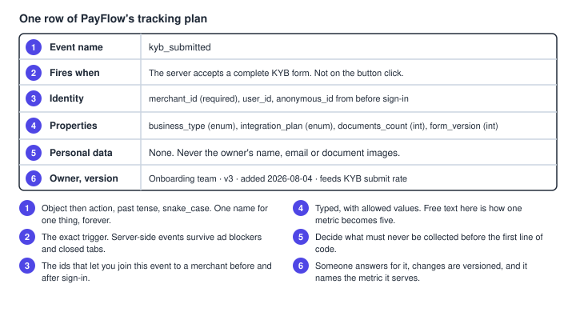
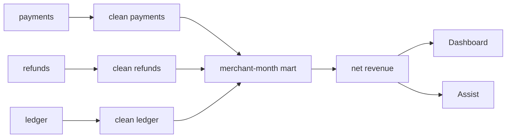
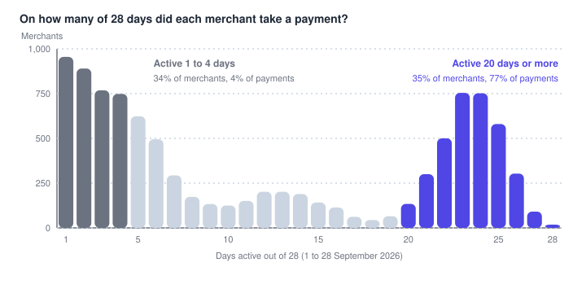
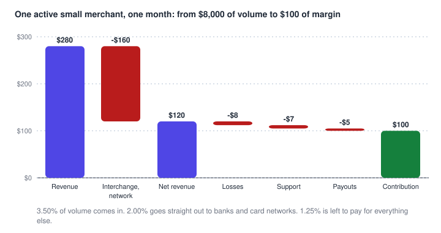

# Product Analytics and Financial Analysis

**Version 2 · October 2026** · Volume 10 of the PM + AI Master Library

> Learn to define a number that means something, find out why it moved, and say what a decision is worth, with every figure computed in front of you.

---

## Start here

### Who this is for

You are a product manager, or about to become one. Three kinds of question keep landing on you, at work and in interviews:

- "This metric dropped 10%. Why?"
- "What is a customer worth, and what can we afford to pay for one?"
- "Is this investment worth it, and how sure are you?"

This book teaches you to answer all three with numbers you can defend. It covers the part of statistics and finance that a PM uses every week.

### What you need before you start

- Arithmetic and percentages. Every other term is explained when it first appears and again in the Glossary.
- The ability to read a SQL query. Volume 5 of this library teaches SQL, and this book uses the same practice database.
- Optional: PostgreSQL 17 and Python 3.13. Every query result and program output is printed here, so you can read along without a computer. The programs are in the `volume-10-examples` folder, next to this book's PDF in the library (`01-curriculum/09-product-analytics/`); `run_all.sh` runs them all. The SQL uses Volume 5's practice database, `01-curriculum/04-sql-and-data/payflow_practice.sql`.

### What you will be able to do

After the full path you will be able to:

- Write a metric contract, draw a metric tree under a North Star, and use it to explain a drop in minutes.
- Specify a tracking plan, and spot the dashboards that mislead.
- Read funnels, cohort tables, engagement histograms and survival tables, and say what each cannot tell you.
- Compute unit economics, lifetime value, acquisition cost and payback, and explain why each headline version flatters.
- Build a driver-based projection with scenarios, NPV, IRR, a sensitivity chart and a simulation.
- Size an experiment, read its result, and separate what marketing claimed from what it caused.
- Measure an AI feature without being fooled by thumbs-up rates.

### How this book is organized

| Part | What you learn | Time |
|---|---|---|
| Meet PayFlow | The running example and the decision this book builds toward | 10 min |
| I. Measuring the right thing (Ch. 1-5) | Events, metric contracts, metric trees, tracking plans, dashboards | 75 min |
| II. The data underneath (Ch. 6-8) | Where numbers come from, why they disagree, quality and privacy | 40 min |
| III. Analyzing behavior (Ch. 9-15) | SQL habits, funnels, cohorts, engagement, churn, correlation, marketplaces | 1 hr 45 min |
| IV. The money (Ch. 16-20) | Unit economics, LTV, CAC, ROAS and ROI, projections, decisions under uncertainty | 80 min |
| V. Cause and proof (Ch. 21-23) | Experiment power, incrementality, attribution | 50 min |
| VI. AI products (Ch. 24) | Evaluating and monitoring an AI assistant | 15 min |
| VII. Practice (Ch. 25-26) | Seven labs with model answers, three worked cases | 4 hr |
| VIII. Interview kit (Ch. 27-29) | One complete spoken answer, scoring, estimation, a question bank | 60 min |
| IX. Reference | Cheat sheet, templates, glossary, answers, syllabus map | As needed |

### Three ways to read it

**The 90-minute pre-interview path.**

1. Meet PayFlow (10 min).
2. Chapter 2, the metric contract (10 min), and Chapter 3, the metric tree (10 min).
3. Chapter 16, unit economics (10 min).
4. Chapters 17 and 18, LTV and CAC: the worked examples only (15 min).
5. Chapter 27, the complete spoken answer (20 min), then the estimation section of Chapter 28 (5 min).
6. The Cheat sheet (10 min).

**The weekend path.** About eight hours over two days.

- Day one: Meet PayFlow, Part I, and Chapters 9 to 14. Do Labs 1, 3 and 4.
- Day two: Part IV, Chapters 21 to 23, and Part VIII. Do Labs 5 and 7, and read Case 3.

**The full path.** About three weeks at 45 minutes a day, in order. Do each part's labs before moving on: Labs 1 and 2 after Part I, Labs 3 and 4 after Part III, Labs 5 and 6 after Part IV, Lab 7 after Part V. Finish with the three cases and Part VIII, answering three question-bank prompts out loud with a timer.

### How each chapter works

Chapters 1 to 24 follow the same six steps:

1. **Why it matters.** The concrete pain this idea prevents.
2. **The idea.** The concept in plain words.
3. **Worked example.** The idea applied to PayFlow, with real inputs and outputs.
4. **Common mistakes.** What goes wrong and what to do instead.
5. **Check yourself.** Two questions, numbered by chapter (Q9.2 is the second question in Chapter 9). Answers are in Part IX.
6. **In one line.** The sentence to remember.

Throughout, form one habit. Before you trust any number, ask five things about it: the *unit* (what is being counted), the *denominator* (out of what), the *window* (over what time), the *source* (which table or system), and the *owner* (who answers for it). Chapter 2 calls this the metric contract.

### What's new in Version 2

- **Everything is computed.** Seventeen SQL queries run against one practice database, and twenty short Python programs produce every other number.
- **One story.** The same company, people and $800,000 decision run from the first chapter to the last case.
- **Twelve figures.** They run from a metric tree and a cohort heat map to a tornado chart.
- **A teaching order.** Twenty-eight topics regrouped into twenty-four chapters that build on each other, with a syllabus map in the Reference part.
- **Practice with answers.** Seven labs, three cases, and an answer for every "Check yourself" question.
- **A complete interview answer.** "Weekly payment volume fell 10%", worked from first question to recommendation.

## Meet PayFlow

PayFlow is a fictional payments company and the only example in this book. Every number attached to it was invented for teaching and describes no real company.

### What PayFlow sells

Businesses, which PayFlow calls **merchants**, use PayFlow to accept card payments and get the money into their bank accounts. PayFlow charges 2.9% plus $0.30 on each successful payment. Around that core it has a merchant dashboard, payouts, dispute handling, an AI assistant called PayFlow Assist, and PayFlow Experts, a small marketplace where merchants hire vetted specialists to set up their store or accounting.

Four payment words appear throughout:

- An **attempt** is one try at charging a card. A **payment** is the customer's intent to pay for one order, and it may take several attempts.
- A **refund** is the merchant sending money back. A **dispute** (or chargeback) is the customer's bank pulling it back.
- **KYB**, "know your business", is the identity and compliance check PayFlow must run before a merchant may take payments.
- A merchant is **activated** when it takes its first successful payment.

### The cast

| Person | Role | What they want |
|---|---|---|
| You | PM for small-business growth | A recommendation you can defend line by line |
| Helen Zhao | General manager, small business | To place one bet for 2027 and know its odds |
| Nadia Rahman | Data analyst | Questions precise enough to answer |
| Marcus Bell | Analytics engineer | One definition per metric, tested |
| Elena Sokolova | Finance partner | Cash flows, not adjectives |
| Jamal Carter | Growth marketing lead | More budget for paid acquisition |
| Arjun Mehta | Engineering lead, onboarding | To rebuild onboarding properly |

### The decision this book follows

It is Friday, October 9, 2026, and 2027 planning has started. Helen has $800,000 for one bet in the small-business segment. Two proposals are on her desk:

- **More paid media.** Jamal wants to add it to next year's advertising.
- **Quickstart.** Arjun wants to rebuild onboarding so that an approved merchant takes a first payment within days instead of drifting away.

Helen asks you one question: "Which is worth more, and how sure are you?" Each part of this book supplies a piece of the answer, and Case 3 puts the recommendation together.

### The numbers you will see again

| Fact about the small-business segment | Value |
|---|---|
| Active merchants in a month | About 9,800 |
| Average merchant, one month | 160 payments, $8,000 of volume |
| What PayFlow earns on that | $280 revenue, $100 contribution margin (Chapter 16) |
| August 2026 sign-ups | 1,640 started, 1,005 approved, 513 paid within 30 days |
| New activated merchants, Q3 2026 | 1,500, of which paid media claims 800 |
| Acquisition cost, Q3 2026 | $690,000 in total, $420,000 of it paid media |
| North Star | Weekly successful payment volume, about $18.0M |

### Two sets of data

**The practice database.** SQL in this book runs on `payflow_practice.sql`, the PostgreSQL database that ships with Volume 5. It is deliberately tiny: 12 merchants, 123 payments and 138 attempts between June 1 and July 13, 2026, with flaws planted on purpose. Treat "today" in that database as July 14, 2026. Its ledger records a flat 3% fee; this book's financial models use 2.9% + $0.30.

**The planning numbers.** A dozen merchants cannot show a retention curve, so the segment-level numbers come from short Python programs with fixed random seeds. Run them and you get the same output as the page.

# Part I — Measuring the right thing

## 1. Product analytics foundations

### Why it matters

Helen asks a simple question in a planning meeting: "How many were active in June?" Nadia says 9. Jamal says 14. Arjun's dashboard says 72. Nobody made an arithmetic mistake. Each counted a different thing, and the meeting spends twenty minutes discovering that instead of deciding anything.

### The idea

**Product analytics** is recording what people do in a product and counting it to make decisions. Its raw material is the **event**: a record that one thing happened. Every event carries four facts.

| Part of an event | Question it answers | PayFlow example |
|---|---|---|
| Name | What happened? | `payment_attempted` |
| Actor | Who did it? | Merchant M05, customer C01 |
| Timestamp | When? | 2026-06-01 12:05:13 UTC |
| Properties | What were the details? | `method = card`, `amount = 6.00`, `status = succeeded` |

Everything else is built by grouping events:

- A **user** is the person or account the events belong to. PayFlow has two kinds: merchants, who are its customers, and the shoppers who pay those merchants.
- A **session** is one sitting: a run of events from one user with no long gap, commonly 30 minutes.
- A **segment** is a group of users who share a property, such as merchants using payment links.

One person can show up three ways: as an anonymous visitor, as a signed-in user, and as a member of a merchant account. Chapter 4 shows how those identities are joined.

The idea that prevents the most arguments is **grain**: what one row, or one count, stands for. An attempt, a payment, a customer and a merchant are four grains of the same activity.

Events are not the only data. The product's own database holds *state*: the current truth about each payment, payout and balance. Use events to study behavior, and use the database and its ledger for money.

Analytics tells you what happened, how often, in what order and for whom. It cannot tell you why people did it (that takes research; see Volume 7), what would have happened otherwise (that takes an experiment; see Part V), or anything about behavior nobody recorded.

### Worked example

Here is June in the practice database, counted at four grains in one query.

```sql
SELECT COUNT(*) AS attempts,
       COUNT(DISTINCT payment_id) AS payments,
       COUNT(DISTINCT customer_id) AS customers,
       COUNT(DISTINCT merchant_id) AS merchants
FROM payment_attempts
WHERE attempted_at >= TIMESTAMPTZ '2026-06-01 00:00:00+00'
  AND attempted_at <  TIMESTAMPTZ '2026-07-01 00:00:00+00'
  AND NOT is_test;
```

Result:

```text
 attempts | payments | customers | merchants 
----------+----------+-----------+-----------
       72 |       66 |        14 |         9
(1 row)
```

All three people in the meeting were right. Arjun counted attempts, Jamal counted paying customers, Nadia counted merchants. A fourth honest answer is 66 payments, because six payments had two attempts each.

One number hides something. Fourteen is the count of *registered* customers. Shoppers who checked out as guests have no customer id, so they are missing from that count entirely. What was not recorded cannot be counted, and the dashboard will not tell you it is missing.

### Common mistakes

| Mistake | Why it bites | Do this instead |
|---|---|---|
| Quoting a count without its grain | Two correct numbers look like a contradiction | Say the unit out loud: "9 merchants", "72 attempts" |
| Treating page views or logins as usage | Activity rises while customers get no value | Count the event where value is delivered, here a successful payment |
| Reading money from event data | Events are dropped, duplicated and late | Take money from the ledger; use events for behavior |
| Asking analytics "why?" | You get a plausible story with no evidence | Use analytics to find where, then research or an experiment to learn why |

### Check yourself

**Q1.1** A chart is titled "Active users: 14". Name three things you must know before you can use that number.

**Q1.2** In the query above, why is "66 payments" smaller than "72 attempts"?

> [!IMPORTANT]
> **In one line:** Every number is a count of something at some grain, so name the unit before you compare two numbers.

## 2. The metrics framework and the metric contract

### Why it matters

PayFlow's payment success rate is 72%, 76% or 84%, depending on whose slide you read. Support quotes the low one to explain complaints. Sales quotes the high one to prospects. When the rate "drops" next month, nobody will know whether payments got worse or a definition changed.

### The idea

A **metric** is a number computed the same way every time and tracked in order to make a decision. Metrics play four different roles, and a team needs all four.

| Role | What it is | PayFlow example |
|---|---|---|
| **Output metric** | The result you want. It moves late and many things move it. | Weekly successful payment volume |
| **Input metric** | Something one team can move directly that drives the output | Activation rate of approved merchants |
| **Guardrail metric** | A limit that must hold while you push | Fraud and dispute losses at or under 0.10% of volume |
| **Counter-metric** | The number that would expose you if you gamed one target | Target: KYB approval time. Counter: losses from merchants approved in under an hour |

Outputs are *lagging* indicators and inputs are *leading* ones, because inputs move first. A **vanity metric** is one that only looks good, such as total sign-ups ever, and changes no decision.

The counter-metric exists because of **Goodhart's law**, named for the economist Charles Goodhart: once a measure becomes a target, people find ways to hit it that defeat its purpose.

Two published checklists help you choose metrics without missing an area:

- **HEART**, from Kerry Rodden, Hilary Hutchinson and Xin Fu at Google (2010): Happiness, Engagement, Adoption, Retention, Task success. For each, write a goal, a signal in behavior, then a metric.
- **AARRR**, from investor Dave McClure (2007): Acquisition, Activation, Retention, Referral, Revenue. It follows a customer's life in order.

Whatever you choose, pin each metric down with a **metric contract**: a short written definition that leaves no room for a second interpretation. It states the unit, what is divided by what, the window and its time zone, what is excluded, the source, and who owns the number and how often it refreshes.

### Worked example

Three success rates, all from the practice database, all defensible.

```sql
WITH a AS (
  SELECT COUNT(*) AS n_all,
         COUNT(*) FILTER (WHERE status = 'succeeded') AS ok_all,
         COUNT(*) FILTER (WHERE NOT is_test) AS n_real,
         COUNT(*) FILTER (WHERE NOT is_test AND status = 'succeeded') AS ok_real
  FROM payment_attempts
), p AS (
  SELECT COUNT(*) AS n_pay,
         COUNT(*) FILTER (WHERE status = 'captured') AS ok_pay
  FROM payments
  WHERE NOT is_test
)
SELECT ROUND(100.0 * ok_all / n_all, 1) AS every_attempt,
       ROUND(100.0 * ok_real / n_real, 1) AS real_attempts,
       ROUND(100.0 * ok_pay / n_pay, 1) AS real_payments
FROM a CROSS JOIN p;
```

Result:

```text
 every_attempt | real_attempts | real_payments 
---------------+---------------+---------------
          72.5 |          76.2 |          84.3
(1 row)
```

The first counts every attempt, including PayFlow's own test traffic. The second removes tests. The third changes the unit from attempt to payment, so a shopper whose card failed once and then worked counts as one success. Marcus writes the contract that ends the argument:

| Field | Payment success rate |
|---|---|
| Unit | One payment (not one attempt) |
| Numerator | Payments with status `captured` |
| Denominator | All payments created in the window |
| Window | Calendar week, Monday to Sunday, UTC |
| Exclusions | `is_test = true` |
| Source | `payments` table |
| Owner, cadence | Payments reliability team; daily |

The attempt-level rate does not disappear. It becomes a second metric with its own name, *attempt success rate*, used by engineers who care about each call to the bank.

### Common mistakes

| Mistake | Why it bites | Do this instead |
|---|---|---|
| A rate with no stated denominator | Nobody can reproduce it, so nobody trusts it | Write numerator, denominator and window next to the number |
| A target with no counter-metric | The target is hit by damaging something unmeasured | Pair each target with the number that would reveal gaming |
| Reporting only an average | A few large merchants hide what most experience | Add the median and a high percentile |
| Tracking forty metrics | Nothing is a priority and definitions drift | One output, three to five inputs, a few guardrails |

### Check yourself

**Q2.1** Classify each as output, input, guardrail or counter-metric for a team told to speed up KYB approval: (a) median hours to approval, (b) weekly payment volume, (c) 90-day losses from fast-approved merchants, (d) payout on-time rate.

**Q2.2** Why is 84.3% higher than 76.2% in the worked example, when both exclude test traffic?

> [!IMPORTANT]
> **In one line:** Give each metric one job and one written contract: unit, denominator, window, source and owner.

## 3. Metric trees and North-Star systems

### Why it matters

On Monday the weekly volume number is down 10%. Without a map of what produces that number, the next five days go to guessing: marketing blames seasonality, engineering blames marketing, and everyone pulls a different report. With a map, you know in ten minutes which team to call.

### The idea

A **North Star metric** is the single output number that best captures the value customers get from the product and that revenue follows. The term is usually credited to growth marketer Sean Ellis. Amplitude's North Star Playbook, led by John Cutler, built it into a framework: one North Star plus a small set of inputs that teams work on.

A good North Star passes four tests. It rises when customers get more value. Revenue follows it. It can be measured every week. And teams can influence it. PayFlow's small-business group uses *weekly successful payment volume*: money that merchants actually received through PayFlow.

A **metric tree** breaks the North Star into parts that multiply or add up to it exactly, and keeps breaking until each leaf is something one team can move.


*Figure 3.1 — PayFlow's small-business metric tree. The four boxes multiply to the North Star; each has inputs and one owner.*

Three rules keep a tree honest:

- **It must reconstruct.** Multiply or add the branches and you get the parent, to the dollar. If you cannot, a branch is missing.
- **Every leaf has an owner.** A leaf nobody owns is a number nobody will fix.
- **Guardrails sit beside it.** Volume can be bought by approving risky merchants, so loss rate, payout timeliness and concentration are watched alongside.

Review the North Star weekly and the inputs daily.

### Worked example

Volume fell from $18.0M to $16.2M. Because the tree multiplies, the natural logs of each input's ratio add up to the log of the total ratio, which lets you give each input an exact share of the drop.

```python
last_week = {"active merchants": 9_000, "attempts per merchant": 43.5,
             "success rate": 0.920, "average payment": 50.00}
this_week = {"active merchants": 8_980, "attempts per merchant": 43.4,
             "success rate": 0.831, "average payment": 49.90}


def volume(week):
    v = 1.0
    for value in week.values():
        v *= value
    return v


def decompose(before, after):
    total = log(volume(after) / volume(before))
    return [(name, after[name] / before[name] - 1,
             log(after[name] / before[name]) / total) for name in before]
```

Output:

```text
Last week $18,009,000   this week $16,160,978   change -10.3%
input                     change   share of the drop
active merchants           -0.2%                  2%
attempts per merchant      -0.2%                  2%
success rate               -9.7%                 94%
average payment            -0.2%                  2%
```

Three inputs barely moved. Success rate fell from 92.0% to 83.1% and accounts for 94% of the drop. You do not call Jamal about ad spend or Sales about a lost account. You call the reliability team and ask what changed in how payments are approved. Chapter 27 follows this thread to its cause.

### Common mistakes

| Mistake | Why it bites | Do this instead |
|---|---|---|
| Revenue as the North Star | It lags by months and says nothing about customer value | Pick the customer-value number that revenue follows |
| Branches that do not add up | The "explained" pieces leave an unexplained gap | Check that the branches reconstruct the parent exactly |
| A North Star with no guardrails | It is grown by something harmful, such as risky merchants | List what must not get worse and review it in the same meeting |

### Check yourself

**Q3.1** A team proposes "total registered merchants" as the North Star. Which of the four tests does it fail?

**Q3.2** Active merchants rise 5% and average payment falls 5%. Does volume stay flat? Work it out.

> [!IMPORTANT]
> **In one line:** Break the North Star into parts that multiply back to it, give each part an owner, and a drop will point at one branch.

## 4. The tracking plan

### Why it matters

Suppose Quickstart ships in July. In August Helen asks which onboarding step loses the most merchants. Nadia opens the data and finds events named `click`, `Onboarding Step` and `kybDone`, a free-text `step` property spelled nine ways, and no merchant id until after sign-in. The question cannot be answered, and the first month of data is gone for good.

### The idea

A **tracking plan** is the written specification of every event a product records, agreed before the code is written. Each row describes one event.



*Figure 4.1 — One row of a tracking plan. Each field closes off a way the data could go wrong later.*

Six decisions make a plan work:

- **Naming.** One pattern for every event, such as object then past-tense action in snake_case: `kyb_submitted`, `payment_link_created`.
- **Trigger.** Record state changes and money on the server, when they are final. A browser event fires on the click, even if the request then fails.
- **Properties.** Each has a type and, where possible, a fixed list of allowed values.
- **Identity.** An `anonymous_id` before sign-in, then a `user_id` and the account's `merchant_id`. Joining the three is called **identity resolution**.
- **Versioning.** Never change what an existing event means. Add a property with a default, or add a new event, and record a version number.
- **Quality checks.** Compare event counts with the product database every day, and alert on missing properties and on **schema drift**, an unannounced change in an event's shape.

The plan's reader-friendly form, listing each event and what it means, is the **event dictionary**.

### Worked example

The practice database holds 47 onboarding events for 12 merchants. Two checks that a tracking plan would have called for find two problems.

```sql
SELECT 'same event delivered twice' AS problem, merchant_id, event_name,
       MIN(event_id) || ', ' || MAX(event_id) AS event_ids
FROM merchant_events
GROUP BY merchant_id, event_name, event_at
HAVING COUNT(*) > 1
UNION ALL
SELECT 'approved before it started', e.merchant_id, e.event_name, e.event_id
FROM merchant_events e
WHERE e.event_name = 'kyb_approved'
  AND e.event_at < (SELECT MIN(s.event_at)
                    FROM merchant_events s
                    WHERE s.merchant_id = e.merchant_id
                      AND s.event_name = 'started')
ORDER BY problem;
```

Result:

```text
          problem           | merchant_id |  event_name  | event_ids  
----------------------------+-------------+--------------+------------
 approved before it started | M07         | kyb_approved | E001
 same event delivered twice | M05         | started      | E008, E009
(2 rows)
```

Bluebird Coffee (M05) has its `started` event twice with the same timestamp. The system that sent it retried a delivery. Count rows and Bluebird started twice. The fix is in the plan: every event carries a unique id, and loads discard repeats.

Lumen Fitness (M07) was "approved" three weeks before it "started". It had abandoned an earlier application. Nothing ties an event to an application, so the old approval attaches itself to the new attempt. The fix is one required property, `application_id`.

For Quickstart you write the plan first:

| Event | Fires when (server) | Key properties |
|---|---|---|
| `signup_started` | Account record created | `source`, `integration_plan` |
| `kyb_submitted` | Complete form accepted | `application_id`, `business_type`, `form_version` |
| `kyb_approved` | Compliance decision saved | `application_id`, `review_type` |
| `integration_connected` | First test payment succeeds | `integration_type`, `plugin_name` |
| `first_payment_succeeded` | First live payment captured | `method`, `days_since_approval` |

### Common mistakes

| Mistake | Why it bites | Do this instead |
|---|---|---|
| Tracking after launch | The weeks you most want to study were never recorded | Make the tracking plan part of the definition of done |
| Ambiguous events such as `click` | Nobody can tell what was counted | Name the object and the action; one event, one meaning |
| Personal data in properties | An email in an event spreads to every downstream tool | Send ids only; keep personal data out by rule (Chapter 8) |
| Silent schema drift | A renamed property makes a metric quietly fall to zero | Version the schema and alert on unexpected changes |

### Check yourself

**Q4.1** Rename these to fit the convention: `Clicked Pay`, `payoutFail`, `refund`.

**Q4.2** Why should `first_payment_succeeded` be recorded on the server and not in the browser?

> [!IMPORTANT]
> **In one line:** Decide each event's name, trigger, properties, identity and owner before launch, because data you did not record cannot be recovered.

## 5. The metrics dashboard

### Why it matters

Most people at PayFlow never run a query. They meet the numbers on a dashboard, glance for five seconds, and form a belief. A careless dashboard manufactures false alarms on Monday and false comfort on Friday.

### The idea

A **dashboard** is a fixed view that answers one recurring question for one audience. Helen's weekly page answers "is the segment healthy, and if not, where?" The reliability team's page answers "are payments going through right now?" Exploration, where the question changes each time, belongs in a notebook.

What belongs on the weekly page follows from Chapter 3: the North Star with a target and comparisons, the tree's inputs, the guardrails, and the context needed to trust them.


*Figure 5.1 — The same week on two dashboards. The left one alarms without informing; the right one shows where to look.*

Read any dashboard in this order:

1. **Period.** Is the last point a complete week or month?
2. **Baseline.** Compared with what? Last week, the same week last year, a target?
3. **Counts.** How many units sit behind each rate?
4. **Noise.** Is this move larger than the usual week-to-week wobble?
5. **Segments.** Does the total hide two groups moving in opposite directions?

### Worked example

Here is the query behind a "weekly volume" chart on the practice database.

```sql
SELECT date_trunc('week', created_at, 'UTC')::date AS week_start,
       COUNT(DISTINCT (created_at AT TIME ZONE 'UTC')::date) AS days,
       COUNT(*) AS payments,
       ROUND(SUM(amount_minor) / 100.0, 2) AS volume_usd,
       ROUND(MAX(amount_minor) / 100.0, 2) AS largest_usd
FROM payments
WHERE status = 'captured' AND NOT is_test AND currency = 'USD'
GROUP BY 1
ORDER BY 1;
```

Result:

```text
 week_start | days | payments | volume_usd | largest_usd 
------------+------+----------+------------+-------------
 2026-06-01 |    6 |       14 |    3582.00 |     2400.00
 2026-06-08 |    6 |       11 |    2180.00 |     1800.00
 2026-06-15 |    5 |       11 |     681.00 |      450.00
 2026-06-22 |    7 |       14 |    6661.00 |     5000.00
 2026-06-29 |    6 |       16 |    1169.00 |      600.00
 2026-07-06 |    7 |       17 |    3980.00 |     3200.00
 2026-07-13 |    1 |        7 |     170.00 |       64.00
(7 rows)
```

A chart of `volume_usd` shows two things that are not there.

The last bar says volume collapsed by 96%, from $3,980 to $170. The `days` column shows why: the data ends on Monday, July 13, so that "week" is one day long.

The earlier weeks look wildly unstable. The `largest_usd` column explains that too. In the week of June 22, one $5,000 payment was three quarters of the total. The number of payments was steady at 11 to 17 all along. With volumes this small, a sum mostly reports whether a large customer happened to pay.

The repair is three choices: plot complete weeks only, show the count of payments beside the sum, and annotate or separate the largest merchants.

### Common mistakes

| Mistake | Why it bites | Do this instead |
|---|---|---|
| An axis that does not start at zero | A small dip looks like a collapse | Start bar and area charts at zero; say so when a line chart does not |
| Including the current, partial period | Every Monday looks like a crisis | End the series at the last complete period |
| No definition, owner or freshness shown | Readers cannot tell a real move from a pipeline fault | Link each tile to its metric contract and show "data as of" |

### Check yourself

**Q5.1** A tile reads "Refund rate 2.1%, down from 4.0%". List three questions to ask before you repeat that in a meeting.

**Q5.2** In the result above, which column would you plot to judge whether demand is stable, and why?

> [!IMPORTANT]
> **In one line:** A dashboard should show one outcome, its inputs and its guardrails over complete periods, with counts beside rates.

# Part II — The data underneath

## 6. Data architecture and the semantic layer

### Why it matters

"How many merchants does PayFlow have?" Sales says 12, compliance says 11, finance says 10, and the product dashboard says 9. All four read the same database. A PM who does not know how a number travels from the product to a chart cannot tell which of these to use, or why Monday's figure disagrees with Friday's.

### The idea

Data moves through five stages on its way to a dashboard.


*Figure 6.1 — From the systems that run PayFlow to the number on a chart. Every arrow is a place where data can be late, duplicated or redefined.*

- **Sources.** The **operational database** runs the product. It is tuned for many small, fast reads and writes and holds the current state. Heavy analysis on it would slow down payments.
- **Ingestion.** Copies are taken in **batch** (on a schedule, so the data is minutes to a day old) or by **streaming** (events flow continuously and arrive within seconds). Streaming costs more and is needed for operations such as outage alerts, rarely for weekly decisions.
- **Warehouse.** A **data warehouse** is a separate database built for scanning large tables. A **data lake** is cheap file storage that holds raw data in any shape; many companies now combine the two. Loading raw copies first and transforming them inside the warehouse is called **ELT**.
- **Transformation.** **Analytics engineering** is the craft of turning raw tables into clean, tested, documented ones using software habits: version control, code review and automated tests. Raw copies become staging tables, and staging tables become marts built around business questions.
- **Semantic layer.** One place where each metric is defined in code, so that a dashboard, a notebook and an AI assistant all get the same answer to "how many active merchants?" Tools such as dbt's Semantic Layer, Looker's modeling language and Cube do this job.

Two more terms complete the picture. A **data contract** is an agreement between the team that produces a table and the teams that use it: its columns, their meaning and its freshness, with changes announced in advance. **Reverse ETL** copies modeled data back into operational tools, which turns a wrong definition into a wrong action.

### Worked example

Here are five ways to count PayFlow's merchants, each one a single line of SQL.

```sql
SELECT
  (SELECT COUNT(*) FROM merchants) AS signed_up,
  (SELECT COUNT(*) FROM merchants WHERE onboarded_at IS NOT NULL) AS approved,
  (SELECT COUNT(DISTINCT merchant_id) FROM payments
   WHERE status = 'captured' AND NOT is_test) AS ever_paid,
  (SELECT COUNT(DISTINCT merchant_id) FROM payments
   WHERE status = 'captured' AND NOT is_test
     AND created_at >= TIMESTAMPTZ '2026-06-01 00:00:00+00'
     AND created_at <  TIMESTAMPTZ '2026-07-01 00:00:00+00') AS paid_in_june,
  (SELECT COUNT(DISTINCT merchant_id) FROM payments
   WHERE status = 'captured' AND NOT is_test
     AND created_at >= TIMESTAMPTZ '2026-07-12 00:00:00+00'
     AND created_at <  TIMESTAMPTZ '2026-07-13 00:00:00+00') AS paid_on_jul_12;
```

Result:

```text
 signed_up | approved | ever_paid | paid_in_june | paid_on_jul_12 
-----------+----------+-----------+--------------+----------------
        12 |       11 |        10 |            9 |              1
(1 row)
```

Each column is somebody's "merchants". Sales counts everyone who signed up. Compliance counts those that passed KYB. Finance counts those that ever produced revenue. A monthly dashboard shows 9 and a daily one shows 1, because July 12 was a quiet Sunday.

The semantic layer ends this by storing one definition under one name:

| Field | Definition of `active_merchants` |
|---|---|
| Entity | Merchant (`merchant_id`) |
| Counts | Distinct merchants with at least one captured payment |
| Filter | `is_test = false` |
| Window | Trailing 28 days, ending on the report date |
| Dimensions allowed | Category, country, integration type |
| Owner | Marcus Bell; changes need a review |

The other four numbers keep their own names: `signed_up_merchants`, `approved_merchants`, and so on. Nobody is told their number is wrong. They are told what it is called.

### Common mistakes

| Mistake | Why it bites | Do this instead |
|---|---|---|
| Defining a metric inside each dashboard | Copies drift apart; this is called semantic drift | Define it once in the semantic layer and reference it |
| Treating the warehouse as truth without contracts | A renamed source column breaks numbers silently | Agree data contracts with the teams that own the sources |
| Transformations nobody documented | A filter added years ago quietly removes real merchants | Keep transformations in reviewed code with a description |

### Check yourself

**Q6.1** Why should analysts not run long reports directly on the operational database?

**Q6.2** Two dashboards show different "active merchants" for the same day. Name two places in Figure 6.1 where the difference could have been introduced.

> [!IMPORTANT]
> **In one line:** A number is only as good as its path, so define each metric once, in one governed place, and give every other count its own name.

## 7. Data quality, lineage and governance

### Why it matters

Elena reconciles the fee revenue on Helen's dashboard to the ledger and finds a small difference. Small is not the point. If nobody can say where the difference comes from, every other number on the page is now in doubt, including the ones your business case will rest on.

### The idea

**Data quality** means the data is fit for the decision it feeds. Six questions cover most failures.

| Dimension | Question | A PayFlow failure |
|---|---|---|
| Freshness | Is it up to date? | Yesterday's payments not yet loaded |
| Completeness | Is anything missing? | Guest checkouts with no customer id |
| Uniqueness | Is anything there twice? | An event delivered twice |
| Validity | Are values in the allowed set? | A misspelled refund reason |
| Consistency | Do two tables agree? | Payments and ledger disagree |
| Accuracy | Does it match the outside world? | Records differ from the bank's settlement file |

A **data test** is a query that should return zero rows, run automatically on every load. A **control total** is an independent figure a result must match, such as the ledger's total for the same period.

**Lineage** is the map of every source and transformation behind a number. It answers two questions: "where did this come from?" and "what breaks if I change this?"



*Figure 7.1 — Lineage of the net revenue metric. A fault in the cleaned ledger table reaches both Helen's dashboard and PayFlow Assist.*

**Governance** is the set of decisions about who owns each dataset, who may read it, how changes are approved and how long data is kept. Its working rule for access is *least privilege*: each role sees what its job needs and no more. Governed does not mean locked; it means someone answers for it.

Teams track all this with a few numbers: freshness against a target, share of tests passing, share of tables with lineage and an owner, query cost, and access violations.

### Worked example

Four tests on the practice database, written as one query. Each line counts rows that break a rule.

```sql
SELECT 'journal does not balance' AS test, COUNT(*) AS failures
FROM (SELECT journal_id
      FROM ledger_entries
      GROUP BY journal_id
      HAVING SUM(CASE direction WHEN 'debit' THEN amount_minor
                                ELSE -amount_minor END) <> 0) AS j
UNION ALL
SELECT 'payment captured twice in the ledger', COUNT(*)
FROM (SELECT payment_id
      FROM ledger_entries
      WHERE account = 'processor_receivable' AND direction = 'debit'
      GROUP BY payment_id
      HAVING COUNT(*) > 1) AS d
UNION ALL
SELECT 'refund reason outside the allowed list', COUNT(*)
FROM refunds
WHERE reason NOT IN ('customer_request', 'product_issue', 'duplicate', 'fraud')
UNION ALL
SELECT 'captured payment missing from the ledger', COUNT(*)
FROM payments p
WHERE p.status = 'captured' AND NOT p.is_test
  AND NOT EXISTS (SELECT 1 FROM ledger_entries l
                  WHERE l.payment_id = p.payment_id)
ORDER BY test;
```

Result:

```text
                   test                   | failures 
------------------------------------------+----------
 captured payment missing from the ledger |        0
 journal does not balance                 |        1
 payment captured twice in the ledger     |        1
 refund reason outside the allowed list   |        1
(4 rows)
```

Three tests fail, and each failure is a different quality dimension.

- **Consistency.** One journal does not balance. Its fee line was never written, so fee revenue is understated by $2.16. This is Elena's difference.
- **Uniqueness.** One payment was captured twice. A customer was charged double, and a refund followed.
- **Validity.** One refund reason is `customer request` with a space, so a chart of refunds by reason shows five reasons where there are four.

The fourth test passes: every captured payment appears in the ledger.

Rank the failures by money and by the decisions they touch, not by count. The double capture harmed a customer, so it comes first. The unbalanced journal touches reported revenue, so it comes second. The misspelling is cosmetic, but fix it at the source, not in the chart, or it will come back.

### Common mistakes

| Mistake | Why it bites | Do this instead |
|---|---|---|
| Testing only the final dashboard | A fault is found weeks later, far from its cause | Test at the source and at each layer |
| Patching bad values in a spreadsheet | The next load brings the fault back | Fix the producing system and add a test for it |
| Giving everyone access to raw tables | Personal data spreads, and people query unmodeled data | Grant access by role; point most users at marts |
| Datasets with no owner | Nobody is paged when a load fails | Name an owner and a freshness target for each important table |

### Check yourself

**Q7.1** Which quality dimension does each fail? (a) A merchant appears twice in a list. (b) A country code is `UK` where the standard is `GB`. (c) The dashboard shows Tuesday's data on Thursday.

**Q7.2** You plan to rename a column in the refunds table. Which tool tells you what will break, and what do you look for?

> [!IMPORTANT]
> **In one line:** Trust comes from tests that run on every load, lineage you can follow and an owner for every table.

## 8. Privacy-aware analytics and consent

### Why it matters

Two things go wrong when privacy is an afterthought. The serious one: an event property carrying a merchant owner's email flows to an advertising tool, and PayFlow has shared personal data it had no permission to share. The quiet one: a consent banner is redesigned, a third of visitors disappear from the charts, and the team spends a week explaining a traffic drop that never happened.

### The idea

**Personal data** is any information about an identifiable person, including an id or device identifier that can be linked back to them. Four habits keep analytics useful and lawful. They are a PM's working knowledge; the decisions belong to counsel.

**Collect less.** **Data minimization** means recording only what a named metric needs: an id in place of a name, a business type in place of a free-text description.

**Know which rules apply.**

| Rule | Where | What it asks of analytics |
|---|---|---|
| GDPR (applies since May 2018) | EU, with a matching UK law | A lawful basis for using personal data. **Consent**, where relied on, must be freely given, specific, informed and unambiguous, and as easy to withdraw as to give. |
| ePrivacy Directive | EU | Consent before storing or reading non-essential information on a person's device, which covers most analytics and advertising cookies |
| CCPA, as amended by the CPRA (2023) | California | An opt-out model: people can tell a business not to sell or share their data, including by a browser signal such as Global Privacy Control |
| Platform rules | Everywhere | Apple requires apps to ask permission before tracking across other companies' apps (since iOS 14.5, 2021). Safari and Firefox block or isolate third-party cookies by default; Chrome still allows them. |

A European Commission proposal from November 2025 would move the cookie rules into the GDPR. At the time of writing it had not been adopted, so check its status before you rely on either version.

**Reduce what a leak could expose.** **Pseudonymization** replaces identifiers with random ids. The data is safer but is still personal data, because the link can be restored. Aggregation with a minimum group size, short retention and role-based access do the rest.

**Expect consent to bend your numbers.** People who accept tracking differ from people who refuse. This **consent bias** means cookie-based analytics describes only the visitors who agreed.

### Worked example

PayFlow's marketing site changed its EU banner so that "Reject" is as easy to click as "Accept". Here are the week before and the week after.

```python
WEEK = ("visitors", "share who consent", "sign-ups by consenting visitors",
        "sign-ups recorded on the server for everyone")
BEFORE = (40_000, 0.78, 655, 801)
AFTER = (40_300, 0.52, 478, 806)


def measured(week):
    visitors, consent, tagged_signups, server_signups = week
    return {"visitors seen by analytics": visitors * consent,
            "sign-ups seen by analytics": tagged_signups,
            "sign-ups in the product database": server_signups}
```

Output:

```text
                                     before    after   change
visitors seen by analytics           31,200   20,956     -33%
sign-ups seen by analytics              655      478     -27%
sign-ups in the product database        801      806      +1%
Sign-up rate before: consenting visitors 2.1%, all visitors 2.0%
Sign-up rate after: consenting visitors 2.3%, all visitors 2.0%
```

The analytics tool reports a 33% fall in visitors and a 27% fall in sign-ups. The product database, which records every sign-up on the server whatever the visitor's cookie choice, shows sign-ups up 1%. Nothing happened to demand. The share of visitors who can be seen fell from 78% to 52%.

The last two lines show the bias. Visitors who consent convert a little better than visitors as a whole, and the gap widened after the change. Projecting the consenting group's behavior onto everyone would overstate conversion.

Three repairs follow. Count business facts such as sign-ups and payments from server records. Plot the consent rate next to traffic, so a change in one explains a change in the other. And review the tracking plan property by property:

| Property proposed | Personal data? | Decision |
|---|---|---|
| `owner_email` | Yes | Remove; join by `merchant_id` in the warehouse if needed |
| `ip_address` | Yes | Drop after deriving country |
| `merchant_id` | Pseudonymous id | Keep, with access by role |
| `business_type` | No | Keep |
| Free-text support message | Often | Never send to analytics tools |

### Common mistakes

| Mistake | Why it bites | Do this instead |
|---|---|---|
| Personal data in event properties or URLs | It is copied into every tool and log downstream | Send ids only, and scan new events for personal data before launch |
| Calling pseudonymized data anonymous | It is still personal data and still regulated | Treat it as personal data; anonymous means the link cannot be restored |
| Reading consented traffic as all traffic | A banner change looks like a demand change | Track consent rate, and count core facts on the server |
| Collecting data "in case it is useful" | You hold risk with no purpose to justify it | Tie each property to a metric, or do not collect it |

### Check yourself

**Q8.1** A dashboard built on cookie analytics shows EU sign-ups down 27% in a week. What two things do you check before raising an alarm?

**Q8.2** Is a random `merchant_id` personal data under the GDPR when it identifies a sole trader? Why?

> [!IMPORTANT]
> **In one line:** Collect only what a metric needs, know which consent rule applies, and never mistake the visitors you can see for all visitors.

# Part III — Analyzing behavior

## 9. SQL analysis: from question to number

### Why it matters

Before the planning review, Jamal asks which merchants refund the most. A query comes back in seconds and Northwind Travel looks unremarkable at 10%. Its true refund rate is 17%. The query ran without an error, returned tidy rows, and was wrong. A PM who presents one such number spends the rest of the quarter being double-checked.

### The idea

SQL itself is taught in Volume 5. This chapter is about the discipline around a query, which applies whether you, an analyst or an AI assistant wrote it. Go through five steps, in order.

| Step | Question | Typical failure |
|---|---|---|
| Grain | What does one row of the result stand for? | Mixing attempts and payments |
| Population | Who is included, in what window, with what excluded? | Test traffic left in; guests dropped by a join |
| Measure | What is counted or summed, and at what grain is it computed? | Summing after a join that repeated rows |
| Check | Does it match a figure computed another way? | No control total |
| Interpretation | What may you conclude, and what not? | A rate from five payments read as a pattern |

The failure that deserves a name is **fan-out**. When one row joins to several rows in another table, it is repeated. A payment with three refunds becomes three rows, and summing the payment amount now counts it three times. The cure is to bring each table to the same grain before joining: total the refunds per payment first, then join.

### Worked example

The question: for each merchant, what share of captured dollars was refunded? Prepare the *check* step first. Compute one figure the simplest possible way, to serve as a control total. Here is Northwind Travel's captured total, straight from the payments table with no joins.

```sql
SELECT ROUND(SUM(amount_minor) / 100.0, 2) AS travel_captured_usd
FROM payments
WHERE merchant_id = 'M04' AND status = 'captured' AND NOT is_test;
```

Result:

```text
 travel_captured_usd 
---------------------
             3530.00
(1 row)
```

Now the first attempt at the report.

```sql
-- WRONG: joining refunds before summing repeats a payment once per refund
SELECT m.merchant_name,
       ROUND(SUM(p.amount_minor) / 100.0, 2) AS captured_usd,
       ROUND(SUM(r.amount_minor) / 100.0, 2) AS refunded_usd,
       ROUND(100.0 * SUM(r.amount_minor) / SUM(p.amount_minor), 1) AS refund_pct
FROM payments p
JOIN merchants m ON m.merchant_id = p.merchant_id
LEFT JOIN refunds r ON r.payment_id = p.payment_id AND r.status = 'succeeded'
WHERE p.status = 'captured' AND NOT p.is_test AND p.currency = 'USD'
GROUP BY m.merchant_name
HAVING SUM(r.amount_minor) > 0
ORDER BY m.merchant_name;
```

Result:

```text
  merchant_name   | captured_usd | refunded_usd | refund_pct 
------------------+--------------+--------------+------------
 Harbor Games     |       300.00 |        20.00 |        6.7
 Northwind Outlet |       318.00 |        15.00 |        4.7
 Northwind Retail |      1016.00 |       225.00 |       22.1
 Northwind Travel |      5930.00 |       600.00 |       10.1
(4 rows)
```

The report says $5,930.00 for Northwind Travel. The gap is $2,400.00, which is exactly two extra copies of one $1,200.00 payment that was refunded in three parts. The measure was computed after the join. Here is the same query with refunds totaled per payment first.

```sql
WITH refunded AS (
  SELECT payment_id, SUM(amount_minor) AS refunded_minor
  FROM refunds
  WHERE status = 'succeeded'
  GROUP BY payment_id
)
SELECT m.merchant_name,
       ROUND(SUM(p.amount_minor) / 100.0, 2) AS captured_usd,
       ROUND(SUM(r.refunded_minor) / 100.0, 2) AS refunded_usd,
       ROUND(100.0 * SUM(r.refunded_minor) / SUM(p.amount_minor), 1) AS refund_pct
FROM payments p
JOIN merchants m ON m.merchant_id = p.merchant_id
LEFT JOIN refunded r ON r.payment_id = p.payment_id
WHERE p.status = 'captured' AND NOT p.is_test AND p.currency = 'USD'
GROUP BY m.merchant_name
HAVING SUM(r.refunded_minor) > 0
ORDER BY m.merchant_name;
```

Result:

```text
  merchant_name   | captured_usd | refunded_usd | refund_pct 
------------------+--------------+--------------+------------
 Harbor Games     |       300.00 |        20.00 |        6.7
 Northwind Outlet |       318.00 |        15.00 |        4.7
 Northwind Retail |      1016.00 |       225.00 |       22.1
 Northwind Travel |      3530.00 |       600.00 |       17.0
(4 rows)
```

Northwind Travel's row now matches the control total, and its refund rate is 17.0%.

One step remains: *interpretation*. Northwind Retail tops the list at 22.1%. But $135.00 of its $225.00 in refunds reverses a double charge that PayFlow caused, which you met in Chapter 7. Refund rate was meant to say something about a merchant's products. For Retail it mostly says something about PayFlow. And every rate here rests on a handful of payments, so none of them yet supports a decision about a merchant.

### Common mistakes

| Mistake | Why it bites | Do this instead |
|---|---|---|
| Joining, then summing | Fan-out inflates the "one" side without any error | Aggregate each table to the join grain first |
| No control total | A wrong number looks exactly like a right one | Recompute one figure a second way before sharing |
| Inner joins that drop rows quietly | Guests or merchants with no activity vanish | Count rows before and after each join |
| Trusting generated SQL because it ran | Running proves syntax, not meaning | Apply the same five steps to every query, whoever wrote it |

### Check yourself

**Q9.1** A query joins `merchants` to `payments` to `refunds` and sums `payments.amount_minor`. Which merchants will have inflated totals?

**Q9.2** Name the five steps, and say which one caught the error in the worked example.

> [!IMPORTANT]
> **In one line:** State the grain, population and measure before you write the query, and match one figure to a control total before you show anyone.

## 10. Funnel analysis

### Why it matters

Arjun's case for Quickstart rests on one sentence: "We lose too many merchants during onboarding." Helen's reply is the right one: "Where, exactly, and which merchants?" A funnel answers both.

### The idea

A **funnel** counts how many units reach each step of an ordered process. It needs four definitions before any counting.

| Definition | Meaning | Onboarding example |
|---|---|---|
| Unit | What moves through | A merchant |
| Steps | The ordered events | Started, submitted KYB, approved, first payment |
| Entry condition | Who is in, and when they entered | Started sign-up in August 2026 |
| **Conversion window** | How long a unit has to reach a step | First payment within 30 days of approval |

**Step conversion** is the share of the previous step that reaches this one. **Overall conversion** is the share of entrants that reach it. Look first at the weakest step conversion, and at the median time between steps.

Two traps catch almost everyone:

- **Order.** A step counts only if it happened after the step before it.
- **Censoring.** A merchant approved last week has not had 30 days yet. Counting it as "did not convert" understates the rate. Something is *censored* when you stopped watching before the outcome could happen.

Not every drop is a problem to fix. Some merchants fail KYB because they should.

### Worked example

**On the practice database.** The query takes each merchant's first approval after its start and first payment after that approval, then compares two entry cohorts.

```sql
WITH f AS (
  SELECT s.merchant_id, s.started_at, a.approved_at, p.paid_at
  FROM (SELECT merchant_id, MIN(event_at) AS started_at
        FROM merchant_events
        WHERE event_name = 'started'
        GROUP BY merchant_id) AS s
  LEFT JOIN LATERAL (
        SELECT MIN(e.event_at) AS approved_at
        FROM merchant_events e
        WHERE e.merchant_id = s.merchant_id AND e.event_name = 'kyb_approved'
          AND e.event_at >= s.started_at) AS a ON true
  LEFT JOIN LATERAL (
        SELECT MIN(e.event_at) AS paid_at
        FROM merchant_events e
        WHERE e.merchant_id = s.merchant_id AND e.event_name = 'first_payment'
          AND e.event_at >= a.approved_at) AS p ON true
)
SELECT CASE WHEN started_at < TIMESTAMPTZ '2026-06-01 00:00:00+00'
            THEN 'started Apr-May' ELSE 'started Jun-Jul' END AS cohort,
       COUNT(*) AS started,
       COUNT(approved_at) AS approved,
       COUNT(*) FILTER (WHERE paid_at < approved_at + INTERVAL '30 days')
         AS paid_in_30d,
       ROUND(percentile_cont(0.5) WITHIN GROUP (
         ORDER BY EXTRACT(EPOCH FROM paid_at - approved_at) / 86400)::numeric, 1)
         AS median_days
FROM f
GROUP BY 1
ORDER BY 1;
```

Result:

```text
     cohort      | started | approved | paid_in_30d | median_days 
-----------------+---------+----------+-------------+-------------
 started Apr-May |       8 |        8 |           7 |         8.6
 started Jun-Jul |       4 |        3 |           2 |         9.5
(2 rows)
```

Of eight merchants that started in April or May, all were approved and seven paid within 30 days; Lumen Fitness took 31. The June-July row looks worse at two of three, but it cannot be judged. Pioneer Pets was approved on July 8 and the data ends on July 13, so it has had five days of its thirty. Report the first row and wait for the second.

**At full scale.** These are the merchants who started in August, measured after every one of them had its full window, split by how they planned to take payments. Each list holds the counts at the four steps.

```python
FUNNEL = {
    "Payment links (no code)": [690, 531, 452, 321],
    "Plugin or API": [950, 666, 553, 192],
}
TOTAL = [sum(column) for column in zip(*FUNNEL.values())]
```

Output:

```text
All merchants who started in August 2026
  Started sign-up            1,640
  Submitted KYB              1,197   73% of previous   73% of start
  KYB approved               1,005   84% of previous   61% of start
  First payment in 30 days     513   51% of previous   31% of start
Approved -> first payment in 30 days, by integration plan
  Payment links (no code)    321 of 452 = 71%
  Plugin or API              192 of 553 = 35%
Approved plugin or API merchants who never took a payment: 361
```


*Figure 10.1 — The August funnel, and its last step split by integration plan. The loss is concentrated in one group.*

The weakest step is the last one: only 51% of approved merchants take a payment within 30 days. Segmenting that step changes the picture. Merchants who planned to use payment links, which need no code, activate at 71%. Merchants who planned a plugin or API integration activate at 35%, and 361 of them were approved and never took a payment.

The problem is not sign-up or KYB. It is the technical setup after approval, for one identifiable group. The **activation rate**, approved merchants who pay within 30 days, becomes Quickstart's target metric, at a baseline of 51%.

### Common mistakes

| Mistake | Why it bites | Do this instead |
|---|---|---|
| Including entrants whose window is still open | Recent conversion always looks worse | Report only cohorts that have had the full window |
| Timing each step independently | A unit can "complete" step 3 without step 2 | Anchor each step to the one before it |
| Treating all drop-off as waste | You "fix" a control, such as KYB rejecting fraud | Ask what each step is for before optimizing it |

### Check yourself

**Q10.1** Using the August output, what would overall conversion be if plugin or API merchants activated at 71% as well?

**Q10.2** Why is the June-July row of the practice-database result not evidence that onboarding got worse?

> [!IMPORTANT]
> **In one line:** Define unit, steps, entry and window, wait for the window to close, then segment the weakest step.

## 11. Cohort analysis

### Why it matters

Active small merchants have grown every month this year, so retention looks healthy. But a total can grow because new merchants arrive faster than old ones leave, even while each new group leaves sooner than the last. Only a cohort view separates the two.

### The idea

A **cohort** is a group that shares a starting event in the same period, such as merchants who took their first payment in April 2026. **Retention** is the share of a cohort still active a given number of periods later. "Active" needs its contract; here it means at least one successful payment in the month.

A cohort table has one row per cohort and one column per age. It separates three effects that a monthly total blends together:

- **Age.** Everyone tends to leave at certain ages. Read along a row.
- **Cohort.** Some groups are different from the start. Read down a column.
- **Calendar.** Something happened to everyone at once, such as an outage. Read along a diagonal.

The table is a triangle, because the newest cohort has one month of history and the oldest has twelve. The empty corner has not happened yet, which is censoring again. Compare cohorts only at ages all of them have reached.

### Worked example

**On the practice database.** Shoppers are grouped by the week of their first successful payment; each column counts how many paid again that many weeks later.

```sql
WITH first_pay AS (
  SELECT customer_id, MIN(attempted_at) AS first_at
  FROM payment_attempts
  WHERE status = 'succeeded' AND NOT is_test AND customer_id IS NOT NULL
  GROUP BY customer_id
), activity AS (
  SELECT DISTINCT a.customer_id,
         date_trunc('week', f.first_at, 'UTC')::date AS cohort_week,
         (date_trunc('week', a.attempted_at, 'UTC')::date
          - date_trunc('week', f.first_at, 'UTC')::date) / 7 AS week_n
  FROM payment_attempts a
  JOIN first_pay f USING (customer_id)
  WHERE a.status = 'succeeded' AND NOT a.is_test
)
SELECT cohort_week,
       COUNT(*) FILTER (WHERE week_n = 0) AS w0,
       COUNT(*) FILTER (WHERE week_n = 1) AS w1,
       COUNT(*) FILTER (WHERE week_n = 2) AS w2,
       COUNT(*) FILTER (WHERE week_n = 3) AS w3,
       COUNT(*) FILTER (WHERE week_n = 4) AS w4,
       COUNT(*) FILTER (WHERE week_n = 5) AS w5
FROM activity
GROUP BY cohort_week
ORDER BY cohort_week;
```

Result:

```text
 cohort_week | w0 | w1 | w2 | w3 | w4 | w5 
-------------+----+----+----+----+----+----
 2026-06-01  |  7 |  6 |  5 |  5 |  5 |  5
 2026-06-08  |  3 |  2 |  1 |  1 |  1 |  1
 2026-06-15  |  2 |  1 |  1 |  1 |  1 |  0
 2026-06-22  |  2 |  1 |  0 |  1 |  0 |  0
 2026-06-29  |  1 |  1 |  0 |  0 |  0 |  0
 2026-07-06  |  1 |  0 |  0 |  0 |  0 |  0
(6 rows)
```

Seven shoppers first paid in the week of June 1, and five were still paying in week 5. The data ends on July 13, so the June 29 cohort cannot have a week 3 yet. Its zeros mean "not observed", and a chart that plots them as zero retention is wrong.

**At full scale.** Each merchant's activation month and last active month give the table directly.

```python
retention = []     # retention[c][k]: share of cohort c still paying in month k
for c in range(n_months):
    cohort = [last for cc, last, _, _ in rows if cc == c]
    max_age = n_months - 1 - c
    retention.append([sum(last >= k for last in cohort) / len(cohort)
                      for k in range(max_age + 1)])
```

Output:

```text
Share of each activation cohort still paying, by months since activation (%)
cohort     n    M0   M1   M2   M3   M4   M5   M6   M7   M8   M9  M10  M11
2025-10  412   100   87   79   76   73   71   69   67   65   64   61   59
2025-11  438   100   92   84   80   77   76   73   71   69   68   66
2025-12  395   100   88   81   77   74   71   69   67   64   63
2026-01  451   100   88   79   75   72   70   67   64   63
2026-02  467   100   90   82   75   73   70   68   67
2026-03  480   100   88   80   76   72   70   68
2026-04  502   100   86   75   69   66   63
2026-05  489   100   83   74   67   64
2026-06  515   100   81   72   64
2026-07  498   100   86   74
2026-08  521   100   83
2026-09  506   100

Month-3 retention, by cohort quarter
  Oct-Dec 2025: 968 of 1,245 = 77.8%
  Jan-Mar 2026: 1,050 of 1,398 = 75.1%
  Apr-Jun 2026: 1,005 of 1,506 = 66.7%

Merchants from these cohorts active in 2026: Jun 3,170  Jul 3,429  Aug 3,725  Sep 3,968
```


*Figure 11.1 — Retention by activation cohort. Below the dashed line, the same ages are a paler color.*

Read down the M3 column. Through March, 75% to 80% of each cohort is still paying at month 3. From April, it is 64% to 69%. The quarterly summary says the same: 77.8%, 75.1%, then 66.7%.

Nadia checks what changed in April. That month Jamal's team launched a bonus for partners who refer merchants. The timing fits. It is a lead, not a verdict; Chapter 22 shows how to test it.

The last line shows why nobody noticed: the number of active merchants rose every month, because the newer cohorts are also the largest.

### Common mistakes

| Mistake | Why it bites | Do this instead |
|---|---|---|
| Comparing cohorts at different ages | An old cohort always looks worse than a young one | Compare down a column, at the same age |
| Reading the empty corner as zero | Recent cohorts appear to have collapsed | Leave unobserved cells blank |
| One blended retention number | A mix of old and new cohorts hides a change in either | Show the table, or at least a fixed age such as month 3 |

### Check yourself

**Q11.1** In the full-scale table, which is the youngest cohort you can include in a comparison of month-5 retention?

**Q11.2** Active merchants rose every month while month-3 retention fell from 78% to 67%. How can both be true?

> [!IMPORTANT]
> **In one line:** Group customers by when they started, compare the groups at the same age, and never read the future as zero.

## 12. Engagement analysis

### Why it matters

A slide says "stickiness is 43%". Someone asks whether that is good. Nobody can answer, because 43% describes no actual merchant. It is an average over a coffee shop that takes payments every day and a consultant who sends one invoice a month, and the two need different products.

### The idea

**Engagement** is how much users do the thing that delivers value. Choose that action deliberately: for a merchant it is taking a successful payment, not opening the dashboard. Then measure three things about it.

- **Frequency.** On how many days, or in how many weeks, does it happen?
- **Depth.** How much happens each time, such as payments per active day?
- **Breadth.** How many parts of the product are used: payments only, or also payouts, invoices and Assist?

Three counts and one ratio are standard. **DAU**, **WAU** and **MAU** are the number of distinct users active in a day, a week and a month. **Stickiness** is DAU divided by MAU: on a typical day, the share of the month's active users who showed up. It equals the average number of active days divided by the days in the month.

A ratio cannot show a mix, so plot the distribution too. The **L28 histogram** counts users by how many of the last 28 days they were active. The name L30 comes from Facebook's growth team; Li Jin and Andrew Chen of the venture firm a16z popularized the chart in 2018 as the "power user curve".

Judge frequency against the product's natural rhythm. A payroll product used twice a month is not failing.

### Worked example

**On the practice database.** Active days per merchant in June, with stickiness for the group in the last column.

```sql
WITH days AS (
  SELECT merchant_id,
         COUNT(DISTINCT (attempted_at AT TIME ZONE 'UTC')::date) AS active_days,
         COUNT(*) AS payments
  FROM payment_attempts
  WHERE status = 'succeeded' AND NOT is_test
    AND attempted_at >= TIMESTAMPTZ '2026-06-01 00:00:00+00'
    AND attempted_at <  TIMESTAMPTZ '2026-07-01 00:00:00+00'
  GROUP BY merchant_id
)
SELECT m.merchant_name, d.active_days, d.payments,
       ROUND(100.0 * SUM(d.active_days) OVER () / (30 * COUNT(*) OVER ()), 1)
         AS dau_over_mau_pct
FROM days d
JOIN merchants m USING (merchant_id)
ORDER BY d.active_days DESC, m.merchant_name;
```

Result:

```text
  merchant_name   | active_days | payments | dau_over_mau_pct 
------------------+-------------+----------+------------------
 Bluebird Coffee  |          19 |       19 |             22.6
 Cedar Books      |           9 |        9 |             22.6
 Harbor Games     |           6 |        6 |             22.6
 Northwind Retail |           6 |        7 |             22.6
 Lumen Fitness    |           5 |        5 |             22.6
 Northwind Outlet |           5 |        5 |             22.6
 Thames Tea       |           5 |        5 |             22.6
 Northwind Group  |           3 |        3 |             22.6
 Northwind Travel |           3 |        3 |             22.6
(9 rows)
```

Nine merchants were active on 61 merchant-days out of a possible 270, so DAU/MAU is 22.6%. One coffee shop traded on 19 days; two merchants traded on 3. The single ratio describes neither.

**At full scale.** The simulation marks, for each of about 10,000 small merchants, which of 28 days it took a payment.

```python
days_active = active.sum(axis=1)
is_mau = days_active > 0                     # active at least once in 28 days
mau = int(is_mau.sum())
dau = active.sum(axis=0).mean()              # average merchants active per day
wau = np.mean([active[:, w * 7:(w + 1) * 7].any(axis=1).sum() for w in range(4)])
histogram = np.bincount(days_active[is_mau], minlength=DAYS + 1)[1:]
```

Output:

```text
MAU (28 days) 9,806   WAU 7,830   DAU 4,182
Stickiness DAU/MAU = 43%   WAU/MAU = 80%

days active of 28    merchants   share   share of payments
1                          955     10%                  0%
2-4                      2,406     25%                  4%
5-9                      1,717     18%                  7%
10-19                    1,296     13%                 12%
20-28                    3,432     35%                 77%

Mean days active 11.9, median 8
```



*Figure 12.1 — The L28 histogram has two humps. The average of 11.9 days falls in the valley between them, where few merchants are.*

The mean is 11.9 days and the median is 8, and neither is typical, because there are two populations. About a third of merchants trade on 20 or more days and produce 77% of all payments. Another third trade on four days or fewer and produce 4%.

That changes what you measure. For daily shops, track days traded and payment success. For occasional sellers, the question is whether they come back next month at all, and a monthly active count fits them better than DAU.

### Common mistakes

| Mistake | Why it bites | Do this instead |
|---|---|---|
| Defining "active" as a login | Activity rises with reminder emails while value does not | Use the action that delivers value |
| One stickiness figure for everyone | It averages groups with different rhythms | Show the L28 histogram and segment it |
| Comparing stickiness across unlike products | A daily tool and a monthly tool cannot share a target | Compare with the product's own natural frequency and history |

### Check yourself

**Q12.1** A merchant took payments on 7 of 28 days. What is its personal "DAU/MAU"? If every merchant looked like this, what would stickiness be?

**Q12.2** Why is a successful payment a better "active" event for PayFlow than a dashboard login?

> [!IMPORTANT]
> **In one line:** Pick the action that delivers value, then look at the whole distribution of how often people do it, not one ratio.

## 13. Churn analysis

### Why it matters

In one meeting Jamal says churn is 30% and Elena says it is 3%. Both computed correctly. One is the share of all merchants who have ever left; the other is a monthly rate among long-standing merchants. Lifetime value, the next part's first big number, is roughly margin divided by churn, so the two figures value a merchant ten times apart.

### The idea

**Churn** is a customer stopping. It needs a contract like any metric. A subscription ends on a known date; a merchant just goes quiet, so PayFlow defines churn as no successful payment for 60 days. Count customers and you have *logo churn*; count their dollars and you have *revenue churn*.

Split churn by cause. **Voluntary churn** is the customer choosing to leave. **Involuntary churn** happens without that choice: PayFlow closes the account for risk reasons, or the business itself shuts.

Two measures describe churn over a customer's life:

- **Hazard** is the share of customers still active at the start of a period who leave during it.
- **Survival** is the share still active after a number of periods. It is the running product of one minus each hazard.

Most customers in your data have not churned yet, which is censoring once more. The standard remedy, the Kaplan-Meier method, counts each customer in the "at risk" group only for the ages it has actually reached. A table built that way is a **survival table**.

A **leading indicator** is a signal that tends to appear before churn, early enough to act on.

### Worked example

The survival table for all merchants activated since October 2025:

```python
def survival_table(rows):
    """Kaplan-Meier style table: for each age, who was at risk and who left."""
    max_age = len(COHORTS) - 1
    table, surv = [], 1.0
    for age in range(1, max_age + 1):
        # at risk: active at age-1 and old enough for us to observe month `age`
        at_risk = sum(1 for c, last, _, _ in rows
                      if last >= age - 1 and max_age - c >= age)
        left = sum(1 for c, last, churned, _ in rows
                   if churned and last == age - 1 and max_age - c >= age)
        if at_risk == 0:
            break                             # nobody old enough to observe
        h = left / at_risk
        surv *= 1 - h
        table.append((age, at_risk, left, h, surv))
    return table
```

Output:

```text
age  at risk   left  hazard  survival
  1    5,168    698   13.5%     86.5%
  2    4,035    424   10.5%     77.4%
  3    3,242    219    6.8%     72.2%
  4    2,692    103    3.8%     69.4%
  5    2,277     78    3.4%     67.0%
  6    1,882     63    3.3%     64.8%
  7    1,495     45    3.0%     62.8%
  8    1,139     31    2.7%     61.1%
  9      826     18    2.2%     59.8%
 10      560     18    3.2%     57.9%
 11      252      9    3.6%     55.8%
Naive 'churn rate' (ever left / ever activated): 30.1%
```

Start with the last line. Thirty percent have left, but that mixes merchants watched for eleven months with merchants watched for one. It is not a rate of anything.

The hazard column is the real finding. In the first month 13.5% leave. By months 4 to 9 it is around 3%. Churn at PayFlow is mostly an early-life problem, which points back at who is acquired and how they are onboarded.


*Figure 13.1 — Survival curves for two groups of cohorts. Both flatten; the newer group loses more merchants before it does.*

The rest of the program's output covers why they leave, and what precedes it.

Output:

```text
business closed            852    50%
switched provider          556    33%
closed by PayFlow risk     298    17%

volume fell 50%+   merchant-months  1,628   left next month 36.6%
no such fall       merchant-months 16,772   left next month 2.5%
Share of leavers the flag caught: 59%
```

Half the leavers closed their business. No retention feature saves them; the lever is acquiring sturdier merchants. A third switched provider, which is voluntary and winnable. The 17% closed by PayFlow's risk team is involuntary, and trades against fraud losses.

The last three lines test a leading indicator. In months where a merchant's volume fell by half or more, 36.6% were gone the next month, against 2.5% otherwise. The flag caught 59% of leavers. That is worth an alert to the account team. Whether a call then *saves* the merchant is a causal claim, and needs the kind of test Part V describes.

### Common mistakes

| Mistake | Why it bites | Do this instead |
|---|---|---|
| "Ever left divided by ever joined" | It depends on how long you have watched | Report hazard by age, or survival at a fixed age |
| Ignoring censoring | Young cohorts look loyal only because they are young | Use a survival table that tracks who is at risk |
| Lumping all reasons together | You build save offers for businesses that closed | Split voluntary from involuntary before choosing a fix |

### Check yourself

**Q13.1** From the survival table, what share of merchants who are still active after month 3 are still active after month 6?

**Q13.2** A flag catches 59% of leavers, and 36.6% of flagged merchants leave. If the account team calls 100 flagged merchants, how many were going to stay anyway?

> [!IMPORTANT]
> **In one line:** Measure churn as a hazard at each age among those still at risk, and split it by cause before you try to reduce it.

## 14. Correlation analysis

### Why it matters

An analysis lands in Helen's inbox: merchants who use PayFlow Assist are 14 points *less* likely to still be paying six months later. Someone proposes switching Assist off for new merchants. The numbers are accurate, and acting on them would be a mistake.

### The idea

Two measures are correlated when they tend to move together. The **correlation coefficient**, written *r*, runs from −1 to +1 and measures how close the relationship is to a straight line. It says nothing about why.

Any correlation between A and B has four possible explanations:

1. A causes B.
2. B causes A (reverse causation).
3. Something else causes both. That something is a **confounder**.
4. Chance, or the way the sample was selected.

**Simpson's paradox**, described by the statistician Edward Simpson in 1951, is confounding at its most dramatic: a relationship that holds inside every group reverses when the groups are pooled, because the groups differ in size and in baseline.

Before believing a correlation, split the data by the most likely confounder, look at the distribution instead of only the coefficient, check which came first in time, and remember that anyone who compares twenty metrics will find one that "correlates" by luck. Then, if the decision matters, run an experiment.

### Worked example

**The Assist result.** Nadia takes the small merchants active in March and splits them by tenure. Each tuple holds Assist users, how many of those were still paying in September, non-users, and how many of those were still paying.

```python
SEGMENTS = {"New (under 3 months)": (1_400, 728, 600, 288),
            "Established": (400, 344, 2_600, 2_080)}
ALL = tuple(sum(column) for column in zip(*SEGMENTS.values()))


def gap(users, kept, non, non_kept):
    """Retention of Assist users minus retention of non-users."""
    return kept / users - non_kept / non
```

Output:

```text
New (under 3 months)   users 52% of 1,400   non-users 48% of 600   gap +4%
Established            users 86% of 400   non-users 80% of 2,600   gap +6%
All merchants          users 60% of 1,800   non-users 74% of 3,200   gap -14%
Gap after weighting each segment by its size: +5.2%
```

Inside each group, Assist users are retained *more*: 4 points more among new merchants, 6 among established ones. Pooled, they are retained 14 points less. The reason is who uses Assist. New merchants have questions, so 1,400 of 2,000 new merchants use it, against 400 of 3,000 established ones. And new merchants churn far more whether or not they use it, as Chapter 13 showed. Tenure is the confounder.

The last line weights each group's gap by the group's size and gets +5.2 points. That is a better estimate than −14, but still not proof. Merchants who choose to use Assist may differ in ways tenure does not capture.

**A coefficient that misleads.** The same file simulates 600 merchants in which staff headcount drives both weekly dashboard logins and monthly volume. The two are strongly correlated.

Output:

```text
All 600 merchants: r = 0.90
  merchants with  1 staff (295): r = +0.04
  merchants with  3 staff (223): r = -0.06
  merchants with 10 staff (82): r = +0.03
```

An *r* of 0.90 looks like a reason to nudge merchants to log in more. Within each size of business the correlation is zero. Logging in does not create sales.

### Common mistakes

| Mistake | Why it bites | Do this instead |
|---|---|---|
| Reading correlation as cause | You fund a lever that moves nothing | List the four explanations and rule out three |
| Pooling groups of different sizes and baselines | The pooled trend can reverse the true one | Split by the likely confounder before comparing |
| Testing many metrics and reporting the winner | Some will correlate by chance | Decide the comparison in advance, or confirm on fresh data |
| Quoting *r* without a plot | One outlier or two clusters can produce it | Look at the scatter and the groups first |

### Check yourself

**Q14.1** Merchants who contact support in their first week have higher 90-day retention. Give one explanation for each of the four categories.

**Q14.2** In the Assist example, why does the pooled comparison come out negative when both segments are positive?

> [!IMPORTANT]
> **In one line:** A correlation is a question, so split by the likely confounder first and reserve "causes" for an experiment.

## 15. Marketplace liquidity

### Why it matters

PayFlow Experts connects merchants who need setup help with vetted specialists. Its monthly review shows a 74% fill rate, which sounds healthy. Yet the merchants Chapter 10 found stuck after approval, the ones attempting a plugin or API integration, say they cannot get anyone to take their job.

### The idea

A **marketplace** is a product that matches two sides: demand (here, merchants posting requests) and supply (experts). **Liquidity** is the likelihood that a participant finds a good match quickly. It is the marketplace's version of a working product; without it, both sides leave.

Five measures describe it.

| Measure | Definition | What a bad value means |
|---|---|---|
| **Fill rate** | Share of requests matched within a set window | Demand goes unserved |
| **Time to match** | Median time from request to first acceptable offer | Buyers give up or go elsewhere |
| Density | Enough participants in each local market or category | Thin markets feel empty |
| Match quality | Share of matches completed and rated well | Matches happen but disappoint |
| Balance | Demand relative to supply, such as requests per expert | Too high: unfilled requests. Too low: idle suppliers who leave. |

Liquidity is local. A marketplace is a collection of small markets, by city or by category, and each one can be healthy or broken separately. Measure each, and ask of a weak one whether it is short of supply or short of demand, because the fix differs.

The measures also feed each other. A merchant who waits two days for a first offer often gives up, so a slow market loses demand as well, and experts who rarely win work stop quoting.

### Worked example

Here are September's requests in PayFlow Experts, by category. Each tuple holds requests posted, requests matched within 48 hours, median hours to a first quote, experts who quoted, and jobs rated four stars or better.

```python
CATEGORIES = {
    "Store setup": (620, 558, 3, 85, 502),
    "Accounting sync": (410, 328, 9, 48, 279),
    "Tax and compliance": (150, 105, 20, 21, 86),
    "Custom API integration": (340, 139, 41, 19, 97),
}
```

Output:

```text
category                 requests  fill  hours  req/expert  good
Store setup                   620   90%      3         7.3   81%
Accounting sync               410   80%      9         8.5   68%
Tax and compliance            150   70%     20         7.1   57%
Custom API integration        340   41%     41        17.9   29%
All categories              1,520   74%                8.8   63%
Unfilled API requests: 201 of 390 unfilled in total
```

Three categories fill 70% to 90% of requests, with a first quote within a day. Custom API integration fills 41%, takes 41 hours to a first quote, and has 17.9 requests per active expert, twice the load of any other category. It is 22% of requests and more than half of all unfilled ones (201 of 390).

The last column sharpens it. Only 29% of API requests ended in a job rated four stars or better. Fill rate counts a match; the merchant cares about the outcome.

The diagnosis is a supply shortage in one category, so the action is to recruit and certify API specialists, not to advertise. It also connects two findings: the group that fails to activate is the group this marketplace serves worst.

### Common mistakes

| Mistake | Why it bites | Do this instead |
|---|---|---|
| One blended fill rate | Healthy categories hide a broken one | Report liquidity for each market separately |
| Growing whichever side is easier | Adding demand to a supply-short market makes it worse | Diagnose the constrained side first |
| Counting matches as success | Poor matches drive both sides away | Track completed, well-rated outcomes |
| Ignoring idle supply | Experts with no work stop responding | Watch requests per supplier, too low as well as too high |

### Check yourself

**Q15.1** A category has a 95% fill rate and 2.1 requests per expert a month. What risk does that suggest?

**Q15.2** Why would advertising PayFlow Experts to more plugin and API merchants make September's numbers worse?

> [!IMPORTANT]
> **In one line:** Measure fill rate, speed, quality and balance market by market, and fix the short side.

# Part IV — The money

## 16. Financial analysis for PMs: from volume to margin

### Why it matters

Jamal's slide says last quarter's campaigns "brought in $53 million". The number is real, and almost none of it is PayFlow's. It passed through on its way from shoppers to merchants. A PM who cannot walk from that figure down to what PayFlow keeps will approve projects that lose money.

### The idea

An **income statement** lists what a business earned and spent over a period, from revenue at the top to profit at the bottom. For a payments company, four lines sit between a headline and the truth.

| Line | What it is | Per average small merchant, monthly |
|---|---|---|
| **Payment volume** | Money that flows through PayFlow. Not PayFlow's. | $8,000 |
| **Revenue** | The fees PayFlow charges | $280 |
| **Net revenue** | Revenue minus what PayFlow must pass on for each payment: **interchange** to the cardholder's bank, plus card network and processor fees | $120 |
| **Contribution margin** | Revenue minus every **variable cost**, a cost that rises with each extra payment or merchant | $100 |

**Take rate** is revenue divided by volume. **Fixed costs**, such as salaries, do not change when one more merchant joins. Contribution margin is what each merchant-month contributes toward covering them; whatever is left is operating income.

**Unit economics** is this same arithmetic done for one unit: one payment, or one merchant for one month.

Two more terms. **Cash flow** is money actually moving in or out in a period; investments are judged on it (Chapter 19). **Variance** is actual minus plan. Explain a variance the way Chapter 3 explained a drop: split it into volume, price and mix.

### Worked example

**What the ledger says.** The practice database charges a flat 3%, and its ledger agrees:

```sql
SELECT currency,
       SUM(amount_minor) FILTER (WHERE account = 'processor_receivable'
                                   AND direction = 'debit') AS captured_minor,
       SUM(amount_minor) FILTER (WHERE account = 'fee_revenue') AS fee_minor,
       ROUND(100.0 * SUM(amount_minor) FILTER (WHERE account = 'fee_revenue')
             / SUM(amount_minor) FILTER (WHERE account = 'processor_receivable'
                                           AND direction = 'debit'), 2)
         AS take_rate_pct
FROM ledger_entries
GROUP BY currency
ORDER BY currency;
```

Result:

```text
 currency | captured_minor | fee_minor | take_rate_pct 
----------+----------------+-----------+---------------
 GBP      |          15300 |       459 |          3.00
 USD      |        1855800 |     55458 |          2.99
(2 rows)
```

The dollar take rate is 2.99%, not 3.00%, because of the journal with the missing fee line from Chapter 7.

**One merchant, one month.** From here on, the models use 2.9% + $0.30.

```python
VOLUME = 8_000.00            # dollars of successful payments
PAYMENTS = 160               # successful payments (average payment $50)
FEE_PCT, FEE_FIXED = 0.029, 0.30      # PayFlow's price: 2.9% + $0.30
COST_PCT, COST_FIXED = 0.018, 0.10    # interchange, network and processor fees
LOSS_PCT = 0.001             # fraud and dispute losses, share of volume
SUPPORT = 0.5 * 14.00        # 0.5 tickets a month at $14 a ticket
PAYOUTS = 20 * 0.25          # 20 payouts a month at $0.25 each


def unit_economics(volume=VOLUME, payments=PAYMENTS):
    """Return the monthly money lines for one active merchant, in dollars."""
    revenue = FEE_PCT * volume + FEE_FIXED * payments
    processing = COST_PCT * volume + COST_FIXED * payments
    losses = LOSS_PCT * volume
    net_revenue = revenue - processing
    contribution = net_revenue - losses - SUPPORT - PAYOUTS
    return {"volume": volume, "revenue": revenue, "processing": processing,
            "net_revenue": net_revenue, "losses": losses, "support": SUPPORT,
            "payouts": PAYOUTS, "contribution": contribution}
```

Output:

```text
One active small merchant, one month: 160 payments, $8,000 volume
  Revenue (2.9% + $0.30)                 280.00   3.50% of volume
  - interchange, network, processor     -160.00  -2.00% of volume
  = Net revenue                          120.00   1.50% of volume
  - fraud and dispute losses              -8.00  -0.10% of volume
  - support                               -7.00  -0.09% of volume
  - payouts                               -5.00  -0.06% of volume
  = Contribution margin                  100.00   1.25% of volume
  Contribution margin ratio: 35.7% of revenue

$  5 payment: fee $0.45 (8.9%), cost $0.19, PayFlow keeps $0.26 (5.10%)
$ 50 payment: fee $1.75 (3.5%), cost $1.00, PayFlow keeps $0.75 (1.50%)
$500 payment: fee $14.80 (3.0%), cost $9.10, PayFlow keeps $5.70 (1.14%)
```



*Figure 16.1 — The waterfall for one merchant-month. More than half of revenue leaves before PayFlow can spend any of it.*

Of $8,000 in volume, PayFlow keeps $100. Its contribution margin is 1.25% of volume, or 35.7% of revenue.

The three per-payment lines show why averages mislead. The 30-cent fixed fee makes a $5 payment pay 8.9% and a $500 payment 3.0%. If the mix shifts toward large tickets, the take rate falls though no price changed. That is a *mix* variance.

**The segment's quarter.**

Output:

```text
Small-business segment, Q3 2026 (29,400 merchant-months)
  Revenue                          8,232,000
  Variable costs                  -5,292,000
  Contribution margin              2,940,000
  Sales and marketing               -690,000
  Product and engineering         -1,150,000
  General and administrative        -420,000
  Operating income                   680,000   (8.3% of revenue)
```

Contribution of $2.94M pays for $2.26M of sales, engineering and administrative costs and leaves $680,000. One more active merchant adds about $100 a month of contribution and almost nothing to the engineering and administrative lines, which is why growth in merchants matters so much here.

### Common mistakes

| Mistake | Why it bites | Do this instead |
|---|---|---|
| Quoting payment volume as if it were revenue | Results look about thirty times larger than they are | State volume, revenue and margin separately |
| Using revenue where margin is needed | A feature that adds revenue and more cost looks good | Decide on contribution margin |
| Calling a variable cost fixed | Support or losses that scale with merchants are left out | Ask of each cost: does one more unit increase it? |
| Reading a take-rate change as a price change | Mix shifts move it with no decision behind them | Split a change into volume, price and mix |

### Check yourself

**Q16.1** A merchant processes $20,000 in a month across 100 payments. Using the listing's rates, what are PayFlow's revenue and net revenue?

**Q16.2** Why does contribution margin, and not revenue, decide whether to acquire a merchant?

> [!IMPORTANT]
> **In one line:** Walk every headline down four lines, from volume to revenue to net revenue to contribution margin, before you decide anything on it.

## 17. Lifetime value

### Why it matters

"What is a merchant worth?" decides how much PayFlow can spend to win one and what Quickstart's extra merchants add up to. Ask three people and you may hear $740, $1,416 and $3,531. All three used the same textbook formula.

### The idea

**Lifetime value (LTV)** is the contribution margin one customer is expected to produce over a stated period, in today's dollars. There are three ways to compute it.

| Method | Calculation | When it breaks |
|---|---|---|
| Formula | Monthly margin ÷ monthly churn | Churn is not constant, so the answer depends on which churn you pick |
| Cohort | Monthly margin × share still active, summed month by month | Needs an assumption for months you have not observed |
| Discounted cohort | The same, with each future month reduced for the time value of money | Needs a discount rate as well |

The formula works because, if a fixed share leaves each month, the average customer lasts one divided by that share. But Chapter 13 showed PayFlow's hazard falling from 13.5% to about 3%.

Discounting reflects that a dollar next year is worth less than a dollar today, since today's dollar could be invested meanwhile. The **discount rate** is the yearly return you require. Elena uses 10%.

An honest LTV states five choices: margin (never revenue), horizon, the assumption beyond observed data, discount rate, and which customers it describes.

### Worked example

The cohort method needs two small functions. One extends the survival curve; the other sums margin over it.

```python
def survival_curve(observed, months=HORIZON, tail=TAIL, borrow=()):
    """Share of activated merchants still paying at ages 0..months-1.

    observed: monthly hazards for ages 1, 2, ... as far as the data goes.
    borrow:   hazards to use for ages this group has not reached yet.
    After both run out, the tail hazard is assumed to continue.
    """
    known = list(observed) + list(borrow[len(observed):])
    curve = [1.0]
    for age in range(1, months):
        h = known[age - 1] if age <= len(known) else tail
        curve.append(curve[-1] * (1 - h))
    return curve


def ltv(curve, margin=MARGIN, monthly_rate=0.0):
    return sum(margin * s / (1 + monthly_rate) ** age for age, s in enumerate(curve))
```

Output:

```text
Monthly contribution margin per active merchant: $100.00
1. Formula: margin / monthly churn
   blended, Aug to Sep     7.1%  ->   $1,416
   first month            13.5%  ->     $740
   months 7 to 11          2.8%  ->   $3,531
2. Cohort: margin x share still paying, month by month
   first 12 months (observed)               $835
   36 months, tail at 2.8% a month        $1,789
3. Same 36 months, discounted at 10% a year      $1,604

Discounted 36-month LTV by activation cohort
   Oct 2025 to Mar 2026: $1,693   (own data to month 11)
   Apr 2026 to Sep 2026: $1,477   (own data to month 5)
```

*The formula* gives $740, $1,416 or $3,531 depending on the churn rate chosen. The blended rate is no compromise: these cohorts are young, so it is dominated by early leavers and changes as the mix of ages changes.

*The cohort method* separates what is known from what is assumed. The first twelve months are observed: $835. Extending to 36 months needs a hazard for months 12 to 35 that nobody has seen. The model continues the 2.8% observed over months 7 to 11, which gives $1,789.

*Discounting* at 10% a year brings that to $1,604. This is the figure the following chapters use.

The last two lines apply the cohort lesson from Chapter 11. Merchants activated since April are worth $1,477, about 13% less than the $1,693 for earlier cohorts, because more of them leave in their first three months. The margin was held at $100 for both; if the newer merchants are also smaller, the gap is wider.

### Common mistakes

| Mistake | Why it bites | Do this instead |
|---|---|---|
| LTV built on revenue | It overstates value by the whole cost of serving | Use contribution margin |
| The formula with one convenient churn rate | A threefold range of answers, all defensible | Sum margin over an observed survival curve |
| No horizon | Most of the value sits in years nobody has observed | State the horizon and the assumption beyond the data |
| One LTV for everyone | A weak channel hides behind a strong average | Compute it by cohort, segment and channel |

### Check yourself

**Q17.1** Monthly margin is $100 and monthly churn is a constant 4%. What does the formula give, and what average lifetime does it imply?

**Q17.2** Which part of the $1,789 is observed, and which is assumed?

> [!IMPORTANT]
> **In one line:** LTV is margin summed over a survival curve for a stated horizon, and it is only as good as the part of that curve you have observed.

## 18. CAC, payback, ROAS and ROI

### Why it matters

Jamal's budget request says acquisition cost is $280 and each merchant returns 5.7 times that. Both figures are correctly computed. They describe the average merchant with only the advertising bill counted. The $800,000 he is asking for would buy the *next* merchants, at the full cost of getting them.

### The idea

**Customer acquisition cost (CAC)** is acquisition spending divided by the new customers it produced in the same period. Two choices define it.

- **Which costs.** Media only, or **fully loaded**: media plus the marketing team and tools, sales effort and onboarding costs.
- **Which customers.** **Blended CAC** divides by every new customer, including those who arrived unprompted. **Paid CAC** divides by those credited to paid channels.

Blended, media-only CAC is the smallest number and the one most often quoted. Paid, fully loaded CAC is closest to what the next dollar buys.

The **payback period** is how many months of contribution margin it takes to recover CAC, allowing for merchants who leave on the way. **LTV:CAC** compares the two totals. A widely repeated guide, from investor David Skok's writing on subscription software, is an LTV at least three times CAC and payback within twelve months. He calls these guidelines, and they describe a different business model, so compute your own.

Two return measures are often confused.

- **ROAS**, return on ad spend, is revenue credited to advertising divided by the advertising cost. It is a ratio of revenue to one cost line.
- **ROI**, return on investment, is the gain after all costs divided by those costs. For PayFlow the gain is contribution margin.

A ROAS above 1 says nothing about profit.

### Worked example

Here are the third quarter's spending and new merchants, and four ways to divide one by the other.

```python
SPEND = {"paid media": 420_000, "marketing team and tools": 120_000,
         "sales assist": 90_000, "KYB checks and onboarding": 60_000}
NEW = {"paid": 800, "organic": 700}       # activated merchants, by claimed source
ALL_NEW = sum(NEW.values())
PER_MERCHANT = SPEND["sales assist"] + SPEND["KYB checks and onboarding"]

CAC = {
    "blended, media only": SPEND["paid media"] / ALL_NEW,
    "paid, media only": SPEND["paid media"] / NEW["paid"],
    "blended, fully loaded": sum(SPEND.values()) / ALL_NEW,
    # paid merchants carry all media and marketing, plus their share of the rest
    "paid, fully loaded": (SPEND["paid media"] + SPEND["marketing team and tools"]
                           + PER_MERCHANT * NEW["paid"] / ALL_NEW) / NEW["paid"],
}


def payback_month(cac, curve=CURVE, margin=MARGIN):
    """First month (1 = activation month) when cumulative margin covers CAC."""
    total = 0.0
    for age, share in enumerate(curve):
        total += margin * share
        if total >= cac:
            return age + 1
    return None
```

Output:

```text
CAC definition              CAC   payback  LTV:CAC
blended, media only         280      4 mo      5.7
paid, media only            525      7 mo      3.1
blended, fully loaded       460      6 mo      3.5
paid, fully loaded          775     11 mo      2.1
(LTV = $1,604: 36 months, discounted, from Chapter 17)
```


*Figure 18.1 — Payback is where the margin curve crosses the CAC line. The curve bends because some merchants leave each month. The top line is explained in Chapter 22.*

One quarter, four CACs, from $280 to $775. The first counts 700 merchants who came without advertising as if ads had bought them, and leaves out $270,000 of real cost. For a decision about adding paid media, the last row is the honest one: $775, eleven months to pay back, LTV:CAC of 2.1.

Now the returns on the same $420,000 of media.

Output:

```text
Paid media $420,000 -> 800 merchants, 8.35 active months each in year 1
  payment volume         $53,426,057   / media spend =  127.2x
  revenue                 $1,869,912   / media spend =    4.5x
  net revenue               $801,391   / media spend =    1.9x
  contribution margin       $667,826   / media spend =    1.6x
12-month ROI on media alone:        +59%
12-month ROI on all paid costs ($620,000): +8%
```

"Volume ROAS" of 127 is the $53 million headline from Chapter 16. Revenue ROAS, the usual definition, is 4.5. On contribution margin the ratio is 1.6, an ROI of 59% on media alone. Count the team, sales and onboarding costs that paid acquisition needs, and the twelve-month ROI is 8%.

Even that assumes all 800 merchants exist because of the ads. Chapter 22 tests that.

### Common mistakes

| Mistake | Why it bites | Do this instead |
|---|---|---|
| Quoting blended CAC to justify paid spend | Free customers subsidize the paid channel on paper | Use paid, fully loaded CAC for paid decisions |
| Leaving out people, tools and onboarding | CAC looks lower than the cash that leaves | Include every cost that exists because you acquire |
| Treating ROAS as profit | Revenue ignores the cost of serving the customer | Compute ROI on contribution margin |
| Payback with no churn | It assumes every customer stays | Accumulate margin over the survival curve |

### Check yourself

**Q18.1** Spend is $300,000 on media and $100,000 on other acquisition costs. 1,000 new customers arrive, 400 of them credited to paid channels. Give blended media-only CAC and paid media-only CAC.

**Q18.2** A campaign has revenue ROAS of 3.0 and a contribution margin ratio of 30%. Is it profitable on media cost alone?

> [!IMPORTANT]
> **In one line:** State which costs and which customers are in your CAC, measure payback on margin with churn, and never read ROAS as profit.

## 19. Financial projections, NPV and IRR

### Why it matters

Arjun says Quickstart "will pay for itself". Elena asks three things: by when, under what assumptions, and compared with leaving the money in the bank. A projection that is a row of typed-in totals cannot answer any of them. One built from drivers can.

### The idea

A **financial projection** is a model of future money in and out. A **driver-based model** computes every total from a few inputs that cause it, the drivers, so that changing one assumption updates everything.

For Quickstart the chain is short: approved merchants each month × the extra share who activate × the share of those still active later × margin per active merchant, minus build and running costs.

A **scenario** is a coherent set of driver values that tells one story. A downside scenario is not "everything 10% lower". It is "the lift is small, and the project is late and over budget", because those tend to happen together.

| Driver | Downside | Base | Upside |
|---|---|---|---|
| Activation lift, points | +2 | +5 | +8 |
| Launch | October 2027 | July 2027 | July 2027 |
| Build cost | $1,000,000 | $800,000 | $800,000 |

All three assume 1,000 approvals a month growing 0.5% monthly, $10,000 a month to run, and $100 of margin per active merchant.

Three measures summarize a stream of cash flows.

| Measure | Definition | Reading |
|---|---|---|
| **Net present value (NPV)** | The sum of all cash flows, each discounted back to today | Above zero: the project earns more than the discount rate |
| **Internal rate of return (IRR)** | The discount rate at which NPV is exactly zero | Compare with the required rate; higher is better |
| Payback | The first period when cumulative cash flow turns positive | How long the money is at risk |

NPV answers "how much value?", IRR "how efficient?", payback "how long exposed?". When they disagree, NPV is the one to trust for choosing between projects of different sizes.

### Worked example

The model takes the drivers as arguments and returns one row per month.

```python
def project(approved, growth, lift, launch, build, run, margin, churn,
            months=MONTHS):
    """Monthly rows of (extra activated, extra active, contribution, cost)."""
    curve = survival_curve([h * churn for h in hazards(table)], months=months,
                           tail=TAIL * churn)
    extra = [approved * (1 + growth) ** t * lift if t >= launch else 0.0
             for t in range(months)]
    rows = []
    for t in range(months):
        active = sum(extra[a] * curve[t - a] for a in range(t + 1))
        cost = build / launch if t < launch else run
        rows.append((extra[t], active, active * margin, cost))
    return rows
```

NPV is one line more:

```python
def npv(flows, rate=MONTHLY_RATE):
    return sum(f / (1 + rate) ** (t + 1) for t, f in enumerate(flows))
```

Output:

```text
Base scenario: +5 points of activation from July 2027
year   extra activated  extra active, Dec  contribution      cost   net cash
2027               313                247        91,711   860,000   -768,289
2028               655                615       545,313   120,000    425,313
2029               695                902       931,312   120,000    811,312

scenario    lift  NPV at 10%    IRR     payback  3-year ROI
Downside    +2pt    -757,788   -47%  not in 3 y        -58%
Base        +5pt     250,024    28%    month 30        +43%
Upside      +8pt   1,019,024    76%    month 24       +128%
```

In the base scenario, Quickstart lifts activation by 5 points from July 2027. About 50 extra merchants activate each month, which is 313 in the half-year after launch. By December 2029 some 900 extra merchants are active, and that year's contribution is $931,000 against $120,000 of running cost.

Discounted at 10%, the three years are worth $250,000 more than the project costs. The IRR is 28%, and cumulative cash turns positive in month 30.

The downside loses $758,000. The upside makes just over $1 million. One driver, the lift, separates a clear loss from a clear win, and nobody has measured it. The next chapter deals with that.

Two assumptions belong in any readout. The model stops at 36 months, although merchants keep paying afterward, which makes it conservative. And it holds margin at $100 for the extra merchants, who are mostly plugin and API users and may differ. Once the project is live, the model becomes the plan that actual results are compared with, driver by driver.

### Common mistakes

| Mistake | Why it bites | Do this instead |
|---|---|---|
| Typing totals instead of modeling drivers | Nobody can test an assumption or trace an error | Compute every line from named drivers |
| Scenarios that move everything by the same percent | Real bad outcomes cluster; the risk is understated | Build each scenario as one coherent story |
| Ranking projects by IRR alone | A tiny project with a high rate beats a large valuable one | Rank by NPV; use IRR as a check |

### Check yourself

**Q19.1** A project costs $100 today and returns $60 at the end of year one and $60 at the end of year two. At a 10% discount rate, what is its NPV?

**Q19.2** In the base scenario, why is 2027's contribution only $92,000 when 313 extra merchants were activated that year?

> [!IMPORTANT]
> **In one line:** Build the projection from drivers, tell each scenario as one story, and judge the cash flows by NPV at a stated discount rate.

## 20. Decision science and sensitivity analysis

### Why it matters

"The base case is positive" does not answer Helen's second question: how sure are you? A decision made on a single number treats a guess as a fact. The tools in this chapter turn "it depends" into "it depends mostly on this, and here is what finding out is worth".

### The idea

**Expected value** is the average outcome you would get if you could make the same bet many times: each outcome multiplied by its probability, added up.

**Sensitivity analysis** changes one driver at a time across a plausible range and records how far the result moves. Sorted from widest to narrowest and drawn as bars, the result is a **tornado chart**. It tells you which assumptions deserve your attention.

**Monte Carlo simulation** changes all the drivers at once. You describe each uncertain driver as a range with a shape, draw a value for each at random, compute the result, and repeat thousands of times. The output is a distribution: a middle, a spread and a chance of loss. P10 and P90 are the values that 10% and 90% of runs fall below.

**Value of information** asks what it would be worth to learn something before deciding. Compare the expected value of deciding now with the expected value if you could first see the uncertain driver and then choose. The difference is the **expected value of perfect information**, an upper limit on what any test of that driver is worth.

### Worked example

Three tools run on Chapter 19's model: scenario probabilities, one-at-a-time ranges, and a simulation.

```python
PROBABILITY = {"Downside": 0.25, "Base": 0.50, "Upside": 0.25}
RANGES = {      # one driver at a time: (pessimistic value, optimistic value)
    "lift": (0.02, 0.08), "approved": (800, 1_200), "margin": (80, 120),
    "churn": (1.25, 0.80), "build": (1_000_000, 700_000), "launch": (9, 6)}


def value(**changes):
    return npv(cash_flows(project(**{**BASE, **changes})))


def tornado():
    bars = [(name, value(**{name: low}), value(**{name: high}))
            for name, (low, high) in RANGES.items()]
    return sorted(bars, key=lambda bar: bar[2] - bar[1], reverse=True)
```

The simulation draws every driver at once:

```python
def monte_carlo(draws=5_000, seed=20):
    rng = np.random.default_rng(seed)
    results = np.empty(draws)
    for i in range(draws):
        results[i] = value(
            lift=rng.triangular(0.00, 0.05, 0.10),
            approved=rng.normal(1_000, 80),
            margin=rng.normal(100, 8),
            churn=rng.uniform(0.85, 1.15),
            build=rng.triangular(700_000, 800_000, 1_100_000),
            launch=int(rng.choice([6, 9, 12], p=[0.60, 0.30, 0.10])))
    return results
```

Output:

```text
Downside  p = 0.25   NPV   -757,788
Base      p = 0.50   NPV    250,024
Upside    p = 0.25   NPV  1,019,024
Expected NPV if we build now: 190,321

driver      pessimistic  optimistic       swing
lift           -518,976   1,019,024   1,538,001
margin           -6,309     506,358     512,667
approved         -6,309     506,358     512,667
build            55,489     347,292     291,802
churn           113,723     372,300     258,577
launch           77,710     250,024     172,314
NPV is zero at a lift of +4.0 points
```


*Figure 20.1 — Sensitivity of Quickstart's NPV. One assumption is three times wider than any other.*

With Helen's probabilities of 25%, 50% and 25%, building now has an expected NPV of $190,000.

The tornado shows where that uncertainty lives. The activation lift swings NPV by $1.5 million. Margin and approvals move it by about $0.5 million each and only just reach zero at their pessimistic ends. Build cost, churn and launch date cannot turn the project negative alone. The last line gives the break-even: Quickstart needs a lift of at least 4 points. Effort spent refining the build estimate would be wasted. Effort spent learning the lift would not.

Output:

```text
Monte Carlo, 5,000 draws: mean 108,976
  P10 -565,185   P50 77,055   P90 821,172
  chance NPV is below zero: 44%

Decide now:          best of build (190,321) or skip (0) = 190,321
Know the lift first: build only when NPV > 0     = 379,768
Expected value of perfect information: 189,447
```

The simulation's mean is $109,000, well under the base case of $250,000. Costs can overrun and launches can slip, but neither comes in far ahead of plan, so the base case is better than the average outcome. There is a 44% chance of losing money.

The last three lines price a test. Deciding now is worth $190,000. If the lift were known first, Helen would build only when it pays, and the expected value would be $380,000. Perfect knowledge of the lift is worth $189,000.

Arjun estimates that a three-month pilot would cost $40,000. No pilot gives perfect knowledge, but one that narrows the lift substantially is clearly worth buying. Chapter 21 designs it.

### Common mistakes

| Mistake | Why it bites | Do this instead |
|---|---|---|
| Presenting only the base case | A guess is read as a forecast | Show the range and the chance of loss |
| Treating the base case as the expected case | Lopsided risks make the average worse than the plan | Simulate, or at least weight the scenarios |
| Testing because testing feels safe | A test can cost more than the mistake it prevents | Compare the test's cost with the value of information |

### Check yourself

**Q20.1** A bet pays +$300,000 with probability 0.6 and −$200,000 with probability 0.4. What is its expected value?

**Q20.2** In the output above, why is the expected value "knowing the lift first" higher than "deciding now", even though the three scenarios and their probabilities are the same?

> [!IMPORTANT]
> **In one line:** Find the assumption that moves the answer most, put a range on the outcome, and pay for information only when it could change the decision.

# Part V — Cause and proof

## 21. Experimentation and statistical power

### Why it matters

The whole Quickstart decision hangs on one unmeasured number, the activation lift, and a pilot will measure it. A pilot that is too small does something worse than waste three months. It returns a noisy answer that looks like a result, and somebody builds an $800,000 project on it.

### The idea

Volume 8 covers running an experimentation program. This chapter covers sizing a test and reading it.

In an **experiment**, units are assigned at random to a control group, which gets the current experience, and a treatment group, which gets the change. Random assignment makes the groups alike in everything except the change, so a difference in outcome can be credited to it. But any two random groups differ a little by luck, so four quantities are fixed in advance.

| Quantity | Meaning | Usual value |
|---|---|---|
| Baseline | The outcome rate today | Measured: 51% |
| **Minimum detectable effect (MDE)** | The smallest change the test is built to detect | Chosen from the decision |
| Significance level | The chance of declaring an effect when there is none | 5% |
| **Power** | The chance of detecting an effect of MDE size when it is real | 80% |

Sample size follows from these four. It grows with the inverse square of the MDE: halving the effect you want to detect takes four times the sample.

Reading a result uses two more ideas. The **p-value** is how often a difference at least this large would appear if the change did nothing. The **confidence interval** is the range of true effects reasonably compatible with the data, and it is the more useful of the two because it shows size as well as doubt.

Before reading either, check for **sample ratio mismatch**: group sizes that differ from the planned split by more than chance allows. It signals a fault in assignment or logging, and no result survives it.

### Worked example

**Sizing the pilot.** Approved merchants are randomized: half get today's onboarding, half get a guided setup run by hand to imitate Quickstart.

```python
BASELINE = 0.51            # approved merchants who take a payment within 30 days
PER_WEEK = 232             # merchants approved each week (1,005 a month)
ALPHA, POWER = 0.05, 0.80


def sample_size(lift, baseline=BASELINE):
    """Merchants needed in EACH arm to detect baseline -> baseline + lift."""
    effect = proportion_effectsize(baseline + lift, baseline)
    return NormalIndPower().solve_power(effect, alpha=ALPHA, power=POWER, ratio=1)
```

Output:

```text
detect a lift of    per arm  weeks to enroll
+3 points             4,348             37.5
+5 points             1,561             13.5
+7 points               793              6.8
+10 points              385              3.3
```

Chapter 20 found that Quickstart breaks even at a 4-point lift, so the pilot must be able to tell 5 points from nothing. That takes 1,561 merchants per arm: about fourteen weeks of approvals, plus thirty days for the last ones to activate. Detecting 3 points would take about nine months. Sizing for 10 points would be quick, and would probably miss a true 5.

**What too small looks like.** The practice database contains a finished checkout test.

```sql
WITH clean AS (
  SELECT ea.payment_id, MIN(ea.variant) AS variant
  FROM experiment_assignments ea
  JOIN payments p USING (payment_id)
  WHERE ea.experiment_key = 'checkout_v2' AND NOT p.is_test
  GROUP BY ea.payment_id
  HAVING COUNT(DISTINCT ea.variant) = 1
)
SELECT c.variant,
       COUNT(*) AS payments,
       COUNT(*) FILTER (WHERE p.status = 'captured') AS captured,
       ROUND(100.0 * COUNT(*) FILTER (WHERE p.status = 'captured') / COUNT(*), 1)
         AS capture_pct
FROM clean c
JOIN payments p USING (payment_id)
GROUP BY c.variant
ORDER BY c.variant;
```

Result:

```text
  variant  | payments | captured | capture_pct 
-----------+----------+----------+-------------
 control   |       31 |       24 |        77.4
 treatment |       27 |       25 |        92.6
(2 rows)
```

Treatment looks 15 points better. Here are that result and the pilot's own, read the same way.

Output:

```text
Practice database, checkout_v2: control 24/31 = 77.4%, treatment 25/27 = 92.6%
  difference +15.2%, 95% CI -2.6% to +32.9%, p = 0.1114
  with 29 per arm, 80% power needs the treatment to reach 98%
Quickstart pilot: control 822/1612 = 51.0%, treatment 897/1588 = 56.5%
  difference +5.5%, 95% CI +2.0% to +8.9%, p = 0.0018
  split check: 1,612 vs 1,588, p = 0.67 (looks fine)
```

The checkout test's interval runs from −2.6 to +32.9 points: anything from slightly harmful to transformative. With 29 payments per arm, only a jump to 98% would have been reliably detected. "Not significant" here means "not enough data".

The Quickstart pilot is a different matter. The split passes its check. Activation rose from 51.0% to 56.5%, and the interval of +2.0 to +8.9 points excludes zero. There is an effect. Notice what the interval still includes, though: lifts below the 4-point break-even. The pilot has narrowed the uncertainty, not removed it. Case 3 prices what is left.

### Common mistakes

| Mistake | Why it bites | Do this instead |
|---|---|---|
| Starting without a sample size | The test ends when someone likes the number | Fix MDE, size and duration before launch |
| Stopping early on a good day | Random peaks are collected as wins | Run the planned duration; stop early only for harm |
| Reading "not significant" as "no effect" | A useful change is discarded by a small test | Report the interval, and say what the test could detect |
| Skipping the split check | A logging fault produces a confident wrong answer | Test for sample ratio mismatch first |

### Check yourself

**Q21.1** A test sized to detect +5 points needs 1,561 per arm. Roughly how many per arm would detecting +2.5 points need?

**Q21.2** A result reads "+1.2 points, 95% CI −0.4 to +2.8". What can you say, and what can you not say?

> [!IMPORTANT]
> **In one line:** Decide the smallest effect that matters, size the test to see it, and read the interval, not just the verdict.

## 22. Causal inference and incrementality

### Why it matters

The advertising platforms report that paid media produced 800 of the quarter's 1,500 new merchants. Every budget number in Chapter 18 rests on that. But a platform counts any merchant who touched an ad before signing up, including those who were on their way to PayFlow already. If half of them would have come anyway, the true cost of acquisition doubles.

### The idea

**Causal inference** is estimating what an action caused. That means comparing what happened with the **counterfactual**: what would have happened without the action. The counterfactual is never observed, so every method is a way of building a stand-in for it.

**Incrementality** is the share of an outcome that exists because of the action. Observed data alone overstates it through **selection bias**: the people who saw the ad, or used the feature, were different to begin with. Someone who searches for "PayFlow sign up" and clicks an ad was not persuaded by the ad.

When a classic user-level experiment is not possible, two designs do most of the work.

- A **holdout** deliberately withholds the action from a randomly chosen group, whether of users or of whole regions.
- **Difference-in-differences** compares the change over time in the group that got the action with the change in a group that did not. Subtracting one change from the other removes both the fixed differences between the groups and anything that affected everyone, such as a season. It relies on the *parallel trends* assumption: without the action, the two groups would have moved together.

Other designs, such as synthetic control and regression discontinuity, build the stand-in differently and answer the same question.

### Worked example

In June and July, Jamal agreed to pause all paid media in six of twelve comparable metro regions, chosen at random, for eight weeks. The data below is simulated with a known truth, so you can see how close the method gets: ads really cause 30% of activations, and the platforms claim 49%.

```python
def did(df):
    cell = df.groupby(["holdout", "post"])["activated"].mean()
    change_holdout = cell[1, 1] - cell[1, 0]
    change_control = cell[0, 1] - cell[0, 0]
    return cell, change_holdout, change_control, change_holdout - change_control
```

Output:

```text
Average activated merchants per region-week
                        before   after  change
ads paused (holdout)      30.5    24.3    -6.3
ads kept on               33.1    36.4    +3.2
Difference-in-differences: -9.5 per region-week
Regression with region and week effects: -9.5 (95% CI -12.1 to -6.9)

Ad platforms claimed 761 activations in the paused regions in the 8 weeks before
  estimate   457 activations lost  ->  60% of claimed were incremental
  low end    331 activations lost  ->  44% of claimed were incremental
  high end   583 activations lost  ->  77% of claimed were incremental
```

Look at the two simpler comparisons first. Before-and-after in the paused regions says pausing cost 6.3 activations per region-week. That understates the effect, because summer lifted every region; the regions that kept their ads rose by 3.2. After-only, paused against not, mixes in the fact that the two sets of regions differed slightly from the start.

Difference-in-differences uses both: −6.3 minus +3.2 is −9.5. A regression with region and week effects gives the same estimate and an interval of −12.1 to −6.9. With only twelve regions, that interval is itself approximate.

Across 48 region-weeks, 457 activations were lost. The platforms had claimed 761 in the same regions over the prior eight weeks. So about 60% of claimed conversions were incremental, with a plausible range of 44% to 77%. The simulation's true figure is 61%.

Output:

```text
Applied to Q3: 800 claimed x 60% = 480 merchants the ads caused
  fully loaded paid CAC per incremental merchant: $1,292
  payback month 22, LTV:CAC 1.2
```

This is the top line on Figure 18.1. Paid, fully loaded CAC is not $775 but about $1,292 per merchant the ads actually caused. Payback moves from month 11 to month 22, and LTV:CAC from 2.1 to 1.2. Paid media still returns slightly more than it costs over three years. It is nowhere near the 5.7 on the budget slide.

### Common mistakes

| Mistake | Why it bites | Do this instead |
|---|---|---|
| Comparing exposed with unexposed users | Exposure was not random; selection bias inflates the effect | Withhold the action at random from a holdout |
| Before-and-after with no comparison group | Seasons and other launches are credited to your change | Use difference-in-differences against a comparable group |
| No check of earlier trends | Groups that were already diverging fake an effect | Plot both groups before the change |

### Check yourself

**Q22.1** In treated regions sign-ups went from 200 to 260. In comparison regions they went from 180 to 216. What is the difference-in-differences estimate?

**Q22.2** Merchants who enable a new invoicing feature have 20% higher volume than those who do not. Give one reason this is not the feature's effect, and one design that would measure it.

> [!IMPORTANT]
> **In one line:** An effect is the gap between what happened and what would have happened, so build a credible stand-in for the second before you claim the first.

## 23. Attribution models and marketing attribution

### Why it matters

Jamal's channel report ranks search advertising first, at $371 per merchant, and social advertising last, at $1,857. The obvious move is to shift budget from social to search. The holdouts from Chapter 22, repeated channel by channel, rank them the other way round.

### The idea

**Attribution** is a set of rules, or a model, that divides the credit for a conversion among the marketing **touchpoints** that came before it. Four things must be defined: which channels are in scope, the **lookback window** (how far back a touch still counts), how touches are joined to one person across devices, and what is left unattributed.

| Model | How credit is divided | Tends to favor |
|---|---|---|
| First-touch | All to the first touch | Channels that introduce the brand |
| Last-touch | All to the final touch | Channels close to the decision, such as search |
| Linear | Equally across every touch | Nobody in particular |
| Time-decay | More to touches nearer the conversion | Recent touches, less extremely than last-touch |
| Data-driven | By an algorithm that compares many paths with and without each channel | Depends on the data; hard to inspect |

A sixth rule, position-based, gives most of the credit to the first and last touches. Google's advertising and analytics tools retired their first-click, linear, time-decay and position-based options in 2023 and kept last-click and data-driven.

All of them share one limit. They divide credit among the touches that were recorded for conversions that happened. None asks whether the conversion would have happened anyway. That is incrementality's question, and it needs a holdout.

The two work together. Attribution is fast and detailed, so use it to steer daily within a channel. Incrementality is slow and coarse, so use it a few times a year to correct the split across channels. A third approach, marketing mix modeling, estimates each channel's effect from spend and outcomes over time without tracking individuals.

Watch one arithmetic trap. Each platform credits itself for any conversion it touched, so platform-reported totals add up to more customers than exist.

### Worked example

The 800 merchants credited to paid channels in the third quarter followed six kinds of path.

```python
PATHS = [
    ([("Search", 1)], 250),
    ([("Social", 12), ("Search", 1)], 200),
    ([("Social", 20), ("Email", 6), ("Search", 1)], 90),
    ([("Partner", 2)], 110),
    ([("Social", 3)], 70),
    ([("Partner", 15), ("Search", 2)], 80),
]
SPEND = {"Search": 230_000, "Social": 130_000, "Partner": 60_000, "Email": 0}
INCREMENTAL = {"Search": 250, "Social": 185, "Partner": 45, "Email": 0}  # holdouts
HALF_LIFE = 7.0     # days: a touch 7 days earlier gets half the weight
```

Time-decay shows how a rule turns a path into credit:

```python
def time_decay(path):
    weights = [0.5 ** (days / HALF_LIFE) for _, days in path]
    credit = defaultdict(float)
    for (channel, _), w in zip(path, weights):
        credit[channel] += w / sum(weights)
    return credit
```

Output:

```text
channel     first    last  linear   decay  holdout   $/last  $/incr.
Search        250     620     420     513      250      371      920
Social        360      70     200     128      185    1,857      703
Partner       190     110     150     127       45      545    1,333
Email           0       0      30      31        0        -        -
Total         800     800     800     800      480
```


*Figure 23.1 — Four attribution rules and one measurement. The rules redistribute the same 800 merchants; the holdouts count how many the ads caused.*

The four rules give Search anywhere from 250 to 620 merchants and Social anywhere from 70 to 360. Each column adds to 800, because a rule can only move credit around.

The `holdout` column is different in kind. It adds to 480, the incremental total from Chapter 22. Search caused 250 merchants, far fewer than last-touch's 620, because a search ad is often the final click of a merchant who had already decided. Social caused 185, well above its last-touch 70, because it starts journeys that end somewhere else.

The cost columns reverse the ranking. Per last-touch merchant, Search is cheapest at $371 and Social dearest at $1,857. Per incremental merchant, Social is cheapest at $703, Search costs $920, and Partner costs $1,333. Moving budget from social to search, the obvious move, would have bought fewer merchants.

### Common mistakes

| Mistake | Why it bites | Do this instead |
|---|---|---|
| Treating credit as cause | Budget flows to channels that harvest demand others created | Calibrate each channel with a holdout |
| Choosing the lookback window that flatters | The same campaign looks better or worse at will | Fix the window in the metric contract and keep it |
| Adding up platform-reported conversions | The total exceeds the customers you have | Use one model across channels, tied to your own records |
| Ignoring what could not be tracked | Journeys across devices or without consent vanish | Report the unattributed share next to the results |

### Check yourself

**Q23.1** A path is Social (10 days before), Email (4 days before), Search (1 day before). How much credit does each channel get under first-touch, last-touch and linear?

**Q23.2** Why does every rule-based column in the output add to 800 while the holdout column adds to 480?

> [!IMPORTANT]
> **In one line:** Attribution shares out credit among recorded touches; only a holdout tells you what a channel caused.

# Part VI — AI products

## 24. AI product analytics and evaluation

### Why it matters

PayFlow Assist answers merchants' questions about payouts, fees and disputes. Its dashboard shows a 91% thumbs-up rate. Support, meanwhile, keeps receiving tickets from merchants who followed a wrong answer about a dispute deadline. Both are true.

### The idea

An AI feature gives different outputs for similar inputs and can be confidently wrong, so it needs measurement at four levels. Mixing them up is the commonest error.

| Level | Question | Typical measures |
|---|---|---|
| Answer quality | Is the output correct and supported? | Score on an evaluation set; human review |
| System | Is it fast, affordable and available? | Latency at p50 and p95, cost per task, error and refusal rates |
| User outcome | Did the person get their job done? | Resolution, escalation to a human, repeat questions |
| Business | Did it change what the company cares about? | Tickets avoided, retention, measured with a holdout |

An **evaluation set** is a fixed collection of realistic inputs, each with an agreed correct answer or grading rule. It is run before every change to the model, prompt or data, and scored by category. It is called *offline* evaluation because no customer is involved.

*Online* signals come from real use. Explicit feedback such as a thumbs-up is the weakest: few people give it, those who do are not typical, and a confident wrong answer earns a thumbs-up from someone who does not yet know it is wrong. **Human review sampling** is stronger: staff grade a *random* sample of real answers against the same rubric every week. An automated grader can extend this, once its grades have been checked against human ones.

Report cost per *resolved* task, not per answer, and latency as percentiles, since the slowest responses are the ones people remember.

### Worked example

**The assistant's own event log.** The practice database records twelve questions put to an internal assistant, as JSON.

```sql
SELECT COALESCE(payload->>'model', '(missing)') AS model,
       COUNT(*) AS questions,
       ROUND(AVG((payload->>'latency_ms')::numeric)) AS avg_ms,
       MAX((payload->>'latency_ms')::numeric) AS worst_ms,
       SUM(COALESCE((payload->>'prompt_tokens')::int,
                    (payload->'usage'->>'input_tokens')::int)) AS tokens_in,
       SUM(COALESCE((payload->>'completion_tokens')::int,
                    (payload->'usage'->>'output_tokens')::int)) AS tokens_out,
       COUNT(*) FILTER (WHERE (payload->>'blocked')::boolean) AS blocked
FROM ai_events
GROUP BY 1
ORDER BY 1;
```

Result:

```text
      model       | questions | avg_ms | worst_ms | tokens_in | tokens_out | blocked 
------------------+-----------+--------+----------+-----------+------------+---------
 (missing)        |         1 |    700 |      700 |       350 |         44 |       0
 pf-analyst-large |         5 |   2842 |     4200 |      5215 |        963 |       1
 pf-analyst-small |         6 |    732 |     1200 |      2495 |        412 |       0
(3 rows)
```

The large model is about four times slower and uses more than twice the tokens per question. One request was blocked. One event has no model name, so its cost cannot be assigned, a tracking-plan gap of the kind Chapter 4 warned about. And the query looks in two places for token counts, because the event's shape changed between versions.

**Assist in September.**

```python
def wilson(successes, n):
    low, high = proportion_confint(successes, n, alpha=0.05, method="wilson")
    return f"{successes / n:.1%} (95% CI {low:.1%} to {high:.1%})"


def review_sample(margin, expected=0.8, z=1.96):
    """Answers to grade so the 95% interval is +/- margin around `expected`."""
    return ceil(z ** 2 * expected * (1 - expected) / margin ** 2)
```

Output:

```text
Offline evaluation set
  Payout timing      140  93.6% (95% CI 88.2% to 96.6%)
  Fees and pricing   100  91.0% (95% CI 83.8% to 95.2%)
  Disputes            90  71.1% (95% CI 61.0% to 79.5%)
  Account and KYB     70  82.9% (95% CI 72.4% to 89.9%)
  All                400  86.0% (95% CI 82.3% to 89.1%)

Thumbs-up rate:        91.0% (95% CI 89.8% to 92.0%)
  ...from 6% of answers; the other 94% said nothing
Random human review:   81.0% (95% CI 76.2% to 85.0%)
Resolved, no ticket:   68% of 42,000 answers

Cost per answer $0.0147; per resolved question $0.0216; per month $618
Latency: mean 2.9 s, p50 2.1 s, p95 7.9 s

Review   246 answers for +/- 5%
Review   683 answers for +/- 3%
Review 1,537 answers for +/- 2%
```

*Offline*, Assist scores 86% overall. That hides a weak category: 71% on disputes, the one area where a wrong answer costs a merchant money.

*Online*, three numbers disagree. Thumbs-up is 91%, from the 6% of answers anyone rated. A random human review finds 81% acceptable. And 68% of questions were resolved without a ticket. The honest quality figure is the reviewed one, ten points below the dashboard.

*System* numbers say cost is not the constraint: about 1.5 cents an answer and $618 for the month. One answer in twenty takes roughly eight seconds or more.

The last lines size the weekly review. Grading 246 random answers gives a margin of five points either way, enough to track the overall rate but not each category. Disputes needs its own sample.

So: add dispute questions to the evaluation set, review a separate dispute sample weekly, and make reviewed quality the dashboard's headline.

### Common mistakes

| Mistake | Why it bites | Do this instead |
|---|---|---|
| Thumbs-up rate as the quality metric | A self-selected few stand in for everyone | Grade a random sample by rubric |
| One overall score | A dangerous category hides in the average | Score by category and weight by harm |
| Evaluating once at launch | Models, prompts and data change, and quality drifts | Run the evaluation set on every change and review weekly |

### Check yourself

**Q24.1** Give two reasons a 91% thumbs-up rate can sit beside an 81% reviewed-acceptable rate.

**Q24.2** At which of the four levels does each belong? (a) p95 latency. (b) Share of questions with no ticket in 48 hours. (c) Score on 90 dispute questions. (d) Support cost per merchant.

> [!IMPORTANT]
> **In one line:** Measure an AI feature at four levels, trust a random graded sample over volunteered feedback, and score by category.

# Part VII — Practice

## 25. Labs

Each lab takes 20 to 30 minutes. Work on paper or in a spreadsheet, then compare with the model answer, which is one good answer and not the only one. Computed numbers come from `labs.py` in the examples folder.

### Lab 1 — One name, three numbers

#### Scenario

Three slides in the October review report "activation rate" for August sign-ups: Growth says 31%, Product says 51%, Sales says 64%. You have the August funnel from Chapter 10 (1,640 started, 1,005 approved, 513 paid within 30 days of approval). You also learn that 231 of the approved merchants were helped by a salesperson, and 148 of those have taken a payment at any time since.

#### Your task

1. Work out what each team divided by what.
2. Write the metric contract for the one definition Quickstart should be judged on.
3. Say what happens to the other two numbers.

#### Hints

Look for three differences: the denominator, the window, and the population.

#### Model answer

Output:

```text
Lab 1: one name, three numbers
  Growth   513 / 1,640 = 31.3%   paid in 30 days / started
  Product  513 / 1,005 = 51.0%   paid in 30 days / approved
  Sales    148 /   231 = 64.1%   ever paid / approved, sales-assisted only
```

| Field | Activation rate |
|---|---|
| Unit | One merchant |
| Numerator | Approved merchants with a first successful payment within 30 days of approval |
| Denominator | Merchants approved in the month |
| Window | Approval month; reported once every merchant has had 30 days |
| Exclusions | Test accounts; merchants closed by risk before activating |
| Source, owner | Server-side `kyb_approved` and `first_payment_succeeded`; onboarding PM |

Product's 51% is the contract, because Quickstart changes what happens after approval. Growth's number becomes *sign-up to activation rate*. Sales's has no window and a hand-picked population, so it is renamed *sales-assisted conversion* and given a 30-day window before anyone compares it with anything.

#### What a reviewer checks

- All three differences are named, not just the denominator.
- The contract waits for the window to close.
- No number is called wrong; each gets a name.

### Lab 2 — Repair a tracking plan

#### Scenario

Arjun's first draft of Quickstart tracking lists these events: `click` (property `label`, free text), `Onboarding Step Completed` (property `step`, free text), `kybDone`, and `payment` (fired in the browser when the Pay button is pressed). Proposed properties on all events: `email`, `merchantName`, `timestamp`. A merchant id is attached only after first login.

#### Your task

Rewrite the plan as at most five events. For each, give the trigger and key properties. Then list three checks to run in the first week.

#### Hints

Which question will Helen ask in August? What can a browser not know? What should never leave the product database?

#### Model answer

Use the five events from Chapter 4: `signup_started`, `kyb_submitted`, `kyb_approved`, `integration_connected`, `first_payment_succeeded`. All fire on the server when the state change is saved. Each carries `event_id`, `merchant_id`, `application_id`, `occurred_at` in UTC and `schema_version`; the pre-login steps also carry `anonymous_id` so the journey joins up.

Changes and reasons:

- `click` goes. It answers no question; the funnel steps do.
- The free-text `step` becomes five named events, so no spelling can split a step in two.
- `payment` moves to the server and is renamed. A button press is not a successful payment.
- `email` and `merchantName` are removed. The id is enough, and personal data stays out of analytics tools.

First-week checks: daily event counts match the product database's counts of approvals and first payments; no event arrives without `merchant_id` or `application_id`; no `event_id` appears twice.

#### What a reviewer checks

- Events map to funnel steps, not to interface elements.
- Server-side triggers for state and money.
- Personal data removed, with identity still joinable.
- At least one check compares against a control total.

### Lab 3 — Decompose a drop, then segment it

#### Scenario

Weekly volume fell 5.8%. Nadia gives you this week and last week for two groups of merchants: the 50 largest and everyone else.

| Group, week | Active merchants | Attempts | Successful payments | Volume |
|---|---|---|---|---|
| 50 largest, last | 50 | 7,200 | 6,600 | $2,700,000 |
| 50 largest, this | 50 | 4,150 | 3,800 | $1,540,000 |
| Everyone else, last | 8,950 | 384,300 | 353,600 | $15,309,000 |
| Everyone else, this | 9,010 | 388,900 | 358,200 | $15,420,000 |

#### Your task

1. Compute the four tree inputs for each week and each input's share of the drop.
2. Say which input moved, then use the two groups to say what really happened.
3. Name one guardrail this exposes.

#### Hints

Add the groups before computing ratios. An input's share is the log of its ratio divided by the log of the volume ratio.

#### Model answer

Output:

```text
Lab 3: decompose a drop, then segment it
  volume $18,009,000 -> $16,960,000 (-5.8%)
  active merchants         9,000 ->   9,060   +0.7%   -11% of the drop
  attempts per merchant    43.50 ->   43.38   -0.3%     4% of the drop
  success rate             92.0% ->   92.1%   +0.1%    -2% of the drop
  average payment         $50.00 ->  $46.85   -6.3%   108% of the drop
  50 largest      $2,700,000 ->  $1,540,000  (-1,160,000)
  everyone else  $15,309,000 -> $15,420,000  (+111,000)
```

The tree says average payment fell 6.3% and explains more than the whole drop; the other inputs slightly offset it. A negative share means that input moved the other way.

The segments say something more useful. Average payment did not fall for a typical merchant. The 50 largest merchants, whose payments average about $400, lost $1.16M of volume while everyone else grew. This is a mix shift: fewer large payments in the blend.

Next step: list those 50 by change in volume. A few accounts leaving or pausing would explain it, and that is a sales conversation, not a product defect.

Guardrail: the share of volume from the largest 50 merchants, which was 15% last week.

#### What a reviewer checks

- Groups are summed before ratios are taken.
- "Average payment fell" is not left as the conclusion.
- The word "mix" appears, with the group responsible.

### Lab 4 — Read a cohort table

#### Scenario

Instant Payouts is a $15-a-month add-on. Subscribers still paying, by the month they started: June 400, then 328, 295, 277. July 420, then 340, 302. August 600, then 390. September 450. In August the first month was free. Of the 210 August subscribers who left after one month, 60 left because their card payment failed.

#### Your task

1. Build the retention table in percent.
2. Compute blended month-1 retention and say why it misleads.
3. Say what is different about August and what you would do about each kind of churn.

#### Hints

Compare down the month-1 column. Which churn did the subscriber choose?

#### Model answer

Output:

```text
Lab 4: Instant Payouts subscribers still paying, by start month
  Jun  n=400     100%    82%    74%    69%
  Jul  n=420     100%    81%    72%
  Aug  n=600     100%    65%
  Sep  n=450     100%
  blended month-1 retention: 1,058 / 1,420 = 74.5%
  August leavers: 210, of which payment failed 60 = 29%
```

June and July keep 82% and 81% after a month. August keeps 65%. The blended 74.5% describes none of them; it is two normal cohorts and one unusual, larger one.

August's free month attracted 600 sign-ups, half as many again as usual, and many left when the first charge arrived. The promotion bought trials, not subscribers. Judge it on month-2 subscribers per promotion dollar, not on sign-ups.

The 60 failed payments are involuntary churn. Those merchants did not decide to leave. Retrying the charge a few days later and prompting for a new card recover some of them at almost no cost. The other 150 chose to leave, and need a different remedy or none.

#### What a reviewer checks

- Cohorts are compared at the same age.
- The promotion is tied to the August cohort's behavior.
- Voluntary and involuntary churn get different treatments.

### Lab 5 — Price a new channel

#### Scenario

A proposal: pay bookkeepers $300 for each merchant they refer who activates. A partner manager would cost $45,000 a quarter and expects 150 referred merchants a quarter. Referred merchants are larger: $14,000 of monthly volume across 200 payments. Their churn is expected to be 5% in the first month and 2% a month after that.

#### Your task

Compute monthly contribution margin, CAC, payback month, 36-month LTV discounted at 10%, and LTV:CAC. Compare with paid media, and name the two biggest risks in the numbers.

#### Hints

Use Chapter 16's rates. Include the manager in CAC.

#### Model answer

Output:

```text
Lab 5: bookkeeper referral channel
  contribution $168.00 a month, CAC $600
  payback in month 4, 36-month discounted LTV $3,743, LTV:CAC 6.2
```

Margin per merchant is $168, against $100 for the average merchant, because volume is higher and support and payout costs are assumed the same. CAC is $300 plus $45,000 ÷ 150. Payback in month 4 and LTV:CAC of 6.2 compare with month 11 and 2.1 for paid, fully loaded.

The two risks are the two assumptions nobody has observed. First, churn: 2% a month is a forecast, and LTV is very sensitive to it. Second, incrementality: bookkeepers may be paid for merchants who would have chosen PayFlow anyway, as Chapter 22 found for advertising. Start with one region, hold out another, and measure both.

Note also the ceiling. At 150 merchants a quarter this is a good channel, not a replacement for the others.

#### What a reviewer checks

- The manager's cost is in CAC.
- Payback uses the survival curve.
- The answer questions the churn and incrementality assumptions instead of celebrating 6.2.

### Lab 6 — An investment case

#### Scenario

Dispute automation would cost $50,000 a month for five months to build, then $4,000 a month to run. PayFlow handles 2,400 disputes a month. The tool should save 12 minutes of staff time per dispute at $0.60 a minute, and raise the share of disputes won by 4 points on an average disputed amount of $85. Benefits arrive at half strength for the first three months after launch.

#### Your task

Compute the monthly benefit at full strength, then NPV at 10%, IRR and payback over 24 months. Which benefit is less certain, and does the case survive without it?

#### Hints

List cash flows month by month. Then set the uncertain benefit to zero.

#### Model answer

Output:

```text
Lab 6: dispute automation, 24 months
  monthly benefit at full ramp: handling $17,280 + wins $8,160
  NPV 81,724, IRR 46%, payback month 19
  NPV with no win-rate gain at all: -44,455
```

Over 24 months the project is worth about $82,000 and pays back in month 19. The time saving is the safer benefit: it follows from a process change you can time with a stopwatch. The win-rate gain depends on banks' decisions and has not been measured.

Without the win-rate gain, NPV is negative $44,000. The case depends on its least certain input. So the recommendation is conditional: measure the win-rate effect on a sample of disputes handled with a prototype before committing the full build, or extend the horizon and show that the time saving alone pays back in year three.

#### What a reviewer checks

- Costs and benefits are laid out by month.
- The sensitivity is tested on the weakest assumption, not a random one.
- The recommendation names what would be measured first.

### Lab 7 — Size and read a test

#### Scenario

A redesigned KYB form aims to raise the share of starters who submit from 73% to 76%. About 380 merchants start each week. The test later reports: control 2,489 submitted of 3,410; treatment 2,378 of 3,150.

#### Your task

1. How many merchants per arm, and how many weeks?
2. Read the result.
3. Would you ship?

#### Hints

Check the split before the effect.

#### Model answer

Output:

```text
Lab 7: KYB form test
  need 3,311 per arm; at 380 starters a week that is 17.4 weeks
  control 73.0%, treatment 75.5%, difference +2.5%
  95% CI +0.4% to +4.6%, p = 0.021
  split 3,410 vs 3,150: p = 0.0013
```

A 3-point lift on a 73% baseline needs 3,311 per arm, about 17 weeks.

The effect looks real: +2.5 points with an interval that excludes zero. But the arms hold 3,410 and 3,150 merchants where a fair split would be about 3,280 each. A gap that size happens by chance about once in 800 tries. That is sample ratio mismatch.

Do not ship on this result. A likely cause: the new form failed to load for some merchants, who left before being logged, so the treatment group is missing exactly the people least likely to submit. That would inflate its rate. Find the cause, fix it, and rerun.

#### What a reviewer checks

- The split is checked before the effect is discussed.
- The answer explains how the mismatch could bias the result, and in which direction.
- "Rerun" is the recommendation, not "ship with a caveat".

## 26. Worked cases

Each case uses several chapters at once. Read the situation, decide what you would do, then read on.

### Case 1 — Monday's success-rate alarm

**Situation.** On the practice database's Tuesday, July 14, an alert says yesterday's attempt success rate was 38%. Support is asking whether checkout is broken.

**Is it real?** Start with the trend and the counts behind it.

```sql
SELECT (attempted_at AT TIME ZONE 'UTC')::date AS day,
       COUNT(*) AS attempts,
       COUNT(*) FILTER (WHERE status = 'succeeded') AS succeeded,
       ROUND(100.0 * COUNT(*) FILTER (WHERE status = 'succeeded') / COUNT(*))
         AS success_pct
FROM payment_attempts
WHERE NOT is_test
  AND attempted_at >= TIMESTAMPTZ '2026-07-06 00:00:00+00'
GROUP BY 1
ORDER BY 1;
```

Result:

```text
    day     | attempts | succeeded | success_pct 
------------+----------+-----------+-------------
 2026-07-06 |        5 |         4 |          80
 2026-07-07 |        2 |         2 |         100
 2026-07-08 |        3 |         3 |         100
 2026-07-09 |        8 |         4 |          50
 2026-07-10 |        3 |         2 |          67
 2026-07-11 |        3 |         3 |         100
 2026-07-12 |        2 |         1 |          50
 2026-07-13 |       21 |         8 |          38
(8 rows)
```

Daily rates have bounced between 50% and 100% all week, on two to eight attempts a day. With counts that small a single failure moves the rate by 12 to 50 points, so most of the earlier wobble is noise. July 13 is different in size, not just in rate: 21 attempts, of which only 8 succeeded.

**Where?** Segment by payment method, and count one specific failure code.

```sql
SELECT method,
       CASE WHEN attempted_at >= TIMESTAMPTZ '2026-07-13 00:00:00+00'
            THEN '13 Jul' ELSE '1-12 Jul' END AS period,
       COUNT(*) AS attempts,
       ROUND(100.0 * COUNT(*) FILTER (WHERE status = 'succeeded') / COUNT(*))
         AS success_pct,
       COUNT(*) FILTER (WHERE failure_code = 'processor_timeout') AS timeouts
FROM payment_attempts
WHERE NOT is_test AND method IN ('card', 'wallet')
  AND attempted_at >= TIMESTAMPTZ '2026-07-01 00:00:00+00'
GROUP BY 1, 2
ORDER BY 1, 2;
```

Result:

```text
 method |  period  | attempts | success_pct | timeouts 
--------+----------+----------+-------------+----------
 card   | 1-12 Jul |       31 |          77 |        0
 card   | 13 Jul   |       18 |          33 |       11
 wallet | 1-12 Jul |        4 |         100 |        0
 wallet | 13 Jul   |        2 |         100 |        0
(4 rows)
```

Wallets succeeded every time, before and on the day. Card success fell from 77% to 33%, and all 11 failed card attempts were processor timeouts, a code that did not appear once in the previous twelve days.

**Conclusion.** This is not a demand problem or a merchant problem. One card processor was timing out on July 13. Shoppers retried, which is why attempts jumped, and some switched to a wallet and succeeded.

**What changes.** Alert on *payment* success, which counts a shopper who eventually paid, with attempt success beside it for engineers. Show counts, and fire only when the move exceeds normal noise. Add a split by method and failure code to the dashboard.

### Case 2 — The partner bonus

**Situation.** Since April, partners who refer a merchant earn a bonus. Jamal's report shows the channel delivering 110 merchants a quarter at $545 each, cheaper than social. He proposes doubling it.

**Three findings meet here.** Cohorts activated since April retain worse (Chapter 11), their LTV is lower (Chapter 17), and the channel's holdout found few incremental merchants (Chapter 23). `cases.py` puts them together.

Output:

```text
Case 2: the partner bonus
  last-touch: 110 merchants at $545 each
  holdout:    45 incremental merchants at $1,333 each
  LTV of merchants activated since April: $1,477
  value created per incremental merchant: $43
  the same $60,000 in social at $703 per incremental merchant: 85 merchants, +40
```

**Reading it.** Last-touch credits Partner with 110 merchants. The holdout says 45 exist because of it; the rest would have signed up anyway, and partners collected a bonus for standing near the door. The real cost is $1,333 per incremental merchant.

Each of those merchants is worth $1,477 in discounted margin and costs about $100 to onboard. That leaves $43 of value per merchant. The channel is close to break-even, and the range around the holdout estimate easily covers a loss.

**Recommendation.** Do not double it. Change the bonus so that it is paid when the referred merchant is still active at month 3, which removes the incentive to refer anyone at all. Move the freed budget to social, where the same $60,000 buys about 85 incremental merchants, not 45. Then rerun the holdout.

**What this case does not prove.** The cohort decline began in the month the bonus launched. That is timing, not a test. Confirm it by comparing month-3 retention of partner-referred merchants with others activated in the same months.

### Case 3 — Helen's $800,000

**Situation.** The pilot is in. Helen wants the recommendation: Quickstart, or more paid media?

**Put both options on the same footing.** Same budget, same discount rate, same definition of value, and the evidence each one now has.

Output:

```text
Case 3: Quickstart after the pilot, against more paid media
  Quickstart NPV at +5.5% (pilot estimate):    378,191
  Quickstart NPV at +2.0% (low end of CI):   -518,976
  Quickstart NPV at +8.9% (high end of CI):  1,249,725
  lift uncertainty only: mean 384,477, chance of loss 19%
  3-year view: Quickstart NPV 378,191
      paid media, today's incremental cost: 914 merchants, NPV 458,592
      paid media, next dollars 25% worse: 731 merchants, NPV 206,874
  5-year view: Quickstart NPV 2,248,228
      paid media, today's incremental cost: 914 merchants, NPV 734,470
      paid media, next dollars 25% worse: 731 merchants, NPV 427,576
  (3-year LTV used for paid merchants $1,477; all merchants $1,604)
```

**Quickstart.** At the pilot's estimate of 5.5 points, three-year NPV is $378,000. The pilot's interval still reaches down to 2 points, where the project loses $519,000. Weighing the whole interval, the expected NPV is $384,000 with a 19% chance of loss. Before the pilot that chance was 44%.

**Paid media.** At today's incremental cost of $875 of media per merchant, $800,000 buys 914 merchants and an NPV of $459,000. That assumes the next dollars work as well as the current ones. They rarely do: the cheapest audiences are bought first. If the added spend is 25% less efficient, NPV is $207,000.

**The three-year view is close.** Paid media is slightly ahead or clearly behind, depending on one assumption about diminishing returns that nobody has tested.

**The five-year view is not.** Paid media buys one group of merchants, once. Quickstart raises the activation of every future cohort for $120,000 a year. Over five years Quickstart is worth $2.2 million against $0.4 to $0.7 million.

**Recommendation.** Fund Quickstart, in two stages: the plugin flow first, since Chapter 10 located the loss there, with the second stage released when live activation for that group passes 40%. Hold paid media at its current level and move the partner budget as in Case 2. Quickstart also makes every acquisition dollar work harder, because more of the merchants it buys go on to activate.

**How sure?** Say it plainly: about four chances in five of a positive three-year return, a break-even lift of 4 points against a measured 5.5, and two assumptions to watch, the margin of plugin merchants and the launch date. Review both at the first quarterly checkpoint.

# Part VIII — Interview kit

## 27. T-R-A-C-E on one complete answer

Analytical interview questions come in four shapes: diagnose a change in a number, define success for a product, estimate a quantity, or judge an investment. The first is the most common, and it rewards structure more than brilliance.

**T-R-A-C-E** is a mnemonic made for this book. It orders the ideas of Chapters 2, 3, 5 and 9 into a sequence you can say out loud. The minutes are for a 25-minute question.

| Step | What you do | Minutes |
|---|---|---|
| **T**ie down the metric | Definition, unit, window, size of the move, since when | 3 |
| **R**ule out artifacts | Partial period, pipeline fault, changed definition, season or holiday | 3 |
| **A**nalyze the tree | Split the metric into parts that multiply or add, and find the branch that moved | 5 |
| **C**ut by segment | Inside that branch: by method, merchant, country, platform, new or existing, and time of onset | 6 |
| **E**xplain and act | Hypotheses, the cheapest check for each, the size of the damage, a fix and a prevention | 6 |

Leave two minutes for questions, and ask for data instead of assuming it.

The prompt: **"PayFlow's weekly payment volume fell 10% week over week. How do you diagnose it?"**

### The answer, as spoken

#### Tie down the metric (minutes 0 to 3)

"Before I look for causes, I want to be sure what fell. When you say payment volume, is that the dollar value of successful payments, or does it include attempts that failed? And is it the whole company or one segment?"

*Interviewer: Successful payments, small-business segment.*

"And week over week means the last complete Monday-to-Sunday week against the one before? Roughly what size are we talking about?"

*Interviewer: Yes. From about $18.0 million to $16.2 million.*

"So about $1.8 million of volume in one week. Last question here: is this a sudden step or the end of a slide over several weeks?"

*Interviewer: The six weeks before were flat to slightly up.*

#### Rule out artifacts (minutes 3 to 6)

"A 10% step in a week is large, so first I'd check that it's real. Is the week complete, or is some of Sunday still loading? Did the definition or the pipeline change? Does the product database agree with the dashboard? And is there a calendar reason, such as a holiday, that the same week last year also shows?"

*Interviewer: Complete week, ledger agrees, no holiday, last year's week was normal.*

"Then it's real, and it's not seasonal. I'll treat it as a change in the business."

#### Analyze the tree (minutes 6 to 11)

"Volume is the product of four things: active merchants, times attempts per merchant, times the share of attempts that succeed, times the average payment. Each has a different story. Fewer merchants would be churn or a lost large account. Fewer attempts would be weaker shopper demand. Lower success would be something in the payment path. A smaller average payment would be a change in mix. Could I see those four for both weeks?"

*Interviewer: Merchants 9,000 and 8,980. Attempts per merchant 43.5 and 43.4. Success rate 92.0% and 83.1%. Average payment $50.00 and $49.90.*

"Three of the four moved by a fraction of a percent. Success rate went from 92 to 83, which is close to a 10% relative fall by itself. So essentially the whole drop is payments failing that used to succeed. That rules out marketing, churn and seasonality in one step."

#### Cut by segment (minutes 11 to 17)

"Now I'd cut success rate along the dimensions where a payment-path problem would show up differently. By payment method: cards against wallets. By failure code. By geography of the card. By merchant, to see if it's concentrated. And by hour, to find when it started, because a sharp start time points at a release or an outage."

*Interviewer: Wallets are unchanged. Card success is down sharply. The code "authentication failed" tripled. It's spread across all merchants, concentrated in European cards, and it began on Wednesday around 2 PM UTC.*

"That's a very specific picture. It's not one merchant, so it isn't an integration fault on their side. It's cards only, one failure reason, one region, with a clean start time."

#### Explain and act (minutes 17 to 23)

"Authentication on European cards usually means 3-D Secure, the step where the shopper's bank asks them to confirm the payment. I have two families of explanation. Internal: we shipped something on Wednesday afternoon that touched that flow. External: a card network or a large bank had a problem, or a rule changed. The cheapest check is our own release log for Wednesday around 2 PM, then whether the failures are spread across many banks or concentrated in one. Spread across many banks points at us."

*Interviewer: There was a release at 1:50 PM that changed the 3-D Secure flow.*

"Then I'd act in this order. First, roll that change back or switch it off today; it's reversible, and every hour costs money. Second, size it. $1.8 million of lost volume is about $65,000 of revenue and $23,000 of contribution margin for the week, and some shoppers will have retried with a wallet, so the true loss is a bit less. The bigger cost is to merchants, who lost sales, so I'd have support tell the most affected ones what happened.

"Third, prevention. We found this on a weekly dashboard five days late. I'd want an alert on payment success rate by method and region that fires within the hour when it leaves its normal range. I'd want releases that touch the payment path to go to a small share of traffic first, with automatic rollback if success drops. And I'd put success rate by method on the weekly page next to volume."

The dollar figures in the last step are computed in `interview.py`.

Output:

```text
Chapter 27: volume lost in the week $1,848,022
  revenue at 3.50% of volume: $64,681
  contribution at 1.25% of volume: $23,100
```

### Why this answer works

- **It defines before it diagnoses.** Three questions turn "volume fell" into one number with a unit, a segment and a window.
- **It checks that the drop is real.** No theory is offered until then.
- **It uses a tree, out loud.** Four branches, each with an owner and a story.
- **It lets the data eliminate.** Marketing, churn and seasonality are dismissed with a reason.
- **It segments with intent.** Each cut is chosen because a specific cause would show up in it.
- **It ends in action and prevention.** Rollback, dollars, customer communication, then an alert and a safer release process.

## 28. Scoring, failure patterns and estimation

### What is being scored

| Dimension | A weak answer | A strong answer |
|---|---|---|
| Definition | Accepts "the metric" as given | Pins down unit, denominator, segment and window |
| Structure | A list of guesses | A tree or sequence that covers the possibilities once each |
| Use of data | Assumes numbers, or asks for "all the data" | Asks for specific cuts and says what each would show |
| Judgment | Treats every cause as equally likely | Ranks by likelihood and by cost to check |
| Quantification | "A big impact" | Dollars or percent, with the arithmetic shown |
| Recommendation | Stops at the cause | A fix, a prevention and a metric to watch |

### Five ways answers fail, and how to recover

| Pattern | What it sounds like | Recover by saying |
|---|---|---|
| Guessing first | "Maybe a competitor launched..." | "Let me define the metric and split it before I guess." |
| Skipping the reality check | Diagnosing a partial week | "First, is the period complete and the data sound?" |
| A flat list of cuts | "I'd look at country, device, age..." | "I'll cut by the dimensions where this cause would show." |
| Correlation as cause | "Assist users churn more, so..." | "Who uses it? Let me split by tenure first." |
| Revenue where margin belongs | "ROAS is 4, so it's profitable" | "After the cost of serving them, the return is..." |

### Estimation questions

An estimation question, such as "how big is this market?", tests whether you can build a number from parts and judge it. Use five moves.

1. **Clarify** exactly what is being estimated: which quantity, where, per what period.
2. **Write an equation** before any numbers: units × rate × price.
3. **State each assumption** as a round number, out loud, so the interviewer can correct it.
4. **Compute**, keeping the units visible.
5. **Sanity-check** the result against something you know, and say which assumption matters most.

Take "what could PayFlow earn in a year from independent coffee shops in a city of two million people, at a 10% share?" The equation is shops × payments per shop × fee per payment.

```python
population = 2_000_000
people_per_shop = 2_500          # assumption: one coffee shop per 2,500 people
independent = 0.60               # assumption: share not owned by a chain
card_payments_per_day = 240      # assumption: 300 customers, 80% pay by card
average_payment = 6.50
days_open = 350
share_won = 0.10

shops = population / people_per_shop * independent
payments = card_payments_per_day * days_open
volume_per_shop = payments * average_payment
revenue = FEE_PCT * volume_per_shop + FEE_FIXED * payments
cost = COST_PCT * volume_per_shop + COST_FIXED * payments
flat_revenue = 0.026 * volume_per_shop      # a flat 2.6% with no fixed fee
```

Output:

```text
Chapter 28: independent coffee shops 480, won 48
One shop, one year: 84,000 card payments, $546,000 volume
  at 2.9% + $0.30: revenue $41,034 (7.5% of volume), net $22,806
  at a flat 2.6%:  revenue $14,196
Yearly revenue from 48 shops: $0.7M to $2.0M
```

The first pass gives about $41,000 per shop. The sanity check catches it: that is 7.5% of the shop's sales, which no coffee shop would pay. The cause is PayFlow's 30-cent fixed fee on a $6.50 payment, the effect Chapter 16 showed. Shops with small tickets negotiate a flat rate or go elsewhere. At a flat 2.6%, a shop is worth about $14,000.

So the answer is a range with a reason: roughly $0.7 million a year at realistic pricing, up to $2.0 million at list price that few would accept. The assumption that matters most is price, not the number of shops. Saying that is worth more than the figure.

## 29. Question bank

Nine prompts with answer outlines. Each outline is a skeleton; say it in your own words. Letters refer to T-R-A-C-E. For estimation practice, rework Chapter 28's example for food trucks.

**1. Activation rate fell from 51% to 46% this month. Why?**

- T: Approved merchants paying within 30 days; has this month's window closed for everyone?
- R: If not, the newest approvals are censored and the fall may be an artifact (Chapter 10).
- A: Activation = share connecting an integration × share of those taking a payment.
- C: By integration plan, acquisition channel, merchant size, approval week.
- E: A shift toward plugin merchants or a low-quality channel changes the mix; a broken plugin changes a step.

**2. What metrics would you set for PayFlow Assist?**

- Four levels (Chapter 24): reviewed answer quality by category; p95 latency and cost per resolved question; resolution without a ticket; support cost per merchant against a holdout.
- Guardrail: wrong answers on money topics, from a weekly random review.
- Name what you would not use as the headline: thumbs-up rate.

**3. Propose a North Star for a new invoicing product.**

- Apply the four tests: customer value, leads revenue, weekly, influenceable.
- Candidate: invoices paid within terms per week. Reject "invoices sent" (activity) and "revenue" (lagging).
- Tree: active senders × invoices per sender × share paid on time. Guardrail: disputes on invoiced payments.

**4. DAU is up 15% and revenue is flat. What is going on?**

- T: What counts as "active"? If it is a login, a reminder email can raise it alone.
- A: Revenue = active merchants × payments × average payment × take rate. Which term did not follow?
- C: New against existing; the L28 histogram, to see whether growth is in one-day users.
- E: Likely light users added by a campaign, or a changed definition. Fix the definition of active first.

**5. What is the LTV of a PayFlow merchant?**

- State the choices: contribution margin, not revenue; 36 months; 10% discount; which segment.
- Method: margin × survival curve, observed months separated from the assumed tail (Chapter 17).
- Give the number with its range by cohort, and say the formula margin ÷ churn would mislead because churn falls with age.

**6. CAC rose 30% quarter over quarter. Is that bad?**

- T: Which CAC: blended or paid, media-only or fully loaded?
- A: CAC = spend ÷ new customers. Did spend rise, or did conversion fall?
- C: By channel; a mix shift toward a costlier channel raises the blend with no channel getting worse.
- E: Judge against payback and LTV, and against incrementality. A higher CAC with better retention can be the better trade.

**7. Should we build Instant Payouts?**

- Frame as an investment (Chapter 19): drivers are eligible merchants × adoption × fee, minus funding cost, losses and build cost.
- Three scenarios as stories; NPV and payback; a tornado to find the driver that matters, probably adoption.
- Propose the cheapest test of that driver, such as a fake-door offer or a pilot with 500 merchants.

**8. An A/B test shows +2% conversion with p = 0.08. Ship?**

- Check the split and the planned duration first.
- Read the interval: it includes zero and probably includes effects worth having. The test was likely too small for the effect that matters.
- Decide by cost and reversibility: if the change is cheap and safe, shipping can be reasonable; if not, extend the test. Do not call it "no effect".

**9. Marketing reports a ROAS of 5. Double the budget?**

- ROAS is revenue over media. Convert to contribution margin, then include the other acquisition costs (Chapter 18).
- Ask what share is incremental; request a holdout (Chapter 22).
- The next dollars work less well than the average. Ask for marginal, not average, return, and test a 20% increase first.

# Part IX — Reference

## Cheat sheet

Reread this the night before. Each block points back to its chapter.

**Five questions for any number (Ch. 2).** Unit · denominator · window · source · owner.

**Four roles for a metric (Ch. 2).** Output (the result) · input (what a team moves) · guardrail (must not worsen) · counter-metric (would expose gaming).

**The tree (Ch. 3).** Volume = active merchants × attempts per merchant × success rate × average payment. An input's share of a change = ln(its ratio) ÷ ln(total ratio).

**Reading a dashboard (Ch. 5).** Complete period? Compared with what? How many behind the rate? Bigger than normal noise? Which segment?

**Five steps for any query (Ch. 9).** Grain · population · measure · check against a control total · interpretation.

**Behavior (Ch. 10-13).** A funnel needs unit, steps, entry and window. Compare cohorts at the same age. The empty corner is the future. Churn is a hazard by age, split by cause.

**Formulas.**

| Measure | Formula |
|---|---|
| Take rate | Revenue ÷ payment volume |
| Contribution margin | Revenue − every variable cost |
| Step conversion | Units at this step ÷ units at the previous step |
| Hazard, survival | Left ÷ at risk; running product of (1 − hazard) |
| Stickiness | DAU ÷ MAU |
| LTV | Sum over months of margin × survival ÷ (1 + r)^t |
| CAC | Acquisition cost ÷ new customers (say which of each) |
| Payback | First month when cumulative margin ≥ CAC |
| ROAS, ROI | Credited revenue ÷ ad spend; (gain − cost) ÷ cost |
| NPV, IRR | Sum of cash flow ÷ (1 + r)^t; the r that makes NPV zero |
| Expected value | Sum of probability × outcome |
| Difference-in-differences | Change in treated − change in comparison |
| Incrementality | Outcomes caused ÷ outcomes claimed |
| Sample size | Grows with 1 ÷ MDE²: half the effect, four times the sample |

**PayFlow in one line (Ch. 16-22).** $8,000 volume → $280 revenue → $120 net revenue → $100 margin. LTV $1,604. CAC from $280 (blended, media) to $775 (paid, loaded) to $1,292 (per incremental merchant).

**Before you believe a cause (Ch. 14, 22).** Reverse causation? Confounder? Chance? Selection? Then a holdout.

**AI features (Ch. 24).** Four levels: answer quality, system, user outcome, business. Random graded sample over thumbs. Score by category.

**T-R-A-C-E (Ch. 27).** Tie down the metric · Rule out artifacts · Analyze the tree · Cut by segment · Explain and act.

## Templates

Four templates, each filled in with a PayFlow example. Copy the left-hand column to reuse one. For a tracking-plan entry, copy Figure 4.1.

### 1. Metric contract

For the North Star.

| Field | Filled in |
|---|---|
| Name | Weekly successful payment volume, small business |
| Role | Output (North Star) |
| Unit and measure | Sum of captured payment amounts, in US dollars |
| Population | Merchants under $50,000 of monthly volume; `is_test = false` |
| Window | Monday to Sunday, UTC; reported for complete weeks only |
| Source | Ledger, receivable debits; reconciled daily to the payments table |
| Inputs | Active merchants, attempts per merchant, success rate, average payment |
| Guardrails | Loss rate, payouts on time, largest-50 share of volume |
| Owner, cadence | Helen Zhao; refreshed daily, reviewed Mondays |

### 2. Analysis readout

One page, written for someone who will read only the first two lines.

| Field | Filled in |
|---|---|
| Question | Should we double the partner referral bonus? |
| Answer | No. It is close to break-even once free riders are removed. |
| Evidence | Last-touch credits 110 merchants at $545; a holdout finds 45 incremental at $1,333; cohorts since April are worth $1,477 each |
| Method and checks | Eight-week regional holdout; cohort LTV from the survival table; totals reconciled to the ledger |
| What this does not show | That the bonus caused the retention decline; the holdout's range is wide |
| Recommendation | Pay the bonus at month 3 of activity; move $60,000 to social; rerun the holdout |
| Owner, review date | Jamal Carter; first week of January 2027 |

### 3. Unit economics and acquisition sheet

| Line | Small-business segment, Q3 2026 |
|---|---|
| Unit | One active merchant, one month |
| Volume, revenue, margin | $8,000 · $280 · $100 contribution |
| Retention | 72% at month 3, 56% at month 11 (survival table) |
| LTV | $1,604: 36 months, 10% discount, tail at 2.8% a month |
| CAC | $460 blended, fully loaded; $775 paid, fully loaded |
| Payback | Month 6 blended; month 11 paid |
| Incrementality | 60% of paid conversions (range 44% to 77%) |
| After adjustment | $1,292 per incremental paid merchant; payback month 22; LTV:CAC 1.2 |

### 4. Investment case

| Field | Filled in |
|---|---|
| Decision | Fund Quickstart: $800,000 build, $10,000 a month to run |
| Mechanism | More approved merchants take a first payment within 30 days |
| Drivers | 1,000 approvals a month; lift +5.5 points; $100 margin; survival from Chapter 13 |
| Base result | Three-year NPV $378,000 at the pilot's lift; break-even lift 4 points |
| Scenarios | Downside −$758,000 (lift +2, late, over budget); upside about +$1.0M (lift +8) |
| Biggest sensitivity | Activation lift: $1.5M swing. Next: margin and approvals, $0.5M each |
| Evidence | Pilot: 51.0% to 56.5%, interval +2.0 to +8.9 points |
| Chance of loss | About 19% on lift alone |
| Checkpoints | Plugin flow first; release stage two when that group's activation passes 40% |

## Glossary

- **AARRR.** Dave McClure's lifecycle checklist: acquisition, activation, retention, referral, revenue.
- **Activated.** Said of a merchant that has taken its first successful payment.
- **Activation rate.** The share of approved merchants that take a first payment within 30 days.
- **Analytics engineering.** Turning raw tables into tested, documented, reusable ones with software practices.
- **Attempt.** One try at charging a card. A payment can have several.
- **Attribution.** Dividing credit for a conversion among earlier marketing touches, by a rule (first-touch, last-touch, linear, time-decay) or a data-driven model.
- **Batch.** Loading data on a schedule, so it is minutes to a day old.
- **Blended CAC.** Acquisition cost divided by all new customers, including those who came unprompted.
- **Cash flow.** Money actually moving in or out during a period.
- **Causal inference.** Estimating what an action caused.
- **Churn.** A customer stopping. PayFlow's rule is 60 days with no successful payment.
- **Cohort.** A group that shares a starting event in the same period.
- **Confidence interval.** The range of true effects reasonably compatible with the data.
- **Confounder.** A third factor that drives both things being compared.
- **Consent.** A person's freely given, specific, informed agreement to a use of their data.
- **Consent bias.** Distortion because people who accept tracking differ from those who refuse.
- **Contribution margin.** Revenue minus every variable cost.
- **Control total.** An independent figure that a result must match.
- **Conversion window.** How long a unit has to reach a funnel step.
- **Correlation coefficient.** A number from −1 to +1 for how closely two measures follow a straight line.
- **Counter-metric.** The number that would reveal a target was hit by gaming it.
- **Counterfactual.** What would have happened without the action.
- **Customer acquisition cost (CAC).** Acquisition spending divided by the new customers it produced.
- **Dashboard.** A fixed view that answers one recurring question for one audience.
- **Data contract.** An agreement between a table's producer and users on its columns, meaning and freshness.
- **Data lake.** Cheap file storage that holds raw data in any shape.
- **Data minimization.** Collecting only the data a stated purpose needs.
- **Data quality.** Fitness for the decision: fresh, complete, unique, valid, consistent, accurate.
- **Data test.** A query that should return no rows, run on every load.
- **Data warehouse.** A separate database built for scanning large tables for analysis.
- **DAU, WAU, MAU.** Distinct users active in a day, a week and a month.
- **Difference-in-differences.** The change in a treated group minus the change in a comparison group.
- **Discount rate.** The yearly return required of money, used to value future amounts today.
- **Dispute.** A customer's bank pulling a payment back; also called a chargeback.
- **Driver-based model.** A projection in which every total is computed from drivers, the few inputs that cause it.
- **ELT.** Extract, load, transform: load raw copies, then transform them inside the warehouse.
- **Engagement.** How much users do the action that delivers value: frequency, depth and breadth.
- **Evaluation set.** Fixed, realistic inputs with agreed answers, used to score an AI system.
- **Event.** A record that one thing happened: name, actor, timestamp and properties.
- **Event dictionary.** The readable catalog of every event and what it means.
- **Expected value.** Each outcome multiplied by its probability, added up.
- **Expected value of perfect information.** The gain from knowing an uncertain input before deciding.
- **Experiment.** A comparison of randomly assigned control and treatment groups.
- **Fan-out.** Rows repeating when one row joins to several, which inflates sums.
- **Fill rate.** The share of marketplace requests matched within a set window.
- **Financial projection.** A model of future money in and out.
- **Fixed costs.** Costs that do not change when one more unit is sold.
- **Fully loaded.** Including people, tools, sales and onboarding costs, not media alone.
- **Funnel.** A count of units reaching each step of an ordered process.
- **Goodhart's law.** A measure that becomes a target stops measuring what it was meant to.
- **Governance.** Who owns data, who may read it, how it changes and how long it is kept.
- **Grain.** What one row, or one count, stands for.
- **Guardrail metric.** A limit that must hold while another metric is pushed.
- **Hazard.** The share of customers active at the start of a period who leave during it.
- **HEART.** Google's metric checklist: happiness, engagement, adoption, retention, task success.
- **Holdout.** A randomly chosen group from which an action is deliberately withheld.
- **Human review sampling.** Staff grading a random sample of real AI outputs against a rubric.
- **Identity resolution.** Joining anonymous, user and account ids into one history.
- **Income statement.** What a business earned and spent in a period, from revenue to profit.
- **Incrementality.** The share of an outcome that exists because of an action.
- **Input metric.** A number one team can move directly that drives an output.
- **Interchange.** The fee on each card payment that goes to the cardholder's bank.
- **Internal rate of return (IRR).** The discount rate at which a project's NPV is zero.
- **Involuntary churn.** Churn the customer did not choose, such as a failed charge.
- **KYB.** "Know your business": the compliance check before a merchant may take payments.
- **L28 histogram.** A count of users by how many of the last 28 days they were active.
- **Leading indicator.** A signal that tends to appear before an outcome.
- **Lifetime value (LTV).** The margin a customer is expected to produce over a stated period, in today's dollars.
- **Lineage.** The map of every source and transformation behind a number.
- **Liquidity.** The likelihood that a marketplace participant finds a good match quickly.
- **Lookback window.** How far before a conversion a touch still earns credit.
- **LTV:CAC.** Lifetime value divided by acquisition cost.
- **Marketplace.** A product that matches two sides, demand and supply.
- **Merchant.** A business that accepts payments through PayFlow.
- **Metric.** A number computed the same way every time and tracked to make a decision.
- **Metric contract.** A written definition: unit, denominator, window, exclusions, source, owner.
- **Metric tree.** A breakdown of a metric into parts that multiply or add up to it.
- **Minimum detectable effect (MDE).** The smallest change a test is sized to detect.
- **Monte Carlo simulation.** Rerunning a model thousands of times with randomly drawn inputs.
- **Net present value (NPV).** The sum of all cash flows, each discounted to today.
- **Net revenue.** Revenue minus interchange, network and processor fees.
- **North Star metric.** The one output that best captures customer value and that revenue follows.
- **Operational database.** The database that runs the product and holds its current state.
- **Output metric.** The result you want; it moves late and has many causes.
- **Overall conversion.** The share of a funnel's entrants that reach a given step.
- **P-value.** How often a difference this large would appear if the change did nothing.
- **Paid CAC.** Acquisition cost divided by customers credited to paid channels.
- **Payback period.** The months of margin needed to recover CAC.
- **Payment.** A customer's intent to pay for one order.
- **Payment volume.** Money that flows through PayFlow. Not its revenue.
- **Personal data.** Information about an identifiable person, including linkable ids.
- **Power.** The chance a test detects an effect of a given size when it is real.
- **Product analytics.** Recording and counting what people do in a product, to make decisions.
- **Pseudonymization.** Replacing identifiers with random ids. The data remains personal data.
- **Refund.** A merchant sending money back to a customer.
- **Retention.** The share of a cohort still active a given number of periods later.
- **Revenue.** The fees PayFlow charges.
- **Reverse ETL.** Copying modeled data from the warehouse back into operational tools.
- **ROAS.** Return on ad spend: credited revenue divided by advertising cost.
- **ROI.** Return on investment: gain after all costs, divided by those costs.
- **Sample ratio mismatch.** Experiment groups whose sizes differ from plan by more than chance allows.
- **Scenario.** A coherent set of driver values that tells one story.
- **Schema drift.** An unannounced change in the shape of an event or table.
- **Segment.** A group of users who share a property.
- **Selection bias.** Distortion from comparing groups that differed before the action.
- **Semantic layer.** One place where each metric is defined in code for every tool to use.
- **Sensitivity analysis.** Changing one input at a time to see how far the result moves.
- **Session.** One sitting: a run of events with no long gap.
- **Simpson's paradox.** A pattern in every subgroup that reverses when the groups are pooled.
- **Step conversion.** The share of the previous funnel step that reaches this one.
- **Stickiness.** DAU divided by MAU.
- **Streaming.** Moving events continuously so they arrive within seconds.
- **Survival.** The share of customers still active after a number of periods.
- **Survival table.** Hazard and survival by age, counting each customer only at ages it has reached.
- **T-R-A-C-E.** This book's order for diagnosing a metric change: tie down, rule out artifacts, analyze the tree, cut by segment, explain and act.
- **Take rate.** Revenue divided by payment volume.
- **Time to match.** Median time from a marketplace request to a first acceptable offer.
- **Tornado chart.** Sensitivity results drawn as bars, widest at the top.
- **Touchpoint.** One recorded contact between a prospect and a marketing channel.
- **Tracking plan.** The written specification of every event a product records.
- **Unit economics.** Revenue and cost worked out for one unit, such as a merchant-month.
- **User.** The person or account that events belong to.
- **Value of information.** How much a decision improves if an uncertainty is resolved first.
- **Vanity metric.** A number that looks good and changes no decision.
- **Variable cost.** A cost that rises with each additional unit.
- **Variance.** Actual minus plan.
- **Voluntary churn.** Churn the customer chose.

## Answers to "Check yourself"

### Part I

**Q1.1** The event that counts as "active", the unit (shoppers, merchants or accounts), and the window. Exclusions and the source come next.

**Q1.2** They are different grains. Six payments had two attempts each, so 72 attempts make 66 payments.

**Q2.1** (a) Input, and the team's target. (b) Output. (c) Counter-metric. (d) Guardrail.

**Q2.2** It counts payments, not attempts. A payment that failed once and then succeeded is one success at payment grain, but one failure and one success at attempt grain.

**Q3.1** Customer value and revenue. A merchant that never takes a payment still counts, and revenue does not follow sign-ups. It is also a running total that cannot fall.

**Q3.2** No. 1.05 × 0.95 = 0.9975, so volume falls by 0.25%.

**Q4.1** `pay_button_clicked`, `payout_failed`, and `refund_created` or `refund_succeeded`, depending on which moment is meant.

**Q4.2** Only the server knows the payment was captured. A browser event can fire and the charge then fail, or the tab can close before the event is sent.

**Q5.1** What is the denominator, payments or dollars? Is the latest period complete, given that refunds arrive weeks after sales? And how many refunds are behind each rate?

**Q5.2** `payments`. The count holds at 11 to 17 in every complete week, while the dollar total is driven by one or two large payments.

### Part II

**Q6.1** It is tuned for the many small reads and writes that run the product, and a long scan competes with live payments.

**Q6.2** Any two: one was loaded later than the other (ingestion); a filter differs in a staging or mart table (transformation); each dashboard holds its own definition instead of using the semantic layer.

**Q7.1** (a) Uniqueness. (b) Validity. (c) Freshness.

**Q7.2** Lineage. Look downstream for everything that reads the column: tables, metrics, dashboards, reverse-ETL syncs.

**Q8.1** Whether the consent rate changed that week, and whether sign-ups recorded on the server fell too.

**Q8.2** Yes. PayFlow can link the id back to a person, and a sole trader is an individual. It is pseudonymous, which lowers risk but does not remove the rules.

### Part III

**Q9.1** Merchants with a payment that has more than one refund. That payment's amount is repeated once per refund.

**Q9.2** Grain, population, measure, check, interpretation. The check caught it: one merchant's total did not match a figure computed without joins.

**Q10.1** About 44%. Roughly 393 of the 553 approved plugin merchants would activate, making 714 of 1,640, against 31% today.

**Q10.2** Its merchants have not had their 30 days; one was approved five days before the data ends. They are censored, and four merchants is too few to judge anyway.

**Q11.1** April 2026, the latest cohort with a month-5 value.

**Q11.2** The total is a sum over cohorts. The newer cohorts are larger, so arrivals exceed departures even though each new cohort loses a bigger share.

**Q12.1** 7 ÷ 28 = 25%. Stickiness would also be 25%, since it is average active days over days in the period.

**Q12.2** A payment is when the merchant gets value and PayFlow earns. A login can be caused by a reminder email, or by a problem.

**Q13.1** 64.8% ÷ 72.2%, about 90%.

**Q13.2** About 63. So a "save rate" has to be measured against flagged merchants who were not called.

**Q14.1** Cause: support fixes a setup problem, so they stay. Reverse: merchants who plan to stay bother to ask. Confounder: larger businesses both ask more and survive more. Selection: only merchants who got far enough to have a question are counted.

**Q14.2** Assist users are mostly new merchants, who retain poorly whatever they do. Non-users are mostly established. The pooled comparison is largely new against established.

**Q15.1** Idle supply. Two requests a month cannot keep an expert interested, so experts will stop responding. That market is short of demand.

**Q15.2** That category already has 17.9 requests per expert and a 41% fill rate. More requests would lower the fill rate and lengthen the wait.

### Part IV

**Q16.1** Revenue: 2.9% × $20,000 + 100 × $0.30 = $610. Processing: 1.8% × $20,000 + 100 × $0.10 = $370. Net revenue: $240.

**Q16.2** Revenue ignores the cost of serving the merchant. Margin is what is left to repay CAC and cover fixed costs.

**Q17.1** $2,500, implying an average lifetime of 25 months.

**Q17.2** The first twelve months, $835, are observed. The other $954 rests on assuming a 2.8% monthly hazard for months 12 to 35.

**Q18.1** Blended: $300,000 ÷ 1,000 = $300. Paid: $300,000 ÷ 400 = $750.

**Q18.2** No. Each media dollar returns $3.00 of revenue, which is $0.90 of margin, a loss of 10 cents in the measured window.

**Q19.1** −100 + 60 ÷ 1.10 + 60 ÷ 1.21 = +$4.13.

**Q19.2** Launch is in July, so each merchant contributes for only a few months of 2027, and some leave. The 313 merchants supply about 920 active merchant-months that year.

**Q20.1** 0.6 × $300,000 − 0.4 × $200,000 = +$100,000.

**Q20.2** Knowing the lift lets Helen skip the project in the downside case, replacing −$758,000 with zero a quarter of the time. Information has value when it would change the decision.

### Parts V and VI

**Q21.1** About 6,200. Half the effect needs four times the sample.

**Q21.2** The best estimate is +1.2 points, and the data fits anything from a small harm to +2.8. You cannot say there is an effect or that there is none. If one point matters, the test was too small.

**Q22.1** (260 − 200) − (216 − 180) = +24.

**Q22.2** Merchants who enable it may already be larger or growing, which is selection bias. Offer the feature to a random half, or roll it out by region and use difference-in-differences.

**Q23.1** First-touch: Social 100%. Last-touch: Search 100%. Linear: one third each.

**Q23.2** A rule only shares out conversions that happened, so it must total 800. A holdout counts the conversions that would not have happened without ads, which is 480.

**Q24.1** Only 6% of answers are rated, by people who are not typical. And a merchant cannot mark a confident wrong answer as wrong before finding out.

**Q24.2** (a) System. (b) User outcome. (c) Answer quality. (d) Business.

## Syllabus map

Every topic of the first edition, and where it is taught now.

| First-edition topic | Version 2 chapter |
|---|---|
| 1. Lifetime Value (LTV) | 17 |
| 2. SQL Analysis | 9, and the SQL examples in 1-7, 10-12, 16, 21, 24, 26 |
| 3. Attribution Model | 23 |
| 4. Tracking Plan | 4, Lab 2 |
| 5. Churn Analysis | 13, Lab 4 |
| 6. ROI Analysis | 18 (ROI against ROAS), 19 (NPV, IRR, payback), Lab 6 |
| 7. Marketplace Liquidity | 15 |
| 8. Marketing Attribution | 23, with incrementality in 22 and Case 2 |
| 9. ROAS Analysis | 18 |
| 10. Engagement Analysis | 12 |
| 11. Metrics Dashboard | 5, Case 1 |
| 12. Financial Projections | 19 |
| 13. Financial Analysis | 16 |
| 14. Data Architecture | 6 |
| 15. CAC Analysis | 18, Lab 5 |
| 16. Cohort Analysis | 11, Lab 4 |
| 17. Correlation Analysis | 14 |
| 18. Funnel Analysis | 10 |
| 19. Metrics Framework | 2, Lab 1 |
| 20. Product Analytics Foundations | 1 |
| 21. Metric Trees and North-Star Systems | 3, Lab 3, Chapter 27 |
| 22. Experimentation and Statistical Power | 21, Lab 7 |
| 23. Causal Inference and Incrementality | 22 |
| 24. Analytics Engineering and Semantic Layers | 6 |
| 25. Data Quality, Lineage and Governance | 7 |
| 26. Privacy-Aware Analytics and Consent | 8 |
| 27. AI Product Analytics and Evaluation | 24 |
| 28. Decision Science and Sensitivity Analysis | 20, Case 3 |

Three pairs were merged because they teach one idea: data architecture with analytics engineering (Chapter 6), the two attribution topics (Chapter 23), and CAC with ROAS and ROI (Chapter 18).

## References

Checked in October 2026.

**Frameworks and metrics**

- Kerry Rodden, Hilary Hutchinson and Xin Fu, "Measuring the User Experience on a Large Scale: User-Centered Metrics for Web Applications", CHI 2010 (the HEART paper): https://research.google/pubs/measuring-the-user-experience-on-a-large-scale-user-centered-metrics-for-web-applications/
- Amplitude, *The North Star Playbook*: https://amplitude.com/books/north-star/about-the-north-star-framework
- Dave McClure, "Startup Metrics for Pirates: AARRR", talk at Ignite Seattle, 2007.
- Li Jin and Andrew Chen, "The Power User Curve", a16z, August 2018: https://a16z.com/the-power-user-curve-the-best-way-to-understand-your-most-engaged-users/
- David Skok, "SaaS Metrics 2.0": https://www.forentrepreneurs.com/saas-metrics-2/

**Statistics and causal methods**

- E. H. Simpson, "The Interpretation of Interaction in Contingency Tables", *Journal of the Royal Statistical Society, Series B*, 1951.
- E. L. Kaplan and Paul Meier, "Nonparametric Estimation from Incomplete Observations", *Journal of the American Statistical Association*, 1958.
- Ron Kohavi, Diane Tang and Ya Xu, *Trustworthy Online Controlled Experiments*, Cambridge University Press, 2020.
- statsmodels documentation, power and proportion functions: https://www.statsmodels.org/stable/stats.html

**Privacy and platforms**

- Regulation (EU) 2016/679, the GDPR: https://eur-lex.europa.eu/eli/reg/2016/679/oj
- Directive 2002/58/EC, the ePrivacy Directive: https://eur-lex.europa.eu/eli/dir/2002/58/oj
- California Attorney General, California Consumer Privacy Act: https://oag.ca.gov/privacy/ccpa
- Apple, "User Privacy and Data Use": https://developer.apple.com/app-store/user-privacy-and-data-use/
- Google Ads Help, "First click, linear, time decay, and position-based attribution models are going away": https://support.google.com/google-ads/answer/13427716

**Data tools**

- dbt documentation, "About MetricFlow": https://docs.getdbt.com/docs/build/about-metricflow
- PostgreSQL 17 documentation: https://www.postgresql.org/docs/17/

**In this library**

- Volume 5, *SQL Handbook for Business Analysts*, for the practice database and for SQL itself.
- Volume 8, for running an experimentation program and growth models.
- Volume 9, for marketing craft.
