# Volume 11

# The Medscape / WebMD Senior Technical Product Manager Field Guide

## MarTech, Programmatic Advertising, PulsePoint, Digital Health, Data, AI, and Product Leadership

**July 2026 edition**

Prepared as a two-week immersion and an on-the-job operating manual.

---

> **Purpose.** This book is designed to help a newly joining Senior Technical Product Manager become useful quickly across the Medscape, WebMD, WebMD Ignite, and PulsePoint ecosystem. It explains the language, systems, commercial models, constraints, and product decisions that sit behind healthcare content, professional education, audience activation, programmatic media, analytics, and digital health.

> **Important boundary.** This is an independent study guide based on public information available through July 14, 2026. It is not an internal WebMD document, does not describe confidential architecture, and is not legal, medical, privacy, security, or regulatory advice. Product claims from vendor case studies are labeled as such. Confirm current internal policies, contracts, data rights, and regulatory interpretations with the appropriate WebMD teams.

## How to use this book

Read the **two-week track** in Appendix A first. During the first pass, aim for fluency rather than memorization. On the second pass, use the chapter-end drills to produce actual artifacts: a system map, event taxonomy, metric tree, data-flow review, and 30/60/90-day plan. Keep the glossary open during meetings.

The book uses four recurring lenses:

1. **User value:** What job is the clinician, patient, marketer, publisher, or health-system operator trying to complete?
2. **System truth:** Which service, identifier, event, contract, and data source makes the experience possible?
3. **Commercial truth:** Who pays, what is being bought, and how is value measured?
4. **Trust truth:** What consent, privacy, clinical, editorial, security, accreditation, or promotional rule constrains the design?

## Executive briefing: the mental model to carry into week one

WebMD's health-information ecosystem can be understood as three connected value networks:

- **Consumer health:** trusted information, tools, and journeys for people researching symptoms, conditions, drugs, treatment, wellness, and care.
- **Professional health:** Medscape's news, reference, clinical tools, education, CME/CE, and professional identity graph for physicians and other healthcare professionals.
- **Healthcare growth and activation:** WebMD Ignite and PulsePoint capabilities that help life-sciences companies, health systems, and health plans understand audiences, activate experiences and media, and measure outcomes.

The strategic advantage is not a single website or ad product. It is the combination of trusted endemic environments, authenticated professional relationships, healthcare-specific data and taxonomies, consumer reach, education expertise, programmatic activation, and measurement. The product challenge is to connect these assets without collapsing the boundaries that preserve editorial independence, accredited-education independence, privacy, consent, data rights, and user trust.

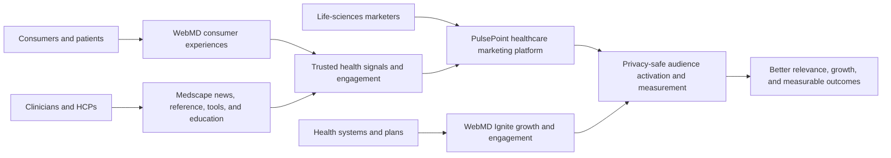

The Senior Technical PM is the translator across these worlds. You should be able to move from a business request such as “improve oncologist engagement” to a precise product model:

- Which oncologists, defined by what professional identity and specialty logic?
- Which consented or contractually permitted signals may be used?
- What is the activation surface: endemic display, video, email, search, CRM, sales outreach, EHR, point of care, or an educational experience?
- Is the content editorial, accredited education, independent medical education, or promotion?
- What does success mean: qualified reach, attention, completion, learning lift, NPI-level engagement, new-to-brand prescribing, script lift, patient action, or care outcome?
- What is the counterfactual and measurement design?
- What minimum cell sizes, suppression rules, de-identification, auditability, and review gates apply?

# Part I - The company, customers, and product ecosystem

## 1. The healthcare information and activation flywheel

### 1.1 The participants

| Participant | Core job | Typical friction | Product opportunity |
|---|---|---|---|
| Consumer or caregiver | Understand a health concern and decide what to do next | Anxiety, low health literacy, fragmented sources, uncertain credibility | Clear content, tools, symptom and treatment journeys, provider discovery, reminders |
| Physician | Make a safe, timely clinical decision and remain current | Time pressure, information overload, changing evidence | Point-of-care reference, drug data, news, calculators, specialty personalization |
| Nurse, pharmacist, APP | Perform role-specific care and maintain credentials | Different scopes, credit rules, workflows | Profession-aware education, reference, tracking, certification support |
| Life-sciences brand team | Reach appropriate audiences with compliant, useful communication | Fragmented channels, weak identity, slow measurement, MLR review | Healthcare-specific audiences, omnichannel orchestration, compliant creative, outcomes |
| Agency and trading desk | Plan, buy, optimize, and report media | Supply opacity, data quality, duplication, reporting latency | Workflow automation, transparent supply, clean APIs, governed optimization |
| Publisher | Monetize attention while protecting audience trust | Yield versus UX, fraud, privacy, latency | SSP controls, direct and programmatic demand, quality enforcement |
| Health system | Acquire patients, improve access, and build loyalty | Leakage, disconnected journeys, capacity mismatch | Service-line marketing, navigation, CRM activation, education, analytics |
| Health plan | Acquire, onboard, engage, and retain members | Low engagement, complex benefits, care gaps | Personalized journeys, member education, outreach, measurement |

### 1.2 The flywheel

Trusted products create repeat engagement. Engagement produces first-party events and declared preferences. With permission and appropriate governance, those signals improve relevance, measurement, and product decisions. Better relevance creates more value for users and customers, which funds better content, tools, education, and technology.

The flywheel fails when optimization consumes trust faster than the product creates it. Examples include excessive ad load, opaque sponsorship, insensitive health inference, misleading attribution, over-personalization, slow pages, or an AI answer that sounds authoritative but is not adequately grounded.

### 1.3 The PM's system boundary test

Before accepting a roadmap item, draw five boundaries:

1. **Experience boundary:** where the user sees and controls the feature.
2. **Data boundary:** where identifiers and events are collected, transformed, joined, and retained.
3. **Decision boundary:** where rules or models determine audience, content, bid, or message.
4. **Commercial boundary:** where inventory, data, software, services, or outcomes are contracted.
5. **accountability boundary:** who owns editorial, medical, legal, privacy, security, accreditation, and operational approval.

If any boundary is unclear, the product is not ready for a confident commitment.

## 2. WebMD portfolio fluency

Publicly described services include the WebMD Consumer Network, the WebMD Professional Network led by Medscape, WebMD Health Services, WebMD Magazine, and WebMD Ignite. PulsePoint operates within the broader Internet Brands family and works with WebMD and Medscape data and environments. The precise internal organizational and platform boundaries may differ; learn them during onboarding.

### 2.1 A practical portfolio map

| Portfolio area | Primary audience | Representative value | PM questions |
|---|---|---|---|
| WebMD Consumer Network | Consumers and caregivers | Health information, tools, condition and drug journeys | How do credibility, comprehension, SEO, personalization, and monetization coexist? |
| Medscape | Physicians and HCPs | News, perspectives, drug and disease reference, clinical tools, video, cases | Which moments are point-of-care, learning, professional news, or sponsored engagement? |
| Medscape Education | Healthcare teams | Independent accredited CME/CE and professional development | How are needs assessment, independence, disclosures, credit, outcomes, and audit trails handled? |
| WebMD Ignite | Health systems and health plans | Awareness, acquisition, engagement, patient/member education, analytics | How do audience, capacity, CRM, content, journey orchestration, and ROI connect? |
| PulsePoint | Life sciences, agencies, healthcare marketers, publishers | Healthcare audience intelligence, media activation, HCP engagement analytics | What signal creates the audience, what supply is eligible, and what outcome closes the loop? |
| Professional network brands | Specialty or regional HCP communities | Deeper professional reach and localized experiences | What identity, consent, taxonomy, and content models are shared or distinct? |

### 2.2 Endemic is a product property, not just a media label

“Endemic” generally means an environment whose primary context is healthcare or a specific professional field. Medscape is endemic to clinical professionals; a general news site is non-endemic even if an HCP visits it. Endemic supply can offer strong contextual relevance, authenticated professional identity, specialty content, and high trust. Non-endemic supply can add reach and frequency. A good plan assigns a different role to each rather than treating all impressions as interchangeable.

### 2.3 Content classes must remain distinguishable

| Content class | Who controls it | Typical purpose | Non-negotiable property |
|---|---|---|---|
| Editorial | Editorial organization | Inform through independent reporting/reference | Editorial independence and transparent corrections |
| Accredited CME/CE | Accredited provider under applicable standards | Improve knowledge, competence, performance, or outcomes | Independence from commercial influence; disclosures and accreditation controls |
| Independent medical education | Independent educational body | Address documented educational gaps | Separation from promotion and appropriate supporter reporting |
| Sponsored content | Sponsor and publisher under defined review | Inform or engage around a topic | Clear labeling and substantiated claims |
| Promotional advertising | Manufacturer/brand and partners | Promote an approved product or indication | Truthful, non-misleading, fair balance, material facts, approved review |
| Market research | Research sponsor/intermediary | Learn attitudes or behavior | Participant transparency, consent, data minimization, research integrity |

The PM must encode these distinctions in the CMS, metadata, review workflow, analytics, recommendation rules, and UI labels. A policy in a slide deck is insufficient if the platform cannot enforce it.

## 3. Medscape product and data fluency

### 3.1 Jobs Medscape performs

Medscape publicly describes news and expert perspective, drug and disease reference, clinical tools, video, cases, and CME/CE. Its professional registration creates a relationship with clinicians that can support specialty-aware experiences and professional verification. Public advertising materials describe broad physician reach and multiple sponsored formats. Treat externally published reach figures as commercial claims until you learn definitions, date ranges, geography, deduplication, and active-user thresholds internally.

### 3.2 Representative product surfaces

- **News and Perspective:** breaking medical news, conference coverage, expert commentary, policy, and the business of medicine.
- **Drugs and Diseases:** monographs, interactions, guidelines, procedures, formulary information, calculators, cases, quizzes, and slideshows.
- **Education:** short and long CME/CE activities, clinical cases, patient simulations, expert video, conference coverage, assessments, evaluations, credits, and certificates.
- **Video and immersive formats:** clinician stories, discussions, virtual events, and interactive brand or educational experiences.
- **Medscape AI:** as of July 2026, Medscape publicly describes a medical-grade AI experience integrating proprietary content, peer-reviewed literature, and real-time medical news for specialty-specific insights.

### 3.3 The professional identity model

An HCP identity graph may contain a platform member ID, NPI, profession, specialty, subspecialty, license geography, organization affiliations, email or hashed email, device or browser identifiers, consent state, and engagement history. These attributes differ in provenance and reliability.

| Attribute | Example source | Key risk | PM control |
|---|---|---|---|
| Profession/specialty | Registration, verification, NPPES, licensed data | Stale or conflicting values | Provenance, confidence, last-verified date, conflict policy |
| NPI | User declaration, NPPES matching, licensed directory | False positive; NPI is not proof of active licensure | Deterministic rules, review thresholds, no overclaiming |
| Organization | Registration, claims-derived relationship, directory | Multiple affiliations and temporal change | Effective dates, relationship type, confidence |
| Engagement | Web, app, email, media, search | Bot activity, shared devices, identity loss | Quality filters, authenticated priority, event contracts |
| Consent | CMP, account preference, contract | Jurisdiction and purpose mismatch | Purpose-specific state, versioned policy, revocation propagation |

**Critical 2026 note:** CMS moved NPPES downloadable files to Version 2 on March 3, 2026, with expanded character lengths. A data pipeline that assumes Version 1 schemas can silently truncate or fail. Also, CMS states that issuance of an NPI does not ensure licensure or credentialing.

### 3.4 Education as a product system

An education product is more than content playback. It includes needs assessment, objectives, faculty and disclosures, content review, learner eligibility, pre-test, activity delivery, post-test, evaluation, credit rules, certificate generation, activity expiration, outcomes reporting, and audit evidence.

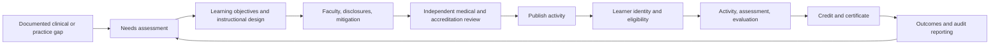

A Senior PM should ask: Is completion idempotent? Can a learner resume across devices? Are credit rules versioned? Can corrections preserve an audit trail? Are commercial-support reports aggregated? Does an expired activity remain readable while credit becomes unavailable? How are accessibility, captions, transcripts, and localization handled?

### 3.5 Medscape AI: the product questions behind the interface

For a medical information assistant, the hard problems are not the chat box. They are corpus governance, retrieval quality, source freshness, specialty context, citation fidelity, clinical-risk boundaries, prompt-injection resistance, PHI handling, abstention, evaluation, and change control.

A credible answer pipeline should distinguish:

1. User question classification and risk tier.
2. Query rewriting and specialty context.
3. Retrieval from approved corpora with freshness and authority metadata.
4. Evidence ranking and contradiction detection.
5. Grounded generation with citations.
6. Safety policies, unsupported-claim detection, and abstention.
7. User feedback and expert-review loops.
8. Offline evaluations and monitored production metrics.

Do not use “accuracy” as a single metric. Track retrieval recall, citation correctness, claim support, answer completeness, harmful omission, calibration, refusal quality, latency, user trust, and downstream action separately.

## 4. WebMD consumer and WebMD Ignite

### 4.1 Consumer health journeys

A consumer health journey rarely follows a clean funnel. A person may move from a symptom search to an article, drug page, calculator, provider directory, insurer page, appointment system, patient portal, and back. Anxiety and urgency alter behavior. Multiple people may research for one patient. Health literacy, language, disability, cost, access, and trust shape the journey.

Useful consumer-product principles:

- Put “what to do next” close to explanatory content.
- Make emergency and escalation guidance obvious without creating alarm fatigue.
- Separate general information from individualized medical advice.
- Explain uncertainty and evidence strength.
- Optimize for comprehension and task completion, not page views alone.
- Treat sensitive-condition inference as high risk even when the data is not HIPAA-covered PHI.
- Measure quality signals such as return-to-search, content usefulness, readability, action completion, and complaint rate.

### 4.2 WebMD Ignite's operating space

WebMD Ignite publicly positions itself as a growth and engagement platform for healthcare organizations. For health systems, typical problems include service-line awareness, patient acquisition, navigation, access, education, retention, and leakage. For health plans, they include member acquisition, onboarding, benefit understanding, care-gap engagement, care management, and retention.

The architecture often spans media, landing experiences, call centers, provider directories, scheduling, CRM, marketing automation, patient portals, analytics, and capacity data. The product must avoid “successful” marketing that sends patients to unavailable appointments or promotes a service in a geography with insufficient capacity.

### 4.3 Healthcare growth metric tree

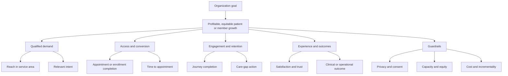

## 5. PulsePoint platform fluency

PulsePoint publicly describes a healthcare marketing platform with omnichannel campaign management, audience intelligence, HCP engagement analytics, media effectiveness, and healthcare-specific supply. Product names and capabilities evolve; use the public model below as orientation and verify current internal packaging.

### 5.1 Publicly described capabilities

| Capability | Public product language | PM interpretation |
|---|---|---|
| Omnichannel campaign management | **Life** | Plan, target, bid, optimize, activate, and measure healthcare campaigns across eligible channels |
| Audience intelligence | **Studio** | Build and analyze HCP and consumer audiences using health-centric filters and data signals |
| HCP engagement analytics | **HCP365** | Connect named HCP/NPI engagement across website, search, media, and other channels; produce actionable lists and insights |
| Media effectiveness | Outcomes measurement | Relate exposure and engagement to clinical or commercial behavior using governed data and study design |
| Endemic omnichannel / curated markets | Healthcare-specific supply | Package vetted publisher, EHR, clinical newsletter, and other health environments for quality and relevance |
| Smart Lists / activation | Actionable HCP cohorts | Move governed insight into CRM, sales, programmatic, or other approved workflow |

Public materials cite 4.2 million verified NPIs, 230 million U.S. consumers, 60+ health filters, and billions of condition claims. These are point-in-time vendor claims, not universal system guarantees. In product reviews, always ask for the denominator, freshness, source mix, match method, consent basis, coverage by channel, and realized reach.

### 5.2 HCP365 as a closed-loop system

HCP365 can be understood as a feedback layer connecting professional identity, event collection, insight, and activation.

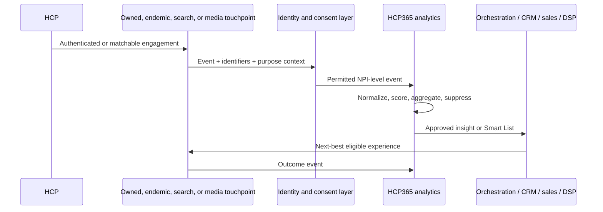

Product questions:

- What is an “engagement,” and is its definition stable across channels?
- Is the identity deterministic, probabilistic, or inferred?
- How quickly does consent revocation remove an HCP from activation?
- What minimum signal is required before an NPI appears in a report?
- How are shared devices, bots, corporate networks, and ambiguous email domains handled?
- Can users understand why an HCP entered a list?
- Is a model score used as an insight, a targeting eligibility rule, a bid modifier, or all three?
- Does the system prevent disallowed sensitive inference or promotion to inappropriate specialties?

### 5.3 A defensible signal-to-action contract

Every activation feature should document:

```
Signal name: oncology_guideline_content_engagement
Source and owner: authenticated Medscape event / professional analytics
Identity level: member_id, linked to NPI only above deterministic threshold
Permitted purpose: campaign analytics and approved HCP engagement
Freshness: event within 30 days
Eligibility: U.S. licensed HCP; approved specialties; active consent and contract
Suppression: opted out, invalid NPI, low confidence, restricted geography, campaign exclusion
Action: add to reviewable Smart List; no autonomous sales contact
Explanation: article category, event time bucket, confidence, source class
Retention: per policy and customer contract
Audit: rule version, list version, actor, export destination
```

This makes privacy, product, engineering, analytics, and customer success discuss the same object.

# Part II - MarTech and programmatic advertising

## 6. The modern MarTech stack

MarTech is the system that turns strategy, content, customer data, and channel execution into measurable experiences. AdTech is the subset focused on paid-media transactions and delivery. In practice the two overlap through identity, audience, creative, consent, and measurement.

### 6.1 Core systems

| System | Primary responsibility | Typical inputs | Typical outputs |
|---|---|---|---|
| CRM | Account and relationship system of record | HCP, patient lead, member, organization, sales activity | Segments, tasks, outreach history |
| CDP | Unify first-party profiles and events | Web/app/email/CRM/offline events | Audiences, traits, journey triggers |
| DMP | Cookie/device-centric audience management | Third-party and pseudonymous media data | Media segments; declining as identity and privacy evolve |
| MAP / journey orchestrator | Automate messages and lifecycle journeys | Profiles, triggers, eligibility, content | Email, SMS, push, tasks, experiments |
| CMS / DAM | Manage content and assets | Copy, media, metadata, rights, approvals | Published pages, modules, approved creative |
| CMP / preference center | Capture privacy choices and consent signals | Jurisdiction, user choice, policy version | Purpose-specific consent state, GPP/TC strings where relevant |
| Tag manager / SDK | Deploy and govern collection | Site/app configuration | Events to analytics and marketing endpoints |
| Warehouse/lakehouse | Store and transform analytical data | Product, media, CRM, financial, clinical data | Models, features, reports, governed datasets |
| MDM / identity graph | Resolve entities and golden records | Member IDs, NPI, email, device, organization | Resolved IDs, confidence, provenance |
| DSP | Buy media for advertisers | Campaign, audience, bid strategy, creative | Bids, spend, delivery, logs |
| SSP | Help publishers package and sell inventory | Ad opportunities, floor rules, consent, supply metadata | Bid requests, auction result, yield data |
| Ad server | Select and deliver ads; count events | Tags, campaigns, creative, targeting | Ad response, impression, click, conversion logs |
| Clean room | Controlled data collaboration | Pseudonymized partner datasets | Overlap, activation, measurement under policy controls |
| Experimentation platform | Assign treatments and measure outcomes | Eligibility, randomization, events | Lift, uncertainty, guardrail results |

### 6.2 A reference architecture

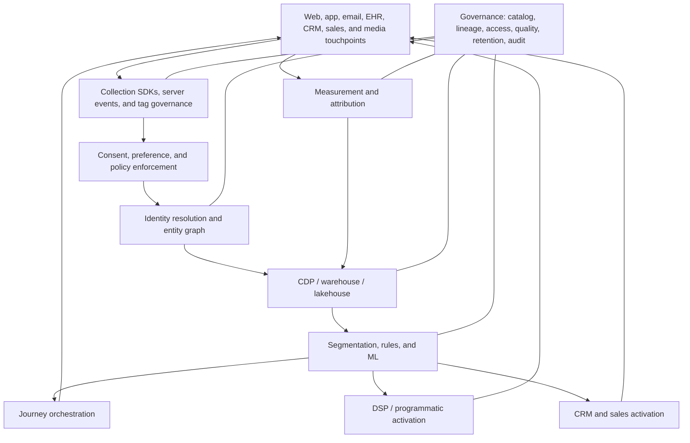

### 6.3 The integration trap

An arrow between boxes hides most delivery risk. For every integration specify:

- **Entity:** HCP, NPI, member, account, campaign, creative, placement, event, conversion.
- **Contract:** schema, required fields, allowed values, versioning, error response.
- **Semantics:** what each field means and which system owns it.
- **Transport:** API, stream, file, pixel, SDK, clean room, manual export.
- **Latency:** real-time, near-real-time, hourly, daily, weekly.
- **Identity:** join keys, match hierarchy, confidence, collision behavior.
- **Governance:** purpose, consent, geography, contract, retention, deletion.
- **Reliability:** retries, idempotency, reconciliation, observability, backfill.
- **Commercial consequence:** billing, reach, optimization, reporting, SLA.

## 7. Programmatic advertising from request to outcome

Programmatic advertising uses software and data to transact, deliver, and optimize media. Real-time bidding is one transaction method; programmatic guaranteed, preferred deals, and private marketplaces are others.

### 7.1 The actors

- **Advertiser:** funds the campaign and owns the business objective.
- **Agency/trading desk:** plans, buys, optimizes, and reports on behalf of the advertiser.
- **DSP:** evaluates bid opportunities and bids for the advertiser.
- **Ad exchange:** facilitates auctions; functionality often overlaps with SSPs.
- **SSP:** represents publisher inventory and optimizes yield, controls, and demand access.
- **Publisher:** owns or operates the content/app and ad inventory.
- **Ad server:** makes delivery decisions and counts ad events.
- **Data/identity provider:** contributes segments, IDs, verification, or enrichment.
- **Measurement/verification provider:** assesses viewability, fraud, brand safety, attention, or outcomes.

### 7.2 The RTB flow

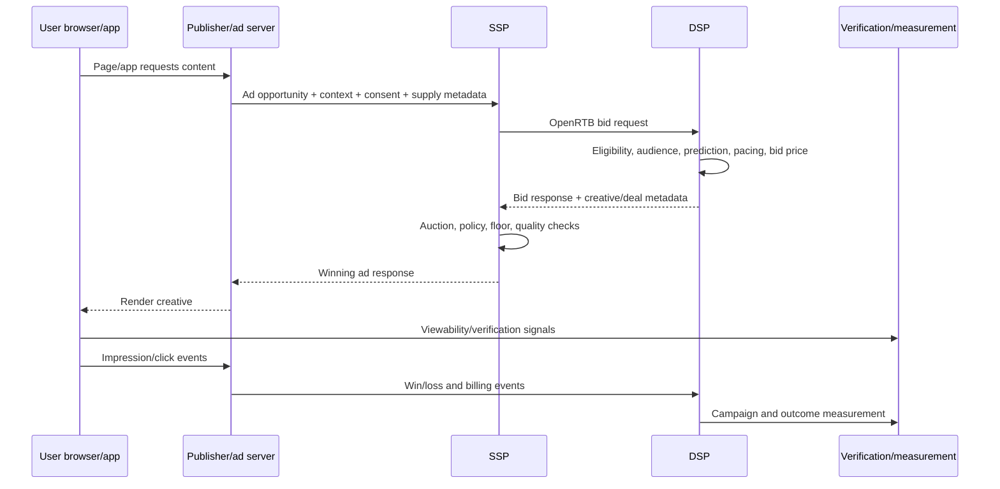

Typical round trips occur in a fraction of a second. Latency budget is shared across page rendering, consent lookup, identity, SSP processing, DSP decisioning, creative retrieval, and verification. A 100 ms feature-store lookup may be harmless offline and fatal in an auction path.

### 7.3 Buying methods

| Method | Price/inventory | Best for | Trade-off |
|---|---|---|---|
| Open auction | Dynamic; broad eligible supply | Scale and flexible optimization | Less exclusivity; stronger quality controls needed |
| Private marketplace (PMP) | Invitation/deal ID; negotiated rules | Curated quality, premium or endemic supply | Setup and troubleshooting complexity |
| Preferred deal | Fixed price; buyer gets preferred access, not guaranteed | Priority without guaranteed commitment | Inventory may not clear |
| Programmatic guaranteed | Fixed price and reserved volume | Predictable premium delivery | Less auction flexibility; forecasting accuracy matters |
| Direct insertion order | Human-negotiated campaign and placement | Custom sponsorship and high-touch formats | Operational overhead and limited automation |

### 7.4 CPM math

`Media cost = impressions / 1,000 x CPM`

If a campaign delivers 2,400,000 impressions at a $28 CPM, gross media cost is $67,200. But a PM must separate:

- gross advertiser spend;
- working media;
- platform or data fees;
- verification and measurement fees;
- publisher revenue;
- take rate and net revenue;
- billable versus measured impressions;
- discrepancies between systems.

## 8. SSPs: the supply-side platform deep dive

An SSP helps publishers expose, package, price, control, and sell digital ad inventory across demand sources. Calling it “the publisher's DSP” is a useful beginner analogy but incomplete: an SSP must also protect user experience, enforce supply and creative policy, manage auctions and deals, maximize yield, support billing, and provide transparent reporting.

### 8.1 SSP responsibilities

1. Receive an ad opportunity from a publisher integration.
2. Interpret site/app, content, device, format, privacy, identity, and supply-chain metadata.
3. Apply publisher blocks, consent rules, floors, deal priority, and traffic-quality controls.
4. Select eligible demand partners and construct bid requests.
5. Run or participate in auctions.
6. Validate the winning bid and creative.
7. Return the ad markup or rendering instruction.
8. Log auction, delivery, billing, quality, and discrepancy events.
9. Optimize publisher yield while respecting latency and user experience.

### 8.2 Auction mechanics

Modern auctions are commonly first-price: the winner pays approximately its bid, subject to rules and fees. Header bidding lets a publisher solicit multiple demand sources before or alongside the ad server. Server-side bidding moves that fan-out off the browser, reducing client work but changing cookie/identity availability and transparency. Bid shading is a DSP tactic that estimates a lower bid likely to win a first-price auction.

Key fields and concepts:

- **Bid floor:** minimum acceptable price, often CPM-denominated.
- **Deal floor:** price associated with a negotiated deal.
- **Dynamic floor:** floor adjusted by context, demand, geography, format, or historical clearing price.
- **Soft floor:** influences auction logic but may allow exceptions.
- **Hard floor:** bids below it are rejected.
- **Clearing price:** price paid by the winner.
- **Fill rate:** filled ad opportunities / eligible ad opportunities.
- **Match rate:** requests with a usable identity match / eligible requests.
- **Win rate:** auctions won / auctions bid.
- **Bid rate:** bid responses / bid requests.
- **Timeout rate:** responses arriving after the auction deadline / requests.

### 8.3 Yield is multi-objective

Publisher yield is not just maximum CPM. A healthier objective is:

`Expected value = eligible request probability x fill probability x expected net CPM x render probability`

subject to latency, ad load, viewability, policy, privacy, user experience, advertiser quality, revenue concentration, and contractual constraints.

A high winning bid that times out, fails to render, or produces a policy incident has negative expected value.

### 8.4 Header bidding versus waterfall

| Model | How it works | Strength | Weakness |
|---|---|---|---|
| Waterfall | Demand partners called sequentially by priority | Simple mental model | Earlier partners see opportunities first; inefficient price discovery |
| Client-side header bidding | Multiple bidders called in browser before ad-server decision | More simultaneous competition and transparency | Browser latency, network load, identifier variability |
| Server-side bidding | Auction fan-out from server | Lower client overhead, broader demand | Cookie match challenges, another intermediary, server cost |
| Hybrid | Client and server paths combined | Balance reach and latency | Deduplication and auction logic become complex |

### 8.5 SSP product metrics

| Layer | Metric | Diagnostic meaning |
|---|---|---|
| Opportunity | ad requests, eligible requests | Inventory and policy funnel |
| Demand | bid rate, average bids/request, timeout rate | Demand connectivity and latency |
| Auction | win/clear rate, floor rejection, deal match | Pricing and deal health |
| Delivery | render rate, discrepancy, viewability | Creative and measurement health |
| Economics | gross spend, publisher revenue, take rate, net eCPM | Commercial performance |
| Quality | IVT, malware block, policy reject, complaint | Trust and safety |
| Experience | page latency, CLS, ad density, CPU/network cost | User impact |

## 9. OpenRTB and supply-chain transparency

OpenRTB is an IAB Tech Lab protocol for exchanging bid requests and responses. Version 2.6 added richer support for connected TV, ad pods, channel/network descriptions, and structured user-agent data. Implementations use selected fields and extensions; “supports OpenRTB 2.6” does not mean every field is populated correctly.

### 9.1 Simplified bid request

```json
{
  "id": "req-8f2c",
  "imp": [{
    "id": "1",
    "banner": {"format": [{"w": 300, "h": 250}]},
    "bidfloor": 18.00,
    "bidfloorcur": "USD",
    "secure": 1,
    "pmp": {"deals": [{"id": "oncology-endemic-pmp", "bidfloor": 24.00}]}
  }],
  "site": {
    "domain": "clinicalpublisher.example",
    "page": "https://clinicalpublisher.example/oncology/article",
    "cat": ["IAB7"],
    "publisher": {"id": "pub-123"}
  },
  "device": {"ua": "...", "ip": "redacted/example", "lmt": 0},
  "user": {"id": "pseudonymous-id", "eids": []},
  "regs": {"ext": {"gpp": "...", "gpp_sid": [7, 8]}},
  "source": {"schain": {"complete": 1, "nodes": []}},
  "tmax": 180
}
```

Never put raw PHI, direct patient identifiers, diagnosis text, or unapproved sensitive inference into a bid request. Minimize URL and content fields so they do not leak sensitive context. A syntactically valid request can still be a privacy failure.

### 9.2 Bid response essentials

A bid response typically includes request ID, seat, bid, impression ID, price, creative markup or reference, creative ID, advertiser domain, campaign ID, categories, and notification URLs. The SSP validates required fields, policy, deal, format, price, and creative eligibility before accepting the bid.

### 9.3 Supply-chain standards

- **ads.txt:** publisher-hosted file listing companies authorized to sell web inventory.
- **app-ads.txt:** equivalent authorization mechanism for apps and connected TV.
- **sellers.json:** SSP/exchange file identifying seller accounts as publishers or intermediaries, subject to confidentiality declarations.
- **SupplyChain object (`schain`):** bid-request object listing the sequence of sellers/resellers involved.
- **owner domain / manager domain:** ads.txt 1.1 directives that improve transparency about inventory ownership and management.

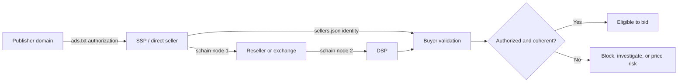

### 9.4 Product acceptance tests

- Publisher account appears in ads.txt with the correct seller relationship.
- Seller ID and domain resolve correctly in sellers.json.
- `schain.complete` accurately represents whether all nodes are included.
- Reseller nodes are ordered and match observed transaction paths.
- Privacy strings pass through without mutation.
- Sensitive page URLs are redacted or categorized according to policy.
- Bid request and billing logs reconcile at defined tolerances.

## 10. Identity and addressability in 2026

Addressability is the ability to recognize or classify an audience sufficiently to select, personalize, frequency-control, or measure an experience. Identity is the system of identifiers and relationships behind that capability.

### 10.1 Identifier landscape

| Identifier | Scope | Strength | Limitation |
|---|---|---|---|
| First-party account/member ID | One platform | Deterministic and durable while logged in | Does not automatically travel to other platforms |
| NPI | U.S. healthcare provider | Stable professional identifier | Public and intelligence-free; not proof of current licensure; not a consumer ID |
| First-party cookie | One domain | Useful for sessions and repeat visits | Browser deletion, consent, device-specific |
| Third-party cookie | Cross-site context | Legacy interoperability | Blocked/restricted in many environments; privacy risk; not a future strategy |
| Mobile advertising ID | Device/app ecosystem | App measurement and advertising | User resets and platform permission controls |
| Hashed email | Derived from email | Deterministic matching when normalized consistently | Hashing is pseudonymization, not anonymization; consent and partner use matter |
| Universal ID | Vendor/industry ID | Interoperability across participants | Adoption, governance, consent, and dependency risk |
| IP address | Network | Coarse household/network signal | Dynamic, shared, VPNs, sensitive, weak identity |
| Contextual classification | Page/content | No person-level ID required | Less individual precision; classification quality matters |

### 10.2 July 2026 browser reality

Do not say “Chrome is eliminating all third-party cookies.” Google announced in April 2025 that it would maintain its existing approach to user choice rather than launch a new standalone third-party-cookie prompt, and in October 2025 retired several Privacy Sandbox advertising technologies while continuing selected cookie, identity, and fraud-prevention work. Safari and Firefox have long imposed stronger tracking restrictions. The robust strategy remains first-party relationships, contextual relevance, consented deterministic collaboration, privacy-enhancing technology, and measurement methods that do not depend on universal cross-site identity.

### 10.3 Identity resolution

Deterministic resolution uses a shared stable key such as authenticated account, verified email, or NPI. Probabilistic resolution uses features such as device, network, behavior, and time to estimate a relationship. In health contexts, probabilistic identity can create unacceptable false positives and sensitive inference.

An identity edge should carry:

```
left_id, right_id, relationship_type, method,
confidence, source, permitted_purposes,
effective_at, expires_at, consent_version,
created_by, rule_or_model_version
```

### 10.4 PAIR and clean collaboration

The IAB Tech Lab's PAIR protocol describes privacy-enhancing advertiser-publisher matching in which parties create encrypted, scoped identifiers and activate through participating ad-tech systems without exposing raw emails. A data clean room similarly provides controlled matching and analysis with restrictions such as approved queries, minimum aggregation thresholds, no raw row export, audit logs, and differential privacy or noise where appropriate.

The PM should ask whether a “clean room” changes the underlying legal permission. It does not. It can reduce exposure and enforce policy, but consent, purpose, contract, data rights, and sensitive-data restrictions still apply.

## 11. Healthcare audience data and segmentation

### 11.1 Data classes

- **Zero-party data:** information a person intentionally declares, such as specialty preference or selected interests.
- **First-party data:** events and attributes collected through a direct relationship.
- **Second-party data:** another party's first-party data shared under agreement.
- **Third-party data:** data collected or aggregated without the direct platform relationship.
- **Clinical data:** diagnoses, procedures, labs, medications, encounters, and other care information.
- **Claims data:** billing and adjudication records with longitudinal but delayed signals.
- **Rx data:** prescription transaction or dispensing information, subject to strict contracts and de-identification.
- **Digital behavioral data:** page, search, video, email, ad, and app events.

### 11.2 Segment quality framework

Assess a segment on:

1. **Definition validity:** does the rule represent the intended audience?
2. **Provenance:** where did every field originate?
3. **Permission:** may it be used for this purpose, customer, geography, and channel?
4. **Freshness:** when did the underlying signal occur or update?
5. **Precision:** among included entities, how many truly qualify?
6. **Recall/coverage:** among qualifying entities, how many are included?
7. **Reachability:** how many can actually be activated in the selected channel?
8. **Stability:** how much does membership change across refreshes?
9. **Bias:** who is systematically underrepresented or misclassified?
10. **Explainability:** can an operator understand inclusion and exclusion?

### 11.3 Example: an oncology HCP audience

Weak definition: “oncologists interested in Brand X.”

Stronger design:

- eligible professions: MD/DO and approved advanced practice clinicians;
- specialty logic: medical oncology, hematology-oncology, and defined related taxonomies;
- geography: campaign-approved U.S. states;
- identity: deterministic NPI match above threshold;
- signal: recent interaction with approved oncology content categories or customer-provided target list;
- exclusions: opt-out, inactive/deactivated NPI, pediatric-only if adult indication, institutional exclusions;
- refresh: daily identity, weekly content segment;
- activation: endemic display and approved CRM list;
- reporting: aggregate and NPI-level only where contractually and legally permitted;
- evaluation: reach, frequency, qualified engagement, incremental outcome with confidence intervals.

### 11.4 Claims are not ground truth

Claims are optimized for payment, not clinical truth. They can be delayed, incomplete, reversed, bundled, miscoded, or absent for cash/self-pay encounters. Diagnosis codes may represent rule-out or historical conditions. Prescription activity does not prove ingestion. Use claims as evidence with known limitations, not as a perfect patient record.

## 12. Campaign operations, optimization, and pacing

### 12.1 Campaign object model

```
Advertiser
  Campaign (objective, budget, dates, geography, guardrails)
    Line item / tactic (audience, channel, deal, bid strategy, pacing)
      Creative (version, format, claims, approval, expiration)
      Placement / supply package
      Measurement plan
```

Every object needs status, owner, effective dates, approval state, audit history, and external IDs. Avoid burying critical semantics in names such as `ONC_US_HCP_Q3_FINAL_v7`.

### 12.2 Pacing

Pacing controls spend or delivery over time. A simple target is:

`Target spend to time t = total budget x elapsed eligible time / total eligible time`

Real systems adjust for dayparting, weekends, forecasted supply, learning periods, deals, frequency caps, audience exhaustion, delayed conversion, and underdelivery risk.

Failure modes:

- aggressive catch-up causes poor-quality late-day inventory;
- tight frequency caps make budget impossible to spend;
- audience refresh shrinks eligibility mid-flight;
- delayed reporting causes oscillating bid changes;
- timezone errors overspend daily budgets;
- a conversion model chases easy but non-incremental responders.

### 12.3 Optimization hierarchy

Optimize in this order:

1. legal, consent, safety, and policy eligibility;
2. campaign contract and delivery feasibility;
3. data and measurement validity;
4. user experience and quality;
5. incremental business outcome;
6. efficiency such as CPA or ROAS.

An algorithm should never trade away a hard constraint for a better predicted click-through rate.

### 12.4 Model loop

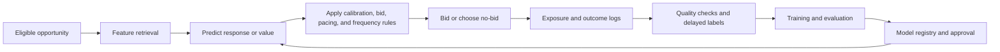

Guard against label leakage, feedback loops, selection bias, sparse specialties, non-stationary campaigns, and optimization to proxy metrics.

## 13. Creative, content, and medical-legal-regulatory workflow

Healthcare creative is software with legal and clinical dependencies. The platform should model claim, indication, fair-balance content, references, prescribing-information links, audience, geography, channel, dimensions, approval ID, effective date, and expiration.

### 13.1 MLR workflow

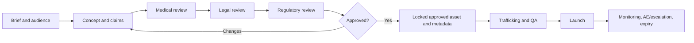

### 13.2 Product controls

- Block launch without a valid approval and unexpired asset.
- Separate draft, approved, live, paused, withdrawn, and expired states.
- Prevent editing a live approved asset in place; create a new version.
- Preserve exactly what was served, where, to whom, and under which rule version.
- Validate destination, prescribing information, fair-balance visibility, dimensions, VAST, click trackers, and accessibility.
- Support emergency withdrawal across all placements and caches.
- Route adverse-event or product-complaint signals according to approved procedures.

### 13.3 Dynamic creative optimization

DCO assembles or selects creative elements based on context or audience. In pharma, flexibility must remain inside an approved decision space. A safe design uses pre-approved components, explicit combination rules, immutable claim-risk pairings, indication and audience constraints, full decision logs, and a kill switch. Generative AI should not invent or paraphrase promotional claims at serving time.

## 14. Measurement, attribution, and incrementality

### 14.1 Measurement ladder

| Level | Examples | What it proves |
|---|---|---|
| Delivery | impressions, reach, frequency, spend | The campaign ran |
| Quality | viewability, IVT, brand safety, completion | Opportunities were plausibly valid and viewable |
| Engagement | clicks, content depth, video completion, tool use | People interacted |
| Learning/attitude | knowledge lift, confidence, intent | A proximal cognitive outcome changed |
| Behavior | site action, CRM response, appointment, new prescriber | Observable action followed |
| Incremental outcome | randomized or credible quasi-experimental lift | Exposure caused additional outcome under assumptions |
| Business/health outcome | revenue, Rx lift, adherence, care-gap closure | Valuable downstream result occurred |

### 14.2 Attribution is not causality

Last-touch attribution assigns credit to the final observed touch. Multi-touch attribution distributes credit across observed touches. Marketing-mix modeling estimates aggregate channel contributions. None automatically proves causal lift. People likely to convert may also be more likely to receive or engage with ads.

Preferred evidence hierarchy:

1. randomized controlled holdout;
2. geo or cluster randomization;
3. strong quasi-experiment such as difference-in-differences with validated assumptions;
4. matched exposed/unexposed analysis with sensitivity tests;
5. observational attribution;
6. descriptive correlation.

### 14.3 Core equations

`Conversion rate = conversions / eligible exposed entities`

`Absolute lift = treatment rate - control rate`

`Relative lift = (treatment rate - control rate) / control rate`

`Incremental conversions = absolute lift x treated eligible population`

`Cost per incremental conversion = total campaign cost / incremental conversions`

Always show uncertainty. A 20% relative lift from 1.0% to 1.2% is a 0.2 percentage-point absolute lift. The practical meaning depends on sample size, cost, and downstream value.

### 14.4 HCP and Rx measurement caveats

- Define new-to-brand, total Rx, and new prescriber precisely.
- Apply washout windows consistently.
- Account for prescription lag and claims maturity.
- Avoid counting overlapping campaigns as independent exposures.
- Use de-identified patient data and governed NPI-level outputs.
- Suppress small cells and restricted specialties/geographies.
- Distinguish target-list analysis from total market impact.
- Label vendor case-study results as case-specific, not guaranteed.

PulsePoint's 2025 Publicis Health Media case study publicly reported higher Rx among exposed and omnichannel-engaged target HCPs. Treat it as a useful product example, while asking about design, comparability, confidence, selection, exposure definition, and external validity before generalizing.

## 15. Fraud, viewability, brand safety, and supply quality

### 15.1 Quality vocabulary

- **IVT:** invalid traffic. General IVT includes known bots and data-center traffic; sophisticated IVT includes spoofing, malware, and intentionally manipulated behavior.
- **Viewability:** whether enough pixels were in view for enough time under the applicable standard; it is an opportunity to see, not proof of attention.
- **Domain/app spoofing:** inventory misrepresented as coming from a premium property.
- **Ad stacking:** multiple ads layered so only one is visible.
- **Pixel stuffing:** an ad rendered in a tiny or invisible area.
- **Click injection/flooding:** fraudulent clicks designed to steal attribution.
- **Made-for-advertising site:** content property optimized primarily to capture ad spend, often with poor user value.
- **Brand safety:** avoid content categories unacceptable to a brand.
- **Brand suitability:** a brand-specific, more nuanced fit assessment.

### 15.2 Healthcare-specific suitability

Healthcare requires context sensitivity beyond generic blocklists. A cancer-treatment ad beside an obituary, misinformation, or a distressing patient story may be technically on-topic but unsuitable. Conversely, blocking every page containing “cancer” can eliminate valuable endemic supply. Use content taxonomy, sentiment, page type, source quality, and human review rather than keyword blocking alone.

### 15.3 Quality incident runbook

1. Stop or constrain affected demand, supply, creative, or data flow.
2. Preserve logs and exact served artifacts.
3. Determine scope by publisher, placement, deal, creative, time, geography, and identity path.
4. Assess user, privacy, regulatory, financial, and customer impact.
5. Notify incident owners and customers under policy and contract.
6. Reconcile billing and issue credits if required.
7. Fix detection or enforcement, not only the single case.
8. Document root cause, contributing conditions, and prevention evidence.

---

# Part III - Digital health technology and healthcare data

## 16. The U.S. healthcare system as a product ecosystem

Healthcare products operate inside a network of care delivery, payment, regulation, professional practice, public health, and consumer behavior. A feature can be desirable and technically feasible yet fail because it does not fit reimbursement, clinical workflow, data availability, or accountability.

### 16.1 The major actors

| Actor | Role | Product implication |
|---|---|---|
| Patient/member/caregiver | Receives care, manages health, pays premiums/cost share | Consent, accessibility, literacy, navigation, trust, affordability |
| Provider | Delivers and documents care | Workflow fit, liability, credentialing, burnout, reimbursement |
| Health system/practice | Operates care delivery | Integration, capacity, revenue cycle, quality, staffing |
| Payer | Finances and manages covered care | Eligibility, benefits, networks, prior authorization, claims, risk |
| Employer | Sponsors benefits for employees | Population health, engagement, cost, privacy boundaries |
| Pharmacy/PBM | Dispenses and manages drug benefit | Formulary, pricing, e-prescribing, adherence, rebates |
| Life-sciences company | Develops and commercializes drugs/devices | Evidence, approval, promotion, safety surveillance, access |
| Regulator/accreditor | Sets and enforces standards | Auditability, submissions, disclosures, safety and quality |
| Health IT vendor | Supplies EHR, CRM, analytics, interoperability | Integration dependencies, certification, data rights |

### 16.2 Money and data move differently

Clinical data may move from provider to HIE to another provider through FHIR or documents. Administrative data may move via X12 transactions. Prescriptions use NCPDP standards. Images use DICOM. Marketing events use web/app event schemas and ad-tech protocols. Claims arrive after care and may be adjudicated or reversed. The PM must identify which record is authoritative for which decision.

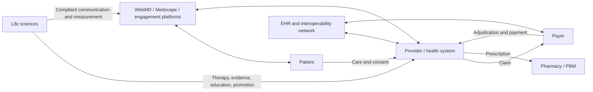

### 16.3 Care and commercial vocabulary

- **Fee for service:** payment linked to units of service.
- **Value-based care:** payment and accountability linked partly to quality, total cost, or outcomes.
- **Capitation:** fixed payment per patient/member for a period.
- **Risk adjustment:** adjusts payment for expected health cost/severity.
- **Formulary:** list and tiers of covered drugs.
- **Prior authorization:** payer approval required before certain care or coverage.
- **Step therapy:** requirement to try preferred therapy before another.
- **Site of care:** location where a service is delivered; affects workflow and cost.
- **Care gap:** recommended action not yet completed.
- **Leakage:** patient receives service outside the intended network/system.
- **Referral:** transfer or recommendation between providers/services.
- **Adherence:** extent to which medication use follows an agreed plan.
- **Persistence:** duration a patient remains on therapy.

## 17. EHRs, interoperability, and APIs

### 17.1 EHR versus EMR

An **EMR** often refers to a digital record within one practice. An **EHR** is a broader longitudinal record and platform supporting clinical workflows, orders, results, medications, notes, billing, and exchange. In everyday usage the terms overlap. The product concern is scope and interoperability, not winning the acronym debate.

### 17.2 HL7 generations

- **HL7 v2:** delimited message standard widely used for admissions, discharges, transfers, orders, and results. Flexible and ubiquitous, but locally customized.
- **C-CDA:** structured clinical documents such as summaries of care.
- **FHIR:** modern standard representing healthcare data as resources accessible through RESTful APIs, messaging, documents, and bulk data patterns.

Common FHIR resources include Patient, Practitioner, Organization, Encounter, Condition, Observation, MedicationRequest, AllergyIntolerance, DiagnosticReport, Procedure, Coverage, Claim, and Consent. A FHIR resource is not automatically interoperable: versions, profiles, required fields, value sets, references, authorization, and workflow semantics still matter.

### 17.3 SMART on FHIR

SMART App Launch uses OAuth 2.0 patterns to authorize applications to FHIR servers. A clinician-facing app can launch from an EHR with patient and encounter context; a patient app can launch standalone; a backend service can use system-level scopes with asymmetric authentication.

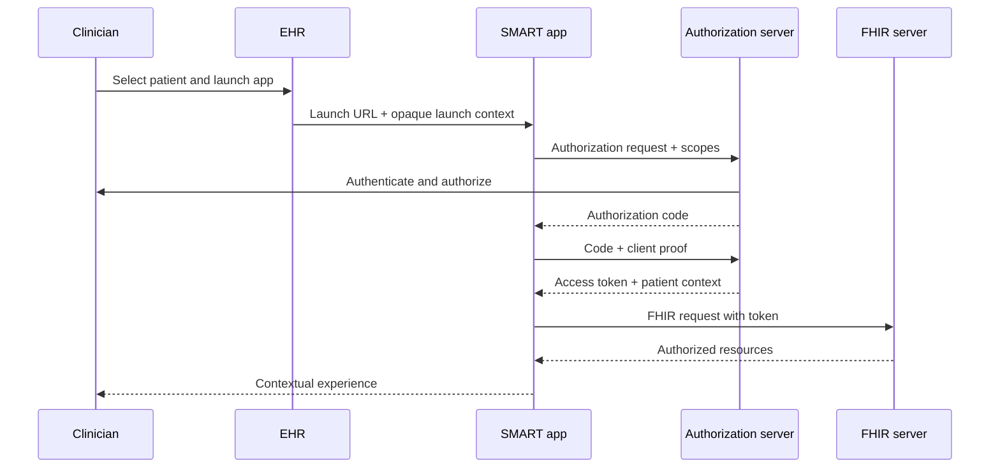

PM requirements should state least-privilege scopes, launch context, token lifetime, refresh behavior, patient switching, error handling, provenance, audit, and what happens when a resource is missing.

### 17.4 USCDI, US Core, TEFCA

- **USCDI:** a standardized set of health data classes/elements for nationwide exchange. Under HTI-1, USCDI v3 became the certification baseline on January 1, 2026.
- **US Core:** FHIR implementation guide defining profiles and API expectations for U.S. data exchange. Production systems commonly remain based on FHIR R4 even though FHIR R5 exists.
- **TEFCA:** the Trusted Exchange Framework and Common Agreement, a nationwide network-of-networks. Qualified Health Information Networks connect participants and subparticipants for permitted exchange purposes.

Do not conflate these: USCDI says what core data; US Core says how to represent and exchange much of it with FHIR; TEFCA establishes governance and network connectivity.

### 17.5 2026 prior-authorization context

CMS-0057-F requires affected payers to meet operational provisions beginning in 2026, including denial reasons and public metrics, with major FHIR API requirements generally beginning in 2027. APIs include Patient Access, Provider Access, Payer-to-Payer, and Prior Authorization. In April 2026 CMS proposed extending electronic prior authorization to certain drugs; a proposal is not a final requirement.

### 17.6 Integration acceptance checklist

- Correct FHIR version and implementation-guide version.
- CapabilityStatement and `.well-known/smart-configuration` validated.
- Required and optional fields mapped with null semantics.
- Terminology bindings tested against expected value sets.
- Pagination, search, rate limits, and bulk export handled.
- Idempotency and conditional create/update defined.
- Patient matching and duplicate behavior tested.
- Provenance, consent, access control, and audit events preserved.
- Synthetic test data used in non-production environments.
- Backward compatibility and migration plan documented.

## 18. Healthcare terminologies, classifications, and transaction standards

### 18.1 Code systems

| Standard | Represents | Example use |
|---|---|---|
| ICD-10-CM | Diagnoses and conditions | Claims, reporting, risk models |
| ICD-10-PCS | Inpatient procedures | U.S. inpatient hospital claims |
| CPT | Physician and professional services/procedures | Claims and service documentation; AMA-licensed |
| HCPCS Level II | Products, supplies, services not in CPT | Ambulance, DME, certain drugs |
| SNOMED CT | Detailed clinical concepts | Problem lists and clinical documentation |
| LOINC | Lab tests, observations, documents | Lab/result interoperability |
| RxNorm | Normalized clinical drug concepts | Medication interoperability |
| NDC | Packaged drug products | Pharmacy and product identification |
| DRG/MS-DRG | Inpatient case grouping | Hospital payment |
| NPI | Individual or organization provider | HIPAA transactions and HCP identity |
| NUCC taxonomy | Provider classification/specialization | NPPES enrollment and provider segmentation |

These systems are not interchangeable. A clinical term can map to a billing code imperfectly. Code sets change annually or more often, require versioning, and may have licensing constraints.

### 18.2 Administrative standards

| Transaction | Standard shorthand | Purpose |
|---|---|---|
| Eligibility inquiry/response | X12 270/271 | Coverage and benefit check |
| Claim status inquiry/response | X12 276/277 | Claim status |
| Claim submission | X12 837 | Professional, institutional, dental claims |
| Payment/remittance | X12 835 | Payment and adjustment explanation |
| Enrollment/disenrollment | X12 834 | Member enrollment |
| Prior authorization | X12 278 | Service review; evolving alongside FHIR APIs |
| Pharmacy claim | NCPDP D.0 | Real-time pharmacy billing |
| E-prescribing | NCPDP SCRIPT | Prescription and medication transactions |

### 18.3 Imaging and devices

- **DICOM:** standard for medical images and related metadata.
- **PACS:** system for storing, retrieving, and viewing images.
- **RIS:** radiology information system for scheduling and workflow.
- **SaMD:** software as a medical device; software intended for a medical purpose without being part of hardware.
- **SiMD:** software in a medical device.
- **CDS:** clinical decision support; regulatory treatment depends on intended use and functionality.
- **RPM:** remote physiologic monitoring using connected physiological data.
- **RTM:** remote therapeutic monitoring, often focused on therapy adherence/response and non-physiological data.

## 19. Digital health product categories and workflows

### 19.1 Category map

| Category | User value | Hard product problem |
|---|---|---|
| Telehealth | Remote access to care | Licensure, scheduling, consent, clinical escalation, reimbursement |
| Patient portal | Records, messages, appointments, bills | Identity proofing, proxy access, interoperability, accessibility |
| Digital therapeutics | Evidence-based software intervention | Clinical evidence, regulatory path, engagement, reimbursement |
| RPM/RTM | Monitor patients between visits | Device reliability, alert burden, adherence, billing |
| Clinical decision support | Improve decisions | Evidence, workflow fit, bias, explainability, liability |
| ePRO/eCOA | Capture patient-reported outcomes | Instrument validity, missing data, trial compliance |
| Decentralized trials | Remote research participation | Consent, source data, device logistics, protocol adherence |
| Population health | Manage cohorts and care gaps | Data completeness, attribution, actionability, equity |
| Provider directory | Find accurate in-network care | Data staleness, network status, specialty, appointment availability |
| Medication support | Prescribing, access, adherence | Formulary, interactions, prior auth, safety, pharmacy workflow |

### 19.2 Clinical workflow fit

A product that adds one minute to every visit may consume thousands of clinician hours. Study the workflow at four levels:

1. **Before the encounter:** scheduling, eligibility, intake, chart preparation.
2. **During:** review, decision, order, documentation, patient communication.
3. **After:** results, follow-up, coding, billing, quality reporting.
4. **Between encounters:** monitoring, messages, medication, care coordination.

Measure clicks, context switches, duplicate entry, time, alert burden, work shifted to other roles, and exception handling.

### 19.3 Alert design

An alert should have a clear hazard, target role, trigger, evidence, action, urgency, override reason, and audit. Track alert firing, visibility, acceptance, override, time to action, downstream outcome, and unintended harm. A high acceptance rate can still be bad if the alert rarely fires when needed; a low acceptance rate may reflect poor specificity or workflow placement.

## 20. Privacy, consent, security, and data governance

### 20.1 HIPAA scope

HIPAA applies to covered entities and business associates handling protected health information. It does not cover all health-related data or all health websites. PHI is individually identifiable health information held or transmitted by a covered entity or business associate in the regulated context. A consumer-health platform may instead face FTC and state-law obligations, contractual duties, and promises in its privacy policy.

### 20.2 HIPAA product principles

- Use or disclose PHI only under an applicable permission or valid authorization.
- Apply minimum necessary where required.
- Execute BAAs with business associates where applicable.
- Implement administrative, physical, and technical safeguards for ePHI.
- Support access controls, audit controls, integrity, authentication, and transmission security.
- Maintain incident and breach assessment processes.

As of July 2026, HHS's 2024 proposal to strengthen the HIPAA Security Rule remains a proposed rule; the current Security Rule remains in effect. Build toward strong modern controls, but label proposed obligations accurately.

### 20.3 Tracking technology warning

HHS guidance says authenticated patient pages and apps commonly expose PHI to tracking technologies and require appropriate HIPAA permissions, BAAs, and safeguards. A generic cookie banner is not a HIPAA authorization. A 2024 federal court vacated part of HHS guidance concerning an IP address plus a visit to certain unauthenticated public pages; do not reduce this complex issue to “all pixels violate HIPAA” or “public pages are safe.” Perform a context-specific legal and data-flow review.

### 20.4 Non-HIPAA consumer health data

- The FTC Health Breach Notification Rule, updated effective July 2024, explicitly reaches many health apps and similar technologies not covered by HIPAA and treats certain unauthorized disclosures as breaches.
- Washington's My Health My Data Act broadly regulates consumer health data, including some inferred data, requires a dedicated privacy policy, affirmative consent for collection/sharing beyond necessary purposes, authorization for sale, security, and geofence restrictions.
- California's CCPA treats health information as sensitive personal information, gives rights to limit use and to opt out of sale/sharing, and introduced additional 2026 regulatory obligations for some businesses around risk assessments, cybersecurity audits, and automated decision-making technology.

### 20.5 Consent architecture

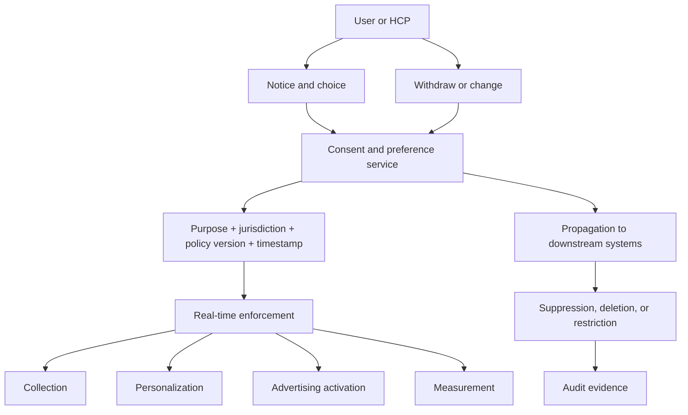

Consent should be granular by purpose, versioned, jurisdiction-aware, easy to withdraw, and propagated to caches, audiences, exports, and partners. “Consent = true” is not a sufficient data model.

### 20.6 Security essentials for the PM

- **Threat modeling:** identify assets, actors, trust boundaries, abuse cases, and controls before build.
- **Least privilege:** grant only needed access for the shortest practical time.
- **RBAC/ABAC:** role-based and attribute-based access controls.
- **Encryption:** protect data in transit and at rest; manage keys separately.
- **Tokenization:** replace sensitive value with a controlled token.
- **De-identification:** HIPAA Safe Harbor or Expert Determination where applicable; not the same as hashing.
- **Secrets management:** never embed keys in code or client apps.
- **Audit logging:** immutable enough to answer who accessed what, when, why, and what changed.
- **DLP:** detect and prevent inappropriate sensitive-data movement.
- **SAST/DAST/SCA:** static, dynamic, and dependency security testing.
- **SBOM:** software bill of materials for dependency visibility.
- **RTO/RPO:** recovery time and recovery point objectives.

### 20.7 Data governance operating model

Each critical field needs an owner, definition, source, allowed values, quality rule, lineage, permitted purpose, sensitivity, retention, and deletion behavior. Data contracts should fail loudly on incompatible change. A catalog no one uses is documentation theater; governance must be wired into pipelines, access, review, and incident response.

## 21. Pharma promotion, education, and safety operations

### 21.1 FDA promotional standard

FDA's Office of Prescription Drug Promotion oversees prescription-drug advertising and promotional labeling. Promotion must be truthful, balanced, and not misleading; communicate material facts; avoid unsupported claims; and present risk information appropriately. Internet and social-media promotion are within scope.

Common failures include:

- omitting or minimizing risk;
- overstating benefit;
- lack of fair balance;
- omitting material limitations;
- unsupported superiority claims;
- misleading presentation of study data;
- promoting an unapproved use or investigational product.

### 21.2 Promotion versus scientific exchange

Do not implement a “content type” dropdown and assume the distinction is solved. Purpose, audience, control, claims, funding, review, labeling, and distribution all matter. Unsolicited medical-information requests should follow approved medical-affairs workflows rather than marketing automation.

### 21.3 Adverse events and product complaints

FDA identifies four elements commonly used for a valid adverse-event case: identifiable patient, identifiable reporter, suspect product, and adverse event. Digital products need training, detection, routing, clock start, follow-up, privacy controls, and audit trails. Do not encourage teams to make clinical causality judgments in the intake UI.

Potential signals can appear in free text, survey responses, support tickets, chat, social interactions, virtual events, email replies, or AI conversations. Product requirements must specify which channels are monitored, who reviews, how quickly, and how false positives are handled.

### 21.4 Accredited education independence

Accredited education must be independent from commercial influence. Platform controls should preserve separation of educational design and commercial support, faculty disclosures and mitigation, fair balance, learner privacy, and only appropriate aggregate supporter reporting. Sponsored promotion and accredited education should not share recommendation logic in ways that compromise independence.

## 22. AI, machine learning, and responsible healthcare products

### 22.1 AI use-case spectrum

| Risk tier | Example | Required rigor |
|---|---|---|
| Low | Internal summarization of non-sensitive operational notes | Human review, confidentiality, accuracy checks |
| Medium | Content tagging, search ranking, audience propensity, anomaly detection | Bias/quality evaluation, monitoring, explainability, rollback |
| High | Clinician-facing evidence synthesis or decision support | Grounding, clinical safety, rigorous evaluation, transparency, human oversight |
| Potentially regulated | Diagnostic or treatment recommendation with medical intended use | Regulatory assessment, quality system, clinical evidence, postmarket controls |

### 22.2 Retrieval-augmented generation

RAG retrieves relevant documents and asks a model to answer using them. It can improve freshness and citation but does not eliminate hallucination. Failure can occur in ingestion, chunking, metadata, retrieval, ranking, context assembly, generation, citation, or UI interpretation.

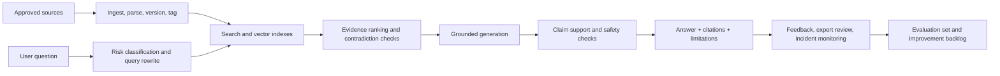

### 22.3 Evaluation matrix

| Dimension | Example metric |
|---|---|
| Retrieval | recall@k for required evidence; authority/freshness mix |
| Grounding | fraction of factual claims entailed by cited sources |
| Citation | citation precision, completeness, link correctness |
| Clinical safety | harmful recommendation/omission rate by risk tier |
| Calibration | confidence versus observed correctness; appropriate abstention |
| Fairness | performance across specialty, geography, demographics, rare conditions |
| Product | task success, time saved, repeat use, trust, escalation |
| Operations | latency, cost, availability, drift, incident rate |

### 22.4 HTI-1 algorithm transparency

HTI-1 established transparency requirements for predictive decision support interventions in certified health IT. Even if a product is outside the exact certification scope, the principle is useful: document purpose, intended users, inputs, output, validation, performance, limitations, fairness, monitoring, and update process.

### 22.5 Generative AI in MarTech

Good uses include draft briefs, taxonomy mapping, creative QA assistance, campaign explanation, anomaly summarization, and knowledge retrieval. High-risk uses include unreviewed pharma claims, autonomous sensitive-health targeting, invented performance explanations, and using customer data to train models without rights.

For every AI feature write:

```
Decision supported:
User and context:
Model and data:
Allowed inputs / prohibited inputs:
Human authority:
Failure impact:
Offline evaluation:
Production monitoring:
Explanation and appeal:
Rollback / kill switch:
Retention and training policy:
```

# Part IV - Operating as a rockstar Senior Technical PM

## 23. Strategy: choose the right problem and moat

### 23.1 Strategy kernel

1. **Diagnosis:** the specific obstacle or change that matters.
2. **Guiding policy:** the coherent approach to address it.
3. **Actions:** mutually reinforcing choices, not a feature wishlist.

Example:

- Diagnosis: HCP campaign teams receive cross-channel insight too late to change an active campaign, while identity confidence and customer workflows vary.
- Guiding policy: create a governed near-real-time signal-to-action layer with transparent eligibility and native integrations.
- Actions: canonical engagement taxonomy, identity confidence model, consent enforcement, explainable Smart Lists, CRM/DSP connectors, incrementality measurement, and customer migration tooling.

### 23.2 Moats in this ecosystem

Potential defensibility comes from trusted user relationships, authenticated HCP reach, proprietary and permitted first-party signals, endemic supply, workflow integration, education expertise, healthcare-specific taxonomy, measurement feedback, and operational/regulatory competence. “More AI” is not a moat if competitors can call the same model.

### 23.3 Build, buy, partner

Score each capability on strategic differentiation, healthcare specificity, data sensitivity, time to value, integration burden, switching cost, vendor concentration, regulatory exposure, and total cost. Build core differentiators and control planes; buy commodity infrastructure when it preserves leverage; partner where network effects or regulated expertise dominate.

## 24. Discovery in a regulated B2B2C environment

### 24.1 Multi-sided discovery

Interview operators, customers, and end users separately. A marketer may request a dashboard; the campaign operator may need fewer manual reconciliations; an HCP may need lower frequency; legal may need audit evidence; engineering may need a stable event contract.

Use an evidence table:

| Claim | Evidence | Confidence | Risk if wrong | Next test |
|---|---|---|---|---|
| Teams need NPI-level insight within 24h | 8/10 operator interviews; export logs | Medium | Build costly streaming path unnecessarily | Prototype daily vs hourly decision exercise |
| CRM activation increases useful follow-up | Two customer pilots | Low | Spam and compliance risk | Controlled pilot with holdout and complaint guardrail |

### 24.2 Problem brief

```
User and job:
Current workflow:
Pain and frequency:
Business impact:
Evidence:
Regulatory/trust constraints:
System dependencies:
Outcome metric and guardrails:
Smallest falsifiable test:
Decision date and owner:
```

### 24.3 Do not confuse requested solution with need

“Add an export button” may mean the API is missing, the dashboard cannot answer a question, the CRM connector is unreliable, or the user needs evidence for a client. Trace the downstream job before committing to UI.

## 25. Technical leadership without becoming the architect

### 25.1 Ask for four diagrams

1. Context diagram: actors and external systems.
2. Container/service diagram: major applications and data stores.
3. Sequence diagram: one critical request end to end.
4. Data lineage diagram: collection to activation, measurement, retention, and deletion.

### 25.2 Non-functional requirements

- Availability and graceful degradation.
- Latency percentiles, not only averages.
- Throughput and burst behavior.
- Data freshness and completeness.
- Recovery time and recovery point.
- Security, privacy, and audit.
- Accessibility and localization.
- Observability and supportability.
- Cost per request/event/profile/campaign.
- Migration and backward compatibility.

### 25.3 API review questions

- Is the API resource-oriented and semantically stable?
- Are pagination, filtering, sorting, and versioning explicit?
- Are retries safe and writes idempotent?
- Can clients distinguish validation, authorization, conflict, rate-limit, and server errors?
- Are timestamps UTC and semantics clear?
- Are enums forward-compatible?
- Are sensitive fields minimized and field-level access enforced?
- Are quotas and SLAs measurable?
- Can old and new clients coexist through migration?

### 25.4 Data contract example

```json
{
  "event_name": "hcp_content_engagement",
  "schema_version": "2.1",
  "event_id": "uuid",
  "occurred_at": "2026-07-14T14:31:22Z",
  "member_id": "internal-pseudonymous-id",
  "npi": "optional-controlled-field",
  "content_id": "asset-123",
  "content_class": "editorial|education|sponsored|promotional",
  "engagement_type": "view|complete|tool_use|save",
  "consent_policy_version": "us-hcp-2026-04",
  "source": "web|app|email",
  "trace_id": "distributed-trace-id"
}
```

Specify deduplication, late arrival, bot filtering, deletion, and whether NPI is present at collection or attached later in a controlled environment.

## 26. Metrics and decision systems

### 26.1 Metric stack

- **North-star outcome:** durable user/customer value created.
- **Input metrics:** behaviors the team can influence.
- **Quality metrics:** validity and experience.
- **Guardrails:** harms or constraints that must not worsen.
- **Operational metrics:** reliability, latency, freshness, cost.
- **Commercial metrics:** revenue, margin, retention, expansion.

Example for an HCP insight-to-action product:

```
Outcome: incremental qualified HCP action attributable to timely, relevant engagement
Inputs: eligible HCP coverage, signal freshness, list adoption, connector success
Quality: identity precision, explanation usefulness, duplicate rate
Guardrails: opt-out leakage, contact frequency, complaint rate, restricted-audience error
Operations: pipeline delay p95, export success, reconciliation error
Commercial: platform adoption, renewal, gross margin, attach rate
```

### 26.2 Metric definition template

```
Name:
Decision it supports:
Numerator:
Denominator:
Eligibility and exclusions:
Entity and grain:
Time window and timezone:
Source of truth:
Latency/freshness:
Known bias:
Owner:
Change-control process:
```

### 26.3 Dashboard review

Start with decisions, not charts. Every dashboard tile should answer: who acts, when, under what threshold, and what drill-down explains the change? Include data freshness, definition links, confidence intervals, and quality warnings. Avoid mixing estimated, attributed, and causal outcomes without labels.

## 27. Delivery, reliability, and incident management

### 27.1 Slice vertically

A thin end-to-end slice for a new HCP signal might include one source event, deterministic identity, one eligibility rule, one reviewable list, one connector, and one outcome event. This tests the real system earlier than building a generalized segmentation engine before activation.

### 27.2 Release controls

- Feature flags and staged rollout.
- Shadow mode for new models/rules.
- Canary by customer, publisher, or traffic percentage.
- Synthetic monitoring and reconciliation.
- Backward-compatible schemas.
- Kill switch with named authority.
- Rollback and data repair plan.
- Customer communication and support readiness.

### 27.3 Incident severity

Severity should consider user harm, privacy/regulatory exposure, clinical risk, revenue/billing impact, customer count, duration, and reversibility. A low-traffic PHI leak can be more severe than a high-traffic reporting delay.

Incident questions:

1. What changed?
2. What is the blast radius?
3. Is the system still causing harm?
4. What safe containment is available?
5. Which evidence must be preserved?
6. Who has notification authority?
7. How will affected data, billing, and customer reports be corrected?

### 27.4 Post-incident review

Focus on system conditions, not blame. Separate root trigger, contributing factors, detection gap, response gap, and recovery gap. Assign preventive actions with evidence of completion. “Remind team to be careful” is not a control.

## 28. Stakeholder leadership

### 28.1 Stakeholder map

Expect relationships with engineering, data science, analytics, design, editorial, medical, education/accreditation, legal, privacy, security, regulatory, ad operations, sales, customer success, finance, partnerships, publishers, agencies, life-sciences clients, health systems, and health plans.

For each stakeholder document goals, decisions owned, inputs needed, incentives, vocabulary, cadence, and escalation path.

### 28.2 Decision memo

```
Decision and deadline:
Recommendation:
User/customer problem:
Evidence:
Options considered:
Trade-offs:
Privacy/clinical/regulatory/security review:
Metrics and guardrails:
Reversibility:
Owner and approvers:
Open risks:
```

### 28.3 Executive communication

Lead with decision and consequence. Replace “engineering is delayed” with “the NPI feed migration creates a two-week risk to audience refresh; we recommend a parallel-run and reconciliation gate, preserving launch date at one sprint of duplicate processing cost.”

### 28.4 Earn trust quickly

- Learn operators' real workflow before proposing re-platforming.
- Distinguish facts, assumptions, and hypotheses.
- Close loops in writing.
- Make invisible reliability and governance work visible.
- Give credit and absorb ambiguity.
- Escalate early with options.
- Never bluff on medical, privacy, or regulatory interpretation.

## 29. Worked product cases

### Case 1: Near-real-time HCP intent activation

**Prompt:** A pharma customer wants sales representatives notified when target oncologists show increased digital engagement.

**Product framing:** The job is not “send alerts.” It is to create timely, explainable, appropriately governed signals that improve the relevance of approved follow-up.

**Design:**

- ingest approved authenticated and media engagement events;
- normalize to a canonical taxonomy;
- resolve to NPI using deterministic evidence;
- apply target-list, specialty, geography, consent, frequency, and contract rules;
- compute an explainable score using time decay and signal diversity;
- require minimum evidence and suppress ambiguous/shared-device activity;
- present reason codes and freshness to an operator;
- export approved records to CRM;
- log rep action and outcome;
- measure incremental value with a randomized eligible holdout where feasible.

**Guardrails:** no patient identity, no diagnosis leakage, no off-label trigger, no autonomous message generation, revocation propagation, restricted specialties, minimum cell size, audit.

**Failure modes:** false NPI match; bot event spike; data delay interpreted as disinterest; duplicate CRM tasks; model favors high-volume digital users; rep contacts exceed frequency policy.

### Case 2: Endemic SSP deal health

**Prompt:** A curated HCP private marketplace is underdelivering.

**Diagnostic funnel:** eligible ad opportunities -> deal match -> bid requests -> bids -> floor-qualified bids -> wins -> renders -> viewable impressions.

Check:

- deal ID mismatch or seat not authorized;
- audience match rate and consent loss;
- geo, specialty, device, format, or frequency constraints;
- bid floor versus market price;
- DSP timeout or creative rejection;
- ads.txt/sellers.json/schain authorization;
- forecast assumptions and competing priority;
- discrepancy between SSP, ad server, and DSP counting.

Recommendation should identify the binding constraint. Lowering the floor will not solve an identity-match failure.

### Case 3: Medscape AI treatment comparison

**Prompt:** Improve answers comparing treatment options.

**Requirements:** approved evidence hierarchy, recency metadata, indication and population awareness, direct claim-to-citation mapping, explicit uncertainty, no patient-specific diagnosis, source conflict handling, specialty review, red-team set, and abstention when evidence is insufficient.

**Metrics:** retrieval recall, unsupported-claim rate, citation precision, omission of material safety information, expert rating, user task success, and escalation rate. Do not optimize thumbs-up alone.

### Case 4: Health-system campaign to appointment

**Prompt:** Increase cardiology appointments for a regional health system.

**System:** audience/media -> landing experience -> provider/service directory -> scheduling/call center -> appointment -> attended visit -> contribution margin.

**PM contribution:** join marketing and operational truth. Add capacity-aware routing, location/travel constraints, insurance acceptance, next-available appointment, call-center fallback, source capture, and reconciliation. Optimize incremental attended appointments, not clicks or form starts.

**Guardrails:** equitable access, no sensitive inference without permission, reasonable frequency, accessible content, no promotion beyond capacity.

### Case 5: Privacy-safe measurement clean room

**Prompt:** Demonstrate campaign impact using publisher exposure and advertiser outcome data.

**Design:** scoped pseudonymous IDs, documented legal basis, approved join, minimum aggregation threshold, restricted queries, no row-level export, analyst roles, audit logs, retention/deletion, and a pre-registered analysis plan. Separate descriptive match, attributed outcome, and incremental lift.

### Case 6: NPPES Version 2 migration

**Prompt:** Update provider identity ingestion after CMS retires Version 1 downloadable files.

**Plan:** inventory consumers; compare schemas and field lengths; update parser and contracts; dual-run old/new where data remains available; quantify row, key, specialty, address, endpoint, and deactivation differences; backfill golden records; monitor match rate and collision changes; version outputs; communicate downstream changes. Do not treat NPI presence as credential verification.

## 30. Your first 30/60/90 days

### Days 1-30: understand and make work visible

- Complete the two-week study sprint in Appendix A.
- Build a one-page portfolio and stakeholder map using internal truth.
- Shadow ad operations, customer success, editorial/education, data, and engineering workflows.
- Trace one campaign and one clinician experience end to end.
- Write the canonical metric definitions for your area.
- Review top incidents, customer escalations, privacy findings, and roadmap commitments.
- Identify one reversible friction fix and one systemic opportunity.

Deliverables: system context map, decision log, glossary delta, metric tree, risk register, and learning memo.

### Days 31-60: improve a real decision loop

- Validate top problem with users/operators and data.
- Define target outcome and guardrails.
- Align architecture, data contract, review path, and experiment design.
- Deliver a thin end-to-end slice or remove a high-frequency operational failure.
- Establish weekly health review with leading indicators.

Deliverables: approved problem brief, solution options memo, experiment/release plan, data-flow review, and launch checklist.

### Days 61-90: scale and set direction

- Ship or pilot a measurable improvement.
- Quantify causal or decision-relevant value.
- Convert learning into a strategy and sequenced roadmap.
- Define build/buy/partner position and platform boundaries.
- Improve one organizational mechanism: intake, metric governance, incident learning, or customer feedback.

Deliverables: outcome review, strategy kernel, 2-3-quarter roadmap, dependency plan, and executive narrative.

# Part V - Advanced technical workshops

## 31. Workshop: design an SSP capability end to end

### 31.1 Product brief

Assume a healthcare publisher network needs a supply platform for endemic display and video inventory. Buyers require private deals, NPI-addressable HCP campaigns where permitted, contextual packages, transparent supply paths, and outcome measurement. Publishers require yield, advertiser quality, latency control, and trustworthy reconciliation.

Start with non-goals: do not create a universal patient identity, accept arbitrary diagnosis data in auctions, or promise every buyer deterministic HCP matching. Keep user consent, inventory eligibility, and publisher policy ahead of monetization.

### 31.2 Domain objects

| Object | Minimum fields | Product owner concern |
|---|---|---|
| Publisher | account, domain/app, owner, manager, contract, payment | authorization and commercial truth |
| Property | site/app, geography, content class, privacy configuration | correct context and jurisdiction |
| Placement | format, size, ad unit, floor, refresh, page rules | UX, revenue, and render behavior |
| Supply package | properties, context, audience capability, quality tier | consistent buyer promise |
| Deal | buyer seat, ID, price, priority, dates, targeting, volume | delivery and troubleshooting |
| Auction | request, bidders, bids, winner, price, timing, rule versions | determinism and audit |
| Creative | advertiser, domain, asset, category, approval, scan state | safety and policy |
| Financial event | billable event, gross, fees, publisher share, currency | reconciliation and margin |

### 31.3 Auction decision order

1. Validate publisher, property, placement, and request authenticity.
2. Resolve jurisdiction and privacy signal.
3. Remove ineligible data and identity fields.
4. Apply publisher blocks, content suitability, and format rules.
5. Determine eligible direct, guaranteed, preferred, PMP, and open demand.
6. Construct partner-specific requests with timeout budgets.
7. Validate bids, deals, price, advertiser domain, creative, and policy.
8. Apply auction and priority rules.
9. Return winner or no-fill before deadline.
10. Record decision, render, billing, and notification events.

### 31.4 Latency budget example

For a 250 ms total auction budget:

| Component | Budget |
|---|---:|
| Request validation and consent | 15 ms |
| Identity/context enrichment | 20 ms |
| Partner selection and serialization | 10 ms |
| Network/DSP bidding | 150 ms |
| Bid validation and auction | 20 ms |
| Response and safety margin | 35 ms |

Budgets are service-level targets, not guarantees. Track p50, p95, and p99 by path. A single global timeout hides partner and geography problems. Use deadline propagation so downstream services know remaining time.

### 31.5 No-bid and loss reason taxonomy

Create stable reason codes: privacy ineligible, identity unavailable, audience miss, geo miss, frequency capped, budget exhausted, pacing, below floor, deal mismatch, creative rejected, timeout, duplicate auction, supply unauthorized, model below threshold, internal error. Reason codes make optimization explainable and support discrepancy debugging.

### 31.6 Reconciliation

Reconcile at request, bid, win, impression, click, conversion, and financial layers. Define expected tolerance and ownership. Differences can arise from counting location, time zones, invalid-traffic filtering, cache behavior, loss notices, currency conversion, or late events. The product should show gross versus filtered counts and when each system finalized data.

### 31.7 Design review drill

Answer in writing:

- What happens if the CMP is unavailable?
- Can an old deal configuration remain in cache after revocation?
- How is a malicious creative blocked after it passed initial scan?
- Can two auctions bill the same impression?
- How do you prove an ad was sold by an authorized path?
- Which logs contain identifiers, and how are they retained?
- How does the system degrade when identity is absent?

## 32. Workshop: build an HCP engagement analytics product

### 32.1 North-star job

Help an authorized user understand how eligible HCPs engage across channels and decide the next appropriate action. This is not merely a dashboard; it is an identity, event, policy, explanation, and workflow product.

### 32.2 Canonical event model

Events should identify what happened without embedding presentation-specific language. Examples:

- `content_viewed`, with content class, taxonomy, and qualified-view threshold;
- `video_progressed`, with quartile and duration;
- `search_performed`, with governed query classification rather than unrestricted raw text;
- `email_engaged`, separating delivered, opened, and clicked with privacy caveats;
- `media_exposed`, with campaign, tactic, creative, and viewability state;
- `crm_action_recorded`, with approved action type and outcome;
- `rx_outcome_observed`, using governed de-identified data and maturity date.

### 32.3 Scoring example

A transparent score can start as:

`score = sum(signal weight x recency decay x quality factor x identity confidence)`

Example weights: qualified article view 1, video completion 3, clinical-tool use 4, approved branded-site depth event 3, repeated diverse-channel engagement 2. Apply exponential time decay and cap repeated identical events. The score should support ranking, not pretend to represent clinical intent with certainty.

### 32.4 Explanation

Show reason codes such as “three qualified oncology education engagements in 14 days across two channels; deterministic NPI match; most recent 2 days ago.” Hide sensitive raw URLs and unsupported inference. Let operators inspect source class, freshness, and confidence. Provide a way to report a wrong identity or irrelevant signal.

### 32.5 Product quality measures

- event completeness and duplicate rate;
- time from event to insight;
- deterministic identity coverage and precision audit;
- list acceptance, removal, and explanation-use rate;
- CRM export success and duplicate-task rate;
- opt-out/suppression leakage;
- incremental qualified action versus holdout;
- customer decision time saved;
- complaint and inappropriate-contact rate.

### 32.6 Backfill and correction

If identity improves later, decide whether historical events may be attached to the newly resolved HCP. If a source event is corrected or deleted, derived scores, lists, exports, and reports may require recomputation. Record lineage from insight to underlying events and model/rule version.

## 33. Workshop: healthcare event pipelines and data quality

### 33.1 Batch, stream, and serving layers

- **Stream:** low-latency events for monitoring, frequency, activation, and fresh insight.
- **Batch:** complete recomputation, claims maturity, reconciliation, and cost-efficient aggregation.
- **Serving:** APIs, feature stores, dashboards, and exports optimized for user queries.

Use a lakehouse or warehouse as analytical truth, but do not force an auction or clinical workflow to wait for an analytical query. Separate operational and analytical stores with reconciled contracts.

### 33.2 Delivery semantics

- **At-most-once:** may lose events but avoids duplicates.
- **At-least-once:** retries can duplicate; consumer must deduplicate.
- **Exactly-once effect:** business outcome applied once using idempotency and transactional design; marketing language often overstates infrastructure guarantees.

Use a globally unique event ID, source sequence where available, occurrence and ingestion timestamps, schema version, and idempotency key. Define a lateness window and backfill policy.

### 33.3 Data quality dimensions

| Dimension | Example rule |
|---|---|
| Completeness | 99.5% of eligible media exposures have campaign and placement IDs |
| Validity | NPI is ten digits and passes check-digit validation where applied |
| Uniqueness | one canonical event per event ID |
| Consistency | content class agrees across CMS and event payload |
| Timeliness | 95% of HCP engagement arrives within 30 minutes |
| Accuracy | sampled identity links meet precision threshold |
| Referential integrity | campaign, creative, deal, and publisher keys resolve |

### 33.4 Observability

Monitor volume, lag, null rate, distribution, cardinality, schema rejection, duplicate rate, dead-letter queue, consent-suppression rate, and downstream freshness. Compare against day-of-week and campaign baselines. An alert should name the decision at risk, not simply “row count low.”

### 33.5 Schema evolution

Add optional fields before requiring them. Never repurpose an existing field. Version incompatible semantics. Support producer/consumer compatibility tests. Track who consumes each field before removal. A field called `specialty` may mean declared primary specialty in one system and claims-derived taxonomy in another; names alone do not create compatibility.

## 34. Workshop: privacy engineering for health marketing

### 34.1 Start with purpose

Draw a purpose matrix before a data map:

| Data | Product operation | Personalization | Advertising | Measurement | Research |
|---|---:|---:|---:|---:|---:|
| Account specialty | required | possible | conditional | possible | conditional |
| Raw health query | avoid/minimize | high risk | prohibited by default | aggregate | controlled |
| NPI engagement | possible | possible | contract/consent dependent | conditional | controlled |
| Patient portal event | required operation | HIPAA context | generally not ad activation | limited/BAA | approved protocol |

Replace the words “possible” and “conditional” with verified internal rules by jurisdiction and business context.

### 34.2 Collection minimization

- collect a taxonomy code instead of full sensitive query where sufficient;
- remove query strings and fragments from page URLs;
- separate direct identifiers from event stores;
- use server-side allowlists for analytics fields;
- prevent arbitrary custom properties in regulated surfaces;
- scan logs and error traces for accidental PHI/PII;
- make test environments reject production identifiers.

### 34.3 Revocation propagation

Model revocation as an event with subject, purposes, jurisdiction, policy version, effective time, and source. Propagate to collection eligibility, profile traits, active segments, cached lists, exports, partner suppressions, model-training eligibility, and future measurement. Track acknowledgments and exceptions. A preference center that updates only the UI is a false control.

### 34.4 Re-identification risk

Aggregation does not guarantee anonymity. Rare specialties, small geographies, precise timestamps, and unusual conditions can identify people by combination. Apply minimum counts, time bucketing, geography coarsening, query controls, and review. For formal de-identification, use the applicable expert or legal process.

### 34.5 Privacy threat model

Consider honest mistakes, curious insiders, compromised credentials, malicious partners, model memorization, data linkage, browser leakage, and customer misuse. Controls include least privilege, purpose-bound tokens, field-level encryption, audit analytics, output suppression, contractual restrictions, clean rooms, red-team testing, and termination procedures.

## 35. Workshop: causal measurement for an omnichannel HCP campaign

### 35.1 Estimand first

State what effect you want:

- intention-to-treat effect of assignment to the campaign;
- effect of actual exposure among compliers;
- incremental new-prescriber rate among eligible target HCPs;
- incremental prescriptions per exposed practice;
- incremental qualified digital action within 30 days.

Changing the estimand after seeing results is analytical bias.

### 35.2 Randomization options

- HCP-level holdout: strongest if spillover and customer constraints allow.
- Practice or geography cluster: reduces contamination but needs more units.
- Staggered rollout: useful operationally; analysis must handle time trends.
- Ghost ads or PSA control: can estimate opportunity-level effects with platform support.

### 35.3 Sources of bias

Exposure is selected by online availability, identity match, auction win, and engagement. Exposed HCPs may differ systematically from unexposed. Sales activity, formulary change, seasonality, competitor launch, and clinical news can confound outcomes. Matching balances observed variables only.

### 35.4 Analysis checklist

- pre-period balance and outcome trend;
- randomization integrity and sample ratio mismatch;
- identity and outcome match coverage by arm;
- contamination and cross-device exposure;
- claims/Rx maturity and washout;
- outlier and sparse-cell handling;
- confidence interval and practical effect;
- multiple comparison correction where needed;
- sensitivity to definitions and exclusions;
- cost per incremental outcome.

### 35.5 Decision example

Treatment new-prescriber rate is 6.2%; control is 5.4%. Absolute lift is 0.8 percentage points and relative lift is 14.8%. If 10,000 HCPs were assigned to treatment, estimated incremental new prescribers are 80 before noncompliance adjustments. At $800,000 campaign cost, cost per incremental new prescriber is $10,000. The decision depends on uncertainty, expected lifetime value, clinical/commercial context, and whether other outcomes improved.

## 36. Workshop: compliant content and creative platform

### 36.1 Content graph

Model claims, evidence, risks, indications, audiences, assets, channels, approvals, and references as linked objects. One approved asset may contain several claims; one claim may require a paired risk statement and approved evidence. This enables impact analysis when labeling or evidence changes.

### 36.2 Approval state machine

`draft -> in medical review -> in legal review -> in regulatory review -> approved -> scheduled -> live -> paused -> expired/withdrawn`

Transitions require named roles. Rejection returns to a new version. Live assets are immutable. Emergency withdrawal bypasses normal scheduling but preserves authority and reason.

### 36.3 Omnichannel derivation

An approved core claim does not mean the same wording works in banner, native, email, video, social, or sales aid. Each channel has space, interaction, and risk-presentation constraints. Store channel-specific approvals and do not auto-crop away required risk or disclosure content.

### 36.4 Content provenance

For every rendered component record asset ID, source, checksum, approval, rule version, template version, locale, audience rule, render time, and destination. This supports audits and rapid withdrawal. Screenshots alone are insufficient for dynamic experiences.

### 36.5 Accessibility

Require semantic headings, keyboard operation, visible focus, sufficient contrast, captions, transcripts, alt text, readable risk information, reduced motion, and screen-reader testing. Accessibility is user safety and reach, not a post-launch polish task.

## 37. Workshop: evaluate Medscape-style clinical AI

### 37.1 Build a representative evaluation set

Stratify by specialty, common and rare conditions, question type, urgency, ambiguity, evidence conflict, changing guidance, medication, diagnosis, treatment comparison, contraindication, and non-clinical request. Include adversarial prompts, requests containing PHI, prompt injection in retrieved content, and questions where abstention is correct.

### 37.2 Claim-level evaluation

Split answers into atomic factual claims. For each claim record whether it is supported, contradicted, unverifiable, outdated, or outside scope. Check whether the citation directly supports the claim and whether material safety context is missing. Overall answer ratings can hide one dangerous unsupported sentence.

### 37.3 Golden and dynamic sets

- Golden set: stable expert-reviewed cases for regression.
- Freshness set: current news, approvals, recalls, and guidelines updated frequently.
- Incident set: every material production failure becomes a permanent regression test.
- Slice set: specialties, geographies, professions, and rare-condition cases.

### 37.4 Human review

Use blinded, calibrated clinical reviewers with a rubric and adjudication. Measure inter-rater agreement. Separate medical correctness from writing preference. Reviewers should see retrieved evidence and timestamps where the product user would.

### 37.5 Production controls

- approved source allowlist and content-version registry;
- retrieval freshness and broken-link monitoring;
- prompt and output filtering without storing unnecessary PHI;
- confidence/abstention policy by risk tier;
- model and prompt version logging;
- canary and shadow evaluation;
- user feedback with safety escalation;
- rapid rollback and source removal;
- cost and latency budgets that do not encourage unsafe truncation.

### 37.6 Launch gate

Do not launch because average expert score exceeds a threshold. Require zero unresolved critical harms in the release set, slice-level minimums, citation and grounding targets, tested refusal behavior, privacy/security approval, incident runbook, and named clinical accountability.

## 38. Workshop: commercial and unit economics

### 38.1 Revenue models

- media spend and platform take rate;
- SaaS/platform subscription;
- data or audience fee;
- measurement fee;
- custom sponsorship or content program;
- professional services;
- outcomes- or performance-linked pricing.

Clarify whether reported revenue is gross or net. Principal-versus-agent accounting and contract terms matter. A campaign with impressive gross spend can have weak contribution margin after publisher cost, data, verification, cloud, service labor, makegoods, and sales commission.

### 38.2 Contribution model

```
Net revenue
- publisher/media cost
- third-party data and identity
- verification and measurement
- variable cloud/serving cost
- campaign operations and support labor
- credits and makegoods
= contribution margin
```

### 38.3 SaaS metrics

Track annual recurring revenue, gross retention, net revenue retention, expansion, logo churn, implementation time, active users, workflow adoption, support burden, gross margin, and cost to serve. For a hybrid managed-service/platform business, distinguish software adoption from human-delivered output.

### 38.4 Forecasting

Forecast programmatic revenue from eligible requests, match/target rate, bid rate, win/fill, net CPM, seasonality, and publisher share. Forecast outcome products from addressable customers, attach rate, study eligibility, data maturity, and analysis capacity. Show ranges and binding constraints rather than one precise point estimate.

## 39. Workshop: product sense and system-design drills

Practice these aloud in 15 minutes each. Start with user and trust constraints, draw the system, define success, then discuss trade-offs.

1. Design an HCP frequency-management service across endemic, non-endemic, email, and CRM channels.
2. Create a self-service private-marketplace deal debugger for an agency trader.
3. Improve completion of a 30-minute CME activity without compromising learning integrity.
4. Design a privacy-safe contextual audience for a rare-disease campaign.
5. Detect a sudden fall in NPI match rate after a provider-data release.
6. Build a provider-directory freshness score for a health-system campaign.
7. Add citations and freshness indicators to a clinical AI answer.
8. Design an adverse-event intake and routing capability for digital campaigns.
9. Measure whether omnichannel HCP engagement changes prescribing behavior.
10. Reduce page latency while preserving publisher revenue.
11. Migrate a campaign platform from third-party cookie dependence.
12. Build a customer-facing data-quality scorecard.
13. Design consent revocation across CDP, DSP, CRM, and warehouse.
14. Create a capacity-aware cardiology acquisition campaign.
15. Investigate why SSP and DSP billable impressions differ by 12%.
16. Create a launch process for a generative-AI campaign assistant.
17. Design role-based access for agency, advertiser, and internal operators.
18. Prevent dynamic creative from producing an unapproved claim-risk combination.
19. Explain the difference between NPI-level engagement and patient-level clinical data.
20. Prioritize between identity coverage, signal freshness, and measurement depth.

## 40. Workshop: the weekly operating cadence

### Monday - outcome and risk review

Review metric movement, data freshness, incidents, customer commitments, regulatory/approval dependencies, and decisions due. Ask which number is least trustworthy. Assign investigation owners, not vague “monitoring.”

### Tuesday - discovery and technical depth

Observe users or operators, inspect one event/log/API, and review architecture or model behavior. Maintain a running list of contradictions between documented and actual workflow.

### Wednesday - product trio and partner alignment

PM, design, and engineering refine options with data/privacy/medical partners as needed. Convert constraints into acceptance criteria. Resolve the hardest decision before polishing the easiest screen.

### Thursday - delivery and launch readiness

Review vertical slices, quality, observability, rollout, training, and customer impact. Confirm who can stop launch. Test failure and rollback, not only happy path.

### Friday - synthesis and communication

Publish a short memo: outcomes, decisions, learning, risks, and next week. Update decision log and metric definitions. Thank contributors explicitly. Reserve time to learn one domain concept deeply.

### Monthly health review

Use six pages at most: user outcome, customer/commercial outcome, platform health, trust/safety, delivery/learning, and decisions requested. Include trends and uncertainty. Do not hide a red guardrail behind green aggregate engagement.

# Part VI - The Medscape commercial product innovation role

This section maps directly to the responsibilities described in Medscape Senior Technical Product Manager Job ID 2025-9860. It turns the job description into systems, artifacts, acceptance criteria, metrics, and first-week questions. The public job description emphasizes commercial product innovation, marketing orchestration, integrations, platform tooling, AI-enabled personalization, enterprise pilots, and collaboration across Engineering, Architecture, Data Science, Education/CME, Medical Affairs, Sales, Product Marketing, Legal, and Editorial/Clinical teams.

## 41. The role scorecard: what excellent performance looks like

### 41.1 The mission in one sentence

Create scalable platform and commercial capabilities that help Medscape and its institutional and life-sciences partners engage the right healthcare professional with the next appropriate experience, through governed data, reusable integrations, automation, and measurable AI-assisted decisioning.

### 41.2 Job-description-to-product map

| Job responsibility | Product system behind it | Evidence of excellent execution |
|---|---|---|
| Uncover stakeholder and client needs | Discovery repository, workflow maps, opportunity scoring | Prioritized problems supported by behavior, interviews, and commercial evidence |
| Run POCs and pilots | Stage-gated experimentation and pilot operations | Explicit hypotheses, technical feasibility, adoption evidence, and stop/scale decision |
| Build scalable features and integrations | APIs, data contracts, connectors, platform tools, SLOs | Shorter integration time, fewer exceptions, reusable patterns, lower support load |
| Define AI/ML components | Training data, features, outputs, evaluation, deployment, monitoring | Slice-level model quality, useful lift, explainability, rollback, and governance |
| Drive commercial adoption | Packaging, positioning, enablement, onboarding, usage telemetry | Activated customers, recurring workflow use, expansion, attributable revenue |
| Deliver roadmap outcomes | Strategy, sequencing, dependency and risk management | Milestones met without sacrificing trust, quality, or business outcome |

### 41.3 The five simultaneous roles

1. **Customer translator:** turn client language into a generalizable job, not a one-off request.
2. **Technical contract owner:** make APIs, events, identities, models, and failure behavior explicit.
3. **Commercial product builder:** connect user value to package, price, sales motion, adoption, and margin.
4. **Decision-system designer:** create rules and models that choose a next action under constraints.
5. **Individual-contributor leader:** create alignment through evidence, clarity, and operating mechanisms rather than reporting authority.

The “mini CEO” metaphor is useful only if paired with accountability. You do not own every decision. Engineering owns engineering quality, Medical and Clinical teams own relevant medical judgment, Legal/Privacy/Regulatory teams own interpretations in their domains, and Sales owns customer relationships. The PM owns coherent outcomes and makes sure no required decision is orphaned.

### 41.4 Balanced role scorecard

| Dimension | Leading indicator | Outcome indicator | Guardrail |
|---|---|---|---|
| Delivery | decisions resolved, dependency readiness | roadmap milestone and launch completion | escaped defects, rework |
| Commercial | qualified design partners, enabled sellers | new revenue, upsell, renewal influence | discounting, services burden, margin |
| Adoption | activated accounts, setup completion | weekly active operators, recurring campaign usage | abandonment, support tickets |
| Activation | eligible audience, trigger coverage | qualified next action and conversion lift | frequency, opt-outs, complaints |
| Integration | sandbox success, certification completion | median time to first value | failure rate, custom forks |
| Automation | assisted tasks and acceptance | hours saved, cycle-time reduction | correction rate, hidden manual work |
| AI/ML | offline quality and pilot exposure | incremental lift from model-assisted workflow | bias, unsafe action, drift |
| Trust | reviews completed, lineage coverage | zero material policy/privacy incidents | suppression leakage, audit gaps |

## 42. NBE and NBA journey systems

### 42.1 Definitions

**Next Best Experience (NBE)** selects the most appropriate experience for an eligible person or account: education, clinical content, event invitation, survey, tool, message, or no action. **Next Best Action (NBA)** selects an operational action: add to a journey, recommend content, notify an account team, request human review, change channel, or suppress contact.

“No action” must be a first-class option. A system that always chooses an experience becomes a contact-maximization engine rather than a relevance engine.

### 42.2 Journey domains in this role

- **Education/CME:** recommend an independent activity based on professional need and eligibility while preserving educational independence.
- **Live events:** invite, register, remind, attend, follow up, and collect outcomes for virtual or in-person programs.
- **Medical Affairs:** support appropriate scientific-exchange and medical-information workflows, distinct from promotion.
- **Commercial activation:** deliver approved sponsored or promotional experiences under audience, indication, frequency, and channel constraints.
- **Institutional engagement:** coordinate organization-level and individual-level journeys for health systems, societies, or other partners.

These domains must not be collapsed into one unconstrained ranking pool. Content class, purpose, sponsor, audience, accreditation, and medical/commercial boundaries determine what can compete for a next-best slot.

### 42.3 Reference architecture

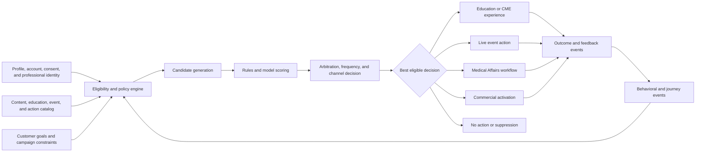

### 42.4 Candidate generation

The system should not score every possible experience. First generate eligible candidates using hard constraints:

- professional type, specialty, geography, and organization;
- content class and purpose;
- campaign, supporter, or partner contract;
- indication and audience appropriateness;
- activity availability, expiration, and capacity;
- consent, opt-out, channel preference, and jurisdiction;
- prior completion, attendance, or exposure;
- frequency and sequence rules;
- medical, legal, regulatory, editorial, and accreditation state.

Candidate generation is a policy system. Ranking is an optimization system. Never ask a model to learn hard compliance boundaries from historical data.

### 42.5 Decision policy example

```
Journey: Oncology education and engagement
Entity: verified U.S. oncology HCP
Trigger: qualified guideline-content engagement within 14 days
Candidate set: active independent education, approved live event, approved commercial content
Hard exclusions: opt-out, wrong profession/specialty, activity completed, expired approval,
                 frequency cap, restricted geography, incompatible content class
Score inputs: declared interest, recency, content affinity, journey stage, channel availability
Arbitration: education independence rules first; then user value; then customer objective
Output: experience_id, action, channel, reason codes, expiry, confidence, policy version
Fallback: generic specialty experience or no action
```

### 42.6 State machine

A journey state should be explicit: `eligible -> entered -> offered -> engaged -> completed -> follow-up eligible -> exited`, with branches for declined, unreachable, suppressed, expired, and error. Events must be idempotent. A late event should not send a user backward or repeat an invitation.

### 42.7 Arbitration across journeys

An HCP may simultaneously qualify for multiple journeys. Arbitration considers urgency, user value, content independence, campaign priority, contractual obligation, channel capacity, predicted utility, fatigue, and diversity. Use global frequency management rather than campaign-local caps only.

### 42.8 NBE/NBA metrics

| Layer | Metric |
|---|---|
| Eligibility | eligible population, candidate coverage, suppression rate |
| Decision | no-action rate, reason-code distribution, model confidence, decision latency |
| Delivery | activation success, channel availability, time from trigger to experience |
| User | qualified engagement, completion, relevance feedback, fatigue/opt-out |
| Business | incremental conversion, event attendance, learning outcome, revenue/upsell |
| Model | precision at k, calibration, coverage, diversity, slice performance, drift |
| Operations | manual overrides, failed journeys, duplicate actions, support effort |

### 42.9 Failure modes

- a promotional objective overrides education independence;
- stale profile attributes route an HCP into the wrong specialty journey;
- each channel respects its own cap but total contact is excessive;
- an event reaches capacity after recommendation but before registration;
- delayed completion event triggers a duplicate reminder;
- the model learns that aggressive contact predicts clicks because the historical system over-contacted likely responders;
- revenue priority becomes a hidden feature with no user-value guardrail;
- medical-affairs action is treated as a sales lead without an approved boundary.

## 43. CDP rollout and campaign activation

### 43.1 A CDP is a capability program, not a database purchase

The role description specifically calls out rollout of CDP and activation features. Success requires a target operating model across collection, identity, profile, segmentation, orchestration, destination connectors, measurement, governance, and user adoption.

### 43.2 Capability layers

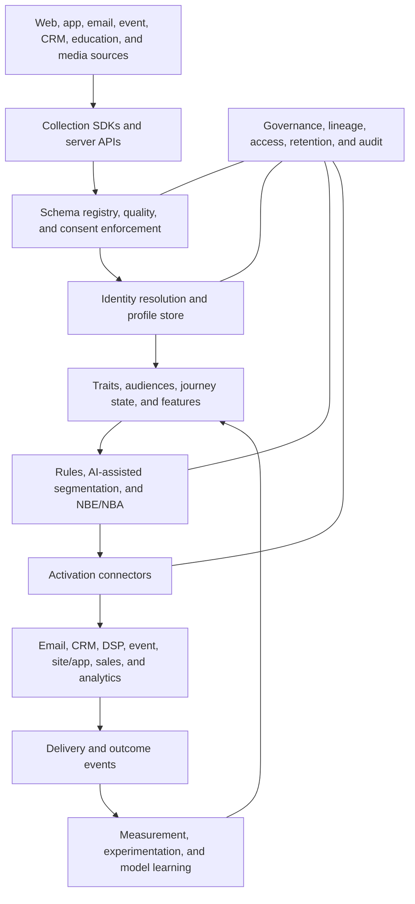

### 43.3 Rollout phases

**Phase 0 - decision and scope:** define the business workflows the CDP must improve, critical entities, destinations, latency, privacy boundary, and build/buy assumptions.

**Phase 1 - foundation:** establish canonical events, identity, consent, profile schema, source-of-truth ownership, and one non-critical destination.

**Phase 2 - activation MVP:** support one high-value segment, one journey, one connector, one measurement loop, and operator review.

**Phase 3 - scale:** add self-service audiences, reusable templates, additional destinations, SLOs, cost controls, and migration tooling.

**Phase 4 - intelligence:** introduce AI-assisted segmentation, recommendations, anomaly detection, and causal optimization only after data and operational quality are credible.

### 43.4 Source onboarding contract

For every source specify owner, entity, event schema, identity keys, consent context, expected volume, latency, replay behavior, retention, data-quality SLO, and incident contact. Require test fixtures and a compatibility check before production.

### 43.5 Identity priority

For HCP journeys, a possible hierarchy is authenticated member ID -> verified deterministic NPI link -> verified email-based link -> controlled probabilistic link where appropriate -> anonymous session. The allowed activation and reporting become more restrictive as confidence falls. Do not coerce every anonymous event into a named profile.

### 43.6 Segment builder product

An enterprise-grade segment builder needs:

- clear attribute provenance and freshness;
- nested AND/OR logic with understandable precedence;
- estimated and realized audience counts;
- inclusion and exclusion explanations;
- consent and policy filters applied automatically;
- versioning, approval, schedule, owner, and expiry;
- overlap and frequency analysis;
- destination compatibility;
- preview using safe sampled or aggregate data;
- audit history and rollback.

### 43.7 AI-assisted segmentation

Useful assistance includes translating a plain-language goal into a draft rule, suggesting relevant approved attributes, identifying unexpectedly small/large audiences, explaining overlap, and recommending a test. The system should show the generated logic before activation and require human approval. It must not invent unavailable fields, infer prohibited health attributes, or silently broaden eligibility to hit a reach target.

### 43.8 Migration risks

- old and new identity graphs produce different counts;
- historical segments contain undocumented logic;
- destination IDs are not portable;
- event names are reused with new semantics;
- consent state is copied without policy version;
- teams recreate old manual workflows inside a new tool;
- customer reports change without a reconciliation period;
- platform usage costs grow faster than business value.

### 43.9 CDP acceptance scorecard

```
Profile completeness and identity precision
Consent and deletion propagation
Event freshness p50/p95
Segment build-to-activation cycle time
Destination delivery and match rate
Audience count reconciliation
Operator task completion and error rate
Campaign incremental outcome
Platform cost per active profile / event / activation
Support tickets and manual interventions
```

## 44. Enterprise integrations, LMS, and platform tooling

### 44.1 Productize the integration journey

Institutional customers rarely buy an isolated feature. They need identity, security review, data exchange, configuration, testing, launch, monitoring, support, and change management. “Integration complete” should mean a customer achieves a verified business event, not that credentials were issued.

### 44.2 Time-to-first-value funnel


Measure time and fallout at every stage. If median integration is 60 days, average alone may hide a long tail of customers blocked by one recurring data-mapping issue.

### 44.3 Integration patterns

- REST or GraphQL API for synchronous configuration and retrieval;
- webhook for event notification;
- streaming bus for high-volume near-real-time events;
- scheduled SFTP/object-storage file for enterprise batch exchange;
- CRM/CDP native connector;
- SSO using SAML or OpenID Connect;
- SCIM for user and group provisioning;
- LMS standards such as LTI, xAPI, or SCORM where the use case and platform support them;
- FHIR/SMART where clinical interoperability is actually required;
- clean room for controlled overlap or measurement.

Do not select a fashionable protocol before defining workflow, latency, authority, and error recovery.

### 44.4 LMS and education integration questions

- Who owns learner identity and eligibility?
- Where is enrollment initiated?
- Which system is authoritative for activity version, completion, score, credit, and certificate?
- How are launch context and deep links passed?
- Can completion be retried safely?
- How are partial progress, expiration, and failed assessments represented?
- Can the institutional customer receive learner-level data, or only aggregate outcomes?
- What accreditation, consent, and contract rules restrict reporting?
- How do corrections propagate after a certificate has been issued?

### 44.5 API product requirements

Every partner-facing API needs discoverable documentation, authentication, scopes, tenant isolation, idempotency, pagination, filtering, rate limits, versioning, deprecation policy, sample payloads, sandbox, status page, error catalog, request tracing, usage analytics, and support escalation.

Example acceptance criteria:

```
Given a valid tenant-scoped token and an idempotency key,
when a partner submits the same activation request three times,
then exactly one activation is created,
all responses return the same activation ID,
the audit log records the retries,
and no cross-tenant fields are returned.
```

### 44.6 Platform tooling for internal operators

High-leverage tools include schema explorer, identity lookup with provenance, journey simulator, audience diff, connector health, retry/replay console, campaign validator, approval-state viewer, model explanation, feature-flag console, and customer configuration templates. Mask sensitive data and separate view, edit, approve, replay, and export permissions.

### 44.7 Integration reliability metrics

- median and p90 time to sandbox, certification, production, and first value;
- successful calls/events divided by eligible attempts;
- error rate by partner, endpoint, and reason;
- retry, duplicate, and dead-letter volume;
- data freshness and reconciliation difference;
- breaking-change and deprecation incidents;
- partner support hours per integration;
- percentage using standard connector versus custom fork;
- first-30-day adoption and activation value.

### 44.8 Reduce integration time systematically

Do not merely add implementation managers. Rank delay by cause, frequency, and elapsed time. Product fixes may include self-service credentials, contract tests, pre-built mappings, clearer error messages, sample datasets, automated certification, reusable security evidence, and migration adapters.

## 45. POCs and enterprise pilot playbook

### 45.1 Distinguish the instruments

- **Prototype:** tests interaction or concept quickly; may not use production architecture.
- **Technical spike:** reduces an engineering uncertainty.
- **Proof of concept (POC):** demonstrates a technical assumption under limited conditions.
- **Pilot:** tests real workflow and value with bounded users/customers.
- **MVP:** smallest production product that delivers repeatable value.

Calling every experiment a pilot creates false commercial expectations.

### 45.2 Stage gates

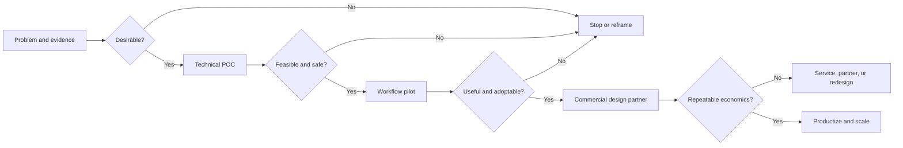

### 45.3 Pilot charter

```
Problem and target user
Customer/design partner and decision authority
Hypotheses: desirability, feasibility, model quality, workflow, commercial value
Scope and explicit non-production boundaries
Data, consent, security, medical/legal/regulatory approvals
Integration and support responsibilities
Success, guardrail, and stop criteria
Baseline and comparison design
Timeline and sample/exposure requirement
Commercial terms and data/product IP
Scale decision and owner
```

### 45.4 AI/ML pilot gates

For AI-assisted segmentation or journey recommendations, require:

- baseline rule/manual workflow;
- training and evaluation data rights;
- leakage and temporal split review;
- representative slices and minimum sample;
- offline model metric tied to a user decision;
- human-review workflow and override capture;
- shadow mode before recommendations affect users;
- online holdout where feasible;
- latency, cost, and failure fallback;
- monitoring, drift, rollback, and incident path.

### 45.5 Avoid pilot purgatory

A pilot becomes permanent unpaid service when there is no decision date, no reusable architecture, and no commercial owner. Before starting, define what evidence triggers scale, iteration, or stop. Track custom work separately from platform work. Do not count a manually curated success as proof of automated scalability.

### 45.6 Enterprise pilot economics

Estimate implementation labor, data fees, cloud/model cost, support, sales engineering, compliance review, and opportunity cost. Compare pilot value with a plausible repeatable price and market size. A high-profile logo can justify learning investment, but label strategic subsidy explicitly.

## 46. AI personalization, recommendations, and model operations

### 46.1 Recommendation problem types

- **Content ranking:** order eligible content for an HCP or specialty.
- **Next-item recommendation:** predict the next useful activity in a journey.
- **Channel selection:** choose web, email, event, CRM, or no action.
- **Send-time optimization:** choose an eligible contact time.
- **Audience expansion:** identify additional similar eligible entities, with strong governance.
- **Anomaly detection:** flag unusual campaign, data, or integration behavior.
- **Campaign optimization:** allocate budget, bid, frequency, or creative among permitted options.

### 46.2 Input/output contract

```
Decision: rank eligible specialty education activities
Inputs: profession, specialty, declared interests, permitted engagement history,
        activity metadata, prior completion, freshness, channel availability
Prohibited inputs: patient data, unsupported sensitive inference, commercial sponsor priority
Output: ordered activity IDs, score, reason codes, model version, expiry
Fallback: editorially curated specialty list
Human control: education team can remove activity; user can dismiss or change interests
```

### 46.3 Training data

Positive labels such as click, completion, dwell, registration, or attendance reflect exposure and historical ranking. Correct for position bias, selection, bots, accidental clicks, and repeated users. Negative examples are not everyone who did not click; many never had a real opportunity. Use temporal validation to avoid training on future information.

### 46.4 Offline metrics

- precision@k and recall@k;
- NDCG or ranking quality;
- mean reciprocal rank where one relevant result matters;
- coverage across catalog and users;
- diversity and novelty;
- calibration for response probabilities;
- false positive rate for anomaly detection;
- precision/recall at operational alert thresholds;
- slice metrics by profession, specialty, geography, activity type, and cold-start state.

### 46.5 Online metrics

Measure incremental qualified engagement, completion, attendance, learning, conversion, task time, and recurring adoption. Guard against lower diversity, over-contact, popularity concentration, complaint/opt-out, content-class imbalance, and latency. A click lift can coexist with worse learning or trust.

### 46.6 Deployment architecture

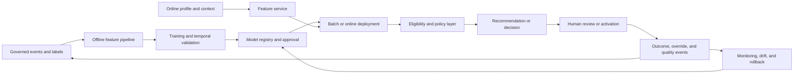

### 46.7 Model operations requirements

- model, feature, data, and policy versions recorded per decision;
- reproducible training and evaluation artifacts;
- approval and separation of duties;
- shadow, canary, A/B, and rollback controls;
- input distribution, output, latency, cost, and outcome monitoring;
- drift thresholds and retraining authority;
- champion/challenger support;
- explanation and operator override;
- fallback when model or feature service is unavailable.

### 46.8 Anomaly detection product design

An anomaly is not automatically an incident. Define entity, metric, baseline, seasonality, sensitivity, minimum volume, and action. Combine statistical signal with business context. Provide likely drivers and comparison periods. Capture operator disposition: true issue, expected campaign change, data delay, or false alert. Optimize for useful investigated alerts, not maximum anomaly count.

## 47. Commercial productization, positioning, and adoption

### 47.1 From capability to offering

A capability becomes a product when it has a defined user and buyer, repeatable problem, packaged scope, entitlement, workflow, service boundary, implementation model, measurable value, price logic, support model, and roadmap. “AI-powered segmentation” is a feature phrase, not an offering.

### 47.2 Offering canvas

```
Buyer and economic decision maker
Operator and end user
Problem and current alternative
Differentiated promise
Included capabilities and limits
Required data/integration
Implementation and time to value
Proof and measurement
Packaging and price metric
Security/privacy/regulatory posture
Support and services boundary
Expansion path
```

### 47.3 Value proposition example

Weak: “AI-powered omnichannel HCP orchestration.”

Stronger: “Help life-sciences campaign teams move from fragmented HCP signals to an approved, explainable next action across Medscape education, live events, and activation channels in hours rather than days - with professional identity, consent, frequency, and measurement built into the workflow.”

Validate every phrase. If “hours rather than days” is not measured, do not publish it.

### 47.4 Packaging options

- base platform plus activation modules;
- usage tier by active HCP profiles, events, campaigns, or API volume;
- premium AI-assistance and advanced measurement;
- connector package for enterprise destinations;
- managed service for customers needing operational support;
- outcome study or clean-room measurement add-on.

Choose a price metric aligned with customer value and predictable cost. Avoid a metric that penalizes desired adoption or encourages unnecessary sensitive-data collection.

### 47.5 Sales and product-marketing assets

- buyer problem and market narrative;
- audience-specific value proposition;
- capability and workflow diagram;
- demo script using representative data;
- integration and security overview;
- implementation plan and responsibilities;
- measurement methodology and proof;
- objection handling and competitive differentiation;
- packaging, entitlement, and services boundary;
- customer qualification checklist;
- adoption playbook after signature.

### 47.6 Adoption funnel


Track conversion and elapsed time between stages. Contracted revenue without integration or recurring use is delayed churn risk.

### 47.7 Revenue attribution

Classify product revenue as directly sold new offering, upsell enabled by feature, retention influence, usage expansion, or services. Define attribution with Finance and Sales before launch. Avoid claiming the full contract value for one feature when the purchase depended on a bundle.

### 47.8 Commercial feedback loop

Sales feedback is valuable but selected. Separate one customer's blocker, recurring segment need, competitor claim, and strategic market change. Require evidence, opportunity size, affected workflow, urgency, workaround, and willingness to adopt/pay. Close the loop so sellers know why an item was accepted, deferred, or solved differently.

## 48. SQL and analytics for the role

The job description expects the PM to write SQL or use analytical tools. You do not need to replace an analyst, but you should independently inspect adoption, campaign, journey, integration, and model behavior.

### 48.1 Representative schema

```
hcp_profile(hcp_id, npi, profession, specialty, country, consent_state, updated_at)
journey_assignment(hcp_id, journey_id, variant, assigned_at, exited_at)
decision_event(decision_id, hcp_id, journey_id, candidate_id, action,
               model_version, policy_version, reason_code, decided_at)
activation_event(decision_id, channel, status, activated_at)
engagement_event(hcp_id, content_id, event_type, event_at, qualified)
integration_event(partner_id, endpoint, status_code, latency_ms, event_at)
commercial_account(account_id, package, contracted_at, annual_value)
```

### 48.2 Time from trigger to activation

```sql
SELECT
  journey_id,
  COUNT(*) AS decisions,
  PERCENTILE_CONT(0.5) WITHIN GROUP
    (ORDER BY EXTRACT(EPOCH FROM (a.activated_at - d.decided_at)) / 60) AS p50_minutes,
  PERCENTILE_CONT(0.95) WITHIN GROUP
    (ORDER BY EXTRACT(EPOCH FROM (a.activated_at - d.decided_at)) / 60) AS p95_minutes
FROM decision_event d
JOIN activation_event a USING (decision_id)
WHERE a.status = 'delivered'
  AND d.decided_at >= CURRENT_DATE - INTERVAL '30 days'
GROUP BY journey_id;
```

Interpretation: low p50 with high p95 suggests a long-tail connector, approval, or retry problem. Break down by channel, partner, and reason before setting an SLA.

### 48.3 Personalization lift with assignment integrity

```sql
WITH assigned AS (
  SELECT hcp_id, journey_id, variant, assigned_at
  FROM journey_assignment
  WHERE assigned_at >= DATE '2026-06-01'
), outcomes AS (
  SELECT DISTINCT a.hcp_id, a.journey_id
  FROM assigned a
  JOIN engagement_event e
    ON e.hcp_id = a.hcp_id
   AND e.event_at >= a.assigned_at
   AND e.event_at < a.assigned_at + INTERVAL '14 days'
   AND e.event_type = 'qualified_conversion'
)
SELECT
  variant,
  COUNT(*) AS assigned_hcps,
  COUNT(o.hcp_id) AS converted_hcps,
  1.0 * COUNT(o.hcp_id) / NULLIF(COUNT(*), 0) AS conversion_rate
FROM assigned a
LEFT JOIN outcomes o USING (hcp_id, journey_id)
GROUP BY variant;
```

This estimates rates by assigned variant, not merely exposed users. Still inspect sample ratio mismatch, contamination, identity coverage, and confidence intervals.

### 48.4 Integration friction

```sql
SELECT
  partner_id,
  endpoint,
  COUNT(*) AS calls,
  AVG(CASE WHEN status_code BETWEEN 200 AND 299 THEN 1.0 ELSE 0.0 END) AS success_rate,
  APPROX_PERCENTILE(latency_ms, 0.95) AS p95_latency_ms,
  SUM(CASE WHEN status_code = 429 THEN 1 ELSE 0 END) AS rate_limited,
  SUM(CASE WHEN status_code >= 500 THEN 1 ELSE 0 END) AS server_errors
FROM integration_event
WHERE event_at >= CURRENT_TIMESTAMP - INTERVAL '7 days'
GROUP BY partner_id, endpoint
ORDER BY success_rate ASC, calls DESC;
```

SQL dialects vary. More important than syntax is grain: know whether one row is a request, retry, unique business event, HCP, campaign, or account.

### 48.5 Analyses to practice

1. Weekly activation funnel by customer cohort.
2. Time from contract to first successful activation.
3. Standard connector versus custom integration reliability.
4. Journey-entry, suppression, no-action, and exit reasons.
5. Recommendation coverage and diversity by specialty.
6. Model override rate and downstream outcome.
7. Segment count drift after identity or data-source update.
8. Manual campaign setup time before and after automation.
9. Revenue/upsell linked to feature entitlement and actual adoption.
10. Support-ticket volume per active customer and integration.

## 49. Agile Product Owner execution

### 49.1 Product Manager versus Product Owner

The PM owns problem, strategy, outcome, and roadmap. The Product Owner function keeps the delivery system ready: ordered backlog, clear acceptance, fast decisions, stakeholder alignment, and validated increments. One person may perform both, but strategy should not disappear into ticket administration.

### 49.2 Backlog hierarchy

```
Outcome / strategic bet
  Epic or capability
    User workflow slice
      Story with acceptance criteria
        Engineering task or test
```

Avoid horizontal epics such as “build database,” “build frontend,” and “build model.” Slice a working journey: one source event -> one eligible HCP -> one decision -> one activation -> one measurable outcome.

### 49.3 Definition of ready

- user and problem evidence;
- outcome and guardrails;
- workflow and content class;
- data, identity, and API contract;
- failure and fallback behavior;
- privacy/security/medical/legal review needs;
- dependencies and owner;
- testable acceptance criteria;
- rollout and instrumentation expectation.

### 49.4 Definition of done

Code complete is not product complete. Require automated tests, observability, accessibility, data-quality checks, documentation, support runbook, feature flag, rollback, analytics validation, approvals, and named post-launch owner.

### 49.5 Sprint and flow ceremonies

- Refinement: expose ambiguity and dependencies, not estimate theater.
- Planning: select a coherent outcome slice within capacity.
- Daily coordination: surface blocked decisions and production risk.
- Review/demo: show working behavior with realistic data and failure cases.
- Retrospective: improve system conditions and decision flow.
- Backlog review: remove stale work and reconnect items to outcomes.

### 49.6 Use-case-backed requirement

```
Use case: campaign operator activates an approved HCP segment to CRM.
Preconditions: segment approved, consent current, connector healthy, operator authorized.
Main flow: preview -> validate count -> activate -> receive destination ID -> monitor status.
Exceptions: count changed, destination rejects field, token expired, partial batch failure.
Acceptance: idempotent retry, row-level error export with masking, audit log, reconciliation.
Outcome: median approved-segment-to-CRM time under 15 minutes.
Guardrail: zero ineligible HCP records delivered.
```

### 49.7 Trade-off memo for roadmap sequencing

When choosing CDP self-service versus another custom connector, compare user reach, revenue commitment, reusable platform value, risk, learning, time, operational savings, dependency readiness, and opportunity cost. Show what will not be built and the consequence. “Both are priority one” is not prioritization.

## 50. The job-specific first two weeks

### 50.1 People to meet

| Partner | What to learn | Artifact to request |
|---|---|---|
| Engineering/Architecture | services, platform boundaries, re-platforming risks | current architecture and dependency map |
| Platform Tools/Product | operator workflow, shared services, roadmap overlap | platform capability catalog |
| BI/Analytics | source of truth, metric disagreements, reporting latency | metric dictionary and key dashboards |
| Data Science | models, training data, evaluation, deployment, drift | model cards/evaluation reports |
| Account Management/Sales | buyer, commitments, adoption blockers, pilots | top opportunities and loss reasons |
| Education/CME | independence, learner journey, LMS/institutional needs | activity lifecycle and reporting rules |
| Medical Affairs | scientific-exchange workflows and boundaries | approved workflow map |
| Product Marketing | positioning, packaging, enablement, proof | current GTM assets |
| Legal/Privacy/Security | data-use boundaries, reviews, recurring risks | data-flow and risk-review templates |
| Editorial/Clinical | content taxonomy, quality, personalization boundaries | content governance model |

### 50.2 Systems to trace

Trace one real commercial journey from client brief to segment, approval, activation, event, engagement, report, invoice, and renewal discussion. Trace one enterprise integration from security review to first value. Trace one model output from source data to operator action and outcome.

### 50.3 Questions that signal seniority

- Which journey decision currently takes days but should take minutes?
- Where do education, medical-affairs, and commercial eligibility rules diverge in the platform?
- What percentage of integrations use a standard path, and what drives the custom tail?
- Which activation or adoption metric does Sales trust least?
- What is the baseline manual effort for segmentation and campaign setup?
- Which model is deployed but not changing a meaningful decision?
- How is no-action represented in current journey logic?
- Can we reproduce why an HCP received an experience six months later?
- What customer commitment is constraining the re-platforming sequence?
- Where does pilot success depend on manual work that cannot scale?

### 50.4 Job-specific 14-day output

By the end of two weeks, produce:

1. commercial platform context and data-flow diagram;
2. NBE/NBA decision contract for one journey;
3. CDP source-to-destination inventory;
4. integration time-to-value funnel with top delay reasons;
5. AI/ML model and pilot inventory;
6. adoption and revenue scorecard definitions;
7. re-platforming risk and dependency register;
8. one proposed thin vertical slice;
9. stakeholder decision map;
10. revised 30/60/90 plan grounded in internal evidence.

### 50.5 Re-platforming discovery checklist

- Which customer and operator workflows must remain uninterrupted?
- Which APIs, events, exports, IDs, and report definitions are contractual?
- Which legacy behaviors are accidental versus relied upon?
- How will old and new identity, segmentation, and measurement results reconcile?
- Can capabilities migrate incrementally behind stable contracts?
- What is the dual-run duration and exit criterion?
- How are customers, sellers, and operators trained?
- What is the rollback point after data begins writing to the new platform?
- Which technical debt is intentionally carried, and when is it retired?
- What evidence proves the new platform is more reliable and faster to integrate?

### 50.6 Your first credible product proposal

A strong early proposal is bounded, measurable, and platform-relevant. Example: “Create a journey simulator and activation preflight that shows candidate count, exclusion reasons, content-class policy, frequency impact, and destination readiness before launch.” It can reduce campaign setup errors, expose data problems, improve operator confidence, and create reusable foundations for NBE/NBA and CDP self-service without requiring an immediate autonomous-AI launch.

# Part VII - Ignite growth, supporter AI, membership, and identity

This section integrates the adjacent expectations in WebMD AI Product Manager - Commercial Offerings Job ID 2026-1403, Senior Product Manager - Healthcare Marketing & AI Solutions Job ID 2026-1704, and the Medscape/WebMD Product Manager - Membership role description. Together, the roles reveal the broader platform context in which a Senior Technical PM operates: professional membership and identity create trusted relationships; Medscape content, education, and commercial offerings create value; WebMD Ignite turns healthcare data and marketing workflows into provider and payer growth; shared AI and platform capabilities connect the layers.

## 51. The four-role capability map

### 51.1 Shared foundation and different outcomes

| Role | Primary customer/user | Core system | Primary outcome |
|---|---|---|---|
| Senior Technical PM, Medscape | Life sciences, institutions, operators, HCPs | Commercial platform, NBE/NBA, CDP, integrations | Faster, reliable, measurable engagement and platform adoption |
| AI PM - Commercial Offerings | Supporters, Education commercial teams, internal operators | AI-enabled content, reporting, customization, workflows | Differentiated supporter value, revenue, efficiency, reusable AI |
| Senior PM - Healthcare Marketing & AI Solutions | Providers, payers, healthcare marketers | Ignite Growth Platform and integrated MarTech workflows | Appointments, encounters, member/patient growth, revenue |
| PM - Membership | Physicians and HCP members across web/mobile | Registration, authentication, profile, identity, retention | Active known users, richer profiles, frequency, lifetime value |

### 51.2 Shared platform primitives

The roadmap should look for reusable primitives rather than four isolated products:

- identity, authentication, professional verification, consent, and preferences;
- event collection, profile, audience, journey, and experimentation;
- content and experience metadata, approval, rights, and taxonomy;
- recommendation, ranking, anomaly, and generative-AI services;
- connectors, APIs, webhooks, batch exchange, and platform tooling;
- reporting, attribution, closed-loop measurement, and commercial analytics;
- governance, model registry, audit, and incident controls;
- reusable web/mobile design patterns, notifications, and accessibility.

### 51.3 Where sharing becomes dangerous

Shared infrastructure does not mean shared purposes or unrestricted data. Membership personalization, accredited education, supporter reporting, provider marketing, payer engagement, and promotional activation can require different consent, content independence, data contracts, and reporting granularity. Use a common control plane with purpose-specific policy rather than copying all data into one unrestricted profile.

### 51.4 Capability ownership matrix

| Capability | Platform owner | Domain owner | Joint decision |
|---|---|---|---|
| Identity graph | Identity/platform | Membership, HCP verification | permitted edges and confidence thresholds |
| Recommendation service | AI platform | Editorial, Education, Commercial, Ignite | candidate policy, objective, evaluation |
| CDP/audience | MarTech platform | campaign/journey product | attributes, activation, consent, measurement |
| Content customization | content/AI platform | Education or commercial offering | approved components, independence, quality |
| Closed-loop outcomes | data platform | Ignite/provider/payer product | linkage, attribution, business definitions |
| Supporter reporting | analytics platform | commercial offering | granularity, proof, privacy, packaging |

## 52. Ignite Growth Platform as a system of intelligence and orchestration

WebMD Ignite publicly describes Ignite Growth Platform (IGP) as a healthcare CRM and growth platform using healthcare-specific data, audience building, omnichannel campaign management, predictive models, and insights. The product pages describe integration into enterprise CRM, marketing automation, and data-warehouse workflows. Treat published scale and ROI figures as vendor claims whose definitions and dates must be verified internally.

### 52.1 System roles

- **System of record:** where authoritative patient, member, campaign, provider, or encounter data is maintained. Epic, Salesforce, or another CRM may own selected records.
- **System of engagement:** where marketers or operators design and execute workflows.
- **System of intelligence:** where data is unified, opportunities are modeled, and recommendations are produced.
- **System of orchestration:** where triggers, policies, channel decisions, and activation are coordinated.
- **System of measurement:** where marketing activity is connected to appointments, encounters, retention, and revenue.

IGP can be positioned as intelligence and orchestration without pretending to replace every customer's EHR, CRM, marketing automation platform, ad platform, and enterprise data warehouse.

### 52.2 Reference integration architecture

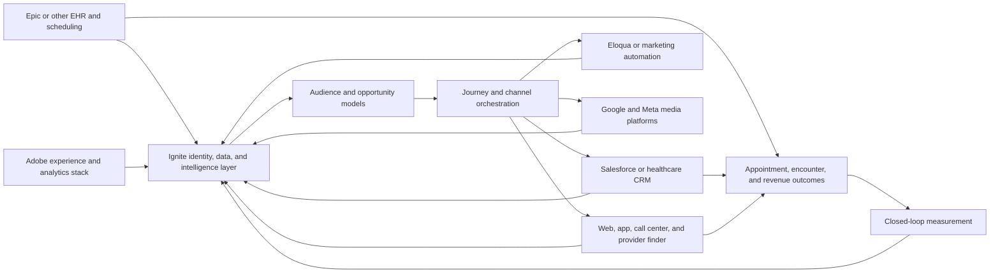

### 52.3 Integration decision table

| System | Typical role | Data flowing into intelligence | Activation/output |
|---|---|---|---|
| Epic/EHR | clinical, scheduling, encounter record | appointments, encounters, patient status, capacity where allowed | outreach task, campaign outcome, scheduling link |
| Epic Cheers | healthcare CRM and outreach | campaign and consumer/patient engagement context | leads, journeys, calls, messages, appointment attribution |
| Salesforce | account, lead, opportunity, service workflow | consumer/account status, sales/service events | tasks, audiences, campaign responses |
| Eloqua | B2B/B2C marketing automation | email/journey events, forms, campaign membership | audience, trigger, content, suppression |
| Adobe | content, experience, analytics, journey capabilities | digital behavior and content context | personalized experience and campaign activation |
| Google/Meta | paid media and conversion platforms | spend, delivery, engagement, platform conversions | governed audiences, campaigns, offline conversions |
| Enterprise warehouse | analytical source and finance truth | customer, campaign, appointment, encounter, revenue | reporting, model features, reconciled metrics |

Specific products and customer configurations differ. Do not state “seamless integration” without defining supported objects, direction, frequency, latency, authentication, and reconciliation.

### 52.4 Epic Cheers context

Epic publicly describes Cheers as a healthcare CRM supporting patient acquisition, care-gap outreach, consistent contact-center experiences, provider finding, campaign prioritization, and tracking from engagement to appointments and revenue. A differentiated integration question is not simply “Can we send data to Epic?” It is “Which system decides the audience and next action, which owns outreach state, and how do both systems reconcile campaign and clinical outcomes without duplicate contact?”

### 52.5 Orchestration conflict patterns

- IGP and Eloqua both advance the journey after the same event.
- Cheers and Salesforce each create a lead for one person.
- Meta reports a platform conversion while EHR appointment data later reverses or cancels it.
- Adobe personalization and IGP recommendation compete for the same page slot.
- customer consent changes in one system but the downstream suppression refresh is daily.

Use a decision-rights matrix, global person/campaign IDs, idempotency, source-of-truth rules, and reconciliation jobs.

### 52.6 IGP product health

Measure source freshness, identity match, audience build time, destination delivery, journey success, model coverage, appointment linkage, outcome maturity, cost, operator adoption, and customer expansion. Separate platform availability from useful workflow availability: a green API can still serve stale data or fail the customer's business process.

## 53. Provider and payer healthcare marketing strategy

### 53.1 Provider growth jobs

Health systems need to grow high-value service lines, attract and retain patients, reduce referral leakage, improve access, use available capacity, engage existing patients, and prove marketing impact to finance and clinical leaders. The product must connect intent with a real pathway to care.

### 53.2 Payer growth and engagement jobs

Health plans need member acquisition, enrollment, onboarding, benefit education, network navigation, care-gap engagement, care management, retention, and plan selection. The journey has enrollment periods, regulatory communications, eligibility changes, and a different outcome model from provider appointment acquisition.

### 53.3 High-intent, high-value, high-conversion moments

- a consumer searches for a specialist or treatment near them;
- a patient views an available provider and begins scheduling;
- a member needs an in-network service;
- a person completes a health-risk assessment and requests help;
- a referring clinician identifies a service need;
- a lapsed patient becomes eligible for outreach;
- a consumer compares coverage or a Medicare Advantage plan;
- an appointment slot opens for a relevant high-intent person.

Do not equate “high value” only with revenue. Include clinical appropriateness, access, equity, capacity, and consumer benefit.

### 53.4 Service-line opportunity model

```
Opportunity = addressable demand
            x clinical/service relevance
            x network and geographic fit
            x reachable eligible population
            x appointment capacity
            x expected conversion
            x expected contribution
            x strategic priority
```

Each factor needs a source and confidence. A propensity model cannot create appointment capacity.

### 53.5 Provider campaign example

**Goal:** increase completed orthopedic encounters in a defined service area.

**System:** market opportunity -> eligible audience -> paid/owned journey -> provider finder -> scheduling/call center -> appointment -> completed encounter -> allowed revenue/contribution.

**Optimization:** prioritize appropriate demand and available locations; use capacity-aware messaging; retarget only under permitted rules; suppress completed or ineligible users; route insurance/network questions; measure incremental completed encounters and margin.

**Guardrails:** no misleading urgency, no use of clinical data for marketing without permission, accessible scheduling, equitable geographic coverage, reasonable frequency, and transparent attribution.

### 53.6 Payer campaign example

**Goal:** improve completion of annual wellness visits among eligible members.

**System:** eligibility/care-gap data -> consent and outreach permission -> channel and language preference -> provider/network navigation -> appointment -> claim/encounter maturity -> care-gap closure.

Measure reachable eligibility, contact, navigation success, scheduled visit, completed visit, time to closure, member satisfaction, and incremental closure versus comparison. Claims lag requires a maturity window.

### 53.7 Capacity-aware activation

```mermaid
flowchart LR
  A[Intent and eligible audience] --> B[Service line and geography]
  C[Provider, location, network, and appointment capacity] --> B
  B --> D[Opportunity and propensity scoring]
  D --> E[Journey and channel decision]
  E --> F[Provider finder or scheduling]
  F --> G[Appointment scheduled]
  G --> H[Appointment completed or cancelled]
  H --> I[Encounter and revenue outcome]
  I --> J[Measurement and capacity feedback]
  J --> D
```

## 54. Closed-loop measurement: appointments, encounters, and revenue

### 54.1 Outcome ladder

| Stage | Example event | Reliability question |
|---|---|---|
| Marketing | impression, click, content interaction | valid, deduplicated, consented? |
| Intent | provider search, form, call, scheduling start | genuine need or low-quality lead? |
| Appointment | scheduled, rescheduled, cancelled, no-show | which state and source of truth? |
| Encounter | checked in, completed, coded | when is the record mature? |
| Financial | charge, allowed amount, payment, contribution | gross charge is not realized revenue |
| Long-term | repeat care, retention, lifetime value | attribution window and confounding? |

### 54.2 Identity and linkage

Closed-loop measurement may require joining media or web identity to lead, patient, appointment, encounter, and finance identifiers. Use deterministic consented links where possible, privacy-preserving partner methods, match-confidence reporting, and unmatched-rate analysis. Do not hide match loss; it can bias results toward digitally recognized populations.

### 54.3 Appointment state model

`requested -> scheduled -> confirmed -> rescheduled -> completed`, with terminal or side states cancelled, no-show, duplicate, invalid, and unable-to-contact. Preserve transitions and timestamps. Reporting only the latest state prevents cycle-time and abandonment analysis.

### 54.4 Revenue definitions

- gross charges: list amounts before contractual adjustment;
- allowed amount: negotiated covered amount;
- net patient/service revenue: expected or recognized after adjustments;
- contribution margin: revenue minus attributable variable cost;
- lifetime value: expected net value over a defined horizon;
- marketing ROI: incremental value minus marketing cost, divided by marketing cost.

Align with Finance. Never let a dashboard casually call gross charges “revenue.”

### 54.5 Measurement architecture

```mermaid
flowchart LR
  A[Campaign and journey exposure] --> B[Lead and digital-intent events]
  B --> C[Identity and attribution layer]
  D[Scheduling and call center] --> C
  E[EHR encounters] --> C
  F[Revenue cycle and finance] --> C
  C --> G[Governed outcome mart]
  G --> H[Descriptive funnel]
  G --> I[Attribution]
  G --> J[Incrementality and ROI]
  K[Match, latency, suppression, and data-quality report] --- C
```

### 54.6 Closed-loop metric contract

```
Outcome: completed encounter
Entity: unique patient encounter
Eligibility: selected service lines and campaign cohort
Attribution: documented lookback and touch rule
Causal estimate: randomized/geo design where feasible
Maturity: 45 days after service date
Identity coverage: report matched and unmatched by source
Revenue: net patient revenue from finance-approved field
Exclusions: test, duplicate, reversed, employee, non-billable as defined
Privacy: minimum cells, approved access, retention, no platform export of PHI
```

### 54.7 Beyond features

The role description explicitly emphasizes appointments, encounters, and revenue. Therefore every roadmap epic should state its outcome path. A new audience builder is not complete when it saves a segment; it is complete when operators activate it reliably and the platform can observe a meaningful downstream outcome.

## 55. Claude and generative AI for rapid product prototyping

The supplied Ignite role specifically asks for hands-on use of Claude or similar tools to accelerate solution design, requirements, user stories, and test scenarios. Use these tools as a structured collaborator, not an authority.

### 55.1 Safe working boundary

Never paste PHI, confidential customer data, unreleased strategy, credentials, or restricted contracts into an unapproved AI tool. Use synthetic examples, approved enterprise environments, and internal policy. Record when generated work materially influences a requirement or decision.

### 55.2 Rapid-prototype loop

1. Frame user, workflow, constraint, and decision.
2. Ask the model to identify ambiguity and failure modes.
3. Generate multiple workflow or schema options.
4. Build a disposable prototype using synthetic data.
5. Test with operators/users.
6. Verify technical and regulatory assumptions with owners.
7. Convert learning into human-owned requirements.
8. Save accepted decisions, not raw chat volume.

### 55.3 Prompt pattern for requirements

```
Act as a critical product-design partner.
Context: A health-system marketer uses an intelligence platform to activate an audience to Eloqua.
User goal: Launch an approved cardiology journey and measure completed encounters.
Constraints: HIPAA-regulated customer context, consent, tenant isolation, idempotent API,
             no PHI in logs, human approval before activation.
Produce:
1. actors and preconditions;
2. main and exception flows;
3. data objects and ownership questions;
4. acceptance criteria in Given/When/Then form;
5. abuse, privacy, reliability, and measurement failure modes;
6. assumptions requiring expert verification.
Do not invent current platform capabilities.
```

### 55.4 Prototypes worth building

- clickable audience and journey workflow;
- JSON API contract with mock server;
- synthetic campaign-to-appointment dataset and dashboard;
- natural-language-to-segment rule generator with approval;
- supporter-report narrative generator constrained to approved metrics;
- content customization workbench using locked source components;
- registration/profile flow with identity-confidence explanation;
- anomaly triage assistant using synthetic incidents.

### 55.5 AI-generated test scenarios

Ask for happy, boundary, adversarial, privacy, accessibility, localization, stale-data, concurrency, retry, partial failure, and rollback tests. Then have domain owners remove irrelevant cases and add real historical incidents. Generated completeness is an illusion unless grounded in system behavior.

### 55.6 Evaluation of the prototyping process

Measure cycle time from problem to testable artifact, percentage of generated requirements accepted after review, defects traced to unverified AI output, user learning per prototype, and reuse of patterns. The goal is better and faster learning, not maximum AI usage.

### 55.7 LLM application architecture

```mermaid
flowchart LR
  A[Approved user input] --> B[Policy, redaction, and prompt template]
  C[Approved product docs, schemas, and examples] --> D[Retrieval]
  B --> E[LLM inference]
  D --> E
  E --> F[Structured output validation]
  F --> G[Human review and edit]
  G --> H[Prototype, PRD, story, or test artifact]
  H --> I[Feedback and quality metrics]
  I --> B
```

Use structured schemas, source citations, deterministic validators, and review. A model should not directly modify production campaign or customer configuration from a prototyping workflow.

## 56. AIO, market shifts, and competitive intelligence

### 56.1 From SEO to AI-mediated discovery

AI answer engines and LLM-based search can answer health questions before a user visits a publisher or health-system site. This affects traffic acquisition, attribution, content strategy, provider discovery, and trust. The response is not merely “optimize for AIO.” Build authoritative structured content, clear provenance, entity metadata, accessible provider/location data, current facts, and high-value actions that an answer cannot complete alone.

### 56.2 AIO terminology

- **AI overview/answer:** generated synthesis presented within a search or assistant experience.
- **AIO/GEO:** evolving practices for making content understandable and citable by AI answer systems; terminology and evidence remain unsettled.
- **Zero-click journey:** user receives information without visiting the source site.
- **Entity authority:** machine-understandable evidence connecting organization, provider, condition, location, and source credibility.
- **Structured data:** schema and APIs that represent entities and actions consistently.

Do not promise ranking in opaque AI systems. Measure referral quality, citation/mention, branded demand, provider-profile action, and downstream conversion where observable.

### 56.3 Competitive landscape method

The supplied role names Unlock Health and Innovaccer. Public materials position Innovaccer around healthcare CRM, consumer data, omnichannel engagement, propensity models, EHR integration, and patient-growth ROI. Unlock Health publicly presents healthcare growth, risk-assessment, patient-acquisition, retention, and managed-care capabilities. Epic Cheers combines healthcare CRM, outreach, care gaps, provider finding, appointment outcomes, and revenue tracking.

Treat vendor claims as hypotheses. Compare workflows using demos, customer references, implementation evidence, contracts, and outcome definitions.

### 56.4 Competitive capability matrix

| Dimension | Questions |
|---|---|
| Data advantage | Which clinical, consumer, market, identity, and engagement data are permitted and current? |
| Intelligence | Which opportunity, propensity, recommendation, and anomaly models exist? |
| Orchestration | Which channels and journey states are native versus integrated? |
| EHR/CRM integration | Which objects, directions, and workflow ownership are supported? |
| Outcome loop | Can the system connect to appointments, encounters, retention, and revenue? |
| Experience | Provider finder, content, web/mobile, call center, scheduling, personalization? |
| Time to value | Standard integration, services burden, migration, operator learning? |
| Trust | HIPAA posture, consent, security, governance, explainability, audit? |
| Economics | Platform, services, data, media, and outcome-study costs? |

### 56.5 Win themes that require proof

Potential differentiation can come from healthcare-specific data and models, WebMD consumer reach and trust, Medscape professional reach, provider/payer workflows, PulsePoint activation, content/education expertise, and closed-loop outcomes. The PM must translate this portfolio into one coherent customer workflow. A slide listing assets is not an integrated product.

### 56.6 Quarterly market review

Track customer jobs, regulation, browser/platform policy, EHR roadmaps, marketing-platform changes, AI answer behavior, competitor launches, pricing, partnerships, and customer wins/losses. For each change state confidence, evidence, product implication, and decision. Avoid trend theater.

## 57. AI-enabled supporter offerings and commercial operations

In Medscape Education and related commercial contexts, a **supporter** commonly refers to an organization funding or purchasing an offering. The exact relationship and education/commercial rules vary. AI can improve value, customization, reporting, and operations, but must preserve education independence, content rigor, and appropriate supporter data boundaries.

### 57.1 Offering opportunities

- faster needs-assessment synthesis from approved sources;
- content-format adaptation using approved source material;
- localization and reading-level assistance with medical review;
- modular activity packaging across eligible formats;
- campaign and learner-outcome anomaly detection;
- supporter-report narrative drafts grounded in approved metrics;
- Q&A, transcript, and theme summarization with privacy controls;
- content tagging and taxonomy enrichment;
- next-format or next-program recommendations for commercial teams;
- internal proposal, scope, and operational workflow assistance.

### 57.2 Content customization boundary

AI may adapt format, length, modality, or presentation only inside an approved content and review framework. Separate independent education from promotional content. Lock scientific claims, references, disclosures, fair-balance elements where applicable, faculty meaning, and accreditation requirements. Preserve source-to-output lineage.

### 57.3 Supporter reporting architecture

```mermaid
flowchart LR
  A[Learner and campaign events] --> B[Validation, identity rules, and consent]
  B --> C[Aggregate outcome mart]
  C --> D[Approved metrics and benchmarks]
  D --> E[Structured report data]
  E --> F[AI-assisted narrative draft]
  F --> G[Analytics, medical, education, and client review]
  G --> H[Versioned supporter report]
  I[Minimum cells, privacy, independence, and contract rules] --- C
  I --- E
  I --- H
```

The model should not calculate numbers from raw events inside free-form generation. Compute metrics deterministically, pass structured values and definitions, and verify every narrative claim against them.

### 57.4 Reporting metrics

- qualified reach and participation;
- profession, specialty, and geography at permitted aggregation;
- activity start, completion, assessment, and evaluation;
- pre/post knowledge or confidence change with methodology;
- engagement by format and channel;
- benchmark with comparable cohort definition;
- operational time and customization effort;
- client adoption and recurring use;
- revenue contribution and margin;
- privacy suppression and reporting exceptions.

### 57.5 Adaptive learning alignment

Adaptive learning changes sequence, difficulty, remediation, or format based on learner evidence. Shared capability can include learner model, competency taxonomy, item metadata, recommendation service, and experimentation. Domain ownership must preserve educational validity. A commercial-offerings PM should align with an Adaptive Learning PM to reuse platform capabilities without turning supporter preference into learner-path bias.

### 57.6 Internal-to-external productization

An internal workflow becomes client-facing only after removing expert-only assumptions, defining entitlement and tenant isolation, adding explanation and support, proving repeatability, documenting quality, and establishing a commercial package. Track manual intervention and exception rate; they reveal whether the “product” is still a service.

### 57.7 Global considerations

For U.S., EU, and LATAM offerings, account for language, medical practice context, accreditation, professional identity, promotional rules, privacy, data residency, consent, and model performance. Do not launch a U.S.-trained content or identity model globally by translating the UI alone.

## 58. Membership, registration, authentication, and profile enrichment

### 58.1 Membership flywheel

```mermaid
flowchart LR
  A[Valuable content, tools, and learning] --> B[Registration or recognition]
  B --> C[Verified and enriched member profile]
  C --> D[Relevant web, mobile, email, and alert experience]
  D --> E[Higher activation, frequency, and retention]
  E --> F[Better declared preferences and permitted signals]
  F --> D
  E --> A
```

Registration is an exchange of value, not a data-extraction checkpoint. Ask for only what is needed now, explain benefits, save progress, and progressively enrich after trust is established.

### 58.2 Membership lifecycle

`anonymous -> recognized -> registered -> verified -> activated -> engaged -> retained`, with recovery branches for duplicate, locked, dormant, unverified, bounced contact, and deleted. Different product capabilities can require different assurance levels.

### 58.3 Registration funnel

Measure landing, registration start, field completion, submit, email/phone verification, professional verification, first-value action, day-7 activation, and day-30 retention. Break down by device, app/web, country, profession, acquisition source, and error. A reduced registration rate may be healthy if low-quality/fraudulent accounts fall and verified activation rises.

### 58.4 Authentication

Key capabilities include secure password, passwordless or magic link where appropriate, MFA for risk, social/enterprise login under policy, session management, device recognition, account recovery, credential stuffing protection, bot detection, and global logout. Separate authentication (who controls the account) from professional verification (whether claimed credentials are supported).

### 58.5 Anonymous-to-known recognition

Use authenticated sessions and first-party identifiers as primary signals. Recognition must respect consent and browser/app controls. Avoid dark patterns that force login for emergency or basic health information without a defensible user need. Measure known-user coverage alongside abandonment, trust, and access.

### 58.6 Profile model

| Attribute class | Examples | Control |
|---|---|---|
| Account | internal ID, email, locale, created date | security and user access |
| Professional | profession, specialty, NPI, license geography | provenance, confidence, verification date |
| Preferences | topics, channels, frequency, language | user-editable and purpose-specific |
| Engagement | content, tools, education, event behavior | consent, retention, quality |
| Organization | employer/practice affiliation and role | temporal, multiple affiliations |
| Commercial eligibility | customer list or audience status | contract, purpose, suppression |

Progressive profiling should choose the next useful question based on value and confidence, not simply fill every null.

### 58.7 Profile enrichment quality

Track completion, verified-field coverage, freshness, conflicts, correction rate, enrichment source, user edits, and downstream utility. A filled field is not necessarily correct. Member-declared updates should not be silently overwritten by a stale vendor feed.

## 59. Identity resolution, verification, fraud, and global membership

### 59.1 Entity resolution

Identity resolution decides whether records refer to the same person, account, professional, organization, or device. Use a graph with evidence, source, confidence, effective dates, and allowed purposes. False merge is often more damaging than a missed merge because it combines histories and can expose information.

### 59.2 Match hierarchy example

1. same authenticated account ID;
2. verified email plus corroborating professional attribute;
3. verified NPI link with account evidence;
4. deterministic enterprise SSO subject mapping;
5. approved probabilistic evidence for low-risk recognition;
6. remain separate and request verification.

Never merge solely on shared surname, organization, office IP, or device.

### 59.3 Professional verification

Verification can use NPPES/NPI, licensing or professional registries, institutional email, documentation, third-party credential providers, and manual review. The method varies by country and profession. Record what was verified, source, date, jurisdiction, status, and expiration. NPI existence does not prove active licensure.

### 59.4 Verification state machine

`unverified -> pending -> verified`, with rejected, needs-more-information, expired, suspended, appealed, and revoked. Product permissions should map to state and risk. Provide an appeal/correction path and avoid exposing sensitive fraud logic.

### 59.5 Fraud and abuse patterns

- credential stuffing and account takeover;
- synthetic or duplicate HCP accounts;
- shared credentials;
- fake professional identity for gated content or incentives;
- automated scraping;
- survey/research reward abuse;
- CME completion manipulation;
- referral or engagement event fabrication;
- device farms and bot-created registrations.

### 59.6 Risk engine

```mermaid
flowchart LR
  A[Registration, login, device, network, and profile signals] --> B[Rules and risk model]
  C[Professional registry and verification evidence] --> B
  D[Behavior, velocity, and historical abuse] --> B
  B --> E{Risk tier}
  E --> F[Allow]
  E --> G[Step-up authentication]
  E --> H[Professional verification]
  E --> I[Manual review]
  E --> J[Block or limit]
  F --> K[Outcome and monitoring]
  G --> K
  H --> K
  I --> K
  J --> K
  K --> B
```

Optimize expected harm and user friction, not fraud catch rate alone. Monitor false positive, appeal success, verification completion, time to resolution, attack loss, and member abandonment by legitimate cohort.

### 59.7 Global product requirements

- country-specific professional identifiers and registries;
- transliterated names and multiple naming conventions;
- local address/phone formats and character sets;
- language and time-zone preferences;
- country-specific consent, data residency, and age rules;
- regional content, accreditation, and promotional boundaries;
- model evaluation by country/profession;
- support and appeal in relevant languages.

## 60. Membership analytics, mobile engagement, and lifetime value

### 60.1 Core membership metrics

- monthly and weekly active verified members;
- new registered, verified, and activated members;
- anonymous versus recognized versus authenticated activity;
- sessions per active member and active days;
- day-1, day-7, day-30, and rolling retention;
- profile completeness, verified specialty, and freshness;
- content/tool/education breadth and depth;
- email, push, in-app, and alert opt-in and engagement;
- member lifetime value and commercial contribution with privacy-safe definitions;
- trust, complaint, recovery, and fraud metrics.

### 60.2 Cohort analysis

Group by registration month, profession, specialty, geography, acquisition source, first-value action, and device. Compare retention curves. A cohort acquired through one high-volume campaign may look successful in registration but fail verification and retention.

### 60.3 Activation metric

Define activation as evidence that the member received core value, not merely completed registration. Examples: saved a drug reference, used a clinical calculator, completed a meaningful article session, enrolled in CME, followed a specialty, or configured alerts. Validate which actions predict durable retention without mistaking correlation for cause.

### 60.4 Mobile product concerns

- app startup, crash-free sessions, offline/poor network behavior;
- biometric login and secure token storage;
- deep links from email and push;
- notification permission timing and value explanation;
- background refresh and battery/network cost;
- cross-device progress and session continuity;
- mobile accessibility, font scaling, and orientation;
- app-store privacy disclosures and SDK governance;
- release compatibility and forced-upgrade policy.

### 60.5 Push/pull engagement

**Pull** experiences respond when a member seeks news, reference, tools, or learning. **Push** includes email, mobile notifications, alerts, and reminders. Use member preferences, urgency, content value, local time, and global frequency. A breaking clinical alert should have different rules from promotional engagement.

### 60.6 Retention experiment examples

- progressive profiling after first value versus during registration;
- specialty feed personalization versus generic feed;
- member-selected alert topics versus inferred defaults;
- cross-device save/resume reminder;
- reactivation based on previous high-value tool use;
- notification permission request after demonstrated value;
- trusted professional-verification badge and explanation.

Pre-register primary and guardrail metrics. Watch opt-out, notification disable, low-value session inflation, content diversity, and unequal effects across specialties.

### 60.7 Member lifetime value

Membership value includes user value, retention, qualified engagement, education participation, research eligibility where appropriate, and commercial value. Avoid reducing a clinician to ad impressions. A practical model can estimate expected future contribution by cohort while constraining contact and preserving trust.

### 60.8 Membership dashboard

```mermaid
flowchart TD
  A[Eligible visitors and app users] --> B[Recognized]
  B --> C[Registered]
  C --> D[Professionally verified]
  D --> E[Activated through first value]
  E --> F[Retained active member]
  F --> G[Broader trusted relationship]
  H[Registration friction] --- C
  I[Identity confidence and fraud] --- D
  J[Recommendation quality] --- E
  K[Email, push, web, and mobile experience] --- F
  L[Privacy, trust, and member control] --- G
```

### 60.9 Unified 30/60/90 implication

In the first 30 days, understand shared membership, commercial, education, Ignite, and AI capabilities. By 60 days, improve one reusable decision or integration loop. By 90 days, demonstrate how the work creates both user value and measurable commercial or operational impact without crossing purpose boundaries.

# Part VIII - Publisher platforms, experience delivery, and portfolio leadership

## Chapter 61 - Publisher ad serving and Google Ad Manager

### 61.1 The publisher ad stack in one sentence

An ad server turns an eligible page or app opportunity into a governed delivery decision: it receives an ad request, evaluates inventory and targeting, selects among direct and programmatic demand, returns a creative, records delivery, and feeds billing and performance systems. The PM owns the product behavior around that decision even when Ad Operations owns campaign configuration.

### 61.2 Google Ad Manager object model

| Object | Practical meaning | PM questions |
|---|---|---|
| Network | Publisher's top-level GAM account | Who owns access, policy, and configuration? |
| Ad unit | Addressable inventory such as article-top or app-feed-card | Is the taxonomy stable across sites and apps? |
| Placement | Reusable grouping of ad units | Is it a sales package, operational group, or both? |
| Order | Commercial container for an advertiser or campaign | What contract and billing identifiers map to it? |
| Line item | Delivery contract: dates, quantity, priority, rate, pacing, and targeting | What makes it eligible and what can outrank it? |
| Creative | The rendered asset or third-party tag | Is it approved, secure, responsive, and measurable? |
| Key-value | Custom context passed in the request | Is the value allowed, documented, and low-risk? |
| Audience segment | Eligible user or cohort signal | What is its provenance, consent, TTL, and match rate? |

Google documents that key-values can be sent in ad tags and used to make targeted line items eligible. Treat that capability as a controlled interface, not a place to leak diagnoses, article titles, free text, or identifiers.

### 61.3 Delivery path

```mermaid
sequenceDiagram
  participant U as User device
  participant P as Web or app experience
  participant C as Consent and context layer
  participant G as Google Ad Manager
  participant D as Direct and programmatic demand
  participant V as Verification and measurement
  U->>P: Open page or screen
  P->>C: Resolve permitted context
  C-->>P: Consent, inventory, and safe key-values
  P->>G: Ad request
  G->>G: Eligibility, priority, pacing, and policy
  G->>D: Compete or request eligible demand
  D-->>G: Bid or creative response
  G-->>P: Winning creative and metadata
  P-->>U: Render reserved ad slot
  P->>V: Viewability and quality signals
  G->>V: Delivery and revenue logs
```

### 61.4 Eligibility before optimization

Ask in order: Is the ad unit targeted? Are date, geography, device, audience, frequency, creative size, consent, and policy conditions satisfied? Is the line item active and under its cap? Is a higher-priority item eligible? Can the creative render in this environment? Many apparent optimization problems are eligibility defects.

### 61.5 Targeting contract

A targeting requirement should define:

- business intent and prohibited inference;
- allowed key names, value vocabulary, case and delimiter rules;
- where each value is calculated and its source of truth;
- browser, app, server-side, and privacy-state behavior;
- unknown, missing, expired, and conflicting-value behavior;
- test requests and expected eligible line items;
- logging that excludes sensitive raw values;
- owner, version, retention, and deprecation date.

For health-related inventory, favor coarse, reviewed contextual categories over unbounded page or user attributes. A campaign requirement never overrides privacy, editorial, medical, or platform policy.

### 61.6 Direct and programmatic delivery

Direct campaigns may carry negotiated guarantees, sponsorships, roadblocks, exclusivity, impression goals, or outcome reporting. Programmatic paths can include open auction, private marketplace, preferred deal, and programmatic guaranteed arrangements. A PM should understand priority, price, pacing, forecast, competition, floors, deal identifiers, supply-chain declarations, creative scanning, and discrepancy resolution without pretending that revenue alone defines quality.

### 61.7 Latency, viewability, and page quality

Ad delivery can slow the critical rendering path, add long JavaScript tasks, shift layout, compete for network bandwidth, and trigger many third parties. Reserve slot dimensions, lazy-load below-the-fold placements, cap timeout and retry chains, govern scripts, compress creative assets, and measure by placement and device. Viewability is an opportunity-to-see signal under a defined standard; it is not attention, comprehension, or clinical impact.

Use a balanced scorecard: eligible request rate, fill, render rate, viewability, revenue, direct-campaign delivery, timeout, creative error, discrepancy, LCP, INP, CLS, privacy failure, complaint, and editorial-trust indicators.

### 61.8 Third-party software integration checklist

For verification vendors, header bidding, rich media, video players, brand safety, consent platforms, and measurement tags, document data collected, subprocessors, network calls, cookies/storage, SDK permissions, performance budget, failure isolation, versioning, security review, accessibility, kill switch, incident contact, and exit plan. Test blocked third-party cookies, slow networks, consent denial, app backgrounding, malformed creative, and vendor outage.

### 61.9 Pre-sales to post-sales workflow

```mermaid
flowchart LR
  A[Client objective and constraints] --> B[Feasibility and inventory forecast]
  B --> C[Solution design and measurement plan]
  C --> D[Contracted scope and acceptance criteria]
  D --> E[Trafficking, creative QA, and launch]
  E --> F[Delivery, pacing, and incident monitoring]
  F --> G[Optimization with approved levers]
  G --> H[Reconciliation, insight, and renewal]
  I[Privacy, editorial, medical, legal, and platform policy] --- C
  I --- E
  I --- G
```

Never promise an audience, format, integration, or metric before feasibility and governance review. Convert a novel client request into a reusable platform capability only when the underlying job repeats, the control surface is safe, and maintenance economics are credible.

## Chapter 62 - Web and mobile performance under advertising load

### 62.1 Core Web Vitals as product outcomes

As of July 2026, Google's stable Core Web Vitals are Largest Contentful Paint (LCP), Interaction to Next Paint (INP), and Cumulative Layout Shift (CLS). The recommended good thresholds are LCP at or below 2.5 seconds, INP at or below 200 milliseconds, and CLS at or below 0.1, assessed at the 75th percentile and segmented by mobile and desktop. These are experience indicators, not a substitute for task success, accessibility, reliability, or business outcomes.

### 62.2 How monetization breaks experience

| Failure | Typical cause | Product control |
|---|---|---|
| Slow LCP | render-blocking tags, bandwidth competition, slow server response | prioritize hero resource; delay noncritical vendors; CDN and cache strategy |
| Poor INP | long JavaScript tasks, tag cascades, expensive hydration | script budget; defer work; isolate vendors; break long tasks |
| High CLS | ad size unknown, late banner injection, font/image dimensions missing | reserve slots; responsive size mapping; stable placeholders |
| Battery/data drain | repeated auctions, heavy SDKs, autoplay, excessive refresh | request budget; lifecycle-aware refresh; asset limits |
| Broken navigation | interstitial or sticky unit blocks controls | safe-area, accessibility, and dismissal criteria |

### 62.3 Performance budget

Set budgets per page type and device class: first-party JavaScript, third-party JavaScript, main-thread time, request count, transfer bytes, ad-request timeout, creative weight, layout movement, app startup, crash-free sessions, and battery/network consumption. Make exceptions time-bound and visible. A vendor's revenue case should include the experience cost it imposes.

### 62.4 Measurement system

Use field Real User Monitoring for actual users and lab testing for repeatable diagnosis. Slice by template, site, app version, browser, device class, geography, consent state, ad density, campaign/creative class, logged-in state, and experiment. Compare medians and tails; a healthy average can hide a damaging mobile 75th or 95th percentile.

```mermaid
flowchart TD
  A[Release, vendor, template, or campaign change] --> B[Lab and synthetic checks]
  B --> C[Canary traffic]
  C --> D[Real User Monitoring]
  D --> E{Budget and guardrails pass?}
  E -->|Yes| F[Expand rollout]
  E -->|No| G[Disable, roll back, or isolate]
  F --> H[Segmented business and user outcomes]
  H --> I[Retain, revise, or remove]
```

### 62.5 Ad refresh and lazy loading

Refresh must be policy-compliant, viewability-aware, clearly disclosed where required, and bounded by user activity and placement semantics. Do not refresh a hidden, backgrounded, or non-viewable slot. Lazy loading should create the slot early enough to avoid a blank experience but late enough to avoid waste. Test fast scrolling, browser back/forward cache, orientation changes, infinite scroll, route changes in single-page apps, and app lifecycle transitions.

### 62.6 Acceptance criteria example

For a new article-page placement: the reserved container prevents layout shift; keyboard and screen-reader flow remain correct; consent denial sends no disallowed signal; the page remains usable when GAM or a third party times out; the creative cannot cover navigation or clinical content; the placement meets agreed viewability and delivery goals; and segmented LCP, INP, CLS, error, complaint, and revenue guardrails pass before full rollout.

## Chapter 63 - Enterprise CMS and digital experience platform ownership

### 63.1 What the platform PM owns

An enterprise CMS/DXP is not merely a page editor. It is the operating system for content models, reusable components, workflow, governance, permissions, preview, localization, search, media, APIs, publishing, experimentation, accessibility, SEO, analytics, and multi-site reuse. Platform success is measured through publisher speed and quality as well as audience experience.

### 63.2 Drupal, AEM, and Sitecore mental model

| Concern | Drupal | Adobe Experience Manager | Sitecore-style DXP |
|---|---|---|---|
| Structured content | entities, fields, taxonomies, views | Content Fragment Models and Content Fragments | templates/items or composable content models |
| Page building | themes, blocks, layout tools | Sites components, templates, Experience Fragments | presentation/components and page builder |
| Workflow | revisions, roles, moderation workflows | authoring workflow, permissions, publication | workflow, roles, approvals |
| Headless | core JSON:API and extensions | Content Fragments via GraphQL/HTTP | APIs and composable/headless services |
| Multi-site | shared code with site-specific configuration/content patterns | Multi Site Manager, blueprints, Live Copies | site collections and shared components/templates |

Product decisions should be based on actual installed architecture and operating model, not brand-level assumptions. Drupal is particularly configurable: inventory modules, custom entities, distributions, hosting, release version, and editorial workflow before proposing change.

### 63.3 Content model before page design

Define semantic objects such as article, clinical reference, author, specialty, topic, drug, condition, educational activity, event, sponsor disclosure, provider, location, campaign module, and reusable legal text. For each object define required fields, vocabulary, validation, ownership, provenance, lifecycle, relationships, localization, search indexing, API exposure, analytics, and retention.

Page-shaped content is fast initially but expensive to reuse. Over-atomized content burdens authors. Model at stable semantic boundaries and test the author workflow with representative content.

### 63.4 Multi-site governance

```mermaid
flowchart TD
  A[Shared platform and design system] --> B[Reusable content types and components]
  A --> C[Security, accessibility, analytics, and release controls]
  B --> D[Brand or product site A]
  B --> E[Brand or product site B]
  B --> F[Regional or specialty site C]
  G[Local content, vocabulary, legal, and market needs] --> D
  G --> E
  G --> F
  D --> H[Shared telemetry and quality scorecard]
  E --> H
  F --> H
```

Classify each capability as mandatory global, configurable shared, or locally owned. Avoid both extremes: uncontrolled forks create security and quality debt; forced uniformity blocks valid editorial, market, and regulatory differences.

### 63.5 Editorial workflow

A publishable object may move through draft, editorial review, medical review, legal/regulatory review, approved, scheduled, published, corrected, expired, and withdrawn states. Not every content class needs every gate. Encode content-class rules, separation of duties, version history, effective dates, linked approvals, emergency correction, rollback, and syndication withdrawal.

### 63.6 Headless, traditional, and hybrid

Traditional rendering gives authors page context and integrated preview. Headless delivery enables structured content reuse across web, apps, assistants, and partner channels but moves composition, preview, caching, authorization, and invalidation complexity into APIs and clients. Hybrid architectures are common. Choose by content reuse, author experience, release independence, performance, governance, and total operating cost, not fashion.

### 63.7 Search and AI optimization

Create machine-readable content with stable IDs, structured headings, authorship, dates, citations, taxonomy, canonical URLs, accessibility, and clear update/withdrawal semantics. For internal search and AI experiences, define retrieval eligibility, freshness, authority, jurisdiction, audience, sponsorship class, and safety metadata. Optimization must improve faithful discovery and answer quality, not manipulate systems with unsupported claims.

### 63.8 CMS platform scorecard

Track time to publish, review-cycle time, correction/withdrawal propagation, content reuse, component adoption, accessibility defects, broken links, search success, API latency/error, cache freshness, release failure, security patch age, editor satisfaction, local fork count, and cost per maintained experience. Tie migration ROI to retired duplication, faster launches, reduced risk, and better user outcomes.

## Chapter 64 - Digital Front Door and patient journey products

### 64.1 Definition

The Digital Front Door is the connected set of digital entry points through which a person discovers care, evaluates options, finds a provider or service, schedules, prepares, communicates, receives guidance, and returns. It can include health-system sites, search, paid media, provider/location finders, chat, call center, scheduling, patient portal, mobile app, CRM, and contact center workflows.

### 64.2 Journey and handoffs

```mermaid
flowchart LR
  A[Need, symptom, screening, or referral] --> B[Trusted information and service discovery]
  B --> C[Provider, location, and availability match]
  C --> D[Intent capture and scheduling]
  D --> E[Preparation, reminders, and navigation]
  E --> F[Encounter or service]
  F --> G[Follow-up, care gap, and loyalty]
  H[Identity, consent, accessibility, language, and support] --- B
  H --- C
  H --- D
  I[CRM, EHR, scheduling, contact center, and analytics] --- C
  I --- D
  I --- F
  I --- G
```

The product is only as strong as its handoffs. A polished provider finder that sends stale availability to an unprepared call center creates abandonment and distrust.

### 64.3 Core data objects

Provider, specialty, condition/service, location, network, plan acceptance, language, accessibility, appointment type, availability, referral requirement, patient/member identity, campaign/source, consent, interaction, lead/request, appointment, encounter, and revenue attribution. Assign source of truth, update cadence, confidence, owner, and reconciliation rule to each.

### 64.4 Digital front door metrics

Use a journey tree: eligible demand -> qualified discovery -> provider/service match -> intent action -> completed scheduling -> appointment kept -> encounter -> approved revenue or care outcome. Measure time to next available appointment, directory accuracy, scheduling completion, call deflection without abandonment, no-show, care-gap closure where appropriate, patient effort, accessibility, complaint, and retention. Separate attributed from incremental volume.

### 64.5 Clinical volume and patient loyalty

Clinical volume is constrained by capacity, service-line economics, geographic access, payer mix, referral patterns, and appointment availability. Marketing cannot create usable value when operations cannot fulfill demand. Patient loyalty is earned through continuity, clarity, access, and trust; repeat visits alone can reflect chronic need or constrained choice. Pair growth metrics with experience and equity guardrails.

### 64.6 Privacy-safe architecture

Minimize data before identity resolution. Keep public browsing, authenticated portal, marketing, scheduling, and clinical contexts purpose-bound. Do not send sensitive URL, form, appointment, or portal data to advertising and analytics vendors merely because a tag can observe it. Establish consent, business-associate, data-use, retention, deletion, and incident obligations system by system.

### 64.7 Case: provider finder to encounter

Problem: high search traffic but low completed appointments. Diagnose directory completeness, query vocabulary, relevance, location accuracy, insurance data, availability freshness, mobile UX, call-center transfer, scheduling integration, and capacity. Instrument result impression, refinement, provider view, intent action, handoff, booking, cancellation/no-show, encounter, and approved value. Test relevance and handoff changes while guarding against longer travel, narrowed choice, specialty inequity, and misleading availability.

## Chapter 65 - Multi-product leadership and client-driven delivery

### 65.1 One portfolio, several operating modes

A Senior PM may simultaneously run a platform capability, client commitment, reliability fix, discovery bet, and compliance deadline. Use one portfolio view with outcome, user, customer, revenue/risk, deadline, evidence, dependency, confidence, effort, owner, and next decision. Separate contractual must-do work from discretionary roadmap work but expose the capacity trade-off.

### 65.2 Prioritization formula with judgment

Score expected outcome value, strategic reuse, evidence confidence, urgency, risk reduction, and effort; then document overrides. A regulatory deadline, severe reliability issue, or critical customer commitment may outrank a higher arithmetic score. Never disguise an executive or contractual decision as objective math.

### 65.3 Translating across teams

| Stakeholder | Starts with | PM translates into |
|---|---|---|
| Business | outcome, market, cost, risk | measurable goal and constraints |
| Editorial/medical | accuracy, independence, workflow | content class, review gate, provenance, withdrawal |
| Sales/client | requested solution and launch date | validated job, feasible scope, acceptance criteria |
| Design | user need and interaction | flows, states, accessibility, evidence plan |
| Engineering/data | system behavior and constraints | contracts, edge cases, NFRs, observability |
| Ad Ops/marketing | campaign setup and delivery | reusable controls, taxonomy, SLA, reporting |

### 65.4 Wireframing as decision work

A useful wireframe shows hierarchy, primary action, content and data states, permissions, errors, empty/loading states, mobile behavior, accessibility annotations, and instrumentation points. Use low fidelity early. Pair screens with a flow and state model; a happy-path picture alone cannot specify authentication, campaign setup, CMS workflow, or ad-delivery exceptions.

### 65.5 Requirement stack

```text
Business rationale: why now and expected outcome
User need: actor, context, job, pain, evidence
Experience: flow, wireframes, content, states
Functional specification: rules, inputs, outputs, permissions, edge cases
Data contract: objects, IDs, source, freshness, retention, consent
Non-functional: latency, availability, accessibility, security, scale
Analytics: events, KPIs, guardrails, causal plan
Operations: support, review, reconciliation, incident, rollback
Acceptance: testable behavior and release threshold
```

### 65.6 Novel client objective workflow

Clarify the outcome and constraints; identify the real user; separate configuration from custom code; test data and inventory availability; prototype the riskiest assumption; estimate recurring operational load; define a safe pilot; and decide whether to configure, extend, partner, or decline. Record what becomes reusable platform capability and what remains client-specific service.

### 65.7 Agile, Lean, Scrum, and Kanban

Scrum provides bounded iterations and roles; Kanban emphasizes flow, work-in-progress limits, and cycle time; Lean emphasizes learning and waste reduction. Use the mechanism that fits the work. Do not force urgent ad incidents, editorial corrections, or partner certification into a ceremony optimized for planned feature delivery. Maintain one visible system of work, explicit service classes, definition of ready/done, decision log, and release evidence.

### 65.8 Vendor and integration leadership

Build a capability matrix across strategic fit, healthcare/privacy posture, API/event coverage, identity model, latency, scale, reliability, configurability, observability, implementation effort, support, roadmap control, data portability, total cost, and exit risk. Contract for service levels, incident communication, security updates, audit rights where appropriate, data return/deletion, and transition support. The product team still owns the user outcome when a vendor fails.

## Chapter 66 - AI search, personalization, and SaaS product controls

### 66.1 Search and recommendation stack

```mermaid
flowchart LR
  A[Query, profile, context, and permissions] --> B[Candidate retrieval]
  B --> C[Filtering and policy gates]
  C --> D[Ranking or recommendation model]
  D --> E[Explanation and experience assembly]
  E --> F[User action and outcome]
  F --> G[Evaluation and learning]
  H[Content authority, freshness, sponsorship, consent, and tenancy] --- B
  H --- C
  H --- D
```

Retrieval finds eligible candidates; ranking orders them; generation may summarize or assemble an answer. Do not ask a language model to compensate for missing permissions, stale content, or an undefined source of truth.

### 66.2 Relevance contract

Define eligible corpus, content class, freshness, geography, profession, specialty, intent, authority, sponsorship treatment, diversity, blocked combinations, fallback, citation behavior, and correction/withdrawal propagation. Offline metrics such as recall, precision, NDCG, calibration, and subgroup performance support but do not replace online task success and expert review.

### 66.3 SaaS controls

Enterprise AI needs tenant isolation, entitlements, configuration versioning, approved models, prompt/template management, audit logs, cost/rate limits, retention controls, regional deployment, customer-specific policy, human review, monitoring, rollback, and portability. Separate global model behavior from tenant configuration and user-level context.

### 66.4 Personalization failure modes

- feedback loops that narrow clinical information;
- inferred sensitive traits used beyond purpose;
- popularity overpowering authority or recency;
- sponsored content affecting supposedly neutral ranking;
- stale professional profile or identity mismatch;
- unsafe cross-tenant data exposure;
- evaluation that rewards clicks rather than usefulness;
- generative answers that omit uncertainty or source context.

Use exploration carefully, cap repetitive exposure, measure diversity and long-term value, and give users meaningful controls. For high-impact clinical or professional contexts, define where AI is assistive, where review is required, and where generation is prohibited.

### 66.5 Prototype-to-production gate

A Claude or open-source model prototype can prove workflow value quickly. Production requires approved data, reproducible evaluation, red-team cases, latency/cost envelope, privacy/security review, clinical/editorial review where relevant, accessibility, abuse controls, observability, human escalation, rollback, and a named accountable owner. A persuasive demo is evidence of possibility, not production readiness.

# Appendix A - The two-week intensive

Assume 4-6 focused hours per day. Each day ends with an artifact; reading without synthesis does not create operating fluency.

| Day | Focus | Read | Produce |
|---|---|---|---|
| 1 | Ecosystem, portfolio, and role | Executive briefing; Chapters 1-5, 41, and 51 | One-page value map; four-role scorecard; 20 questions |
| 2 | Medscape and education | Chapters 2-3, 13, 21 | Content-class decision tree; CME lifecycle diagram |
| 3 | MarTech, CDP, CMS, and integrations | Chapters 6, 43-44, and 63 | Stack hypothesis; CMS/CDP capability map; integration funnel |
| 4 | Programmatic, GAM, and performance | Chapters 7-9 and 61-62 | Explain an auction and GAM request; ad/CWV scorecard |
| 5 | Identity, membership, and audiences | Chapters 10-11 and 58-60 | Identity graph; registration and segment scorecards |
| 6 | Journeys, activation, and outcomes | Chapters 12-15, 42, 52-54, and 64 | IGP journey; NBE/NBA contract; encounter measurement plan |
| 7 | Digital-health and Digital Front Door | Chapters 16-19 and 64 | Money/data flow; patient-journey handoff map; standards cheat sheet |
| 8 | Privacy, security, pharma | Chapters 20-21 | Data-flow risk review; MLR and AE runbook questions |
| 9 | AI products, pilots, and search | Chapters 22, 45-46, 55-57, and 66 | Evaluation matrix; pilot charter; model/relevance contract |
| 10 | PM, commercial, and Agile execution | Chapters 23-28, 47-49, and 65 | Offering canvas; portfolio board; backlog slice; decision memo |
| 11 | Cases and analytics | Chapter 29 cases 1-3; Chapter 48 | Whiteboard answers; three SQL analyses |
| 12 | Cases and platform workshops | Chapter 29 cases 4-6; Chapters 31-40 | Recommendation with architecture and trade-offs |
| 13 | Job-specific internal adaptation | Chapters 50-60; revisit diagrams | Replace assumptions; produce role-specific artifacts |
| 14 | Leadership plan | Chapters 30, 50, and 61-66 | Evidence-grounded 30/60/90 plan and week-one agenda |

### Daily recall drill

Without notes, answer:

1. What user and commercial job does this system perform?
2. What are the key objects and identifiers?
3. Where does consent or professional verification enter?
4. What is the latency and source of truth?
5. What metric can be gamed?
6. What is the highest-severity failure?
7. What question would expose a weak architecture or analysis?

# Appendix B - Meeting and artifact templates

## B1. Week-one questions

### Product and strategy

- Which customer and user outcomes matter most this year?
- Where is the platform differentiated versus services-heavy?
- Which roadmap commitments are contractual?
- Which legacy constraints are intentional controls versus technical debt?
- What will the team explicitly not do?

### Data and identity

- What is the canonical HCP, NPI, consumer, account, campaign, and event model?
- Which identity edges are deterministic? Which are modeled?
- What are the most damaging data-quality incidents from the last year?
- How do deletion, revocation, and suppression propagate?
- Which fields cannot leave a controlled environment?

### Commercial and operations

- How do campaign and software revenues differ?
- Where do margin, reconciliation, makegoods, and manual work concentrate?
- Which workflows break at quarter end or during launches?
- Which reports do customers trust least?
- What is the highest-value integration customers repeatedly request?

### Trust and regulation

- What review boards and sign-offs exist?
- How are editorial, education, sponsored, and promotional systems separated?
- What starts an adverse-event reporting clock?
- What is the privacy incident severity model?
- Which states or geographies force product variants?

## B2. PRD skeleton

```
Title / owner / status / decision date
Problem and evidence
Users and jobs
Goals and non-goals
Experience and workflow
Functional requirements
Data and identity contract
Privacy, security, medical, editorial, accreditation, regulatory review
Metrics, guardrails, and experiment
Architecture and dependencies
Failure modes and operational plan
Rollout, migration, and rollback
Open decisions
```

## B3. Launch readiness

- User experience, accessibility, content, localization.
- Data contract, quality, backfill, reconciliation, retention, deletion.
- Privacy, legal, security, medical, regulatory, editorial, accreditation approvals.
- Performance, availability, scaling, observability, support.
- Billing, reporting, finance, contracts, customer communication.
- Experiment assignment and metric validation.
- Feature flag, canary, kill switch, rollback, incident owner.
- Documentation, training, runbook, ownership after launch.

## B4. Experiment pre-registration

```
Decision:
Primary hypothesis:
Unit of randomization:
Eligibility:
Treatment and control:
Primary metric:
Guardrails:
Minimum detectable effect / sample:
Duration and stopping rule:
Interference and contamination risks:
Analysis plan and exclusions:
Owner and decision date:
```

## B5. Data-flow review

```
Data subject/entity:
Collection surface and notice:
Fields and sensitivity:
Purpose and legal/contract basis:
Identity resolution:
Systems and subprocessors:
Access roles:
Activation destinations:
Retention/deletion/revocation:
Aggregation/suppression:
Threats and controls:
Audit evidence:
```

# Appendix C - Glossary

## Advertising, MarTech, and measurement

**Ad exchange:** marketplace technology connecting multiple sources of publisher supply and advertiser demand.

**Ad server:** system that selects, delivers, and records ads.

**Ad tag:** code or URL used to request an ad or measurement endpoint.

**Ad pod:** sequence of video ads in a commercial break.

**Ads.txt:** publisher declaration of authorized digital sellers.

**Addressability:** ability to recognize/classify an audience for selection, frequency, personalization, or measurement.

**Attribution:** assignment of outcome credit to marketing touches; not automatically causal.

**Audience extension:** reaching a publisher's audience beyond the publisher's owned properties under permitted arrangements.

**Bid request:** structured description of an ad opportunity sent to buyers.

**Bid response:** buyer's price and creative metadata for an opportunity.

**Bid shading:** estimating a lower bid likely to win a first-price auction.

**Brand safety:** avoiding content categories generally unsafe for brands.

**Brand suitability:** brand-specific contextual appropriateness.

**CDP:** customer data platform unifying first-party profiles/events for analysis and activation.

**Clean room:** controlled environment for privacy-preserving data collaboration and measurement.

**Click-through rate (CTR):** clicks divided by impressions; often a weak proxy for healthcare value.

**CMP:** consent management platform.

**Contextual targeting:** selection based on content/context rather than person-level identity.

**Conversion:** defined downstream action attributed or causally linked to an experience.

**CPA:** cost per acquisition/action.

**CPC:** cost per click.

**CPM:** cost per thousand impressions.

**Creative:** ad asset and associated metadata.

**DCO:** dynamic creative optimization within approved rules.

**Deal ID:** identifier for negotiated programmatic terms.

**Demand-side platform (DSP):** advertiser-side platform for buying and optimizing media.

**DMP:** data management platform historically centered on pseudonymous media audiences.

**eCPM:** effective revenue or cost per thousand impressions.

**Endemic:** environment directly related to the subject/audience, such as a clinical professional site for HCPs.

**Fill rate:** filled opportunities divided by eligible opportunities.

**First-price auction:** winner generally pays its bid.

**Frequency cap:** maximum exposures per entity in a time window.

**GPP:** IAB Global Privacy Protocol carrying applicable privacy signals.

**Header bidding:** publisher solicits multiple demand partners before/alongside ad-server selection.

**Impression:** counted ad-delivery event under defined measurement rules.

**Incrementality:** additional outcome caused by treatment versus counterfactual.

**Insertion order (IO):** commercial agreement specifying media campaign terms.

**Invalid traffic (IVT):** traffic not generated by valid human ad interaction.

**MAID:** mobile advertising identifier.

**Marketing automation platform (MAP):** system for triggered and lifecycle messaging.

**Match rate:** fraction of eligible records/opportunities resolved to required identity.

**Media mix model (MMM):** aggregate statistical model estimating channel contribution.

**Open auction:** broad programmatic auction without invitation-only deal.

**OpenRTB:** IAB protocol for real-time bid request/response exchange.

**PAIR:** privacy-enhancing advertiser-publisher identity reconciliation protocol.

**Pacing:** controlling spend or delivery over time.

**PMP:** private marketplace using negotiated access and deal terms.

**Programmatic guaranteed:** automated reserved inventory at agreed price/volume.

**Reach:** deduplicated entities exposed.

**ROAS:** return on ad spend; attributed revenue divided by ad spend.

**Seller-defined audience:** publisher/SSP-described segment communicated with standardized taxonomy.

**Sellers.json:** SSP/exchange disclosure of seller identities.

**SSP:** supply-side platform for publisher inventory, demand access, auctions, controls, and yield.

**SupplyChain object:** ordered OpenRTB record of sellers/resellers in an impression path.

**Take rate:** platform revenue divided by gross transaction value/spend, defined carefully.

**VAST:** XML-based video ad serving template.

**Viewability:** standardized opportunity for an ad to be seen.

**Win rate:** wins divided by bids; definition can vary by platform.


## Healthcare and digital health

**ACO:** accountable care organization responsible for quality and cost of a population.

**Adherence:** extent to which medication behavior follows an agreed regimen.

**ADT:** admission, discharge, transfer message/event.

**BAA:** business associate agreement under HIPAA.

**Care gap:** recommended care not yet completed.

**C-CDA:** consolidated clinical document architecture.

**CDS:** clinical decision support.

**CME/CE:** continuing medical/continuing education credit.

**Coinsurance:** percentage of allowed cost paid by member.

**Copay:** fixed member payment for a covered service.

**DICOM:** standard for medical imaging and metadata.

**Digital therapeutic (DTx):** evidence-based software intervention intended to prevent, manage, or treat disease.

**DRG:** diagnosis-related group used in inpatient payment.

**EHR:** electronic health record and clinical workflow platform.

**ePA:** electronic prior authorization.

**ePRO/eCOA:** electronic patient-reported outcome/electronic clinical outcome assessment.

**FHIR:** Fast Healthcare Interoperability Resources standard.

**Formulary:** covered-drug list and utilization rules.

**HCC:** hierarchical condition category used in risk adjustment contexts.

**HCPCS:** Healthcare Common Procedure Coding System.

**HIE:** health information exchange.

**HL7 v2:** widely used event-message standard for clinical systems.

**ICD-10-CM:** diagnosis classification used in U.S. clinical/claims contexts.

**Information blocking:** practices likely to interfere with electronic health information access, exchange, or use, subject to law and exceptions.

**Interoperability:** ability to exchange and meaningfully use information across systems.

**LOINC:** coding system for observations, labs, and documents.

**NDC:** National Drug Code for packaged drug products.

**NPI:** unique 10-digit provider identifier; not credential proof.

**NPPES:** CMS system assigning and publishing NPI data.

**PACS:** picture archiving and communication system.

**PBM:** pharmacy benefit manager.

**Persistence:** duration a patient remains on therapy.

**PHI/ePHI:** protected health information/electronic PHI under HIPAA.

**Prior authorization:** payer review required before coverage for defined care.

**Provider taxonomy:** classification/specialization code associated with provider enrollment.

**QHIN:** qualified health information network under TEFCA.

**Real-world data/evidence (RWD/RWE):** data from routine settings and evidence derived from it.

**REMS:** FDA-required risk evaluation and mitigation strategy for certain drugs.

**RPM/RTM:** remote physiologic/therapeutic monitoring.

**RxNorm:** normalized clinical drug terminology.

**SaMD:** software as a medical device.

**SMART on FHIR:** OAuth-based app authorization and launch framework for FHIR.

**SNOMED CT:** comprehensive clinical terminology.

**Step therapy:** coverage rule requiring preferred treatment first.

**TEFCA:** nationwide trusted exchange framework and common agreement.

**USCDI:** U.S. Core Data for Interoperability.

**Value-based care:** models linking payment/accountability to quality, outcomes, or total cost.


## Data, AI, privacy, and engineering

**ABAC/RBAC:** attribute-based/role-based access control.

**API:** application programming interface.

**Calibration:** alignment between predicted probability/confidence and observed outcome.

**Data contract:** enforceable agreement on schema, semantics, quality, and change behavior.

**Data lineage:** trace of data origin, transformations, and destinations.

**De-identification:** process reducing identification risk under an applicable standard; not synonymous with hashing.

**Differential privacy:** formal privacy technique limiting influence of one record on output.

**Drift:** change in inputs, relationships, or outcomes affecting model performance.

**Embedding:** vector representation used for semantic similarity and retrieval.

**Feature store:** system serving governed model features consistently.

**Grounding:** constraining or verifying generated output against evidence.

**Hallucination:** fluent but unsupported or false model output.

**Idempotency:** repeated operation produces the same intended effect as one operation.

**Identity graph:** entities and edges linking identifiers with provenance and confidence.

**Inference:** model execution producing a prediction or generation.

**Least privilege:** minimum access necessary for a task.

**Model registry:** controlled inventory of model versions, metadata, approval, and status.

**PII:** personally identifiable information; exact legal meaning varies.

**Pseudonymization:** replacing direct identifiers while retaining linkability; not anonymization.

**RAG:** retrieval-augmented generation.

**RPO/RTO:** recovery point objective/recovery time objective.

**SBOM:** software bill of materials.

**Suppression:** preventing display, activation, or reporting under a rule.

**Tokenization:** substituting sensitive data with a controlled token.

**Vector database:** store optimized for similarity search over embeddings.


# Appendix D - Reference architecture diagrams

## D1. From clinician engagement to governed activation

```mermaid
flowchart TB
  A[Medscape / endemic / email / search / media events] --> B[Collection and validation]
  B --> C[Consent and purpose enforcement]
  C --> D[Professional identity resolution]
  D --> E[Canonical HCP event stream]
  E --> F[Warehouse and feature layer]
  F --> G[Rules and models]
  G --> H[HCP365-style analytics and explanations]
  H --> I[Reviewable Smart List]
  I --> J[CRM / sales / DSP / journey activation]
  J --> K[Exposure, engagement, Rx or approved outcome]
  K --> L[Attribution and incrementality]
  L --> F
  M[Governance, audit, retention, deletion] --- B
  M --- D
  M --- H
  M --- J
```

## D2. Trust control plane

```mermaid
flowchart LR
  R[Requirement or campaign] --> T{Content class and risk tier}
  T --> P[Privacy and consent]
  T --> M[Medical / editorial / accreditation]
  T --> L[Legal and regulatory]
  T --> S[Security and abuse]
  P --> G{All required gates passed?}
  M --> G
  L --> G
  S --> G
  G -->|No| X[Revise or reject]
  G -->|Yes| V[Versioned approved configuration]
  V --> D[Delivery and monitoring]
  D --> A[Audit, incident, expiry, withdrawal]
```

## D3. Measurement truth layers

```mermaid
flowchart TD
  A[Raw delivery logs] --> B[Validated, deduplicated events]
  B --> C[Identity and eligible population]
  C --> D[Descriptive reach and engagement]
  D --> E[Attributed outcomes]
  E --> F[Causal design and counterfactual]
  F --> G[Incremental outcome and uncertainty]
  G --> H[Business decision]
  Q[Quality, consent, suppression, and bias checks] --- B
  Q --- C
  Q --- F
```

# Appendix E - Sources and further study

The sources below were selected for authority and recency. Product pages describe vendor capabilities and should be interpreted as public claims. Regulations and standards change; check the current official text before making decisions.

## WebMD, Medscape, WebMD Ignite, and PulsePoint

1. WebMD Corporate, “Our Services,” https://www.webmd.com/corporate/default.htm
2. Medscape Help Center, “Tell me about Medscape,” https://help.medscape.com/hc/en-us/articles/360001482192-Tell-me-about-Medscape
3. Medscape Help Center, “About Medscape Education,” updated July 9, 2026, https://help.medscape.com/hc/en-us/articles/360010468592-About-Medscape-Education
4. Medscape Help Center, “What is Medscape AI?”, updated July 5, 2026, https://help.medscape.com/hc/en-us/articles/41820309020685-What-is-Medscape-AI
5. Medscape, “Advertising,” https://www.medscape.com/advertise/
6. Medscape Network Privacy Policy, https://www.medscape.com/public/privacy
7. Medscape Editorial Policies, https://www.medscape.com/public/editorialpolicies
8. WebMD Ignite, “Who We Help,” https://webmdignite.com/who-we-help
9. WebMD Ignite, “Always-on Marketing,” 2025, https://webmdignite.com/sites/default/files/2025-07/Always_On_Marketing_Guide_07252025_FINAL.pdf
10. PulsePoint, “Platform,” https://www.pulsepoint.com/platform/platform
11. PulsePoint User Guide, https://docs.pulsepoint.com/user-guide/
12. PulsePoint, “HCP Digital Health Marketing,” https://www.pulsepoint.com/landing-pages/hcp-digital-health-marketing
13. PulsePoint, “HCP365 self-service application,” https://www.pulsepoint.com/press-releases/self-serve-application-hcp365
14. PulsePoint and Publicis Health Media case study, 2025, https://go.pulsepoint.com/hubfs/PHM_PulsePoint_Life_HCP365_Case%20Study-1.pdf

## Advertising and privacy technology

15. IAB Tech Lab, OpenRTB 2.6, https://iabtechlab.com/standards/openrtb/
16. IAB Tech Lab, ads.txt 1.1, https://iabtechlab.com/ads-txt/
17. IAB Tech Lab, sellers.json and SupplyChain, https://iabtechlab.com/sellers-json/
18. IAB Tech Lab, Global Privacy Protocol, https://iabtechlab.com/global-privacy-platform-explained/
19. IAB Tech Lab, Data Transparency Standard, https://iabtechlab.com/standards/data-transparency-standard/
20. IAB Tech Lab, PAIR Protocol v1.0, February 2025, https://iabtechlab.com/wp-content/uploads/2025/02/PAIR-Protocol-version-1.0-FINAL-Feb-2025.pdf
21. IAB Tech Lab, VAST, https://iabtechlab.com/standards/vast/
22. Google Privacy Sandbox, “Next steps,” April 22, 2025, https://privacysandbox.google.com/blog/privacy-sandbox-next-steps
23. Google Privacy Sandbox, “Update on Plans for Privacy Sandbox Technologies,” October 17, 2025, https://privacysandbox.google.com/blog/update-on-plans-for-privacy-sandbox-technologies

## Interoperability, terminology, and healthcare operations

24. HL7, FHIR R5, https://hl7.org/fhir/
25. HL7, SMART App Launch 2.2.0, https://hl7.org/fhir/smart-app-launch/
26. ASTP/ONC, HTI-1 Final Rule, https://healthit.gov/regulations/hti-rules/hti-1-final-rule/
27. ASTP/ONC, TEFCA, updated June 9, 2026, https://healthit.gov/policy/tefca/
28. CMS, Interoperability and Prior Authorization Final Rule CMS-0057-F, https://www.cms.gov/newsroom/fact-sheets/cms-interoperability-and-prior-authorization-final-rule-cms-0057-f
29. CMS, 2026 Interoperability Standards and Prior Authorization for Drugs Proposed Rule, https://www.cms.gov/newsroom/fact-sheets/2026-cms-interoperability-standards-prior-authorization-drugs-proposed-rule
30. CMS, National Provider Identifiers, https://www.cms.gov/priorities/key-initiatives/burden-reduction/administrative-simplification/unique-identifiers/npis
31. CMS, NPPES downloadable files, https://download.cms.gov/nppes/NPI_Files.html
32. AMA, “CPT code set: The basics and resources,” updated May 15, 2026, https://www.ama-assn.org/practice-management/cpt/cpt-code-set-basics-and-resources

## Privacy, security, promotion, and safety

33. HHS OCR, HIPAA Security Rule, https://www.hhs.gov/hipaa/for-professionals/security/index.html
34. HHS OCR, HIPAA Security Rule NPRM, https://www.hhs.gov/hipaa/for-professionals/security/hipaa-security-rule-nprm/index.html
35. HHS OCR, Online Tracking Technologies, https://www.hhs.gov/hipaa/for-professionals/privacy/guidance/hipaa-online-tracking/index.html
36. FTC, Health Breach Notification Rule, https://www.ftc.gov/legal-library/browse/rules/health-breach-notification-rule
37. Washington Legislature, My Health My Data Act, https://app.leg.wa.gov/RCW/default.aspx?cite=19.373
38. California Privacy Protection Agency, CCPA FAQ, https://cppa.ca.gov/faq
39. FDA, Office of Prescription Drug Promotion, https://www.fda.gov/drugs/prescription-drug-advertising/incorrect-help-seeking-ad
40. FDA, Bad Ad Program, https://www.fda.gov/drugs/prescription-drug-advertising-and-promotional-labeling/bad-ad-program
41. FDA, Postmarketing Adverse Event Reporting Compliance Program, https://www.fda.gov/drugs/surveillance-post-drug-approval-activities/postmarketing-adverse-event-reporting-compliance-program
42. Medscape, Senior Technical Product Manager, Job ID 2025-9860, role description supplied for this edition.
43. Medscape, AI Product Manager - Commercial Offerings, Job ID 2026-1403, role description supplied for this edition.
44. WebMD Ignite, Senior Product Manager, Healthcare Marketing & AI Solutions, Job ID 2026-1704, role description supplied for this edition.
45. Medscape/WebMD, Product Manager - Membership, role description supplied for this edition.
46. Medscape/WebMD, advertising, CMS, Digital Front Door, and platform product requirements supplied for this edition.
47. WebMD Ignite, "Platform Solutions," https://webmdignite.com/platform-solutions
48. WebMD Ignite, "Solutions and Products," https://webmdignite.com/solutions-and-products
49. WebMD Ignite, "Provider and Location Finders," https://webmdignite.com/platform-solutions/provider-and-location-finders
50. Epic, "Cheers," https://www.epic.com/software/cheers/
51. Innovaccer, "CRM," https://innovaccer.com/products/crm
52. Unlock Health, "Health Risk Assessments," https://go.unlockhealthnow.com/unlock-hras/
53. Google Ad Manager Help, "Get started with key-values," https://support.google.com/admanager/answer/188092
54. Google, "Web Vitals," https://web.dev/articles/vitals
55. Adobe Experience League, "Reusing Content: Multi Site Manager and Live Copy," updated June 17, 2026, https://experienceleague.adobe.com/en/docs/experience-manager-cloud-service/content/sites/administering/reusing-content/msm/overview
56. Adobe Experience League, "Introduction to Headless for AEM," updated June 5, 2026, https://experienceleague.adobe.com/en/docs/experience-manager-cloud-service/content/headless/introduction
57. Drupal, "JSON:API module," https://www.drupal.org/docs/core-modules-and-themes/core-modules/jsonapi-module

## Closing operating principles

1. Optimize trust before engagement.
2. Treat identity as evidence with provenance, not a magical join key.
3. Separate delivery, attribution, and causality.
4. Encode policy in product controls and audit trails.
5. Build for revocation, correction, expiry, and withdrawal from day one.
6. Learn the operator workflow behind every dashboard.
7. Make uncertainty visible.
8. Use AI to support accountable decisions, not to launder ambiguity.
9. Trace one real event end to end before proposing platform strategy.
10. Never trade patient or clinician trust for a short-term metric.
