# Medscape / WebMD Senior Technical PM Field Guide

**Version 2 · October 2026** · Volume 11 of the PM + AI Master Library

> Learn how health media, advertising technology and healthcare data fit together well enough to be useful in your first weeks as a product manager in the WebMD, Medscape, WebMD Ignite and PulsePoint ecosystem.

---

## Start here

### Who this is for

You are a product manager preparing for, or starting, a senior product role in the family of businesses around WebMD: Medscape for clinicians, the WebMD consumer sites, WebMD Ignite for health systems and health plans, and PulsePoint for healthcare advertising. You may know product management well and still be new to two things at once: advertising technology and United States healthcare. This book teaches both from zero and then shows how they meet.

It covers five roles, described in Chapter 4 and in the role paths below.

### What you need before you start

- No advertising or healthcare background. Every term is explained where it first appears and again in the Glossary.
- Basic product vocabulary: roadmap, metric, experiment, API.
- Optional: Python 3.9 or later. Every number here comes from short scripts and SQL queries that ran on SQLite 3.45 through Python 3.13, and their real output is printed in the text. The files are in `volume-11-examples/`, next to this book's PDF in the library (`01-curriculum/10-medscape-webmd-digital-health/`); `run_all.sh` rebuilds the practice database and reruns everything.

### What you will be able to do

- Explain who uses, who pays and who approves in each part of the ecosystem, and keep editorial, accredited education and promotion apart.
- Trace one ad from page request to bid, win, render, bill and measured outcome, and read a bid request.
- Describe an identity graph and a consent signal's path, and compute a match-rate funnel, pacing, yield, lift with a confidence interval, and contribution margin.
- Tell HIPAA-covered data from other health data, and name the standards and rules that bind interoperability, pharma promotion and accredited education.
- Specify a CDP rollout, a next-best-action journey, a registration change and a clinical AI evaluation in terms an engineer can build from.
- Write the SQL a PM in this role is expected to write, and walk into week one with a 30/60/90 plan.

### How this book is organized

| Part | What you learn | Time |
|---|---|---|
| Meet Wrenfield | The fictional company, clients and numbers used in every example | 10 min |
| I. The ecosystem and its customers (Ch. 1-4) | Who is served, the real portfolio, content classes, the five roles | 1 hr |
| II. How the money and the media work (Ch. 5-14) | MarTech, programmatic, auctions, ad serving, identity, audiences, pacing, measurement, unit economics | 3 hr 30 min |
| III. Healthcare and digital-health data (Ch. 15-20) | The US system, interoperability, code systems, privacy, pharma and education rules | 2 hr 15 min |
| IV. Platforms and products (Ch. 21-34) | Pipelines, CDP, journeys, HCP analytics, integrations, CMS, membership, growth platforms, AI | 5 hr |
| V. Operating as the PM (Ch. 35-41) | Strategy, discovery, technical leadership, SQL, delivery, stakeholders, pilots, first 90 days | 2 hr 30 min |
| VI. Practice (Ch. 42-43) | Eight labs and seven cases with model answers | 5 hr |
| VII. Interview kit (Ch. 44-46) | One complete spoken answer, how it is scored, a question bank | 1 hr |
| VIII. Reference | Cheat sheet, filled-in templates, glossary, answers, sources | As needed |

### Three ways to read it

**The 90-minute pre-interview path.** Meet Wrenfield (5 min). Chapter 1 (10). Chapter 3 (8). Chapter 6 and Figure 7.1 (12). Chapter 10 (10). Chapter 13 (12). Chapter 18 (8). Chapter 23 (8). Chapter 44, the complete answer (12). The Cheat sheet (5).

**A path for your role.** Read Part I and the chapters listed, then the labs and cases named.

| Role | Chapters | Practice |
|---|---|---|
| Senior Technical PM, Medscape commercial innovation | 3-5, 10-13, 20-25, 33, 36-38, 40, 41 | Labs 2, 3, 5; Cases 1, 5, 6 |
| AI PM, commercial offerings | 3, 4, 13, 18-20, 32-34, 40 | Labs 6, 7; Case 3 |
| Senior PM, healthcare marketing and AI (WebMD Ignite) | 4, 5, 15, 16, 18, 22, 26, 29-31, 34, 35 | Labs 4, 8; Cases 4, 7 |
| PM, membership | 4, 10, 13, 18, 21, 27, 28, 33, 37 | Labs 3, 4; Case 6 |
| Publisher platforms and portfolio leadership | 4, 6-9, 12, 14, 26, 30, 33, 39 | Labs 1, 8; Cases 2, 7 |

**The two-week immersion.** Four to six focused hours a day. Each day ends with an artifact, because reading without producing something does not build fluency.

| Day | Focus | Read | Produce |
|---|---|---|---|
| 1 | Ecosystem, portfolio, roles | Meet Wrenfield; Ch. 1-4 | One-page value map; role scorecard; 20 questions |
| 2 | Medscape and education | Ch. 2, 3, 19, 20 | Content-class decision tree; education lifecycle diagram |
| 3 | MarTech, CDP, CMS, integrations | Ch. 5, 21, 22, 25, 26 | Stack hypothesis; CMS and CDP capability map; integration funnel |
| 4 | Programmatic, ad serving, performance | Ch. 6-9 | Explain an auction and an ad-server request; ad and page-speed scorecard |
| 5 | Identity, membership, audiences | Ch. 10, 11, 27, 28 | Identity graph; registration and segment scorecards |
| 6 | Journeys, activation, outcomes | Ch. 12, 13, 23, 24, 29, 31 | Growth journey; next-best-action contract; encounter measurement plan |
| 7 | Digital health and the digital front door | Ch. 15-17, 30 | Money and data flow; patient-journey handoff map; standards cheat sheet |
| 8 | Privacy, security, pharma | Ch. 18, 19; Lab 4 | Data-flow risk review; review-workflow and adverse-event questions |
| 9 | AI products, pilots, search | Ch. 32-34, 40 | Evaluation matrix; pilot charter; model and relevance contract |
| 10 | Commercial and delivery | Ch. 14, 35, 36, 38, 39 | Offering canvas; portfolio board; backlog slice; decision memo |
| 11 | Cases and analytics | Ch. 37; Cases 1-3 | Whiteboard answers; three SQL analyses |
| 12 | Cases and labs | Ch. 42; Cases 4-7 | A recommendation with architecture and trade-offs |
| 13 | Adapt to your role | Your role path; revisit the figures | Replace assumptions with internal facts; role-specific artifacts |
| 14 | Leadership plan | Ch. 41; Part VII | Evidence-grounded 30/60/90 plan and week-one agenda |

End each day with this recall drill, without notes:

1. What user job and what commercial job does this system perform?
2. What are its key objects and identifiers?
3. Where does consent or professional verification enter?
4. What is its latency, and what is its source of truth?
5. Which metric can be gamed?
6. What is the highest-severity failure?
7. What question would expose a weak architecture or analysis?

### How each chapter works

Chapters 1 to 41 follow the same steps: **Why it matters**, **The idea**, a **Worked example**, **Common mistakes**, and **Check yourself** (Q13.2 is the second question in Chapter 13; answers are in Part VIII), then one line to remember. Some chapters add **Questions to ask in your first weeks**.

Four lenses recur. Use them on any system you meet:

1. **User value.** What job is the clinician, patient, marketer, publisher or health-system operator trying to finish?
2. **System truth.** Which service, identifier, event, contract and data source makes the experience possible?
3. **Commercial truth.** Who pays, what is being bought, and how is value measured?
4. **Trust truth.** Which consent, privacy, clinical, editorial, security, accreditation or promotional rule constrains the design?

### An important boundary

This is an independent study guide built from public information available through October 9, 2026. It is not an internal WebMD document and does not describe confidential architecture. It is not legal, medical, privacy, security or regulatory advice. Product claims taken from vendor pages and case studies are labeled as vendor claims. Confirm current internal policies, contracts, data rights and regulatory interpretations with the responsible teams once you are inside.

### What's new in Version 2

- **Organized by subject.** Measurement, identity and AI are each taught once, in a teaching order, with reading paths for five roles.
- **One practice company.** A fictional health-media business and three fictional clients carry every example, so real companies are never given invented numbers.
- **Numbers that ran.** A seeded practice database and 18 scripts produce every result shown, including lift with a confidence interval, pacing, yield and a match-rate funnel.
- **Pictures.** Eleven figures, among them an annotated bid request, an auction timeline, an identity graph and a consent signal's path.
- **Practice with answers.** Eight labs, seven cases, a complete interview answer and an answer to every "Check yourself" question.
- **Re-verified to October 2026.** Product names, standards and rules were rechecked; what changed is reflected in the text.

## Meet Wrenfield

Wrenfield Health Media is a fictional company. It exists so that worked examples can have numbers without attributing them to a real business. Its shape follows what the real ecosystem says about itself in public, and nothing more. All names are invented; any resemblance to a real organization, product or person is coincidental.

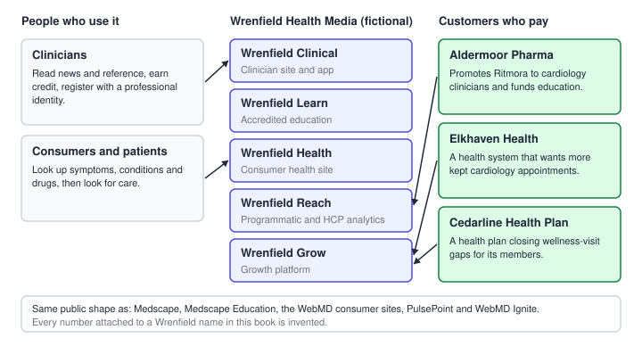

*Figure 0.1 — The practice ecosystem: users create the attention and trust; customers pay to reach or serve them.*

### What Wrenfield sells

| Product | What it does | Public counterpart in shape |
|---|---|---|
| Wrenfield Clinical | Free site and app for clinicians: news, drug reference, tools. Members register with a professional identity. | Medscape |
| Wrenfield Learn | Accredited continuing education for clinicians | Medscape Education |
| Wrenfield Health | Consumer health information | WebMD consumer sites |
| Wrenfield Reach | Advertising platform: buys media for health marketers and reports clinician-level engagement | PulsePoint |
| Wrenfield Grow | Growth platform for health systems and health plans | WebMD Ignite |

A **healthcare professional (HCP)** is anyone licensed to deliver care: physicians, nurse practitioners, physician assistants, nurses, pharmacists. In the United States most have a **National Provider Identifier (NPI)**, a public ten-digit number. Fictional NPIs in this book start with 9, a first digit real NPIs do not use.

### The clients

- **Aldermoor Pharma** makes Ritmora, a fictional heart-failure medicine. Its brand team wants cardiology clinicians to know the approved facts about it.
- **Elkhaven Health** is a regional health system that wants more kept cardiology appointments.
- **Cedarline Health Plan** wants more of its members to complete an annual wellness visit.

### The cast

| Person | Role |
|---|---|
| You | Senior technical PM at Wrenfield |
| Nadia Rahman | Engineering lead |
| Tomás Ortega | Data scientist |
| Grace Liu | Ad operations lead |
| Marcus Bell | Privacy counsel |
| Dr. Helen Okoye | Medical director, Wrenfield Learn |
| Ingrid Solberg | Ritmora brand lead at Aldermoor |
| Devon Price | Marketing director at Elkhaven |
| Dr. Amara Singh | A Texas cardiologist, Wrenfield member 48213 |

### The numbers you will see again

**The Ritmora campaign.** Aldermoor supplies a target list of 12,000 NPIs. After matching and consent checks, 7,039 clinicians are eligible. A random 10% (719) are held out; 6,320 may see the campaign. The budget is $48,000 over 84 days, September 14 to December 6, 2026.

| Line item | How it is bought | CPM | Budget |
|---|---|---|---|
| LI-DIRECT | Reserved display on Wrenfield Clinical | $120 | $20,000 |
| LI-PMP | Private marketplace across other clinical sites | $85 | $16,000 |
| LI-OPEN | Open auction, addressed to the same clinicians | $50 | $12,000 |

On October 9, day 26, the campaign has spent $11,209.75 against a plan of $14,857.15. Finding out why is Chapter 12's job.

**The Elkhaven campaign.** A cardiology campaign costing $58,000 sent 6,200 people to the provider finder; 512 kept an appointment. One campus has only 60 open new-patient slots this quarter.

**The registration experiment.** For two weeks in August, 8,000 new visitors to Wrenfield Clinical saw either the long registration form (A) or a short one that asks the remaining questions later (B).

# Part I — The ecosystem and its customers

## 1. The ecosystem and the flywheel

### Why it matters

In your first week someone will say "we need to improve cardiologist engagement." That sentence can mean a better drug-reference page, a sponsored video, an accredited course, a media campaign or a sales alert. Each has a different user, payer and rulebook, and building the wrong one, or the right one the wrong way, breaks a rule.

### The idea

The ecosystem is three connected value networks:

- **Consumer health.** Trusted information, tools and journeys for people researching symptoms, conditions, drugs, treatment, wellness and care.
- **Professional health.** News, reference, clinical tools and continuing education for clinicians, built on a registered professional identity.
- **Healthcare growth and activation.** Services that help life-sciences companies, health systems and health plans understand audiences, reach them and measure the result.

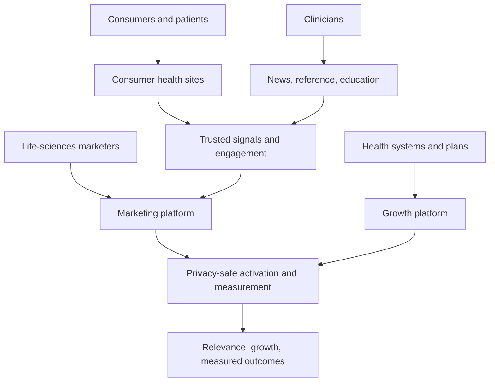

*Figure 1.1 — Two audiences create trusted engagement; two kinds of customer pay to act on it within rules.*

Eight participants meet here. Learn what each is trying to do.

| Participant | Core job | Typical friction | Product opportunity |
|---|---|---|---|
| Consumer or caregiver | Understand a health concern and decide what to do | Anxiety, low health literacy, uncertain credibility | Clear content, tools, provider discovery |
| Physician | Decide safely and quickly; stay current | Time pressure, information overload | Point-of-care reference, news, specialty personalization |
| Nurse, pharmacist, advanced practice clinician | Do role-specific care; keep credentials | Different scopes and credit rules | Profession-aware education and tracking |
| Life-sciences brand team | Reach the right audience with compliant communication | Fragmented channels, weak identity, slow review | Healthcare audiences, orchestration, outcomes |
| Agency and trading desk | Plan, buy, optimize and report media | Opaque supply, duplication, late reports | Workflow automation, transparent supply, clean APIs |
| Publisher | Earn from attention without losing trust | Yield against experience, fraud, latency | Supply controls, quality enforcement |
| Health system | Acquire patients, improve access, build loyalty | Leakage, disconnected journeys, capacity mismatch | Service-line marketing, navigation, analytics |
| Health plan | Acquire, onboard, engage and keep members | Low engagement, complex benefits, care gaps | Personalized journeys, outreach, measurement |

The business runs as a flywheel. Trusted products earn repeat visits. Visits produce first-party events and declared preferences. With permission and governance, those signals improve relevance and measurement. Better relevance is worth more to users and customers, which funds better content and tools.

The flywheel stops when optimization uses up trust faster than the product creates it: too many ads, unclear sponsorship, insensitive health inference, misleading attribution, slow pages, or an AI answer that sounds certain and is not grounded.

The advantage is the combination: trusted **endemic** environments (ones whose main subject is healthcare), authenticated professional relationships, healthcare-specific data and taxonomies, consumer reach, education expertise, programmatic activation and measurement. Your job is to connect those assets without collapsing the boundaries that protect editorial independence, education independence, privacy, consent and data rights.

### Worked example

Ingrid Solberg at Aldermoor asks Wrenfield to "improve cardiologist engagement with Ritmora." You turn it into seven answers before anyone designs anything.

| Question | Answer for the Ritmora campaign |
|---|---|
| Which clinicians, by what identity and specialty logic? | Aldermoor's list of 12,000 NPIs; cardiology physicians, nurse practitioners and physician assistants |
| Which consented or contractually permitted signals? | Member profile and engagement on Wrenfield Clinical, for members who allowed advertising use |
| What is the activation surface? | Display on Wrenfield Clinical, a private marketplace, open auction |
| Is the content editorial, accredited education or promotion? | Promotion, reviewed by Aldermoor's medical, legal and regulatory team |
| What does success mean? | Qualified engagement within 14 days; later, new prescribers |
| What is the counterfactual? | A random 10% holdout that never sees the campaign |
| What suppression and review gates apply? | No report cell under 11 clinicians; opt-outs removed daily; audit log of list versions |

Then you run the **boundary test**. Before accepting a roadmap item, draw five lines:

1. **Experience boundary:** where the user sees and controls the feature.
2. **Data boundary:** where identifiers and events are collected, joined and kept.
3. **Decision boundary:** where rules or models choose audience, content, bid or message.
4. **Commercial boundary:** where inventory, data, software, services or outcomes are contracted.
5. **Accountability boundary:** who owns editorial, medical, legal, privacy, security, accreditation and operational approval.

If any line is unclear, the item is not ready for a confident commitment.

### Common mistakes

| Mistake | Why it bites | Do this instead |
|---|---|---|
| Treating "engagement" as one thing | Editorial reading, course completion and ad clicks follow different rules | Name the content class and the payer first |
| Optimizing a metric that spends trust | Short-term lift, long-term loss of the audience | Pair every growth metric with a trust guardrail |
| Assuming all health data is alike | Consent, law and contract differ by source | Ask where each signal came from and what it may be used for |

### Check yourself

**Q1.1** Name the three value networks, and say who pays in the third.

**Q1.2** Give two ways the flywheel can fail even while engagement numbers rise.

> [!IMPORTANT]
> **In one line:** Trusted engagement is the asset; every product decision either adds to it or spends it.

## 2. The portfolio: WebMD, Medscape, WebMD Ignite and PulsePoint

### Why it matters

Interviewers and then colleagues will ask how the pieces fit. Product names here change often and public pages carry marketing numbers, so you need the current names and the habit of reading a claim as a claim.

### The idea

WebMD's corporate site describes itself as "an Internet Brands company" and lists these services.

| Area | Audience | What it publicly offers | Questions a PM asks |
|---|---|---|---|
| WebMD Consumer Network | Consumers, caregivers | Health information, tools, condition and drug content | How do credibility, comprehension, search traffic and monetization coexist? |
| Medscape | Physicians and other clinicians | News and Perspective, Drugs and Diseases, clinical tools, video, cases, Medscape AI | Which moments are point-of-care, learning, news or sponsored? |
| Medscape Education | Healthcare teams | Free accredited continuing education on medscape.org | How are independence, disclosure, credit and outcomes handled? |
| WebMD Ignite | Health systems, health plans, and others | Growth and engagement: patient education, the Ignite Growth Platform, provider finders | How do audience, capacity, CRM, content and return connect? |
| PulsePoint | Life sciences, agencies, publishers | "The Healthcare Marketing Platform": campaign buying, audiences, clinician-level analytics | What signal builds the audience, which supply is eligible, what closes the loop? |
| WebMD Health Services | Employers, plans | Well-being programs | Outside this book's scope |
| Other professional brands | Specialty or regional clinicians | Sites such as MDedge, Univadis and QxMD | Which identity, consent and taxonomy are shared? |

Details worth knowing as of October 2026:

- Medscape's surfaces, as it describes them: News and Perspective (breaking news, conference coverage, expert commentary, policy, the business of medicine); Drugs and Diseases (monographs, interactions, guidelines, procedures, formulary information, calculators, cases, quizzes, slideshows); Education (short and long activities, patient simulations, expert video, assessments, credit, certificates); and video and immersive formats (clinician stories, discussions, virtual events, interactive brand or educational experiences).
- Medscape AI launched on November 18, 2025. Medscape describes it as a medical-grade AI experience that draws on its own content, peer-reviewed literature and current medical news, free to registered members on the app and website, with a notice that answers may be incomplete and need professional judgment.
- WebMD Ignite launched in April 2023 by combining WebMD Provider Services, Krames, Mercury Healthcare and The Wellness Network; Healthwise joined in 2024. Its site names the Ignite Growth Platform with modules for market planning, audience insight, campaign workflow and performance, referral analytics and data-as-a-service, alongside a provider finder and a Digital Experience Engine. Some job postings shorten the platform to IGP. Its site now also lists health associations, government, agencies and rural communities as customers.
- PulsePoint joined Internet Brands under a deal announced April 29, 2021. Its platform page names Life (omnichannel campaign management), Studio (audience intelligence), HCP365 (clinician-level engagement analytics), Adaptive Optimization, Media Effectiveness for outcomes measurement, and an Endemic Omnichannel Suite that includes Curated Markets. Newer names include Audience Manager, HCP2DTC Influence, DTC Explorer, Hatch (an agentic AI workspace announced August 4, 2026, in limited pilot) and Moments (announced September 15, 2026, turning real-time first-party intent signals, including Medscape AI queries, into activation; open beta planned for January 2027). "Smart Lists", now written "SmartLists", are clinician cohorts that can be pushed into CRM, sales or media workflows.

**Endemic** is a product property, not only a media label. Medscape is endemic to clinicians; a general news site is non-endemic even when a clinician visits it. Endemic supply offers context, authenticated identity and trust. Non-endemic supply adds reach and frequency. A good plan gives each a different role.

Public pages also carry numbers. PulsePoint's platform page cites 4.2 million verified NPIs, 230 million US consumers, more than 60 health-centric filters, more than 5 billion condition claims and a 99% match rate. Medscape's media kit cites physician reach. WebMD Ignite cites average campaign return. Treat all of these as point-in-time **vendor claims**: useful orientation, not system guarantees.

### Worked example

A slide in a sales deck says "99% match rate." Before repeating it, you ask seven questions.

| Ask for | Why |
|---|---|
| The denominator | 99% of what: submitted NPIs, valid NPIs, or active members? |
| Freshness | When was the figure measured? |
| Source mix | Which data sources contribute to a match? |
| Match method | Deterministic key or statistical guess? |
| Consent basis | Is every matched record usable for this purpose? |
| Coverage by channel | A match in a database is not a reachable clinician on a given channel |
| Realized reach | How many were actually exposed? |

Wrenfield's own Ritmora list shows the gap. Of 12,000 listed NPIs, 9,695 match a member (80.8%), but only 7,039 are verified, consented and recently active (58.7%). Chapter 10 computes this funnel.

### Common mistakes

| Mistake | Why it bites | Do this instead |
|---|---|---|
| Quoting a vendor number as a fact | You inherit a claim you cannot define | Label it, and ask for the seven items above |
| Using last year's product names | Signals you did not check | Reread the public pages the week you interview |
| Treating all impressions as interchangeable | Endemic and non-endemic supply do different jobs | Assign each a role in the plan |
| Assuming public structure equals internal structure | Org charts and platforms differ from brochures | Learn internal boundaries during onboarding |

### Check yourself

**Q2.1** What does PulsePoint's HCP365 measure, and at what level of identity?

**Q2.2** A site about mortgages is visited by many nurses. Is it endemic supply for a nursing campaign? Why does the answer matter?

> [!IMPORTANT]
> **In one line:** Know the current public names, and read every published number as a claim that needs a denominator.

## 3. Content classes and the trust boundary

### Why it matters

One clinician page can hold an independent news story, an accredited course, a sponsored article and an advertisement. Each is controlled by different people under different rules. If the platform cannot tell them apart, a ranking model will mix them, a report will leak learner data to a sponsor, and the label on the page will be wrong.

### The idea

A **content class** says who controls a piece of content and what promise it makes.

| Content class | Who controls it | Purpose | What must never be compromised |
|---|---|---|---|
| Editorial | The editorial organization | Inform through independent reporting and reference | Independence; transparent corrections |
| Accredited CME/CE | An accredited provider | Improve knowledge, competence, performance or outcomes | Freedom from commercial influence; disclosures |
| Independent medical education | An independent educational body | Close a documented educational gap | Separation from promotion; proper supporter reporting |
| Sponsored content | Sponsor and publisher under review | Inform or engage on a topic | Clear labeling; substantiated claims |
| Promotional advertising | The manufacturer and its partners | Promote an approved product or use | Truthful, not misleading, balanced on risk |
| Market research | The research sponsor | Learn attitudes or behavior | Participant transparency, consent, data minimization |

**CME/CE** means continuing medical education and continuing education: courses clinicians take for credit.

A policy in a slide deck is not a control. The distinction has to live in six places: the content management system, the metadata on every item, the review workflow, analytics, recommendation rules and the label the user sees.

The pattern that enforces it is a **trust control plane**: every requirement or campaign is classified first, then routed through the gates its class requires.

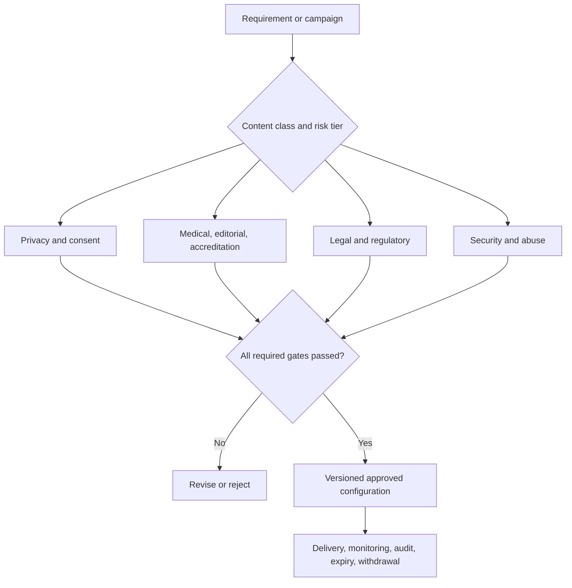

*Figure 3.1 — Classify first. The class decides which gates apply and what evidence is kept.*

### Worked example

Aldermoor asks for Ritmora content in the "Recommended for you" rail on Wrenfield Clinical, beside a heart-failure course from Wrenfield Learn. You answer with a table, not an opinion.

| Request | Decision | Control that enforces it |
|---|---|---|
| Rank the Ritmora page in the same pool as the course | No | `content_class` is a required field; the education ranker only accepts `education` |
| Show Ritmora content on the same page | Yes, in a labeled sponsored slot | Slot type fixed in the page template; label rendered by the platform, not the creative |
| Tell Aldermoor which clinicians took the course | No | Supporter reports are aggregate only; learner names need the learner's explicit consent |
| Use course completion to trigger a Ritmora ad | No | Education events are excluded from the advertising purpose in the consent record |

### Common mistakes

| Mistake | Why it bites | Do this instead |
|---|---|---|
| A free-text "type" field | Nobody can enforce a rule on free text | A required, controlled `content_class` on every item and event |
| One ranking pool for everything | Commercial priority leaks into education and editorial | Separate candidate pools per class |
| Labels drawn by the advertiser | Labels vanish or shrink | The platform renders the label |
| Treating research like marketing | Participants were promised something else | Separate consent, storage and reporting |

### Check yourself

**Q3.1** Which class is a drug manufacturer's banner, and which is a course funded by that manufacturer through an educational grant?

**Q3.2** Name four of the six places where the content-class distinction must be enforced.

> [!IMPORTANT]
> **In one line:** Classify every piece of content and every event, then let the class decide the gates, the ranking pool, the label and the report.

## 4. Five roles on one platform

### Why it matters

The job descriptions look different, but they describe one platform seen from five seats. Knowing all five tells you what your neighbors need, what you can reuse, and how your work will be judged.

### The idea

| Role | Primary customer or user | Core system | Primary outcome |
|---|---|---|---|
| Senior Technical PM, Medscape | Life sciences, institutions, operators, clinicians | Commercial platform, journeys, CDP, integrations | Faster, reliable, measurable engagement and adoption |
| AI PM, commercial offerings | Supporters, education commercial teams | AI-enabled content, reporting, customization | Differentiated supporter value, revenue, efficiency |
| Senior PM, healthcare marketing and AI | Providers, payers, healthcare marketers | Ignite Growth Platform and connected workflows | Appointments, encounters, growth, revenue |
| PM, membership | Clinician members on web and mobile | Registration, authentication, profile, identity | Active known members, richer profiles, retention |
| Publisher platforms | Readers, ad operations, clients | Ad serving, CMS, patient-journey products | Revenue with page quality and trust intact |

The senior technical role's mission in one sentence: create scalable platform and commercial capabilities that help Medscape and its institutional and life-sciences partners engage the right clinician with the next appropriate experience, through governed data, reusable integrations, automation and measurable AI-assisted decisions.

Its job description maps to systems and evidence.

| Responsibility | System behind it | Evidence of excellent work |
|---|---|---|
| Uncover stakeholder and client needs | Discovery repository, workflow maps | Prioritized problems backed by behavior and commercial evidence |
| Run proofs of concept and pilots | Stage-gated experiments | Explicit hypotheses and a stop-or-scale decision |
| Build scalable features and integrations | APIs, data contracts, connectors, service levels | Shorter integration time, fewer exceptions, lower support load |
| Define AI and ML components | Training data, features, evaluation, monitoring | Slice-level quality, useful lift, rollback |
| Drive commercial adoption | Packaging, enablement, usage telemetry | Activated customers, recurring use, attributable revenue |
| Deliver roadmap outcomes | Sequencing, dependency and risk management | Milestones met without trading away trust |

You will play five parts at once:

1. **Customer translator:** turn client language into a job that generalizes.
2. **Technical contract owner:** make APIs, events, identities, models and failure behavior explicit.
3. **Commercial product builder:** connect user value to package, price, sales motion and margin.
4. **Decision-system designer:** create rules and models that choose a next action under constraints.
5. **Individual-contributor leader:** align people through evidence and operating mechanisms, not reporting lines.

The "mini CEO" image is only useful with its limits. Engineering owns engineering quality. Medical and clinical teams own medical judgment. Legal, privacy and regulatory teams own interpretation. Sales owns the customer relationship. You own a coherent outcome, and you make sure no required decision is left without an owner.

The five roles share primitives: identity, verification, consent and preferences; event collection, profiles, audiences, journeys and experiments; content metadata and approval; recommendation and generative AI services; connectors and tooling; reporting and measurement; governance and audit; web and mobile design patterns. Shared infrastructure does not mean shared purposes. Membership personalization, accredited education, supporter reporting, provider marketing and promotion each need their own consent, independence and reporting rules. Build one control plane with purpose-specific policy, not one unrestricted profile.

| Capability | Platform owner | Domain owner | Decided jointly |
|---|---|---|---|
| Identity graph | Identity platform | Membership | Permitted links and confidence thresholds |
| Recommendation service | AI platform | Editorial, education, commercial | Candidate policy, objective, evaluation |
| CDP and audiences | MarTech platform | Campaign and journey product | Attributes, activation, consent |
| Content customization | Content and AI platform | Education or commercial offering | Approved components, independence |
| Closed-loop outcomes | Data platform | Provider and payer product | Linkage, attribution, definitions |
| Supporter reporting | Analytics platform | Commercial offering | Granularity, proof, privacy |

### Worked example

Your manager asks how you want to be measured. You bring a balanced scorecard: for each dimension a leading indicator you can move this quarter, an outcome, and a guardrail.

| Dimension | Leading indicator | Outcome | Guardrail |
|---|---|---|---|
| Delivery | Decisions resolved, dependencies ready | Milestones and launches | Escaped defects, rework |
| Commercial | Design partners, enabled sellers | New revenue, upsell, renewals | Discounting, services burden |
| Adoption | Activated accounts, setup completed | Weekly active operators | Abandonment, support tickets |
| Activation | Eligible audience, trigger coverage | Qualified next action, conversion lift | Frequency, opt-outs, complaints |
| Integration | Sandbox success, certification | Median time to first value | Failure rate, custom forks |
| Automation | Assisted tasks accepted | Hours saved, shorter cycles | Correction rate, hidden manual work |
| AI and ML | Offline quality, pilot exposure | Incremental lift from assisted workflow | Bias, unsafe action, drift |
| Trust | Reviews completed, lineage coverage | Zero material policy or privacy incidents | Suppression leaks, audit gaps |

### Common mistakes

| Mistake | Why it bites | Do this instead |
|---|---|---|
| Acting as owner of every decision | You override experts and take on risk you cannot judge | Own the outcome; find the owner of each decision |
| Building four isolated products | The same identity and consent logic gets built four times | Look for the shared primitive first |
| One profile for every purpose | Data collected for education ends up in advertising | Purpose-specific policy on a shared control plane |

### Check yourself

**Q4.1** Which decisions does the PM not own, according to this chapter?

**Q4.2** Give one leading indicator and one guardrail for the integration dimension.

> [!IMPORTANT]
> **In one line:** Five roles share one set of primitives; share the infrastructure, never the purposes.

# Part II — How the money and the media work

## 5. The MarTech stack and the integration trap

### Why it matters

Architecture slides are boxes joined by arrows. The boxes are products you can buy. The arrows are where projects fail: two systems that disagree about what a "clinician" is, how fresh a list must be, or what happens to an opt-out.

### The idea

**MarTech** (marketing technology) is the set of systems that turn strategy, content, customer data and channel execution into measurable experiences. **AdTech** is the part that handles paid-media transactions and delivery. They overlap at identity, audience, creative, consent and measurement.

| System | Responsible for | Takes in, gives out |
|---|---|---|
| CRM | Account and relationship record | Contacts, leads, sales activity in; segments, tasks, outreach history out |
| CDP | Unifying first-party profiles and events | Web, app, email, CRM, offline events in; audiences, traits, triggers out |
| DMP | Cookie- and device-based audiences | Third-party and pseudonymous data in; media segments out. Declining as privacy rules tighten |
| MAP or journey orchestrator | Automated messages and lifecycle journeys | Profiles, triggers, content in; email, SMS, push, tasks out |
| CMS and DAM | Content and digital assets | Copy, media, metadata, approvals in; pages and approved creative out |
| CMP and preference center | Privacy choices | Jurisdiction, user choice, policy version in; purpose-specific consent state and privacy strings out |
| Tag manager or SDK | Governed data collection | Site and app configuration in; events to analytics and marketing endpoints out |
| Warehouse or lakehouse | Analytical storage and transformation | Product, media, CRM, finance data in; models, features, governed datasets out |
| MDM or identity graph | Resolving entities into golden records | Member IDs, NPI, email, device, organization in; resolved IDs with confidence out |
| DSP | Buying media for advertisers | Campaign, audience, bid strategy, creative in; bids, spend, logs out |
| SSP | Selling publisher inventory | Ad opportunities, floors, consent in; bid requests, auction results, yield data out |
| Ad server | Choosing, delivering and counting ads | Tags, campaigns, creative, targeting in; ad response and event logs out |
| Clean room | Controlled data collaboration | Pseudonymized partner data in; overlap, activation, measurement out |
| Experimentation platform | Assigning treatments and measuring | Eligibility, randomization, events in; lift and guardrail results out |

Spelled out: customer relationship management (**CRM**), customer data platform (**CDP**), data management platform (**DMP**), marketing automation platform (**MAP**), content management system (**CMS**), digital asset management (DAM), consent management platform (**CMP**), master data management (MDM), demand-side platform (**DSP**), supply-side platform (**SSP**).

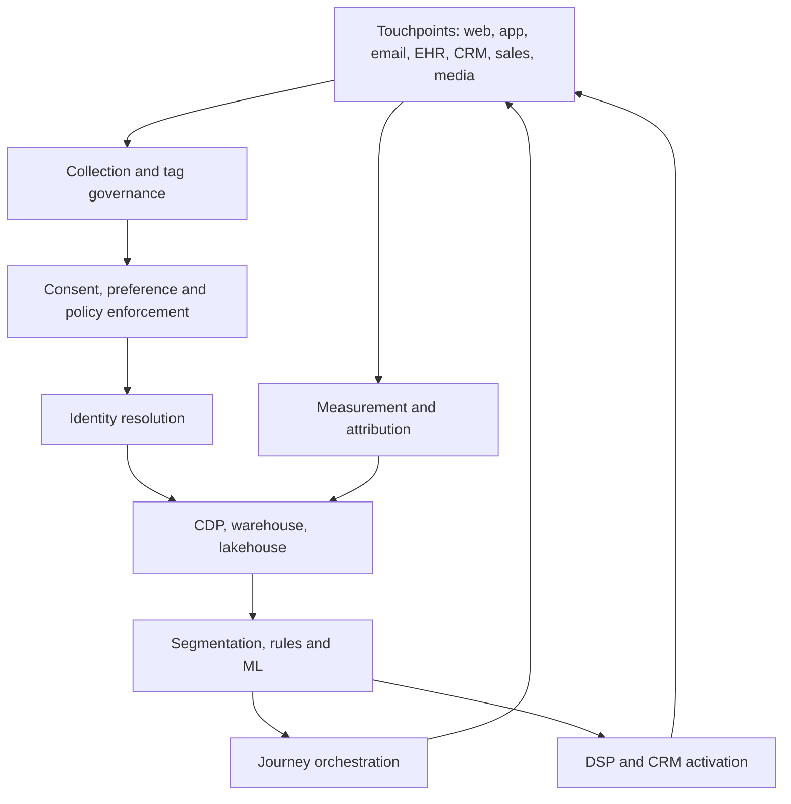

*Figure 5.1 — A reference stack. Governance (catalog, lineage, access, quality, retention, audit) applies at every box.*

The integration trap is believing the arrow. For each one, write nine things down.

### Worked example

Wrenfield Reach will export a list of engaged cardiologists to Aldermoor's CRM. Nadia asks what "export" means. You fill in the integration sheet.

| Item | For the Reach to Aldermoor CRM export |
|---|---|
| Entity | Clinician, keyed by NPI; one row per clinician per list version |
| Contract | JSON schema v2; required fields NPI, list ID, reason code, as-of time; documented error responses |
| Semantics | "Engaged" means two or more qualified education or reference events in 30 days; Wrenfield owns the definition |
| Transport | Partner API, with a nightly file as fallback |
| Latency | Daily by 06:00 Eastern; not real time |
| Identity | Deterministic NPI only; no probabilistic links; collisions rejected |
| Governance | Advertising purpose only; US only; removed within 24 hours of opt-out; deleted at contract end |
| Reliability | Idempotent upsert; three retries; daily row-count reconciliation; alert on a 5% gap |
| Commercial consequence | Missed days breach the service level; counts feed the monthly invoice |

### Common mistakes

| Mistake | Why it bites | Do this instead |
|---|---|---|
| Approving a diagram with unlabeled arrows | Each team assumes a different contract | Fill the nine items per arrow |
| Sharing a field name, not a meaning | `specialty` is declared in one system, claims-derived in another | Write semantics and owner next to the schema |
| Asking for "real time" by default | Streaming costs more and may change no decision | Set latency from the decision it serves |

### Check yourself

**Q5.1** What is the difference between a CDP and a DMP, and why is one declining?

**Q5.2** Name five of the nine items to specify for an integration.

> [!IMPORTANT]
> **In one line:** Buy the boxes, but design the arrows: entity, contract, meaning, transport, latency, identity, governance, reliability and money.

## 6. Programmatic advertising from request to outcome

### Why it matters

Most media in this ecosystem is bought and sold by software, one impression at a time, in a fraction of a second. If you have worked in payments, it will feel familiar: a real-time decision between several parties, followed by slower counting, billing and reconciliation.

### The idea

**Programmatic advertising** uses software and data to transact, deliver and optimize media. **Real-time bidding (RTB)** is one way to transact: an auction per impression. Guaranteed and fixed-price deals are also programmatic.

The actors:

- **Advertiser:** funds the campaign and owns the objective.
- **Agency or trading desk:** plans, buys, optimizes and reports for the advertiser.
- **DSP:** evaluates each opportunity and bids for the advertiser.
- **Ad exchange:** runs auctions; in practice it overlaps with the SSP.
- **SSP:** represents the publisher's inventory and manages yield and controls.
- **Publisher:** owns the site or app and its ad space, called inventory.
- **Ad server:** decides what is delivered and counts it.
- **Data or identity provider:** adds segments, identifiers or enrichment.
- **Measurement or verification provider:** assesses viewability, fraud, brand safety, attention or outcomes.

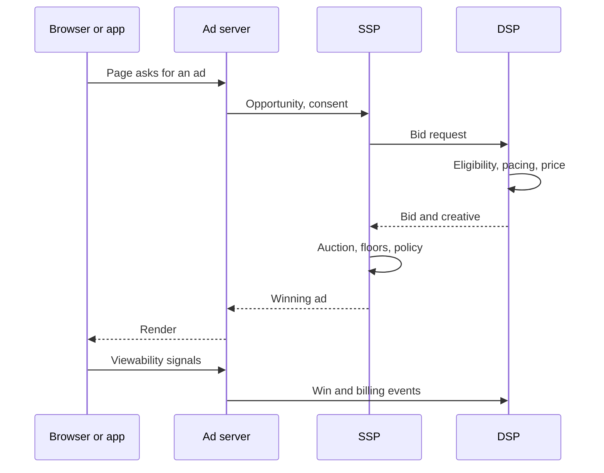

*Figure 6.1 — One impression. The round trip usually takes a fraction of a second.*

The time is shared by page rendering, consent lookup, identity, the SSP, the DSP, creative retrieval and verification. A 100-millisecond data lookup that is harmless in a nightly job can be fatal in this path.

| Buying method | Price and inventory | Best for | Trade-off |
|---|---|---|---|
| Open auction | Dynamic price, broad supply | Scale and flexible optimization | Needs stronger quality controls |
| Private marketplace (PMP) | Invitation by **deal ID**, negotiated rules | Curated, premium or endemic supply | Setup and troubleshooting effort |
| Preferred deal | Fixed price, first look, not guaranteed | Priority without commitment | Inventory may not clear |
| Programmatic guaranteed | Fixed price, reserved volume | Predictable premium delivery | Depends on accurate forecasts |
| Direct insertion order | Negotiated by people | Custom sponsorships | Manual work |

Prices are quoted as **CPM**, cost per thousand impressions:

`media cost = impressions / 1,000 x CPM`

### Worked example

A fictional campaign delivers 2,400,000 impressions at a $28 CPM.

```python
def media_cost(impressions, cpm):
    return impressions / 1000 * cpm


impressions, cpm = 2_400_000, 28.00
gross = media_cost(impressions, cpm)
```

Output:

```text
2,400,000 impressions at a $28.00 CPM cost $67,200.00
```

That $67,200 is gross advertiser spend, not what the publisher earns. Apply a fictional fee schedule (12% platform fee, 8% data fee and 3% verification on gross; then a 15% SSP fee on what remains):

Output:

```text
line                                   amount
----------------------------------  ---------
Gross advertiser spend              67,200.00
DSP platform fee                    -8,064.00
Audience data fee                   -5,376.00
Verification and measurement        -2,016.00
Working media (clears the auction)  51,744.00
SSP fee                             -7,761.60
Publisher revenue                   43,982.40

Publisher receives 65.5% of gross spend.
Advertiser pays $28.00 CPM; publisher earns $18.33 eCPM.
```

Eight numbers get confused in meetings. Keep them apart: gross advertiser spend; working media; platform and data fees; verification and measurement fees; publisher revenue; **take rate** (platform revenue as a share of spend) and net revenue; billable against measured impressions; and discrepancies between systems. **eCPM**, effective CPM, is what a party actually earned or paid per thousand impressions after all of that.

### Common mistakes

| Mistake | Why it bites | Do this instead |
|---|---|---|
| Saying "revenue" without gross or net | Finance, sales and product mean different numbers | Name the line in the waterfall |
| Calling every deal a PMP | Guarantees, price and priority differ | Use the five method names precisely |
| Trusting one system's count | Ad server, SSP and DSP count at different points | Define the billable source and a tolerance |

### Check yourself

**Q6.1** A line item delivers 850,000 impressions at a $42 CPM. What is the gross media cost?

**Q6.2** What separates a preferred deal from programmatic guaranteed?

> [!IMPORTANT]
> **In one line:** An impression is a sub-second negotiation between many parties; the money is only understood when you name which line of the waterfall you mean.

## 7. SSPs, auctions and yield

### Why it matters

On the publisher side the question is what to accept, from whom, at what price, and how long to make the reader wait. A team that maximizes the winning bid can lower revenue and slow every page.

### The idea

An **SSP** helps a publisher expose, package, price, control and sell ad inventory across many buyers. "The publisher's DSP" is a fair first picture, but an SSP also protects the reader's experience and enforces policy. For each opportunity it:

1. Receives the opportunity from the publisher's integration.
2. Interprets site or app, content, device, format, privacy, identity and supply-chain data.
3. Applies publisher blocks, consent rules, floors, deal priority and traffic-quality controls.
4. Selects eligible demand partners and builds bid requests.
5. Runs or joins the auction.
6. Validates the winning bid and creative.
7. Returns the ad markup.
8. Logs auction, delivery, billing, quality and discrepancy events.
9. Optimizes yield within latency and experience limits.

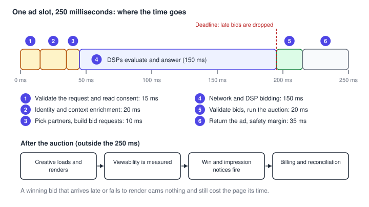

*Figure 7.1 — A 250-millisecond budget for one slot. These are targets, not guarantees.*

Auction vocabulary:

- **First-price auction:** the winner pays about what it bid. This is now the common format. **Bid shading** is the buyer's tactic of bidding lower than its true value while still expecting to win.
- **Header bidding:** the publisher asks several demand sources before, or alongside, the ad server's own decision. Prebid is the common open-source implementation.
- **Bid floor:** the minimum acceptable price. A hard floor rejects lower bids; a soft floor only influences the auction. A deal floor belongs to a negotiated deal. A dynamic floor moves with context, demand or history.
- **Clearing price:** what the winner pays.
- **Fill rate:** filled opportunities divided by eligible opportunities.
- **Bid rate:** bid responses divided by bid requests. **Win rate:** auctions won divided by auctions bid. **Timeout rate:** responses that arrive after the deadline, divided by requests.
- **Match rate:** requests with a usable identity match, divided by eligible requests.

| Model | How it works | Strength | Weakness |
|---|---|---|---|
| Waterfall | Partners called one after another by priority | Simple | Early partners see everything first; weak price discovery |
| Client-side header bidding | Many bidders called from the browser | Real competition, transparent | Browser latency and network load |
| Server-side bidding | The fan-out happens on a server | Less work for the page | Weaker cookie matching; another intermediary |
| Hybrid | Both paths | Balances reach and speed | Deduplication gets complicated |

**Yield** is what the publisher earns from its inventory, and it has several objectives at once:

`expected value = P(eligible) x P(fill) x expected net CPM x P(render)`

subject to latency, ad load, viewability, policy, privacy, reader experience, advertiser quality and contracts.

| Layer | Metrics | What they diagnose |
|---|---|---|
| Opportunity | Ad requests, eligible requests | Inventory and policy funnel |
| Demand | Bid rate, bids per request, timeout rate | Connectivity and latency |
| Auction | Win rate, floor rejections, deal match | Pricing and deal health |
| Delivery | Render rate, discrepancy, viewability | Creative and measurement health |
| Economics | Gross spend, publisher revenue, take rate, net eCPM | Commercial performance |
| Quality | Invalid traffic, malware blocks, policy rejects | Trust and safety |
| Experience | Page latency, layout shift, ad density | Cost to the reader |

### Worked example

One slot on Wrenfield Clinical receives four bids. The open floor is $18; the cardiology deal has a $24 floor.

The script `ch07_yield.py` checks each bid against its floor and picks the highest eligible one.

Output:

```text
bidder  bid_cpm  path                status
------  -------  ------------------  ------------------
DSP-A     21.50  open                eligible
DSP-B     26.00  cardio-endemic-pmp  eligible
DSP-C     23.75  cardio-endemic-pmp  below floor $24.00
DSP-D     17.90  open                below floor $18.00

Winner: DSP-B pays $26.00 CPM (first price).
```

Now Grace wants to raise the floor and lengthen the timeout to "get higher CPMs." You compute revenue per thousand requests for three settings.

Output:

```text
setting                      fill  net_cpm  render  revenue_per_1000_requests
---------------------------  ----  -------  ------  -------------------------
Floor $8, 900 ms timeout      86%    14.20     97%                      11.13
Floor $14, 900 ms timeout     61%    19.80     97%                      11.01
Floor $14, 2,500 ms timeout   70%    20.60     78%                      10.57
```

The $14 floor lifts net CPM by 39% and revenue falls, because fill drops from 86% to 61%. The long timeout has the highest CPM of all and the lowest revenue: slow winning bids fail to render, and the page may wait up to 1.6 seconds longer.

### Common mistakes

| Mistake | Why it bites | Do this instead |
|---|---|---|
| Optimizing average CPM | CPM rises while revenue and speed fall | Optimize revenue per thousand requests, with latency as a guardrail |
| One global timeout | Hides a slow partner or region | Set and track budgets per partner |
| Reporting the average latency | The 95th percentile is where bids are lost | Report percentiles |

### Check yourself

**Q7.1** Using the output above, why did DSP-C lose even though its bid beat DSP-A's?

**Q7.2** Fill is 70%, net CPM $20, render rate 90%, all requests eligible. What is revenue per thousand requests?

> [!IMPORTANT]
> **In one line:** Yield is revenue per request after fill, render and the reader's time are counted, not the price of the best bid.

## 8. OpenRTB, supply-chain transparency and supply quality

### Why it matters

A buyer spending a pharma brand's money needs to know three things about an impression: what exactly is offered, who is really selling it, and whether a person could see it. Each has a standard. When any is missing, cautious buyers stop bidding, and a publisher sees "low demand" without knowing why.

### The idea

**OpenRTB** is the IAB Tech Lab protocol for bid requests and responses. Version 2.6 added ad pods for connected TV, channel and network descriptions and a structured user-agent object. It is now maintained as dated releases; the latest is 2.6-202606, from June 2026. "Supports OpenRTB 2.6" never means every field is filled in correctly.

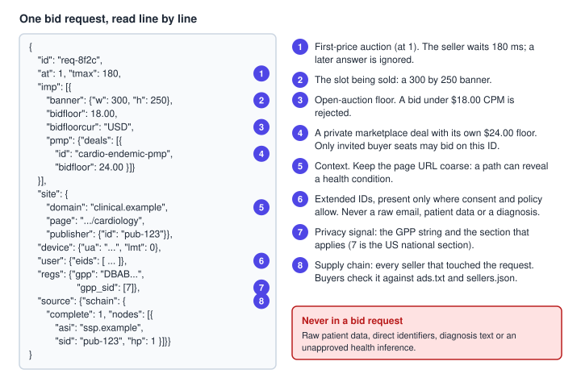

*Figure 8.1 — A simplified bid request. A request can be valid JSON and still be a privacy failure.*

A **bid response** carries the request ID, the buyer's seat, the impression it answers, the price, creative markup or a reference, a creative ID, the advertiser's domain, a campaign ID, content categories and notification URLs. The SSP checks all of it before accepting the bid.

Four mechanisms let a buyer verify the seller:

- **ads.txt:** a file on the publisher's domain listing who may sell its inventory, each marked DIRECT or RESELLER. Version 1.1 added owner-domain and manager-domain lines.
- **app-ads.txt:** the same for mobile and connected-TV apps.
- **sellers.json:** a file hosted by the SSP or exchange naming each seller account as publisher, intermediary or both, unless marked confidential.
- **SupplyChain object (`schain`):** the ordered list of sellers inside the bid request, with a flag saying whether the list is complete.

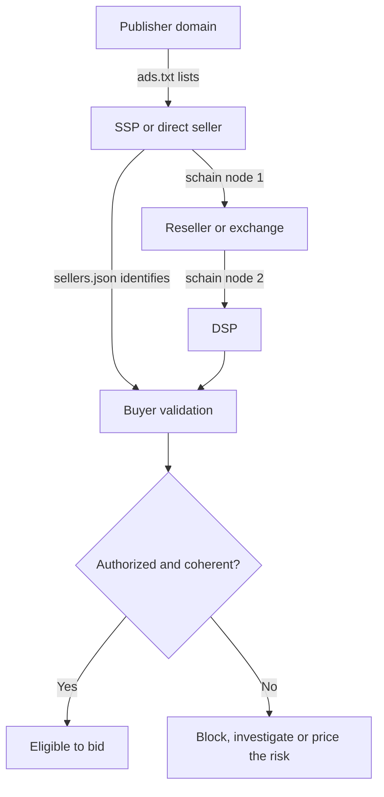

*Figure 8.2 — Three public declarations checked against each other.*

Supply quality has its own vocabulary.

| Term | Meaning |
|---|---|
| **Invalid traffic (IVT)** | Traffic not from a real person with real interest. General IVT is caught by routine filters such as known bots and data centers. Sophisticated IVT needs deeper analysis: hijacked devices, emulators, manipulated activity |
| **Viewability** | Under the Media Rating Council guideline, at least 50% of a display ad's pixels in view for one continuous second, or two seconds for video. An opportunity to see, not proof of attention |
| Domain or app spoofing | Inventory passed off as a premium property |
| Ad stacking, pixel stuffing | Ads layered so one is visible, or rendered in a tiny invisible area |
| Click injection or flooding | Fake clicks that steal attribution |
| Made-for-advertising site | A property built mainly to capture ad spend |
| **Brand safety** and **brand suitability** | Avoiding categories unacceptable to any brand; then a brand-specific judgment of fit |

Healthcare needs more than a blocklist. A cancer-treatment ad beside an obituary or a distressing patient story is on-topic and unsuitable. Blocking every page that contains the word "cancer" removes the best endemic supply. Use taxonomy, page type, source quality and human review together.

### Worked example

A clinical publisher, CardioDaily (fictional), asks to join Wrenfield's cardiology private marketplace. Grace runs the acceptance tests.

| Test | Result |
|---|---|
| Publisher account appears in ads.txt with the right relationship | Pass |
| Seller ID and domain resolve in sellers.json | Fail: listed as intermediary, but ads.txt says DIRECT |
| `schain.complete` reflects whether all sellers are present | Pass |
| Reseller nodes are ordered and match observed paths | Pass |
| Privacy strings pass through unchanged | Pass |
| Sensitive page URLs are redacted or categorized | Fail: full article paths, including condition names, are sent |
| Bid request and billing logs reconcile within tolerance | Pass, 1.8% gap against a 3% tolerance |

Two failures, both blocking: the first makes careful buyers drop the supply, the second leaks health context to every bidder.

### Common mistakes

| Mistake | Why it bites | Do this instead |
|---|---|---|
| Sending the full page URL | A path can reveal a condition to hundreds of bidders | Send a coarse category |
| Keyword blocklists for health | Blocks valuable clinical pages; misses unsuitable ones | Taxonomy plus page type plus review |
| Checking ads.txt once | Seller relationships change | Monitor and alert on mismatches |

### Check yourself

**Q8.1** Which file does the publisher host, which does the SSP host, and which information travels in the bid request?

**Q8.2** Why can a syntactically valid bid request be a privacy failure?

> [!IMPORTANT]
> **In one line:** A buyer must be able to verify what is offered, who sells it and whether it could be seen; give them that, and never more data than the auction needs.

## 9. Publisher ad serving and page performance

### Why it matters

The ad server decides which ad appears on every page view. Ad operations configures it; you own how the product behaves around it, including how fast the page loads. A slow clinical reference page fails the reader at the moment of need.

### The idea

An **ad server** turns an eligible page or app opportunity into a governed delivery decision: it receives an ad request, evaluates inventory and targeting, chooses among direct and programmatic demand, returns a creative, records delivery and feeds billing. Google Ad Manager is the common publisher ad server. Its objects:

| Object | Meaning | Question to ask |
|---|---|---|
| Network | The publisher's top-level account | Who owns access and policy? |
| Ad unit | A sellable position, such as article-top | Is the naming stable across sites and apps? |
| Placement | A reusable group of ad units | Is it a sales package, an operational group, or both? |
| Order | The commercial container for an advertiser | Which contract and billing IDs map to it? |
| **Line item** | The delivery contract: dates, quantity, priority, rate, pacing, targeting | What makes it eligible, and what outranks it? |
| Creative | The asset or third-party tag | Is it approved, secure, responsive, measurable? |
| **Key-value** | Custom context sent with the request | Is the value allowed, documented, low-risk? |
| Audience segment | An eligible user or cohort signal | What are its source, consent, lifetime and match rate? |

Key-values make line items eligible for a request. Treat them as a controlled interface. Google's policies forbid passing anything it could recognize as personally identifiable information, and a diagnosis, article title or free text does not belong there either.

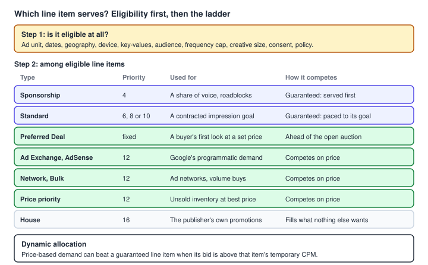

*Figure 9.1 — Line item types and priority values as Google Ad Manager's help pages list them.*

Check eligibility before optimization. Is the ad unit targeted? Do date, geography, device, audience, frequency, creative size, consent and policy all pass? Is the line item active and under its cap? Is something of higher priority also eligible? Can the creative render here? Many "optimization problems" are eligibility defects.

A targeting contract defines: the business intent and prohibited inference; allowed key names, values, case and delimiters; where each value is calculated; behavior in browser, app, server-side and each privacy state; what happens when a value is unknown, missing, expired or conflicting; test requests and the line items they should make eligible; logging without sensitive raw values; and owner, version, retention and retirement date. For health inventory, prefer coarse, reviewed context categories. A campaign requirement never overrides privacy, editorial, medical or platform policy.

Direct campaigns carry guarantees, sponsorships, roadblocks, exclusivity and impression goals. Programmatic paths carry open auction, private marketplace, preferred and guaranteed deals. Client work runs: objective and constraints, then feasibility and inventory forecast, solution and measurement plan, contracted scope, trafficking and creative checks, delivery and pacing, optimization with approved levers, reconciliation and renewal. Never promise an audience, format, integration or metric before feasibility and governance review.

**Page performance.** Google's **Core Web Vitals** are three field measures, judged at the 75th percentile and split by mobile and desktop: Largest Contentful Paint (LCP) at or under 2.5 seconds, Interaction to Next Paint (INP) at or under 200 milliseconds, and Cumulative Layout Shift (CLS) at or under 0.1. They indicate experience. They do not replace task success, accessibility or reliability.

| Failure | Typical cause | Control |
|---|---|---|
| Slow LCP | Render-blocking tags, slow server | Prioritize the main content; delay noncritical vendors; cache |
| Poor INP | Long JavaScript tasks, tag cascades | Script budget; defer and isolate vendor code |
| High CLS | Unknown ad size, late banners | Reserve slot dimensions; stable placeholders |
| Battery and data drain | Repeated auctions, heavy SDKs, autoplay | Request budget; refresh only in view |
| Broken navigation | Sticky or interstitial units over controls | Safe areas and dismissal rules |

Set a performance budget per page type and device class: first- and third-party JavaScript, main-thread time, request count, bytes, ad-request timeout, creative weight, layout movement, app startup and crash-free sessions. Exceptions are time-bound and visible. A vendor's revenue case must include the experience cost it imposes.

Measure with real-user monitoring in the field and lab tests for diagnosis. Slice by template, site, app version, browser, device class, consent state, ad density and logged-in state; compare medians and tails.

Every release, vendor, template or campaign change passes the same gate: lab and synthetic checks, canary traffic, real-user monitoring, then a budget and guardrail decision. A pass expands the rollout; a fail is disabled, rolled back or isolated. What survives is retained, revised or removed on segmented business and user outcomes.

Ad refresh must follow policy, depend on viewability and user activity, and never fire for a hidden or backgrounded slot. Lazy loading should create a slot early enough to avoid a blank and late enough to avoid waste. Test fast scrolling, back-forward cache, orientation change, infinite scroll and single-page route changes.

For any third party (verification, header bidding, rich media, video player, consent platform, measurement tag) document: data collected, subprocessors, network calls, storage, SDK permissions, performance budget, failure isolation, versioning, security review, accessibility, kill switch, incident contact and exit plan.

### Worked example

Sales wants a new in-article placement on Wrenfield Clinical. You write the acceptance criteria.

- [ ] The reserved container prevents layout shift.
- [ ] Keyboard and screen-reader order stay correct.
- [ ] With consent denied, no disallowed signal is sent.
- [ ] The page stays usable when the ad server or a third party times out.
- [ ] The creative cannot cover navigation or clinical content.
- [ ] Viewability and delivery meet the agreed goals.
- [ ] LCP, INP, CLS, error, complaint and revenue guardrails pass, by device, before full rollout.

Scorecard for the placement: eligible request rate, fill, render rate, viewability, revenue, direct-campaign delivery, timeouts, creative errors, discrepancy, the three vitals, privacy failures, complaints and editorial-trust signals.

### Common mistakes

| Mistake | Why it bites | Do this instead |
|---|---|---|
| Tuning price when a line item is not eligible | Nothing changes | Walk the eligibility list first |
| Free-form key-values | Sensitive context leaks into ad requests | A versioned targeting contract |
| Judging speed by the average | The mobile 75th percentile is failing | Segment and read percentiles |

### Check yourself

**Q9.1** Two line items are eligible: a Standard at priority 8 and a Price priority at 12. Which is considered first, and what can let the other win?

**Q9.2** State the three Core Web Vitals with their "good" thresholds.

> [!IMPORTANT]
> **In one line:** Eligibility decides what can serve, priority decides what does, and the page's speed is part of the product you are selling.

## 10. Identity and addressability

### Why it matters

Every promise in this business ("reach these cardiologists", "cap frequency at three", "measure who prescribed") rests on knowing that two records refer to the same person. Miss a match and you lose reach. Make a false one and you merge two clinicians' histories, which is worse.

### The idea

**Addressability** is the ability to recognize or classify an audience well enough to select, personalize, frequency-control or measure. Identity is the set of identifiers and relationships behind it. If you know payments, think of customer due diligence: evidence of different strengths, each with a source and a date.

| Identifier | Strength | Limitation |
|---|---|---|
| First-party account or member ID | Deterministic and durable while logged in | Does not travel to other platforms |
| NPI | Stable public identifier for US providers | Carries no information about the person; not proof of a current license; not a consumer ID |
| First-party cookie | Sessions and repeat visits on one domain | Deleted by browsers; device-specific; needs consent |
| Third-party cookie | Old cross-site interoperability | Blocked or restricted in many browsers; not a future strategy |
| Mobile advertising ID (**MAID**) | App measurement and advertising | Resettable; gated by platform permission |
| Hashed email | Deterministic when normalized the same way | Hashing is **pseudonymization**, not anonymization |
| Universal ID | Interoperability across companies | Adoption, governance and dependency risk |
| IP address | Coarse household or network signal | Shared, dynamic, sensitive, weak |
| Contextual classification | Needs no person-level ID | Less precise; depends on classification quality |

**Browsers in October 2026.** Do not say "Chrome is eliminating third-party cookies." In April 2025 Google said it would keep its existing cookie choice in Chrome settings and not launch a new prompt. In October 2025 it retired most Privacy Sandbox advertising technologies, including Topics, Protected Audience and Attribution Reporting, while continuing CHIPS, FedCM and Private State Tokens; Chrome began removing the retired interfaces in version 152 in August 2026. The UK competition regulator closed its case in October 2025. Safari has blocked third-party cookies by default since 2020 and Firefox isolates them per site. iPhone apps need permission to read the advertising ID. The durable strategy is unchanged: first-party relationships, contextual relevance, consented deterministic collaboration and measurement that does not need universal cross-site identity.

**Deterministic resolution** uses a shared stable key such as an authenticated account, verified email or NPI. **Probabilistic resolution** estimates a link from device, network, behavior and time. In health contexts probabilistic identity can produce unacceptable false positives and sensitive inference.

An **identity graph** stores entities and the links between them. Each link carries evidence:

```text
left_id, right_id, relationship_type, method,
confidence, source, permitted_purposes,
effective_at, expires_at, consent_version,
created_by, rule_or_model_version
```

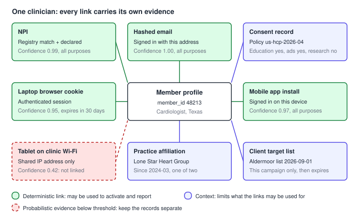

*Figure 10.1 — Dr. Singh's identity graph. The red link stays unlinked.*

Profile attributes differ in provenance and reliability. Specialty may be declared, verified or licensed, and goes stale: keep provenance, confidence and a last-verified date. An NPI can be mistyped or matched to the wrong person: use deterministic rules and review thresholds. Organization changes and is often plural: keep effective dates. Engagement can be bots or shared devices: prefer authenticated events. Consent varies by purpose and jurisdiction: keep it versioned and propagate withdrawal.

Two facts about the NPI registry, NPPES. CMS states that having an NPI does not ensure a provider is licensed or credentialed. And CMS stopped supporting Version 1 of its downloadable files on March 3, 2026; Version 2 lengthens the first-name and legal-business-name fields, so a pipeline built for the old layout can truncate or fail quietly.

A workable match order, most to least trusted:

1. Same authenticated account ID.
2. Verified email plus a corroborating professional attribute.
3. Verified NPI link with account evidence.
4. Deterministic enterprise single-sign-on mapping.
5. Approved probabilistic evidence, for low-risk recognition only.
6. Otherwise keep the records separate and ask for verification.

Never merge on a shared surname, organization, office IP address or device alone. As confidence falls, allowed activation and reporting narrow. Do not force every anonymous event into a named profile.

**Clean collaboration.** The IAB Tech Lab's **PAIR** protocol (originated by Google, now at version 1.1) lets an advertiser and publisher match their first-party audiences using encrypted, scoped identifiers inside a clean room, without either seeing the other's raw emails. A data **clean room** allows controlled matching and analysis: approved queries, minimum aggregation, no row-level export, audit logs. Neither changes the underlying permission. Consent, purpose, contract and data rights still apply.

### Worked example

Aldermoor's list has 12,000 NPIs. How many can the campaign actually address? The check digit comes first: an NPI's tenth digit is computed from the other nine with the Luhn algorithm, after prefixing 80840 (`npi_check_digit` in `seed.py`).

Output:

```text
123456789 -> 1234567893
1234567893  valid: True
1234567894  valid: False
123456789   valid: False
```

Then the funnel, one query over the list and the member profiles:

```sql
-- One row per NPI on the client's target list. npi_valid() is a small
-- check-digit function the Python runner registers with SQLite.
SELECT
  COUNT(*)                                            AS on_client_list,
  SUM(npi_valid(t.npi))                               AS valid_npi,
  SUM(p.hcp_id IS NOT NULL)                           AS matched_member,
  SUM(p.verified = 1)                                 AS verified,
  SUM(p.verified = 1 AND p.consent_state = 'granted') AS consented,
  SUM(p.verified = 1 AND p.consent_state = 'granted'
      AND p.last_seen >= '2026-08-15')                AS reachable
FROM target_list t
LEFT JOIN hcp_profile p ON p.npi = t.npi;
```

Output:

```text
stage             npis  pct_of_previous  pct_of_list
--------------  ------  ---------------  -----------
on_client_list  12,000                -        100.0
valid_npi       11,780             98.2         98.2
matched_member   9,695             82.3         80.8
verified         9,002             92.9         75.0
consented        8,121             90.2         67.7
reachable        7,039             86.7         58.7
```

"Match rate" could honestly be reported as 98.2%, 80.8% or 58.7%, depending on which line you stop at. The campaign can only use the last one.

### Common mistakes

| Mistake | Why it bites | Do this instead |
|---|---|---|
| One "match rate" number | Hides whether loss is typos, non-members, consent or inactivity | Report the funnel |
| Treating hashed email as anonymous | It still links to one person | Call it pseudonymous and govern it |
| Merging on weak evidence | Two people's histories combine | Keep separate below threshold; false merges cost more than misses |

### Questions to ask in your first weeks

- What is the canonical model for clinician, NPI, consumer, account, campaign and event?
- Which identity links are deterministic and which are modeled?
- How do deletion, revocation and suppression propagate?
- Which fields may not leave a controlled environment?

### Check yourself

**Q10.1** In the funnel above, which step loses the most NPIs, and is that a data-quality problem?

**Q10.2** Why is a false merge usually worse than a missed merge?

> [!IMPORTANT]
> **In one line:** Identity is evidence with a source, a confidence and a permitted purpose, never a magic join key.

## 11. Audience data and segmentation

### Why it matters

"Cardiologists interested in Ritmora" sounds like an audience. It is not one until someone can say which rule produced each member, whether each field may be used this way, and how many of them can be reached this week.

### The idea

Data comes in classes, and the class sets how far you can trust and use it.

- **Zero-party data:** what a person deliberately tells you, such as a chosen specialty interest.
- **First-party data:** events and attributes collected through your own relationship.
- **Second-party data:** another party's first-party data shared under agreement.
- **Third-party data:** collected or aggregated without a direct relationship.
- **Clinical data:** diagnoses, procedures, labs, medications, encounters.
- **Claims data:** billing and adjudication records, long-running but delayed.
- **Prescription (Rx) data:** dispensing transactions, under strict contracts and de-identification.
- **Digital behavioral data:** page, search, video, email, ad and app events.

Claims are not ground truth. They are built for payment. They can be late, incomplete, reversed, bundled, miscoded or absent for cash visits. A diagnosis code may record a condition being ruled out. A filled prescription does not prove the medicine was taken.

Judge any **segment** (a defined group of people or accounts) on ten points:

1. **Definition validity:** does the rule describe the intended audience?
2. **Provenance:** where did each field come from?
3. **Permission:** may it be used for this purpose, customer, geography and channel?
4. **Freshness:** when did the signal occur?
5. **Precision:** of those included, how many truly qualify?
6. **Recall:** of those who qualify, how many are included?
7. **Reachability:** how many can be activated in the chosen channel?
8. **Stability:** how much does membership change between refreshes?
9. **Bias:** who is systematically missing or misclassified?
10. **Explainability:** can an operator see why someone is in or out?

A segment builder fit for enterprise use shows attribute provenance and freshness; handles nested AND/OR logic with clear precedence; shows estimated and realized counts; explains inclusion and exclusion; applies consent and policy filters automatically; supports versions, approval, schedule, owner and expiry; analyzes overlap and frequency; checks destination compatibility; previews with aggregate data; and keeps an audit history with rollback.

AI can help: turning a plain-language goal into a draft rule, suggesting approved attributes, flagging an audience that is unexpectedly small or large, explaining overlap, recommending a test. It must show the generated logic and wait for human approval. It must not invent fields, infer prohibited health attributes, or quietly widen eligibility to hit a reach target.

### Worked example

Ingrid's brief says: "cardiologists interested in Ritmora." You rewrite it as a definition someone can build and audit.

| Element | Ritmora audience definition |
|---|---|
| Eligible professions | Physicians, and approved nurse practitioners and physician assistants |
| Specialty logic | Cardiovascular disease, interventional cardiology, electrophysiology, advanced heart failure |
| Geography | US states approved for the campaign |
| Identity | Deterministic NPI match above threshold |
| Signal | On Aldermoor's target list, or recent engagement with approved cardiology content categories |
| Exclusions | Opt-outs, deactivated NPIs, pediatric-only practice (adult indication), institutional exclusions |
| Refresh | Identity daily; content segment weekly |
| Activation | Endemic display and an approved CRM list |
| Reporting | Aggregate; NPI-level only where contract and law permit |
| Evaluation | Reach, frequency, qualified engagement, incremental outcome with confidence intervals |

### Common mistakes

| Mistake | Why it bites | Do this instead |
|---|---|---|
| Reporting segment size only | A large segment may be mostly unreachable | Report eligible, reachable and realized counts |
| Using claims as the patient record | Rule-out codes and lag mislead | State known limits beside every claims-based field |
| Letting a model widen the rule to hit a number | Eligibility drifts past what was approved | Rule changes need a new version and approval |
| No expiry on segments | Old logic keeps activating | Owner and expiry on every segment |

### Check yourself

**Q11.1** A segment has high precision and low recall. Describe what the campaign team will observe.

**Q11.2** Give two reasons a diagnosis code in a claim may not mean the patient has the condition.

> [!IMPORTANT]
> **In one line:** An audience is a rule with provenance, permission and a reachable count, not a phrase in a brief.

## 12. Campaign operations, pacing and optimization

### Why it matters

A campaign that underdelivers owes the client a makegood, and one that overspends early buys poor inventory late. An optimizer left alone finds the cheapest clicks, which are rarely what the client paid for.

### The idea

Campaigns are nested objects, and each level needs a status, owner, dates, approval state, audit history and external IDs.

```text
Advertiser
  Campaign (objective, budget, dates, geography, guardrails)
    Line item or tactic (audience, channel, deal, bid strategy, pacing)
      Creative (version, format, claims, approval, expiration)
      Placement or supply package
      Measurement plan
```

Do not bury meaning in names such as `CARD_US_HCP_Q4_FINAL_v7`.

**Pacing** controls spend or delivery over time. The simplest target is even:

`target spend to day t = total budget x elapsed days / total days`

Real systems adjust for time of day, weekends, forecast supply, learning periods, deals, frequency caps, audience exhaustion and delayed conversions. A **frequency cap** limits how many times one person sees the campaign in a period.

Optimize in this order, and never trade a higher level for a lower one:

1. Legal, consent, safety and policy eligibility.
2. The campaign contract and delivery feasibility.
3. Data and measurement validity.
4. User experience and quality.
5. Incremental business outcome.
6. Efficiency, such as **CPA** (cost per action) or **ROAS** (return on ad spend).

Bidding models learn in a loop, and the loop can teach them the wrong thing.

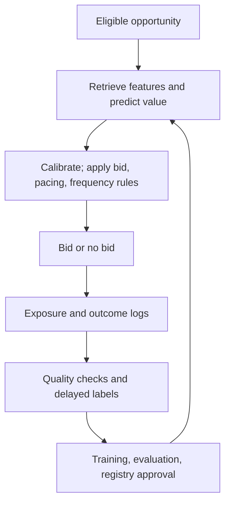

*Figure 12.1 — The optimization loop. Watch for label leakage, feedback loops, selection bias, sparse specialties, campaigns that change mid-flight, and proxy metrics.*

### Worked example

It is October 9, day 26 of 84. First, what has each line item delivered?

Output:

```text
line_item  buy_type    impressions  viewable_rate     spend    vcpm  reach  frequency
---------  ----------  -----------  -------------  --------  ------  -----  ---------
LI-DIRECT  guaranteed       48,003          0.719  5,760.36  166.95  4,690       10.2
LI-OPEN    open             72,516          0.551  3,625.80   90.79  4,871       14.9
LI-PMP     pmp              21,454          0.719  1,823.59  118.23  3,896        5.5
```

Then pacing against an even plan. `daily_needed` is the remaining budget divided by the 58 days left.

Output:

```text
line_item     budget    planned      spent  pace_pct  daily_so_far  daily_needed
---------  ---------  ---------  ---------  --------  ------------  ------------
LI-DIRECT  20,000.00   6,190.48   5,760.36      93.1        221.55        245.51
LI-OPEN    12,000.00   3,714.29   3,625.80      97.6        139.45        144.38
LI-PMP     16,000.00   4,952.38   1,823.59      36.8         70.14        244.42
TOTAL      48,000.00  14,857.15  11,209.75      75.5        431.14        634.31
```

The campaign is at 75.5% of plan, and almost all of the gap is one line: the private marketplace is at 36.8%. To finish on budget it must spend $244.42 a day, three and a half times its current rate. That is not a pacing setting. Something upstream is limiting supply, and Case 2 finds it.

Before raising any bid, look at frequency across all three lines together:

Output:

```text
impressions_in_26_days   hcps  pct_of_reached
----------------------  -----  --------------
01-10                     453             9.2
11-25                   1,687            34.3
26-40                   1,602            32.6
41+                     1,173            23.9
```

About a quarter of reached clinicians have already seen 41 or more impressions in 26 days. Pushing the open auction harder to "catch up" would add impressions to the same people.

### Common mistakes

| Mistake | Why it bites | Do this instead |
|---|---|---|
| Aggressive catch-up | Buys low-quality late inventory and piles frequency on the same people | Find the binding constraint first |
| Caps set per line item only | Total exposure per person is uncontrolled | Cap across the campaign |
| Reacting to delayed reports | Bids oscillate | Know each report's lag before changing anything |
| Letting a conversion model chase easy responders | Spend goes to people who would have acted anyway | Optimize toward incremental outcomes |

Also watch for timezone errors that overspend daily budgets, caps so tight the budget cannot be spent, and audience refreshes that shrink eligibility mid-flight.

### Check yourself

**Q12.1** A $30,000 line item is on day 20 of 60 and has spent $7,000. What is its pace against an even plan, and what daily spend finishes on budget?

**Q12.2** Why is "raise the bid" the wrong first response to the private marketplace at 36.8%?

> [!IMPORTANT]
> **In one line:** Pacing tells you that delivery is off; the constraint that explains it is almost never the pacing setting.

## 13. Measurement, attribution and incrementality

### Why it matters

Clients pay for the belief that the campaign changed something. If your product reports correlation as effect, the first careful analyst on the client side will take it apart, and the renewal with it.

### The idea

Measurement climbs a ladder. Each rung proves something specific and nothing above it.

| Level | Examples | What it proves |
|---|---|---|
| Delivery | Impressions, **reach** (distinct people exposed), frequency, spend | The campaign ran |
| Quality | Viewability, invalid traffic, brand safety, completion | Impressions were plausibly valid and viewable |
| Engagement | Clicks, content depth, video completion, tool use | People interacted |
| Learning or attitude | Knowledge lift, confidence, intent | A near-term cognitive outcome changed |
| Behavior | Site action, CRM response, appointment, new prescriber | An action followed |
| Incremental outcome | Randomized or credible quasi-experimental lift | Exposure caused additional outcomes, under stated assumptions |
| Business or health outcome | Revenue, prescription lift, adherence, care-gap closure | A valuable downstream result occurred |

**Attribution** assigns credit for an outcome to marketing touches. Last-touch gives it all to the final one. Multi-touch spreads it. A **media mix model** estimates channel contributions from aggregate data. None of these proves cause, because the people most likely to convert are also the most likely to be shown, and to click, an ad.

**Incrementality** is the additional outcome caused by the campaign compared with what would have happened without it, the **counterfactual**. Prefer evidence in this order:

1. Randomized controlled holdout.
2. Geographic or cluster randomization.
3. A strong quasi-experiment, such as difference-in-differences with tested assumptions.
4. Matched exposed and unexposed groups with sensitivity tests.
5. Observational attribution.
6. Descriptive correlation.

The arithmetic is short:

```text
conversion rate           = conversions / eligible entities
absolute lift             = treatment rate - control rate
relative lift             = absolute lift / control rate
incremental conversions   = absolute lift x treated population
cost per incremental conv = campaign cost / incremental conversions
```

A 20% relative lift from 1.0% to 1.2% is 0.2 percentage points. Always show the interval around it.

Decide the **estimand**, the exact effect you want, before looking at results: the effect of being assigned to the campaign (intention to treat), the effect of exposure among those reached, the incremental new-prescriber rate, or incremental qualified digital action in 30 days. Changing it afterwards is bias.

Ways to randomize: a clinician-level holdout (strongest when spillover is low); practice or geography clusters (less contamination, more units needed); a staggered rollout (practical, but time trends must be handled); and ghost ads or public-service placebo ads (estimate opportunity-level effects with platform support).

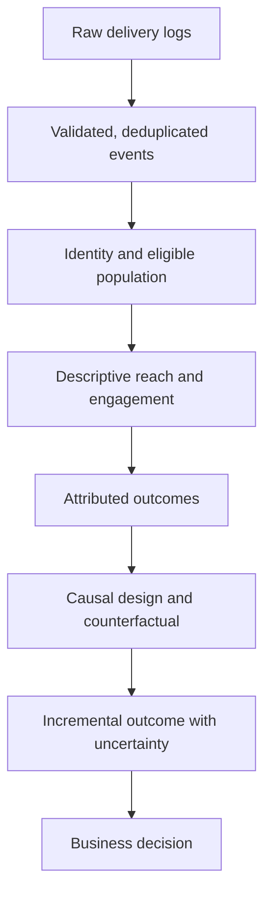

*Figure 13.1 — Measurement truth layers. Quality, consent, suppression and bias checks apply at the event, identity and causal layers.*

For clinician and prescription measurement: define new-to-brand, total prescriptions and new prescriber exactly; apply washout windows consistently; allow for prescription lag and claims maturity; do not count overlapping campaigns as independent; use de-identified patient data and governed NPI-level outputs; suppress small cells; separate target-list impact from total-market impact. A PulsePoint and Publicis Health Media case study, published in 2025 on 2024 data, reports 10% more prescriptions among exposed target clinicians than unexposed ones. It is a vendor claim from a retrospective comparison. Ask about design, comparability, selection and exposure definition before generalizing from it.

### Worked example

The Ritmora campaign held out a random 10%. Compare by assigned group:

```sql
-- Rates by ASSIGNED variant (intention to treat), not by who was exposed.
WITH assigned AS (
  SELECT hcp_id, variant, assigned_at
  FROM journey_assignment
  WHERE journey_id = 'J-CARDIO'
), outcomes AS (
  SELECT DISTINCT a.hcp_id
  FROM assigned a
  JOIN engagement_event e
    ON e.hcp_id = a.hcp_id
   AND e.event_type = 'qualified_conversion'
   AND e.event_at >= a.assigned_at
   AND e.event_at < datetime(a.assigned_at, '+14 days')
)
SELECT
  a.variant,
  COUNT(*)                                  AS assigned_hcps,
  COUNT(o.hcp_id)                           AS converted_hcps,
  ROUND(1.0 * COUNT(o.hcp_id) / COUNT(*), 4) AS conversion_rate
FROM assigned a
LEFT JOIN outcomes o USING (hcp_id)
GROUP BY a.variant
ORDER BY a.variant DESC;
```

Output:

```text
variant    assigned_hcps  converted_hcps  conversion_rate
---------  -------------  --------------  ---------------
treatment          6,320             566           0.0896
holdout              719              37           0.0515
```

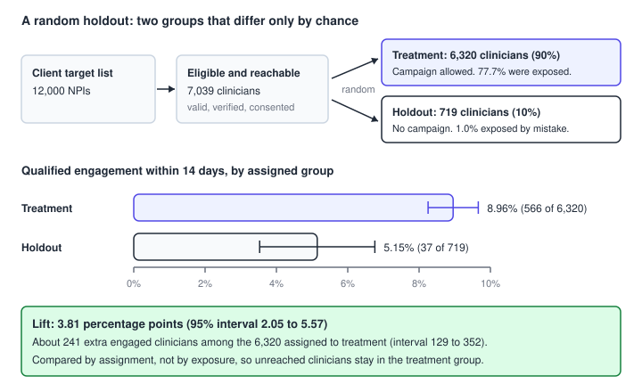

*Figure 13.2 — The design and its result. The whiskers are 95% confidence intervals.*

First check the split itself. A **sample ratio mismatch** means the groups are not the sizes the design intended, a sign that assignment or logging is broken.

Output:

```text
treatment share 89.79%, chi-square 0.36, p = 0.55
```

No mismatch. Now the lift, with its interval:

```python
def lift(conv_t, n_t, conv_c, n_c):
    """Absolute lift between two proportions with a 95% interval."""
    p_t, p_c = conv_t / n_t, conv_c / n_c
    se = sqrt(p_t * (1 - p_t) / n_t + p_c * (1 - p_c) / n_c)
    diff = p_t - p_c
    return {"p_t": p_t, "p_c": p_c, "abs": diff, "rel": diff / p_c,
            "low": diff - Z95 * se, "high": diff + Z95 * se}
```

Output:

```text
treatment rate   8.96%
control rate     5.15%
absolute lift    3.81 points (95% CI 2.05 to 5.57)
relative lift    74.0%
incremental      241 (95% CI 129 to 352)
```

The interval excludes zero, so the campaign raised engagement. Did everyone in treatment see it?

Output:

```text
variant    assigned_hcps  exposed_hcps  pct_exposed
---------  -------------  ------------  -----------
treatment          6,320         4,908         77.7
holdout              719             7          1.0
```

No, and seven holdout clinicians did. The comparison still stands because it is by assignment. Dropping the unexposed 22% from treatment would bring back the selection bias the holdout removed.

Engagement is a large, fast effect. Prescribing is small and slow. Take a new-prescriber rate of 6.2% against 5.4%:

Output:

```text
design       treated  control  lift_pts  ci_low  ci_high  excludes_zero
-----------  -------  -------  --------  ------  -------  -------------
10% holdout   10,000    1,111      0.80   -0.61     2.21  no
50% holdout   10,000   10,000      0.80    0.15     1.45  yes

Equal arms needed for 80% power at 5.4% vs 6.2%: 13,397 HCPs per arm
```

The same 0.8-point lift is invisible with a 10% holdout and clear with equal arms. Design the holdout for the outcome you intend to claim.

### Common mistakes

| Mistake | Why it bites | Do this instead |
|---|---|---|
| Comparing exposed with unexposed | Exposure is selected by availability, match and engagement | Compare by random assignment |
| Reporting lift with no interval | A noisy 20% looks like a finding | Show the interval and the sample sizes |
| A holdout sized for convenience | The study cannot detect the effect it was built to find | Size it from the smallest effect worth acting on |

### Check yourself

**Q13.1** Treatment converts at 4.5% and control at 3.6%. Give absolute lift, relative lift and incremental conversions for 20,000 treated clinicians.

**Q13.2** Why does removing never-exposed clinicians from the treatment group bias the result?

> [!IMPORTANT]
> **In one line:** Delivery, attribution and causation are three different claims; only a counterfactual supports the third.

## 14. Commercial models and unit economics

### Why it matters

A campaign can look impressive in gross spend and lose money. A platform can look like software and be a services business. You need to know which you are running before you set a roadmap.

### The idea

Revenue arrives in several forms: media spend with a platform take rate; a software subscription; a data or audience fee; a measurement fee; a custom sponsorship or content program; professional services; and pricing linked to outcomes or performance.

Always ask whether a revenue figure is gross or net. Accounting rules distinguish a principal, who books the whole transaction, from an agent, who books only its fee, and contract terms decide which applies.

**Contribution margin** is what remains after the costs that vary with the work:

```text
Net revenue
- publisher and media cost
- third-party data and identity
- verification and measurement
- variable cloud and serving cost
- campaign operations and support labor
- credits and makegoods
= contribution margin
```

For software, track annual recurring revenue, gross and net revenue retention, expansion, logo churn, implementation time, active users, workflow adoption, support burden, gross margin and cost to serve. In a hybrid of managed service and platform, separate software adoption from output delivered by people.

Forecast programmatic revenue from eligible requests, match rate, bid rate, win rate, net CPM, seasonality and publisher share. Forecast outcome products from addressable customers, attach rate, study eligibility, data maturity and analyst capacity. Show a range and the constraint that binds, not one precise number. Lab 8 does this.

### Worked example

The Ritmora campaign bills $48,000. What does Wrenfield keep?

```python
# Fictional figures for the 12-week Ritmora campaign.
gross_spend = 48_000.00
lines = [
    ("Gross media spend billed to the client", gross_spend),
    ("Publisher and media cost", -31_200.00),
    ("Third-party data and identity", -2_900.00),
    ("Verification and measurement", -1_450.00),
    ("Variable cloud and serving cost", -1_150.00),
    ("Campaign operations labor (62 h at $95)", -62 * 95.00),
    ("Credits and makegoods", -1_200.00),
]
net_revenue = gross_spend - 31_200.00            # if booked as an agent
contribution = sum(amount for _, amount in lines)
```

Output:

```text
line                                         amount
---------------------------------------  ----------
Gross media spend billed to the client    48,000.00
Publisher and media cost                 -31,200.00
Third-party data and identity             -2,900.00
Verification and measurement              -1,450.00
Variable cloud and serving cost           -1,150.00
Campaign operations labor (62 h at $95)   -5,890.00
Credits and makegoods                     -1,200.00
Contribution margin                        4,210.00

Net revenue (gross minus media cost): $16,800.00
Take rate on gross spend:             35.0%
Contribution as share of gross:       8.8%
Contribution as share of net revenue: 25.1%
```

A 35% take rate becomes an 8.8% contribution once data, verification, serving and 62 hours of operations labor are counted. The labor line is the product opportunity: it is larger than data, verification and cloud combined.

### Common mistakes

| Mistake | Why it bites | Do this instead |
|---|---|---|
| Celebrating gross spend | Margin may be thin or negative | Review contribution per campaign |
| Leaving labor out of cost | Manual work hides inside "platform" revenue | Time operations and price it in |
| One-number forecasts | Nobody sees which input matters | Ranges, with the binding constraint named |
| Counting managed output as software adoption | Overstates how scalable the product is | Track self-service use separately |

### Check yourself

**Q14.1** Net revenue is $20,000 and variable costs total $13,500. What is contribution margin as a share of net revenue?

**Q14.2** Why does the principal-versus-agent question change how large a business looks?

> [!IMPORTANT]
> **In one line:** Follow the money past gross spend to contribution, and count the people doing the work.

# Part III — Healthcare and digital-health data

## 15. The US healthcare system and digital health products

### Why it matters

A feature can be wanted by users and easy to build and still fail, because nobody is paid to use it, it adds a minute to every visit, the data it needs lives in another organization, or no one is accountable for acting on it. Healthcare products live inside a network of care, payment, regulation and professional practice. 

### The idea

| Actor | Role | What it means for a product |
|---|---|---|
| Patient, member, caregiver | Receives care, pays premiums and cost share | Consent, accessibility, literacy, navigation, affordability |
| Provider | Delivers and documents care | Workflow fit, liability, credentialing, burnout |
| Health system or practice | Operates care delivery | Integration, capacity, revenue cycle, staffing |
| Payer | Finances and manages covered care | Eligibility, benefits, networks, prior authorization, claims |
| Employer | Sponsors benefits | Population health, cost, privacy boundaries |
| Pharmacy and **PBM** (pharmacy benefit manager) | Dispenses and manages the drug benefit | Formulary, pricing, e-prescribing, adherence |
| Life-sciences company | Develops and sells drugs and devices | Evidence, approval, promotion, safety surveillance |
| Regulator and accreditor | Sets and enforces standards | Auditability, disclosures, safety and quality |
| Health IT vendor | Supplies EHR, CRM, analytics | Integration dependencies, certification, data rights |

Money and data take different roads. Clinical data moves between providers as FHIR resources or documents. Administrative data moves as X12 transactions. Prescriptions use NCPDP standards. Images use DICOM. Marketing events use web schemas and ad-tech protocols. If you know card payments, a **claim** will look familiar: it is submitted after the service, adjudicated against rules, paid in part, and sometimes reversed. For every decision, ask which record is authoritative.

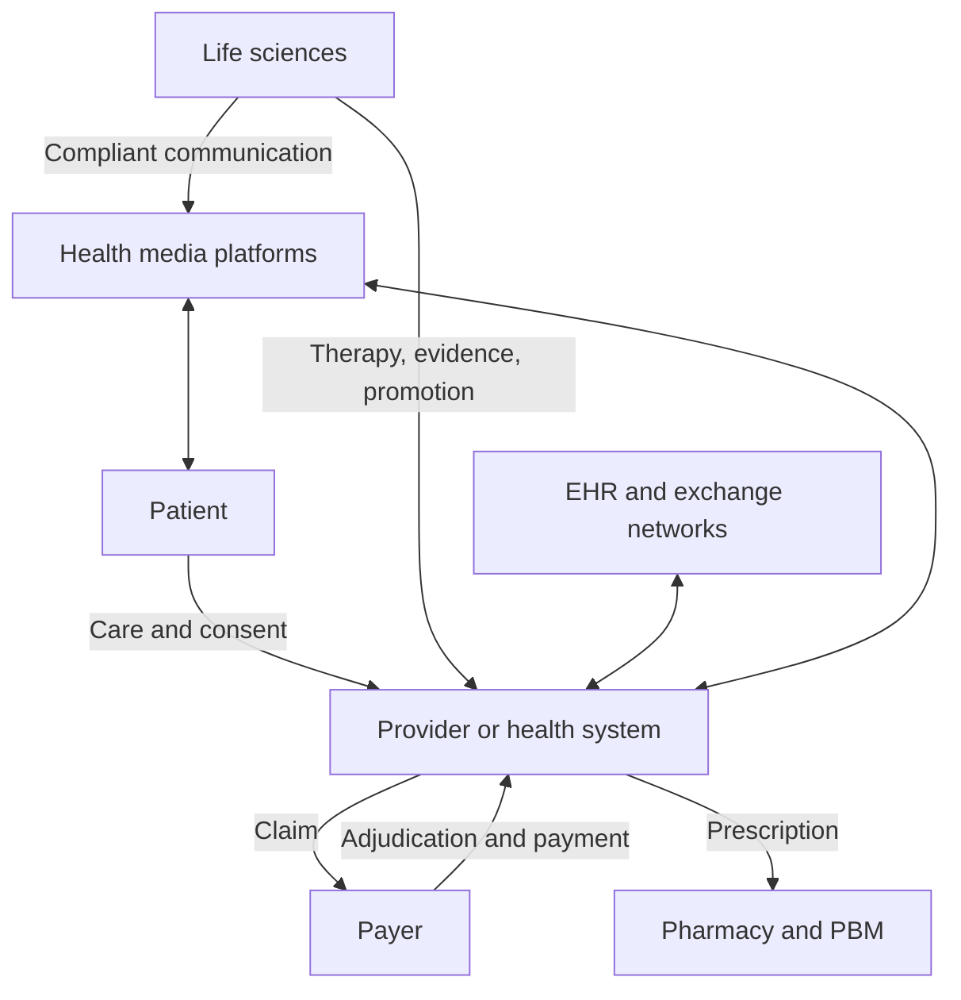

*Figure 15.1 — Who exchanges what. Care, money and marketing each have their own records.*

Vocabulary you will hear daily:

- **Fee for service:** payment per unit of service. **Value-based care:** payment tied partly to quality, total cost or outcomes. **Capitation:** a fixed payment per member per period. **Risk adjustment:** payment adjusted for expected cost.
- **Formulary:** the list and tiers of covered drugs. **Prior authorization:** payer approval required before certain care is covered. **Step therapy:** a preferred treatment must be tried first.
- **Site of care:** where a service is delivered. **Referral:** a recommendation or transfer between providers. **Leakage:** a patient gets a service outside the intended network.
- **Care gap:** a recommended action not yet done. **Adherence:** how closely medication use follows the agreed plan. **Persistence:** how long a patient stays on therapy.

Digital health products fall into recognizable categories, each with one hard problem.

| Category | Value to the user | The hard problem |
|---|---|---|
| Telehealth | Care at a distance | Licensure, scheduling, escalation, reimbursement |
| Patient portal | Records, messages, appointments, bills | Identity proofing, proxy access, interoperability |
| Digital therapeutics | Software that treats | Clinical evidence, regulatory path, engagement |
| Remote monitoring (RPM, RTM) | Watching patients between visits | Device reliability, alert burden, billing |
| Clinical decision support | Better decisions | Evidence, workflow fit, bias, liability |
| Patient-reported outcomes (ePRO, eCOA) | Capturing how patients feel and function | Instrument validity, missing data |
| Decentralized trials | Research participation from home | Consent, source data, logistics |
| Population health | Managing cohorts and care gaps | Data completeness, attribution, equity |
| Provider directory | Finding accurate in-network care | Stale data, network status, availability |
| Medication support | Prescribing, access, adherence | Formulary, interactions, prior authorization |

Study clinical workflow at four moments: before the encounter (scheduling, eligibility, intake, chart preparation), during (review, decision, order, documentation), after (results, follow-up, coding, billing, quality reporting) and between encounters (monitoring, messages, medication, coordination). Measure clicks, context switches, duplicate entry, time, alert burden, work shifted to other roles and exception handling.

An alert needs a clear hazard, target role, trigger, evidence, action, urgency, override reason and audit trail. Track firing, visibility, acceptance, override, time to action, downstream outcome and unintended harm. High acceptance is bad if the alert rarely fires when needed. Low acceptance may mean poor specificity or the wrong place in the workflow.

### Worked example

Cedarline proposes a reminder in Elkhaven's visit workflow: "member is overdue for a wellness visit." It looks free. You price one minute.

```python
clinicians, visits_per_day, clinic_days = 24, 18, 230     # fictional Elkhaven
extra_minutes = 1
hours = clinicians * visits_per_day * clinic_days * extra_minutes / 60
visits_lost = hours * 60 / 20                # a follow-up visit takes 20 minutes
```

Output:

```text
24 cardiology clinicians x 18 visits x 230 days = 99,360 visits
One extra minute each = 1,656 clinician hours a year
That is 4,968 twenty-minute visits that cannot happen
```

So the reminder goes to the front desk before the encounter, not to the clinician during it. Its specification names the role, the trigger (no wellness claim in 12 months, allowing for claims lag), the action, the override reasons and the audit record.

### Common mistakes

| Mistake | Why it bites | Do this instead |
|---|---|---|
| Designing for the clinician by default | Clinician time is the scarcest resource | Ask which role and which of the four moments |
| Treating claims as real time | Claims arrive weeks later and can reverse | Build a maturity window into any claims-based trigger |
| Ignoring who pays | No reimbursement, no adoption | Name the payer and the incentive in the brief |

### Check yourself

**Q15.1** Which standard family typically carries a claim, a prescription and a lab result between organizations?

**Q15.2** An alert is accepted 90% of the time. What two further facts do you need before calling it good?

> [!IMPORTANT]
> **In one line:** In healthcare the user, the payer and the accountable party are usually three different organizations, and a product must work for all three.

## 16. EHRs, interoperability and APIs

### Why it matters

Closed-loop measurement, scheduling links and care-gap outreach depend on data held in electronic health records. "We integrate with the EHR" hides months of work and several rules.

### The idea

An **EMR** usually means a digital record inside one practice. An **EHR**, electronic health record, is the broader longitudinal record and platform for orders, results, medications, notes, billing and exchange. The words overlap in daily use; what matters is scope and **interoperability**, the ability to exchange information and use it meaningfully.

Three generations of HL7 standards coexist:

- **HL7 v2:** delimited messages for admissions, discharges and transfers (**ADT**), orders and results. Everywhere, and locally customized.
- **C-CDA:** structured clinical documents such as a summary of care.
- **FHIR** (Fast Healthcare Interoperability Resources): data as resources reached through web APIs, messaging, documents and bulk export.

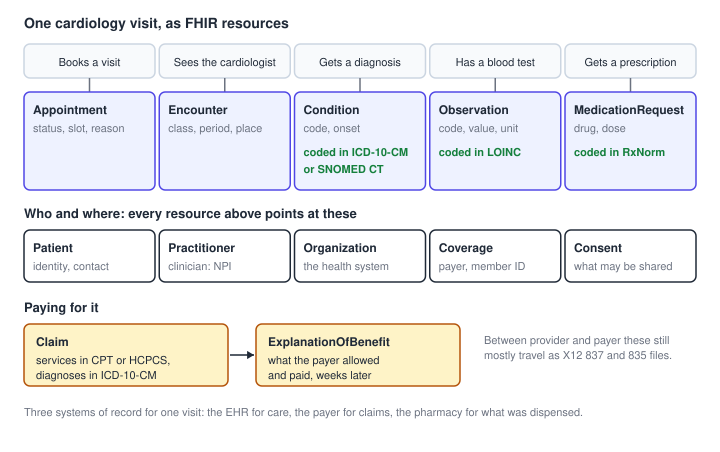

*Figure 16.1 — One visit as FHIR resources. Other common resources include AllergyIntolerance, DiagnosticReport and Procedure.*

A FHIR resource is not automatically interoperable. Versions, profiles, required fields, value sets, references, authorization and workflow meaning still have to agree. FHIR R5 is the current published release and R6 is in ballot, but US regulation, and most production systems, remain on R4.

**SMART on FHIR** uses OAuth 2.0 so an application can be authorized against a FHIR server. A clinician-facing app launches from the EHR with patient and encounter context; a patient app launches standalone; a backend service uses system-level scopes with a signed credential.

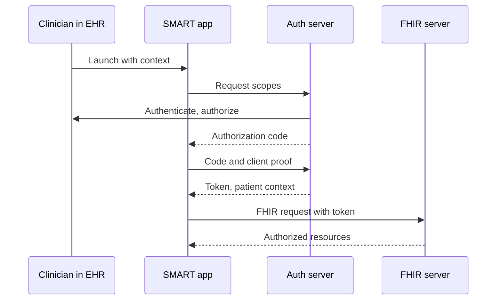

*Figure 16.2 — An EHR launch. Requirements should name least-privilege scopes, launch context, token lifetime, refresh, patient switching, error handling, provenance, audit, and what happens when a resource is missing.*

Three terms are often confused:

- **USCDI** (United States Core Data for Interoperability) says which data classes and elements must be exchangeable. Version 3 became the certification baseline on January 1, 2026. Version 7 was published in July 2026 and is not required.
- **US Core** is the FHIR implementation guide that says how to represent much of that data. Version 9.0.0 is current, on FHIR R4.
- **TEFCA** (Trusted Exchange Framework and Common Agreement) is the governance for a nationwide network of networks. Eleven **QHINs** (qualified health information networks) connect participants for six permitted purposes, including treatment, payment and individual access.

USCDI says what, US Core says how, TEFCA says who may exchange with whom under which rules. Separately, **information blocking** rules penalize practices likely to interfere with access to electronic health information, subject to defined exceptions.

**Prior authorization** is being rebuilt on these standards. Under the CMS rule known as CMS-0057-F, affected payers have had to meet decision timeframes, give specific denial reasons and report metrics since 2026; four FHIR APIs (patient access, provider access, payer-to-payer, prior authorization) are generally required from January 1, 2027. In April 2026 CMS proposed extending electronic prior authorization (**ePA**) to drugs. That proposal is not final.

### Worked example

Wrenfield Grow needs appointment outcomes from Elkhaven's EHR. Before agreeing a date, Nadia and you walk the acceptance checklist.

- [ ] FHIR version and implementation-guide version confirmed (R4, US Core).
- [ ] CapabilityStatement and `.well-known/smart-configuration` validated.
- [ ] Required and optional fields mapped, including what null means.
- [ ] Terminology bindings tested against expected value sets.
- [ ] Pagination, search, rate limits and bulk export handled.
- [ ] Idempotency and conditional create or update defined.
- [ ] Patient matching and duplicate behavior tested.
- [ ] Provenance, consent, access control and audit events preserved.
- [ ] Synthetic test data only in non-production environments.
- [ ] Backward compatibility and migration plan written.

Elkhaven's sandbox fails two: appointment status uses a local value set, and there is no bulk export, so 14 months of history needs a different route. Both are found in week one instead of week ten.

### Common mistakes

| Mistake | Why it bites | Do this instead |
|---|---|---|
| "It's FHIR, so it will work" | Profiles and value sets differ by site | Test against the customer's real endpoint |
| Asking for broad scopes | Security review stalls; risk grows | Least-privilege scopes tied to the use case |
| Confusing USCDI, US Core and TEFCA | You ask the wrong team the wrong question | What, how, and who |
| Treating a proposed rule as law | Roadmap built on a requirement that may change | Mark proposed, final and effective dates |

### Check yourself

**Q16.1** In one sentence each, what do USCDI, US Core and TEFCA do?

**Q16.2** Why might two systems that both "support FHIR R4" fail to exchange an appointment?

> [!IMPORTANT]
> **In one line:** The standards give you a shared grammar; the integration is still won or lost on profiles, value sets, scopes and the customer's own endpoint.

## 17. Terminologies, code systems and transactions

### Why it matters

Audiences, eligibility rules, outcome measures and clinical AI all sit on codes. If you treat a billing code as a clinical fact, or miss that a code set changed in October, your segment and your report are both wrong and nothing will tell you.

### The idea

| Standard | Represents | Used for | Note |
|---|---|---|---|
| **ICD-10-CM** | Diagnoses | Claims, reporting, risk models | Updated each October 1 |
| ICD-10-PCS | Inpatient procedures | Hospital inpatient claims | Maintained by CMS |
| CPT | Physician and professional services | Claims, service documentation | Owned and licensed by the AMA |
| **HCPCS** Level II | Supplies, services and some drugs not in CPT | Ambulance, equipment, certain drugs | Quarterly updates |
| **SNOMED CT** | Detailed clinical concepts | Problem lists, documentation | US edition twice a year |
| **LOINC** | Lab tests, observations, documents | Result exchange | Twice a year |
| **RxNorm** | Normalized clinical drugs | Medication exchange | Monthly, with weekly updates |
| **NDC** | Packaged drug products | Pharmacy, product identification | Ten digits today; an FDA rule moves to twelve in 2033 |
| **DRG** (MS-DRG) | Inpatient case groups | Hospital payment | New version each fiscal year |
| **NPI** | An individual or organization provider | Transactions, clinician identity | Type 1 individual, Type 2 organization |
| NUCC taxonomy | Provider classification and specialization | NPPES enrollment, segmentation | The **provider taxonomy** code |

These are not interchangeable. A clinical term maps to a billing code imperfectly. Code sets are versioned, change at least yearly and may need a license.

| Transaction | Standard | Purpose |
|---|---|---|
| Eligibility inquiry and response | X12 270/271 | Coverage and benefit check |
| Claim status | X12 276/277 | Where a claim stands |
| Claim submission | X12 837 | Professional, institutional, dental claims |
| Payment and remittance | X12 835 | Payment and adjustment explanation |
| Enrollment | X12 834 | Member enrollment and disenrollment |
| Prior authorization | X12 278 | Service review; moving toward FHIR APIs |
| Pharmacy claim | NCPDP Telecommunication D.0 | Real-time pharmacy billing; version F6 required from April 14, 2028 |
| E-prescribing | NCPDP SCRIPT | Prescription messages; version 2023011 replaces 2017071 from January 1, 2028 |

A March 2026 rule also adopts standards for claims attachments, with compliance in May 2028.

Imaging and device terms:

- **DICOM:** the standard for medical images and their metadata. **PACS:** the system that stores and displays them. RIS: the radiology system for scheduling and workflow.
- **SaMD:** software as a medical device, intended for a medical purpose without being part of hardware. SiMD: software inside a device.
- **CDS:** clinical decision support. Whether it is regulated as a device depends on intended use and function. FDA's January 2026 guidance restates four statutory conditions for staying outside device regulation, among them that the software does not analyze images or signals and that the clinician can independently review the basis for a recommendation.
- **RPM/RTM:** remote physiologic monitoring uses physiological data such as blood pressure; remote therapeutic monitoring covers non-physiological data such as therapy adherence and response.

### Worked example

One patient at Elkhaven sees a cardiologist for heart failure. The same visit is written in five vocabularies.

| What happened | System | Code |
|---|---|---|
| Diagnosis: heart failure, unspecified | ICD-10-CM | I50.9 |
| The same problem on the clinical problem list | SNOMED CT | A heart-failure concept ID |
| Blood test: NT-proBNP | LOINC | 33762-6 |
| Prescription: furosemide 20 mg oral tablet | RxNorm | 310429 |
| The box the pharmacy dispensed | NDC | A package-level code, different for each manufacturer |
| Office visit, established patient | CPT | 99214 |
| The cardiologist | NPI | A fictional 9-prefixed number in this book |

If Tomás builds a "heart-failure patients" cohort from ICD-10-CM alone, he gets people who were billed with the code, including some being ruled out. If he builds it from prescriptions alone, he gets people on a diuretic for any reason. The cohort definition has to say which evidence counts.

### Common mistakes

| Mistake | Why it bites | Do this instead |
|---|---|---|
| Hard-coding a code list | The October update silently drops or adds codes | Version value sets and review them each release |
| Treating NDC and RxNorm as the same | One is a package, the other a clinical drug | Map through RxNorm for clinical meaning |
| Using CPT descriptions freely | They are licensed content | Confirm the license covers the use |

### Check yourself

**Q17.1** Which code system would you use to exchange a lab result, and which to bill for the office visit where it was ordered?

**Q17.2** What is the difference between an NPI Type 1 and Type 2?

> [!IMPORTANT]
> **In one line:** Every code system answers a different question about the same event; name which one you are relying on and which version.

## 18. Privacy, consent and security

### Why it matters

Health data misuse is the fastest way to lose this audience and attract a regulator. The rules are not one law: they depend on who holds the data, where the person lives, what was promised and what the data is used for.

### The idea

**HIPAA** applies to covered entities (health plans, clearinghouses, and providers who transmit standard transactions electronically) and to their business associates. It protects **PHI**, protected health information: individually identifiable health information they hold. It does not cover all health data or all health websites. A consumer health site usually answers instead to the FTC, state law, its contracts and its own privacy policy.

Where HIPAA applies, the principles for a product are: use or disclose PHI only under a permission or a valid authorization; apply the minimum necessary; sign a **BAA** (business associate agreement) with each business associate; implement administrative, physical and technical safeguards for electronic PHI; support access control, audit, integrity, authentication and transmission security; and keep an incident and breach process. As of October 2026 the proposal to strengthen the Security Rule, published in January 2025, is still a proposal; the regulatory agenda targets final action in July 2027.

**Tracking technologies.** HHS guidance says trackers on authenticated patient pages generally have access to PHI, so the vendor needs a BAA and the disclosure a HIPAA permission. A cookie banner is not a HIPAA authorization. In June 2024 a federal court vacated the part of that guidance covering an IP address combined with a visit to an unauthenticated public page. Neither "all pixels violate HIPAA" nor "public pages are safe" is right. Review each data flow in context.

**Health data outside HIPAA:**

- The FTC **Health Breach Notification Rule**, amended effective July 29, 2024, covers health apps and similar technologies and treats an unauthorized disclosure as a breach. In September 2026 the FTC withdrew an older policy statement as redundant; the rule itself is unchanged.
- Washington's My Health My Data Act covers consumer health data broadly, including inferences. It requires a separate privacy policy, consent to collect and to share beyond what a requested service needs, signed authorization to sell, and no geofencing near health facilities, and it allows private lawsuits. Nevada has a similar law without the private right. Virginia added protections for reproductive and sexual health information in 2025. New York's bill was vetoed in December 2025.
- California's CCPA treats health information as sensitive personal information, with rights to limit its use and to opt out of sale or sharing. Regulations effective January 1, 2026 add risk assessments, cybersecurity audits and rules for automated decision-making technology, phased in through 2030.
- Marketing email falls under CAN-SPAM; marketing texts and automated calls need prior express written consent under the TCPA.

Consent has to be a record, not a flag. `consent = true` cannot say which purpose, which jurisdiction, which policy version or when.

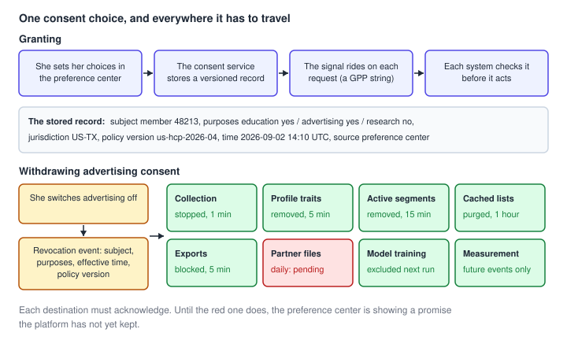

*Figure 18.1 — Consent must be granular by purpose, versioned, jurisdiction-aware, easy to withdraw, and propagated to caches, audiences, exports and partners.*

In advertising requests the choice travels as an IAB **GPP** string: the Global Privacy Platform format, with numbered sections for US national, individual states and the European framework.

**De-identification** under HIPAA has two methods: Safe Harbor, removing 18 listed identifiers, and Expert Determination. Hashing is neither. **Tokenization** replaces a sensitive value with a controlled token. Aggregation does not guarantee anonymity either: a rare specialty in a small state at a precise time can identify one person.

Security terms a PM should use correctly: threat modeling before build; **least privilege**; attribute-based and role-based access control (**ABAC/RBAC**); encryption in transit and at rest with keys managed separately; secrets never in code or client apps; audit logs that answer who accessed what, when and why; data loss prevention (DLP); static, dynamic and dependency testing (SAST, DAST, SCA); a software bill of materials (**SBOM**); and recovery point and recovery time objectives (**RPO/RTO**).

### Worked example

Aldermoor asks for engaged clinicians by specialty and state. Marcus sets a minimum cell size of 11, the threshold CMS applies to its own data releases: no cell showing 1 to 10 people.

```sql
-- Engaged HCPs by specialty and state, with small cells hidden.
SELECT
  p.specialty,
  p.state,
  CASE WHEN COUNT(DISTINCT p.hcp_id) < 11 THEN 'suppressed'
       ELSE CAST(COUNT(DISTINCT p.hcp_id) AS TEXT) END AS engaged_hcps
FROM hcp_profile p
JOIN engagement_event e USING (hcp_id)
WHERE e.qualified = 1
  AND p.specialty IN ('Advanced Heart Failure',
                      'Clinical Cardiac Electrophysiology')
  AND p.state IN ('CA', 'CO', 'VT', 'WY')
GROUP BY p.specialty, p.state
ORDER BY p.specialty, p.state;
```

Output:

```text
specialty                           state  engaged_hcps
----------------------------------  -----  ------------
Advanced Heart Failure              CA     57
Advanced Heart Failure              CO     suppressed
Advanced Heart Failure              WY     suppressed
Clinical Cardiac Electrophysiology  CA     57
Clinical Cardiac Electrophysiology  CO     25
Clinical Cardiac Electrophysiology  VT     suppressed
Clinical Cardiac Electrophysiology  WY     suppressed
```

Four cells are hidden. Two more controls are needed before this ships. First, totals must not let a reader subtract their way back to a hidden cell, so a second cell is often hidden too (complementary **suppression**). Second, the report must not be re-runnable with slightly different filters until the small cell is isolated; that needs query controls, not just a threshold.

### Common mistakes

| Mistake | Why it bites | Do this instead |
|---|---|---|
| "It isn't HIPAA data, so it's fine" | FTC and state laws reach health data HIPAA does not | Classify by law, promise and purpose |
| A preference center that updates only the screen | Segments, exports and partners keep using the data | Treat revocation as an event with acknowledgments |
| Suppressing cells but publishing totals | Hidden values can be derived | Suppress by complement and control queries |

### Questions to ask in your first weeks

- Which review boards and sign-offs exist, and for which content classes?
- What is the privacy incident severity model?
- Which states or countries force product variants?

### Check yourself

**Q18.1** A health-system website puts an advertising pixel on its logged-in patient portal. Which rule is most directly engaged, and what two things would be required?

**Q18.2** Why is `consent = true` not an adequate data model? Name three fields it lacks.

> [!IMPORTANT]
> **In one line:** Ask who holds the data, under which law and promise, for which purpose, and prove that a withdrawal reaches everything downstream.

## 19. Pharma promotion, MLR review and safety

### Why it matters

A prescription-drug ad is a regulated communication. An unapproved claim, a missing risk statement or an ad still running after its approval expired is not a bug to fix next sprint. It is a compliance event for your client, and your platform served it.

### The idea

FDA's Office of Prescription Drug Promotion reviews prescription-drug advertising and promotional labeling so that it is truthful, balanced and accurately communicated. Internet and social media are in scope. The usual failures: omitting or minimizing risk; overstating benefit; no **fair balance** between benefit and risk; omitting material limitations; unsupported superiority claims; misleading presentation of study data; promoting an unapproved use or an investigational product.

Enforcement attention rose in September 2025, when a presidential memorandum and an FDA announcement brought a wave of letters to manufacturers and a plan to tighten broadcast disclosure rules. As of October 2026 no proposed rule has been published.

Promotion and scientific exchange are different things. A "content type" dropdown does not settle which one you have. Purpose, audience, control, claims, funding, review, labeling and distribution all matter. Unsolicited medical-information requests go to approved medical-affairs workflows, not to marketing automation.

Healthcare creative is software with legal and clinical dependencies. The platform should model claim, indication, fair-balance content, references, prescribing-information links, audience, geography, channel, dimensions, approval ID, effective date and expiration.

**MLR** is medical, legal and regulatory review, the manufacturer's approval process.

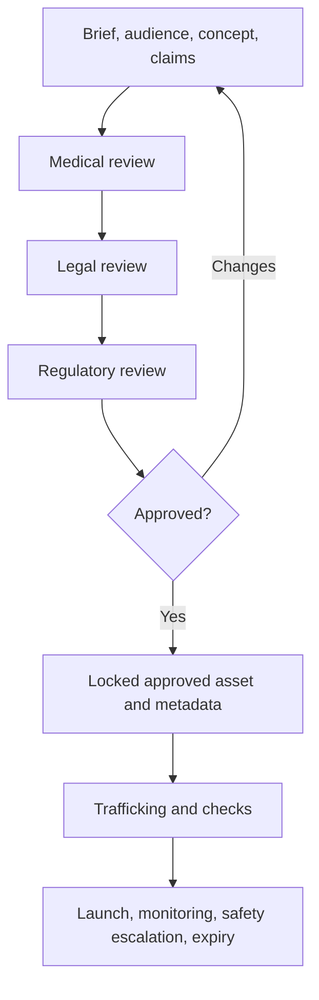

*Figure 19.1 — The review workflow. The platform's job is to make the approved state the only state that can serve.*

Controls the platform owes its clients:

- Block launch without a valid approval and an unexpired asset.
- Keep draft, approved, live, paused, withdrawn and expired as separate states.
- Never edit a live approved asset in place; create a new version.
- Record exactly what was served, where, to whom and under which rule version.
- Validate destination, prescribing information, fair-balance visibility, dimensions, video tags, click trackers and accessibility.
- Support emergency withdrawal across all placements and caches.

**Dynamic creative optimization (DCO)** assembles creative from parts according to context or audience. In pharma the flexibility must stay inside an approved space: pre-approved components, explicit combination rules, claim-and-risk pairs that cannot be separated, full decision logs and a kill switch. Generative AI must not write or paraphrase promotional claims at serving time.

**Adverse events.** FDA uses four elements for a valid report: an identifiable patient, an identifiable reporter, a suspect product and an adverse event. Manufacturers must report serious, unexpected events within 15 calendar days of first receiving them. Signals can appear in free text, survey answers, support tickets, chat, social replies, virtual events, email replies and AI conversations. Requirements must say which channels are monitored, who reviews, how fast and how false positives are handled. Never ask intake staff or an interface to judge causality.

### Worked example

Grace is about to traffic the Ritmora banner. The creative record decides whether she can.

| Field | Value |
|---|---|
| Asset | RIT-HCP-300x250, version 3 |
| Claim | One efficacy claim, linked to its reference |
| Paired risk statement | Present; cannot be cropped or hidden by the template |
| Indication and audience | Adults with heart failure; US clinicians only |
| Prescribing information link | Resolves; checked daily |
| Approval ID and dates | MLR-2026-0417; effective September 10, 2026; expires March 10, 2027 |
| State | Approved, scheduled |
| Channels approved | Display only |

Three things the platform refuses. Version 2 cannot be reactivated, because it is withdrawn. The asset cannot run in the email newsletter, because that channel has no approval. And on March 11, 2027 it stops serving everywhere, including cached copies, without anyone remembering to pause it.

### Common mistakes

| Mistake | Why it bites | Do this instead |
|---|---|---|
| Approval stored as a PDF attachment | The ad server cannot enforce it | Approval ID, dates and channels as fields that gate serving |
| One approval reused across channels | Risk presentation differs by format | Channel-specific approvals |
| Adverse-event text left in a chat log | A reporting clock may have started unseen | Detect, route and timestamp on receipt |

### Questions to ask in your first weeks

- What starts an adverse-event reporting clock here, and which channels are monitored?
- How are editorial, education, sponsored and promotional systems separated?

### Check yourself

**Q19.1** Name the four elements of a valid adverse-event report.

**Q19.2** Why must a generative model not paraphrase a promotional claim at serving time?

> [!IMPORTANT]
> **In one line:** Make "approved, unexpired and for this channel" a condition the ad server checks, not a promise people keep.

## 20. Accredited education as a product system

### Why it matters

Continuing education is a large part of what clinicians come for and what supporters fund. It is also the area where commercial influence is most tightly fenced. A PM who treats a course like a video with a quiz will break credit rules, reporting rules or both.

### The idea

An education product is more than playback. It includes needs assessment, objectives, faculty and disclosures, content review, learner eligibility, pre-test, delivery, post-test, evaluation, credit rules, certificates, expiration, outcomes reporting and audit evidence.

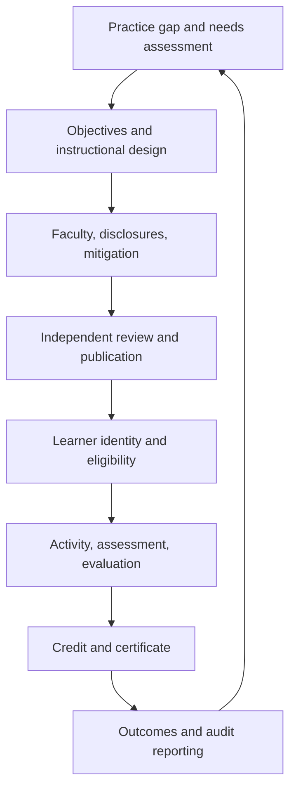

*Figure 20.1 — The education lifecycle. Each box leaves evidence an accreditor may ask for.*

The governing document for accredited medical education is the ACCME's Standards for Integrity and Independence in Accredited Continuing Education, in force since January 2022. Its five standards cover valid content; preventing commercial bias and marketing; identifying, mitigating and disclosing financial relationships; managing commercial support; and managing ancillary activities. It calls a company that makes or sells healthcare products an ineligible company. Two rules shape product design directly: an ineligible company may not influence planning, faculty or content, and learner names or contact details may not be shared with one without the learner's explicit consent.

So the platform must keep educational design separate from commercial support; hold disclosures and mitigation; protect learner privacy; and give supporters only appropriate aggregate reports. Sponsored promotion and accredited education must not share recommendation logic in a way that compromises independence.

Adaptive learning changes sequence, difficulty, remediation or format from learner evidence. The learner model, competency taxonomy, item metadata, recommendation service and experimentation can be shared platform capabilities. Educational validity stays with the education owner, so that a supporter's preference never becomes a bias in the learner's path.

Institutions connect through a learning management system (LMS), using standards such as LTI for launch, and xAPI or SCORM for tracking, where both sides support them.

### Worked example

Dr. Singh starts a 30-minute heart-failure activity on her laptop and finishes on her phone. You and Dr. Okoye write what "done" means.

| Question | Requirement |
|---|---|
| Is completion idempotent? | A repeated completion event issues one credit and one certificate |
| Can she resume across devices? | Progress is stored server-side per learner and activity version |
| Are credit rules versioned? | The certificate cites the rule version in force at completion |
| Can a correction keep the audit trail? | A corrected activity is a new version; old completions keep the old one |
| What does the supporter see? | Aggregate participation and outcomes only, with small cells suppressed |
| What happens at expiry? | The content stays readable; credit is no longer offered |
| Is it accessible? | Captions, transcript, keyboard operation, tested with a screen reader |

### Common mistakes

| Mistake | Why it bites | Do this instead |
|---|---|---|
| Optimizing completion rate alone | Shortcuts undermine learning and credit integrity | Pair completion with assessment and outcome measures |
| Learner-level data in supporter reports | Breaks the independence standard | Aggregate by default; explicit consent for anything else |
| Sharing a ranker with promotion | Commercial priority reaches education | Separate candidate pools and objectives |
| Treating a certificate as a file | It cannot be corrected or audited | Treat it as a versioned record |

### Questions to ask in your first weeks

- Who owns learner identity and eligibility, and where does enrollment start?
- Which system is authoritative for activity version, completion, score, credit and certificate?
- How are launch context and deep links passed, and can completion be retried safely?
- How are partial progress, expiration and failed assessments represented?
- May an institutional customer receive learner-level data, or only aggregates?
- How do corrections propagate after a certificate has been issued?

### Check yourself

**Q20.1** A supporter asks for the list of physicians who completed the activity it funded. What is the answer, and on what basis?

**Q20.2** Name four parts of an education product beyond the content itself.

> [!IMPORTANT]
> **In one line:** Accredited education is a record-keeping system with independence rules; build the evidence and the separation into the product.

# Part IV — Platforms and products

## 21. Event pipelines, data quality and governance

### Why it matters

Every audience, score, journey and report in this book is computed from events. If events are duplicated, late, mislabeled or collected without the right consent, everything built on them is wrong in a way that looks plausible. You do not build the pipeline, but you must ask the questions that expose a weak one.

### The idea

Three layers do different jobs:

- **Stream:** low-latency events for monitoring, frequency control, activation and fresh insight.
- **Batch:** complete recomputation, claims maturity, reconciliation and cheap aggregation.
- **Serving:** APIs, **feature stores**, dashboards and exports shaped for the questions users ask.

Keep the warehouse or lakehouse as analytical truth, but never make an auction or a clinical workflow wait for an analytical query. Operational and analytical stores are separate and reconciled.

Delivery guarantees are often oversold:

- **At-most-once:** may lose events, never duplicates.
- **At-least-once:** retries can duplicate, so the consumer must deduplicate.
- **Exactly-once effect:** the business outcome is applied once, through **idempotency** (doing a request twice has the same effect as once) and transactional design.

Give every event a globally unique ID, a source sequence where available, both occurrence and ingestion times, a schema version and an idempotency key. Define how late an event may arrive and how history is backfilled.

A **data contract** is an enforceable agreement on schema, meaning, quality and change:

```json
{
  "event_name": "hcp_content_engagement",
  "schema_version": "2.1",
  "event_id": "uuid",
  "occurred_at": "2026-10-09T14:31:22Z",
  "member_id": "internal-pseudonymous-id",
  "npi": "optional-controlled-field",
  "content_id": "asset-123",
  "content_class": "editorial|education|sponsored|promotional",
  "engagement_type": "view|complete|tool_use|save",
  "consent_policy_version": "us-hcp-2026-04",
  "source": "web|app|email",
  "trace_id": "distributed-trace-id"
}
```

The contract also says how duplicates, late arrivals, bots and deletions are handled, and whether the NPI is present at collection or attached later in a controlled environment.

| Quality dimension | Example rule |
|---|---|
| Completeness | 99.5% of eligible media exposures have campaign and placement IDs |
| Validity | An NPI has ten digits and passes its check digit |
| Uniqueness | One canonical event per event ID |
| Consistency | Content class agrees between CMS and event payload |
| Timeliness | 95% of clinician engagement arrives within 30 minutes |
| Accuracy | Sampled identity links meet the precision threshold |
| Referential integrity | Campaign, creative, deal and publisher keys resolve |

Monitor volume, lag, null rate, distribution, cardinality, schema rejections, duplicates, the dead-letter queue, consent-suppression rate and downstream freshness, against day-of-week and campaign baselines. An alert should name the decision at risk, not "row count low."

Schemas evolve by rules: add optional fields before requiring them; never repurpose a field; version incompatible meanings; test producer and consumer compatibility; know who reads a field before removing it. A field called `specialty` can be declared primary specialty in one system and claims-derived taxonomy in another.

Governance is the operating model around all this. Each critical field needs an owner, definition, source, allowed values, quality rule, **data lineage** (where it came from and where it goes), permitted purpose, sensitivity, retention and deletion behavior. Contracts fail loudly on incompatible change. A catalog nobody uses is documentation theater; governance has to be wired into pipelines, access, review and incident response.

### Worked example

Before the Ritmora report goes to Aldermoor, Tomás runs four rules against the practice database.

```sql
-- Four data-quality rules as one result set: rule, rows checked, failures.
SELECT 'validity: target-list NPI passes check digit' AS rule,
       COUNT(*) AS checked, SUM(1 - npi_valid(npi)) AS failed
FROM target_list
UNION ALL
SELECT 'uniqueness: one row per engagement event_id',
       COUNT(*), COUNT(*) - COUNT(DISTINCT event_id)
FROM engagement_event
UNION ALL
SELECT 'completeness: consent state is known',
       COUNT(*), SUM(consent_state = 'unknown')
FROM hcp_profile
UNION ALL
SELECT 'referential integrity: exposure has an assignment',
       COUNT(*), SUM(a.hcp_id IS NULL)
FROM exposure e
LEFT JOIN journey_assignment a USING (hcp_id);
```

Output:

```text
rule                                               checked  failed  pass_pct
-------------------------------------------------  -------  ------  --------
validity: target-list NPI passes check digit        12,000     220     98.17
uniqueness: one row per engagement event_id         11,213      40     99.64
completeness: consent state is known                12,874     418     96.75
referential integrity: exposure has an assignment   56,781       0    100.00
```

Three findings. The 220 invalid NPIs are typos in the client's file: report them back, do not guess. The 40 duplicate event IDs are a retried batch on an at-least-once pipeline: any count that is not deduplicated is inflated. And 418 profiles have unknown consent: they must be treated as not consented.

### Common mistakes

| Mistake | Why it bites | Do this instead |
|---|---|---|
| Believing "exactly once" | Duplicates reach reports and invoices | Idempotency keys and consumer-side deduplication |
| Reusing a field for a new meaning | Old consumers read new values wrongly | New field, new version |
| Alerts on row counts | Nobody knows what is at risk | Alert on the decision or report affected |

### Questions to ask in your first weeks

- What were the most damaging data-quality incidents of the last year?
- Which numbers do customers trust least, and why?

### Check yourself

**Q21.1** A pipeline is at-least-once. What must every consumer do, and what does it need from the event to do it?

**Q21.2** Give one example rule each for validity and timeliness.

> [!IMPORTANT]
> **In one line:** Trust an event only when it has an ID, a time, a schema version, a consent version and an owner.

## 22. The CDP: rollout and activation

### Why it matters

A customer data platform is easy to buy and hard to make useful. Teams that treat it as a database purchase end up with an expensive copy of their data and the same manual campaign work as before.

### The idea

A CDP is a capability program: collection, identity, profile, segmentation, orchestration, destination connectors, measurement, governance and adoption, run under an agreed operating model.

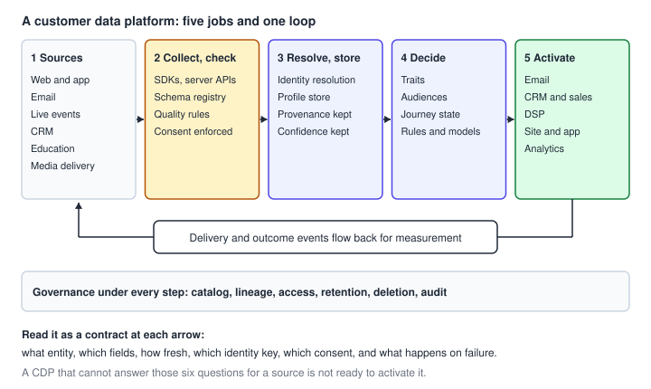

*Figure 22.1 — The CDP's five jobs and the loop that makes it learn.*

Roll it out in phases, each with an exit test:

- **Phase 0, decision and scope.** Name the business workflows to improve, critical entities, destinations, latency, the privacy boundary and build-or-buy assumptions.
- **Phase 1, foundation.** Canonical events, identity, consent, profile schema, source-of-truth ownership and one non-critical destination.
- **Phase 2, activation MVP.** One high-value segment, one journey, one connector, one measurement loop, with operator review.
- **Phase 3, scale.** Self-service audiences, reusable templates, more destinations, service levels, cost controls, migration tooling.
- **Phase 4, intelligence.** AI-assisted segmentation, recommendations, anomaly detection and causal optimization, only once data and operations are credible.

Every source is onboarded under a contract: owner, entity, event schema, identity keys, consent context, expected volume, latency, replay behavior, retention, quality targets and an incident contact, with test fixtures and a compatibility check before production. Identity follows the match order in Chapter 10, and the segment builder follows Chapter 11.

Migration from older tools carries its own risks: old and new identity graphs produce different counts; historical segments contain undocumented logic; destination IDs are not portable; event names are reused with new meanings; consent is copied without its policy version; teams rebuild old manual workflows inside the new tool; customer reports change with no reconciliation period; and usage costs grow faster than value.

### Worked example

Wrenfield's Phase 2 is the Ritmora audience delivered to one destination. You define acceptance before the build starts.

| Scorecard item | Target for Phase 2 exit |
|---|---|
| Profile completeness and identity precision | Sampled audit: at least 99% of NPI links correct |
| Consent and deletion propagation | Withdrawal reaches the destination within 24 hours, with acknowledgment |
| Event freshness | Median 5 minutes, 95th percentile 30 minutes |
| Segment build-to-activation time | Under one working day, from days today |
| Destination delivery and match rate | Delivered rows reconcile within 1%; match rate reported as a funnel |
| Audience count reconciliation | Old and new counts explained to within 2% |
| Operator task completion and errors | Three operators complete setup unaided |
| Campaign incremental outcome | Holdout in place; lift with an interval |
| Cost per active profile, event and activation | Measured against an agreed ceiling |
| Support tickets and manual interventions | Logged from day one |

### Common mistakes

| Mistake | Why it bites | Do this instead |
|---|---|---|
| Starting with AI features | Models on unreliable data scale the errors | Earn Phase 4 through Phases 1 to 3 |
| Loading every source first | Months pass with no activation | One segment, one journey, one connector |
| Switching reports without a parallel run | Customers see numbers change with no explanation | Dual-run and reconcile before cutover |

### Check yourself

**Q22.1** What are the four "ones" of an activation MVP?

**Q22.2** Why might the same segment return different counts in the old and new platforms, even with identical rules?

> [!IMPORTANT]
> **In one line:** A CDP earns its place when one segment reaches one destination reliably and the outcome is measured; scale after that.

## 23. Journeys and next-best-action

### Why it matters

Once a platform can decide what each clinician sees next, the temptation is to always show something. A system that always acts is a contact-maximization engine. It burns the audience, and in this ecosystem it can put promotion where education or medical exchange should be.

### The idea

**Next best experience (NBE)** selects the most appropriate experience for an eligible person or account: education, clinical content, an event invitation, a survey, a tool, a message, or nothing. **Next best action (NBA)** selects an operational action: add to a journey, recommend content, notify an account team, request human review, change channel, or suppress contact. "No action" must be a first-class choice.

Five journey domains exist side by side: education and CME; live events (invite, register, remind, attend, follow up); medical affairs (scientific exchange and medical-information workflows, distinct from promotion); commercial activation (approved sponsored or promotional experiences); and institutional engagement for health systems or societies. They must not be collapsed into one ranking pool. Content class, purpose, sponsor, audience and accreditation decide what may compete for a slot.

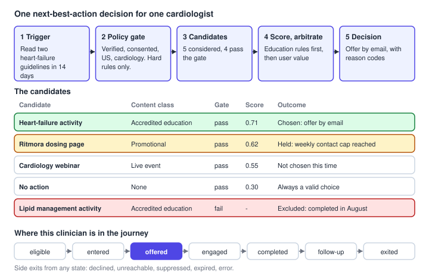

*Figure 23.1 — One decision for Dr. Singh. The promotional candidate scored second and was held by the contact cap; the education candidate won.*

The key design rule: **candidate generation is a policy system; ranking is an optimization system.** First cut the candidates with hard constraints:

- profession, specialty, geography and organization;
- content class and purpose;
- campaign, supporter or partner contract;
- indication and audience appropriateness;
- availability, expiration and capacity;
- consent, opt-out, channel preference and jurisdiction;
- prior completion, attendance or exposure;
- frequency and sequence rules;
- medical, legal, regulatory, editorial and accreditation state.

Only then rank. Never ask a model to learn a compliance boundary from historical data.

A journey is a state machine: eligible, entered, offered, engaged, completed, follow-up eligible, exited, with branches for declined, unreachable, suppressed, expired and error. Events are idempotent, and a late event must not send someone backward or repeat an invitation.

When a clinician qualifies for several journeys, arbitration weighs urgency, user value, content independence, campaign priority, contractual obligation, channel capacity, predicted utility, fatigue and diversity, under a global frequency limit, not one per campaign.

| Layer | Metrics |
|---|---|
| Eligibility | Eligible population, candidate coverage, suppression rate |
| Decision | No-action rate, reason-code distribution, model confidence, decision latency |
| Delivery | Activation success, channel availability, time from trigger to experience |
| User | Qualified engagement, completion, relevance feedback, fatigue and opt-out |
| Business | Incremental conversion, event attendance, learning outcome, revenue |
| Model | Precision at k, **calibration**, coverage, diversity, slice performance, **drift** |
| Operations | Manual overrides, failed journeys, duplicate actions, support effort |

### Worked example

You write the decision contract for the cardiology journey.

```text
Journey:         Cardiology education and engagement
Entity:          Verified US cardiology clinician
Trigger:         Qualified guideline-content engagement within 14 days
Candidate set:   Active independent education, approved live event,
                 approved commercial content, no action
Hard exclusions: Opt-out, wrong profession or specialty, activity completed,
                 expired approval, frequency cap, restricted geography,
                 incompatible content class
Score inputs:    Declared interest, recency, content affinity, journey stage,
                 channel availability
Arbitration:     Education independence rules first; then user value;
                 then customer objective
Output:          experience_id, action, channel, reason codes, expiry,
                 confidence, policy version
Fallback:        Generic specialty experience, or no action
```

Then you check what the engine actually did:

```sql
-- What the decision engine chose, and why. "No action" is a real outcome.
SELECT
  journey_id,
  COUNT(*)                                                  AS decisions,
  ROUND(100.0 * SUM(action = 'offer') / COUNT(*), 1)        AS pct_offer,
  ROUND(100.0 * SUM(action = 'no_action') / COUNT(*), 1)    AS pct_no_action,
  ROUND(100.0 * SUM(action = 'suppress') / COUNT(*), 1)     AS pct_suppress,
  ROUND(100.0 * SUM(reason_code = 'frequency_cap') / COUNT(*), 1)
                                                            AS pct_frequency_cap
FROM decision_event
GROUP BY journey_id
ORDER BY journey_id;
```

Output:

```text
journey_id  decisions  pct_offer  pct_no_action  pct_suppress  pct_frequency_cap
----------  ---------  ---------  -------------  ------------  -----------------
J-COMM            845       60.9           35.6           3.4               16.9
J-EDU           1,408       59.5           36.8           3.7               17.9
J-EVENT           511       61.4           35.6           2.9               20.4
```

More than a third of decisions are "no action," and about half of those are the frequency cap doing its job. If that column read zero, the engine would not be deciding anything.

### Common mistakes

| Mistake | Why it bites | Do this instead |
|---|---|---|
| A promotional objective that can outrank education | Breaks education independence | Separate pools; independence rules first in arbitration |
| Caps per channel only | Each channel behaves; total contact is excessive | One global frequency service |
| Training on a history of over-contact | The model learns that pestering predicts clicks | Holdouts, and penalties for fatigue |
| Treating a medical-affairs request as a sales lead | Crosses the promotion boundary | A separate, approved workflow |

Other failures to design against: stale profile attributes routing someone into the wrong specialty; an event that fills between recommendation and registration; a late completion event triggering a duplicate reminder; and revenue priority hidden inside the score with no user-value guardrail.

### Questions to ask in your first weeks

- Which journey decision takes days today and should take minutes?
- Where do education, medical-affairs and commercial eligibility rules diverge in the platform?
- How is "no action" represented in current journey logic?
- Can we reproduce why a clinician received an experience six months ago?

### Check yourself

**Q23.1** Why is candidate generation described as policy and ranking as optimization?

**Q23.2** In Figure 23.1, the promotional page outscored the webinar and still was not shown. Why?

> [!IMPORTANT]
> **In one line:** Gate with rules, rank with models, cap contact globally, and let "do nothing" win when it should.

## 24. HCP engagement analytics: from signal to action

### Why it matters

Life-sciences customers want to know which clinicians are engaging and what to do next. An engagement dashboard that cannot say why a name is on a list, or that keeps a clinician on it after they opt out, creates work for sales teams and risk for everyone.

### The idea

PulsePoint's HCP365 is the public example of this product type: clinician-level engagement analytics that connect identity, events, insight and activation. Think of it as a feedback loop.

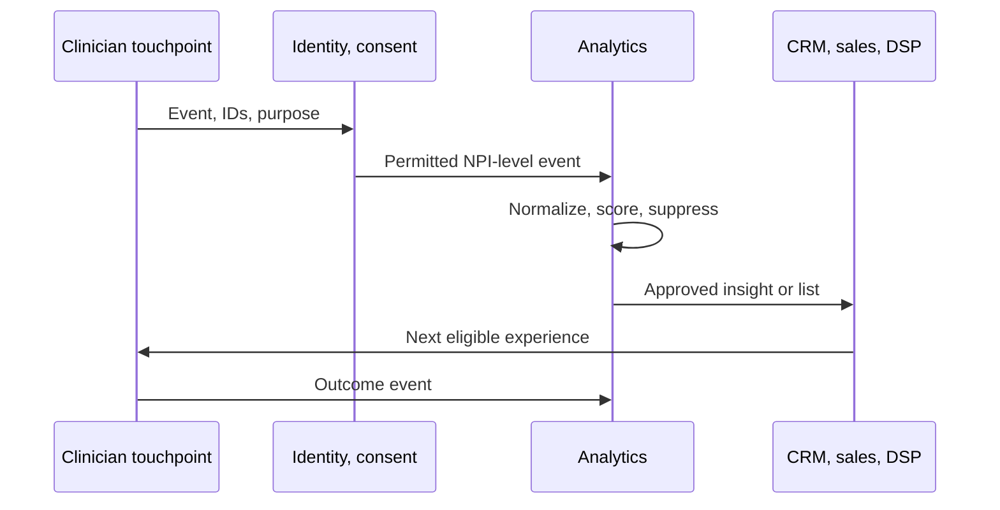

*Figure 24.1 — The closed loop. Governance, audit, retention and deletion apply at collection, identity, analytics and activation.*

The job is to help an authorized user understand how eligible clinicians engage across channels and decide the next appropriate action. That makes it an identity, event, policy, explanation and workflow product, not a dashboard.

Explanations matter as much as scores. Show reason codes such as "three qualified cardiology education engagements in 14 days across two channels; deterministic NPI match; most recent 2 days ago." Hide sensitive raw URLs and unsupported inference. Let operators inspect source class, freshness and confidence, and give them a way to report a wrong identity or an irrelevant signal.

### Worked example

Every signal that can put a clinician on a list gets a signal-to-action contract. Privacy, product, engineering, analytics and customer success then argue about the same object.

```text
Signal name:       cardiology_guideline_content_engagement
Source and owner:  Authenticated Wrenfield Clinical event; professional analytics
Identity level:    member_id, linked to NPI only above the deterministic threshold
Permitted purpose: Campaign analytics and approved clinician engagement
Freshness:         Event within 30 days
Eligibility:       US licensed clinician; approved specialties; active consent
                   and contract
Suppression:       Opted out, invalid NPI, low confidence, restricted geography,
                   campaign exclusion
Action:            Add to a reviewable list; no autonomous sales contact
Explanation:       Article category, event time bucket, confidence, source class
Retention:         Per policy and customer contract
Audit:             Rule version, list version, actor, export destination
```

Lab 2 builds the scoring and quality measures on top of this contract.

### Common mistakes

| Mistake | Why it bites | Do this instead |
|---|---|---|
| A score with no explanation | Operators cannot trust or challenge it | Reason codes on every row |
| "Engagement" defined per channel | Cross-channel totals mean nothing | One canonical definition with a qualified threshold |
| Reading silence as disinterest | The data may simply be late | Show freshness beside every insight |
| A score used for three purposes at once | Insight, eligibility and bid modifier need different controls | State each use and approve it separately |

### Questions to ask in your first weeks

- What is an "engagement," and is its definition stable across channels?
- Is the identity deterministic, probabilistic or inferred?
- How quickly does a consent withdrawal remove a clinician from activation?
- What minimum signal is required before an NPI appears in a report?
- How are shared devices, bots, corporate networks and ambiguous email domains handled?
- Can a user see why a clinician entered a list?
- Is a model score an insight, a targeting rule, a bid modifier, or all three?
- Does the system prevent sensitive inference and promotion to inappropriate specialties?

### Check yourself

**Q24.1** Which five kinds of product is an engagement analytics tool, according to this chapter?

**Q24.2** Which line of the signal-to-action contract stops a list from triggering automatic sales calls?

> [!IMPORTANT]
> **In one line:** A clinician appears on a list because of a named signal, under a named permission, with a reason an operator can read.

## 25. Enterprise integrations and platform tooling

### Why it matters

Institutional customers do not buy a feature. They buy the feature working inside their own systems, after their own security review. If each integration is a custom project, growth is capped by implementation headcount.

### The idea

Productize the whole integration journey: identity, security review, data exchange, configuration, testing, launch, monitoring, support and change management. "Integration complete" means the customer achieved a verified business event, not that credentials were issued.

The time-to-first-value funnel runs: commercial qualification, solution design, security and legal review, sandbox and credentials, data mapping and configuration, certification tests, production launch, first successful activation, recurring value and expansion. Measure time and fallout at every stage. A 60-day median can hide a long tail of customers stuck on one recurring mapping problem.

Choose an integration pattern after defining workflow, latency, authority and error recovery, not before:

- REST or GraphQL **API** for synchronous configuration and retrieval;
- webhook for event notification;
- streaming bus for high-volume near-real-time events;
- scheduled file over SFTP or object storage for batch exchange;
- native CRM or CDP connector;
- single sign-on with SAML or OpenID Connect, and SCIM for user provisioning;
- LMS standards (LTI, xAPI, SCORM) where the use case and platform support them;
- FHIR and SMART where clinical interoperability is really needed;
- clean room for controlled overlap or measurement.

Every partner-facing API needs documentation, authentication, scopes, tenant isolation, idempotency, pagination, filtering, rate limits, versioning, a deprecation policy, sample payloads, a sandbox, a status page, an error catalog, request tracing, usage analytics and a support path.

Internal operators need tools too: schema explorer, identity lookup with provenance, journey simulator, audience diff, connector health, retry and replay console, campaign validator, approval-state viewer, model explanation, feature-flag console and customer configuration templates. Mask sensitive data, and separate permission to view, edit, approve, replay and export.

Reliability measures: median and 90th-percentile time to sandbox, certification, production and first value; successful calls divided by eligible attempts; error rate by partner, endpoint and reason; retry, duplicate and dead-letter volume; freshness and reconciliation difference; breaking-change incidents; support hours per integration; share on the standard connector against custom forks; and first-30-day adoption.

To cut integration time, do not only add implementation managers. Rank delay by cause, frequency and elapsed time. Product fixes include self-service credentials, contract tests, pre-built mappings, clearer errors, sample datasets, automated certification, reusable security evidence and migration adapters.

### Worked example

Three partners call Wrenfield's API. One query shows who is struggling.

```sql
-- Grain of integration_event: one row per API call, including retries.
WITH ranked AS (
  SELECT partner_id, status_code, latency_ms,
         ROW_NUMBER() OVER (PARTITION BY partner_id ORDER BY latency_ms) AS rn,
         COUNT(*)     OVER (PARTITION BY partner_id)                     AS n
  FROM integration_event
  WHERE event_at >= datetime('2026-10-09', '-7 days')
)
SELECT
  partner_id,
  COUNT(*)                                                        AS calls,
  ROUND(AVG(CASE WHEN status_code BETWEEN 200 AND 299
                 THEN 1.0 ELSE 0.0 END), 3)                       AS success_rate,
  MAX(CASE WHEN rn = (95 * n + 99) / 100 THEN latency_ms END)     AS p95_latency_ms,
  SUM(status_code = 429)                                          AS rate_limited,
  SUM(status_code >= 500)                                         AS server_errors
FROM ranked
GROUP BY partner_id
ORDER BY success_rate, calls DESC;
```

Output:

```text
partner_id     calls  success_rate  p95_latency_ms  rate_limited  server_errors
-------------  -----  ------------  --------------  ------------  -------------
aldermoor-crm  2,100         0.936           2,125            80             28
campus-lms     2,100         0.971             454             0             38
elkhaven-crm   2,100         0.990             318             0             12
```

Aldermoor's CRM connector succeeds 93.6% of the time, with 80 rate-limited calls and a 95th-percentile latency more than six times Elkhaven's. It is retrying a batch job too aggressively. The fix is on both sides: a documented retry policy, and acceptance criteria that make retries safe.

```text
Given a valid tenant-scoped token and an idempotency key,
when a partner submits the same activation request three times,
then exactly one activation is created,
all responses return the same activation ID,
the audit log records the retries,
and no cross-tenant fields are returned.
```

### Common mistakes

| Mistake | Why it bites | Do this instead |
|---|---|---|
| Declaring success at "credentials issued" | The customer has no value yet | Define done as first verified business event |
| Reporting average integration time | The stuck tail is invisible | Median, 90th percentile and fallout per stage |
| Picking the protocol first | A fashionable choice that does not fit the workflow | Workflow, latency, authority and recovery first |
| A custom fork per customer | Every release becomes N releases | Standard connector plus configuration |

### Questions to ask in your first weeks

- What percentage of integrations use a standard path, and what drives the custom tail?
- Which integration do customers ask for most often?
- Where does a pilot's success depend on manual work that cannot scale?

### Check yourself

**Q25.1** Why does the acceptance criterion above matter for a partner that retries on timeout?

**Q25.2** Name four product changes that shorten integration time without adding people.

> [!IMPORTANT]
> **In one line:** Treat the integration journey as a product with a funnel, and call it done when the customer's first real event succeeds.

## 26. CMS and digital experience platforms

### Why it matters

The content management system decides how fast editors can publish, whether a correction reaches every copy, whether content can be reused in an app or an AI answer, and whether a sponsored module can be told apart from an article. Its PM is judged on publisher speed and quality as much as on reader experience.

### The idea

An enterprise CMS or digital experience platform (DXP) covers content models, reusable components, workflow, governance, permissions, preview, localization, search, media, APIs, publishing, experimentation, accessibility, search optimization, analytics and multi-site reuse.

| Concern | Drupal | Adobe Experience Manager | Sitecore |
|---|---|---|---|
| Structured content | Entities, fields, taxonomies, views | Content Fragment Models and Content Fragments | Templates and items, or composable models |
| Page building | Themes, blocks, layout tools | Components, templates, Experience Fragments | Components and page builder |
| Workflow | Revisions, roles, moderation | Authoring workflow, permissions, publication | Workflow, roles, approvals |
| Headless delivery | JSON:API in core | Content Fragments over GraphQL | APIs and composable services |
| Multi-site | Shared code, site-specific configuration | Multi Site Manager, blueprints, Live Copies | Site collections, shared components |

As of October 2026, Drupal 11 is the stable major version with Drupal 12 scheduled for December, and Sitecore's flagship is SitecoreAI, the successor to XM Cloud. Base decisions on the architecture actually installed, not on the brand: inventory modules, custom entities, hosting, version and editorial workflow first.

**Model content before designing pages.** Define semantic objects (article, clinical reference, author, specialty, topic, drug, condition, educational activity, event, sponsor disclosure, provider, location, campaign module, reusable legal text). For each, define required fields, vocabulary, validation, ownership, provenance, lifecycle, relationships, localization, search indexing, API exposure, analytics and retention. Page-shaped content is fast at first and expensive to reuse; over-atomized content burdens authors.

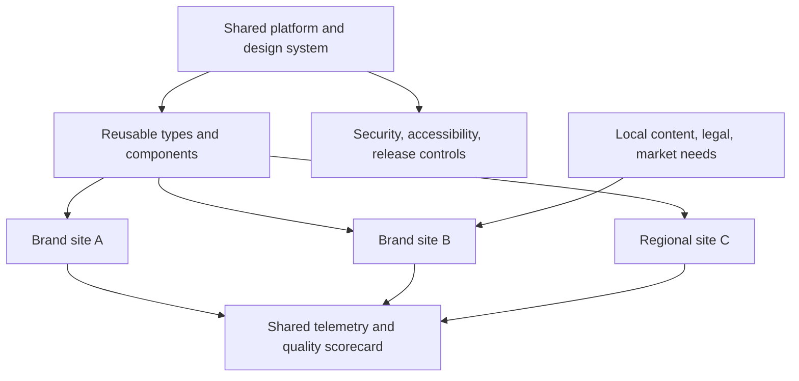

*Figure 26.1 — Multi-site governance. Classify each capability as mandatory global, configurable shared, or locally owned.*

Uncontrolled forks create security and quality debt. Forced uniformity blocks real editorial, market and regulatory differences.

A publishable object moves through draft, editorial review, medical review, legal or regulatory review, approved, scheduled, published, corrected, expired and withdrawn. Not every content class needs every gate. Encode the class rules, separation of duties, version history, effective dates, emergency correction, rollback and withdrawal from syndication.

Traditional rendering gives authors page context and preview. **Headless** delivery lets structured content be reused across web, apps, assistants and partners, and moves composition, preview, caching and invalidation into APIs and clients. Hybrids are common. Choose on reuse, author experience, release independence, performance, governance and total cost.

**Search and AI-mediated discovery.** AI answer engines now answer health questions before a person visits a site. A generated answer inside search is often called an AI overview; the practices for being understood and cited by such systems go by AIO or GEO, and the evidence for them is unsettled. A zero-click journey ends without a visit. The response is structural: stable IDs, clear headings, authorship, dates, citations, taxonomy, canonical URLs, entity metadata tying organization, provider, condition and location together, and clear update and withdrawal behavior. Offer actions an answer cannot complete alone. Do not promise ranking in opaque systems. Measure referral quality, citation or mention, branded demand, provider-profile actions and downstream conversion where you can see them.

### Worked example

Wrenfield Clinical's drug pages were built as free-form pages. You propose a structured object instead.

| Property | Drug reference object |
|---|---|
| Required fields | Generic name, RxNorm ID, indications, dosing, interactions, warnings, last medical review date |
| Vocabulary | RxNorm for drugs; controlled specialty and topic taxonomies |
| Ownership | Clinical reference editors; medical reviewer sign-off required |
| Lifecycle | Draft, medical review, published, corrected, withdrawn; every state change versioned |
| Relationships | Links to condition objects, calculators and related education |
| API exposure | Read-only delivery API for web, app and the answer assistant |
| AI retrieval | Eligible only when published and reviewed within 12 months |
| Sponsorship | Never; `content_class` fixed to editorial |

The same object now feeds the page, the app, and the assistant in Chapter 32, and a correction reaches all three.

Scorecard for the platform: time to publish, review-cycle time, correction and withdrawal propagation, content reuse, component adoption, accessibility defects, broken links, search success, API latency and errors, cache freshness, release failures, security patch age, editor satisfaction, local fork count and cost per maintained experience.

### Common mistakes

| Mistake | Why it bites | Do this instead |
|---|---|---|
| Designing pages before the model | Content cannot be reused or retrieved reliably | Semantic objects first |
| Choosing headless because it is fashionable | Preview and caching problems land on authors and clients | Decide on reuse, authoring and cost |
| Corrections that update one copy | Stale clinical content stays live elsewhere | Withdrawal and correction propagate by ID |

### Check yourself

**Q26.1** What three categories should each multi-site capability be sorted into?

**Q26.2** Give two reasons to model a drug page as a structured object.

> [!IMPORTANT]
> **In one line:** Model the content once as governed objects, and every channel, including AI, inherits the same truth and the same corrections.

## 27. Membership: registration, authentication and profile

### Why it matters

A registered, verified member is the foundation under everything else: personalization, education credit, addressable advertising and measurement. But registration is also the moment a busy clinician is most likely to leave. Ask for too much and you lose them; ask for too little and you cannot tell a cardiologist from a bot.

### The idea

Membership is a flywheel. Valuable content, tools and learning lead to registration. A verified, enriched profile makes web, mobile and email more relevant. Relevance raises activation, frequency and retention, and engaged members declare more preferences and permit more signals, which improves relevance again.

Registration is an exchange of value, not a data-extraction checkpoint. Ask only for what is needed now, explain the benefit, save progress, and enrich the profile later once trust exists. This is **progressive profiling**: choosing the next useful question by value and confidence, not filling every blank.

The lifecycle runs anonymous, recognized, registered, verified, activated, engaged, retained, with recovery branches for duplicate, locked, dormant, unverified, bounced contact and deleted. Different capabilities can require different assurance levels.

Measure the funnel at each step: landing, registration start, field completion, submit, email or phone verification, professional verification, first-value action, day-7 activation and day-30 retention, broken down by device, app or web, country, profession, acquisition source and error. A lower registration rate can be healthy if fraudulent accounts fall and verified activation rises.

Authentication covers secure passwords, passwordless or magic-link sign-in where appropriate, multi-factor authentication for risk, social or enterprise login under policy, session management, device recognition, account recovery, credential-stuffing protection, bot detection and global logout. Keep two questions apart: authentication asks who controls the account; professional verification asks whether the claimed credentials are supported.

Moving people from anonymous to known should rest on authenticated sessions and first-party identifiers, within consent and browser controls. Do not force login for emergency or basic health information without a defensible need. Track known-user coverage alongside abandonment, trust and access.

| Attribute class | Examples | Control |
|---|---|---|
| Account | Internal ID, email, locale, created date | Security and user access |
| Professional | Profession, specialty, NPI, license geography | Provenance, confidence, verification date |
| Preferences | Topics, channels, frequency, language | User-editable and purpose-specific |
| Engagement | Content, tools, education, event behavior | Consent, retention, quality |
| Organization | Employer or practice and role | Dated; multiple affiliations allowed |
| Commercial eligibility | Customer list or audience status | Contract, purpose, suppression |

Judge enrichment by completion, verified-field coverage, freshness, conflicts, correction rate, source, user edits and downstream usefulness. A filled field is not necessarily correct, and a stale vendor feed must never silently overwrite what the member declared.

Define **activation** as evidence that the member got core value, not that they registered: saved a drug reference, used a calculator, finished a meaningful article session, enrolled in a course, followed a specialty or set up alerts. Check which actions predict retention without mistaking correlation for cause.

On mobile, watch app startup, crash-free sessions, behavior on poor networks, biometric login and secure token storage, deep links from email and push, when and how notification permission is requested, background refresh cost, cross-device continuity, accessibility and font scaling, app-store privacy disclosures, SDK governance and forced-upgrade policy.

Engagement is pull or push. Pull is the member seeking news, reference, tools or learning. Push is email, notifications, alerts and reminders, governed by member preferences, urgency, content value, local time and a global frequency limit. A breaking clinical alert follows different rules from a promotional message.

### Worked example

The registration experiment: form A asks nine questions up front; form B asks four and profiles progressively.

```sql
-- Grain of registration_event: one row per visitor per step reached.
SELECT
  variant,
  SUM(step = 'start')                  AS started,
  SUM(step = 'submit')                 AS submitted,
  SUM(step = 'email_verified')         AS email_verified,
  SUM(step = 'professional_verified')  AS prof_verified,
  SUM(step = 'first_value')            AS first_value
FROM registration_event
GROUP BY variant
ORDER BY variant;
```

Output:

```text
variant       started  submitted  email_verified  prof_verified  first_value
------------  -------  ---------  --------------  -------------  -----------
A_long_form     4,003      1,862           1,488          1,047          620
B_short_form    3,997      2,696           2,078          1,299          826
```

Per 100 starts:

Output:

```text
variant       submitted  email_verified  prof_verified  first_value
------------  ---------  --------------  -------------  -----------
A_long_form        46.5            37.2           26.2         15.5
B_short_form       67.5            52.0           32.5         20.7

B versus A: registrations +45.0%, verified and activated members +33.4%
```

The headline "registrations up 45%" is true and misleading. Counted to members who are professionally verified and reached first value, B is up 33%. Part of B's extra volume is accounts that never verify. By device:

Output:

```text
variant       device   started  pct_submitted
------------  -------  -------  -------------
A_long_form   desktop    1,537           51.7
A_long_form   mobile     2,466           43.3
B_short_form  desktop    1,533           68.6
B_short_form  mobile     2,464           66.7
```

The long form loses most on phones, where 62% of starts happen. Ship B, report the 33%, and watch verification quality.

### Common mistakes

| Mistake | Why it bites | Do this instead |
|---|---|---|
| Optimizing registrations | Rewards low-quality and fake accounts | Optimize verified, activated members |
| Asking everything at sign-up | Abandonment, worst on mobile | Progressive profiling after first value |
| Vendor data overwriting member edits | Profiles drift back to stale values | Member-declared wins unless verification says otherwise |

### Check yourself

**Q27.1** Using the output above, what share of A's and B's starters submitted the form on mobile?

**Q27.2** Give three candidate definitions of activation for a clinician site.

> [!IMPORTANT]
> **In one line:** Registration is a trade; ask for little, give value fast, and count members who are verified and active, not forms submitted.

## 28. Verification, fraud and membership analytics

### Why it matters

A clinician network is worth what its verification is worth: advertisers pay for verified professionals, and education credit requires a real learner. Fraud attacks those points, and clumsy defenses drive away legitimate members.

### The idea

**Professional verification** can draw on the NPI registry, licensing boards, institutional email, documents, third-party credential services and manual review. Methods vary by country and profession. Record what was verified, the source, date, jurisdiction, status and expiration. Verification is a state machine: unverified, pending, verified, with rejected, needs-more-information, expired, suspended, appealed and revoked. Map permissions to state and risk, offer an appeal, and do not expose fraud logic.

Abuse to expect: credential stuffing and account takeover; synthetic or duplicate clinician accounts; shared credentials; fake identity for gated content or incentives; automated scraping; survey and research reward abuse; course-completion manipulation; fabricated referral or engagement events; device farms and bot registrations.

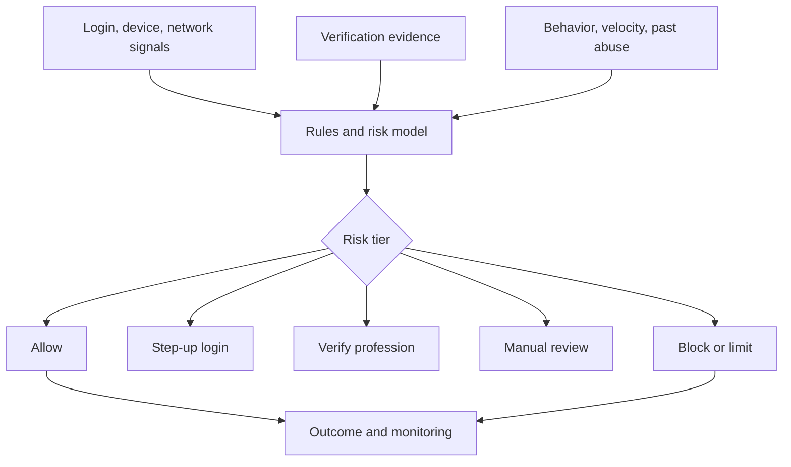

*Figure 28.1 — A risk engine. Every branch feeds its outcome back.*

Optimize expected harm and friction together, not catch rate alone. Monitor false positives, appeal success, verification completion, time to resolution, attack loss and abandonment among legitimate members.

A global membership adds: country-specific professional identifiers and registries; transliterated names and naming conventions; local address, phone and character formats; language and time zone; country-specific consent, data residency and age rules; regional content, accreditation and promotional boundaries; model evaluation by country and profession; and support and appeals in the relevant languages.

**Membership metrics:**

- monthly and weekly active verified members;
- new registered, verified and activated members;
- anonymous, recognized and authenticated activity;
- sessions per active member and active days;
- day-1, day-7, day-30 and rolling retention;
- profile completeness, verified specialty and freshness;
- breadth and depth across content, tools and education;
- opt-in and engagement for email, push, in-app and alerts;
- member lifetime value and commercial contribution, defined privacy-safely;
- trust, complaint, recovery and fraud measures.

Use cohorts: group by registration month, profession, specialty, geography, acquisition source, first-value action and device, and compare retention curves. A cohort from one high-volume campaign can look excellent at registration and fail verification and retention.

Member lifetime value includes user value, retention, qualified engagement, education participation, research eligibility where appropriate and commercial value. Do not reduce a clinician to ad impressions. Estimate expected contribution by cohort while limiting contact.

### Worked example

Did the short form's extra members stay? Among those who reached first value:

```sql
-- Among members who reached first value: who came back, and when?
WITH activated AS (
  SELECT visitor_id, variant, event_at AS activated_at
  FROM registration_event
  WHERE step = 'first_value'
), returned AS (
  SELECT a.visitor_id,
         MAX(l.login_at <  datetime(a.activated_at, '+8 days'))  AS week_1,
         MAX(l.login_at >= datetime(a.activated_at, '+8 days'))  AS days_8_30
  FROM activated a
  JOIN login_event l USING (visitor_id)
  GROUP BY a.visitor_id
)
SELECT
  a.variant,
  COUNT(*)                                                      AS activated,
  ROUND(100.0 * SUM(COALESCE(r.week_1, 0)) / COUNT(*), 1)       AS pct_back_week_1,
  ROUND(100.0 * SUM(COALESCE(r.days_8_30, 0)) / COUNT(*), 1)    AS pct_back_days_8_30
FROM activated a
LEFT JOIN returned r USING (visitor_id)
GROUP BY a.variant
ORDER BY a.variant;
```

Output:

```text
variant       activated  pct_back_week_1  pct_back_days_8_30
------------  ---------  ---------------  ------------------
A_long_form         620             57.4                40.8
B_short_form        826             55.3                39.5
```

B's members return at about the same rate as A's, two points lower in the first week. With 826 against 620 activated, B still produces more retained members. The short form wins, and the quality worry from Chapter 27 is real but small.

You put the result on a dashboard that pairs each stage with the lever that moves it.

| Stage | Lever to watch |
|---|---|
| Eligible visitors to recognized | First-party recognition within consent |
| Recognized to registered | Registration friction |
| Registered to professionally verified | Identity confidence and fraud controls |
| Verified to activated | Recommendation quality, first value |
| Activated to retained | Email, push, web and mobile experience |
| Retained to trusted relationship | Privacy, trust and member control |

Experiments worth queuing next: progressive profiling after first value against during registration; specialty feed against generic feed; member-selected alert topics against inferred defaults; a cross-device save-and-resume reminder; reactivation based on a previously used tool; asking for notification permission after demonstrated value; and a verification badge with an explanation. Pre-register the primary and guardrail metrics. Watch opt-outs, disabled notifications, inflated low-value sessions, content diversity and unequal effects across specialties.

### Common mistakes

| Mistake | Why it bites | Do this instead |
|---|---|---|
| Maximizing fraud catch rate | Legitimate clinicians are blocked and leave | Minimize expected harm plus friction |
| Verifying once, forever | Licenses lapse; people change roles | Expiry and re-verification |
| One global verification method | It fails outside the US | Country-specific sources and review |
| Judging a cohort at registration | Volume hides poor quality | Follow each cohort to day 30 |

### Check yourself

**Q28.1** Why does an NPI lookup not complete professional verification?

**Q28.2** From the output, how many more members came back in days 8 to 30 under B than under A, approximately?

> [!IMPORTANT]
> **In one line:** Verification is a state with an expiry, fraud defense is a trade against friction, and a cohort is judged at day 30, not at sign-up.

## 29. Growth platforms for health systems and plans

### Why it matters

Health systems and plans already own an EHR, a CRM, a marketing automation tool, ad accounts and a data warehouse. A growth platform that claims to replace them loses the sale. One that cannot say which system decides what creates duplicate outreach to patients.

### The idea

WebMD Ignite positions itself as a growth partner for healthcare organizations. For health systems the problems are service-line awareness, patient acquisition, navigation, access, education, retention and leakage. For health plans they are acquisition, onboarding, benefit understanding, care-gap engagement, care management and retention. Its Ignite Growth Platform is described publicly as a growth platform with CRM capabilities that uses healthcare data, audience building, omnichannel campaigns, clinical propensity models and insights, and pushes data into enterprise CRM, marketing automation and warehouses. The site's figures for encounter data, model counts and campaign return are vendor claims; learn their definitions inside.

Five roles a system can play:

- **System of record:** where authoritative patient, member, campaign, provider or encounter data lives.
- **System of engagement:** where marketers and operators design and run workflows.
- **System of intelligence:** where data is unified, opportunities modeled and recommendations produced.
- **System of orchestration:** where triggers, policies, channel decisions and activation are coordinated.
- **System of measurement:** where marketing activity is connected to appointments, encounters, retention and revenue.

A growth platform can credibly be intelligence and orchestration without pretending to be every other system.

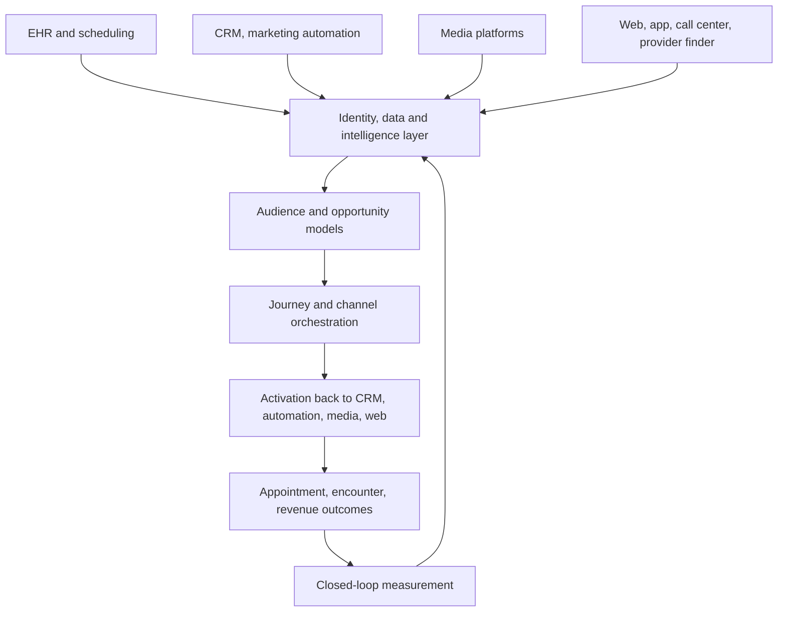

*Figure 29.1 — A reference integration. Each arrow needs the nine items from Chapter 5.*

| System | Typical role | Flows in to intelligence | Flows out |
|---|---|---|---|
| Epic or another EHR | Clinical, scheduling, encounter record | Appointments, encounters, capacity where allowed | Outreach task, scheduling link |
| Epic Cheers | Healthcare CRM and outreach | Campaign and engagement context | Leads, journeys, calls, messages |
| Salesforce | Account, lead and service workflow | Consumer and account status, service events | Tasks, audiences, responses |
| Eloqua | Marketing automation | Email and journey events, forms | Audience, trigger, suppression |
| Adobe | Content, experience, analytics | Digital behavior and content context | Personalized experience |
| Google and Meta | Paid media and conversions | Spend, delivery, platform conversions | Governed audiences, offline conversions |
| Enterprise warehouse | Analytical and finance truth | Customer, appointment, encounter, revenue | Reporting, features, reconciled metrics |

Never say "seamless integration" without naming supported objects, direction, frequency, latency, authentication and reconciliation.

Epic describes Cheers as a CRM for healthcare covering patient acquisition, care-gap outreach, call management, provider finding, outreach prioritized by appointment availability, and tracking through to appointments and revenue. So the useful question is not "can we send data to Epic?" It is "which system decides the audience and next action, which owns outreach state, and how do both reconcile outcomes without contacting the patient twice?"

Conflicts to expect: the growth platform and marketing automation both advance a journey on the same event; two CRMs each create a lead for one person; a media platform reports a conversion that the EHR later shows as cancelled; two personalization engines compete for one page slot; consent changes in one system while the downstream suppression file refreshes daily. The remedies are a decision-rights matrix, global person and campaign IDs, idempotency, source-of-truth rules and reconciliation jobs.

Measure platform health by source freshness, identity match, audience build time, destination delivery, journey success, model coverage, appointment linkage, outcome maturity, cost, operator adoption and expansion. A green API can still serve stale data.

### Worked example

Before Elkhaven's cardiology campaign, Devon and you agree who decides what.

| Decision | Decides | Records state | Reconciles with |
|---|---|---|---|
| Who is in the audience | Wrenfield Grow | Wrenfield Grow | Elkhaven's CRM suppression list, daily |
| Which message, which channel | Wrenfield Grow | Marketing automation | Global person ID |
| Whether a person was contacted | Marketing automation | Marketing automation | Grow, hourly |
| Whether an appointment exists | Elkhaven's EHR | EHR | Grow outcome mart, nightly |
| Whether consent allows marketing | Elkhaven's consent service | Consent service | Every system, within one hour |

### Common mistakes

| Mistake | Why it bites | Do this instead |
|---|---|---|
| Positioning as a replacement for the EHR or CRM | The buyer's IT team says no | Intelligence and orchestration, integrated |
| Two systems advancing one journey | Patients get duplicate messages | One orchestrator per journey, by rule |
| Counting platform conversions as outcomes | Cancelled appointments stay counted | Outcomes come from the system of record |

### Check yourself

**Q29.1** Match each to a role: EHR appointment table; a propensity model; the tool where a marketer builds an email.

**Q29.2** A social platform reports 300 conversions; the EHR shows 210 kept appointments from the same campaign. Which do you report, and why?

> [!IMPORTANT]
> **In one line:** Say which system decides, which records and which reconciles, for every decision, before a single message is sent.

## 30. Provider and payer growth and the digital front door

### Why it matters

Marketing can create demand that operations cannot serve. A campaign that fills a provider finder with people who then find no appointment for six weeks has spent money to damage trust.

### The idea

**Provider growth jobs:** grow high-value service lines, attract and keep patients, reduce referral leakage, improve access, use available capacity, engage existing patients and prove marketing impact to finance and clinical leaders.

**Payer jobs:** member acquisition, enrollment, onboarding, benefit education, network navigation, care-gap engagement, care management, retention and plan selection, shaped by enrollment periods, regulated communications and eligibility changes.

High-intent, high-value moments include: a search for a specialist or treatment nearby; viewing an available provider and starting to schedule; a member needing an in-network service; completing a health-risk assessment and asking for help; a referring clinician identifying a need; a lapsed patient becoming eligible for outreach; comparing coverage or a Medicare Advantage plan; and a slot opening for a relevant person. "High value" is not only revenue. It includes clinical appropriateness, access, equity, capacity and benefit to the person.

A service-line opportunity is a product of factors, each with a source and a confidence:

```text
Opportunity = addressable demand x clinical relevance
            x network and geographic fit x reachable eligible population
            x appointment capacity x expected conversion
            x expected contribution x strategic priority
```

A propensity model cannot create appointment capacity.

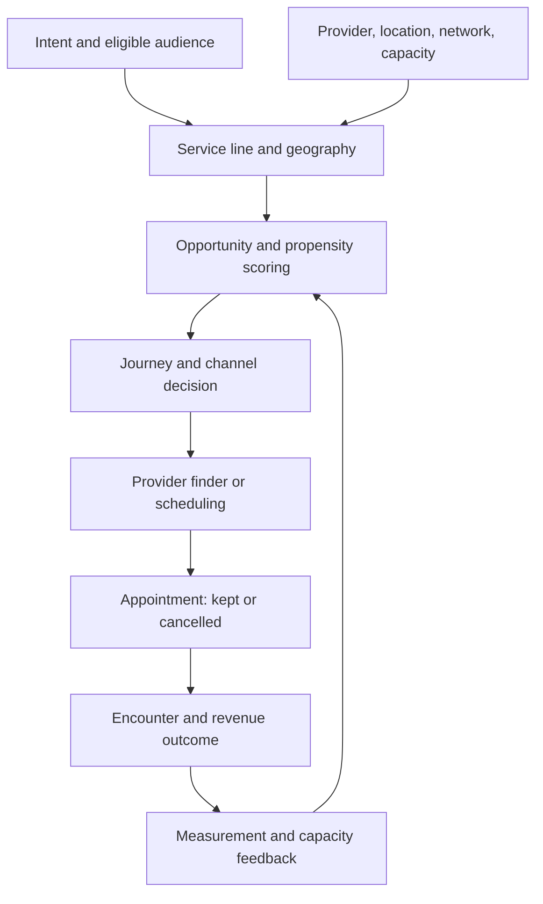

*Figure 30.1 — Capacity-aware activation. Capacity is an input to scoring, not a surprise after launch.*

The **digital front door** is the connected set of digital entry points through which a person discovers care, evaluates options, finds a provider, schedules, prepares, communicates and returns: sites, search, paid media, provider and location finders, chat, call center, scheduling, patient portal, app and CRM. The journey runs: need or referral, trusted information and service discovery, provider and availability match, intent capture and scheduling, preparation and reminders, the encounter, then follow-up and loyalty. Identity, consent, accessibility, language and support run underneath all of it.

The product is only as strong as its handoffs. A polished provider finder that sends stale availability to an unprepared call center creates abandonment.

Its data objects: provider, specialty, condition or service, location, network, plan acceptance, language, accessibility, appointment type, availability, referral requirement, patient or member identity, campaign source, consent, interaction, lead, appointment, encounter and revenue attribution. Each needs a source of truth, update cadence, confidence, owner and reconciliation rule.

Measure it as a tree: eligible demand, qualified discovery, provider match, intent action, completed scheduling, appointment kept, encounter, approved revenue or care outcome. Add time to next available appointment, directory accuracy, call deflection without abandonment, no-shows, patient effort, accessibility, complaints and retention. Separate attributed volume from incremental volume. Repeat visits alone can reflect chronic need or lack of choice, so pair growth with experience and equity guardrails.

Keep public browsing, authenticated portal, marketing, scheduling and clinical contexts bound to their purposes. Minimize data before identity resolution, and do not send sensitive URL, form, appointment or portal data to advertising and analytics vendors because a tag happens to see it.

For consumer content itself: put "what to do next" close to the explanation; make emergency guidance obvious without alarm fatigue; separate general information from individual medical advice; explain uncertainty and evidence strength; optimize for comprehension and task completion, not page views; treat sensitive-condition inference as high risk even outside HIPAA; and measure return-to-search, usefulness, readability, action completion and complaints. A consumer journey is rarely a clean funnel: anxiety, urgency, caregivers, literacy, language, cost and access all bend it.

### Worked example

Elkhaven wants to promote cardiology at both campuses and orthopedics at one. You run the opportunity model with capacity included.

```python
# Fictional Elkhaven Health inputs for one quarter.
# demand = people in the service area likely to need the service
# open_slots = new-patient appointments available in the quarter
lines = [
    # name, demand, reachable share, conversion, open slots, contribution each
    ("Cardiology, North campus", 9_400, 0.55, 0.035, 60, 410.0),
    ("Cardiology, River campus", 7_800, 0.50, 0.035, 420, 410.0),
    ("Orthopedics, North campus", 11_200, 0.48, 0.028, 380, 520.0),
]
rows = []
for name, demand, reach, conv, slots, value in lines:
    wanted = demand * reach * conv           # appointments marketing could create
    served = min(wanted, slots)              # appointments operations can honor
    rows.append((name, round(wanted), slots, round(served),
                 served * value, "capacity" if wanted > slots else "demand"))
```

Output:

```text
service_line               requests  open_slots  appointments  contribution  binds
-------------------------  --------  ----------  ------------  ------------  --------
Cardiology, North campus        181          60            60        24,600  capacity
Cardiology, River campus        136         420           136        55,965  demand
Orthopedics, North campus       151         380           151        78,275  demand
```

North campus cardiology would generate 181 appointment requests against 60 open slots. Promoting it creates 121 disappointed people. The plan becomes: route cardiology demand to River campus, cap North campus promotion until slots open, and state the constraint to Elkhaven's leadership.

Two campaign patterns to keep in mind:

| Element | Provider: orthopedic encounters | Payer: Cedarline wellness visits |
|---|---|---|
| Goal | More completed encounters in a service area | More eligible members complete an annual visit |
| System | Market opportunity, audience, journey, provider finder, scheduling, appointment, encounter, allowed revenue | Eligibility and care-gap data, outreach permission, channel and language preference, navigation, appointment, claim maturity, gap closure |
| Optimization | Appropriate demand to available locations; suppress completed or ineligible people | Reachable eligibility, contact, navigation success, completed visit, time to closure |
| Guardrails | No misleading urgency; no clinical data for marketing without permission; accessible scheduling; equitable coverage | Member satisfaction; claims lag handled with a maturity window; incremental closure against a comparison group |

### Common mistakes

| Mistake | Why it bites | Do this instead |
|---|---|---|
| Scoring demand without capacity | Demand is created that cannot be served | Capacity as a factor and a feedback loop |
| Optimizing clicks or form starts | They do not become kept appointments | Optimize kept appointments |
| Equating value with revenue | Access and equity suffer; reputational risk | A wider definition of value, with guardrails |

### Check yourself

**Q30.1** In the output, which constraint binds at North campus, and what does marketing spend there buy?

**Q30.2** Name four systems that are part of a digital front door.

> [!IMPORTANT]
> **In one line:** Growth is demand that the organization can actually serve; score capacity before you buy attention.

## 31. Closed-loop measurement: appointments, encounters, revenue

### Why it matters

Health-system leaders have heard marketing claim "revenue" that finance cannot find. Closing the loop honestly, from campaign to kept appointment to money received, makes a growth product credible. It goes wrong at identity, maturity and the definition of revenue.

### The idea

| Stage | Example event | The reliability question |
|---|---|---|
| Marketing | Impression, click, content interaction | Valid, deduplicated, consented? |
| Intent | Provider search, form, call, scheduling start | Real need or a low-quality lead? |
| Appointment | Scheduled, rescheduled, cancelled, no-show | Which state, from which source of truth? |
| Encounter | Checked in, completed, coded | When is the record mature? |
| Financial | Charge, allowed amount, payment | Gross charge is not realized revenue |
| Long-term | Repeat care, retention, lifetime value | Attribution window and confounding? |

**Identity and linkage.** Closing the loop means joining media or web identity to lead, patient, appointment, encounter and finance identifiers. Use deterministic consented links where possible, privacy-preserving partner methods otherwise, and report match confidence and unmatched rates. Hidden match loss biases results toward people who are easy to recognize digitally.

**Appointment states.** Requested, scheduled, confirmed, rescheduled, completed, with side states cancelled, no-show, duplicate, invalid and unable-to-contact. Keep every transition and timestamp. Reporting only the latest state hides cycle time and abandonment.

**Revenue words:**

- gross charges: list prices before contractual adjustment;
- allowed amount: the negotiated covered amount;
- net patient revenue: expected or recognized after adjustments;
- contribution margin: revenue minus attributable variable cost;
- lifetime value: expected net value over a stated horizon;
- marketing ROI: incremental value minus marketing cost, divided by marketing cost.

Agree these with finance. Never let a dashboard call gross charges "revenue."

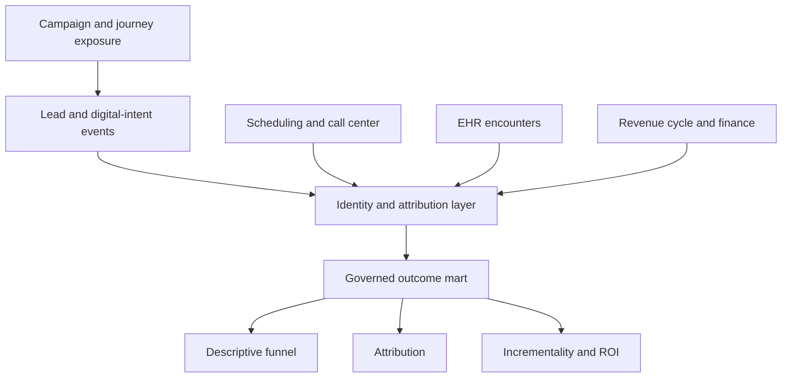

*Figure 31.1 — Measurement architecture. A report of match rate, latency, suppression and data quality travels with every output.*

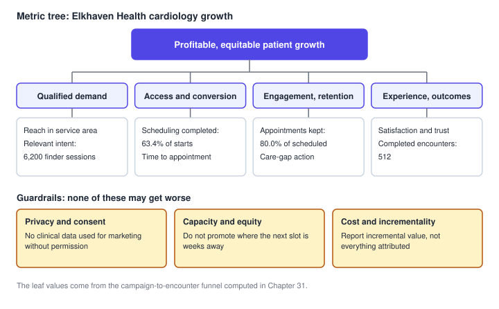

*Figure 31.2 — The metric tree for Elkhaven's cardiology growth.*

Every roadmap epic should state its path to one of these outcomes. An audience builder is not finished when it saves a segment. It is finished when operators activate it reliably and a downstream outcome can be observed.

### Worked example

You write the metric contract for Elkhaven.

```text
Outcome:          Completed encounter
Entity:           Unique patient encounter
Eligibility:      Selected service lines and campaign cohort
Attribution:      Documented lookback and touch rule
Causal estimate:  Geographic holdout where feasible
Maturity:         45 days after service date
Identity:         Report matched and unmatched by source
Revenue:          Net patient revenue from the finance-approved field
Exclusions:       Test, duplicate, reversed, employee, non-billable
Privacy:          Minimum cells, approved access, retention, no export of PHI
```

Then the matured cohort, 45 days after service:

Output:

```text
stage                                     count  pct_of_previous
----------------------------------------  -----  ---------------
Provider-finder sessions from campaign    6,200                -
Scheduling started                        1,010             16.3
Appointments scheduled                      640             63.4
Appointments kept (completed encounters)    512             80.0
Encounters matched to finance records       468             91.4
```

Of 512 kept appointments, 468 match a finance record. The other 44 are not zero-revenue; they are unmatched, and the report says so. Now state the result three ways (ROI of +3.07 means $3.07 of value beyond each $1 spent):

```python
matched = 468
gross_charges_each, net_revenue_each = 1_480.00, 505.00
variable_cost_each = 185.00
campaign_cost = 58_000.00
incremental_share = 0.40          # from a geo holdout, not from attribution

gross = matched * gross_charges_each
net = matched * net_revenue_each
contribution = matched * (net_revenue_each - variable_cost_each)
incremental = contribution * incremental_share
```

Output:

```text
basis                             value     roi
------------------------------  -------  ------
Gross charges, all attributed   692,640  +10.94
Net revenue, all attributed     236,340   +3.07
Contribution, incremental only   59,904   +0.03
```

Same campaign, same data: a return of nearly eleven to one, three to one, or roughly break-even. Only the last uses money actually kept and counts only what the campaign caused. That is the number to show finance, with the other two labeled for what they are.

### Common mistakes

| Mistake | Why it bites | Do this instead |
|---|---|---|
| Calling gross charges revenue | Overstates value several times over | Finance-approved net revenue or contribution |
| Reporting before records mature | Cancellations and reversals arrive later | A stated maturity window |
| Hiding unmatched records | Results skew toward recognizable people | Publish match and unmatched rates |

### Check yourself

**Q31.1** Order these from largest to smallest for a typical encounter: net patient revenue, gross charges, contribution margin.

**Q31.2** Why keep every appointment state transition instead of the latest state?

> [!IMPORTANT]
> **In one line:** Report matured, matched, finance-defined, incremental value, and label everything else as what it is.

## 32. Clinical AI: grounded answers and evaluation

### Why it matters

Medscape now offers an AI answer experience to clinicians, and every competitor will. In a clinical setting a fluent wrong answer is a safety problem. The difficult work is not the chat box. It is everything that decides whether an answer deserves to be shown.

### The idea

The hard problems behind a medical information assistant are corpus governance, retrieval quality, source freshness, specialty context, citation fidelity, clinical-risk boundaries, prompt-injection resistance, handling of patient information, abstention, evaluation and change control.

Match rigor to risk.

| Risk tier | Example | Rigor required |
|---|---|---|
| Low | Internal summary of non-sensitive notes | Human review, confidentiality, accuracy checks |
| Medium | Content tagging, search ranking, propensity, anomaly detection | Bias and quality evaluation, monitoring, rollback |
| High | Clinician-facing evidence synthesis | Grounding, clinical safety evaluation, transparency, human oversight |
| Potentially regulated | Diagnostic or treatment recommendation with a medical intended use | Regulatory assessment, quality system, clinical evidence |

**Retrieval-augmented generation (RAG)** retrieves relevant documents and asks a model to answer from them. It improves freshness and citation. It does not remove **hallucination**, fluent output that the sources do not support. Failure can enter at ingestion, chunking, metadata, retrieval, ranking, context assembly, generation, citation or the interface.

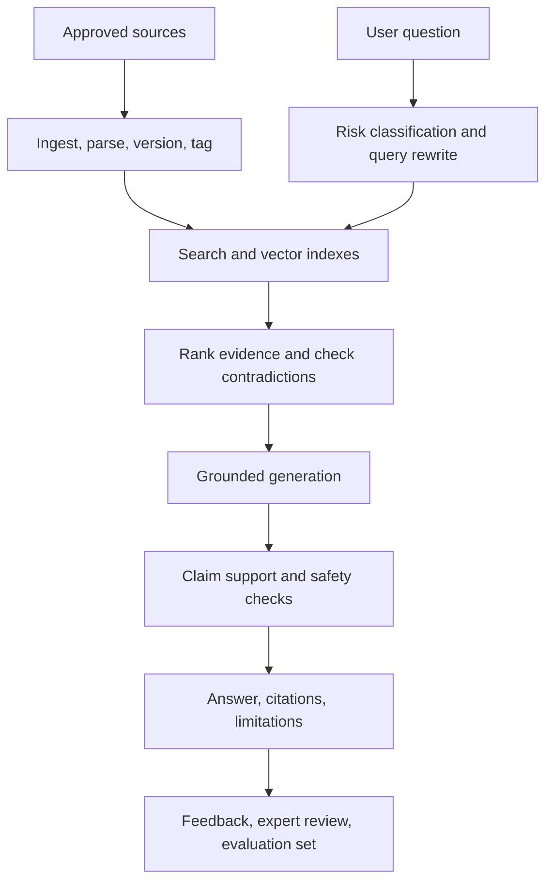

*Figure 32.1 — An answer pipeline. Specialty context is applied at the rewrite step; abstention is a valid output of the safety check.*

"Accuracy" is not one metric.

| Dimension | Example metric |
|---|---|
| Retrieval | Recall at k for required evidence; authority and freshness mix |
| **Grounding** | Share of factual claims supported by cited sources |
| Citation | Citation precision, completeness, link correctness |
| Clinical safety | Harmful recommendation or omission rate by risk tier |
| Calibration | Confidence against observed correctness; appropriate abstention |
| Fairness | Performance across specialty, geography, demographics, rare conditions |
| Product | Task success, time saved, repeat use, trust, escalation |
| Operations | Latency, cost, availability, drift, incident rate |

The rules are moving. ONC's HTI-1 rule requires certified health IT to expose source attributes for predictive decision support, and a December 2025 proposal (HTI-5) to remove those requirements was still not final in October 2026. FDA's clinical decision support guidance marks the device boundary. A federal nondiscrimination rule covers patient care decision support tools. California, Texas and Utah require disclosure of AI use in defined healthcare settings; Colorado's replacement law starts in January 2027; the EU AI Act's high-risk obligations now begin in December 2027. Whatever the scope, the transparency principle is sound: document purpose, intended users, inputs, output, validation, performance, limitations, fairness, monitoring and update process.

### Worked example

Wrenfield plans an answer assistant on Wrenfield Clinical. Before any build, you fill in the AI feature brief.

| Field | Wrenfield answer assistant |
|---|---|
| Decision supported | A clinician's information lookup; not a diagnosis or treatment decision |
| User and context | Verified clinician members, signed in, on web and app |
| Model and data | Approved model; retrieval over reviewed drug reference, guidelines and news |
| Allowed and prohibited inputs | Clinical questions allowed; patient identifiers stripped and never stored |
| Human authority | The clinician decides; a medical editor owns the corpus |
| Failure impact | A wrong dosing statement could harm a patient: high tier |
| Offline evaluation | Claim-level grading on a stratified expert set (Lab 7) |
| Production monitoring | Unsupported-claim rate, citation precision, abstention rate, safety escalations |
| Explanation and appeal | Citations with dates on every answer; one-tap "report a problem" |
| Rollback and kill switch | Feature flag by specialty; a source can be removed within an hour |
| Retention and training policy | Queries kept 30 days for safety review; not used to train models |

### Common mistakes

| Mistake | Why it bites | Do this instead |
|---|---|---|
| Optimizing thumbs-up | Confident wrong answers get liked | Claim support and expert rating first |
| One accuracy number | Hides a dangerous slice | The eight dimensions, by specialty |
| Trusting retrieval to prevent errors | Stale or conflicting sources flow through | Freshness and authority metadata, contradiction checks |
| No abstention | The model answers when evidence is thin | A refusal policy by risk tier, measured |

### Check yourself

**Q32.1** Why does retrieval-augmented generation not eliminate hallucination?

**Q32.2** Which tier is "an assistant that summarizes guideline evidence for clinicians," and what four kinds of rigor does it need?

> [!IMPORTANT]
> **In one line:** In clinical AI the product is the evidence chain behind the answer; measure every link of it, and let the system decline.

## 33. AI personalization, search and model operations

### Why it matters

Recommendation and search fail quietly: feeds narrow, popular content crowds out authoritative content, sponsored material nudges a ranking that claims to be neutral. A deployed model that changes no decision is cost; one that changes decisions unmonitored is risk.

### The idea

Personalization problems come in types: content ranking; next-item recommendation in a journey; channel selection (web, email, event, CRM or none); send-time optimization; audience expansion to similar eligible entities, under strong governance; anomaly detection; and campaign optimization of budget, bid, frequency or creative among permitted options.

Search and recommendation share a stack: query, profile, context and permissions feed candidate retrieval; filtering and policy gates; a ranking model; explanation and assembly; then user action, evaluation and learning. Authority, freshness, sponsorship, consent and tenancy constrain the first three steps. Retrieval finds eligible candidates, ranking orders them, generation may summarize. Do not ask a language model to make up for missing permissions, stale content or an undefined source of truth.

A relevance contract defines the eligible corpus, content class, freshness, geography, profession, specialty, intent, authority, sponsorship treatment, diversity, blocked combinations, fallback, citation behavior and how corrections and withdrawals propagate.

**Training data.** Positive labels such as click, completion, dwell, registration or attendance reflect what was shown and where. Correct for position bias, selection, bots, accidental clicks and heavy users. People who did not click are not all negatives; many never had a real opportunity. Validate on later time periods so the model never trains on the future.

**Offline metrics:** precision and recall at k; NDCG; mean reciprocal rank where one right answer matters; coverage across catalog and users; diversity and novelty; calibration; false-positive rate and precision and recall at operating thresholds for anomaly models; and slices by profession, specialty, geography, activity type and cold start. They support, and never replace, online task success and expert review.

**Online metrics:** incremental qualified engagement, completion, attendance, learning, conversion, task time and recurring adoption, guarded against lower diversity, over-contact, popularity concentration, opt-outs, content-class imbalance and latency. A click lift can coexist with worse learning or trust.

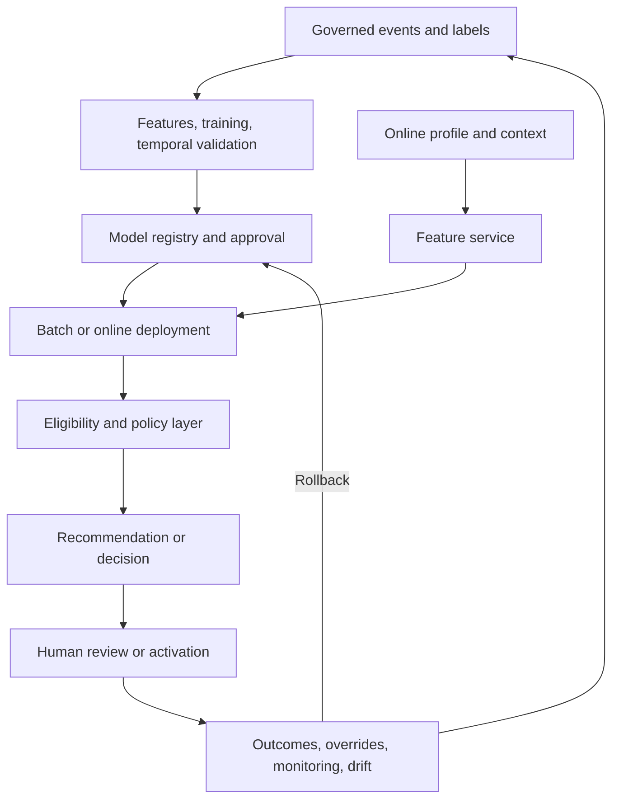

*Figure 33.1 — Model deployment. The policy layer sits after the model, so a score never overrides eligibility.*

Model operations require: model, feature, data and policy versions recorded per decision; reproducible training and evaluation; approval with separation of duties; shadow, canary, A/B and rollback controls; monitoring of inputs, outputs, latency, cost and outcomes; drift thresholds and a named retraining authority; champion-challenger support; explanation and operator override; and a fallback when the model or feature service is down. A **model registry** is the controlled inventory that holds versions and approvals.

An anomaly is not an incident. Define entity, metric, baseline, seasonality, sensitivity, minimum volume and action. Give likely drivers and comparison periods. Record the operator's disposition: real issue, expected campaign change, data delay or false alert. Optimize for useful investigated alerts, not alert count.

Enterprise AI sold as software also needs tenant isolation, entitlements, configuration versioning, approved models, prompt and template management, audit logs, cost and rate limits, retention controls, regional deployment, customer-specific policy, human review and portability, with global model behavior kept separate from tenant configuration and user context.

A prototype built on Claude or an open-source model can prove workflow value in days. Production needs approved data, reproducible evaluation, red-team cases, a latency and cost envelope, privacy and security review, clinical or editorial review where relevant, accessibility, abuse controls, observability, human escalation, rollback and a named owner. A persuasive demo is evidence of possibility, not readiness.

### Worked example

Tomás proposes a ranker for education activities. You write its contract first.

```text
Decision:          Rank eligible specialty education activities
Inputs:            Profession, specialty, declared interests, permitted engagement
                   history, activity metadata, prior completion, freshness,
                   channel availability
Prohibited inputs: Patient data, unsupported sensitive inference,
                   commercial sponsor priority
Output:            Ordered activity IDs, score, reason codes, model version, expiry
Fallback:          Editorially curated specialty list
Human control:     Education team can remove an activity; the member can dismiss
                   or change interests
```

"Commercial sponsor priority" on the prohibited line is the sentence Dr. Okoye will look for.

### Common mistakes

| Mistake | Why it bites | Do this instead |
|---|---|---|
| Rewarding clicks | Feeds narrow toward the popular and the provocative | Measure usefulness, diversity and long-term value |
| Sponsored content inside a "neutral" ranker | Trust and independence are lost | Separate pools; label and slot sponsorship |
| No fallback | An outage becomes a blank page | Curated default per specialty |
| Launching from a demo | Unknown failure modes reach members | The prototype-to-production gate |

Also design against inferred sensitive traits used beyond their purpose, stale profiles, cross-tenant exposure, and generated answers that drop uncertainty or source context. Explore carefully, cap repetition, and give members real controls. In high-impact clinical contexts, define where AI assists, where review is required and where generation is prohibited.

### Questions to ask in your first weeks

- Which model is deployed but not changing a meaningful decision?

### Check yourself

**Q33.1** Why are non-clicks unreliable as negative training examples?

**Q33.2** Where does the eligibility and policy layer sit relative to the model, and why?

> [!IMPORTANT]
> **In one line:** Write the contract (inputs, prohibited inputs, fallback, human control) before the model, and measure usefulness, not clicks.

## 34. Generative AI in commercial offerings and in your own work

### Why it matters

Two of the five roles ask for hands-on use of generative AI: to build offerings for the organizations that fund education and campaigns, and to speed up your own product work. Used well it shortens weeks to days. Used carelessly it puts invented numbers in a client report or confidential data in an unapproved tool.

### The idea

**Where it fits.** Good uses in marketing technology: draft briefs, taxonomy mapping, creative quality checks, campaign explanation, anomaly summaries and knowledge retrieval. High-risk uses: unreviewed pharma claims, autonomous sensitive-health targeting, invented performance explanations, and training models on customer data without the right to.

**Supporter offerings.** In education and related commercial work, a **supporter** is an organization funding or purchasing an offering. AI can add value through faster needs-assessment synthesis from approved sources; adapting approved material to new formats; localization and reading-level help with medical review; modular packaging; anomaly detection in campaign and learner outcomes; report narratives grounded in approved metrics; summarizing questions, transcripts and themes with privacy controls; content tagging; next-format or next-program suggestions for commercial teams; and internal proposal and scoping help.

The boundary: AI may adapt format, length, modality or presentation only inside an approved content and review framework. Keep independent education apart from promotion. Lock scientific claims, references, disclosures, fair balance where it applies, faculty meaning and accreditation requirements, and keep lineage from source to output.

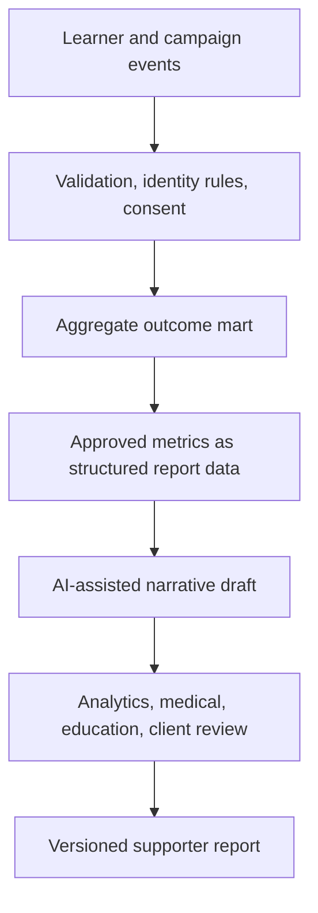

*Figure 34.1 — Supporter reporting. Minimum cells, privacy, independence and contract rules apply at the mart, the structured data and the final report.*

The model must not calculate numbers from raw events inside free-form generation. Compute metrics deterministically, pass structured values with their definitions, and check every sentence of the narrative against them.

Reports typically cover qualified reach and participation; profession, specialty and geography at permitted aggregation; starts, completions, assessments and evaluations; pre- and post-activity change in knowledge or confidence, with method; engagement by format and channel; benchmarks with a comparable cohort defined; operational time and customization effort; client adoption; revenue and margin; and suppression and exceptions.

An internal workflow becomes a client-facing product only after expert-only assumptions are removed, entitlement and tenant isolation are defined, explanation and support exist, repeatability is proven, quality is documented and a package is set. Manual intervention and exception rates reveal whether the "product" is still a service. For offerings across the US, Europe and Latin America, account for language, medical practice, accreditation, professional identity, promotional rules, privacy, data residency and model performance. Translating the interface does not make a US-trained model global.

**Your own work.** Use Claude or a similar tool as a structured collaborator, not an authority.

Safe boundary: never paste patient information, confidential customer data, unreleased strategy, credentials or restricted contracts into an unapproved tool. Use synthetic examples and approved enterprise environments. Record when generated work materially shaped a requirement or decision.

The rapid-prototype loop:

1. Frame user, workflow, constraint and decision.
2. Ask the model for ambiguities and failure modes.
3. Generate several workflow or schema options.
4. Build a disposable prototype on synthetic data.
5. Test with operators or users.
6. Verify technical and regulatory assumptions with their owners.
7. Convert what you learned into human-owned requirements.
8. Save accepted decisions, not chat volume.

Prototypes worth building: a clickable audience and journey flow; a JSON API contract with a mock server; a synthetic campaign-to-appointment dataset and dashboard; a natural-language-to-segment rule generator with approval; a report narrative generator limited to approved metrics; a customization workbench using locked components; a registration flow with an identity-confidence explanation; and an anomaly triage assistant on synthetic incidents.

An LLM application for this work has a fixed shape: approved user input passes through policy, redaction and a prompt template; retrieval adds approved documents, schemas and examples; the model responds; structured output is validated; a person reviews and edits; and the result becomes a prototype, requirement, story or test whose quality is tracked. The model never changes production campaign or customer configuration directly.

For test scenarios, ask for happy, boundary, adversarial, privacy, accessibility, localization, stale-data, concurrency, retry, partial-failure and rollback cases. Then have domain owners delete the irrelevant and add real past incidents. Judge the practice by cycle time from problem to testable artifact, share of generated requirements accepted after review, defects traced to unverified AI output, learning per prototype and pattern reuse. The goal is faster learning, not more AI use.

### Worked example

You need requirements for activating an audience from Wrenfield Grow to Elkhaven's marketing automation. You give the model a brief, not a wish.

```text
Act as a critical product-design partner.
Context: A health-system marketer uses an intelligence platform to activate
         an audience to a marketing automation tool.
User goal: Launch an approved cardiology journey and measure completed encounters.
Constraints: HIPAA-regulated customer context, consent, tenant isolation,
             idempotent API, no PHI in logs, human approval before activation.
Produce:
1. actors and preconditions;
2. main and exception flows;
3. data objects and ownership questions;
4. acceptance criteria in Given/When/Then form;
5. abuse, privacy, reliability and measurement failure modes;
6. assumptions requiring expert verification.
Do not invent current platform capabilities.
```

Item 6 and the last line do the most work. They make the output a list of questions for Nadia and Marcus instead of a specification nobody checked.

### Common mistakes

| Mistake | Why it bites | Do this instead |
|---|---|---|
| Letting the model compute report numbers | Plausible, wrong figures reach a client | Deterministic metrics in; narrative checked against them |
| Pasting real customer data into a prompt | A confidentiality breach | Synthetic data, approved environments |
| Shipping generated requirements unreviewed | Invented capabilities become commitments | Owners verify every assumption |

### Check yourself

**Q34.1** Why should a report-writing model receive structured values instead of raw events?

**Q34.2** Name three things that must never be pasted into an unapproved AI tool.

> [!IMPORTANT]
> **In one line:** Generative AI drafts, adapts and questions; people and deterministic code own the numbers, the claims and the decisions.

# Part V — Operating as the PM

## 35. Strategy and discovery in a regulated B2B2C market

### Why it matters

Requests arrive from clients, sellers, executives and operators, mostly phrased as solutions. Where buyer, user and approver are different people, building what was asked for is the commonest way to build the wrong thing.

### The idea

**Strategy.** Richard Rumelt's kernel, from *Good Strategy Bad Strategy* (2011), has three parts: a diagnosis of the specific obstacle, a guiding policy for dealing with it, and coherent actions that reinforce each other. Applied here:

- Diagnosis: campaign teams get cross-channel clinician insight too late to change a live campaign, while identity confidence and customer workflows vary.
- Guiding policy: a governed, near-real-time signal-to-action layer with transparent eligibility and native integrations.
- Actions: canonical engagement taxonomy, identity confidence model, consent enforcement, explainable lists, CRM and DSP connectors, incrementality measurement, migration tooling.

**Moats.** Defensibility in this ecosystem can come from trusted user relationships, authenticated clinician reach, permitted first-party signals, endemic supply, workflow integration, education expertise, healthcare taxonomy, measurement feedback and regulatory competence. "More AI" is not a moat when competitors can call the same model.

**Build, buy, partner.** Score each capability on strategic differentiation, healthcare specificity, data sensitivity, time to value, integration burden, switching cost, vendor concentration, regulatory exposure and total cost. Build core differentiators and control planes; buy commodity infrastructure; partner where network effects or regulated expertise dominate.

**Discovery.** Interview operators, customers and end users separately. A marketer may ask for a dashboard; the campaign operator may need fewer manual reconciliations; a clinician may need lower frequency; legal may need audit evidence; engineering may need a stable event contract. Do not confuse the requested solution with the need. "Add an export button" may mean the API is missing, the dashboard cannot answer a question, the connector is unreliable, or the user needs evidence for a client. Trace the downstream job first.

For a novel client objective: clarify the outcome and constraints; find the real user; separate configuration from custom code; test data and inventory availability; prototype the riskiest assumption; estimate recurring operational load; define a safe pilot; then decide to configure, extend, partner or decline. Record what becomes reusable platform capability and what stays a client-specific service.

**Competitors.** Treat vendor claims as hypotheses and compare workflows through demos, references, implementation evidence, contracts and outcome definitions. Publicly, Innovaccer positions a CRM within a healthcare experience suite, with a consumer data platform, omnichannel marketing, propensity scoring and EHR integration. Unlock Health presents health-risk assessments for service-line growth, acquisition and retention. Epic's Cheers is the CRM inside the EHR many customers already run.

| Dimension | Question to answer for each competitor |
|---|---|
| Data advantage | Which clinical, consumer, market, identity and engagement data are permitted and current? |
| Intelligence | Which opportunity, propensity, recommendation and anomaly models exist? |
| Orchestration | Which channels and journey states are native, which integrated? |
| EHR and CRM integration | Which objects, directions and workflow ownership? |
| Outcome loop | Does it reach appointments, encounters, retention, revenue? |
| Experience | Provider finder, content, web and mobile, call center, scheduling? |
| Time to value | Standard integration, services burden, operator learning? |
| Trust | HIPAA posture, consent, security, explainability, audit? |
| Economics | Platform, services, data, media and study costs? |

Possible win themes are healthcare-specific data and models, consumer reach and trust, clinician reach, provider and payer workflows, programmatic activation, content and education expertise, and closed-loop outcomes. Each needs proof, and they must add up to one coherent customer workflow. A slide listing assets is not an integrated product.

Each quarter, review customer jobs, regulation, browser and platform policy, EHR roadmaps, marketing-platform changes, AI answer behavior, competitor launches, pricing, partnerships, wins and losses. For each change record confidence, evidence, product implication and decision.

### Worked example

Sales says Aldermoor wants "real-time clinician alerts." You open an evidence table before a design file.

| Claim | Evidence | Confidence | Risk if wrong | Next test |
|---|---|---|---|---|
| Teams need NPI-level insight within 24 hours | 8 of 10 operator interviews; export logs | Medium | Build a costly streaming path nobody uses | Decision exercise: daily against hourly data |
| CRM activation improves useful follow-up | Two customer pilots | Low | Spam and compliance risk | Controlled pilot with holdout and complaint guardrail |

Then the problem brief:

```text
User and job:         Aldermoor field team lead; decide which clinicians to
                      contact this week with approved material
Current workflow:     Weekly spreadsheet export, merged by hand with CRM
Pain and frequency:   Insight is 7 to 10 days old; every week
Business impact:      Follow-up reaches clinicians after interest has passed
Evidence:             Table above
Constraints:          Promotion rules, contact frequency policy, consent, audit
System dependencies:  Identity graph, engagement events, CRM connector
Outcome, guardrails:  Qualified follow-up within 48 hours; no rise in opt-outs
                      or complaints
Smallest test:        Daily list for 50 reps for four weeks, with holdout
Decision, owner:      December 11; you
```

Daily turns out to be enough. The streaming path is not built.

### Common mistakes

| Mistake | Why it bites | Do this instead |
|---|---|---|
| A strategy that is a feature list | No obstacle named, so nothing is ruled out | Diagnosis, policy, coherent actions |
| Interviewing only the buyer | Operators and end users carry the real constraints | Separate conversations for each side |
| Taking sales feedback at face value | It is real but selected | Ask for evidence, size, workaround, willingness to pay |

### Questions to ask in your first weeks

- Which customer and user outcomes matter most this year?
- Where is the platform differentiated, and where is it services-heavy?
- Which roadmap commitments are contractual?
- Which legacy constraints are deliberate controls, and which are technical debt?
- What will the team explicitly not do?

### Check yourself

**Q35.1** State the three parts of the strategy kernel.

**Q35.2** A client asks for an export button. Give three different underlying needs it might signal.

> [!IMPORTANT]
> **In one line:** Name the obstacle before the plan and the job before the feature, and test the cheapest version of the riskiest belief.

## 36. Technical leadership and metrics

### Why it matters

You are not the architect, and you still own whether the system does what the customer was promised. Two tools let you lead without designing: asking for the right pictures, and insisting that every number has a definition.

### The idea

Ask for four diagrams of any system you are responsible for:

1. Context: actors and external systems.
2. Containers: major applications and data stores.
3. Sequence: one critical request end to end.
4. Data lineage: from collection to activation, measurement, retention and deletion.

Then write the non-functional requirements (NFRs), the qualities a system needs beyond its features: availability and graceful degradation; latency percentiles, not averages; throughput and burst behavior; data freshness and completeness; recovery time and recovery point; security, privacy and audit; accessibility and localization; observability and supportability; cost per request, event, profile or campaign; and migration and backward compatibility.

The metric stack has six layers:

- **North-star outcome:** durable value created for users and customers.
- **Input metrics:** behaviors the team can influence.
- **Quality metrics:** validity and experience.
- **Guardrails:** harms or constraints that must not worsen.
- **Operational metrics:** reliability, latency, freshness, cost.
- **Commercial metrics:** revenue, margin, retention, expansion.

For a clinician insight-to-action product:

```text
Outcome:     Incremental qualified clinician action from timely, relevant engagement
Inputs:      Eligible clinician coverage, signal freshness, list adoption,
             connector success
Quality:     Identity precision, explanation usefulness, duplicate rate
Guardrails:  Opt-out leakage, contact frequency, complaint rate,
             restricted-audience error
Operations:  Pipeline delay at the 95th percentile, export success,
             reconciliation error
Commercial:  Platform adoption, renewal, gross margin, attach rate
```

**Review dashboards from decisions, not charts.** For every tile: who acts, when, at what threshold, and which drill-down explains a change? Show data freshness, definition links, confidence intervals and quality warnings. Never mix estimated, attributed and causal outcomes without labels.

### Worked example

"Qualified engagement rate" appears in three Wrenfield decks with three values. You write one definition.

| Field | Definition |
|---|---|
| Name | Qualified engagement rate, 14-day |
| Decision it supports | Whether a campaign changed clinician behavior enough to continue |
| Numerator | Assigned clinicians with at least one qualified conversion event |
| Denominator | All clinicians assigned to the variant |
| Eligibility and exclusions | Verified, consented, on the target list; test accounts excluded |
| Entity and grain | Clinician; one row per clinician per campaign |
| Time window and timezone | 14 days from assignment; UTC |
| Source of truth | `engagement_event`, deduplicated by `event_id` |
| Latency | Available the next day; final after 16 days |
| Known bias | Under-counts clinicians who engage while signed out |
| Owner | Product analytics |
| Change control | Versioned; changes announced two weeks ahead |

The three decks disagreed because one divided by exposed clinicians, one counted events instead of clinicians, and one used a 30-day window.

### Common mistakes

| Mistake | Why it bites | Do this instead |
|---|---|---|
| Accepting "it's in the architecture doc" | The doc shows boxes, not one real request | Ask for the sequence and lineage diagrams |
| Requirements with no NFRs | Latency and recovery are discovered in production | Ten NFR headings on every requirement |
| A metric with no denominator | Teams compute it differently | The twelve-field definition |
| A dashboard nobody acts on | Cost with no decision | Name the actor and threshold for each tile |

### Questions to ask in your first weeks

Use these on any API you inherit:

- Is it resource-oriented and semantically stable? Are pagination, filtering, sorting and versioning explicit?
- Are retries safe and writes idempotent?
- Can clients tell validation, authorization, conflict, rate-limit and server errors apart?
- Are timestamps in UTC with clear meaning, and are enumerations forward-compatible?
- Are sensitive fields minimized, with field-level access enforced?
- Are quotas and service levels measurable, and can old and new clients coexist during migration?

### Check yourself

**Q36.1** Name the four diagrams.

**Q36.2** Give one guardrail and one operational metric for the insight-to-action product.

> [!IMPORTANT]
> **In one line:** Lead technically by asking for one real request drawn end to end, and by refusing any number that lacks a numerator, denominator and owner.

## 37. SQL and analytics for the role

### Why it matters

These roles expect you to write SQL or use analytical tools. You are not replacing an analyst. You are making sure you can inspect adoption, campaign, journey, integration and model behavior yourself.

### The idea

Before syntax, learn **grain**: what one row is. A request, a retry, a unique business event, a clinician, a campaign and an account are different grains, and joining tables of different grain without thinking multiplies rows.

The practice database (SQLite, built by `seed.py`) has these tables:

```text
target_list(npi, client, list_version)
hcp_profile(hcp_id, npi, profession, specialty, state, consent_state,
            verified, last_seen)
journey_assignment(hcp_id, journey_id, variant, assigned_at)
exposure(hcp_id, day, line_item, impressions, viewable)
line_item(line_item, name, buy_type, cpm, budget, start_day, end_day)
engagement_event(event_id, hcp_id, event_type, content_class, event_at, qualified)
decision_event(decision_id, hcp_id, journey_id, action, reason_code,
               model_version, policy_version, decided_at)
activation_event(decision_id, channel, status, activated_at)
integration_event(partner_id, endpoint, status_code, latency_ms, event_at)
registration_event(visitor_id, variant, device, step, event_at)
login_event(visitor_id, login_at)
```

Three queries cover most of what you will be asked: time from trigger to activation (below), lift by assigned variant (Chapter 13), and integration friction (Chapter 25). Dialects differ. PostgreSQL offers `PERCENTILE_CONT` and Trino offers `APPROX_PERCENTILE`; SQLite has neither, so the examples rank rows with window functions.

### Worked example

How long does a journey decision take to become a delivered experience?

```sql
-- Minutes from decision to delivered activation, by channel.
-- SQLite has no PERCENTILE_CONT, so this uses the nearest-rank method.
WITH lat AS (
  SELECT a.channel,
         (julianday(a.activated_at) - julianday(d.decided_at)) * 1440.0 AS minutes
  FROM decision_event d
  JOIN activation_event a USING (decision_id)
  WHERE a.status = 'delivered'
), ranked AS (
  SELECT channel, minutes,
         ROW_NUMBER() OVER (PARTITION BY channel ORDER BY minutes) AS rn,
         COUNT(*)     OVER (PARTITION BY channel)                  AS n
  FROM lat
)
SELECT
  channel,
  MAX(n)                                                         AS delivered,
  ROUND(MAX(CASE WHEN rn = (n + 1) / 2 THEN minutes END), 1)     AS p50_minutes,
  ROUND(MAX(CASE WHEN rn = (95 * n + 99) / 100 THEN minutes END), 1)
                                                                 AS p95_minutes
FROM ranked
GROUP BY channel
ORDER BY p95_minutes;
```

Output:

```text
channel  delivered  p50_minutes  p95_minutes
-------  ---------  -----------  -----------
site           736          2.0          4.4
email          561          8.6         25.9
crm            279         33.5        289.1
```

A low median with a high 95th percentile points at a long tail: a connector, an approval step or retries. The CRM channel's median is 33.5 minutes and one delivery in twenty takes nearly five hours. Break that down by partner and reason before promising a service level.

A second query, by campaign week:

```sql
-- Grain: one row per campaign week. Week 1 starts September 14, 2026.
SELECT
  1 + CAST((julianday(date(d.decided_at)) - julianday('2026-09-14')) / 7 AS INT)
                                                          AS campaign_week,
  COUNT(*)                                                AS decisions,
  SUM(d.action = 'offer')                                 AS offers,
  SUM(a.status = 'delivered')                             AS delivered,
  ROUND(100.0 * SUM(a.status = 'delivered')
        / SUM(d.action = 'offer'), 1)                     AS pct_offers_delivered
FROM decision_event d
LEFT JOIN activation_event a USING (decision_id)
GROUP BY campaign_week
ORDER BY campaign_week;
```

Output:

```text
campaign_week  decisions  offers  delivered  pct_offers_delivered
-------------  ---------  ------  ---------  --------------------
            1        688     422        397                  94.1
            2        731     451        423                  93.8
            3        819     484        453                  93.6
            4        526     310        303                  97.7
```

Week 4 is a partial week, which is why its counts are lower. Always check whether the last period is complete before reading a trend.

Ten analyses to practice, with where this book works them:

1. Weekly activation funnel by customer cohort (above).
2. Time from contract to first successful activation.
3. Standard connector against custom integration reliability (Chapter 25).
4. Journey entry, suppression, no-action and exit reasons (Chapter 23).
5. Recommendation coverage and diversity by specialty.
6. Model override rate and downstream outcome.
7. Segment count drift after an identity or data-source update (Chapter 10's funnel, run before and after).
8. Manual campaign setup time before and after automation.
9. Revenue or upsell linked to feature entitlement and actual adoption.
10. Support tickets per active customer and integration.

### Common mistakes

| Mistake | Why it bites | Do this instead |
|---|---|---|
| Joining without knowing the grain | Rows multiply and totals inflate | State the grain of every table in a comment |
| Rates by exposed users | Selection bias | Rates by assigned variant |
| Averages for latency | The tail is invisible | Median and 95th percentile |

### Check yourself

**Q37.1** What is the grain of `integration_event`, and why does it matter when counting "failed activations"?

**Q37.2** In the latency output, which channel would you investigate first, and what would you break it down by?

> [!IMPORTANT]
> **In one line:** Know what one row is before you count anything, and prefer percentiles and assigned groups to averages and exposed ones.

## 38. Delivery, agile execution and incidents

### Why it matters

In this ecosystem a release can touch a clinician's page, a client's invoice and a consent record at once. Delivery discipline is how you move quickly without creating an incident, and incident discipline is how you keep trust when one happens anyway.

### The idea

**Slice vertically.** A thin end-to-end slice for a new clinician signal is one source event, deterministic identity, one eligibility rule, one reviewable list, one connector and one outcome event. It tests the real system earlier than a generalized segmentation engine would. Avoid horizontal epics such as "build database," "build frontend" and "build model."

```text
Outcome or strategic bet
  Epic or capability
    User workflow slice
      Story with acceptance criteria
        Engineering task or test
```

The product manager owns problem, strategy, outcome and roadmap. The product owner function keeps delivery ready: ordered backlog, clear acceptance, fast decisions, validated increments. One person may do both; strategy must not disappear into ticket administration.

**Definition of ready:** user and problem evidence; outcome and guardrails; workflow and content class; data, identity and API contract; failure and fallback behavior; privacy, security, medical and legal review needs; dependencies and owner; testable acceptance criteria; rollout and instrumentation plan.

**Definition of done:** code complete is not product complete. Require automated tests, observability, accessibility, data-quality checks, documentation, a support runbook, a feature flag, rollback, validated analytics, approvals and a named post-launch owner.

Ceremonies have purposes: refinement exposes ambiguity and dependencies; planning selects a coherent slice within capacity; daily coordination surfaces blocked decisions and production risk; review shows working behavior with realistic data and failure cases; the retrospective improves system conditions; backlog review removes stale work. Scrum gives bounded iterations and roles, Kanban emphasizes flow and work-in-progress limits, Lean emphasizes learning and waste reduction. Do not force urgent ad incidents, editorial corrections or partner certification into a ceremony built for planned feature work. Keep one visible system of work with explicit service classes.

**Release controls:** feature flags and staged rollout; shadow mode for new models and rules; canary by customer, publisher or traffic share; synthetic monitoring and reconciliation; backward-compatible schemas; a kill switch with a named authority; a rollback and data-repair plan; customer communication and support readiness.

When sequencing, for example CDP self-service against another custom connector, compare user reach, revenue commitment, reusable platform value, risk, learning, time, operational savings, dependency readiness and opportunity cost. Show what will not be built and the consequence. "Both are priority one" is not prioritization.

**Incidents.** Severity weighs user harm, privacy and regulatory exposure, clinical risk, revenue and billing impact, customer count, duration and reversibility. A low-traffic leak of patient information can outrank a high-traffic reporting delay. Ask seven questions: what changed; what is the blast radius; is the system still causing harm; what safe containment exists; which evidence must be preserved; who has notification authority; how will affected data, billing and reports be corrected?

For a supply, creative or data quality incident the runbook is:

1. Stop or constrain the affected demand, supply, creative or data flow.
2. Preserve logs and the exact served artifacts.
3. Scope it by publisher, placement, deal, creative, time, geography and identity path.
4. Assess user, privacy, regulatory, financial and customer impact.
5. Notify incident owners and customers under policy and contract.
6. Reconcile billing and issue credits if required.
7. Fix detection or enforcement, not only the single case.
8. Document root cause, contributing conditions and evidence of prevention.

The review afterward looks at system conditions, not blame, and separates the trigger, contributing factors, detection gap, response gap and recovery gap. "Remind the team to be careful" is not a control.

### Worked example

You write one story for the Aldermoor CRM export so that it is ready by the definition above.

```text
Use case:      Campaign operator activates an approved clinician segment to CRM.
Preconditions: Segment approved, consent current, connector healthy,
               operator authorized.
Main flow:     Preview, validate count, activate, receive destination ID,
               monitor status.
Exceptions:    Count changed, destination rejects a field, token expired,
               partial batch failure.
Acceptance:    Idempotent retry, row-level error export with masking, audit log,
               reconciliation.
Outcome:       Median approved-segment-to-CRM time under 15 minutes.
Guardrail:     Zero ineligible clinician records delivered.
```

### Common mistakes

| Mistake | Why it bites | Do this instead |
|---|---|---|
| Horizontal epics | Nothing works until everything works | One thin working journey |
| No named kill-switch authority | Minutes are lost deciding who may stop a launch | Name the person before launch |
| Severity by traffic | Small privacy incidents are under-ranked | Weigh harm and reversibility |

### Check yourself

**Q38.1** List the six components of a thin vertical slice for a new clinician signal.

**Q38.2** Why can a low-traffic incident be the most severe of the week?

> [!IMPORTANT]
> **In one line:** Ship one thin journey that really works, know who can stop it, and when it breaks, contain first and fix the detector last.

## 39. Stakeholders and portfolio leadership

### Why it matters

You will run a platform capability, a client commitment, a reliability fix, a discovery bet and a compliance deadline at once, through people who do not report to you.

### The idea

Expect working relationships with engineering, data science, analytics, design, editorial, medical, education and accreditation, legal, privacy, security, regulatory, ad operations, sales, customer success, finance, partnerships, publishers, agencies and clients. For each, write down goals, decisions owned, inputs needed, incentives, vocabulary, cadence and escalation path.

| Stakeholder | Starts with | You translate into |
|---|---|---|
| Business | Outcome, market, cost, risk | A measurable goal and constraints |
| Editorial and medical | Accuracy, independence, workflow | Content class, review gate, provenance, withdrawal |
| Sales and client | A requested solution and a launch date | A validated job, feasible scope, acceptance criteria |
| Design | User need and interaction | Flows, states, accessibility, evidence plan |
| Engineering and data | System behavior and constraints | Contracts, edge cases, NFRs, observability |
| Ad operations and marketing | Campaign setup and delivery | Reusable controls, taxonomy, service level, reporting |

One portfolio view holds every item with its outcome, user, customer, revenue or risk, deadline, evidence, dependency, confidence, effort, owner and next decision. Keep contractual must-do work visibly separate from discretionary roadmap work, and show the capacity trade-off between them. Score items on expected outcome value, strategic reuse, evidence confidence, urgency, risk reduction and effort, then document overrides. A regulatory deadline, a severe reliability issue or a critical commitment may outrank a higher score. Never disguise an executive or contractual decision as arithmetic.

Requirements are a stack, and a wireframe is one layer of it:

```text
Business rationale: why now and the expected outcome
User need:          actor, context, job, pain, evidence
Experience:         flow, wireframes, content, states
Functional spec:    rules, inputs, outputs, permissions, edge cases
Data contract:      objects, IDs, source, freshness, retention, consent
Non-functional:     latency, availability, accessibility, security, scale
Analytics:          events, measures, guardrails, causal plan
Operations:         support, review, reconciliation, incident, rollback
Acceptance:         testable behavior and release threshold
```

A useful wireframe shows hierarchy, the primary action, content and data states, permissions, errors, empty and loading states, mobile behavior, accessibility notes and instrumentation points. Keep it low fidelity early and pair it with a flow and a state model.

**Vendors.** Compare on strategic fit, healthcare and privacy posture, API and event coverage, identity model, latency, scale, reliability, configurability, observability, implementation effort, support, roadmap control, data portability, total cost and exit risk. Contract for service levels, incident communication, security updates, audit rights where appropriate, data return and deletion, and transition support. You still own the user outcome when a vendor fails.

**Earn trust quickly:** learn operators' real workflow before proposing a re-platform; separate facts, assumptions and hypotheses; close loops in writing; make reliability and governance work visible; give credit and absorb ambiguity; escalate early with options; never bluff on medical, privacy or regulatory interpretation.

Lead executive communication with the decision and its consequence. Not "engineering is delayed," but the memo below.

### Worked example

The NPI registry file format changed (Chapter 10). Nadia's team needs two more weeks. You write a decision memo.

| Field | Content |
|---|---|
| Decision and deadline | Approve a parallel run of old and new NPI ingestion; decide by Friday |
| Recommendation | Run both for one sprint with a reconciliation gate; keep the launch date |
| Problem | The feed migration puts audience refresh at a two-week risk |
| Evidence | Test load: name fields truncated in 0.4% of records under the old parser |
| Options | Cut over now; delay launch two weeks; parallel run |
| Trade-offs | Parallel run costs one sprint of duplicate processing |
| Reviews | Privacy: no new data. Security: no change. Medical: not applicable |
| Metrics and guardrails | Match rate within 0.5 points of baseline; zero identity collisions |
| Reversibility | High until old ingestion is switched off |
| Owner and approvers | You; engineering lead; data governance |
| Open risks | Downstream consumers with hard-coded field lengths |

### Common mistakes

| Mistake | Why it bites | Do this instead |
|---|---|---|
| Reporting status instead of a decision | Executives cannot act on "delayed" | Decision, consequence, recommendation |
| A formula presented as the decision | Hides the real reason for an override | Score, then write down the override |
| A happy-path wireframe as the spec | Authentication, errors and exceptions are undefined | The full requirement stack |

### Check yourself

**Q39.1** What does a sales stakeholder typically start with, and what do you translate it into?

**Q39.2** Name five fields of the decision memo.

> [!IMPORTANT]
> **In one line:** Translate each stakeholder's starting point into contracts and decisions, keep one honest portfolio, and lead with the decision you need.

## 40. Pilots, productization and adoption

### Why it matters

This role is judged on commercial adoption, not demos. Between a promising prototype and recurring revenue there are two traps: the pilot that never ends, and the "product" that is really a team of people doing manual work behind a login.

### The idea

Use the right word for the instrument:

- **Prototype:** tests an interaction or concept quickly; may not use production architecture.
- **Technical spike:** reduces one engineering uncertainty.
- **Proof of concept (POC):** demonstrates a technical assumption under limited conditions.
- **Pilot:** tests real workflow and value with bounded users or customers.
- **MVP:** the smallest production product that delivers repeatable value.

Calling everything a pilot creates false commercial expectations.

```mermaid
flowchart TD
  A[Problem and evidence] --> B(["Desirable?"])
  B -->|Yes| C[Technical POC]
  C --> D(["Feasible and safe?"])
  D -->|Yes| E[Workflow pilot]
  E --> F(["Useful and adoptable?"])
  F -->|Yes| G[Commercial design partner]
  G --> H(["Repeatable economics?"])
  H -->|Yes| J[Productize and scale]
  H -->|No| I["Service, partner or redesign"]
  B -->|No| X[Stop or reframe]
  D -->|No| X
  F -->|No| X
```

*Figure 40.1 — Stage gates. Each rounded question needs evidence defined before the stage starts.*

For AI-assisted segmentation or journey recommendations, a pilot also needs: a baseline rule or manual workflow; rights to the training and evaluation data; a leakage and time-split review; representative slices and a minimum sample; an offline metric tied to a user decision; a human-review workflow that captures overrides; shadow mode before recommendations affect users; an online holdout where feasible; latency, cost and failure fallback; and monitoring, drift, rollback and an incident path.

**Pilot purgatory** is a pilot with no decision date, no reusable architecture and no commercial owner: permanent unpaid service. Define beforehand what evidence triggers scale, iteration or stop. Track custom work separately from platform work, and do not count a manually curated success as proof of automated scale. Estimate implementation labor, data fees, cloud and model cost, support, sales engineering, compliance review and opportunity cost against a plausible repeatable price and market size. A marquee customer can justify the investment; label the strategic subsidy as one.

**From capability to offering.** A capability becomes a product when it has a defined user and buyer, a repeatable problem, packaged scope, entitlement, workflow, a service boundary, an implementation model, measurable value, price logic, a support model and a roadmap. "AI-powered segmentation" is a feature phrase. The Templates section shows the offering canvas filled in.

A value proposition must be specific enough to be false. Weak: "AI-powered omnichannel clinician orchestration." Stronger: "Help life-sciences campaign teams move from fragmented clinician signals to an approved, explainable next action across education, live events and activation channels in hours instead of days, with professional identity, consent, frequency and measurement built into the workflow." Validate every phrase. If "hours instead of days" is not measured, do not publish it.

Packaging options: a base platform plus activation modules; usage tiers by active profiles, events, campaigns or API volume; premium AI assistance and advanced measurement; a connector package; managed service for customers who need operational help; and an outcome study or clean-room measurement add-on. Choose a price metric that follows customer value and predictable cost, and avoid one that penalizes adoption or rewards collecting sensitive data.

Sales and product marketing need: the buyer problem and market narrative; audience-specific value propositions; a capability and workflow diagram; a demo script on representative data; an integration and security overview; an implementation plan with responsibilities; measurement method and proof; objection handling and differentiation; packaging, entitlement and the services boundary; a qualification checklist; and an adoption playbook for after signature.

The adoption funnel runs: eligible customer, contracted, integrated, configured, first activation, repeated workflow use, measured value, renewal and expansion. Track conversion and elapsed time between stages. Contracted revenue without integration or recurring use is churn that has not happened yet.

Classify product revenue as a directly sold new offering, upsell enabled by a feature, retention influence, usage expansion or services, and agree the attribution with finance and sales before launch. Do not claim a whole contract for one feature in a bundle. Close the loop with sellers so they know why a request was accepted, deferred or solved differently.

### Worked example

Aldermoor agrees to pilot the daily clinician list from Chapter 35. The charter fits on a page.

| Field | Pilot charter |
|---|---|
| Problem and target user | Stale clinician insight; Aldermoor field team leads |
| Design partner and authority | Aldermoor; Ingrid Solberg signs off |
| Hypotheses | Desirable: reps use the list weekly. Feasible: list by 06:00 daily. Valuable: follow-up within 48 hours rises |
| Scope and non-production limits | 50 reps, one brand, US only; manual quality check allowed for four weeks only |
| Approvals | Privacy, security, Aldermoor's medical-legal-regulatory team |
| Integration and support | Standard CRM connector; Wrenfield supports weekdays |
| Success, guardrail, stop criteria | Success: 60% weekly use. Guardrail: no rise in opt-outs. Stop: any ineligible record delivered |
| Baseline and comparison | Prior weekly export; 10% of reps held out |
| Timeline and sample | Eight weeks; at least 2,000 list entries |
| Commercial terms | Paid pilot at a stated discount; data stays Wrenfield's; learnings shared |
| Scale decision and owner | December 11; you |

### Common mistakes

| Mistake | Why it bites | Do this instead |
|---|---|---|
| A pilot with no stop criterion | It runs forever as free service | Decision date and evidence thresholds in the charter |
| Hand-curated success presented as product | It will not scale or hold its margin | Track manual steps; price or automate them |
| Counting signed contracts as adoption | Unused software churns | Measure first activation and repeated use |

### Check yourself

**Q40.1** What distinguishes a proof of concept from a pilot?

**Q40.2** Which three absences define pilot purgatory?

> [!IMPORTANT]
> **In one line:** Decide in advance what evidence scales, changes or stops a pilot, and call it a product only when it repeats without heroics.

## 41. Your first 90 days

### Why it matters

The first three months set what people bring you afterward. Arrive with opinions about re-platforming and you will be managed. Arrive able to trace one real campaign end to end and name the number nobody trusts, and you will be asked into the decisions.

### The idea

| Period | Do | Deliver |
|---|---|---|
| Days 1-30: understand and make work visible | Finish the two-week immersion. Build a portfolio and stakeholder map from internal truth. Shadow ad operations, customer success, editorial, education, data and engineering. Trace one campaign and one clinician experience end to end. Write the canonical metric definitions for your area. Review top incidents, escalations, privacy findings and commitments. Find one reversible friction fix and one systemic opportunity. | System context map, decision log, glossary delta, metric tree, risk register, learning memo |
| Days 31-60: improve a real decision loop | Validate the top problem with users and data. Define outcome and guardrails. Align architecture, data contract, review path and experiment design. Deliver a thin slice or remove a frequent operational failure. Start a weekly health review. | Approved problem brief, options memo, experiment and release plan, data-flow review, launch checklist |
| Days 61-90: scale and set direction | Ship or pilot a measurable improvement. Quantify its causal or decision value. Turn learning into a strategy and sequenced roadmap. Set build, buy, partner positions and platform boundaries. Improve one mechanism: intake, metric governance, incident learning or customer feedback. | Outcome review, strategy kernel, two-to-three-quarter roadmap, dependency plan, executive narrative |

Across roles the pattern is the same: by day 30 understand the shared membership, commercial, education, growth and AI capabilities; by 60 improve one reusable decision or integration loop; by 90 show user value and measurable commercial or operational impact without crossing a purpose boundary.

**People to meet in the first two weeks:**

| Partner | Learn | Ask for |
|---|---|---|
| Engineering and architecture | Services, platform boundaries, re-platforming risks | Architecture and dependency map |
| Platform tools and product | Operator workflow, shared services, roadmap overlap | Capability catalog |
| BI and analytics | Source of truth, metric disagreements, reporting lag | Metric dictionary, key dashboards |
| Data science | Models, training data, evaluation, drift | Model cards, evaluation reports |
| Account management and sales | Buyer, commitments, adoption blockers, pilots | Top opportunities and loss reasons |
| Education | Independence, learner journey, institutional needs | Activity lifecycle, reporting rules |
| Medical affairs | Scientific-exchange workflows and limits | Approved workflow map |
| Product marketing | Positioning, packaging, proof | Current go-to-market assets |
| Legal, privacy, security | Data-use boundaries, recurring risks | Data-flow and risk-review templates |
| Editorial and clinical | Taxonomy, quality, personalization limits | Content governance model |

**Trace three things:** one commercial journey from client brief to segment, approval, activation, event, engagement, report, invoice and renewal conversation; one enterprise integration from security review to first value; one model output from source data to operator action and outcome.

**If a re-platform is under way, ask:** which customer and operator workflows must not be interrupted; which APIs, events, exports, IDs and report definitions are contractual; which legacy behaviors are accidental and which are relied on; how old and new identity, segmentation and measurement results will reconcile; whether capabilities can migrate behind stable contracts; how long the dual run lasts and what ends it; how customers, sellers and operators are trained; where the rollback point is once data writes to the new platform; which debt is carried on purpose and when it is retired; and what evidence shows the new platform is more reliable and faster to integrate.

A weekly cadence keeps this from sliding:

- **Monday, outcome and risk.** Metric movement, data freshness, incidents, commitments, approval dependencies, decisions due. Ask which number is least trustworthy. Assign investigation owners, not "monitoring."
- **Tuesday, discovery and technical depth.** Observe users or operators; inspect one event, log or API; review architecture or model behavior. Keep a list of contradictions between documented and actual workflow.
- **Wednesday, trio and partners.** Product, design and engineering refine options with data, privacy and medical partners. Turn constraints into acceptance criteria. Resolve the hardest decision before polishing the easiest screen.
- **Thursday, delivery and launch readiness.** Slices, quality, observability, rollout, training, customer impact. Confirm who can stop a launch. Test failure and rollback.
- **Friday, synthesis.** A short memo: outcomes, decisions, learning, risks, next week. Update the decision log and metric definitions. Thank contributors by name. Keep an hour to learn one domain concept properly.

Monthly, a health review of six pages at most: user outcome, customer and commercial outcome, platform health, trust and safety, delivery and learning, decisions requested. Show trends and uncertainty, and never hide a red guardrail behind green engagement.

### Worked example

By day 14 you hand your manager ten artifacts:

1. Commercial platform context and data-flow diagram.
2. Next-best-action decision contract for one journey.
3. CDP source-to-destination inventory.
4. Integration time-to-value funnel with top delay reasons.
5. AI and ML model and pilot inventory.
6. Adoption and revenue scorecard definitions.
7. Re-platforming risk and dependency register.
8. One proposed thin vertical slice.
9. Stakeholder decision map.
10. A revised 30/60/90 plan grounded in internal evidence.

And one proposal, bounded and platform-relevant: "Create a journey simulator and activation preflight that shows candidate count, exclusion reasons, content-class policy, frequency impact and destination readiness before launch." It reduces setup errors, exposes data problems, raises operator confidence and lays foundations for next-best-action and CDP self-service, without requiring an autonomous AI launch.

### Common mistakes

| Mistake | Why it bites | Do this instead |
|---|---|---|
| Proposing a re-platform in month one | You have not yet seen why the old one behaves as it does | Trace one real journey first |
| Reading documents instead of shadowing | Documented and actual workflow differ | Sit with ad operations and customer success |
| A 30/60/90 with no artifacts | Nobody can tell whether it happened | A deliverable for every period |
| Saving bad news for the monthly review | Trust is lost when it surfaces | Monday's "least trustworthy number" habit |

### Questions to ask in your first weeks

- Which activation or adoption metric does sales trust least?
- What is the baseline manual effort for segmentation and campaign setup?
- Which customer commitment constrains the re-platforming sequence?
- How do campaign and software revenues differ here, and where do margin, reconciliation, makegoods and manual work concentrate?
- Which workflows break at quarter end or during launches?

### Check yourself

**Q41.1** What are the deliverables for days 31 to 60?

**Q41.2** What is Monday's most useful question, and why?

> [!IMPORTANT]
> **In one line:** Spend the first month tracing real work, the second fixing one loop, and the third proving the fix mattered.

# Part VI — Practice

## 42. Labs

Do each lab on paper, in about 30 minutes, before reading the model answer.

### Lab 1: Design an endemic supply platform

**Scenario.** Wrenfield wants to sell display and video inventory across a network of clinical publishers. Buyers want private deals, NPI-addressable clinician campaigns where permitted, contextual packages, transparent supply paths and outcome measurement. Publishers want yield, advertiser quality, latency control and reconciliation they can trust. The auction budget is 250 milliseconds.

**Your task.** (a) State three non-goals. (b) List the domain objects. (c) Order the auction decision. (d) Allocate the latency budget and say what a slow enrichment call does. (e) Define no-bid reason codes. (f) Answer the seven review questions below.

**Hints.** Consent, inventory eligibility and publisher policy come before monetization. Every downstream service should know how much time is left.

**Model answer.** Non-goals: no universal patient identity; no arbitrary diagnosis data in auctions; no promise of deterministic clinician matching for every buyer.

| Object | Minimum fields | What the owner worries about |
|---|---|---|
| Publisher | Account, domain or app, owner, manager, contract, payment | Authorization and commercial truth |
| Property | Site or app, geography, content class, privacy configuration | Correct context and jurisdiction |
| Placement | Format, size, ad unit, floor, refresh, page rules | Experience, revenue, render behavior |
| Supply package | Properties, context, audience capability, quality tier | A consistent promise to buyers |
| Deal | Buyer seat, ID, price, priority, dates, targeting, volume | Delivery and troubleshooting |
| Auction | Request, bidders, bids, winner, price, timing, rule versions | Determinism and audit |
| Creative | Advertiser, domain, asset, category, approval, scan state | Safety and policy |
| Financial event | Billable event, gross, fees, publisher share, currency | Reconciliation and margin |

Decision order: validate publisher, property, placement and request; resolve jurisdiction and privacy signal; remove ineligible data and identity fields; apply publisher blocks, suitability and format rules; determine eligible direct, guaranteed, preferred, private and open demand; build partner-specific requests with timeout budgets; validate bids, deals, price, advertiser domain, creative and policy; apply auction and priority rules; return a winner or no-fill before the deadline; record decision, render, billing and notification events.

Output:

```text
component                            budget_ms
-----------------------------------  ---------
Request validation and consent              15
Identity and context enrichment             20
Partner selection and serialization         10
Network and DSP bidding                    150
Bid validation and auction                  20
Response and safety margin                  35
Total                                      250

If enrichment takes 100 ms, DSPs get 70 ms instead of 150 ms.
```

A single slow lookup more than halves the time buyers have, so fewer bids arrive and revenue falls with no error anywhere. Track each path's 50th, 95th and 99th percentile, and propagate the deadline.

Reason codes: privacy ineligible, identity unavailable, audience miss, geography miss, frequency capped, budget exhausted, pacing, below floor, deal mismatch, creative rejected, timeout, duplicate auction, supply unauthorized, model below threshold, internal error.

Reconcile at request, bid, win, impression, click, conversion and financial layers, with a tolerance and an owner for each. Differences come from counting location, time zones, invalid-traffic filtering, caching, loss notices, currency conversion and late events. Show gross and filtered counts and when each system finalized.

| Review question | Answer |
|---|---|
| What if the consent platform is unavailable? | Fail closed: serve contextual, non-personalized demand only |
| Can an old deal stay cached after revocation? | Not beyond a short stated lifetime; revocation pushes an invalidation |
| How is a creative blocked after passing its scan? | Rescan continuously; block by creative ID across all caches |
| Can two auctions bill one impression? | No: an impression ID with idempotent billing |
| How do you prove an authorized path? | Stored ads.txt, sellers.json and supply-chain evidence per transaction |
| Which logs hold identifiers? | Enumerated, access-controlled, with retention per log |
| What happens without identity? | Degrade to contextual packages and report the reduced match |

**What a reviewer checks.** Consent sits ahead of demand selection, the budget sums to the total, and reconciliation has owners.

### Lab 2: Score and explain clinician engagement

**Scenario.** Four clinicians have recent activity. Weights: qualified article view 1, video completion 3, clinical-tool use 4, approved branded-site depth event 3, repeated cross-channel engagement 2. Signals lose half their weight every 14 days, and at most three identical events count.

**Your task.** Define the canonical events, compute the scores, write one explanation, list quality measures, and say what happens when identity improves later.

**Hints.** `score = sum(weight x recency decay x quality factor x identity confidence)`. A score ranks; it does not prove intent.

**Model answer.** Canonical events say what happened without presentation language: `content_viewed` (content class, taxonomy, qualified-view threshold); `video_progressed` (quartile, duration); `search_performed` (governed query classification, not raw text); `email_engaged` (delivered, opened and clicked kept apart, with privacy caveats); `media_exposed` (campaign, tactic, creative, viewability); `crm_action_recorded` (approved action type and outcome); `rx_outcome_observed` (governed de-identified data with a maturity date).

```python
WEIGHTS = {"article_view": 1, "video_complete": 3, "tool_use": 4,
           "brand_site_depth": 3, "cross_channel_bonus": 2}
HALF_LIFE_DAYS = 14
CAP_PER_SIGNAL = 3                 # repeated identical events stop counting


def score(events, identity_confidence):
    """events: (signal, days_ago, quality_factor between 0 and 1)."""
    total, seen = 0.0, {}
    for signal, days_ago, quality in sorted(events, key=lambda e: e[1]):
        seen[signal] = seen.get(signal, 0) + 1
        if seen[signal] > CAP_PER_SIGNAL:
            continue
        decay = 0.5 ** (days_ago / HALF_LIFE_DAYS)
        total += WEIGHTS[signal] * decay * quality * identity_confidence
    return total
```

Output:

```text
hcp                                                  identity_confidence  score
---------------------------------------------------  -------------------  -----
HCP A: three education videos, a tool, two channels                 1.00  11.78
HCP B: ten article views in one day                                 1.00   2.86
HCP C: same as A, but five weeks ago                                1.00   2.08
HCP D: same as A, weaker identity link                              0.60   7.07
```

Ten page views in a day score less than a quarter of three videos and a tool across two channels, because of the cap. The same behavior five weeks ago scores under a fifth as much. A weaker identity link scales the score down. Explanation for clinician A: "three qualified cardiology education engagements in 14 days across two channels; deterministic NPI match; most recent 2 days ago."

Quality measures: event completeness and duplicate rate; time from event to insight; deterministic identity coverage and a precision audit; list acceptance, removal and explanation use; CRM export success and duplicate tasks; opt-out leakage; incremental qualified action against a holdout; customer decision time saved; complaints and inappropriate contact.

If identity improves later, decide whether historical events may attach to the newly resolved clinician. If a source event is corrected or deleted, derived scores, lists, exports and reports may need recomputation, so keep lineage from each insight to its events and rule version.

**What a reviewer checks.** Repetition is capped, recency and identity confidence both count, and the explanation holds no raw URL or inferred diagnosis.

### Lab 3: Gate a client report on data quality

**Scenario.** The Ritmora report is due tomorrow. Chapter 21's checks found 220 invalid NPIs on the client list, 40 duplicate engagement events, and 418 profiles with unknown consent. Engineering also wants to replace the `specialty` field with a taxonomy code next sprint.

**Your task.** Decide whether the report ships, write one rule per quality dimension, word the alert, and plan the schema change.

**Hints.** Which numbers in the report does each defect touch? Who reads `specialty` today?

**Model answer.** Ship, with three conditions. Deduplicate events by `event_id` before any count (the lift query already counts distinct clinicians, so lift is unaffected; raw event totals are not). Exclude unknown-consent profiles and say so. Return the 220 invalid NPIs to Aldermoor as a list for correction instead of guessing.

Each dimension in Chapter 21's table gets a threshold and an owner. The alert reads "Ritmora engagement counts may be overstated: 40 duplicate events in today's load," not "duplicate rate 0.36%."

Schema change: add `specialty_taxonomy_code` as an optional field; keep `specialty` unchanged; list every consumer of `specialty`; run both for a release; version the contract; remove the old field only when no consumer reads it. 

**What a reviewer checks.** The decision says what is affected, unknown consent means no, and no field is repurposed.

### Lab 4: Privacy engineering for a marketing feature

**Scenario.** A proposal: use on-site search queries from Wrenfield Health, the consumer site, to build advertising audiences, and add an analytics tag to a partner health system's patient portal.

**Your task.** Draw a purpose matrix before a data map. List collection-minimization steps. Design revocation. Name the re-identification risks and a threat model.

**Hints.** Start with purpose. A preference center that only updates a screen is a false control.

**Model answer.**

| Data | Operate the product | Personalize | Advertise | Measure | Research |
|---|---|---|---|---|---|
| Account specialty | Required | Possible | Conditional | Possible | Conditional |
| Raw health query | Avoid or minimize | High risk | Prohibited by default | Aggregate only | Controlled |
| NPI-level engagement | Possible | Possible | Depends on contract and consent | Conditional | Controlled |
| Patient portal event | Required | HIPAA context | Generally not | Limited, under a BAA | Approved protocol |

Replace every "possible" and "conditional" with verified internal rules by jurisdiction and business context. On that basis the search-query audience is declined, and the portal tag goes ahead only with a business associate agreement and no advertising use.

Minimize at collection: a taxonomy code instead of the full query; strip query strings and fragments from URLs; keep direct identifiers apart from event stores; server-side allowlists for analytics fields; no arbitrary custom properties on regulated surfaces; scan logs and error traces for accidental personal data; make test environments reject production identifiers.

Revocation is an event with subject, purposes, jurisdiction, policy version, effective time and source. It propagates to collection eligibility, profile traits, active segments, cached lists, exports, partner suppressions, model-training eligibility and future measurement, and each must acknowledge. Track exceptions.

Re-identification: rare specialties, small geographies, precise timestamps and unusual conditions identify people in combination. Use minimum counts, time bucketing, coarser geography, query controls and review; use the formal expert or legal process for de-identification claims.

Threats: honest mistakes, curious insiders, compromised credentials, malicious partners, model memorization, data linkage, browser leakage and customer misuse. Controls: least privilege, purpose-bound tokens, field-level encryption, audit analytics, output suppression, contractual limits, clean rooms, red-team testing and termination procedures.

**What a reviewer checks.** Purpose comes before the data map, revocation is acknowledged, and nothing relies on hashing or aggregation alone.

### Lab 5: Decide on a prescribing study

**Scenario.** An omnichannel clinician campaign cost $800,000. Of 10,000 clinicians assigned to treatment, 6.2% became new prescribers; of 10,000 in control, 5.4%.

**Your task.** State the estimand, compute the lift with its interval and the cost per incremental prescriber, run the analysis checklist, and recommend.

**Hints.** Use the interval, not only the point estimate, for the cost.

**Model answer.** Estimand: the intention-to-treat effect of assignment on the new-prescriber rate among eligible target clinicians.

Output:

```text
treatment rate   6.20%
control rate     5.40%
absolute lift    0.80 points (95% CI 0.15 to 1.45)
relative lift    14.8%
incremental      80 (95% CI 15 to 145)
cost per incremental outcome  $10,000
cost range from the interval  $5,526 to $52,561
```

Eighty incremental prescribers at $10,000 each is the headline. The honest statement is "between about $5,500 and $53,000 each." Whether that pays depends on the expected value of a new prescriber, which Aldermoor must supply, and on whether the estimate survives the checklist:

- pre-period balance and outcome trend;
- randomization integrity and sample ratio;
- identity and outcome match coverage by arm;
- contamination and cross-device exposure;
- claims and prescription maturity, and washout;
- outliers and sparse cells;
- interval and practical effect;
- multiple-comparison correction where several outcomes were tested;
- sensitivity to definitions and exclusions;
- cost per incremental outcome.

Bias to rule out: exposure is selected by online availability, identity match, auction wins and engagement; sales activity, formulary changes, seasonality, a competitor launch and clinical news all move prescribing; matching balances only what was observed. These numbers are before any adjustment for clinicians in treatment who were never reached.

Recommendation: report the lift as real but imprecise, continue at current scale with the equal-arm design, and do not change the estimand now that results are in.

**What a reviewer checks.** The estimand was fixed first, cost is a range, and confounders are named.

### Lab 6: A compliant content and creative platform

**Scenario.** Ritmora's label gains a new warning. Forty live assets across banner, native, email, video and sales aid use the old risk statement.

**Your task.** Say how the platform finds and withdraws the affected assets, and specify the content graph, the approval state machine, channel derivation, provenance and accessibility.

**Hints.** Screenshots are not provenance for dynamic content.

**Model answer.** Model claims, evidence, risks, indications, audiences, assets, channels, approvals and references as linked objects. One asset holds several claims; one claim requires a paired risk statement and approved evidence. The graph answers "which live assets use risk statement R-7?" in one query: all forty, withdrawn together.

State machine: draft, in medical review, in legal review, in regulatory review, approved, scheduled, live, paused, then expired or withdrawn. Transitions need named roles. Rejection creates a new version. Live assets are immutable. Emergency withdrawal bypasses scheduling and records who and why.

An approved core claim is not approved wording for every channel. Each channel has its own space, interaction and risk-presentation limits. Store channel-specific approvals, and never auto-crop required risk or disclosure content.

For every rendered component record asset ID, source, checksum, approval, rule version, template version, locale, audience rule, render time and destination.

Accessibility is user safety and reach: semantic headings, keyboard operation, visible focus, sufficient contrast, captions, transcripts, alt text, readable risk information, reduced motion and screen-reader testing.

**What a reviewer checks.** Impact analysis is a query, nothing live can be edited, and each channel has its own approval.

### Lab 7: Evaluate a clinical answer assistant

**Scenario.** Before launch, Wrenfield's assistant answered 600 expert-written questions. Mean expert rating: 4.4 of 5. Three answers contained a dosing statement the cited source did not support.

**Your task.** Describe the evaluation set, grade one answer claim by claim, name the set types, design human review, list production controls, and make the launch decision.

**Hints.** An average can hide one dangerous sentence.

**Model answer.** Stratify the set by specialty, common and rare conditions, question type, urgency, ambiguity, conflicting evidence, changing guidance, medication, diagnosis, treatment comparison, contraindication and non-clinical requests. Include adversarial prompts, questions containing patient details, prompt injection hidden in retrieved content, and questions where declining is correct.

Split each answer into atomic claims and grade each as supported, contradicted, unverifiable, outdated or out of scope.

| Claim in a fictional answer about Ritmora | Citation supports it? | Grade |
|---|---|---|
| It is indicated for adults with heart failure | Yes, the label | Supported |
| The starting dose is X | Source gives a different titration | Contradicted |
| It reduced hospitalization in its main trial | Yes, with the trial's population | Supported |
| It is superior to standard therapy | No source | Unverifiable |
| No renal monitoring is mentioned | Label requires it | Missing safety context |

Keep four sets: a golden set of stable expert-reviewed cases for regression; a freshness set of current news, approvals, recalls and guidelines; an incident set where every production failure becomes a permanent test; and slice sets by specialty, geography, profession and rare condition.

Reviewers are blinded, calibrated clinicians using a rubric with adjudication. Measure agreement between them. Separate medical correctness from writing preference. Show them the retrieved evidence and timestamps a user would see.

Production controls: source allowlist and content-version registry; freshness and broken-link monitoring; input and output filtering without storing unnecessary patient data; abstention policy by risk tier; model and prompt version logging; canary and shadow evaluation; feedback with safety escalation; fast rollback and source removal; cost and latency budgets that do not encourage unsafe truncation.

Decision: do not launch. The gate is zero unresolved critical harms in the release set, slice-level minimums, citation and grounding targets, tested refusal behavior, privacy and security approval, an incident runbook and a named clinician accountable. Three unsupported dosing statements fail the first condition, whatever the average.

**What a reviewer checks.** Grading is per claim, the gate is not an average, and a person is accountable.

### Lab 8: Forecast revenue as a range

**Scenario.** Finance asks for next month's revenue from the endemic private marketplace. You have low, base and high values for five inputs.

```python
def monthly_revenue(requests, match, bid_rate, win_rate, net_cpm):
    return requests * match * bid_rate * win_rate * net_cpm / 1000


base = {"requests": 40_000_000, "match": 0.10, "bid_rate": 0.65,
        "win_rate": 0.42, "net_cpm": 78.0}
low = {"requests": 36_000_000, "match": 0.08, "bid_rate": 0.60,
       "win_rate": 0.38, "net_cpm": 70.0}
high = {"requests": 44_000_000, "match": 0.12, "bid_rate": 0.70,
        "win_rate": 0.46, "net_cpm": 85.0}
```

**Your task.** Give the forecast as a range, find the input that matters most, and say where you would invest.

**Hints.** Move one input at a time and hold the others at base.

**Model answer.**

Output:

```text
all low   $    45,965
base      $    85,176
all high  $   144,514

input_moved_alone  revenue_low  revenue_high   swing
-----------------  -----------  ------------  ------
match                   68,141       102,211  34,070
requests                76,658        93,694  17,035
net_cpm                 76,440        92,820  16,380
win_rate                77,064        93,288  16,224
bid_rate                78,624        91,728  13,104
```

The answer to finance is "$85,000, plausibly $46,000 to $145,000." Match rate alone swings revenue by $34,000, twice any other input. That is where engineering time goes, and it agrees with what Case 2 finds. Report the binding constraint with the range. For subscription products the same habit applies to annual recurring revenue, retention, implementation time and cost to serve.

**What a reviewer checks.** A range instead of a point, a computed sensitivity ranking, and a recommendation that follows from it.

## 43. Worked cases

Each case is a prompt you might be given in an interview or a planning meeting, with a model answer.

### Case 1: Near-real-time clinician intent activation

**Prompt.** A pharma customer wants sales representatives notified when target clinicians show increased digital engagement.

**Framing.** The job is not "send alerts." It is to create timely, explainable, governed signals that make approved follow-up more relevant.

**Model answer.** Ingest approved authenticated and media engagement events. Normalize them to a canonical taxonomy. Resolve to NPI on deterministic evidence. Apply target-list, specialty, geography, consent, frequency and contract rules. Compute an explainable score with time decay and signal diversity (Lab 2). Require minimum evidence and suppress ambiguous or shared-device activity. Show reason codes and freshness to an operator. Export approved records to CRM. Log the representative's action and the outcome. Measure incremental value with a randomized eligible holdout.

Guardrails: no patient identity, no diagnosis leakage, no off-label trigger, no autonomous message generation, revocation propagation, restricted specialties, minimum cell size, audit.

Failure modes: a false NPI match; a bot spike; a data delay read as disinterest; duplicate CRM tasks; a model that favors heavy digital users; contacts beyond the frequency policy.

### Case 2: An underdelivering private marketplace

**Prompt.** The curated clinician marketplace line, LI-PMP, is at 36.8% of plan. Grace proposes lowering the floor.

**Framing.** Walk the funnel and find the binding constraint before touching price.

**Model answer.** Compare each stage's actual rate with the rate the forecast assumed (`labs.py`).

Output:

```text
stage                                count  planned_rate  actual_rate  actual_vs_plan
-------------------------------  ---------  ------------  -----------  --------------
Eligible ad opportunities        1,024,000             -            -               -
Matched to the target list          87,040           30%         8.5%            0.28
Bid requests sent with the deal     85,300           98%        98.0%            1.00
Bids returned                       55,445           70%        65.0%            0.93
Bids at or above the deal floor     52,670           93%        95.0%            1.02
Auctions won                        22,120           45%        42.0%            0.93
Rendered impressions                21,454           97%        97.0%            1.00
Viewable impressions                15,425           70%        71.9%            1.03

Impressions if match rate reached plan:      75,720
Impressions if every bid cleared the floor:  22,584
```

Every stage is within 7% of plan except one: 8.5% of opportunities match the target list against a forecast of 30%. Lowering the floor would add about 1,100 impressions. Fixing the match would more than triple delivery.

Also check, in order: deal ID mismatch or an unauthorized seat; consent loss; geography, specialty, device, format or frequency limits; floor against market price; DSP timeouts or creative rejection; ads.txt, sellers.json and supply-chain authorization; forecast assumptions and competing priority; counting differences between SSP, ad server and DSP. Here the cause is that partner sites recognize far fewer signed-in clinicians than Wrenfield Clinical does, and the forecast assumed otherwise.

### Case 3: Treatment comparisons in a clinical assistant

**Prompt.** Improve answers that compare treatment options.

**Model answer.** Requirements: an approved evidence hierarchy; recency metadata; awareness of indication and population; a direct mapping from each claim to a citation; explicit uncertainty; no patient-specific diagnosis; handling of conflicting sources; specialty review; a red-team set; and abstention when evidence is insufficient.

Metrics: retrieval recall, unsupported-claim rate, citation precision, omission of material safety information, expert rating, user task success and escalation rate. Do not optimize thumbs-up alone.

### Case 4: Health-system campaign to appointment

**Prompt.** Increase cardiology appointments for Elkhaven Health.

**Model answer.** The system is audience and media, landing experience, provider and service directory, scheduling or call center, appointment, attended visit, contribution margin. Your contribution is joining marketing truth to operational truth: capacity-aware routing (Chapter 30 showed North campus cannot absorb demand), location and travel limits, insurance acceptance, next-available appointment, a call-center fallback, source capture and reconciliation. Optimize incremental attended appointments, not clicks or form starts.

Guardrails: equitable access, no sensitive inference without permission, reasonable frequency, accessible content, no promotion beyond capacity.

### Case 5: A privacy-safe measurement clean room

**Prompt.** Demonstrate campaign impact using publisher exposure data and advertiser outcome data.

**Model answer.** Scoped pseudonymous IDs; a documented legal basis; an approved join; a minimum aggregation threshold; restricted queries; no row-level export; analyst roles; audit logs; retention and deletion; and an analysis plan registered in advance. Report three things separately: the descriptive match, the attributed outcome and the incremental lift.

### Case 6: The provider-registry file migration

**Prompt.** CMS has retired Version 1 of the NPPES downloadable files. Update provider identity ingestion.

**Model answer.** Inventory every consumer of the feed. Compare schemas and field lengths. Update the parser and data contracts. Run old and new in parallel where data remains available. Quantify differences in rows, keys, specialty, address, endpoint and deactivation. Backfill golden records. Monitor match rate and collisions. Version the outputs and tell downstream teams what changed. Throughout, do not treat the presence of an NPI as credential verification.

### Case 7: Provider finder to encounter

**Prompt.** Elkhaven's provider finder has high search traffic and few completed appointments.

**Model answer.** Diagnose in order: directory completeness, query vocabulary, relevance, location accuracy, insurance data, availability freshness, mobile experience, call-center transfer, scheduling integration and capacity. Instrument result impression, refinement, provider view, intent action, handoff, booking, cancellation or no-show, encounter and approved value. Test relevance and handoff changes while guarding against longer travel, narrower choice, inequity between specialties and misleading availability.

# Part VII — Interview kit

## 44. One complete answer

Interviewers want to hear you move between a client's sentence, the system behind it, the money and the rules. The four lenses from "Start here" give an order to speak in: clarify, then system truth, commercial truth, trust truth, user value, and a decision with a measure. Call it the four-lens walk.

**The question.** "A pharma client says their clinician campaign on our platform is underdelivering and they are not sure it is working. You have ten minutes with their brand lead tomorrow. Walk me through what you do."

**The answer, as you would say it.**

"First I'd separate two complaints that sound like one. 'Underdelivering' is about delivery: are we spending the budget and reaching the list? 'Not working' is about effect: did reaching them change anything? They have different causes and evidence, so I'd come prepared on both.

"On delivery, I'd look at pacing by line item, not in total. Say the campaign is at 75% of plan after 26 of 84 days. In the example I have in mind, the reserved line and the open-auction line are both above 90%, and the private marketplace is at 37%. So this is one line, not the campaign.

"Then I'd walk that line's funnel: eligible opportunities, matched to the target list, bid requests, bids, bids above the floor, wins, renders, viewable. The instinct is to lower the floor. But if every stage is close to forecast except identity match, which is 8.5% against a planned 30%, then price is not the constraint. Lowering the floor buys about 5% more impressions. Fixing the match would triple them. I'd also check frequency across all lines before pushing spend anywhere, because if a quarter of reached clinicians already have forty-plus impressions, 'catching up' on open auction just hits the same people again.

"Commercially, I'd be straight about what this means. The forecast assumed partner sites recognize clinicians as well as our own site does. They don't. So either we shift budget to the lines that are delivering, or we accept a makegood. I'd bring both with numbers and recommend the shift, because it serves her objective and not our inventory plan.

"On whether it is working, I would not show clicks or an exposed-versus-unexposed comparison. Exposed clinicians were always going to look better. We held out a random 10% of eligible clinicians. Qualified engagement within 14 days is 9.0% in treatment and 5.2% in holdout, a lift of 3.8 points with a 95% interval of about 2 to 5.6. That is a real effect on engagement. I'd be equally clear about what it does not show: it is not prescribing. A 10% holdout of this size cannot detect a one-point change in new prescribers, and I'd tell her that now, not when the study reads out.

"On trust: everything I show is aggregate, with small cells suppressed. I would not offer a list of which named clinicians engaged unless the contract and their consent allow it. And I'd confirm the creative approval dates, because a campaign that stops serving on an expired approval also looks like underdelivery.

"For the clinician, the right outcome is fewer, better-placed impressions, not more.

"So tomorrow I'd say three things. The campaign is working on engagement, and here is the interval. One line is under-delivering because of match rate, not price, and here is the budget shift I recommend. And if prescribing is the outcome that matters, here is the holdout size the next flight needs. Then I'd ask what decision she has to make this month, and make sure one of those three helps her make it."

**Why this works.** It refuses the first fix, finds the binding constraint with numbers, separates delivery from effect, states what the evidence cannot show, and ends on the client's decision.

## 45. How you are scored

| Dimension | A weak answer | A strong answer |
|---|---|---|
| Structure | A list of ideas in the order they occurred | A visible order: clarify, system, money, trust, user, decision |
| Domain fluency | Buzzwords: "omnichannel," "AI-driven," "real time" | Correct, specific terms: line item, match rate, holdout, content class |
| Evidence and numbers | "I'd look at the data" | Names the table, the funnel stage and the comparison; gives a rate with an interval |
| Trust judgment | Privacy and review mentioned at the end, or not at all | Consent, content class, suppression and approval shape the solution |
| Decision and trade-off | "It depends" | A recommendation, what it costs, what would change your mind |
| Honesty about limits | Claims the campaign "drove prescriptions" | States what the design can and cannot show |

Three things lose the room quickly: quoting a vendor number as fact, saying "we can just use the data" about health information, and proposing a model before stating the rule it must not break.

## 46. Question bank

Practice each aloud in 15 minutes. Start with the user and the trust constraints, draw the system, define success, then discuss trade-offs. The chapter in brackets has the material.

1. Design a clinician frequency-management service across endemic, non-endemic, email and CRM channels. [12, 23]
2. Create a self-service private-marketplace deal debugger for an agency trader. [7, Case 2]
3. Improve completion of a 30-minute CME activity without compromising learning integrity. [20]
4. Design a privacy-safe contextual audience for a rare-disease campaign. [8, 18]
5. Detect a sudden fall in NPI match rate after a provider-data release. [10, Case 6]
6. Build a provider-directory freshness score for a health-system campaign. [30]
7. Add citations and freshness indicators to a clinical AI answer. [32]
8. Design adverse-event intake and routing for digital campaigns. [19]
9. Measure whether omnichannel clinician engagement changes prescribing. [13, Lab 5]
10. Reduce page latency while preserving publisher revenue. [7, 9]
11. Migrate a campaign platform away from third-party cookie dependence. [10]
12. Build a customer-facing data-quality scorecard. [21]
13. Design consent revocation across CDP, DSP, CRM and warehouse. [18, Lab 4]
14. Create a capacity-aware cardiology acquisition campaign. [30, Case 4]
15. Investigate why SSP and DSP billable impressions differ by 12%. [6, Lab 1]
16. Create a launch process for a generative-AI campaign assistant. [33, 34]
17. Design role-based access for agency, advertiser and internal operators. [18, 25]
18. Prevent dynamic creative from producing an unapproved claim-and-risk combination. [19, Lab 6]
19. Explain the difference between NPI-level engagement and patient-level clinical data. [10, 11, 18]
20. Prioritize between identity coverage, signal freshness and measurement depth. [35, Lab 8]

**Answer outlines for four of them.**

**5. Match-rate drop.** Monitor the funnel from Chapter 10 daily, by stage. Alert on a stage-to-stage rate leaving its baseline, naming the campaigns at risk. First suspects after a registry release: schema or field-length change, a changed key format, a truncated load. Contain by holding the previous identity snapshot; reconcile old against new before cutover.

**9. Prescribing impact.** Fix the estimand. Randomize at clinician or practice level, with a holdout sized for the smallest effect worth acting on. Use matured, de-identified prescription data with a consistent washout. Report lift with an interval and cost per incremental prescriber as a range. Name confounders: sales activity, formulary change, seasonality.

**13. Revocation.** Revocation is an event with subject, purposes, jurisdiction, policy version and effective time. Fan it out to collection, traits, segments, cached lists, exports, partners, model training and measurement, and require an acknowledgment from each. Dashboard the slowest destination. Test by revoking a synthetic profile daily.

**19. NPI-level against patient-level.** An NPI identifies a professional and is public; engagement tied to it is professional behavior governed by consent and contract. Patient-level clinical data is about a person's health and is governed by HIPAA or consumer health laws. The first can support clinician marketing where permitted. The second must never enter a bid request, a sales list or a marketing profile without a specific permission.

# Part VIII — Reference

## Cheat sheet

**Four lenses.** User value. System truth. Commercial truth. Trust truth.

**Five boundaries.** Experience, data, decision, commercial, accountability.

**Formulas.**

```text
media cost              = impressions / 1,000 x CPM
eCPM                    = revenue or cost / impressions x 1,000
fill rate               = filled / eligible opportunities
win rate                = auctions won / auctions bid
yield per 1,000 requests = P(eligible) x P(fill) x net CPM x P(render)
pace                    = spend to date / (budget x days elapsed / total days)
absolute lift           = treatment rate - control rate
relative lift           = absolute lift / control rate
incremental conversions = absolute lift x treated population
contribution margin     = net revenue - variable costs
marketing ROI           = (incremental value - cost) / cost
```

**Orders worth memorizing.**

- Optimization: eligibility and policy, contract and feasibility, measurement validity, experience, incremental outcome, efficiency.
- Evidence: randomized holdout, cluster randomization, quasi-experiment, matched groups, attribution, correlation.
- Identity match: authenticated account, verified email with corroboration, verified NPI with account evidence, enterprise sign-on, limited probabilistic, keep separate.

**Numbers to know.**

| Fact | Value |
|---|---|
| Core Web Vitals, "good" at the 75th percentile | LCP 2.5 s, INP 200 ms, CLS 0.1 |
| Viewable display impression | 50% of pixels for 1 second; video 2 seconds |
| NPI | 10 digits, last is a check digit; Type 1 person, Type 2 organization |
| Serious, unexpected adverse event report | 15 calendar days |
| Small-cell suppression used in this book | Hide counts of 1 to 10 |
| HIPAA de-identification | Safe Harbor (18 identifiers) or Expert Determination |

**Ten operating principles.**

1. Optimize trust before engagement.
2. Treat identity as evidence with provenance, not a magical join key.
3. Separate delivery, attribution and causality.
4. Encode policy in product controls and audit trails.
5. Build for revocation, correction, expiry and withdrawal from day one.
6. Learn the operator workflow behind every dashboard.
7. Make uncertainty visible.
8. Use AI to support accountable decisions, not to launder ambiguity.
9. Trace one real event end to end before proposing platform strategy.
10. Never trade patient or clinician trust for a short-term metric.

## Templates

Each template is shown filled in for a Wrenfield scenario. The week-one questions from the first edition now sit in the "Questions to ask in your first weeks" sections of Chapters 10, 18, 19, 21, 23, 24, 25, 33, 35, 36 and 41.

### Product requirements document

| Section | Example: activation preflight |
|---|---|
| Title, owner, status, decision date | Activation preflight; you; draft; November 6 |
| Problem and evidence | 1 in 6 launches is reworked for an eligibility or destination error |
| Users and jobs | Campaign operator: launch an approved audience without surprises |
| Goals and non-goals | Show count, exclusions and readiness before launch. Not an optimizer |
| Experience and workflow | Select audience, run preflight, read reasons, fix or launch |
| Functional requirements | Candidate count; exclusion reasons; content-class policy; frequency impact; destination check |
| Data and identity contract | Reads profiles, consent and segment version; writes a preflight record |
| Privacy, security, medical, editorial, accreditation, regulatory review | Privacy and security required; the rest consulted |
| Metrics, guardrails, experiment | Rework rate; launch time; zero ineligible records; staggered rollout by team |
| Architecture and dependencies | Policy engine, identity service, connector health API |
| Failure modes and operational plan | Stale counts; destination timeout; runbook and owner |
| Rollout, migration, rollback | Feature flag by team; old path stays for one quarter |
| Open decisions | Whether preflight blocks launch or only warns |

### Launch readiness

- [ ] Experience, accessibility, content, localization.
- [ ] Data contract, quality, backfill, reconciliation, retention, deletion.
- [ ] Privacy, legal, security, medical, regulatory, editorial and accreditation approvals.
- [ ] Performance, availability, scaling, observability, support.
- [ ] Billing, reporting, finance, contracts, customer communication.
- [ ] Experiment assignment and metric validation.
- [ ] Feature flag, canary, kill switch, rollback, incident owner.
- [ ] Documentation, training, runbook, ownership after launch.

### Experiment pre-registration

| Field | Example: the registration experiment |
|---|---|
| Decision | Replace the long registration form with the short one |
| Primary hypothesis | The short form raises verified, activated members per 100 starts |
| Unit of randomization | New visitor |
| Eligibility | First-time visitors who open registration; no existing account |
| Treatment and control | B: four fields, then progressive profiling. A: nine fields |
| Primary metric | First-value members per 100 starts |
| Guardrails | Professional verification rate; week-1 return; fraud flags |
| Minimum detectable effect, sample | 3 points; about 4,000 starts per arm |
| Duration and stopping rule | 14 days; no early stop on the primary metric |
| Interference risks | Returning visitors on a second device |
| Analysis plan and exclusions | By assigned variant; bots and test accounts excluded |
| Owner and decision date | Membership PM; one week after the 30-day read |

### Data-flow review

| Field | Example: the Ritmora engaged-clinician list |
|---|---|
| Data subject | US clinicians who are Wrenfield members |
| Collection surface and notice | Wrenfield Clinical, signed in; privacy policy and preference center |
| Fields and sensitivity | NPI, specialty, engagement category, time bucket; professional, not patient, data |
| Purpose and basis | Advertising and analytics; member consent and client contract |
| Identity resolution | Deterministic NPI link only |
| Systems and subprocessors | Event pipeline, identity service, analytics, CRM connector |
| Access roles | Campaign operators view; analysts query aggregates; export needs approval |
| Activation destinations | Aldermoor CRM; Wrenfield Reach |
| Retention, deletion, revocation | Campaign plus 90 days; removed within 24 hours of opt-out |
| Aggregation and suppression | Reports hide cells of 1 to 10 |
| Threats and controls | Over-export, insider curiosity; least privilege, audit analytics |
| Audit evidence | Rule version, list version, actor, destination |

### Offering canvas

| Field | Example: daily clinician insight list |
|---|---|
| Buyer and economic decision maker | Brand lead; commercial operations director |
| Operator and end user | Field team lead; representative |
| Problem and current alternative | Week-old insight; manual spreadsheet merge |
| Differentiated promise | An explainable daily list with consent and frequency built in |
| Included capabilities and limits | One brand, US, education and reference signals; no patient data |
| Required data and integration | Target list; standard CRM connector |
| Implementation and time to value | Four weeks to first list |
| Proof and measurement | Holdout of representatives; follow-up within 48 hours |
| Packaging and price metric | Module on the base platform, priced per active brand |
| Security, privacy, regulatory posture | Deterministic identity, audit log, suppression, review of signals |
| Support and services boundary | Standard support; custom scoring is a paid service |
| Expansion path | More brands, event signals, measurement add-on |

## Glossary

### Advertising, MarTech and measurement

**Activation:** for an audience, delivery to a channel; for a member, first evidence of core value such as using a tool.

**Ad exchange:** marketplace technology connecting publisher supply with advertiser demand.

**Ad pod:** a sequence of video ads in one break.

**Ad server:** the system that selects, delivers and records ads.

**Ad tag:** code or a URL used to request an ad or a measurement endpoint.

**Addressability:** the ability to recognize or classify an audience for selection, frequency control, personalization or measurement.

**Ads.txt:** a publisher's public list of authorized sellers; app-ads.txt is the app version.

**AdTech:** the part of marketing technology that transacts and delivers paid media.

**Attribution:** assigning outcome credit to marketing touches; not automatically causal.

**Audience extension:** reaching a publisher's audience beyond its own properties under permitted arrangements.

**Bid floor:** the minimum price a seller will accept; a hard floor rejects lower bids.

**Bid request:** the structured description of an ad opportunity sent to buyers.

**Bid response:** a buyer's price and creative details for an opportunity.

**Bid shading:** bidding below true value while still expecting to win a first-price auction.

**Boundary test:** drawing a feature's experience, data, decision, commercial and accountability boundaries before committing to it.

**Brand safety:** avoiding content categories generally unacceptable to brands.

**Brand suitability:** a brand-specific judgment of contextual fit.

**CDP:** customer data platform; unifies first-party profiles and events for analysis and activation.

**Clean room:** a controlled environment for privacy-preserving data collaboration and measurement.

**Clearing price:** what the auction winner pays.

**Click-through rate (CTR):** clicks divided by impressions; a weak proxy for healthcare value.

**CMP:** consent management platform.

**CMS:** content management system.

**Contextual targeting:** selection by content or context, not person-level identity.

**Contribution margin:** net revenue minus the costs that vary with the work.

**Conversion:** a defined downstream action attributed or causally linked to an experience.

**Core Web Vitals:** Google's three field measures of page experience: LCP, INP and CLS.

**Counterfactual:** what would have happened without the campaign.

**CPA:** cost per acquisition or action.

**CPC:** cost per click.

**CPM:** cost per thousand impressions.

**Creative:** an ad asset and its metadata.

**CRM:** customer relationship management system.

**DCO:** dynamic creative optimization within approved rules.

**Deal ID:** the identifier for negotiated programmatic terms.

**DMP:** data management platform, historically built on pseudonymous media audiences.

**DSP:** demand-side platform; buys and optimizes media for advertisers.

**eCPM:** effective revenue or cost per thousand impressions.

**Endemic:** an environment whose subject matches the audience, such as a clinical site for clinicians.

**Estimand:** the exact effect a study sets out to measure.

**Fill rate:** filled opportunities divided by eligible opportunities.

**First-price auction:** the winner generally pays its bid.

**Frequency cap:** a maximum number of exposures per person in a period.

**GPP:** the IAB Global Privacy Platform string that carries applicable privacy signals.

**Header bidding:** a publisher asks several demand partners before or alongside the ad server's decision.

**Headless:** delivering structured content through APIs, separately from page rendering.

**Impression:** a counted ad delivery under defined measurement rules.

**Incrementality:** the additional outcome caused by treatment compared with the counterfactual.

**Insertion order (IO):** a commercial agreement setting media campaign terms.

**Invalid traffic (IVT):** traffic not generated by a real person with real interest.

**Key-value:** custom context sent with an ad request and used for targeting.

**Line item:** an ad server's delivery contract: dates, quantity, priority, rate and targeting.

**MAID:** mobile advertising identifier.

**MAP:** marketing automation platform, for triggered and lifecycle messaging.

**MarTech:** the systems that turn strategy, content and data into measurable experiences.

**Match rate:** the share of eligible records or requests resolved to the required identity.

**Media mix model (MMM):** an aggregate statistical model of channel contribution.

**Next best action (NBA):** choosing an operational action such as recommend, notify, review or suppress.

**Next best experience (NBE):** choosing the most appropriate experience for an eligible person, including none.

**Open auction:** a broad programmatic auction without an invitation-only deal.

**OpenRTB:** the IAB protocol for real-time bid requests and responses.

**Pacing:** controlling spend or delivery over time.

**PAIR:** Publisher Advertiser Identity Reconciliation, a privacy-enhancing matching protocol.

**Pilot purgatory:** a pilot with no decision date, reusable architecture or commercial owner.

**PMP:** private marketplace with negotiated access and deal terms.

**Programmatic advertising:** media transacted, delivered and optimized by software.

**Programmatic guaranteed:** automated reserved inventory at an agreed price and volume.

**Progressive profiling:** asking for profile details gradually, after value has been delivered.

**Reach:** the number of distinct people exposed.

**ROAS:** return on ad spend; attributed revenue divided by ad spend.

**RTB:** real-time bidding; an auction per impression.

**Sample ratio mismatch:** experiment groups whose sizes differ from the design, signaling a broken assignment.

**Segment:** a defined group of people or accounts.

**Seller-defined audience:** a publisher-described segment in a standard taxonomy; IAB Tech Lab now calls the specification Curated Audiences.

**Sellers.json:** an SSP's or exchange's public list of its seller accounts.

**SSP:** supply-side platform for publisher inventory, auctions, controls and yield.

**SupplyChain object:** the ordered OpenRTB record of sellers and resellers in an impression's path.

**Take rate:** platform revenue divided by gross spend, defined carefully.

**VAST:** the XML-based Video Ad Serving Template.

**Vendor claim:** a figure published by a company about its own product, not independently verified.

**Viewability:** a standardized opportunity for an ad to be seen.

**Win rate:** wins divided by bids; definitions vary by platform.

**Yield:** what a publisher earns from its inventory after fill, price and render.

### Healthcare and digital health

**ACO:** accountable care organization, responsible for quality and cost of a population.

**Adherence:** how closely medication behavior follows the agreed regimen.

**ADT:** admission, discharge, transfer message or event.

**BAA:** business associate agreement under HIPAA.

**Care gap:** recommended care not yet completed.

**C-CDA:** Consolidated Clinical Document Architecture.

**CDS:** clinical decision support.

**Claim:** a provider's request to a payer for payment for a service.

**CME/CE:** continuing medical education and continuing education credit.

**Coinsurance:** the percentage of allowed cost a member pays.

**Content class:** who controls a piece of content and what promise it makes: editorial, accredited, sponsored, promotional or research.

**Copay:** a fixed member payment for a covered service.

**DICOM:** the standard for medical images and their metadata.

**Digital front door:** the connected digital entry points through which a person finds, schedules and returns to care.

**Digital therapeutic (DTx):** evidence-based software intended to prevent, manage or treat disease.

**DRG:** diagnosis-related group, used in inpatient payment.

**EHR:** electronic health record and clinical workflow platform.

**EMR:** electronic medical record; usually the digital record inside one practice.

**ePA:** electronic prior authorization.

**ePRO/eCOA:** electronic patient-reported outcome and electronic clinical outcome assessment.

**Fair balance:** presenting a drug's risks with prominence comparable to its benefits.

**FHIR:** Fast Healthcare Interoperability Resources.

**Formulary:** the covered-drug list and its utilization rules.

**HCC:** hierarchical condition category, used in risk adjustment.

**HCP:** healthcare professional.

**HCPCS:** Healthcare Common Procedure Coding System.

**HIE:** health information exchange.

**HIPAA:** the US law governing health information held by covered entities and their business associates.

**HL7 v2:** the widely used event-message standard for clinical systems.

**ICD-10-CM:** the diagnosis classification used in US clinical and claims contexts.

**Information blocking:** practices likely to interfere with access, exchange or use of electronic health information, subject to law and exceptions.

**Interoperability:** the ability to exchange information and use it meaningfully across systems.

**LOINC:** the coding system for observations, lab tests and documents.

**MLR:** medical, legal and regulatory review of promotional material.

**NDC:** National Drug Code for packaged drug products.

**NPI:** the unique ten-digit provider identifier; not proof of credentials.

**NPPES:** the CMS system that assigns NPIs and publishes NPI data.

**PACS:** picture archiving and communication system.

**PBM:** pharmacy benefit manager.

**Persistence:** how long a patient remains on therapy.

**PHI/ePHI:** protected health information and its electronic form under HIPAA.

**Prior authorization:** payer review required before coverage for defined care.

**Professional verification:** checking that claimed clinical credentials are supported.

**Provider taxonomy:** the classification and specialization code tied to provider enrollment.

**QHIN:** qualified health information network under TEFCA.

**Real-world data and evidence (RWD/RWE):** data from routine care and the evidence derived from it.

**REMS:** an FDA-required risk evaluation and mitigation strategy for certain drugs.

**RPM/RTM:** remote physiologic and remote therapeutic monitoring.

**RxNorm:** the normalized clinical drug terminology.

**SaMD:** software as a medical device.

**SMART on FHIR:** the OAuth-based app authorization and launch framework for FHIR.

**SNOMED CT:** a comprehensive clinical terminology.

**Step therapy:** a coverage rule requiring a preferred treatment first.

**Supporter:** an organization that funds or purchases an education or commercial offering.

**TEFCA:** the Trusted Exchange Framework and Common Agreement.

**Trust control plane:** classifying every requirement or campaign and routing it through the gates its class requires.

**US Core:** the FHIR implementation guide for US data exchange.

**USCDI:** United States Core Data for Interoperability.

**Value-based care:** models linking payment to quality, outcomes or total cost.

### Data, AI, privacy and engineering

**ABAC/RBAC:** attribute-based and role-based access control.

**API:** application programming interface.

**Calibration:** agreement between predicted probability and observed outcome.

**Data contract:** an enforceable agreement on schema, meaning, quality and change behavior.

**Data lineage:** the trace of data's origin, transformations and destinations.

**De-identification:** reducing identification risk under an applicable standard; not the same as hashing.

**Deterministic resolution:** linking records through a shared stable key such as an account, verified email or NPI.

**Differential privacy:** a formal technique limiting any one record's influence on an output.

**Drift:** change in inputs, relationships or outcomes that degrades a model.

**Embedding:** a vector representation used for semantic similarity and retrieval.

**Feature store:** a system serving governed model features consistently.

**Grain:** what one row of a table represents.

**Grounding:** constraining or verifying generated output against evidence.

**Hallucination:** fluent model output that is unsupported or false.

**Health Breach Notification Rule:** the FTC rule requiring notice of breaches of health data held outside HIPAA.

**Idempotency:** a repeated operation has the same effect as one.

**Identity graph:** entities and the links between identifiers, with provenance and confidence.

**Inference:** running a model to produce a prediction or generation.

**Least privilege:** the minimum access necessary for a task.

**Model registry:** the controlled inventory of model versions, metadata, approval and status.

**PII:** personally identifiable information; the legal meaning varies.

**Probabilistic resolution:** estimating a link from device, network, behavior and timing.

**Pseudonymization:** replacing direct identifiers while keeping records linkable; not anonymization.

**RAG:** retrieval-augmented generation.

**RPO/RTO:** recovery point objective and recovery time objective.

**SBOM:** software bill of materials.

**Suppression:** preventing display, activation or reporting under a rule.

**Tokenization:** substituting a controlled token for sensitive data.

**Vector database:** a store built for similarity search over embeddings.

## Answers to "Check yourself"

**Q1.1** Consumer health, professional health, and healthcare growth and activation. The third is paid for by life-sciences companies, health systems and health plans.

**Q1.2** Any two: too many ads, unclear sponsorship, insensitive health inference, misleading attribution, slow pages, an ungrounded AI answer.

**Q2.1** How named clinicians engage across channels, at the level of the individual NPI.

**Q2.2** No: its subject is not healthcare. It adds reach and frequency without clinical context or authenticated identity, so it gets a different role and price.

**Q3.1** The banner is promotional advertising. The grant-funded course is accredited CME/CE: the funder may not influence it.

**Q3.2** Any four: the CMS, item metadata, review workflow, analytics, recommendation rules, user-facing labels.

**Q4.1** Engineering quality, medical judgment, legal, privacy and regulatory interpretation, and the customer relationship.

**Q4.2** Leading: sandbox success or certification completion. Guardrail: failure rate or custom forks.

**Q5.1** A CDP unifies first-party profiles and events. A DMP manages pseudonymous cookie and device audiences, and declines as those identifiers are restricted.

**Q5.2** Any five: entity, contract, semantics, transport, latency, identity, governance, reliability, commercial consequence.

**Q6.1** 850,000 / 1,000 x $42 = $35,700.

**Q6.2** Both have a fixed price. A preferred deal gives a first look with no reserved volume. Programmatic guaranteed reserves the volume.

**Q7.1** DSP-C bid through the deal, whose floor is $24.00; $23.75 is below it. DSP-A bid in the open auction, where the floor is $18.00.

**Q7.2** 0.70 x $20 x 0.90 = $12.60.

**Q8.1** The publisher hosts ads.txt. The SSP or exchange hosts sellers.json. The supply chain object travels in the bid request.

**Q8.2** It can carry a page address, segment or identifier that reveals a health condition or was sent without permission.

**Q9.1** The Standard item, by priority. Dynamic allocation lets price-based demand win when it beats the Standard item's temporary CPM.

**Q9.2** LCP at or under 2.5 seconds, INP at or under 200 milliseconds, CLS at or under 0.1, at the 75th percentile.

**Q10.1** Valid NPI to matched member: 2,085 are not Wrenfield members. That is coverage, not data quality.

**Q10.2** A false merge combines two people's histories, so one is targeted or reported on the other's behavior. A missed merge only loses reach.

**Q11.1** The people reached are right, but there are few of them: low reach, slow delivery, and many qualifying clinicians never included.

**Q11.2** Any two: it may record a condition being ruled out, a historical condition, a miscoding, or a code chosen for billing.

**Q12.1** Plan to date is $10,000, so pace is 70%. It needs $23,000 over 40 days: $575 a day.

**Q12.2** The shortfall is too large for price to explain. A higher bid buys more impressions on the same clinicians and leaves the upstream limit in place.

**Q13.1** 0.9 points absolute, 25% relative, 180 incremental conversions.

**Q13.2** Exposure is not random: reached clinicians are more active and easier to match, so the trimmed group no longer resembles the holdout.

**Q14.1** $6,500 / $20,000 = 32.5%.

**Q14.2** A principal books the whole media spend as revenue; an agent books only its fee. Same economics, very different top line.

**Q15.1** A claim: X12 837. A prescription: NCPDP SCRIPT. A lab result: HL7 v2 or FHIR, coded in LOINC.

**Q15.2** How often it fires when it should, and whether the accepted action improved the outcome without causing harm.

**Q16.1** USCDI names the data that must be exchangeable. US Core defines how to represent it in FHIR. TEFCA governs who may exchange with whom across networks.

**Q16.2** Different profiles, local value sets (such as appointment status), required fields, search support or authorization scopes.

**Q17.1** LOINC for the result. CPT for the visit.

**Q17.2** Type 1 is an individual provider. Type 2 is an organization.

**Q18.1** HIPAA: a tracker on an authenticated page generally receives PHI. It needs a business associate agreement and a HIPAA permission or authorization.

**Q18.2** Any three: purpose, jurisdiction, policy version, time, source.

**Q19.1** An identifiable patient, an identifiable reporter, a suspect product and an adverse event.

**Q19.2** The paraphrase is a new claim nobody reviewed. It can change meaning or separate a benefit from its required risk statement.

**Q20.1** No, unless each learner explicitly consented. The independence standards bar sharing learner names with an ineligible company; supporters get aggregates.

**Q20.2** Any four: needs assessment, disclosures, assessment, credit rules, certificates, outcomes reporting, audit evidence.

**Q21.1** Deduplicate. It needs a unique event ID or idempotency key.

**Q21.2** Validity: an NPI has ten digits and passes its check digit. Timeliness: 95% of engagement events arrive within 30 minutes.

**Q22.1** One segment, one journey, one connector, one measurement loop.

**Q22.2** A different identity graph, automatically applied consent filters, changed event definitions or different freshness.

**Q23.1** Hard constraints must hold whatever the data says, so they are rules. Choosing the best among what is permitted can be learned and tuned.

**Q23.2** The weekly cap on commercial contact was reached, and arbitration places education first.

**Q24.1** Identity, event, policy, explanation and workflow.

**Q24.2** "Action: add to a reviewable list; no autonomous sales contact."

**Q25.1** A retry reuses the idempotency key, so it returns the same activation instead of creating a duplicate.

**Q25.2** Any four: self-service credentials, contract tests, pre-built mappings, clearer errors, sample datasets, automated certification, reusable security evidence, migration adapters.

**Q26.1** Mandatory global, configurable shared, locally owned.

**Q26.2** The site, the app and the assistant can reuse it, and a correction reaches all three.

**Q27.1** A: 43.3%. B: 66.7%.

**Q27.2** Any three: saved a drug reference, used a calculator, enrolled in a course, followed a specialty, set up alerts.

**Q28.1** It shows the number exists, not that the license is active or that the account holder is that provider.

**Q28.2** A: about 253 (40.8% of 620). B: about 326 (39.5% of 826). Roughly 73 more.

**Q29.1** System of record; system of intelligence; system of engagement.

**Q29.2** The 210: the EHR is the system of record, and the platform's figure includes cancellations.

**Q30.1** Capacity: 60 open slots against 181 requests. Spend beyond the first 60 buys longer waits and disappointed patients.

**Q30.2** Any four: site, search, provider finder, scheduling, call center, patient portal, app, CRM.

**Q31.1** Gross charges, then net patient revenue, then contribution margin.

**Q31.2** To see cycle time, reschedules, cancellations and abandonment, which the latest state hides.

**Q32.1** Retrieval can return stale, irrelevant or conflicting sources, and the model can still write a claim they do not support or cite them wrongly.

**Q32.2** High. Grounding, clinical safety evaluation, transparency and human oversight.

**Q33.1** Many people never saw the item, because of position or exposure. Absence of a click is not a rejection.

**Q33.2** After the model, so that no score can override eligibility or policy.

**Q34.1** A model can miscalculate or invent figures. Deterministic code computes them, and the narrative can be checked against the values.

**Q34.2** Any three: patient information, confidential customer data, credentials, unreleased strategy, restricted contracts.

**Q35.1** Diagnosis, guiding policy, coherent actions.

**Q35.2** Any three: the API is missing, the dashboard cannot answer a question, the connector is unreliable, the user needs evidence for a client.

**Q36.1** Context, containers, sequence, data lineage.

**Q36.2** Guardrail: opt-out leakage. Operational: pipeline delay at the 95th percentile.

**Q37.1** One row per API call, including retries, so counting failed rows over-counts failed activations.

**Q37.2** CRM, broken down by partner and by failure or retry reason.

**Q38.1** One source event, deterministic identity, one eligibility rule, one reviewable list, one connector, one outcome event.

**Q38.2** Severity weighs harm, privacy exposure and reversibility. A small disclosure of patient information is serious and cannot be undone.

**Q39.1** A requested solution and a launch date; you translate them into a validated job, a feasible scope and acceptance criteria.

**Q39.2** Any five of the eleven fields in the worked example.

**Q40.1** A proof of concept tests a technical assumption under limited conditions. A pilot tests real workflow and value with real, bounded users.

**Q40.2** No decision date, no reusable architecture, no commercial owner.

**Q41.1** Approved problem brief, options memo, experiment and release plan, data-flow review, launch checklist.

**Q41.2** "Which number is least trustworthy?" It finds data problems before they reach a decision.

## Where Version 1 material went

Nothing of substance was removed. Fifteen first-edition diagrams became figures, tables or prose; they are marked below.

| Version 1 | Version 2 |
|---|---|
| Purpose, boundary, how to use, four lenses | Start here |
| Executive briefing; Ch. 1 Flywheel | Ch. 1 |
| Ch. 2 Portfolio fluency | Ch. 2; content classes (2.3) in Ch. 3 |
| Ch. 3 Medscape product and data fluency | Ch. 2 (surfaces); Ch. 10 (identity model, NPPES); Ch. 20 (education system); Ch. 32 (Medscape AI) |
| Ch. 4 Consumer and WebMD Ignite | Ch. 30 (consumer journeys); Ch. 2 and 29 (Ignite); metric tree diagram now Figure 31.2 |
| Ch. 5 PulsePoint platform fluency | Ch. 2 (capabilities); Ch. 24 (closed loop, signal-to-action contract) |
| Ch. 6 MarTech stack | Ch. 5 |
| Ch. 7 Programmatic | Ch. 6 |
| Ch. 8 SSPs | Ch. 7 |
| Ch. 9 OpenRTB and supply chain | Ch. 8 |
| Ch. 10 Identity and addressability | Ch. 10 |
| Ch. 11 Audience data and segmentation | Ch. 11 |
| Ch. 12 Campaign operations | Ch. 12 |
| Ch. 13 Creative and MLR | Ch. 19 |
| Ch. 14 Measurement | Ch. 13 |
| Ch. 15 Fraud, viewability, brand safety | Ch. 8 (vocabulary, suitability); Ch. 38 (incident runbook) |
| Ch. 16 US healthcare system | Ch. 15 |
| Ch. 17 EHRs and interoperability | Ch. 16 |
| Ch. 18 Terminologies and transactions | Ch. 17 |
| Ch. 19 Digital health categories | Ch. 15 |
| Ch. 20 Privacy, consent, security, governance | Ch. 18; governance model (20.7) in Ch. 21; consent diagram now Figure 18.1 |
| Ch. 21 Pharma promotion, education, safety | Ch. 19; education independence (21.4) in Ch. 20 |
| Ch. 22 AI and responsible products | Ch. 32; generative AI in MarTech (22.5) in Ch. 34 |
| Ch. 23 Strategy; Ch. 24 Discovery | Ch. 35 |
| Ch. 25 Technical leadership; Ch. 26 Metrics | Ch. 36; data contract (25.4) in Ch. 21 |
| Ch. 27 Delivery and incidents | Ch. 38 |
| Ch. 28 Stakeholder leadership | Ch. 39 |
| Ch. 29 Worked product cases 1-6 | Ch. 43, Cases 1-6 |
| Ch. 30 First 30/60/90 days | Ch. 41 |
| Ch. 31 Workshop: SSP capability | Lab 1 |
| Ch. 32 Workshop: HCP engagement analytics | Lab 2; Ch. 24 |
| Ch. 33 Workshop: event pipelines | Ch. 21; Lab 3 |
| Ch. 34 Workshop: privacy engineering | Lab 4; Ch. 18 |
| Ch. 35 Workshop: causal measurement | Ch. 13; Lab 5 |
| Ch. 36 Workshop: compliant content platform | Lab 6; Ch. 19 |
| Ch. 37 Workshop: clinical AI evaluation | Lab 7 |
| Ch. 38 Workshop: unit economics | Ch. 14; Lab 8 |
| Ch. 39 Workshop: 20 system-design drills | Ch. 46 |
| Ch. 40 Workshop: weekly cadence | Ch. 41 |
| Ch. 41 Role scorecard | Ch. 4 |
| Ch. 42 NBE and NBA journeys | Ch. 23; architecture diagram now Figure 23.1 |
| Ch. 43 CDP rollout | Ch. 22; identity priority in Ch. 10; segment builder in Ch. 11; layers diagram now Figure 22.1 |
| Ch. 44 Integrations, LMS, tooling | Ch. 25; LMS questions in Ch. 20; funnel diagram now prose |
| Ch. 45 POCs and pilots | Ch. 40 |
| Ch. 46 AI personalization and model operations | Ch. 33 |
| Ch. 47 Productization and adoption | Ch. 40; offering canvas in Templates; funnel diagram now prose |
| Ch. 48 SQL and analytics | Ch. 37; lift query in Ch. 13; integration query in Ch. 25 |
| Ch. 49 Agile Product Owner execution | Ch. 38 |
| Ch. 50 Job-specific first two weeks | Ch. 41; its questions also in Ch. 23, 25 and 33 |
| Ch. 51 Four-role capability map | Ch. 4 |
| Ch. 52 Ignite Growth Platform | Ch. 29 |
| Ch. 53 Provider and payer strategy | Ch. 30 |
| Ch. 54 Closed-loop measurement | Ch. 31 |
| Ch. 55 Generative AI for prototyping | Ch. 34; application diagram now prose |
| Ch. 56 AIO, market shifts, competitors | Ch. 26 (AI-mediated discovery); Ch. 35 (competitors, market review) |
| Ch. 57 AI-enabled supporter offerings | Ch. 34; adaptive learning in Ch. 20 |
| Ch. 58 Membership and registration | Ch. 27; flywheel diagram now prose |
| Ch. 59 Identity resolution, verification, fraud | Ch. 10 (resolution, match order); Ch. 28 |
| Ch. 60 Membership analytics and mobile | Ch. 27 (activation, mobile, push and pull); Ch. 28; dashboard diagram now a table |
| Ch. 61 Publisher ad serving and Google Ad Manager | Ch. 9; delivery sequence merged into Figures 6.1 and 9.1; workflow diagram now prose |
| Ch. 62 Web and mobile performance | Ch. 9; rollout diagram now prose |
| Ch. 63 Enterprise CMS and DXP | Ch. 26 |
| Ch. 64 Digital Front Door | Ch. 30; journey diagram now prose; its case is Case 7 |
| Ch. 65 Multi-product leadership | Ch. 39; client workflow in Ch. 35; Agile methods in Ch. 38 |
| Ch. 66 AI search and SaaS controls | Ch. 33; stack diagram now prose |
| Appendix A Two-week intensive | Start here |
| Appendix B Templates | Templates; week-one questions in chapter question sections |
| Appendix C Glossary | Glossary |
| Appendix D Reference diagrams | D1 merged into Figure 24.1; D2 is Figure 3.1; D3 is Figure 13.1 |
| Appendix E Sources; closing principles | Sources; Cheat sheet |

## Sources

Checked on October 9, 2026. Company pages describe vendor capabilities and are public claims. Regulations and standards change; read the current official text before acting on any of this.

**WebMD, Medscape, WebMD Ignite, PulsePoint**

- WebMD corporate, services: https://www.webmd.com/corporate/default.htm
- Medscape Help, "Tell me about Medscape": https://help.medscape.com/hc/en-us/articles/360001482192-Tell-me-about-Medscape
- Medscape Help, "About Medscape Education": https://help.medscape.com/hc/en-us/articles/360010468592-About-Medscape-Education
- Medscape Help, "What is Medscape AI?": https://help.medscape.com/hc/en-us/articles/41820309020685-What-is-Medscape-AI
- Medscape AI launch release, November 18, 2025: https://www.webmd.com/corporate/press/20251118/medscape-disrupts-medical-ai-with-industry-first
- Medscape advertising: https://www.medscape.com/advertise/
- Medscape privacy policy: https://www.medscape.com/public/privacy
- Medscape editorial policies: https://www.medscape.com/public/editorialpolicies
- WebMD Ignite, who we help: https://webmdignite.com/who-we-help
- WebMD Ignite, platform solutions: https://webmdignite.com/platform-solutions
- WebMD Ignite, Ignite Growth Platform: https://webmdignite.com/platform-solutions/ignite-growth-platform
- WebMD Ignite, solutions and products: https://webmdignite.com/solutions-and-products
- WebMD Ignite, provider and location finders: https://webmdignite.com/platform-solutions/provider-and-location-finders
- WebMD Ignite launch release, April 2023: https://www.webmd.com/corporate/press/20230416/webmd-ignite-pr
- WebMD Ignite, always-on marketing guide: https://webmdignite.com/sites/default/files/2025-07/Always_On_Marketing_Guide_07252025_FINAL.pdf
- PulsePoint platform: https://www.pulsepoint.com/platform/platform
- PulsePoint user guide: https://docs.pulsepoint.com/user-guide/
- PulsePoint, HCP marketing: https://www.pulsepoint.com/landing-pages/hcp-digital-health-marketing
- PulsePoint, HCP365 self-service release, 2022: https://www.pulsepoint.com/press-releases/self-serve-application-hcp365
- PulsePoint and Publicis Health Media case study: https://go.pulsepoint.com/hubfs/PHM_PulsePoint_Life_HCP365_Case%20Study-1.pdf
- Internet Brands to acquire PulsePoint, April 29, 2021: https://www.webmd.com/corporate/press/20210429/internet-brands-acquire-pulsepoint
- PulsePoint Hatch release, August 4, 2026: https://www.webmd.com/corporate/press/20260804/pulsepoint-launches-hatch-the-first-agentic-ai-platformbuilt-for-healthcare-marketing
- Moments release, September 15, 2026: https://www.webmd.com/corporate/press/20260915/medscape-pulsepoint-and-webmd-introduce-moments
- Role descriptions on WebMD's careers site: Medscape Senior Technical Product Manager (Job ID 2025-9860, no longer listed in October 2026); AI Product Manager, Commercial Offerings (2026-1403); Senior Product Manager, Healthcare Marketing and AI Solutions (2026-1704); Product Manager, membership (2025-10019); and the advertising, CMS and digital-front-door requirements supplied for the first edition.
- Epic, Cheers: https://www.epic.com/software/cheers/
- Innovaccer, CRM: https://innovaccer.com/products/crm
- Unlock Health, health risk assessments: https://go.unlockhealthnow.com/unlock-hras/

**Advertising and privacy technology**

- IAB Tech Lab, OpenRTB: https://iabtechlab.com/standards/openrtb/ and releases at https://github.com/InteractiveAdvertisingBureau/openrtb2.x/releases
- IAB Tech Lab, ads.txt: https://iabtechlab.com/ads-txt/
- IAB Tech Lab, sellers.json and SupplyChain: https://iabtechlab.com/sellers-json/
- IAB Tech Lab, Global Privacy Platform: https://iabtechlab.com/gpp/
- IAB Tech Lab, Data Transparency Standard: https://iabtechlab.com/standards/data-transparency-standard/
- IAB Tech Lab, PAIR: https://iabtechlab.com/pair/
- IAB Tech Lab, VAST: https://iabtechlab.com/standards/vast/
- IAB Tech Lab, Curated Audiences (formerly Seller Defined Audiences): https://iabtechlab.com/sda/
- Google Privacy Sandbox, April 22, 2025: https://privacysandbox.google.com/blog/privacy-sandbox-next-steps
- Google Privacy Sandbox, October 17, 2025: https://privacysandbox.google.com/blog/update-on-plans-for-privacy-sandbox-technologies
- Chrome 152 release notes: https://developer.chrome.com/release-notes/152
- UK Competition and Markets Authority case page: https://www.gov.uk/cma-cases/investigation-into-googles-privacy-sandbox-browser-changes
- WebKit tracking prevention: https://webkit.org/tracking-prevention/
- Apple, user privacy and data use: https://developer.apple.com/app-store/user-privacy-and-data-use/
- Google Ad Manager Help, key-values: https://support.google.com/admanager/answer/188092
- Google Ad Manager Help, line item types and priorities: https://support.google.com/admanager/answer/177279
- Google, Web Vitals: https://web.dev/articles/vitals
- Media Rating Council, standards and guidelines: https://mediaratingcouncil.org/standards-and-guidelines
- Prebid: https://docs.prebid.org/overview/intro.html
- Adobe Experience Manager, Multi Site Manager: https://experienceleague.adobe.com/en/docs/experience-manager-cloud-service/content/sites/administering/reusing-content/msm/overview
- Adobe Experience Manager, headless introduction: https://experienceleague.adobe.com/en/docs/experience-manager-cloud-service/content/headless/introduction
- Drupal, JSON:API module: https://www.drupal.org/docs/core-modules-and-themes/core-modules/jsonapi-module
- Sitecore: https://www.sitecore.com/

**Interoperability, terminology, healthcare operations**

- HL7 FHIR: https://hl7.org/fhir/
- HL7 SMART App Launch: https://hl7.org/fhir/smart-app-launch/
- HL7 US Core: https://hl7.org/fhir/us/core/
- ASTP/ONC, HTI-1 final rule: https://healthit.gov/regulations/hti-rules/hti-1-final-rule/
- ASTP/ONC, HTI-5 proposed rule: https://healthit.gov/regulations/hti-rules/hti-5-proposed-rule/
- ASTP/ONC, USCDI: https://isp.healthit.gov/united-states-core-data-interoperability-uscdi
- ASTP/ONC, TEFCA: https://healthit.gov/policy/tefca/
- ASTP/ONC, information blocking: https://healthit.gov/information-blocking/
- CMS-0057-F fact sheet: https://www.cms.gov/newsroom/fact-sheets/cms-interoperability-and-prior-authorization-final-rule-cms-0057-f
- CMS, 2026 drug prior authorization proposed rule: https://www.cms.gov/newsroom/fact-sheets/2026-cms-interoperability-standards-prior-authorization-drugs-proposed-rule
- CMS, National Provider Identifiers: https://www.cms.gov/priorities/key-initiatives/burden-reduction/administrative-simplification/unique-identifiers/npis
- CMS, NPPES downloadable files: https://download.cms.gov/nppes/NPI_Files.html
- CMS, adopted HIPAA standards and operating rules: https://www.cms.gov/priorities/key-initiatives/burden-reduction/administrative-simplification/hipaa/adopted-standards-operating-rules
- CMS, e-prescribing standards: https://www.cms.gov/medicare/regulations-guidance/electronic-prescribing/adopted-standard-and-transactions
- CDC, ICD-10-CM: https://www.cdc.gov/nchs/icd/icd-10-cm/files.html
- AMA, CPT basics: https://www.ama-assn.org/practice-management/cpt/cpt-code-set-basics-and-resources
- NLM, SNOMED CT US Edition: https://www.nlm.nih.gov/healthit/snomedct/us_edition.html
- NLM, RxNorm: https://www.nlm.nih.gov/research/umls/rxnorm/overview.html
- FDA, National Drug Code format: https://www.fda.gov/drugs/electronic-drug-registration-and-listing-system-edrls/national-drug-code-format
- FDA, Clinical Decision Support Software guidance: https://www.fda.gov/regulatory-information/search-fda-guidance-documents/clinical-decision-support-software
- ResDAC, CMS cell size suppression policy: https://resdac.org/articles/cms-cell-size-suppression-policy

**Privacy, security, promotion, education, AI**

- HHS, HIPAA Security Rule: https://www.hhs.gov/hipaa/for-professionals/security/index.html
- HHS, Security Rule proposed rule: https://www.hhs.gov/hipaa/for-professionals/security/hipaa-security-rule-nprm/index.html
- HHS, online tracking technologies: https://www.hhs.gov/hipaa/for-professionals/privacy/guidance/hipaa-online-tracking/index.html
- HHS, de-identification: https://www.hhs.gov/hipaa/for-professionals/special-topics/de-identification/index.html
- FTC, Health Breach Notification Rule: https://www.ftc.gov/legal-library/browse/rules/health-breach-notification-rule
- Washington, My Health My Data Act: https://app.leg.wa.gov/RCW/default.aspx?cite=19.373
- California Privacy Protection Agency, FAQ: https://cppa.ca.gov/faq
- FDA, Office of Prescription Drug Promotion: https://www.fda.gov/about-fda/cder-offices-and-divisions/office-prescription-drug-promotion-opdp
- FDA, Bad Ad Program: https://www.fda.gov/drugs/prescription-drug-advertising-and-promotional-labeling/bad-ad-program
- FDA, September 2025 advertising enforcement announcement: https://www.fda.gov/news-events/press-announcements/fda-launches-crackdown-deceptive-drug-advertising
- FDA, postmarketing adverse event reporting: https://www.fda.gov/drugs/surveillance-post-drug-approval-activities/postmarketing-adverse-event-reporting-compliance-program
- ACCME, Standards for Integrity and Independence: https://accme.org/rules/standards/
- European Commission, AI Act: https://digital-strategy.ec.europa.eu/en/policies/regulatory-framework-ai
- Colorado SB 26-189: https://leg.colorado.gov/bills/sb26-189
- NIST AI Risk Management Framework: https://www.nist.gov/itl/ai-risk-management-framework

**Book**

- Richard Rumelt, *Good Strategy Bad Strategy* (2011).
