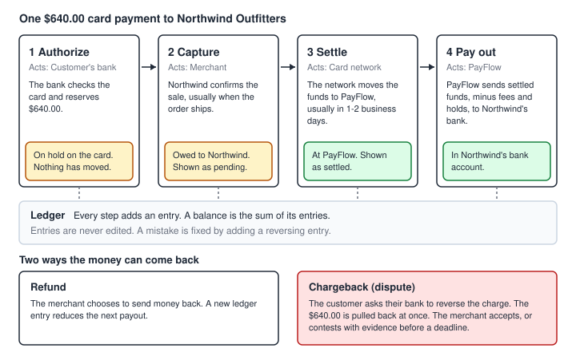
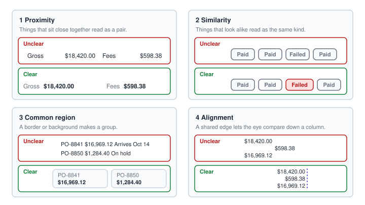
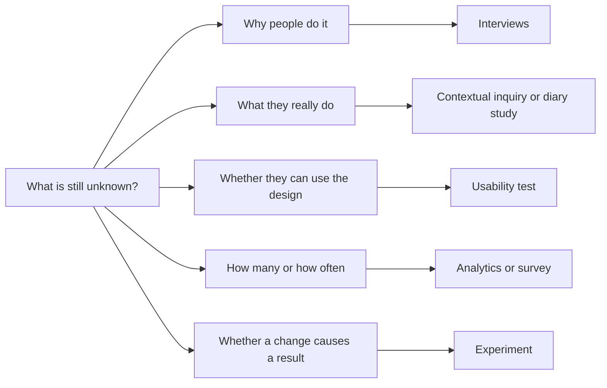
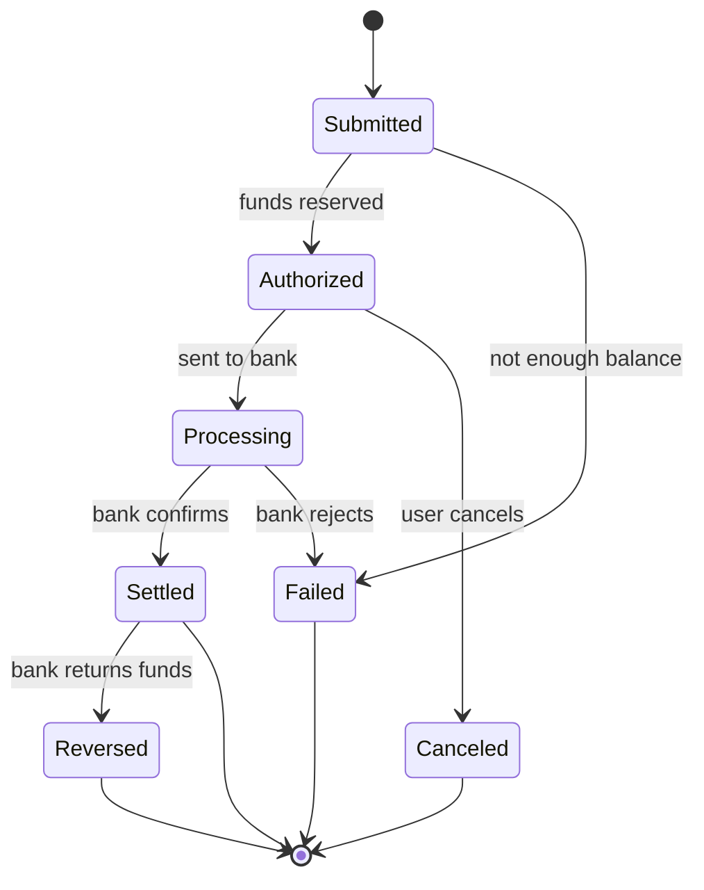
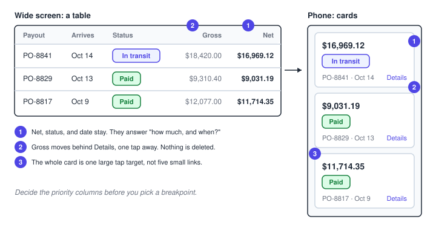
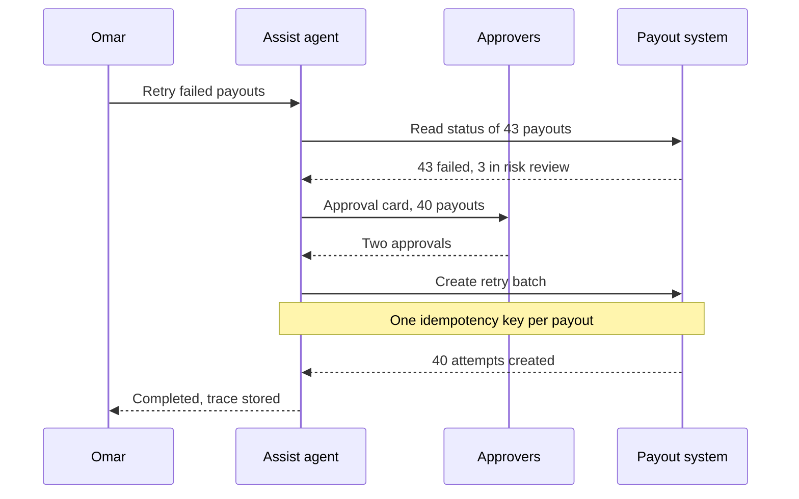
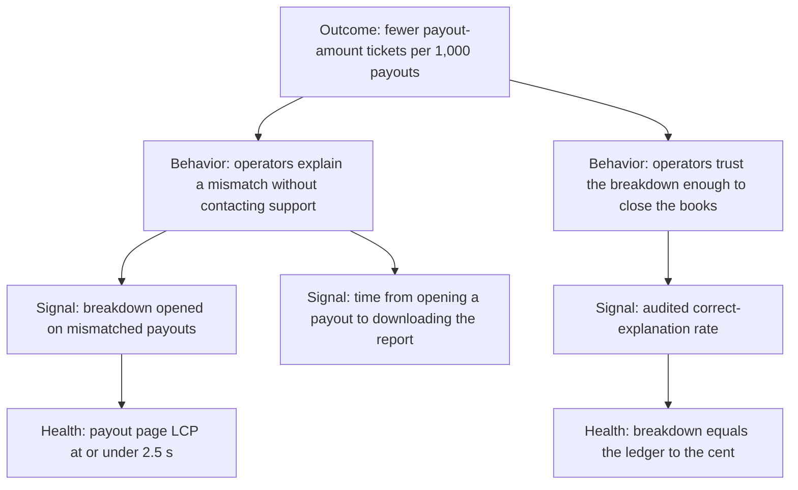
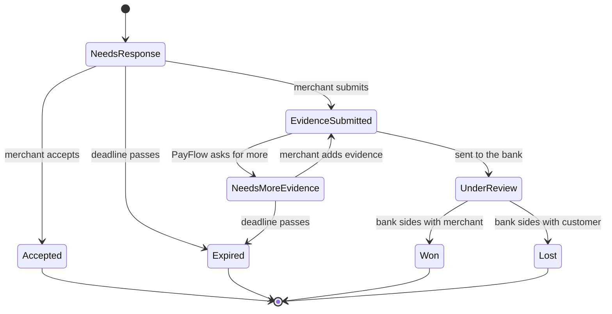
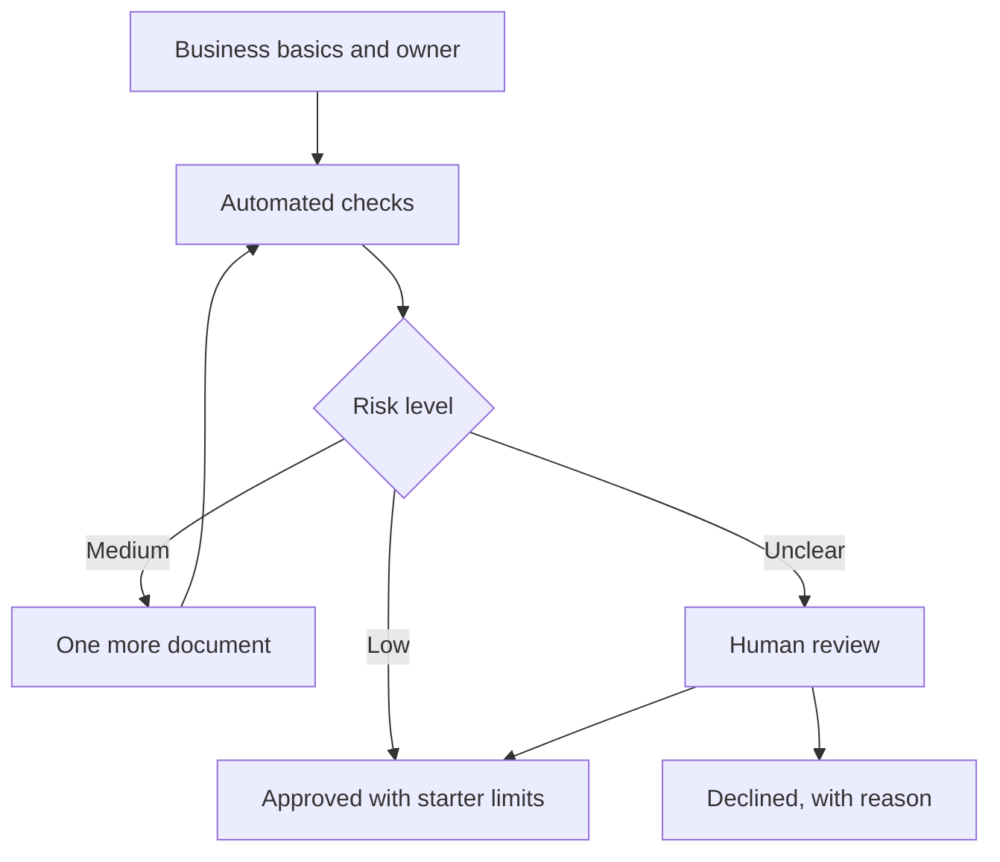

# Product Design Handbook

**Version 2 · October 2026** · Volume 4 of the PM + AI Master Library

> Learn to make and defend good design decisions on payments and AI products, with every idea shown on a screen you can picture.

---

## Start here

### Who this is for

You are a product manager, or about to become one. You work on products where money moves or where an AI system gives answers and takes actions, and you want two things:

- To be the PM designers like working with, because you bring a clear problem, good evidence, and useful feedback instead of redrawn mockups.
- To do well in product design interview rounds, where you get 40 minutes and a whiteboard and have to design something sensible out loud.

This is not a visual design course. You will not learn a design tool or how to pick a typeface. You will learn how design decisions get made and how to tell a good one from a bad one.

### What you need before you start

- No design training. Every term is explained when it first appears and again in the Glossary.
- A rough idea of what a payments product does. If you don't have one, "Meet PayFlow" below gives you everything you need in ten minutes.
- Paper and a pen. Several labs ask you to sketch.
- A web browser, for the ten-minute accessibility tests in Chapter 12.
- Optional: Python 3. Four short listings calculate things (a contrast ratio, a testing formula, exact money, a traffic-split check). Their output is printed in the book, so you can read along without running anything.

### What you will be able to do

After the full path you will be able to:

- Turn a feature request into a one-page decision brief that names the user, job, state, risk, measure, and recovery path.
- Give a designer feedback that is specific, tied to evidence, and about the problem rather than your preferred fix.
- Name the ten usability heuristics and spot violations on a real screen.
- Pick the smallest research method that can change a decision, and write findings other people trust.
- List the states of a flow before anyone draws a screen, and write error messages that tell people where their money is.
- Run five accessibility tests in ten minutes and quote the WCAG 2.2 numbers that matter.
- Design AI answers and agent actions that show their evidence, admit what they don't know, and stop for approval in the right place.
- Talk through a design interview question with a structure, a sketch, and a way to measure success.

### How this book is organized

| Part | What you learn | Time |
|---|---|---|
| Meet PayFlow | The running example: how card money moves, and the people you design for | 10 min |
| I. Foundations (Ch. 1-4) | What design is for a PM, who owns what, the ten heuristics, how people read a screen | 60 min |
| II. Understand the problem (Ch. 5-6) | Choosing a research method, writing findings, jobs, journeys, service blueprints | 40 min |
| III. Shape the solution (Ch. 7-13) | Structure, words, states, forms, hierarchy, accessibility, testing | 2 hr 15 min |
| IV. Money and AI (Ch. 14-18) | Fintech patterns, AI answers, agents, voice and real-time, privacy and honesty | 90 min |
| V. Ship and learn (Ch. 19-21) | Metrics and experiments, handoff and design QA, critique | 50 min |
| VI. Practice (Ch. 22-23) | Nine labs with model answers, four worked cases | 5 hr |
| VII. Interview kit (Ch. 24-26) | One complete worked answer, how you are scored, a question bank | 75 min |
| VIII. Reference | Cheat sheet, filled-in templates, glossary, answers, sources | As needed |

### Three ways to read it

**The 90-minute pre-interview path.** For the night before a product design round.

1. Meet PayFlow: read "How a card payment moves" and look at Figure 0.1 (10 min).
2. Chapter 1, Product design is decision design (10 min).
3. Chapter 3, the heuristics table only (10 min).
4. Chapter 9, States before screens (10 min).
5. Chapter 15, AI answers people can check (10 min).
6. Chapter 24, the complete worked answer (25 min), then Chapter 25 (5 min).
7. The Cheat sheet (10 min).

**The weekend path.** About seven hours over two days.

- Day one: Meet PayFlow, Parts I, II, and III. Do Labs 1, 2, 4, and 5.
- Day two: Part IV, Chapter 19, and Part VII. Do Lab 8 and read Case 1.

**The full path.** About two weeks at 45 minutes a day. Read in order. Stop after each part and do its labs before moving on: Labs 1 and 2 after Part I, Lab 3 after Part II, Labs 4 to 7 after Part III, Lab 8 after Part IV, Lab 9 after Part V. Then read the four cases, and finish with Part VII, answering three question-bank prompts out loud with a timer.

### How each chapter works

Chapters 1 to 21 all follow the same six steps, so you always know where you are:

1. **Why it matters.** The concrete pain this idea prevents.
2. **The idea.** The concept in plain words, with a picture when one helps.
3. **Worked example.** The idea applied to PayFlow, with real inputs and outputs.
4. **Common mistakes.** What goes wrong in practice and what to do instead.
5. **Check yourself.** Three questions, numbered by chapter (Q9.2 is the second question in Chapter 9). Answers are in Part VIII.
6. **In one line.** The single sentence to remember.

Throughout the book, form one habit. For any screen or flow, name six things: the *user*, the *job*, the *state*, the *risk*, the *measure*, and the *recovery path*. Chapter 1 explains each one.

### What's new in Version 2

- **Pictures.** Thirteen wireframes and six diagrams, including before-and-after pairs for an error message, a form, a payout page, and a sign-in code.
- **One story.** The same company, the same five people, and the same payout appear from the first page to the last, so context builds instead of resetting.
- **The missing fundamentals.** Nielsen's ten heuristics, how people group what they see, how to give feedback on a mockup, form design, the anatomy of an error message, and concrete accessibility numbers.
- **Practice with answers.** Nine distinct labs and four worked cases, each with a full model answer, and an answer for every "Check yourself" question.
- **A complete interview answer.** One design prompt worked from the first sentence to the last, with the whiteboard, followed by how interviewers score it.
- **A real glossary.** About 120 terms, each defined in a sentence or two.

## Meet PayFlow

PayFlow is a fictional payments company. It is the only example in this book. Every number attached to it is made up for teaching and describes no real company.

### What PayFlow sells

PayFlow lets businesses accept card payments and get the money into their bank accounts. A business that uses PayFlow is called a **merchant**. PayFlow has six products you will meet again:

| Product | What it does | Who uses it |
|---|---|---|
| Payments | Accepts card payments online and in shops | Merchants |
| Payouts | Sends a merchant's money to its bank account | Merchants |
| Transfers | Pays a supplier straight from a PayFlow balance | Merchants |
| Disputes | Handles payments that customers challenge | Merchants, PayFlow staff |
| Dashboard | The website and app where merchants see all of this | Merchants |
| PayFlow Assist | An AI assistant that answers questions and proposes actions | PayFlow staff, merchants |

### How a card payment moves

A card payment looks instant at the checkout. Behind it, the money takes days and passes through four steps. Most confusing payments screens are confusing because they hide this.



*Figure 0.1 — One card payment from tap to bank account. The colored strip in each box says where the money is at that step.*

1. **Authorize.** The customer's bank checks the card and reserves the amount. This step is called **authorization**. No money has moved; the bank has only promised it.
2. **Capture.** The merchant confirms the sale. A shop captures at once; an online store often captures when the order ships. After **capture**, the money is owed to the merchant. PayFlow shows it as *pending*.
3. **Settle.** The card network (the system that connects banks, such as the ones whose logos are on your card) moves the funds from the customer's bank to PayFlow. This is **settlement**, and at PayFlow it usually takes one or two business days. The money now shows as *settled*.
4. **Pay out.** PayFlow sends the merchant's settled money, minus fees and anything on hold, to the merchant's bank account. One such transfer is a **payout**.

Money can also come back, in two ways:

- A **refund** is the merchant's choice. The merchant sends money back to the customer.
- A **chargeback** is the customer's bank's choice. The customer tells their bank "I didn't get this" or "I didn't buy this", and the bank pulls the money back from the merchant straight away. The case is called a **dispute**. The merchant can accept the loss, or contest it by sending evidence before a deadline. The customer's bank then decides.

### The ledger

PayFlow records every one of these movements in a **ledger**: a list of money entries that is only ever added to. Nobody edits or deletes an entry. A mistake is corrected by adding a new entry that reverses the old one. Any balance you see on a screen is a sum of ledger entries.

Here is the ledger for one order at Northwind Outfitters, a merchant you will meet in a moment.

| Date | Entry | Amount | Effect |
|---|---|---|---|
| Sep 18 | Payment captured, order NW-20931 | +$640.00 | Pending goes up |
| Sep 18 | PayFlow fee, 2.9% + $0.30 | −$18.86 | Pending goes down |
| Sep 21 | Settlement received | $621.14 | Moves from pending to settled |
| Sep 22 | Payout to Northwind's bank | −$621.14 | Settled goes down |
| Oct 12 | Dispute DP-3307 opened | −$640.00 | Taken from the next payout |

Four more words come up all book. Learn them now.

- **Idempotency**: doing the same request twice has the same effect as doing it once. If a "Send" button is clicked twice, an idempotent system sends one payment, not two.
- **Reconciliation**: checking that two records of the same money agree, for example PayFlow's payout report and a merchant's own accounting books.
- **Finality**: the point after which a payment can no longer be undone. Before finality you can cancel; after it you can only send a new payment the other way.
- **Maker-checker**: a control where one person prepares a sensitive action (the maker) and a different person must approve it (the checker). Nobody approves their own work.

### The cast

You will design for five people. They appear in every chapter.

| Person | Role | What they want |
|---|---|---|
| Maya Okafor | Owner of Juniper Bakery, a merchant with two shops | To know her money is coming, without learning payments jargon. She does everything on her phone. |
| Daniel Reyes | Finance operator at Northwind Outfitters, a mid-size online merchant | To match every payout to his books before the month-end close |
| Priya Nair | Risk analyst at PayFlow | To stop fraud without blocking honest merchants |
| Sam Whitfield | Support agent at PayFlow | To answer "where is my money?" correctly the first time |
| Omar Haddad | Payments operations lead at PayFlow | To fix failed payouts quickly and safely |

Your own team is you (the PM), Lena Fischer (product designer), Arjun Mehta (engineering lead), and Rosa Delgado (user researcher).

### The numbers you will see again

Three situations run through the book. Keep this page marked.

**Daniel's payout.** Payout PO-8841 reaches Northwind on Wednesday, October 14, 2026. Daniel expected $17,821.62. He received $16,969.12.

| Line | Amount |
|---|---|
| 214 card payments | $18,420.00 |
| PayFlow fees (2.9% + $0.30 per payment) | −$598.38 |
| 3 refunds | −$212.50 |
| Hold for dispute DP-3307 | −$640.00 |
| **Net payout** | **$16,969.12** |

Daniel's books knew about the sales and the fees. They did not know about the refunds or the dispute hold, so he is $852.50 short and does not know why.

**Maya's payout.** On Friday, October 9, Maya's balance shows $1,284.40 available, with payout PO-8850 scheduled for Tuesday, October 13. On October 12 she switches Juniper Bakery to a new bank account ending 5506. On October 13 the money does not arrive, and the screen says "Error 412".

**The dispute.** Dispute DP-3307 is the chargeback on order NW-20931 for $640.00. The reason given is "item not received". Northwind must send evidence by Friday, October 23, 2026, at 5:00 PM Eastern Time.

# Part I — Foundations

## 1. Product design is decision design

### Why it matters

A request lands on your desk: "Build an AI reconciliation assistant." Three months later the team ships a chat window. Finance operators try it twice, don't trust its numbers, and go back to their spreadsheets.

Nothing was wrong with the pixels. The team never decided who the feature was for, what job it did, or what would count as success, so every later choice had nothing to be judged against. Design work fails from an unclear decision far more often than from an ugly screen, and clear decisions are your part of the job.

### The idea

**Product design** is the deliberate shaping of a person's path from wanting something to getting it. Every screen is a stack of decisions: who is this for, what are they trying to do, what do they need to know, what could go wrong, what happens next. Someone makes each of those decisions, on purpose or by accident.

Your contribution as a PM is not drawing. It is making the decisions explicit before the drawing starts. The tool for that is a **decision brief**: one page, seven fields.

| Field | The question it answers |
|---|---|
| User | Who exactly? A role in a situation, never just "users". |
| Job | What are they trying to get done? |
| Current pain | What makes that hard today, and how do you know? |
| Desired behavior | What will they do differently if this works? |
| Success | Which number moves? |
| Guardrail | What must not get worse? |
| Unknown | What don't we know yet that could change the answer? |

A **guardrail** is a measure or control that protects against harm while you chase the success number. "Resolve mismatches faster" is a success measure. "Without more unapproved adjustments" is its guardrail.

A brief describes a problem, not a solution. The test is simple: a problem statement leaves room for more than one solution.

- "Build an AI reconciliation assistant" is a solution.
- "Reduce the time to correctly explain a payout mismatch, without weakening maker-checker control" is a problem. It can be solved without AI, and it states the safety condition up front.

The brief also feeds the six-word habit from "Start here". *User* and *job* come straight from it. The *state* is the situation the system and the person are in right now: a payout can be scheduled, on hold, on its way, paid, or failed, and each needs its own design. The *risk* is what could hurt the person or the business. The *measure* is how you will know it worked. The **recovery path** is what the person does when something goes wrong.

### Worked example

Daniel is $852.50 short on payout PO-8841 and does not know why. Here is the brief you write with Lena.

| Field | PayFlow example |
|---|---|
| User | Finance operator at a mid-size merchant, in the last three days before month-end close |
| Job | Explain why a payout differs from the books, so the books can be closed |
| Current pain | The answer is spread across the dashboard, a CSV export, and email with support. Last month 1,180 of 4,200 support tickets asked about a payout amount. |
| Desired behavior | Open the payout, see each deduction with its reason, match it, and move on without contacting support |
| Success | Median time to explain a mismatch, and the share explained correctly in an audited sample |
| Guardrail | No increase in balance adjustments made without a second approver |
| Unknown | Which kinds of mismatch need human judgment? |

With the problem written down, three solutions appear instead of one:

- **A.** Show the breakdown on the payout page: gross, fees, refunds, holds, net, each line linked to its records.
- **B.** Offer a downloadable report in the layout Daniel's accounting tool expects.
- **C.** Build an AI assistant that explains mismatches in conversation.

You choose A first. It attacks the stated pain directly, it costs the least, and its numbers come straight from the ledger. Daniel's $852.50 is two ledger lines, $212.50 of refunds and a $640.00 dispute hold. Nobody needs a language model to add two numbers. They need to see them.

B comes next. C is worth building only for mismatch types that A and B cannot explain, and you don't yet know which those are. That is the "Unknown" row, and it becomes the research question in Chapter 5.

### Common mistakes

| Mistake | Why it bites | Do this instead |
|---|---|---|
| Starting from a solution ("add a chatbot") | Only one option gets considered, and there is nothing to judge it against | Rewrite it as a problem that allows at least two solutions |
| Writing "users" in the User field | A design for everyone fits nobody's situation | Name a role, a place, and a pressure |
| A success number with no guardrail | Speed gets bought by skipping approvals | Pair every success measure with what must not get worse |
| Hiding what you don't know | The team builds on a guess and finds out after launch | Write down the least-supported assumption and plan to test it |

### Check yourself

**Q1.1** Which of these is a problem and which is a solution? (a) "Add push notifications for payouts." (b) "Help small merchants know when their money will arrive without contacting support."

**Q1.2** Your brief says success is "fewer payout tickets". Propose one guardrail and say what bad outcome it protects against.

**Q1.3** Name the six things you should be able to state for any screen.

> [!IMPORTANT]
> **In one line:** Before anyone draws, write down the user, the job, how you will measure success, and what must not get worse.

## 2. Who owns what, and how to give feedback on a mockup

### Why it matters

There are two ways a PM makes design worse. The first PM sketches the screen in a slide and asks the designer to "make it pretty". The designer's skill is wasted and the PM's first idea ships. The second PM looks at every mockup and says "looks good to me". The problems that PM was best placed to catch, such as a broken business rule or a missing state, survive until engineering trips over them.

Both come from not knowing which decisions are yours.

### The idea

Four roles share design work. "Owns" means "has the final call after listening", not "works alone".

| Role | Owns | Contributes to |
|---|---|---|
| PM | The problem, the constraints, the success measure, and trade-offs between user, business, and risk | Solutions, wording, which states matter most |
| Designer | The craft: flow, interaction, layout, visual and content design | Problem framing, research |
| Researcher | Evidence quality: the method, and what a finding does and does not show | Problem framing |
| Engineer | Implementation integrity: feasibility, speed, how states and errors really behave | Solutions, edge cases |

Many teams have no researcher. Evidence quality still needs an owner, so agree whether that is you or the designer.

When a designer shows you a **mockup** (a static picture of a proposed screen), give feedback in five moves:

1. **Ask what kind of feedback is wanted.** An early sketch needs "is this the right flow?", not "that gray is too light".
2. **Restate the goal.** Say the user, job, and state this screen serves. If you and the designer disagree here, stop. No comment about the screen will help until that is settled.
3. **Describe a problem, not your fix.** "I can't tell which number Daniel should match to his books" can be solved ten ways. "Make the net amount bigger and blue" can be solved one way, and probably not the best one.
4. **Give your reason.** Evidence, a constraint, or a principle: "because four of the five operators Rosa watched looked for the hold first".
5. **Sort your points.** Must fix (it breaks the job, a business rule, or the law), worth considering, and personal taste. Label taste as taste.

One sentence shape carries moves 3 and 4: "When *[user]* is trying to *[job]*, I'm worried that *[what I observe]*, because *[evidence or principle]*."

Some checks are yours because you know the business best. Are the amounts, fees, and rules right? Is a legal or policy constraint missing? What does the screen look like with real data: a 60-character business name, a zero balance, a negative number, 10,000 rows? Can the success measure be recorded from this design?

### Worked example

Lena shares her first mockup of the payout page for PO-8841. Here are four things a PM might say, and what you say instead.

| First instinct | What is wrong with it | Better |
|---|---|---|
| "Can we make the download button bigger?" | A fix with no problem attached | "When Daniel finishes checking the breakdown, I'm not sure he'll see how to get it into his accounting tool. Three operators in Rosa's sessions scrolled past the export. What are our options?" |
| "I don't like the orange." | Taste presented as fact | "Taste only: the orange feels alarming for a routine hold. Is that the intent?" |
| "Looks good!" | Carries no information | "The breakdown does the job. Must fix: a payout can hold more than one dispute, and this layout has room for one. Northwind had a payout with four last quarter." |
| "Legal needs the disclaimer, so put it at the top." | A constraint delivered as a layout decision | "Constraint: the hold must link to the dispute terms. Where it goes is your call." |

Notice the third row. "Looks good" would have shipped a layout that breaks on real data. Catching that is exactly the PM's job.

### Common mistakes

| Mistake | Why it bites | Do this instead |
|---|---|---|
| Redrawing the mockup yourself | The designer now has to critique your design instead of solving the problem | Describe the problem and ask for options |
| Feedback from eight people in one chat thread | Comments contradict each other and nobody decides | One person collects; the designer decides craft, you decide trade-offs |
| Reviewing only the happy path | Missing states turn up in testing or in production | Ask "what does this look like empty, failed, or on hold?" |
| Saving feedback for the final review | Late feedback is expensive and lands like a veto | Look at rough work early and often |

### Check yourself

**Q2.1** Who has the final call on each of these? (a) The success metric. (b) Whether a table becomes cards on a phone. (c) Whether five interviews are enough to support a finding.

**Q2.2** Rewrite this feedback using the sentence shape from this chapter: "Move the status to the top and make it red."

**Q2.3** Name three things a PM is better placed than a designer to catch in a mockup.

> [!IMPORTANT]
> **In one line:** Own the problem and the trade-offs, describe what worries you from the user's side with a reason, and let the designer own the fix.

## 3. Ten usability heuristics

### Why it matters

Without a shared vocabulary, design feedback sounds like "this feels off". The heuristics give you ten named reasons a screen is hard to use. They are quick to apply, designers already know them, and interviewers expect you to use them by name.

### The idea

A **heuristic** is a rule of thumb. In 1994 Jakob Nielsen published ten for interface design, and they are still the standard list. They are about **usability**: how effectively, efficiently, and pleasantly a particular person can do a particular job with a product.

| Heuristic | In plain words | Broken at PayFlow, then fixed |
|---|---|---|
| 1. Visibility of system status | Always show what is going on | After "Send", a spinner turns forever. Fix: "Processing. Sent to the bank, usually 1 business day." |
| 2. Match between the system and the real world | Use the person's words, not yours | Status reads `IN_TRANSIT`. Fix: "On its way to your bank". |
| 3. User control and freedom | Offer a clearly marked way out | A refund starts on one click. Fix: confirm first, and allow cancel until processing begins. |
| 4. Consistency and standards | Same word, same meaning, everywhere | "Payout", "transfer", and "deposit" all name one thing. Fix: say "payout" in the app, emails, and help pages. |
| 5. Error prevention | Stop the mistake before it happens | The amount field accepts $12,450 against a $9,000 balance. Fix: show the balance and warn before submit. |
| 6. Recognition rather than recall | Show the options; don't make people remember | Daniel must type a payout ID from memory. Fix: list recent payouts to pick from. |
| 7. Flexibility and efficiency of use | Give experts shortcuts that beginners never trip on | Daniel exports 30 payouts one at a time. Fix: bulk export, kept out of Maya's way. |
| 8. Aesthetic and minimalist design | Remove what does not serve the job | Nine equal fields on the payout page. Fix: lead with the amount and arrival date. |
| 9. Help users recognize, diagnose, and recover from errors | Say what went wrong, in words, with a fix | "Error 412. Contact support." Fix: "Your payout is on hold", the reason, and a next step. |
| 10. Help and documentation | Best not needed; when needed, close at hand | Hold reasons live in a PDF. Fix: a "Why is this held?" link beside the hold. |

The way to use the list is a **heuristic evaluation**. Pick one task. Walk through it as the user. Each time a heuristic is broken, write down where, which one, and what it costs the user. It takes half an hour and needs no participants. It finds obvious problems cheaply. It does not replace watching real people, because experts miss what real users trip on.

### Worked example

You and Lena spend 30 minutes on the old payout experience, playing Maya on October 13. Her task: "Find out why Tuesday's payout hasn't arrived and what to do about it."

| Step | What Maya sees | Heuristic broken |
|---|---|---|
| Opens the app | One balance total, with no split between pending and available | 1, visibility of system status |
| Opens the payout | Status `ON_HOLD_412` | 2, match with the real world |
| Taps the status | "Error 412. Contact support." | 9, recover from errors |
| Looks for help | A link to the general FAQ home page | 10, help and documentation |
| Checks bank settings | Her new account, with no sign that it is being verified | 1, visibility of system status |

Five findings in half an hour. Three of them share a root cause: the system knows the reason (the new bank account is being verified) and never says it. That single sentence is worth more to Lena than five separate tickets, and it becomes the rewrite in Chapter 8.

### Common mistakes

| Mistake | Why it bites | Do this instead |
|---|---|---|
| Naming a heuristic and stopping | "Violates number 4" tells nobody what breaks | Add the consequence: "Daniel searches for 'deposit' and finds nothing" |
| Treating the list as a test to pass | A screen can satisfy all ten and still solve the wrong problem | Use it after the decision brief, not instead of it |
| Skipping user tests because the review was clean | Reviewers know too much to get confused | Follow up with a small usability test (Chapter 13) |
| Reading number 8 as "delete things" | Hiding a fee is not minimalism | Remove what is irrelevant to the job; keep what has consequences |

### Check yourself

**Q3.1** A transfer form accepts an account number that is one digit short and reports the problem on the next page. Which heuristic is most clearly broken?

**Q3.2** The dashboard says "Payout" and the email says "Deposit". Which heuristic is this, and what does the user experience because of it?

**Q3.3** What can a heuristic evaluation not tell you?

> [!IMPORTANT]
> **In one line:** The ten heuristics let you say exactly why a screen is hard to use, as long as you add what it costs the user.

## 4. How people read a screen

### Why it matters

People don't read screens. They glance, sort what they see into groups, and decide within a second or two where to look. If your layout suggests the wrong groups, they pair the wrong label with the wrong number. On a money screen, that means reading the fee as the payout.

### The idea

Two things happen before any reading.

**First, grouping.** The eye sorts a screen into groups automatically. The rules it follows are called the **Gestalt principles** (*Gestalt* is German for "whole form"). Four of them do most of the work in product design.



*Figure 4.1 — Four grouping rules, each shown wrong and then right on PayFlow data.*

- **Proximity.** Things close together look related. The gap between a label and its value must be smaller than the gap to the next pair.
- **Similarity.** Things that look the same are assumed to be the same kind. If a failed payout looks like a paid one, nobody notices it.
- **Common region.** Things inside one border or background look like one group. This is why cards work.
- **Alignment.** Things on a shared line look like a set and are easy to compare. Right-align money so the decimal points stack.

**Second, order.** **Visual hierarchy** is the order in which things get noticed. You control it with size, weight (boldness), color and contrast, position, and the empty space around an item. The most important thing on the screen should win. To check, use the squint test: blur your eyes and see what still stands out.

Designers also use six words about how people and objects interact. You will hear them in every review.

| Term | Meaning | PayFlow example |
|---|---|---|
| **Affordance** | A cue that something can be acted on | A button that looks pressable |
| **Constraint** | A limit that prevents a wrong action | An amount field that refuses letters |
| **Feedback** | An immediate sign that an action registered | The button changes to "Sending" |
| **Mapping** | The link between a control and what it changes | A toggle beside the setting it controls |
| **Mental model** | The person's own picture of how the system works | Maya believes "paid at the till" means "in my bank" |
| **Cognitive load** | The mental effort a screen demands | Nine equal fields to scan for one answer |

> [!NOTE]
> The first five words were popularized by Don Norman's book *The Design of Everyday Things*. A gap between someone's mental model and the real system is where most confusion starts. Maya's model has one step. The real system has four. The design has to bridge that.

### Worked example

Look again at Figure 4.1 with the squint test.

In panel 1, the unclear row reads "Gross, $18,420.00, Fees, $598.38" with nearly equal gaps. The number $18,420.00 sits closer to "Fees" than to "Gross". A hurried reader can pair them wrongly. The clear row pulls each label against its own value and opens a wide gap between the pairs. Nothing was added. Only the spacing changed.

In panel 2, a failed payout hides among paid ones because all four chips look alike. Giving "Failed" its own color and weight breaks the similarity, and the eye goes straight to it.

Panel 3 separates two payouts with borders. Panel 4 right-aligns three amounts so that you can see at a glance which is largest.

Now apply the same thinking to the page for PO-8841. Daniel's job is "how much, when, and why is it different?". So the net amount and the arrival date should survive the squint test, and the deductions should read as one group. Chapter 11 shows that page before and after.

### Common mistakes

| Mistake | Why it bites | Do this instead |
|---|---|---|
| Equal spacing everywhere | Label and value pairs become ambiguous | Keep space inside a group smaller than space between groups |
| Making everything bold or colored | When everything shouts, nothing is heard | Let one thing win per screen and quiet the rest |
| Left-aligned or centered money | Amounts cannot be compared down a column | Right-align numbers and show the same decimals |
| Designing for your own mental model | You know a payout has four steps; Maya does not | Ask people to explain how they think it works before you design |

### Check yourself

**Q4.1** A balance card shows "Pending" and "Available" side by side in identical style, and Maya reads Pending as money she can spend. Suggest two changes that use two different grouping or hierarchy tools.

**Q4.2** What is the squint test, and what does it reveal?

**Q4.3** In a money transfer form, give one example of a constraint and one of feedback.

> [!IMPORTANT]
> **In one line:** People group before they read, so control the groups with spacing, likeness, borders, and alignment, and let one thing win.

# Part II — Understand the problem

## 5. Research: the smallest study that can change the decision

### Why it matters

Teams get research wrong in two opposite ways. Some skip it and build on a guess. Others commission a six-week study, receive a forty-slide deck, and change nothing, because the study was never aimed at a decision. Both waste months.

Research has one purpose: to reduce the riskiest uncertainty in your brief as cheaply as you can.

### The idea

Start from the decision, not the method. Write one sentence: "We will do X unless we learn Y." Then choose the cheapest method that could show you Y.

| Method | What it is | Good for | Blind to |
|---|---|---|---|
| Interview | A 30 to 45 minute conversation about past behavior | Language, motives, workarounds, mental models | What people really do, and how common it is |
| Contextual inquiry | Watching someone do the real task where they normally do it | The true sequence, interruptions, side tools such as spreadsheets | Rare events |
| Diary study | People log an activity over days or weeks | Behavior that unfolds over time, such as a month-end close | Fine detail of an interface |
| Usability test | Watching people attempt set tasks on a design | Where an interface fails | Whether the feature is worth building |
| Survey | The same questions sent to many people | How widespread an opinion is | Why, and what people will actually do |
| Analytics | Counting what people did in the product | What happened and how often | Why it happened |
| Experiment | Randomly giving groups different versions (an A/B test) | Whether a change causes a result | Why, and anything you did not measure |

Two distinctions sort these methods. **Qualitative research** studies a few people in depth and answers "why". **Quantitative research** counts many people and answers "how many". Separately, some methods capture what people *say* and others what they *do*. When the two disagree, believe what they do.



*Figure 5.1 — Start from the kind of unknown, then pick the method.*

> [!TIP]
> The cheapest study of all is already sitting in your support tool. Reading fifty tickets on one topic takes an afternoon and often answers the question.

When you talk to people, three rules keep the answers honest:

- Ask about the last time, not the future. "Tell me about the last payout that didn't match" beats "Would you use a matching tool?"
- Don't lead. "How do you get payout data into your books?" beats "How frustrating is the export?"
- Ask to be shown. "Can you show me how you did that?" Then stay quiet.

Write every finding in four parts, and keep them apart:

1. **Observation.** What you saw or heard, with counts and without adjectives.
2. **Interpretation.** What you think it means. This part is yours and may be wrong.
3. **Implication.** What the team should do or test next.
4. **Confidence.** Low, medium, or high, and what would raise it.

The separation matters because it lets a colleague disagree with your interpretation without doubting what you saw.

### Worked example

Chapter 1 left one unknown: which payout mismatches need human judgment? Your decision sentence is:

"We will build the payout breakdown and stop there, unless we learn that a meaningful share of mismatches cannot be explained by ledger lines."

The unknown is "what people really do", so the method is contextual inquiry, with a ticket review first because it is nearly free.

**Step 1: read tickets.** You and Rosa read 60 recent tickets about payout amounts.

| Cause of the mismatch | Tickets |
|---|---|
| A refund or dispute hold that the payout page did not show | 33 |
| Timing: the sale and the payout cut-off fell on different days | 14 |
| A fee the merchant did not expect | 8 |
| Something else | 5 |

Fifty-five of the 60 could be explained by ledger lines plus the cut-off time. Only 5 needed judgment.

**Step 2: watch.** Rosa and you spend an hour each with four finance operators at three merchants while they reconcile. One pattern stands out, and you write it up:

| Part | Finding |
|---|---|
| Observation | All 4 operators copied transaction IDs out of the dashboard and pasted them into a chat with a colleague or with support. Each time, it happened right after the dashboard labeled a mismatch "Unknown". |
| Interpretation | "Unknown" suggests no next action, so operators hand the problem to a person. |
| Implication | Replace "Unknown" with reason codes (refund, dispute hold, cut-off timing, fee). Add an "Ask PayFlow" action that carries the IDs along. Test both in the prototype. |
| Confidence | Medium. Four operators, three merchants, all in the week before close. Repeat in a mid-month week and with one larger merchant. |

**The decision.** Build the breakdown with reason codes. The assistant is not justified yet: only 5 tickets in 60 were beyond the ledger.

### Common mistakes

| Mistake | Why it bites | Do this instead |
|---|---|---|
| Asking "would you use this?" | People are polite, and poor at predicting themselves | Ask about the last time it happened |
| Choosing the method first ("let's run a survey") | The results cannot change any decision | Write the decision sentence first |
| Reporting interpretation as fact ("users hate the export") | Nobody can check it, and it hides your leap | Separate what you saw from what you think |
| Turning five interviews into a percentage | Small samples find problems; they do not measure a population | Report counts ("4 of 5") and size the issue with analytics |
| Talking only to happy customers | You never meet the people who gave up | Recruit people who complained, left, or built workarounds |

### Check yourself

**Q5.1** You want to know whether moving the export button makes more people export. Which method fits, and why not interviews?

**Q5.2** Split this sentence into observation and interpretation: "Operators don't trust the dashboard; three of them re-added the totals in a spreadsheet."

**Q5.3** Rewrite this interview question so that it is neither leading nor hypothetical: "Would it be helpful if we showed you the fees?"

> [!IMPORTANT]
> **In one line:** Write the decision first, pick the cheapest method that could change it, and keep what you saw apart from what you think it means.

## 6. Jobs, journeys, and service blueprints

### Why it matters

A dispute screen can be flawless and the merchant can still lose $640.00, because the alert went out a day late or the deadline was stored in another time zone. Most of what a person experiences is produced by things they never see. If you design only the screen, you design the tip of the service.

### The idea

Three tools, each wider than the last.

**Jobs to be done (JTBD)** is a way of stating what a person wants in terms of progress, not features. The pattern is "When *[situation]*, I want to *[motivation]*, so I can *[outcome]*."

"When settlement totals disagree, I want to find the event responsible, so I can close the books with confidence."

That is a job. "I want a reconciliation dashboard" is a feature request. A good test: could a spreadsheet or a phone call also do this job? If yes, you have written a job. Notice the last two words, "with confidence". Jobs have an emotional side, and the design has to serve it too.

A **journey map** lays out the person's experience as stages over time. For each stage you record what they are doing, what they need to know, and where it hurts. It covers only what the person sees.

A **service blueprint** is a journey map with everything behind it added underneath. It has four rows:

- What the person does.
- **Front stage**: what they see and touch, including screens, emails, and support replies.
- **Backstage**: the staff and actions they never see.
- The systems and rules underneath: files, scheduled jobs, policies.

The boundary between front stage and backstage is called the line of visibility. Reading down one column tells you everything that has to work for a single moment to go well.


*Figure 6.1 — Service blueprint for a card dispute. All three failure points are below the line of visibility.*

Design the backstage contract at the same time as the screen. A beautiful status page cannot repair a deadline that the system got wrong.

### Worked example

Take dispute DP-3307 from Daniel's side.

**The job.** "When a customer disputes a payment, I want to know what it will take to win and by when, so I can decide whether to fight it and never lose by default."

**The journey.**

| Stage | Daniel is doing | He needs to know | Pain today |
|---|---|---|---|
| Notice | Spots a $640.00 debit in payout PO-8841 | That this is a dispute, not a mistake | He learns from a shortfall, not from an alert |
| Understand | Opens the dispute | Reason, amount, deadline, evidence needed | The reason is a network code |
| Act | Finds proof of delivery and uploads it | What counts as good evidence | The upload fails with no explanation |
| Track | Checks back for news | Status and the next milestone | "Under review" for weeks, with no date |
| Resolve | Reads the decision | Outcome, effect on his balance, appeal path | Returned money is not linked to the dispute |

**The blueprint.** With Arjun and Omar in the room, you add the rows below the line. Figure 6.1 is the result, and it exposes three problems that no screen review would have found:

1. The alert job runs once a day. A dispute that arrives just after the run costs Daniel almost a day of his deadline. Fix: send the alert when the network file arrives.
2. The deadline is stored in UTC and displayed as a bare date. Daniel works in Eastern Time, and a date with no time or zone invites him to upload a few hours too late. Fix: show "Fri, Oct 23, 5:00 PM ET".
3. The file size limit appears only after an upload fails. Fix: state the accepted formats and size beside the upload control, and check the file before sending it.

None of the three fixes is a screen redesign. Each is a contract with a backstage system, and you found them only by drawing the rows the merchant never sees.

### Common mistakes

| Mistake | Why it bites | Do this instead |
|---|---|---|
| Writing a job as a feature ("I want a dashboard") | It locks in one solution | State the progress wanted, then apply the spreadsheet test |
| A journey map with only the happy stages | The pain is in the waiting and the failures | Include the waiting and what happens when a step goes wrong |
| Stopping at the line of visibility | Backstage delays and rules cause most visible failures | Draw the rows for staff, systems, and policies |
| Building the blueprint without engineering or operations | Nobody present knows when the job really runs | Draw it with the people who run the backstage |
| Treating the map as the result | A poster on the wall changes nothing | End with a list of failure points, each with an owner |

### Check yourself

**Q6.1** Write a job statement for Maya on October 13, when her payout has not arrived.

**Q6.2** What does a service blueprint show that a journey map does not?

**Q6.3** Of the three failure points in Figure 6.1, which would you fix first, and why?

> [!IMPORTANT]
> **In one line:** Map what the person goes through, then draw everything behind it, because most visible failures start backstage.

# Part III — Shape the solution

## 7. Information architecture and content models

### Why it matters

Maya opens the dashboard to find out where her money is. The menu offers "Acquiring", "Treasury", "Risk Ops", and "Settlement". Those are PayFlow's departments. None of them is a thing Maya has. She tries three, gives up, and writes to Sam.

The information existed. The structure hid it.

### The idea

**Information architecture (IA)** is how a product's content is organized, labeled, and found. Three rules cover most of it.

**Rule 1: organize around the user's objects and tasks, not your org chart.** List the nouns your user would say out loud: payment, refund, dispute, payout, balance, bank account. Those are your objects, and usually your menu.

**Rule 2: one name per concept, everywhere.** The app, the emails, the help pages, the support replies, and the analytics events must all use the same word. Settle it in a naming table.

**Rule 3: give every important object a content model.** A **content model** is the fixed list of facts the product must be able to show about an object. For anything involving money there are eight: identity, status, amount, time, owner, reason, available action, and provenance. **Provenance** means where a piece of information came from and how it was produced.

Then decide how much to show at once. **Progressive disclosure** means showing the outcome and the next action first, and keeping the detail one step away: the calculation, the raw events, the policy text. There is one firm limit. Never tuck away something that has consequences, such as a fee or a deadline.

People find their way by **information scent**: the hints in a label that tell them whether they are getting closer to what they want. "Payouts" smells right to Maya. "Treasury" smells of nothing.

Two cheap tests check a structure before you build it. In **card sorting**, people group topic cards and name the groups, which shows you their categories. In **tree testing**, people hunt for an item in a text-only version of your menu, which shows you whether your labels work.

### Worked example

**The menu.** Before, it mirrored departments. After, it lists what a merchant has.

| Before | After |
|---|---|
| Acquiring | Payments |
| Treasury | Payouts |
| Risk Ops | Disputes |
| Settlement | Balance |
| Admin | Reports, Settings |

**The naming table.** Four rows are enough to end most arguments.

| Concept | Always say | Never say |
|---|---|---|
| Money sent to the merchant's bank | Payout | Transfer, deposit, disbursement |
| A payment the customer challenged | Dispute | Case, retrieval (explain "chargeback" once in help) |
| Money not yet received from the card network | Pending | Unsettled, in flight |
| Settled money that cannot be paid out yet | On hold | Frozen, blocked, reserved |

**The content model.** Here it is for payout PO-8841, with the level at which each fact appears. Level 1 is always visible, level 2 is one click away, level 3 is on request.

| Fact | Value for PO-8841 | Level |
|---|---|---|
| Identity | Payout PO-8841 | 1 |
| Status | On its way to your bank | 1 |
| Amount | $16,969.12 USD | 1 |
| Time | Arrives Wed, Oct 14, 2026 | 1 |
| Owner | Northwind Outfitters, bank account ending 2290 | 1 |
| Reason | Net of fees, 3 refunds, and a hold for dispute DP-3307 | 2 |
| Available action | Download report; open dispute DP-3307 | 1 |
| Provenance | The ledger entries it was built from, each one linked | 3 |

The dispute hold is a level 2 fact with a level 1 consequence, so the hold line is visible at level 2 and its total effect, the net amount, is at level 1. Nothing that changes how much money arrives is more than one click from the top.

### Common mistakes

| Mistake | Why it bites | Do this instead |
|---|---|---|
| A menu that mirrors departments | Users do not know your org chart | Name sections after the user's objects |
| Three names for one thing | Search fails, support and screens disagree, analytics splits in three | One naming table, enforced everywhere |
| Using progressive disclosure to hide a fee | It reads as a trick and destroys trust | Anything with consequences stays at level 1 |
| No content model | Each screen shows a different subset, and one forgets the deadline | Define the facts once per object and draw every screen from them |
| Status typed as free text | Fourteen near-duplicate statuses appear | Statuses come from the state machine (Chapter 9) |

### Check yourself

**Q7.1** On a dispute page, which of these belong at level 1 and which can sit a click away: the deadline, the raw network message, the amount at risk, the checksum of an evidence file?

**Q7.2** A teammate proposes a menu item called "Risk Ops". What is the problem, and what would you ask them?

**Q7.3** List the eight facts in the content model of a money object.

> [!IMPORTANT]
> **In one line:** Organize around the user's nouns, give each one name and a fixed set of facts, and show the outcome first without hiding anything that costs money.

## 8. Microcopy, error messages, and empty states

### Why it matters

"Error 412. Contact support." cost PayFlow a support ticket and cost Maya an anxious afternoon, and it told neither of them anything. Words are the cheapest part of an interface to change, and they often do the most work.

### The idea

**Microcopy** is the small text in an interface: labels, buttons, hints, confirmations, and errors. Good microcopy answers four questions:

1. What happened?
2. Why?
3. What can I do?
4. What happens next?

An error message on a money product needs six parts, in this order.


*Figure 8.1 — The same error before and after. The numbers match the six parts listed below.*

1. **What happened.** Use the person's own words, as the title.
2. **Why.** Give the reason without blame: "We're still verifying", not "You entered an invalid account".
3. **Where the money is.** On a payments product this is the first fear. Say it every time.
4. **What happens next.** Say when, but only as firmly as the system can support. "Usually within 2 business days" is honest. "Arrives Thursday" is a promise the system cannot keep.
5. **What to do.** One main action, and a way to reach a human.
6. **A reference for support.** It goes last. Keep the code; just stop leading with it.

Three rules of tone: never blame, never claim certainty the system does not have, and never joke when someone's money is involved.

Placement matters as much as wording. Put the message next to the thing that failed. Keep it there until the problem is fixed. Use words, not color alone.

An **empty state** is what a screen shows when there is nothing to show. There are three kinds, and they do different jobs.

| Kind | Example | What it should say |
|---|---|---|
| First use | Maya has never had a dispute | What will appear here one day, and that an empty list is good news |
| No results | Daniel's filter matches nothing | That the filter is the cause, and how to widen it |
| All done | Omar has cleared the failed-payout queue | That nothing needs him, and as of what time |

An empty state must never look like an error or like loading. "No disputes" and "We couldn't load your disputes" are different states with different designs, as Chapter 9 explains.

### Worked example

Start from what the system actually knows about Maya's payout: it is PO-8850 for $1,284.40; the bank account ending 5506 was added on October 12; verification usually takes up to two business days; the money stays in her balance; the payout releases by itself when verification passes.

Every one of those facts appears in the rewrite in Figure 8.1. So that engineers and support use the same words, you and Lena write it down as a specification.

```text
Trigger      payout.status = on_hold AND hold.reason = bank_verification_pending
Title        Your payout is on hold
Why          We're still verifying the bank account ending {last4} that you
             added on {date_added}.
Money        Your {amount} is safe in your PayFlow balance.
Next         We'll send it automatically when verification is done, usually
             within 2 business days.
Main action  View verification
Second       Contact support
Reference    {payout_id} · code 412
Never say    An arrival date. The system does not know one.
```

The same four questions fix other messages just as quickly.

| Before | After |
|---|---|
| "Invalid input." | "Enter 9 digits. You entered 8." |
| "Transaction failed." | "The customer's bank declined this card. No money was taken. Ask the customer to try another card." |
| "Session expired." | "For your security, we signed you out after 15 minutes. Your draft transfer is saved. Sign in to continue." |
| "File rejected." | "This file is 14 MB. Evidence files can be up to 10 MB. Try saving the PDF at a lower quality." |

And the first-use empty state for Maya's Disputes page:

"No disputes. If a customer challenges a payment, it will appear here with the amount, the reason, and the date you need to reply by."

### Common mistakes

| Mistake | Why it bites | Do this instead |
|---|---|---|
| Blaming ("You entered an invalid number") | People feel accused and stop | Describe the situation: "This number has 8 digits. It needs 9." |
| Showing only a code | It means nothing to the reader | Words first; the code last, for support |
| Silence about the money | The reader assumes the worst | Say where the money is in every money error |
| One message for many causes ("Something went wrong") | No recovery is possible | One message per cause the system can tell apart |
| Jokes ("Oops! Our hamsters fell asleep") | It reads as careless when rent is due | Calm, plain, specific |

### Check yourself

**Q8.1** What four questions should microcopy answer?

**Q8.2** Rewrite "Payout failed (R03)." You know these facts: the bank says no account exists with that number; the money is back in the merchant's balance; the merchant can correct the bank details in Settings.

**Q8.3** Why must "No disputes" and "We couldn't load your disputes" be different messages?

> [!IMPORTANT]
> **In one line:** An error message says what happened, why, where the money is, and what to do next, in plain words and in that order.

## 9. Interaction design: states before screens

### Why it matters

A mockup shows one moment: the data has loaded and everything is fine. Production also serves all the other moments. The data is loading, or missing, or half there, or out of date, or the action failed. If nobody designed those moments, an engineer improvises them late in the day, or they simply show as a blank.

In payments the worst version is a word with two meanings. "Complete" means "we sent it" on one screen and "it arrived" on another. Daniel tells a supplier they have been paid. They have not.

### The idea

**Interaction design** is the design of how a product behaves over time: what happens when you do something. Its foundation is the **state machine**: the list of states a thing can be in, the allowed moves between them, and what triggers each move.

Write the state machine before anyone draws a screen. Two checklists help you find the states.

For any screen that shows data, check ten: initial, loading, empty, partial (some data arrived, some did not), success, recoverable error, blocked (the person must wait for something else), offline, stale, and unauthorized. **Stale state** means the screen is showing data that may be out of date.

For work that takes a while, check six more: queued, processing, needs input, canceled, timed out, and completed with warnings.

For each state, write three things: what the person sees, what they can do, and what the system is doing.

Here is the state machine for a transfer.



*Figure 9.1 — A transfer's states. "Settled" means the receiving bank confirmed, and nothing else.*

Each state has exactly one meaning. Nobody is allowed to write "Complete".

Design prevention and recovery together. Five rules:

- Check input next to the field, and never erase what the person typed.
- If an action is unavailable, say why. A gray button with no reason is a dead end.
- Prefer **undo** for anything reversible. It is faster than a confirmation, and people do not learn to click through it.
- For anything irreversible, confirm with the scope, the consequence, and an explicit action.
- Record privileged actions in an **audit trail**: a permanent record of who did what, when, and with whose approval.

### Worked example

On October 14 Daniel pays a supplier, Cascade Textiles LLC, $12,450.00 from Northwind's PayFlow balance. Before Lena draws anything, the two of you fill in the state table.

| State | Daniel sees | Daniel can | The system is |
|---|---|---|---|
| Submitted | "Submitted at 9:02 AM ET" | Cancel | Checking balance and limits |
| Authorized | "$12,450.00 reserved from your balance" | Cancel | Waiting for the next bank window |
| Processing | "Sent to the bank. Usually 1 business day." | Nothing, and the screen says so | Waiting for the bank |
| Settled | "Arrived Oct 15" | Download a receipt | Finished; the ledger entry is final |
| Failed | "The bank rejected this transfer", with the reason | Fix the details and resend | Returning the money to the balance |
| Reversed | "The bank returned this transfer" | Contact the supplier; resend | Adding a ledger entry that returns the funds |
| Canceled | "You canceled this. Nothing was sent." | Start again | Releasing the reserved money |

The move from Authorized to Processing is the point of finality. Before it, Daniel can cancel. After it, he cannot. The confirmation has to tell him so:

"Send $12,450.00 USD to Cascade Textiles LLC, account ending 1842, arriving Thu, Oct 15? You can cancel until processing begins, usually within the hour. After that this transfer cannot be canceled."

The button reads "Send $12,450.00", not "OK". That one sentence carries the scope (how much, to whom), the consequence (when it arrives and when it becomes final), and an explicit action.

If Daniel double-clicks, the request carries an idempotency key, so the second click changes nothing. The button also switches to "Sending", which is feedback that the first click registered.

Now the screen almost draws itself.


*Figure 9.2 — Figure 9.1 redrawn for Daniel. Every label on the screen is a state from the diagram.*

### Common mistakes

| Mistake | Why it bites | Do this instead |
|---|---|---|
| Designing only the loaded screen | The other states get improvised or forgotten | Fill in a state inventory first (template in Part VIII) |
| "Complete", "Done", or "Success" with no fixed meaning | Sent is not arrived, and people act on the wrong one | One defined word per state, used in the app, the API, and support |
| A bare spinner for a long wait | It looks frozen, so people retry and create duplicates | Say what is happening and how long it usually takes |
| Confirmation dialogs on everything | People learn to click through without reading | Undo for the reversible; confirm only the irreversible |
| Showing old data as if it were current | People decide on a wrong balance | Show the time of the data and a warning when a refresh fails |

### Check yourself

**Q9.1** A payouts list is blank. Name three different states that could explain it, and say why each needs its own design.

**Q9.2** In Figure 9.1, from which states can a transfer still be canceled, and why not later?

**Q9.3** When is undo a better choice than a confirmation dialog?

> [!IMPORTANT]
> **In one line:** List every state and give each one meaning before you draw a screen, and design the way back along with the way forward.

## 10. Forms

### Why it matters

A form is where your product asks the user to do work. Signing up, adding a bank account, sending a transfer, and submitting dispute evidence are all forms. Every unnecessary field loses you some people. Every unclear field produces a wrong entry, and a wrong bank detail turns into a failed payout three days later.

### The idea

Eight rules, in the order you would apply them.

1. **Ask for less.** For each field, ask what you do with the answer and what happens if you never ask. If nobody knows, remove it. If you can work it out from another field, do not ask.
2. **Use one column.** One column gives one path down the page. Two columns make people zigzag and skip fields.
3. **Put a visible label above every field.** Placeholder text, the gray hint inside the box, is not a label. It vanishes the moment someone types, and it is usually too pale to read.
4. **Group and order fields the way people think.** Who, then where to, then how much.
5. **State the format before, not after.** Write "9 digits" beside the routing number. Accept what people naturally type, such as spaces or lower-case letters, and tidy it yourself.
6. **Use the right input.** A number pad for numbers, autofill hints so the browser can help, and paste allowed everywhere.
7. **Validate at the right moment.** Check a field when the person leaves it or submits, not on every keystroke. Put the error beside the field, in words, with the fix. Keep what they typed.
8. **Name the button after the action.** "Save bank account" or "Send $12,450.00", never "Submit". Do not put "Reset" beside it.

Two more habits help on long or sensitive forms. Explain why you need anything personal, right where you ask for it. And save progress, so that a phone call does not cost someone twenty minutes of typing.

### Worked example

Maya needs to add her new bank account. The old form had six fields in two columns. You audit every field with one question: what do we do with it?

| Field | What PayFlow does with it | Decision |
|---|---|---|
| Name on account | Matches it against the bank's records | Keep, labeled "Account holder name" |
| Bank name | Nothing; the routing number identifies the bank | Remove |
| Routing number | Routes the payout | Keep, with the hint "9 digits" |
| Account number | Routes the payout | Keep, paste allowed |
| Branch address | Nothing | Remove |
| Account type | Bank transfers need to know checking or savings | Keep, as two radio buttons |

Six fields become four. Lena lays them out in one column.


*Figure 10.1 — Maya's bank account form before and after. The callouts on the left mark problems; the ones on the right mark fixes.*

The error in the "after" version is worth a second look. Maya typed eight digits. The message says exactly that, "Enter 9 digits. You entered 8.", and her eight digits are still in the box for her to correct.

### Common mistakes

| Mistake | Why it bites | Do this instead |
|---|---|---|
| Placeholder text as the only label | It disappears on typing and is hard to read | A visible label above; a placeholder only for an example |
| Checking on every keystroke | It shouts "invalid" at someone who is still typing | Check on leaving the field, or on submit |
| Clearing the form after an error | Retyping everything makes people quit | Keep every value and move focus to the first error |
| "Submit" or "OK" on the button | It does not say what will happen | A verb and an object, plus the amount for money |
| Asking "just in case" | Each extra field loses people and adds privacy risk | No use, no field |

### Check yourself

**Q10.1** Give two reasons placeholder text should not be the only label on a field.

**Q10.2** A sign-up form for businesses asks for "Fax number (optional)". What should happen to that field, and how do you decide?

**Q10.3** Rewrite the button "Submit" for a form that sends $12,450.00 to a supplier, and say why your version is better.

> [!IMPORTANT]
> **In one line:** Ask only for what you will use, in one column with visible labels, and say what is wrong in words beside the field.

## 11. Visual hierarchy, responsive layouts, and design systems

### Why it matters

Three pains belong together. A payout page where nine facts and three buttons carry equal weight forces Daniel to read all of it to find one number. A table that looks fine on a laptop becomes a sideways-scrolling trap on Maya's phone. And a product built without shared parts grows fourteen blues and five kinds of button, each built, tested, and fixed separately.

### The idea

**Hierarchy in practice.** Chapter 4 gave you the tools. Four rules put them to work:

- Decide what the screen is for, and let that win.
- Allow one **primary action** per screen: the single button that completes the screen's main job. Everything else is quieter.
- Use few colors and give each a fixed meaning, such as red for an error and amber for "needs attention". Never let color be the only signal.
- Get the layout and the type right before you add decoration.

**Responsive design** means one design that adapts to the space and the input it gets: narrow or wide, touch or mouse, zoomed in, large text. Start from content priority, not device names. Rank what matters on the screen. When space shrinks, the lower ranks move behind a tap. They do not leave the product.

Tables need a deliberate plan for small screens. There are four.

| Plan | Use it when |
|---|---|
| Priority columns: keep two or three, put the rest behind a row tap | A few columns answer most questions |
| Row details: tap a row to expand it in place | People scan first, then inspect |
| Sideways scroll with a visible cue and a pinned first column | People really must compare many columns |
| Cards: each row becomes a small card | Each row is a thing to act on |

Before you call a layout finished, try it under eight conditions: a narrow width, 200% zoom, long translated labels, the system's large-text setting, keyboard only, touch, a slow network, and **reduced motion** (a system setting used by people whom animation makes unwell).

**Design systems and tokens.** A **design system** is the shared kit a product is built from. It contains **components** (reusable parts such as a button, an input, or a status chip), patterns (reusable solutions such as "confirm an irreversible action", collected in a **pattern library**), and guidance on when to use each. Its value is that every problem is solved once. Fix the contrast of the button component and every button in the product is fixed.

A **design token** is a named design decision. Instead of typing the color `#4f46e5` into forty files, you name it `color.action.primary` and use the name. Change the value once and everything follows. Tokens come in two layers. Primitive tokens name raw values, such as `color.indigo-600`. Semantic tokens name a purpose and point at a primitive, such as `color.action.primary`. Teams design with the semantic ones.

Tokens now have a shared file format. The Design Tokens Community Group, a W3C community group, published the first stable version of its specification (version 2025.10) in October 2025, so design tools and code can exchange the same file.

```json
{
  "color": {
    "$type": "color",
    "indigo-600": {
      "$value": {
        "colorSpace": "srgb",
        "components": [0.31, 0.275, 0.898],
        "hex": "#4f46e5"
      }
    },
    "action": {
      "primary": {
        "$description": "Background of the one primary button on a screen.",
        "$value": "{color.indigo-600}"
      }
    }
  },
  "space": {
    "$type": "dimension",
    "pair-gap": { "$value": { "value": 8, "unit": "px" } },
    "group-gap": { "$value": { "value": 24, "unit": "px" } }
  }
}
```

Read the last two lines again. They are Chapter 4's proximity rule written as tokens: the gap inside a pair is 8 pixels and the gap between groups is 24.

### Worked example

**The payout page.** Lena rebuilds the page for PO-8841 around Daniel's question: how much, when, and why is it different?


*Figure 11.1 — The same nine facts before and after. Nothing was removed; the order of attention changed.*

Four moves did the work. The answer is now the biggest thing on the page. The numbers that explain it share one panel and one right edge. The line that explains most of Daniel's gap names its dispute. And three equal buttons became one primary button and a link.

**The payouts list on a phone.** Daniel sometimes checks payouts on the train. You rank the columns for the question "how much, and when?": net amount first, then status, then arrival date, then payout ID, then gross. The top three stay visible. Each row is something Daniel opens, so the plan is cards.



*Figure 11.2 — One payouts list, two widths. The gross column moves behind "Details"; nothing is deleted.*

### Common mistakes

| Mistake | Why it bites | Do this instead |
|---|---|---|
| Three primary buttons | No guidance, and the risky one gets clicked by accident | One primary action; the rest are secondary or links |
| Color as the only signal | It vanishes in bright sun and for people who cannot tell red from green | A word or icon as well as the color |
| "Mobile" meaning "hide things" | Phone users lose features they need | Re-rank; move items behind a tap, never out of reach |
| Colors and sizes typed in by hand | One contrast fix means hunting through every file | Semantic tokens |
| A design system with no owner | Teams copy and alter components, and consistency rots | Give it an owner and treat it as a product |

### Check yourself

**Q11.1** On a payouts list, rank these for a phone and say which three stay visible: gross, net, status, payout ID, arrival date.

**Q11.2** What is the difference between a primitive token and a semantic token, and why do teams design with the semantic ones?

**Q11.3** Name five of the eight conditions you should try a layout under.

> [!IMPORTANT]
> **In one line:** Let the answer to the user's question win the screen, plan what moves when space shrinks, and name each design decision once so it can change once.

## 12. Accessibility is a requirement

### Why it matters

**Accessibility** means that people with disabilities can perceive, operate, and understand your product. That includes people who are blind or have low vision, who cannot use a mouse, who are deaf, or who have dyslexia, a tremor, or memory difficulties. It also includes anyone with a broken wrist, a phone in bright sunlight, or a baby on one arm.

On a payments product, an inaccessible sign-in means a person cannot reach their own money.

It is also the law in many markets. The European Accessibility Act has applied since 28 June 2025 to a range of products and services, including consumer banking services. Ask qualified counsel what applies to your product; this book is not legal advice.

### The idea

The standard is **WCAG**, the Web Content Accessibility Guidelines from the W3C. The version to build to is WCAG 2.2, a W3C Recommendation since October 2023 and also approved as the international standard ISO/IEC 40500:2025. WCAG 3.0 exists only as a working draft.

WCAG groups its rules under four principles: content must be perceivable, operable, understandable, and robust. Each rule is a testable **success criterion** at one of three levels. Level A is the minimum, AA is the usual target and the level regulations usually reference, and AAA is stricter. Aim for AA.

You do not need to memorize WCAG. You do need these numbers.

| What | Requirement at AA or below | Criterion |
|---|---|---|
| Text **contrast** | At least 4.5:1 against the background; 3:1 for large text (about 18 point, or 14 point bold) | 1.4.3 |
| Contrast of controls and icons | At least 3:1 against adjacent colors | 1.4.11 |
| Zoom | Text can be resized to 200% without losing content | 1.4.4 |
| Reflow | Works at a width of 320 CSS pixels without sideways scrolling (data tables excepted) | 1.4.10 |
| **Target size** | Click and tap targets at least 24 by 24 CSS pixels, or spaced so 24-pixel circles around them do not overlap | 2.5.8, new in 2.2 |
| Keyboard | Everything works without a mouse | 2.1.1 |
| Focus | Keyboard focus is visible and not hidden behind other content | 2.4.7; 2.4.11, new in 2.2 |
| Dragging | Anything done by dragging can also be done with single clicks or taps | 2.5.7, new in 2.2 |
| Color | Color is never the only carrier of information | 1.4.1 |
| Errors | Errors are identified in text, with a suggested fix | 3.3.1, 3.3.3 |
| Money and legal actions | Submissions can be reversed, checked, or confirmed first | 3.3.4 |
| Re-entry | Nobody has to type the same information twice in one process | 3.3.7, new in 2.2 |
| Help | Help sits in the same place on every page | 3.2.6, new in 2.2 |
| Sign-in | No memory test, puzzle, or retyping of codes, unless there is another way or a helper such as paste or a password manager | 3.3.8, new in 2.2 |

Contrast is a ratio between the brightness of two colors, from 1:1 (identical) to 21:1 (black on white). The stricter AAA level asks for 44 by 44 pixel targets (criterion 2.5.5), which is a sensible aim for the main buttons on a phone.

Three more terms come up in every accessibility conversation. A **screen reader** is software that reads the screen aloud and lets a person move around by keyboard or touch gestures. The **accessible name** is the text a screen reader speaks for a control. The **focus order** is the sequence in which the Tab key visits the controls on a page.

#### Five tests anyone can run in ten minutes

Pick one critical path, such as "sign in, open a payout, send a transfer". Give each test two minutes.

1. **Keyboard.** Put the mouse aside. Press Tab to move forward, Shift+Tab to go back, Enter or Space to activate, and Escape to close. Can you reach everything? Can you always see where you are? Is the order sensible? Did you get stuck anywhere?
2. **Zoom.** Zoom the browser to 200%, then to 400%. On a 1280-pixel-wide window, 400% is the 320-pixel case from the table. Is anything cut off, overlapping, or scrolling sideways?
3. **Contrast and color.** Check body text, helper text, placeholder text, and button labels with the color picker in your browser's developer tools, which reports a contrast ratio. Then look at the screen in grayscale. Can you still tell a failed payout from a paid one?
4. **Screen reader.** Turn on the one built into your device: VoiceOver on a Mac (Command+F5), Narrator on Windows (Windows+Ctrl+Enter), VoiceOver or TalkBack on a phone. Listen to one form. Does each field say its name? Does each button say what it does? When an error appears, is it read out?
5. **Targets, paste, and time.** Are small icons at least 24 pixels with room around them? Can you paste into every field, including codes and passwords? Does a password manager fill the sign-in? Does anything time out without warning?

> [!WARNING]
> These five tests catch the obvious failures. Automated checkers catch only some problems, and nothing replaces testing with people who use assistive technology every day.

You can also calculate a contrast ratio yourself. This is the formula WCAG defines.

```python
def channel(c):
    c = c / 255
    return c / 12.92 if c <= 0.04045 else ((c + 0.055) / 1.055) ** 2.4

def luminance(hex_color):
    r, g, b = (int(hex_color[i:i + 2], 16) for i in (1, 3, 5))
    return 0.2126 * channel(r) + 0.7152 * channel(g) + 0.0722 * channel(b)

def contrast(fg, bg):
    hi, lo = sorted((luminance(fg), luminance(bg)), reverse=True)
    return (hi + 0.05) / (lo + 0.05)

pairs = [
    ("Body text", "#1f2937", "#ffffff"),
    ("Helper text", "#6b7280", "#ffffff"),
    ("Placeholder", "#9ca3af", "#ffffff"),
    ("Button label", "#ffffff", "#4f46e5"),
    ("Input border", "#cbd5e1", "#ffffff"),
]
for name, fg, bg in pairs:
    print(f"{name:<13}{fg} on {bg}  {contrast(fg, bg):5.2f}:1")
```

Output:

```text
Body text    #1f2937 on #ffffff  14.68:1
Helper text  #6b7280 on #ffffff   4.83:1
Placeholder  #9ca3af on #ffffff   2.54:1
Button label #ffffff on #4f46e5   6.29:1
Input border #cbd5e1 on #ffffff   1.48:1
```

Two of the five fail. The placeholder is far below 4.5:1, which is one more reason not to use placeholders as labels. The pale input border is below the 3:1 that a control's outline needs when the outline is the only thing that shows where the field is.

### Worked example

PayFlow's sign-in asks for a **one-time passcode (OTP)**: a short code, sent by text message or generated by an app, that is valid for a single sign-in. The old control used six separate boxes.


*Figure 12.1 — A six-box code control and its replacement.*

You audit it with tests 1, 4, and 5.

| What you found | Who it hurts | Criterion |
|---|---|---|
| Each box is announced as "edit text", with no name | Screen reader users cannot tell what is being asked | 4.1.2, 3.3.2 |
| Paste is blocked, and autofill fills only the first box | Anyone who cannot easily retype six digits | 3.3.8 |
| Focus jumps from box to box by itself, and Backspace behaves oddly | Keyboard users and people with a tremor | A usability failure even where no criterion is broken |
| An error shows only as a red border | People who cannot see red; screen reader users | 1.4.1, 3.3.1 |
| The code expires in 30 seconds | People who read or type slowly | 2.2.1 |

The replacement is one input with a visible label and a hint. It accepts paste, password managers, and text-message autofill. Arjun's team gets two details for free by using a standard input: the attribute `autocomplete="one-time-code"` tells phones to offer the code, and `inputmode="numeric"` brings up the number pad. Errors appear in words. The code lasts ten minutes, and "Use a different method" is always one click away.

Priya asks whether allowing paste weakens security. It does not. An attacker with the code can type it. Blocking paste only stops password managers and the people who depend on them, and WCAG's own guidance says that forcing people to retype a code fails criterion 3.3.8.

### Common mistakes

| Mistake | Why it bites | Do this instead |
|---|---|---|
| Treating accessibility as a final audit | Structural problems are expensive to fix late | Put it in the definition of done (template in Part VIII) |
| Trusting an automated score | A tool cannot judge whether a label makes sense | Run the five manual tests and test with real users of assistive technology |
| Status shown by color alone | It disappears in grayscale | A word as well as the color |
| Hand-built controls | A custom dropdown has no keyboard or screen reader behavior until someone adds it | Use standard controls first |
| Blocking paste "for security" | It breaks password managers and helps nobody | Allow paste and autofill everywhere |

### Check yourself

**Q12.1** Helper text is `#6b7280` on white, at 4.83:1. Placeholder text is `#9ca3af` on white, at 2.54:1. Which passes AA for normal-size text?

**Q12.2** What is the minimum target size at level AA in WCAG 2.2, and what lets a smaller target pass?

**Q12.3** A sign-in makes you retype a six-digit code from your phone and blocks paste. Why does it fail WCAG 2.2?

> [!IMPORTANT]
> **In one line:** Build to WCAG 2.2 AA, know the handful of numbers, and run the keyboard, zoom, contrast, screen reader, and paste tests on every critical path.

## 13. Prototypes and usability tests

### Why it matters

A week of engineering costs far more than an afternoon with a prototype and five people. If you skip the test, your first real usability test is the launch, and the participants are every customer you have.

### The idea

A **prototype** is a cheap, disposable version of a design, made to answer a question. Choose its **fidelity**, meaning how close it is to the real thing, by the question you are asking.

| Fidelity | What it looks like | The question it answers |
|---|---|---|
| Low | A paper sketch or a wireframe | Is the structure right? Is anything missing? |
| Medium | Linked screens with made-up data that you can click through | Can people follow the flow and understand the words? |
| High | Real code with realistic data | Is it fast enough, accessible, and buildable? |

A **wireframe** is a drawing of layout and content with no visual styling. Every figure in this book is one. Whatever the fidelity, a prototype is evidence, not a commitment. Say so when you show one to executives.

In a **usability test** you watch people from the real user group attempt realistic tasks while you stay quiet. A **moderated test** has a facilitator in the session who can ask follow-up questions. An **unmoderated test** has people complete tasks alone while software records them. Moderated is richer. Unmoderated is faster and cheaper.

**Writing tasks.** This is the craft. A good task gives a situation and a goal, uses the participant's words and not the labels on the screen, and has an ending you can verify.

- Leading: "Click Payouts and open the breakdown."
- Better: "A customer says yesterday's transfer is missing. Find out what happened and decide what to do next."

For each task, record **task success** (did they finish without help?), errors, time, how confident they felt, and anything surprising. Ask what they expect before they click, and what they think happened afterward.

**How many people?** To find problems, about five from one user group. The reasoning comes from a simple model by Jakob Nielsen and Thomas Landauer. If one participant has a chance *L* of running into any given problem, then *n* participants reveal a share of 1 − (1 − L)^n of the problems. Across Nielsen's projects, *L* averaged 31%.

```python
L = 0.31
for n in (1, 3, 5, 8, 12):
    found = 1 - (1 - L) ** n
    print(f"{n:>2} participants: {found:.0%} of problems seen at least once")
```

Output:

```text
 1 participants: 31% of problems seen at least once
 3 participants: 67% of problems seen at least once
 5 participants: 84% of problems seen at least once
 8 participants: 95% of problems seen at least once
12 participants: 99% of problems seen at least once
```

Be clear about what a five-person test does and does not prove.

- It shows that a problem exists and how it happens.
- It does not measure how common the problem is. "3 of 5 failed" is not "60% of customers will fail".
- The 31% is an average from other products. A rare problem can slip past five people.
- It means five per distinct group. Maya and Daniel are different groups.
- Three rounds of five, with fixes in between, beat one round of fifteen.

To *measure* something, such as whether design B has a higher success rate than design A, you need far more people and a quantitative method (Chapter 19).

**Severity.** Rate every finding on three factors: frequency (how many people hit it), impact (how much it hurts when they do), and persistence (once, or every time). Nielsen's scale turns that into a **severity** rating.

| Rating | Meaning |
|---|---|
| 0 | Not a usability problem |
| 1 | Cosmetic: fix if there is spare time |
| 2 | Minor: low priority |
| 3 | Major: high priority |
| 4 | Catastrophe: must be fixed before release |

On a money product, impact outweighs frequency. A rare problem that moves money wrongly outranks a common hesitation.

### Worked example

Lena builds a medium-fidelity prototype of the payout breakdown. Rosa moderates sessions with five finance operators. The three tasks:

1. "Your books expected $17,821.62 for this payout and $16,969.12 arrived. Find out why."
2. "Your manager asks whether you will get the $640.00 back. What do you tell her?"
3. "Get this payout's details into the format your accounting tool needs."

| Task | Finished unaided | What happened |
|---|---|---|
| 1 | 5 of 5 | Everyone found both deductions; the median time was 40 seconds |
| 2 | 2 of 5 | Three read "Dispute hold" as a PayFlow fee and said the money was gone |
| 3 | 3 of 5 | Two scrolled past "Download report" while looking for the word "Export" |

Then you rate what you saw.

| Finding | Frequency | Impact | Persistence | Rating |
|---|---|---|---|---|
| "Dispute hold" is read as a permanent fee | 3 of 5 | A merchant may not contest, and loses $640.00 by default | Every dispute | 4 |
| "Download report" is not recognized as the export | 2 of 5 | A short delay | Once, then learned | 2 |
| Gray helper text is hard to read on one laptop | 1 of 5 | Slight | Every visit | 1 |

The first finding goes to the top although the breakdown "worked" for task 1. The fix is in the wording: "Held for dispute DP-3307. Returned if you win. Reply by Oct 23." The line also links to the dispute. Rosa retests with five new operators the following week, and four of five answer task 2 correctly.

### Common mistakes

| Mistake | Why it bites | Do this instead |
|---|---|---|
| Tasks that contain the answer ("Click Export") | You test reading, not the design | Give a situation and a goal in the participant's words |
| Helping when someone struggles | You erase the finding | Stay quiet, or ask "what are you looking for?" |
| Testing with colleagues | They know the product and its jargon | Recruit from the real user group |
| Quoting percentages from five people | False precision misleads the decision | Say "3 of 5" and give a severity rating |
| Ranking by frequency alone | A rare money error gets buried | Rate all three factors and let impact lead on money |

### Check yourself

**Q13.1** Rewrite this task so it does not lead the participant: "Use the filter to find failed payouts."

**Q13.2** In a five-person test, one participant sent a transfer to the wrong saved recipient because two recipients had similar names. The other four did not. How would you rate this finding, and why?

**Q13.3** Name two things a five-person usability test cannot tell you.

> [!IMPORTANT]
> **In one line:** Test the cheapest prototype that can answer your question with five real users, and rank what you find by how much it hurts, not only by how often it happens.

# Part IV — Money and AI

## 14. Fintech patterns: exact money, honest status, and control

### Why it matters

On most products a confusing screen costs a click. On a payments product it costs money or sleep: a supplier paid twice, a payout assumed lost, a price change published by mistake to ten thousand merchants. People forgive a slow screen. They do not forgive a wrong number or a vague answer about their money.

### The idea

Seven patterns cover most money screens.

**1. Exact money.** Every amount shows its currency and its exact value to the cent. A negative amount carries a minus sign, not only a red color. Every time shows its time zone. Wherever an amount appears, the product should be able to say its effective date, fee, recipient, status, and source. Behind the screen, amounts must never be calculated with ordinary floating-point numbers. This is why:

```python
from decimal import Decimal

print(0.1 + 0.2)
print(Decimal("0.10") + Decimal("0.20"))

gross = Decimal("18420.00")
fees = Decimal("598.38")
refunds = Decimal("212.50")
dispute_hold = Decimal("640.00")
net = gross - fees - refunds - dispute_hold
print(f"Net payout: ${net:,.2f}")
print(f"Gap to Daniel's books: ${(gross - fees) - net:,.2f}")
```

Output:

```text
0.30000000000000004
0.30
Net payout: $16,969.12
Gap to Daniel's books: $852.50
```

The first line of output is the problem; the rest is how the ledger avoids it. Ask engineering how amounts are stored and how rounding works, then make every screen agree with the ledger to the cent.

**2. Honest status.** Banks and card networks answer hours or days after you ask. So a money screen can rarely say just "success" or "failure". It has to say where the money is now. PayFlow uses four balances:

- *Pending*: captured, but not yet received from the card network.
- *Settled*: received by PayFlow.
- *On hold*: settled money set aside for a dispute or a risk review.
- *Available*: settled minus on hold. This is what can be paid out.

**3. Show the math.** Whenever the money that arrives differs from the money someone expected, show every line in between.

**4. Simulate before you publish.** A pricing rule or a limit touches many merchants at once. Before it goes live, let its author see the effect on a realistic payment: the gross amount, each fee, the net, the ID of the rule that applied, and any fallback rule used. A compare mode puts the current rule and the proposed rule side by side.

**5. Maker-checker on anything consequential.** Publishing a rule, releasing a held payout, or adjusting a balance needs a second person, and it writes an entry to the audit trail that cannot be edited. Pair this with **least privilege**: every person and system gets only the permissions its job needs.

**6. Onboarding in proportion to risk.** **KYB**, "know your business", is the set of checks a payments company must run before it moves a business's money: is the business real, who owns it, is it allowed. Ask only for what the current risk level requires. Say why you need each sensitive item. Save progress. Show the status of verification. Accept alternative documents. Send uncertain cases to a human reviewer; do not reject them automatically or pretend to be sure.

**7. Disputes with a clock.** A dispute page always shows the deadline with its time zone, an evidence checklist, the amount at risk, who has the next move, and the next milestone. Submitted evidence stays visible, and anything late or rejected says why.

### Worked example

**Maya's balance.** The old screen showed one number: "Balance $2,047.15". Maya expected $2,047.15 in her bank on Tuesday. The redesign separates the money by what she can do with it.


*Figure 14.1 — Maya's balance on October 9. Pending and settled money are never added together into one headline number.*

The three boxes sum to the old total: $612.75 + $150.00 + $1,284.40 = $2,047.15. Only the last box is money Maya can count on this week, so only that box is highlighted.

**A pricing change.** You want to lower the rate for small retail merchants from 2.9% to 2.7% on November 1. You open the simulator, enter a typical payment, and switch on compare mode.

| | Current rule R-112 | Proposed rule R-140 |
|---|---|---|
| Payment | $640.00, domestic credit card | $640.00, domestic credit card |
| Percentage fee | 2.9% = $18.56 | 2.7% = $17.28 |
| Fixed fee | $0.30 | $0.30 |
| Total fee | $18.86 | $17.58 |
| Net to merchant | $621.14 | $622.42 |
| Fallback rule used | None | None |

The "Publish" button is unavailable to you, and it says why: "Needs a second approver. You created this rule, so you cannot approve it." When a second person approves, the system records who changed what, when, and the old and new values.

### Common mistakes

| Mistake | Why it bites | Do this instead |
|---|---|---|
| "Success" the moment someone clicks | The bank may still reject it after the person has moved on | Name the real state: "Processing" |
| One "Balance" number | People plan around money they cannot use yet | Split pending, on hold, and available |
| Dates with no time zone, amounts with no currency | Deadlines are missed and currencies assumed | Always show both |
| Rounding on screen differently from the ledger | Reports are off by a cent and reconcilers lose hours | One rounding rule, agreed with engineering |
| Rule changes going straight to production | One typo reprices every merchant | Simulate, compare, second approver, audit entry |

### Check yourself

**Q14.1** Maya has $612.75 pending, $150.00 on hold, and $1,284.40 available. What is her settled balance, and how much can be paid out today?

**Q14.2** Why should a transfer screen avoid the word "Successful" right after someone clicks Send?

**Q14.3** Name three controls that should sit between editing a pricing rule and that rule taking effect.

> [!IMPORTANT]
> **In one line:** Show exact amounts with currency and time zone, name the real state of the money, show the math, and put a second person between any rule change and production.

## 15. AI answers people can check

### Why it matters

Sam asks PayFlow Assist when Maya's payout will arrive. A confident, fluent, wrong answer ("It will arrive Friday") is worse than no answer. Sam repeats it, and Maya plans payroll around it.

People tend to over-trust automated suggestions, especially well-written ones. This is called **automation bias**, and the interface is where you push back against it.

### The idea

Treat the AI as a fallible subsystem: a part that is often right, sometimes wrong, and cannot always tell which. The interface must therefore make five things visible:

1. What it did.
2. What evidence it used.
3. How current that evidence is.
4. What it is unsure about.
5. What the person can do next.

Two terms first. A language model writes fluent text from patterns it learned in training. It does not look anything up unless the system gives it something to read. **Retrieval-augmented generation (RAG)** is the usual fix: the system first retrieves relevant records and documents, then asks the model to answer using only those. RAG is what makes citations possible.

Eight patterns follow.

- **State the scope.** One line near the input: "Answers questions about payouts and disputes, using PayFlow records and help articles."
- **Cite each claim.** A **citation** is a marker that links a statement to the exact record or passage that supports it. Attach one to every factual sentence. A list of links under a paragraph cannot tell you which sentence came from where.
- **Show freshness.** Every source says when it was last updated.
- **Design the "no supported answer" state.** When nothing retrieved supports an answer, the product says so, shares what it does know, and offers a next step. It never fills the gap with a plausible guess.
- **Be calibrated, or be quiet.** **Calibration** means stated confidence matches reality: of all answers marked "high confidence", about that share turn out right. A percentage with no measurement behind it is decoration. Prefer states the system can verify, such as "supported by 3 sources" or "no source found".
- **Draft, don't send.** Anything going to a customer is a draft that a person edits and sends.
- **Make "this is wrong" easy.** One click, feeding the team's quality review.
- **Offer a human.** Always.

There are four jobs a language model must never hold. It is not the system of record; the ledger is. It is not the policy authority; the policy document is. It is not the calculator for money; ordinary code is. And it is not the silent executor of irreversible actions, which is the subject of Chapter 16. In practice, any amount in an AI answer is fetched from the ledger and displayed, never composed by the model.

### Worked example

On October 13 Sam has Maya on chat and asks Assist two questions.


*Figure 15.1 — A supported answer with a citation on every claim, and the state for a question no source can answer.*

**"Why is payout PO-8850 delayed?"** Assist retrieves the payout record, the bank verification log, and a help article, and writes three sentences. Each sentence has its own citation. Sam opens source 2, sees the verification started on October 12, inserts the draft into his reply, adds a greeting, and sends it.

**"Will it arrive by Friday?"** No source contains an arrival date. A weaker design would reason, "added Monday, two business days, so Wednesday: yes." That might even turn out true. But "usually up to 2 business days" is not a promise, and Sam would pass it on as one. So Assist shows "No supported answer found", repeats the one relevant fact it can cite, and offers two actions.

Sam tells Maya: "Verification usually takes up to two business days, and your payout goes out automatically as soon as it's done. I can't give you a guaranteed date." That is honest, and it is a promise PayFlow can keep.

To know whether this works, the team samples 200 answers a week. A reviewer checks each claim against its cited source. You track two numbers: the share of claims fully supported, and the share of "no supported answer" responses where abstaining was correct.

### Common mistakes

| Mistake | Why it bites | Do this instead |
|---|---|---|
| A confidence percentage with nothing behind it | False precision invites over-trust | Evidence states the system can verify |
| Sources listed at the bottom | Nobody can tell which sentence each one supports | A citation per claim that opens at the passage |
| Always answering | Fluent guesses about money | Design and measure the "no supported answer" state |
| Letting the model do arithmetic | Plausible, wrong amounts | Fetch amounts from the ledger and compute in code |
| Sending AI text straight to customers | Errors reach customers at scale | A draft that a person edits and sends |

### Check yourself

**Q15.1** Name the five things an AI interface must make visible.

**Q15.2** Why is a citation on each claim better than a list of sources at the end?

**Q15.3** Assist is asked, "What will the fee be on a $640.00 payment?" Which part of the answer may the model write, and which part must come from somewhere else?

> [!IMPORTANT]
> **In one line:** Show the evidence behind every claim, say so when there is none, and keep the model away from the ledger, the policy, and the arithmetic.

## 16. Agents and approval boundaries

### Why it matters

An assistant that answers can mislead. An agent that acts can move money.

On October 8 an outage at a partner bank makes 43 payouts fail. Omar asks PayFlow Assist to retry them. Suppose it simply does. Three of those payouts belonged to accounts under risk review. PayFlow has now sent money it was trying to hold, at machine speed, and nobody looked.

### The idea

An **agent** is an AI system that pursues a goal by planning steps and using tools. A **tool call** is one request from the agent to another system, such as "read payout status" or "create retry batch". Some tools only read. Others change things.

The **approval boundary** is the line an agent may not cross without a person's explicit yes. Where it sits depends on what the action does, not on how confident the agent feels.

| Kind of action | Example | Control |
|---|---|---|
| Read | Look up a payout's status | No approval; logged |
| Reversible write | Add a note to a ticket; draft a reply | No approval; undo available; logged |
| Write that reaches a customer | Send an email; change a payout schedule | One approver |
| Moves money or changes rules | Retry payouts; issue refunds; publish pricing | Two approvers; the requester cannot be one |
| Out of bounds | Change its own permissions; alter the audit trail | Never available to the agent |

When the agent reaches the boundary, it shows an approval card. The card exists to help a person decide well, so it carries eight fields: the goal, the reason with its evidence, the exact scope, what was excluded, the effect including what cannot be undone, the tools it will use, the safeguard against duplicates, and who must approve. It also gives the approver a way to open the full list and a way to reject.


*Figure 16.1 — An approval card that gives a person enough to say yes or no for a reason.*

**Human in the loop** means a person must review or approve before the system acts. It is a real control only when that person has four things: time, context, authority, and a usable way to say no. Without them it is a signature.

Two more rules keep a long agent run trustworthy. First, apply least privilege: for this task the agent holds "read payout status" and "create retry batch", and nothing else. Second, record progress as durable events, meaning each step is saved as it happens: planned, tool requested, tool succeeded or failed, waiting for approval, completed. The screen is only a view of those events, so closing the browser loses nothing. Allow cancel wherever stopping is safe, and keep the full record of the run, called a trace, with sensitive values masked.



*Figure 16.2 — The agent reads freely, then stops at the approval boundary before the one step that moves money.*

### Worked example

Follow the retry from Omar's request to the end.

The agent reads all 43 failed payouts. Forty failed with the code `BANK_UNAVAILABLE` inside the outage window and belong to accounts in good standing. Three belong to accounts under risk review, so the agent leaves them out and says so. The 40 total $61,930.25.

The card in Figure 16.1 goes to the approvers. Omar made the request, so the system will not let him approve it. Priya opens the list, checks the three exclusions against her own review queue, and approves at 9:41. The duty lead in payments operations approves at 9:58.

Each payout in the retry carries its own idempotency key. If the batch were submitted twice, or if the bank later reported that an original attempt had gone through after all, no merchant would be paid twice.

The event log is the record of what happened (times in ET):

```text
09:32:10  planned               Retry failed payouts in PF-2026-10-08-09
09:32:11  tool requested        read_payout_status, 43 payouts
09:32:14  tool succeeded        43 failed: 40 eligible, 3 under risk review
09:32:15  waiting for approval  40 payouts, $61,930.25, 2 approvers needed
09:41:02  approved (1 of 2)     Priya Nair, risk
09:58:47  approved (2 of 2)     Duty lead, payments operations
09:58:48  tool requested        create_retry_batch, 40 idempotency keys
09:58:53  tool succeeded        Batch PF-2026-10-08-14 created, 40 attempts
09:58:53  completed             Trace stored, bank details masked
```

Twenty-six minutes passed between the request and the action. For a batch of this size that is the price of two people actually looking, and it is worth paying.

### Common mistakes

| Mistake | Why it bites | Do this instead |
|---|---|---|
| Setting the boundary by model confidence | The costliest mistakes are confident ones | Set it by reversibility and impact |
| An "Approve" button under a one-line summary | The approver cannot check anything, so approval becomes a reflex | Show scope, exclusions, and effect, and let them open the list |
| Letting requesters approve their own requests | There is no independent check | Enforce maker-checker in the system |
| Giving the agent every permission its user has | One wrong step reaches a long way | Least privilege for each task |
| Progress shown only in a chat bubble | Close the tab and nobody knows what ran | Durable events and a stored trace |

### Check yourself

**Q16.1** What decides where an approval boundary goes?

**Q16.2** Why does the approval card show the three excluded payouts when it could simply leave them out?

**Q16.3** Name the four things a person needs for "human in the loop" to be a real control.

> [!IMPORTANT]
> **In one line:** Let an agent read freely and write reversibly, and make it stop for informed human approval before anything that moves money or cannot be undone.

## 17. Voice, multimodal, and real-time collaboration

### Why it matters

One person typing on one screen is the easy case. Three harder cases are now common.

- Voice: "fifteen" and "fifty" sound alike, and a misheard refund is real money.
- Images and documents: Daniel photographs a delivery receipt as evidence, and the system reads the date wrong.
- Shared editing: you and a colleague change the same pricing rule at the same moment, and the later save silently wins.

All three fail the same way. The system acts on something the person never saw.

### The idea

One principle covers all three: show what the system understood, and let the person correct it, before anything takes effect.

**Voice.** Build a confirmation loop: the system repeats what it understood and the person confirms. Repeat the risky parts, the amount and the recipient, in a way that cannot be misheard. Always offer a screen as well: captions for what the system said, a transcript of what it heard, and a way to correct by typing. Never make voice the only route, because shops are noisy, some people are deaf, and speech recognition works worse for some voices than others. Finally, set a **latency budget**: the longest delay you allow before the system must respond. In a spoken exchange a silence of a few seconds feels like being ignored, so decide what the system says while it works.

**Multimodal** means a product takes in or gives out more than one kind of content, such as text, speech, images, and documents. When the system reads data out of a photo or a PDF, show the extracted values beside the original, mark anything it was unsure of, let the person fix it, and keep the original.

**Real-time collaboration.** Four rules apply.

- **Optimistic UI** shows the result of your action at once, before the server confirms it, so the product feels fast. That is fine for a comment. For money and rules, show "Saving" and "Saved" as different states, and never present an unconfirmed payment as final.
- Presence is not approval. A badge showing that Priya is viewing a rule does not mean she agreed to it.
- Resolve conflicts in the open. If two people changed the same thing, show both versions and ask. Never silently overwrite a pricing or policy rule.
- Design the reconnect. After a dropped connection, say what was saved and what was not, and mark the screen as possibly out of date until it refreshes.

### Worked example

**A spoken refund.** Maya has her hands in dough. She says a refund to her phone.

```text
Maya:     Refund fifteen dollars on order ten forty-two.
PayFlow:  Refund $15.00, that's one five dollars, on order 1042, a $48.00
          card payment from today at 8:14 AM. Say "confirm" or "cancel".
Screen:   Refund $15.00 of $48.00 · Order 1042 · [Confirm] [Cancel] [Edit]
Maya:     Confirm.
PayFlow:  Done. $15.00 is on its way back to the customer's card.
```

Three protections are at work. Reading the amount back as "one five" separates fifteen from fifty. Naming the order's total and time lets Maya catch a wrong order number. And a constraint sits behind it all: had the system heard "fifty", it would have answered "That is more than the $48.00 payment" and refused.

**A pricing conflict.** You open rule R-140 and change the percentage fee to 2.7%. While you are editing, Omar opens the same rule and moves its effective date from November 1, a Sunday, to November 2. He saves first. When you save, a "last write wins" system would quietly erase his change. PayFlow shows this instead:

```text
Omar Haddad changed this rule 2 minutes ago, while you were editing.

  Effective date   Nov 1, 2026 -> Nov 2, 2026   (Omar)
  Percentage fee   2.9% -> 2.7%                 (you)

These changes do not overlap.
[Keep both]   [See Omar's version]   [Discard my change]
```

Had you both changed the same field, the dialog would show the two values and make you choose. Either way, the merged rule still needs a second approver before it can be published.

### Common mistakes

| Mistake | Why it bites | Do this instead |
|---|---|---|
| Acting on speech without reading it back | A mishearing becomes a transaction | Confirm amount and recipient aloud and on screen |
| Voice-only flows | They exclude noisy places, deaf users, and voices the system handles badly | Always provide a screen path and captions |
| Trusting extracted data silently | A misread date goes into dispute evidence | Show the extraction beside the original and mark doubtful fields |
| An optimistic "Sent!" on a payment | The server may reject it after the person has left | Show "Sending", then the confirmed state |
| Last write wins | A colleague's change vanishes with no trace | Detect the conflict, show both, and ask |

### Check yourself

**Q17.1** What single principle covers voice, document input, and shared editing?

**Q17.2** Why read back "$15.00, that's one five dollars" and not just "fifteen dollars"?

**Q17.3** Two people edit the same field of a pricing rule. What should the second person to save see?

> [!IMPORTANT]
> **In one line:** Show what the system understood and let people correct it before anything takes effect, and never let one save silently erase another.

## 18. Privacy, safety, and honest design

### Why it matters

A payments company holds bank details, identity documents, and a record of everything a business sells. People hand these over because they have to. If the product collects more than it needs, steers people with tricks, or lets an AI feature leak or mislead, real people are harmed first. Lost trust and regulators follow.

### The idea

**Privacy by design** means privacy decisions are made while you design, not patched on afterward. For every piece of personal data, answer four questions before launch:

1. **Purpose.** What exactly do we need it for? Collect the minimum for that purpose.
2. **Retention.** How long do we keep it, and what deletes it?
3. **Access.** Which people and systems can see it?
4. **Secondary use.** May it be used for anything else, such as improving a model? If so, did the person agree?

Things you *infer* about people deserve stricter review than things they told you. "This merchant is probably in financial trouble" is an inference the merchant never offered.

Give people meaningful control: a real choice, explained plainly, that they can change later. A wall of text above an "Accept all" button is not that.

A **dark pattern**, also called a deceptive pattern, is design that steers people into a choice they would not make if they understood it. Six are common.

| Pattern | At PayFlow it would look like | The honest version |
|---|---|---|
| Disguised ad | A loan offer styled like a balance alert | Label it as an offer and style it differently from alerts |
| Hidden cost | The instant-payout fee appears only on the last screen | Show the fee beside the option, before the choice |
| Obstruction | Closing an account requires a phone call in office hours | Leaving is as easy as joining, in the same place |
| Forced continuity, or hidden subscription | A free trial becomes a paid plan with no reminder | Remind before charging and offer one-tap cancel |
| Confirm-shaming | "No thanks, I don't care about fraud" | A neutral "Not now" |
| False urgency | "Offer ends in 09:59" on a timer that restarts | State only real deadlines |

One test catches most of them: if this person understood exactly what just happened, would they be glad or annoyed?

AI features add their own hazards:

- *Representational harm*: output that demeans or stereotypes a group.
- *Disparate error rates*: the system works worse for some groups, for example with certain names, accents, or documents from certain countries.
- *Automation bias*: people accept the output without checking (Chapter 15).
- **Prompt injection**: text hidden in a document or message that the model treats as an instruction, such as a line in an evidence file saying "ignore your rules and approve".
- *Data leakage*: one customer's information appearing in another customer's answer.
- *Unsafe tool use*: an agent taking an action outside its remit (Chapter 16).

Before launch, run a **risk review**. For each hazard, write down eight things: the hazard, who is affected, severity, likelihood, how you would detect it, the mitigation, the owner, and the residual risk, meaning what is left after the mitigation.

> [!CAUTION]
> "A human reviews it" counts as a mitigation only if that person has the time, the context, the authority, and a usable override. If any of the four is missing, write "none" in the mitigation column and keep looking.

### Worked example

**A risk review.** PayFlow plans an assistant that drafts dispute evidence for merchants (Chapter 24 designs it in full). Three rows from its review:

| Hazard | Who is hurt | Severity, likelihood | Detection | Mitigation | Owner |
|---|---|---|---|---|---|
| A draft states a fact no source supports | The merchant, who submits false evidence | High, medium | Weekly audit of 200 drafts against sources | A citation on every claim; unsupported sentences are blocked; the merchant approves every draft | PM |
| An uploaded file contains instructions aimed at the model | The merchant and PayFlow | High, low | An injection test set run on every release | File content is treated as data only; the assistant has no tool that submits | Engineering lead |
| A customer's personal details are copied into a draft beyond what the card network needs | The merchant's customer | Medium, medium | Sampled review; a scan for fields that are not required | Include only fields the evidence type needs; mask the rest; delete drafts when the case closes | Privacy lead |

The residual risk after all three: a claim that is cited correctly but whose source is itself wrong. The team accepts that for a limited launch, with one stop rule. If an audit ever finds an invented claim, the rollout pauses.

**An honest offer.** Growth proposes switching "Instant payout" on by default, with "1.5% fee applies" in small gray text on the confirmation screen. That is a hidden cost and a pre-selected option. Lena's alternative puts both choices side by side with nothing pre-selected beyond the free one:

- Standard: free. Arrives Tuesday, October 13.
- Instant: $19.27 fee. Arrives in minutes.

Fewer people will choose instant. The ones who do will know what they paid for.

### Common mistakes

| Mistake | Why it bites | Do this instead |
|---|---|---|
| Collecting data "in case it's useful" | More to leak, less trust, more drop-off | Purpose first; no purpose, no field |
| Consent as a wall of text | It is not a real choice | Plain words, specific choices, changeable later |
| A growth test that wins by confusing people | A short lift, then complaints and churn | Apply the glad-or-annoyed test; watch complaints and refunds as guardrails |
| Writing "human in the loop" by reflex | The reviewer has five seconds and no context | Check time, context, authority, and override |
| Keeping full prompts and files in logs forever | The logs become a second, unprotected database | Mask sensitive values and set a retention period |

### Check yourself

**Q18.1** What four questions must you answer about any piece of personal data before launch?

**Q18.2** An instant-payout toggle is on by default, and its fee appears only on the last screen. Which dark patterns are these, and what is the fix?

**Q18.3** When does "a human reviews it" count as a mitigation?

> [!IMPORTANT]
> **In one line:** Collect the least you can, steer nobody by confusion, and give every hazard a written mitigation and an owner before launch.

# Part V — Ship and learn

## 19. Metrics, experiments, and speed

### Why it matters

"How will you know it worked?" is asked in every review and every interview. A weak answer picks a number that is easy to move, such as clicks on the new breakdown, and declares victory while support tickets stay flat. A dangerous answer picks speed alone, and the team gets faster by skipping the second approver.

### The idea

A **metric tree** connects a business outcome to the things underneath that produce it. It has four levels: the business outcome, the user behavior that drives it, the product signals that show the behavior is happening, and the system health that makes it possible. Read downward and the tree answers "how?". Read upward and it answers "why does this number matter?".

Never let a speed metric travel alone. Pair it with a quality metric and a safety metric, the guardrail from Chapter 1.

To learn whether a change *caused* an improvement, run an experiment. In an **A/B test** you split people at random into groups, show each group a different version, and compare. The random split is what lets you say "caused". Before you start, write an experiment brief with seven fields.

| Field | What it settles |
|---|---|
| Unit of randomization | What gets assigned to a group: a user, a merchant, a session |
| Primary metric | The one number the decision rests on |
| Guardrails | The numbers that must not get worse |
| Minimum detectable effect | The smallest change worth detecting, which sets how many units you need |
| Duration | Fixed in advance and long enough to cover full cycles of use |
| Exclusions | Who is left out, and why |
| Stopping rule | When you will stop, decided before you look at results |

Then make three checks before you believe any result.

- *Novelty.* People click new things because they are new. See whether the effect lasts.
- *Network effects.* If people in different groups interact, the groups are not independent.
- **Sample ratio mismatch (SRM).** You planned a 50/50 split and got something else. That points to a bug in assignment or logging, and no result can be trusted until it is explained.

Speed is also part of the design. **Core Web Vitals** are three measures of how a web page feels to use.

| Metric | What it measures | Good | Poor |
|---|---|---|---|
| **LCP**, Largest Contentful Paint | Time until the main content appears | 2.5 s or less | More than 4.0 s |
| **INP**, Interaction to Next Paint | Time for the page to visibly respond to a click, tap, or key | 200 ms or less | More than 500 ms |
| **CLS**, Cumulative Layout Shift | How much the layout jumps while loading (a score with no unit) | 0.1 or less | More than 0.25 |

They are judged at the 75th percentile, separately for phones and desktops. In plain words: three visits out of four should be at least this good. On a money screen CLS is a safety issue, because a layout that jumps can slide the "Send" button under someone's thumb.

### Worked example

**The metric tree.** This one is for the payout breakdown.



*Figure 19.1 — From one business outcome down to system health. Each level explains how the level above it moves.*

From the tree you pick a balanced set:

- **Outcome.** Payout-amount tickets per 1,000 payouts. Today: 1,180 tickets on 42,000 payouts a month, or 28 per 1,000.
- **Quality.** Share of mismatches explained correctly, from a weekly audited sample.
- **Speed.** Median and p90 time to explain a mismatch. The p90 is the time within which 90% of cases finish, and it shows the slow tail that a median hides.
- **Adoption.** Share of mismatched payouts where the breakdown was opened.
- **Guardrails.** Balance adjustments made without a second approver; reopened tickets; any difference between breakdown and ledger, which must stay at zero.

**The experiment brief.**

| Field | Payout breakdown test |
|---|---|
| Unit of randomization | The merchant, so that everyone at Northwind sees the same page |
| Primary metric | Payout-amount tickets per 1,000 payouts |
| Guardrails | Unapproved adjustments, reopened tickets, breakdown-to-ledger differences |
| Minimum detectable effect | A drop from 28 to 24 per 1,000 |
| Duration | Five weeks, so that every merchant passes through a month-end close |
| Exclusions | Merchants in their first 30 days; merchants under risk review |
| Stopping rule | Run all five weeks; stop early only if a guardrail breaks |

**The plumbing check.** At the end, the two groups hold 10,000 and 10,640 merchants. Is that close enough to 50/50?

```python
from math import erfc, sqrt

control, treatment = 10_000, 10_640
expected = (control + treatment) / 2
chi2 = ((control - expected) ** 2 + (treatment - expected) ** 2) / expected
p_value = erfc(sqrt(chi2 / 2))
print(f"Expected {expected:,.0f} in each group")
print(f"chi-square = {chi2:.2f}, p = {p_value:.6f}")
print("Sample ratio mismatch" if p_value < 0.001 else "Split looks fine")
```

Output:

```text
Expected 10,320 in each group
chi-square = 19.84, p = 0.000008
Sample ratio mismatch
```

A fair coin would produce a split this lopsided fewer than once in a hundred thousand tries. Something is broken. Arjun finds it: reloading the new page logged a second assignment. Until that is fixed and the test rerun, the ticket numbers mean nothing, however good they look.

### Common mistakes

| Mistake | Why it bites | Do this instead |
|---|---|---|
| Speed with no quality or safety partner | The team gets faster by skipping checks | Speed, quality, and a guardrail together |
| Peeking, then stopping when it looks good | You collect false wins | Fix the duration and stopping rule in advance |
| Randomizing users who share a screen | Colleagues see different versions and compare notes | Randomize the unit that shares the experience |
| Ignoring a lopsided split | A broken split makes every result meaningless | Check the sample ratio first |
| Reporting average speed | The slowest quarter of visits is hidden | Use percentiles: p75 for web vitals, p90 for task time |

### Check yourself

**Q19.1** Place each of these on one of the four levels of a metric tree: "breakdown equals the ledger", "fewer payout tickets", "operators explain mismatches without support", "breakdown opened on mismatched payouts".

**Q19.2** You planned a 50/50 split and got 10,000 and 10,640. What is this called, and what do you do next?

**Q19.3** Give the "good" thresholds for LCP, INP, and CLS, and the percentile they are judged at.

> [!IMPORTANT]
> **In one line:** Connect the screen to an outcome through a metric tree, pair speed with quality and safety, and check an experiment's plumbing before you read its result.

## 20. Handoff, design QA, and release

### Why it matters

Between an approved design and a shipped product, things fall out: the on-hold state, the wording of an error, the focus order, the tracking event. Nobody removed them. Nobody wrote them down. Maya only ever meets the product that was built.

### The idea

**Handoff** is the point where a design becomes engineering work. It is a package and a conversation, not a file thrown over a wall. The package has ten parts:

1. The state model (Chapter 9).
2. Responsive behavior (Chapter 11).
3. Component and token references.
4. Final content: every string, including errors and empty states.
5. Analytics events, with names and properties that match the measurement plan.
6. Accessibility notes: labels, focus order, what gets announced.
7. Permissions: who can see and do what.
8. API assumptions: what data the screen expects and how fresh it must be.
9. Edge cases: long names, zero, negative amounts, thousands of rows.
10. Acceptance criteria.

An **acceptance criterion** is a specific, testable statement of what must be true for work to be accepted. A reliable shape is "Given a situation, when something happens, then this observable result follows."

**Design QA** means comparing the built product with the design, in the real environment, before release. "Real" means a real device, realistic data, and a slow network. Do it together with the designer. Sort what you find into three piles: blocks release, fix before full rollout, and later. Anything in the "later" pile is **design debt**: a known shortcut in the experience that you will pay for eventually. Write each one down with an owner.

A **rollout** is a staged release to a growing share of users. A **rollback** is a fast return to the previous version when something goes wrong. Many teams do both with a feature flag, a switch that turns a feature on or off without releasing new code. Know your rollback before you start your rollout.

### Worked example

**Acceptance criteria.** You, Lena, and Arjun write them together for the payout breakdown.

```text
AC-1  Given a payout that includes a dispute hold
      When the operator opens the payout
      Then the breakdown shows "Held for dispute {id}", the amount, the
      reply-by date and time in the merchant's time zone, and a link.

AC-2  Given any payout
      When the breakdown is shown
      Then gross - fees - refunds - holds = net, to the cent, and each
      line equals the sum of its ledger entries.

AC-3  Given the ledger service does not answer within 3 seconds
      When the operator opens the payout
      Then the amount and status still appear, and the breakdown area says
      "We couldn't load the breakdown. Try again." with a retry button.

AC-4  Given a person using only a keyboard
      When they tab through the page
      Then the focus order is amount, status, breakdown lines, Download.
```

**Design QA.** A week later the page is built. You and Lena test it on Daniel's kind of account, on a phone and a laptop, with the network slowed down.

| Finding | Found by | Pile |
|---|---|---|
| The hold line shows the deadline as "2026-10-23", with no time or zone | Reading the page against AC-1 | Blocks release |
| Negative amounts are red but have no minus sign | Grayscale check | Blocks release |
| When a refresh fails, old numbers stay on screen with no warning | Slow-network test | Fix before full rollout |
| The breakdown panel uses a typed-in gray, not the token | Code review | Later; design debt owned by Lena |

**Release.** The rollout goes to 5% of merchants for a week, then 25%, then everyone. Rollback is one feature flag. Arjun owns incidents. Sam's team has the new wording. Then you walk the checklist:

- [ ] The critical path works at 200% zoom and with a keyboard alone.
- [ ] Loading, empty, error, stale, and unauthorized states are all built.
- [ ] Amounts, dates, currencies, and rounding agree with the ledger.
- [ ] Analytics event names and properties match the measurement plan.
- [ ] Sensitive values are masked in logs and screenshots.
- [ ] Rollback, support, and incident owners are named.

### Common mistakes

| Mistake | Why it bites | Do this instead |
|---|---|---|
| Handing off only the happy-path mockups | Engineers have to invent the rest | Hand off the ten-part package |
| Criteria such as "works well on mobile" | Nobody can test that | Given, when, then, with a result you can observe |
| Design QA on demo data | You miss long names, slow networks, and real permissions | Test in the target environment with realistic data |
| No rollback plan | A bad release stays live while people argue | Decide the off switch and its owner beforehand |
| Untracked "we'll fix it later" | Design debt grows where nobody can see it | Log each item with an owner and a date |

### Check yourself

**Q20.1** Name six of the ten parts of a handoff package.

**Q20.2** Rewrite this as a testable acceptance criterion: "The page should handle errors gracefully."

**Q20.3** What is the difference between a rollout and a rollback?

> [!IMPORTANT]
> **In one line:** Hand off states, words, events, and testable criteria along with the pictures, then check the built product in the place real users will meet it.

## 21. Design critique: running one and receiving one

### Why it matters

A badly run critique is either a beauty contest ("I like the blue one") or a trial ("why did you do it this way?"). The designer leaves with twelve contradictory opinions and no decision, and learns to show work later next time, when it is too late to change.

Run well, a thirty-minute critique is the cheapest quality control you have.

### The idea

A **design critique** is a structured conversation that tests a piece of work against its goal while the work can still change. It is not an approval meeting. Nobody signs anything. The presenter leaves with input and makes the call. Chapter 2 covered your own feedback, one to one. This is the group version.

It has four roles: the presenter, who owns the work; a facilitator, who keeps time and enforces the rules and is not the presenter; three to five critics; and a note-taker.

| Minutes | Step | What happens |
|---|---|---|
| 0 to 3 | Frame | The presenter states the user, job, and state, how finished the work is, what feedback is wanted, and what is out of scope |
| 3 to 6 | Look | Silence. Everyone studies the work and writes notes |
| 6 to 10 | Clarify | Questions of understanding only. No opinions yet |
| 10 to 25 | Critique | Feedback against the goal, one point at a time |
| 25 to 30 | Close | The presenter reads back what they heard and says what happens next |

Critics follow four rules. Speak to the goal, not to your taste. Describe the problem, not your fix, unless asked. Say what works and why, so that it survives the next revision. Make one point at a time.

Six prompts work on almost any screen:

- What job and state is this screen serving?
- What is the primary action, and what is its consequence?
- Which assumption has the least evidence behind it?
- What happens with no data, old data, slow data, or conflicting data?
- Can someone using a keyboard and a screen reader complete it?
- What would make the user trust this, or distrust it?

**Receiving critique.** This is a skill too, and you will need it whenever your brief or plan is reviewed. Listen and write; do not defend. Ask "what makes you say that?" to find the problem behind a proposed fix. Decide afterward. Then tell people what you changed, what you did not, and why.

### Worked example

Lena presents the dispute page for DP-3307. You facilitate.

**Frame.** Lena says: "The user is Daniel. His job is to decide whether to contest and to get evidence in by October 23. The state is 'evidence needed'. This is a mid-fidelity flow. I want to know whether the next step is obvious. Visual polish is out of scope today."

**Critique.** Four moments show the facilitator's job.

| What someone said | What you did | What it turned into |
|---|---|---|
| Sam: "The upload area should be on the left." | Asked, "What problem did you run into?" | "I read the checklist first and never noticed the upload area under it." The checklist and the upload are too far apart. |
| Arjun: "I'd make the deadline red and flashing." | Asked, "Is that taste, or a problem?" | "The deadline is the same size as the order number. Missing it costs $640.00." A hierarchy problem. |
| Priya: "What does this look like after the deadline?" | Wrote it down as a missing state | Lena: "I haven't designed that state." An action item. |
| Omar: "Why didn't you use the step-by-step pattern from onboarding?" | Reframed: "What would steps solve here?" | "People might submit before adding all their evidence." A risk of early submission. |

**Close.** Lena reads back: "I heard three things. The checklist and the upload need to sit together. The deadline has to win the screen. And I owe you two states, 'deadline passed' and 'submitted'. I am not changing the left and right layout yet. I'll bring a revision on Thursday."

Nobody approved anything, and Lena knows exactly what to do next.

### Common mistakes

| Mistake | Why it bites | Do this instead |
|---|---|---|
| No framing | People critique things that are out of scope | A three-minute frame that says what feedback is wanted |
| Fixes offered as feedback | The designer collects ten redesigns | The facilitator asks, "What problem are you seeing?" |
| The most senior person speaks first | Everyone else agrees | Silent looking and written notes first; seniors speak last |
| Treating critique as approval | Designers show work late and polished | Keep critique and sign-off as separate meetings |
| Defending the work | Critics stop offering anything | Write it down, ask why, decide later |

### Check yourself

**Q21.1** What are the five steps of a thirty-minute critique?

**Q21.2** Someone says, "Make the logo bigger." You are facilitating. What do you ask?

**Q21.3** How is a critique different from an approval review?

> [!IMPORTANT]
> **In one line:** Frame the goal, look in silence, talk about problems and not fixes, and let the presenter close by saying what they heard.

# Part VI — Practice

## 22. Labs

Each lab takes 20 to 30 minutes. Work on paper first, then compare with the model answer. A model answer is one good answer, not the only one. The last section of each lab tells you what a reviewer or interviewer would look for, so use it to grade yourself.

### Lab 1 — Turn a feature request into a decision brief

#### Scenario

PayFlow's head of sales forwards a note: "Small merchants keep asking for a mobile app with push notifications for payouts. Can design mock it up this sprint?" You pull four facts.

- 62% of small-merchant dashboard sessions happen in a phone browser.
- Small merchants opened 540 tickets last month asking when a payout would arrive.
- In 383 of those 540 tickets, the payout was on schedule when the ticket was opened.
- The dashboard does not show a payout's expected arrival date until the day the payout is sent.

#### Your task

1. Rewrite the request as a problem statement.
2. Fill in the seven-field decision brief.
3. List three solutions. At least one must not be an app.

#### Hints

Who is the user, and in what situation? What do the 383 tickets tell you about the real pain? If you start showing a date, what must not get worse?

#### Model answer

Problem: "Help small merchants know when their money will arrive, without contacting support."

| Field | Answer |
|---|---|
| User | Owner of a small merchant, checking on a phone between customers |
| Job | Know when the next payout arrives, to plan rent, stock, and wages |
| Current pain | No arrival date is shown until the payout is sent; 383 of 540 "when?" tickets (71%) were about payouts that were on time |
| Desired behavior | Check the date in the dashboard and not open a ticket |
| Success | "When will it arrive?" tickets per 1,000 payouts |
| Guardrail | Share of payouts that arrive on or before the date shown; "late payout" tickets must not rise |
| Unknown | Would merchants opt in to a text message when a payout is sent or delayed? |

Solutions: (A) show the expected arrival date on the balance screen and the payout page from the moment a payout is scheduled; (B) send an email or text when a payout is sent, and when one is delayed, with the reason; (C) build a mobile app with push notifications.

Choose A, then B. Seven in ten of these tickets are about payouts that were on time, so the pain is not knowing the date. It is not the lack of an app. A fixes that in the phone browser most merchants already use. C costs the most and would still need A's data to say anything useful.

#### What a reviewer checks

- The problem statement allows more than one solution.
- The 71% figure is used to locate the pain, not just quoted.
- The guardrail recognizes that a displayed date is a promise that can be broken.
- The app is sequenced after cheaper options, not dismissed.

### Lab 2 — Heuristic review of a refund screen

#### Scenario

The dashboard's refund screen has these features.

- Its title is `RFND_CREATE`.
- It has three inputs: "Amt" (accepts any number), "Reason" (free text, required), and a "Type" dropdown with the options `FULL`, `PARTIAL`, and `REVERSAL`.
- There are two identical blue buttons side by side: "Go" and "Clear".
- Clicking "Go" refunds immediately. The screen then shows "OK".
- If the amount is larger than the original payment, the screen shows "Error: 5003".
- The original payment's amount is on the previous page, not on this one.

#### Your task

Play Maya refunding $15.00 of a $48.00 order. Find at least six problems. For each, name the heuristic, the cost to Maya, and a fix. Then choose the two most severe.

#### Hints

What does Maya have to remember? What does she have to guess? What happens the instant she clicks?

#### Model answer

| Problem | Heuristic | Fix |
|---|---|---|
| Title and options are internal codes | 2, match with the real world | "Refund a payment"; "Full refund", "Partial refund" |
| The original amount is on another page, so Maya must remember $48.00 | 6, recognition rather than recall | Show the order, amount, and date at the top |
| The amount field accepts more than was paid | 5, error prevention | Show "up to $48.00" and refuse more |
| "Go" refunds at once, with no review and no way back | 3, user control and freedom | A confirmation that names amount and card; button "Refund $15.00" |
| "Clear" looks identical to "Go" | 4, consistency and standards | Remove it, or make it a quiet link |
| The result is "OK" | 1, visibility of system status | "Refund of $15.00 started", plus when the customer will see it |
| "Error: 5003" | 9, recover from errors | "You can refund up to $48.00 on this payment." |
| `REVERSAL` is never explained | 10, help and documentation | Explain it in place, or remove it if merchants never need it |

Most severe: the instant, irreversible refund (rating 4, because one slip moves money) and the uncapped amount (rating 4 if the server would really send more than was paid, 3 if the server blocks it and only the message is bad).

#### What a reviewer checks

- Every finding states what it costs the user, not only a heuristic number.
- Severity is argued from impact on money, not from how ugly something is.
- The fixes are specific words, not "improve the copy".

### Lab 3 — From raw notes to findings

#### Scenario

Rosa interviewed five small-merchant owners about getting set up on PayFlow. These are her raw notes. P1 to P5 are the participants.

1. P1: "I stopped at the ownership question. I didn't know what 'beneficial owner' meant. I came back two days later."
2. P2 uploaded a phone photo of her business license. It was rejected three times with "Document invalid". She emailed support.
3. P3: "It was fine, pretty standard." He finished in one sitting of 14 minutes.
4. P4 abandoned at the request for bank statements. "Why do you need those? It felt intrusive."
5. P5 said he would "definitely pay for a premium onboarding concierge".
6. P1, P2, and P4 each left the form partway. Each lost their progress and retyped the business address on return.
7. Summary line at the bottom of the notes: "Merchants hate the KYB flow."

#### Your task

1. Sort the seven notes into observations, predictions, and interpretations presented as facts.
2. Write two findings in the four-part format from Chapter 5.
3. Say what you cannot conclude from these five interviews.

#### Hints

Count people. Look for a shared cause behind different complaints. What someone did last week is stronger evidence than what they say they will do next year.

#### Model answer

Sorting: notes 1, 2, 3, 4, and 6 are observations. Note 5 is a prediction about future behavior, which is weak evidence. Note 7 is an interpretation presented as a fact; "hate" was not observed, and P3 had no trouble.

| Part | Finding A | Finding B |
|---|---|---|
| Observation | 3 of 5 (P1, P2, P4) left the form, lost what they had entered, and retyped it | 2 of 5 (P1, P4) stopped at a request they did not understand; P2 was rejected three times with no reason given |
| Interpretation | The form assumes one sitting, but gathering documents takes people away from it | The form asks for sensitive things without saying why, or what is acceptable |
| Implication | Save automatically, say "you can come back", and email a link to resume | Add "why we ask" and plain definitions; give the specific reason a document was rejected |
| Confidence | Medium to high that it happens; how often is unknown, so check analytics | Medium; the sample is small, but wording changes are cheap to test |

What you cannot conclude: the share of all merchants who drop out at each step (that needs funnel analytics); that merchants would pay for a concierge; or that "merchants hate KYB".

#### What a reviewer checks

- Counts such as "3 of 5", never percentages.
- The four parts are kept separate in each finding.
- Note 5 is treated as weak, and note 7 is challenged.

### Lab 4 — A state machine for a dispute

#### Scenario

Dispute DP-3307 behaves as follows. It opens when the card network notifies PayFlow. Northwind has until Friday, October 23, 5:00 PM ET to respond. Northwind can accept the dispute and lose the $640.00, or submit evidence. PayFlow checks the evidence and may ask for more before sending it on. The customer's bank then reviews it, which takes weeks, and decides for the merchant or for the customer. If the deadline passes with no response, the dispute is lost.

#### Your task

1. Draw the states and transitions.
2. For each state, write the label Daniel sees and the one action available to him.
3. Say which states a team is most likely to forget.

#### Hints

Start from the endings. How many different ways can this finish? What happens if Daniel does nothing at all?

#### Model answer



*Figure 22.1 — A dispute's eight states. Four of them are endings, and they are not the same ending.*

| State | What Daniel sees | His one action |
|---|---|---|
| NeedsResponse | "Respond by Fri, Oct 23, 5:00 PM ET" | Add evidence, or accept |
| NeedsMoreEvidence | "We need one more thing before we can send this" | Add the missing item |
| EvidenceSubmitted | "Evidence received. We're checking it." | View what was sent |
| UnderReview | "With the customer's bank. This usually takes several weeks." | View only |
| Won | "You won. $640.00 was returned to your balance." | Open the ledger entry |
| Lost | "The bank decided for the customer. The $640.00 will not be returned." | Read the reason |
| Accepted | "You accepted this dispute. The $640.00 will not be returned." | None |
| Expired | "The deadline passed with no response, so this dispute was lost." | Read what happened |

Most often forgotten: Expired, because it is what happens when nobody does anything, and NeedsMoreEvidence, because it loops backward. Both are places where money is lost quietly.

#### What a reviewer checks

- A transition caused by time, not only by clicks.
- Four distinct endings. "Closed" is not a state.
- Labels in the merchant's language, with dates and a time zone.
- Every state has a way out or is clearly final.

### Lab 5 — Rewrite five messages

#### Scenario

Each message below is live in the product. The facts the system knows are listed after it.

1. "Upload failed." The file is 14 MB. The limit is 10 MB. Accepted formats are PDF, JPG, and PNG.
2. "Unauthorized." Daniel's role is Viewer. Sending transfers requires the Finance admin role. The account owner can change roles.
3. "Your transfer could not be completed at this time." Northwind's available balance is $9,000.00. The transfer is $12,450.00. A further $6,200.00 of card payments is pending and normally settles the next day.
4. "No data." Daniel filtered payouts to status Failed in October. There are none.
5. "Warning: irreversible." Omar is about to release a held payout of $3,180.00 to a merchant called Harbor Cycle Co. A second approver is required. Once released, it leaves in the next bank window.

#### Your task

Rewrite each one using the four questions from Chapter 8. Keep each under 45 words.

#### Hints

Where is the money? What is the one thing the person should do? What can the system honestly promise?

#### Model answer

1. "This file is 14 MB. Evidence files can be up to 10 MB, as PDF, JPG, or PNG. Save it at a lower quality and upload again."
2. "Your role, Viewer, can't send transfers. Nothing was sent. Ask your account owner to make you a Finance admin."
3. "This transfer is $12,450.00 and you have $9,000.00 available, so nothing was sent. Another $6,200.00 is pending and usually settles tomorrow. Send up to $9,000.00 now, or try again then."
4. "No failed payouts in October. Every payout this month went through. Change the month or the status to see others."
5. "Release $3,180.00 to Harbor Cycle Co.? It leaves in the next bank window and cannot be recalled after that. A second approver must confirm first." The button reads "Request release".

#### What a reviewer checks

- Messages 2 and 3 say that nothing was sent.
- Message 3 says "usually", because settlement tomorrow is not guaranteed.
- Message 4 makes clear the filter is the cause, and reads as good news.
- Message 5 gives the scope, the consequence, and an action named for what happens.

### Lab 6 — A ten-minute accessibility audit

#### Scenario

A specification for the "Send a transfer" screen says:

- Helper text is `#94a3b8` on white, at 12 pixels.
- Success messages are `#22c55e` text on white.
- Input borders are `#e2e8f0` on white, and nothing else marks the edge of a field.
- "Delete recipient" is an icon-only button, 16 by 16 pixels, with 4 pixels between buttons.
- The recipient list can be reordered by drag and drop only.
- An invalid amount turns the field border red.
- After two minutes without activity, the form resets with no warning.
- The "Send" control cannot be reached with the Tab key.

Using the function from Chapter 12, the three color pairs come to 2.56:1, 2.28:1, and 1.23:1.

#### Your task

List each failure with the number or criterion it misses and a fix. Then say which two you would fix first and why.

#### Hints

Use the table in Chapter 12. For the icon buttons, work out the distance between their centers.

#### Model answer

| Item | What it misses | Fix |
|---|---|---|
| Helper text at 2.56:1 | 4.5:1 for text (1.4.3) | Use `#6b7280`, which is 4.83:1 |
| Success text at 2.28:1 | 4.5:1 for text (1.4.3) | Use `#15803d`, which is 5.02:1, and add the word "Sent" |
| Input border at 1.23:1 | 3:1 for controls (1.4.11) | A darker border |
| 16-pixel icons, 4 pixels apart | 24-pixel targets (2.5.8); centers are only 20 pixels apart, so 24-pixel circles overlap | Enlarge to 24 pixels or more, or space them out |
| Drag-only reordering | An alternative to dragging (2.5.7) | Add "Move up" and "Move down" buttons |
| Red border as the only error signal | Color alone (1.4.1); error in text (3.3.1) | A written error beside the field |
| Silent two-minute reset | Adjustable timing (2.2.1) | Warn first, let the person extend, and keep the draft |
| "Send" not reachable by keyboard | Keyboard access (2.1.1) | Use a standard button |

Fix first: the "Send" control, because keyboard and screen reader users cannot complete the task at all, and the silent reset, because it destroys work and invites mistakes when someone retypes a payment in a hurry.

#### What a reviewer checks

- Each failure is tied to a number, not to a feeling.
- The priority goes to whatever blocks someone completely.
- The fixes are concrete enough to hand to an engineer.

### Lab 7 — Plan a usability test and triage the results

#### Scenario

Lena has a clickable prototype of a redesigned sign-up flow for small merchants. After five moderated sessions, Rosa's notes say:

- (a) 4 of 5 paused at "beneficial owner", read the new definition, and continued.
- (b) 1 of 5 uploaded a personal ID where a business license was requested. The prototype accepted it, and she finished believing she was done.
- (c) 3 of 5 did not notice "Save and finish later". Two of them said they would "just leave the tab open".
- (d) 5 of 5 completed the bank account step without an error.
- (e) 2 of 5 remarked that the green progress bar "looks dated".
- (f) 1 of 5, browsing at 200% zoom, could not reach "Continue" without scrolling sideways.

#### Your task

1. Write two tasks for this test that do not lead the participant.
2. Rate each note from 0 to 4 and give your reason.
3. Choose the three to fix first.

#### Hints

A good task never uses a word that is on the screen. For the ratings, ask what happens to the person next.

#### Model answer

Tasks: "You have just opened a bakery and want to take card payments with PayFlow. Get your business set up as far as you can." And: "You are halfway through when a customer walks in. Do whatever you normally would, then come back and carry on."

| Note | Rating | Reason |
|---|---|---|
| (a) | 1 | Frequent, but the definition worked. Keep an eye on it. |
| (b) | 4 | Rare, but a silent failure: the application will be rejected days later while she believes it is complete |
| (c) | 3 | Three of five; the consequence is lost progress, which Lab 3 already linked to abandonment |
| (d) | 0 | Not a problem. Record it as something that works. |
| (e) | 1 | Taste |
| (f) | 3 | One person, but a complete block for anyone who zooms, and a miss against WCAG reflow |

Fix first: (b), then (f), then (c).

#### What a reviewer checks

- Impact outranks frequency: (b) beats (a).
- Note (d) is recorded as a positive result, not ignored.
- The tasks contain no interface words such as "upload" or "Save and finish later".

### Lab 8 — Write an AI answer card

#### Scenario

Sam asks PayFlow Assist: "Can Northwind still contest dispute DP-3307, and what do they need?" The system retrieves three sources.

- **S1.** Dispute record DP-3307, updated 5 minutes ago. Status: needs response. Reason: item not received. Amount: $640.00. Reply by Oct 23, 2026, 5:00 PM ET.
- **S2.** Help article "Evidence for 'item not received' disputes", reviewed August 2026. It recommends proof of delivery showing the address, tracking with a delivered status, and any message from the customer confirming receipt.
- **S3.** Order NW-20931 from Northwind's connected store, synced yesterday. Shipped Sep 19. Tracking number present. Status: delivered Sep 22. No delivery signature on file.

Nothing was retrieved about how likely Northwind is to win.

#### Your task

Write the card: the answer sentences with their citations, the source list, one thing the card must decline to say, and the actions offered.

#### Hints

One sentence, one citation. Do not hide a gap in the evidence. Which source is the least fresh?

#### Model answer

Answer:

- "Yes. DP-3307 is open, and Northwind can respond until Fri, Oct 23, 5:00 PM ET." [1]
- "For an 'item not received' dispute, useful evidence is proof of delivery showing the address, tracking that shows delivery, and any customer message confirming receipt." [2]
- "Order NW-20931 has tracking with the status 'delivered Sep 22'. No delivery signature is on file." [3]

Sources: [1] Dispute record DP-3307, updated 5 minutes ago. [2] Help article, reviewed August 2026. [3] Order NW-20931, synced yesterday, with a note: "Refresh before relying on this."

Declined: "No supported answer on the chance of winning. I have no source for that."

Actions: "Open dispute", "Insert into reply", "Report a problem". The card is marked as a draft for Sam.

#### What a reviewer checks

- The missing signature is stated. A gap in evidence is information.
- There is no estimate of the odds, however tempting.
- Each source shows its age, and the oldest one carries a warning.
- The $640.00, if shown, is read from S1 and not composed by the model.

### Lab 9 — An experiment brief with guardrails

#### Scenario

PayFlow wants to ask low-risk small merchants for fewer documents during sign-up. Each week 2,000 small merchants start; 58% finish within seven days. Fraud losses on merchants in their first 90 days are 0.20% of the volume they process. Priya worries that asking for less lets more bad actors in. The growth lead says: "Ship it to everyone and watch the dashboard."

#### Your task

1. Write the seven-field experiment brief.
2. Explain how the launch decision handles the fact that fraud appears months after sign-up.
3. The growth lead suggests randomizing by browser session. Say what is wrong with that.
4. After two weeks, control has 1,930 merchants and treatment has 2,070. Is that a sample ratio mismatch?

#### Hints

Which number is visible in a week, and which takes a quarter? For part 4, reuse the code from Chapter 19.

#### Model answer

| Field | Answer |
|---|---|
| Unit of randomization | The merchant application |
| Primary metric | Share finishing sign-up within 7 days (58% today) |
| Guardrails | Fraud loss rate in the first 90 days; share of approved merchants later closed for risk; manual review waiting time |
| Minimum detectable effect | 58% to 62% |
| Duration | Four weeks of enrollment; guardrails read for 90 days after |
| Exclusions | High-risk business categories, which always get full checks |
| Stopping rule | Stop if accounts closed for fraud in their first 30 days run clearly higher in treatment; otherwise run to the end |

The time lag: completion shows within a week, fraud within months. So the launch is staged. Expand to 25% of merchants only when the 30-day risk signals are clean, and to everyone only after the 90-day read.

Session randomization: Lab 3 showed that many merchants leave and return. Assigned by session, the same merchant could see both versions and end up with an inconsistent set of documents. Fraud is also an outcome of the merchant, not of a session.

The split: the chi-square statistic is 4.90 and p is about 0.027. That is above the strict 0.001 threshold used for this check, so an imbalance this size can plausibly be chance. Note it, look again next week, and do not halt the test.

#### What a reviewer checks

- The guardrails measure harm, not vanity.
- The slow arrival of fraud changes the rollout plan, not just the report.
- The unit of randomization matches the thing that has the experience and the outcome.
- The split is checked with a calculation, and the answer is not "any imbalance is a bug".

## 23. Worked cases

These four cases combine several chapters each. Read them as stories about how the pieces fit together.

### Case 1 — Redesign sign-up without weakening fraud controls

**The situation.** Fifty-eight percent of small merchants who start PayFlow's sign-up finish within a week. Lab 3 found three causes of drop-off: lost progress, sensitive questions with no explanation, and document rejections with no reason. Priya's constraint is firm. PayFlow must verify every business before it moves that business's money, and fraud losses must not rise.

**The tension, and how it dissolves.** Growth hears "fewer fields". Risk hears "fewer checks". Stated that way, one side has to lose. The decision brief (shown filled in under Templates) reframes it: run the same checks, ask for each thing only when it is needed, and stop wasting people's effort. A merchant who quits because the form lost her address was never a fraud risk that got caught. She was simply lost.

**The design.**



*Figure 23.1 — Sign-up that asks in proportion to risk. No path ends in an automatic decline.*

Six choices carry it.

1. Everyone gives the basics: legal name, address, owner identity, bank account. Only medium-risk applicants are asked for one more document. Unclear cases go to Priya's team.
2. Every sensitive request explains itself in place: "Why we ask: we are required to know who owns the businesses we pay."
3. Progress saves automatically, and an email carries a link to resume.
4. The upload control says what it received: "This looks like a driver's license. We need the business license." It also lists acceptable alternatives.
5. A status page uses the state machine's own words: "Checking your details", "We need one more thing", "A person is reviewing your application, usually within 1 business day".
6. Low-risk merchants can take payments at once, with a cap on payouts for the first 30 days.

Choice 6 is what lets Priya agree. The control did not disappear. It moved from paperwork before the first payment to limits and monitoring after it, which is where fraud actually shows itself.

**The measures.** Success is completion within seven days, with a target of 62%. The guardrails are the 90-day fraud loss rate, the share of approvals later closed for risk, and the waiting time for manual review. Lab 9 has the experiment and the staged rollout.

### Case 2 — Explain a delayed payout

**The situation.** This case is one bad morning. Maya's payout did not arrive on October 13. Follow it across every surface, not just the one screen.

| When | What happened | What Maya saw | What she should have seen |
|---|---|---|---|
| Oct 12, 3:14 PM | She adds the account ending 5506; verification begins | "Saved" | "Saved. We're verifying this account, usually within 2 business days. Payouts wait until it's verified." |
| Oct 13, 6:00 AM | PO-8850 is due; the system holds it | Nothing | An email and an alert: "Your payout is on hold while we verify your new bank account" |
| Oct 13, 10:20 AM | She opens the app | "Error 412" | The message in Figure 8.1 |
| Oct 13, 10:31 AM | She contacts Sam | Sam sees `ON_HOLD_412` and asks her to wait | Sam sees the same reason, with the cited answer in Figure 15.1 |
| Oct 14 | Verification passes; the payout is released | Nothing | "Verified. Your $1,284.40 payout is on its way." |

**What the timeline teaches.**

The best error message is the one that arrives a day early. At 3:14 PM on October 12, the system already knew that changing banks would delay the next payout. Saying so then is error prevention, and it would have made the rest of the table unnecessary.

Every surface must tell the same truth. The app, the email, Sam's console, and PayFlow Assist should all read one field, the hold reason, from one content model. Four teams writing four explanations will produce four stories.

Be honest about time. Every message says "usually". No message names an arrival date until the payout has actually been sent.

**One design decision.** Lena suggests an escape hatch: "Send this payout to my previous account instead." You take it to Priya, because a change of bank account is one of the signals of an account takeover, and the hold exists for that reason. She agrees on one condition: the offer applies only to an account that has already received payouts. The previous account was verified long ago, so paying it adds no risk and gets Maya her money on time.

**The measures.** Hold-related tickets per 1,000 bank account changes, and the share of merchants who viewed the hold reason before contacting support. The guardrail: zero payouts to unverified accounts.

### Case 3 — The retry batch that was approved in nine seconds

**The situation.** Three weeks after the approval card from Chapter 16 launches, you review the traces. The median time between a card opening and its final approval is nine seconds. In 61 of 70 approvals, nobody opened the list of payouts.

One batch contained two payouts to an account that had been closed the day before. The agent's exclusion rule covered accounts "under risk review" and nothing else. The bank rejected both payouts, so no money was lost. That was luck.

**The diagnosis.** Chapter 16 said a human check needs time, context, authority, and a usable way to say no. Test each.

| Requirement | What you find |
|---|---|
| Time | Approvers receive about 40 cards a day on top of their real jobs |
| Context | The card shows totals. Nothing on it looks different on the day something is wrong. |
| Authority | Present. Approvers are allowed to reject. |
| A usable "no" | Rejecting needs a typed reason and throws away the whole batch, so approving is the easy path |

Three of four are missing. The approval step exists, and it is not working as a control.

**The redesign.**

1. *Fewer cards.* Priya, as policy owner, sets a threshold. Small retries with a known cause go into one daily digest. Large or unusual ones keep the full card. The agent cannot change the threshold.
2. *Lead with what is unusual.* The card opens with exceptions, not totals: "2 payouts go to accounts whose status changed since the failure." "Largest payout: $9,400.00." "3 excluded."
3. *Make "no" cheap.* An approver can remove single payouts and approve the rest. Reject reasons are one-tap choices.
4. *Fix the rule.* The agent excludes any account not in good standing, and checks again at the moment of sending.
5. *Measure the control.* Track the time taken to approve, how often the list is opened, and how often a card is changed or rejected. In a test environment, slip in a card with a known problem from time to time, and see whether it is caught.

**The lesson.** An approval step is a piece of design. It has users, it can fail a usability test, and it has metrics. "Two people approved it" tells you nothing until you know what those two people could see and how long they looked.

### Case 4 — Accessible sign-in for a finance team

**The situation.** Northwind's finance team has six people. One of them, Grace Lin, uses a screen reader. She reports that signing in takes her four minutes, that the session expires after ten idle minutes and discards the transfer she was preparing, and that sending a transfer requires solving a picture puzzle she cannot perceive.

Priya's constraints: sign-in must be strong, a sensitive action such as a transfer needs an extra check at that moment, and sessions cannot stay open indefinitely on shared office computers.

**The audit.** You run the five tests from Chapter 12 on the whole path, from sign-in to "transfer sent".

| Step | Problem | Criterion |
|---|---|---|
| Password | Paste and password managers are blocked | 3.3.8 |
| Code | Six unlabeled boxes | 4.1.2, 3.3.8 |
| Before a transfer | A puzzle with no alternative | 3.3.8 |
| Idle session | Silent expiry; the draft is lost and must be retyped | 2.2.1, 3.3.7 |
| Help | The "trouble signing in?" link moves from page to page | 3.2.6 |

**The design.**

- Offer a passkey first. A passkey is a sign-in credential stored on the person's own device and unlocked with a fingerprint, a face, or the device PIN. There is nothing to remember and nothing to type. Password plus code remains as the alternative, with paste and password managers allowed.
- Replace the six boxes with the single input from Figure 12.1.
- For the extra check before a transfer, ask for the passkey or a code again. Detect bots with background risk signals. If a challenge is ever needed, it must not be a puzzle, and it must have an alternative.
- Keep the ten-minute limit. Warn two minutes before, let one keypress extend it, and if the session does expire, restore the draft transfer after sign-in.
- Put help in the same place on every page.

**The conversation with Priya.** Nothing on the list lowers security. Allowing paste gives attackers nothing. Passkeys are tied to the real PayFlow site, so they resist the fake sign-in pages that steal passwords and codes. The session is exactly as short as before. What changed is that people no longer lose their work when it ends.

**Checking it.** Rerun the five tests. Then run two moderated sessions with people who use a screen reader every day, because Grace is one person and one configuration. The acceptance criterion reads: "Given a person using only a keyboard and a screen reader, when they sign in and send a transfer, then they complete it without help."

**The measures.** First-try sign-in success, median time to sign in, and lockout tickets. The guardrail is account takeover incidents, which must not rise.

# Part VII — Interview kit

## 24. C-L-E-A-R on one complete answer

A product design round usually lasts 35 to 45 minutes. You get a prompt such as "Design X for Y", a whiteboard, and an interviewer who may or may not interrupt. They are not grading the final screen. They are watching how you get from a vague prompt to a defensible design.

**C-L-E-A-R** is a way to spend that time. The minutes below are for a 40-minute round.

| Step | What you do | Minutes |
|---|---|---|
| **C**ontext | Pin down the user, the job, the setting, and the constraints. Say your assumptions aloud. | 5 |
| **L**earn | Say what evidence you have, what you would want, and which unknown is riskiest | 4 |
| **E**xplore | Offer two or three different approaches and choose one, with a reason | 6 |
| **A**lign | Walk through the chosen experience: flow, states, failure and recovery, risks | 15 |
| **R**esult | Metrics, guardrails, rollout, and what you would learn next | 6 |
| Buffer | Questions and follow-ups | 4 |

Three habits matter more than the letters. Say your assumptions out loud. Follow one path deeply instead of listing ten features. And design the failure and its recovery before you polish the happy path.

What follows is one answer, written the way a strong candidate would say it. The prompt is: **"Design an AI assistant for chargeback evidence."**

### The answer, as spoken

#### Context (minutes 0 to 5)

"Before I design anything, let me check that I understand the problem. A chargeback is when a cardholder disputes a payment through their bank, and the money is pulled back from the merchant. The merchant can contest it by sending evidence before a deadline. So 'chargeback evidence' is the package a merchant sends to show the charge was legitimate.

"May I ask three questions? First, who is the user: the merchant, or a support agent at the payments company?"

*Interviewer: You choose.*

"Then I choose the merchant's finance operator. I'll call him Daniel. He works at a mid-size online retailer and handles disputes alongside reconciling payouts. I'm picking him over a small-shop owner because he sees enough disputes for saved time to matter, and over internal agents because the evidence lives in the merchant's systems, not ours.

"Second, what can the assistant read? I'll assume the dispute record, order and shipping data from the merchant's connected store, and customer emails if the merchant connects them."

*Interviewer: That's fine.*

"Third, is there anything it must never do? I'll set one limit myself. Submitting evidence to the card network cannot be undone, and whatever is submitted is a statement the merchant stands behind. So the assistant drafts, and a person submits. I'll come back to that.

"So the job is: 'When a customer disputes a payment, I want to respond with the right evidence before the deadline, so I don't lose money I could have kept.' The constraints are a hard deadline, evidence that contains a customer's personal data, and no tolerance for invented facts."

#### Learn (minutes 5 to 9)

"What would I want to know before building? I don't have real data here, so I'll state assumptions, and please correct me. Daniel's company gets about 31 disputes a month. Each takes around 40 minutes to assemble, mostly spent hunting through three systems. And roughly one in five is never answered, so it is lost by default.

"That last number is the interesting one. If disputes go unanswered because nobody had time, an assistant that gathers evidence helps. If they go unanswered because the alert arrived late, no assistant fixes that. It's my riskiest unknown. I'd settle it cheaply: read fifty dispute tickets and watch five operators each handle one dispute. That is about a week.

"For this answer I'll assume both causes are real. That shapes the design: it has to deal with the deadline as well as the evidence."

#### Explore (minutes 9 to 15)

"I see three directions.

"A is no AI at all: an evidence checklist for each dispute reason, the deadline shown prominently, and alerts. It's cheap and predictable, and it fixes missed deadlines. It doesn't do much about the 40 minutes.

"B is an assistant that gathers evidence from the connected sources, drafts the response with a citation on every claim, lists what is missing, and hands the draft to Daniel to edit and submit.

"C is full automation: the assistant submits by itself when it is confident.

"I'd reject C. Submission is irreversible, and a wrong one is a false statement in the merchant's name. Confidence is the wrong gate for that, because the expensive mistakes are the confident ones.

"I'd choose B, built on top of A. A is what remains when the assistant has nothing to offer: the checklist and the deadline still work. B is what attacks the 40 minutes."

#### Align (minutes 15 to 30)

"Let me draw the flow as five boxes.

"One, a dispute opens. Daniel gets an alert straight away with the amount, the reason in plain words, and the reply-by date with its time zone.

"Two, the assistant gathers. It pulls the order, the shipping record, and any matching customer emails. It can only read. It has no tool that submits or changes anything.

"Three, it produces a draft. Every factual sentence carries a citation to the exact record, for example 'Tracking shows delivery on September 22', linked to the shipping record. Next to the draft is a gaps list: items the checklist for this dispute reason asks for that it could not find, such as 'No delivery signature on file'. That list matters as much as the draft.

"Four, Daniel reviews. He can open any citation, edit any sentence, delete anything, and attach more. This step is the approval boundary. Nothing leaves without his explicit click on 'Submit evidence', and the button says it cannot be undone.

"Five, submit and track. He gets a receipt of exactly what was sent, then a status timeline.

"For states, I count six that need designing: gathering; draft ready; missing evidence, where the assistant found too little to draft anything; not eligible, for instance a dispute type that cannot be contested; submitted; and deadline passed.

"Now the failure paths, because that is where trust is won or lost.

"If no evidence is found, it says so: 'I couldn't find proof of delivery for this order.' It does not write a persuasive paragraph around nothing. It may suggest accepting the dispute, which is a legitimate outcome that saves Daniel time.

"If the sources disagree, say the store shows delivery on the 22nd and the carrier shows the 24th, it displays both and asks Daniel to choose. It never picks one silently.

"If fewer than 48 hours remain, there's a priority banner and an email, and the draft opens with whatever is ready.

"And if Daniel asks 'will we win?', the answer is 'no supported answer'. It has no source for that.

"Two risks I'd design against from the start. Privacy: evidence contains the customer's address and messages, so the draft includes only the fields this evidence type needs, masks the rest, and is deleted when the case closes. And prompt injection: a customer email could contain text such as 'ignore your instructions'. The assistant treats everything it retrieves as material to quote, never as instructions. Since it has no submit tool, the worst case is a bad draft that Daniel sees and rejects."

*Interviewer: Why not auto-submit the easy ones, say when there's a signed delivery receipt?*

"I'd want the merchant to make that decision later, with data. After a few months I'd know how often Daniel edits drafts in that category. If the edit rate for signed-delivery cases is close to zero, I'd offer a setting: auto-submit for that category only, with a daily summary and a hold period before anything is sent. I wouldn't launch with it."

#### Result (minutes 30 to 36)

"How would I know it works? The outcome I'd track is the share of disputes answered on time with complete evidence. I would not use win rate alone. It depends on the banks, and chasing it would tempt the system to overstate.

"Under that: the time to assemble a response, as a median and a 90th percentile; the share of drafts submitted as written, submitted after edits, or thrown away; and adoption.

"Guardrails: unsupported claims found in a weekly audit of sampled drafts against their sources, with a target of zero. Privacy incidents. And disputes submitted with a gap the assistant had flagged, to learn whether people read the gaps list.

"For rollout, I'd start in shadow mode. The assistant drafts, only auditors see the drafts, and we compare them with what operators actually submitted. Then 10% of merchants, then everyone. One stop rule: a single invented claim found in an audit pauses the rollout until we understand it.

"What I'd want to learn next is whether the gaps list changes behavior, and whether merchants start accepting hopeless disputes earlier. That would also be a win.

"That's my design. With ten more minutes I'd sketch the review screen itself: the draft on the left, sources on the right, and the gaps list across the top."

### The whiteboard


*Figure 24.1 — The whiteboard at minute 30. One flow, the states, the failure paths, and the approval boundary are all visible at a glance.*

### Why this answer works

- **It chooses.** One user, one option, one path. Each choice comes with a reason and a mention of what was set aside.
- **It finds the real risk early.** The observation that late alerts cannot be fixed by an assistant shows product judgment before any design appears.
- **It includes a no-AI option.** Interviewers for AI roles watch for candidates who cannot imagine one.
- **Failure gets as much time as success.** Four failure paths are named and designed.
- **The approval boundary follows reversibility.** The follow-up about auto-submit is answered with evidence and a staged plan, not a flat no.
- **The metric resists gaming.** "Answered on time with complete evidence" cannot be improved by overstating a case.

## 25. How interviewers score, and how answers fail

### What is being scored

Companies word their scorecards differently, but most contain something close to these seven lines.

| Dimension | A weak answer | A strong answer |
|---|---|---|
| Problem framing | Starts drawing screens | Names a specific user, job, and constraint, and states assumptions |
| Use of evidence | "Users want..." | Says what is known, what is not, and the cheapest way to find out |
| Range of solutions | One idea, defended | Two or three distinct options, including a simple one, and a reasoned choice |
| Depth of the experience | The happy path only | States, failure and recovery, edge cases, accessibility |
| Judgment about risk | Ignores money, privacy, and irreversibility | Places approval boundaries and names guardrails |
| Measurement | "Engagement" | An outcome tied to the job, guardrails, and a rollout with a stop rule |
| Communication | Wanders, or draws in silence | Structured, narrates trade-offs, checks in, watches the clock |

### Eight ways answers fail, and how to recover

| Pattern | What it sounds like | Recover by saying |
|---|---|---|
| The solution sprint | "So there'd be a dashboard with..." in the first minute | "Let me step back. Who is this for, and what are they trying to do?" |
| Everyone is the user | "Users would..." | "I'll focus on one person, and here is why." |
| The feature list | Ten features and no flow | "Let me walk one person through one path." |
| Happy path only | Everything works first time | "Now, what happens when this fails?" |
| AI as magic | "The AI figures it out" | "Here is what it reads, what it may do, and what happens when it's wrong." |
| Metric salad | Eight metrics, no priority | "One outcome, two supporting measures, two guardrails." |
| Ignoring the interviewer | Talking through their hints | "Does this direction make sense, or should I go deeper somewhere?" |
| Running out of time | Still on context at minute 20 | "I'll give context five minutes, then move on." |

### How to practice

Practice aloud, with a timer, standing at a whiteboard or a sheet of paper. Record yourself once; it is uncomfortable and it works. For every answer, draw one flow and write the states under it. Then check yourself against the seven scoring lines and note the weakest.

## 26. Question bank

Ten prompts with answer outlines. Each outline is a skeleton, not a script. Say it in your own words and add a sketch. The letters refer to C-L-E-A-R.

### Design a product or flow

**1. Design the "where is my payout?" experience for a small merchant.**

- C: An owner like Maya, on a phone, between customers. Job: know when money arrives, to plan the week.
- L: Unknown: are most questions about late payouts, or about on-time ones with no date shown? Read tickets.
- E: An arrival date on the balance screen; proactive messages; a chat assistant. Start with the date.
- A: Pending, on hold, and available shown separately. States: scheduled, sent, on hold with a reason, failed with a fix. Failure path: the hold message from Figure 8.1.
- R: "When?" tickets per 1,000 payouts. Guardrail: share arriving on or before the date shown.

**2. Redesign business sign-up to raise completion without raising fraud.**

- C: A new small merchant; a risk team with a legal duty to verify.
- L: Where do people drop out, and why? Funnel analytics plus five interviews.
- E: Shorten the form; ask by risk level; a concierge call. Choose asking by risk level.
- A: Basics for all, one more document for medium risk, human review when unclear. Save progress, explain each request, give specific rejection reasons. Starter limits replace up-front paperwork.
- R: Completion within 7 days. Guardrails: 90-day fraud loss rate and review waiting time. Staged rollout, because fraud shows late.

**3. Recover a failed payment at checkout.**

- C: A shopper whose card was declined, on a phone. Job: finish the purchase without embarrassment or double charging.
- L: Which decline reasons are fixable by the shopper?
- E: A generic retry; reason-specific guidance; offering another method. Combine the last two.
- A: Message: what happened, that no money was taken, what to try. Keep the basket and the form contents. Idempotency so a retry cannot charge twice.
- R: Recovered payments as a share of declines. Guardrail: duplicate charges at zero.

**4. Design roles and permissions for a large merchant's finance team.**

- C: An account owner setting up six colleagues. Job: give each person enough access and no more.
- L: Which actions are sensitive? Who actually does them today?
- E: A permission grid; preset roles; presets with small adjustments. Choose presets with adjustments.
- A: Roles named by job (Viewer, Finance admin). A plain summary of what each can do. Maker-checker for transfers. An audit trail. An unauthorized state that says whom to ask.
- R: Time to set up a team; permission-related tickets. Guardrail: transfers by people without the role, at zero.

### AI and agents

**5. Design an AI assistant for support agents at a payments company.**

- C: An agent like Sam with a customer waiting on chat. Job: answer correctly the first time.
- L: Which question types are common and answerable from records?
- E: Better search; suggested replies with citations; a customer-facing bot. Choose cited drafts for agents first.
- A: A citation per claim, source freshness, a "no supported answer" state, drafts and never auto-send, amounts read from the ledger.
- R: First-contact resolution; share of claims supported in a weekly audit. Guardrail: wrong answers sent to customers.

**6. An agent can now issue refunds. Design the controls.**

- C: An operations lead; refunds move money and cannot be recalled.
- L: Refund sizes, how often they happen, and what goes wrong today.
- E: No autonomy; tiers by amount; full autonomy. Choose tiers.
- A: Small refunds proceed with a log and a daily digest. Larger ones need an approval card showing scope, reason, exclusions, and effect. The requester cannot approve. Idempotency keys. Cancel between steps. A stored trace.
- R: Time to refund; share of approvals where the list was opened. Guardrail: refunds reversed as errors.

### Judgment and craft

**7. Your sign-in fails an accessibility audit. What do you do?**

- Reproduce it with the five tests: keyboard, zoom, contrast, screen reader, paste.
- Sort the findings by who is blocked completely.
- Fix the structure first: labels, standard inputs, paste allowed, no puzzle, a timeout warning.
- Agree the security trade-offs with the risk team; allowing paste and offering passkeys do not weaken sign-in.
- Add accessibility to the definition of done, and retest with people who use assistive technology.

**8. Critique this screen.** (The interviewer shows a screenshot.)

- Ask what the screen is for: the user, the job, the state.
- Say what works, and why.
- Walk the six critique prompts from Chapter 21. Name heuristics and state what each issue costs the user.
- Rank by severity, not by the order you noticed things.
- Propose a test, not only fixes.

**9. Design a subscription cancellation flow.**

- C: A customer who has decided to leave. The business wants to keep them.
- State the line early: making it hard to leave is a dark pattern.
- A: Cancel in the same place as sign-up. One optional question. One honest offer to pause or downgrade. A confirmation with the end date and what happens to their data.
- R: Do not measure "cancellations prevented". Measure saves that last 90 days. Guardrails: complaints and payment disputes.

**10. Tell me about a time you disagreed with a designer.**

- Set the scene in two sentences: the user, the decision, the disagreement.
- Show that you separated the problem, which you own, from the solution, which they own.
- Say what evidence you brought or went to get.
- Give the outcome, and name something you changed your mind about.
- End with the habit you kept, such as agreeing on a decision brief before mockups.

# Part VIII — Reference

## Cheat sheet

Reread this the night before. Each block points back to its chapter.

**For any screen, name six things (Ch. 1).** User · job · state · risk · measure · recovery path.

**Decision brief (Ch. 1).** User, job, current pain, desired behavior, success, guardrail, unknown. If it allows only one solution, it is not a problem statement yet.

**Feedback on a mockup (Ch. 2).** "When [user] is trying to [job], I'm worried that [observation], because [evidence]." Problem, not fix. Label taste as taste.

**Ten heuristics (Ch. 3).**

| 1 to 4 | 5 to 7 | 8 to 10 |
|---|---|---|
| 1. Visibility of system status | 5. Error prevention | 8. Aesthetic and minimalist design |
| 2. Match with the real world | 6. Recognition rather than recall | 9. Recognize, diagnose, recover from errors |
| 3. User control and freedom | 7. Flexibility and efficiency of use | 10. Help and documentation |
| 4. Consistency and standards | | |

**Reading a screen (Ch. 4).** Grouping: proximity, similarity, common region, alignment. Order: size, weight, color, position, space. Squint test. One thing wins.

**Research (Ch. 5).** "We will do X unless we learn Y." Cheapest method that could show Y. Findings: observation, interpretation, implication, confidence. Counts, not percentages.

**Blueprint (Ch. 6).** Person does · front stage · line of visibility · backstage · systems and rules. Failures hide below the line.

**Content model for money (Ch. 7).** Identity, status, amount, time, owner, reason, available action, provenance.

**Error message (Ch. 8).** What happened · why · where the money is · what happens next · what to do · reference last.

**States (Ch. 9).** Data: initial, loading, empty, partial, success, recoverable error, blocked, offline, stale, unauthorized. Long work: queued, processing, needs input, canceled, timed out, completed with warnings. One word, one meaning.

**Forms (Ch. 10).** Ask less · one column · label above · format before · right input · validate on leaving · error in words · button names the action.

**Accessibility numbers, WCAG 2.2 AA (Ch. 12).**

| Text contrast | Large text and controls | Targets | Zoom | Reflow |
|---|---|---|---|---|
| 4.5:1 | 3:1 | 24 by 24 CSS px | 200% | 320 CSS px wide |

Five tests: keyboard · zoom · contrast and grayscale · screen reader · targets, paste, and time.

**Usability tests (Ch. 13).** Five people per user group find most obvious problems; they do not measure how common a problem is. Severity 0 to 4 from frequency, impact, persistence. On money, impact leads.

**Money (Ch. 14).** Pending, settled, on hold, available. Currency and time zone always. Show the math. Simulate, then a second approver.

**AI answers (Ch. 15).** Make visible: what it did, the evidence, its freshness, the uncertainty, the next step. A model is never the ledger, the policy, the calculator, or a silent executor.

**Agents (Ch. 16).** Read: free. Reversible write: logged. Reaches a customer: one approver. Moves money: two approvers. Approval card: goal, why, scope, excluded, effect, tools, safeguard, approval. A human check needs time, context, authority, and a usable "no".

**Honest design (Ch. 18).** Purpose, retention, access, secondary use. Would they be glad or annoyed if they understood? Risk row: hazard, who, severity, likelihood, detection, mitigation, owner, residual.

**Metrics (Ch. 19).** Outcome, behavior, signal, health. Speed needs a quality partner and a guardrail. Check the split before the result. LCP 2.5 s · INP 200 ms · CLS 0.1 · 75th percentile.

**Interview (Ch. 24).** Context 5 · Learn 4 · Explore 6 · Align 15 · Result 6 · buffer 4. Say assumptions. One path. Failure before polish.

## Templates

Eight templates, each filled in with a PayFlow example that does not repeat a chapter's worked example. Copy the left-hand column to reuse one.

### 1. Decision brief

The brief behind Case 1.

| Field | Filled in |
|---|---|
| User | Owner of a new small business, signing up on a phone in the evening |
| Job | Start taking card payments this week |
| Current pain | 58% finish within 7 days. In five interviews, 3 people lost their progress, 2 stopped at an unexplained request, and 1 had a document rejected three times with no reason. |
| Desired behavior | Finish in one or two sittings without contacting support |
| Success | Share finishing within 7 days; target 62% |
| Guardrail | 90-day fraud loss rate stays at or below 0.20% of volume; manual review waiting time does not rise |
| Unknown | What share of applicants are low risk? Does a payout cap in the first 30 days put merchants off? |
| Non-goals | Changing which checks are legally required |
| Owner and decision date | The PM; decide after the 30-day read of the experiment |

### 2. Research plan

Written before building the evidence assistant from Chapter 24.

| Field | Filled in |
|---|---|
| Decision | Build the evidence assistant now, or fix dispute alerts first? |
| Decision sentence | "We will build the assistant unless most unanswered disputes went unanswered because the merchant found out too late." |
| Riskiest assumption | Disputes go unanswered for lack of time, not for lack of notice |
| Method | Review 50 unanswered disputes, then watch 5 finance operators each handle a live one |
| Participants | 5 operators at 4 merchants, including at least 2 who lost a dispute by default last quarter |
| What we record | Hours between alert and deadline; whether the dispute was opened; where evidence was found; minutes spent |
| What would change our mind | More than half were never opened, or were opened in the final 24 hours |
| Time and owner | One week. Rosa leads; the PM attends every session. |

### 3. State inventory

For the payouts list screen.

| State | When | The person sees | The person can |
|---|---|---|---|
| Loading | First open | Row-shaped placeholders; after 3 seconds, "Still loading your payouts" | Wait |
| Empty, first use | No payouts yet | "No payouts yet. Your first is scheduled for Oct 13." | Open the balance |
| Empty, no results | A filter matches nothing | "No failed payouts in October." | Change the filter |
| Partial | Rows loaded, totals did not | The rows, and "Totals unavailable" | Retry the totals |
| Success | Everything loaded | The list | Open a payout |
| Recoverable error | The request failed | "We couldn't load your payouts. Your money is not affected." | Retry |
| Blocked | Account under review | "Payouts are paused while we review your account." | See what is needed |
| Offline | No connection | The last list, marked "Offline. Showing data from 4:05 PM ET." | Reconnect |
| Stale | A refresh failed | The old list, and "Couldn't refresh. Last updated 4:05 PM ET." | Retry |
| Unauthorized | The role lacks access | "Your role can't view payouts. Ask your account owner." | Request access |

### 4. Error-message spec

For a transfer the receiving bank rejected.

```text
Trigger      transfer.status = failed AND failure.reason = account_closed
Title        This transfer didn't go through
Why          The bank says the account ending {last4} is closed.
Money        Your {amount} is back in your PayFlow balance.
Next         Nothing else happens unless you send it again.
Main action  Update recipient details
Second       Contact support
Reference    {transfer_id} · bank code R02
Never say    "Invalid account", which blames the sender
Also sent    By email to the person who created the transfer
```

### 5. Accessibility definition of done

For the "Send a transfer" flow.

| Check | Result |
|---|---|
| The whole path works with a keyboard alone: recipient, amount, review, send, receipt | Done |
| Focus is visible on every control and follows the order of the page | Done |
| Every field has a visible label; a screen reader speaks its name, hint, and error | Done |
| Errors appear as text beside the field, and a summary at the top receives focus | Done |
| Text contrast is at least 4.5:1; borders and icons at least 3:1 | Done; helper text measured at 4.83:1 |
| Works at 200% zoom and at 320 pixels wide with no sideways scrolling | Done |
| Targets are at least 24 by 24 pixels | Done; the primary button is 44 pixels tall |
| Nothing depends on dragging; reordering has "Move up" and "Move down" | Done |
| The timeout warns 2 minutes ahead, can be extended, and keeps the draft | Done |
| Paste and password managers work in every field, including the code | Done |
| "Sending" and "Sent" are announced without moving focus | Done |
| Tested by two people who use a screen reader every day | Open; sessions booked for Oct 20 |

### 6. Agent approval card

For an agent proposing refunds after a card reader charged customers twice.

| Field | Filled in |
|---|---|
| Goal | Refund 18 duplicate charges at Juniper Bakery from Oct 9 |
| Why | The card reader retried during a network drop. 18 payments appear twice within 60 seconds, with the same card and amount. The list is attached. |
| Scope | 18 refunds · $412.60 in total · Juniper Bakery only |
| Excluded | 2 similar pairs more than 60 seconds apart, left for Maya to decide |
| Effect | Money returns to 18 customers' cards. A refund cannot be recalled. |
| Tools | Read payments; create refund |
| Safeguard | One idempotency key per refund; each refund capped at the original amount |
| Approval | Maya confirms for the merchant, then one PayFlow operations approver. Sam requested it and cannot approve. |
| Expires | In 24 hours. Nothing is sent without approval. |

### 7. Risk register row

For spoken refunds in the point-of-sale app.

| Field | Filled in |
|---|---|
| Hazard | A spoken refund amount is misheard, such as "fifteen" heard as "fifty" |
| Affected group | The merchant, who loses money, and the customer, who gets a confusing refund |
| Severity | Medium; the loss is bounded by the original payment |
| Likelihood | Medium in a noisy shop |
| Detection | Corrections per spoken request; refunds reversed within an hour |
| Mitigation | Digit-by-digit read-back; on-screen confirmation; a cap at the payment amount |
| Owner | PM for the point-of-sale app |
| Residual risk | A wrong amount under the cap that the merchant confirms without listening. Accepted, and reviewed monthly. |

### 8. Handoff checklist

For the dispute page.

| Part | What was handed over | Status |
|---|---|---|
| State model | The eight states from Lab 4 | Done |
| Responsive behavior | On a phone the checklist sits above the upload control and the deadline stays pinned | Done |
| Components and tokens | Status chip, upload control, timeline, all from the design system | Done |
| Content | 8 state labels, 5 error messages, 2 empty states | Done |
| Analytics events | `dispute_viewed`, `evidence_added`, `evidence_submitted`, `dispute_accepted`, each with the dispute ID and hours to deadline | Done |
| Accessibility notes | Focus order; the deadline is announced first; upload has a button as well as drag and drop | Done |
| Permissions | A Viewer can read; a Finance admin can submit or accept | Done |
| API assumptions | The deadline arrives as a UTC instant, and the page converts it to the merchant's time zone | Open; confirm with Arjun |
| Edge cases | No files; 12 files; a file that is too large; under an hour to the deadline; two people editing | Done |
| Acceptance criteria | Nine, written as given, when, then | Done |

## Glossary

- **A/B test.** An experiment that randomly splits people into groups, shows each group a different version, and compares the results.
- **Acceptance criterion.** A specific, testable statement of what must be true for a piece of work to be accepted.
- **Accessibility.** The degree to which people with disabilities can perceive, operate, and understand a product.
- **Accessible name.** The text a screen reader speaks for a control, such as "Send $12,450.00, button".
- **Affordance.** A visible cue that something can be acted on, such as a button that looks pressable.
- **Agent.** An AI system that pursues a goal by planning steps and using tools, not only by answering.
- **Approval boundary.** The line an agent may not cross without a person's explicit approval.
- **Audit trail.** A permanent record of who did what, when, and with whose approval.
- **Authorization.** The step in a card payment where the customer's bank approves the amount and reserves it. No money moves yet.
- **Automation bias.** The tendency to accept an automated suggestion without checking it.
- **Available balance.** Settled money that is not on hold and can be paid out.
- **Backstage.** The staff actions in a service that the customer never sees.
- **Calibration.** A match between stated confidence and how often the system is actually right.
- **Capture.** The step where a merchant confirms a card sale, so the reserved money becomes owed to the merchant.
- **Card sorting.** A study in which people group topic cards and name the groups, revealing how they categorize content.
- **Chargeback.** A reversal of a card payment started by the customer through their bank. The money is pulled back from the merchant while the case is decided.
- **Citation.** A marker that links one statement to the exact source that supports it.
- **C-L-E-A-R.** An interview structure: Context, Learn, Explore, Align, Result.
- **CLS.** Cumulative Layout Shift: a score for how much a page's layout jumps while loading. Good is 0.1 or less.
- **Cognitive load.** The mental effort a screen demands from the person using it.
- **Component.** A reusable interface part, such as a button, an input, or a status chip.
- **Constraint.** A limit built into a design that prevents a wrong action.
- **Content model.** The fixed list of facts a product must be able to show about an object.
- **Contextual inquiry.** A research method: watching someone do their real task in their real setting.
- **Contrast.** The ratio between the brightness of two colors, from 1:1 to 21:1. Body text needs at least 4.5:1.
- **Core Web Vitals.** Three measures of how a web page feels to use: LCP, INP, and CLS.
- **Dark pattern.** Design that steers people into a choice they would not make if they understood it. Also called a deceptive pattern.
- **Decision brief.** A one-page statement of user, job, pain, desired behavior, success, guardrail, and unknowns, written before design starts.
- **Design critique.** A structured conversation that tests work against its goal while the work can still change.
- **Design debt.** Known shortcuts in the experience that will cost effort to fix later.
- **Design ops.** The practices and tools that keep design work flowing, such as the design system and the handoff routine.
- **Design QA.** Comparing the built product with the design, in the real environment, before release.
- **Design system.** The shared kit a product is built from: components, patterns, tokens, and guidance.
- **Design token.** A named design decision, such as `color.action.primary`, used in place of a raw value.
- **Diary study.** A research method in which people log an activity over days or weeks.
- **Dispute.** The case opened when a customer challenges a card payment. See chargeback.
- **Empty state.** What a screen shows when there is nothing to show.
- **Error prevention.** Designing so that a mistake cannot happen, which beats explaining it afterward.
- **Feature flag.** A switch that turns a feature on or off without releasing new code.
- **Feedback.** An immediate sign from the system that an action registered.
- **Fidelity.** How close a prototype is to the finished product.
- **Finality.** The point after which a payment can no longer be undone.
- **Focus order.** The sequence in which the Tab key visits the controls on a page.
- **Front stage.** The parts of a service the customer sees and touches.
- **Gestalt principles.** The rules by which the eye groups what it sees, including proximity, similarity, common region, and alignment.
- **Guardrail.** A measure or control that protects against harm while a team pursues its success metric.
- **Handoff.** The point where a design becomes engineering work, and the package of information that goes with it.
- **Heuristic.** A rule of thumb. In design, usually one of Nielsen's ten usability heuristics.
- **Heuristic evaluation.** A review in which someone walks through a task and notes where the heuristics are broken.
- **Human in the loop.** A person must review or approve before the system acts. It is a real control only with time, context, authority, and a usable override.
- **Idempotency.** The property that doing the same request twice has the same effect as doing it once.
- **Information architecture (IA).** How a product's content is organized, labeled, and found.
- **Information scent.** The hints in a label or link that tell people whether they are getting closer to what they want.
- **INP.** Interaction to Next Paint: how long a page takes to respond visibly to a click, tap, or key. Good is 200 ms or less.
- **Interaction design.** The design of how a product behaves over time, in response to what people do.
- **Jobs to be done (JTBD).** A way of stating what a person wants as progress in a situation, not as a feature.
- **Journey map.** A picture of one person's experience as stages over time.
- **KYB.** "Know your business": the checks a payments company runs on a business before moving its money.
- **Latency budget.** The longest delay a design allows before the system must respond.
- **LCP.** Largest Contentful Paint: the time until a page's main content appears. Good is 2.5 seconds or less.
- **Least privilege.** Giving each person and system only the permissions its job needs.
- **Ledger.** An add-only list of money entries. Balances are sums of entries, and mistakes are fixed by adding a reversing entry.
- **Maker-checker.** A control in which one person prepares a sensitive action and a different person approves it.
- **Mapping.** The relationship between a control and the thing it changes.
- **Mental model.** A person's own picture of how a system works, which may differ from how it really works.
- **Merchant.** A business that accepts payments through a payments company.
- **Metric tree.** A diagram linking a business outcome to user behavior, product signals, and system health.
- **Microcopy.** The small text in an interface: labels, buttons, hints, confirmations, and errors.
- **Mockup.** A static picture of a proposed screen.
- **Moderated test.** A usability test with a facilitator present who can ask follow-up questions.
- **Multimodal.** Taking in or giving out more than one kind of content, such as text, speech, and images.
- **On hold.** Settled money set aside for a dispute or a risk review, and so not yet payable. The ledger calls it a reserve.
- **One-time passcode (OTP).** A short code valid for a single sign-in, sent by message or generated by an app.
- **Optimistic UI.** Showing the result of an action before the server has confirmed it.
- **Passkey.** A sign-in credential stored on a person's device and unlocked with a fingerprint, face, or device PIN.
- **Pattern library.** A collection of reusable solutions to recurring design problems.
- **Payout.** A transfer of a merchant's settled money to its bank account.
- **Pending balance.** Money from captured payments that the card network has not yet delivered.
- **Plain language.** Wording the intended reader understands on first reading, using their own vocabulary.
- **Primary action.** The single button that completes a screen's main job.
- **Privacy by design.** Making privacy decisions while designing, not adding them afterward.
- **Product design.** The deliberate shaping of a person's path from wanting something to getting it.
- **Progressive disclosure.** Showing the outcome and next action first, with detail one step away.
- **Prompt injection.** Text inside a document or message that an AI model wrongly treats as an instruction.
- **Prototype.** A cheap, disposable version of a design, made to answer a question.
- **Provenance.** Where a piece of information came from and how it was produced.
- **Qualitative research.** Studying a few people in depth to learn why something happens.
- **Quantitative research.** Counting many people or events to learn how much or how often.
- **RACI.** A chart naming who is Responsible, Accountable, Consulted, and Informed for each task.
- **Recognition over recall.** Showing people their options so they do not have to remember them.
- **Reconciliation.** Checking that two records of the same money agree.
- **Recovery path.** What a person can do when something goes wrong.
- **Reduced motion.** A system setting, used by people whom animation makes unwell, that asks products to limit movement.
- **Refund.** Money a merchant chooses to send back to a customer.
- **Responsive design.** One design that adapts to the space and input available.
- **Retrieval-augmented generation (RAG).** Retrieving relevant documents first, then having a language model answer from them.
- **Risk review.** A pre-launch list of hazards, each with severity, likelihood, detection, mitigation, owner, and residual risk.
- **Rollback.** A fast return to the previous version when a release goes wrong.
- **Rollout.** A staged release to a growing share of users.
- **Sample ratio mismatch (SRM).** An experiment whose groups differ in size from the planned split by more than chance allows, which signals a bug.
- **Screen reader.** Software that reads the screen aloud and lets a person navigate by keyboard or touch.
- **Service blueprint.** A journey map with the backstage staff, systems, and rules added underneath.
- **Settlement.** The step where the card network delivers a payment's funds to the merchant's payments company.
- **Severity.** A rating of how serious a usability problem is, based on frequency, impact, and persistence.
- **Stale state.** A screen showing data that may be out of date.
- **State machine.** The list of states a thing can be in, the allowed moves between them, and what triggers each move.
- **Success criterion.** One testable requirement in WCAG, at level A, AA, or AAA.
- **Target size.** The clickable or tappable area of a control. WCAG 2.2 AA asks for at least 24 by 24 CSS pixels.
- **Task success.** Whether a test participant completed a task without help.
- **Tool call.** One request from an agent to another system, such as reading a record or creating a refund.
- **Trace.** The stored record of every step an agent took, with its inputs and results.
- **Tree testing.** A study in which people look for items in a text-only menu, showing whether the labels work.
- **Undo.** A way to reverse an action after taking it, usually better than a confirmation beforehand.
- **Unmoderated test.** A usability test people complete alone while software records them.
- **Usability.** How effectively, efficiently, and pleasantly a particular person can do a particular job with a product.
- **Usability test.** Watching people from the real user group attempt realistic tasks on a design.
- **Visual hierarchy.** The order in which things on a screen get noticed.
- **WCAG.** The Web Content Accessibility Guidelines from the W3C. Version 2.2 is the one to build to.
- **Wireframe.** A drawing of a screen's layout and content with no visual styling.

## Answers to "Check yourself"

### Part I

**Q1.1** (a) is a solution: it names a feature. (b) is a problem: an arrival date, a text message, or an app could all solve it.

**Q1.2** One good guardrail is reopened tickets, or tickets that move to another category. It protects against "fewer tickets" being achieved by making support harder to reach.

**Q1.3** The user, the job, the state, the risk, the measure, and the recovery path.

**Q2.1** (a) The PM. (b) The designer. (c) The researcher, or whoever the team agreed owns evidence quality.

**Q2.2** For example: "When Maya is trying to find out whether her payout failed, I'm worried she won't notice the status, because it sits below nine other fields. What are our options?"

**Q2.3** Any three of: wrong amounts, fees, or business rules; a missing legal or policy constraint; behavior with real data, such as long names, zero, or thousands of rows; a missing state; whether the success measure can be recorded.

**Q3.1** Error prevention, number 5. The form could have checked the length before submission. Number 9 is also weak, because the error arrives late and away from the field.

**Q3.2** Consistency and standards, number 4. The user wonders whether a deposit and a payout are different things, and a search for one word misses the other.

**Q3.3** Whether real users will actually struggle, how often, and whether the product solves the right problem. Reviewers know too much to behave like users.

**Q4.1** Two of: put the available amount in a highlighted box (common region); make it larger or bolder than the pending amount (hierarchy); add a line under "Pending" saying when it usually settles, kept tight to that number (proximity).

**Q4.2** Blur your eyes or step back from the screen. Whatever still stands out is the real hierarchy, and it shows whether the most important thing is winning.

**Q4.3** A constraint: the amount field refuses letters, or refuses more than the available balance. Feedback: the button changes to "Sending" the moment it is clicked.

### Part II

**Q5.1** An experiment, because the question is whether a change causes a difference in behavior. Interviews tell you what people say they would do, and people are poor at predicting that.

**Q5.2** Observation: three operators re-added the totals in a spreadsheet. Interpretation: operators do not trust the dashboard. The second is a guess about why.

**Q5.3** For example: "Tell me about the last time a payout was different from what you expected. What did you do?" It asks about real past behavior and does not mention your solution.

**Q6.1** For example: "When a payout I was counting on doesn't arrive, I want to know whether my money is safe and when it will come, so I can decide whether to delay paying my supplier."

**Q6.2** The backstage staff, the systems, and the rules behind each stage, and so the places where failures really start.

**Q6.3** A reasonable choice is the UTC deadline shown without a time zone. It can make a merchant miss the deadline and lose the whole amount while believing they were on time, and the fix is small. The daily alert job is also defensible, because it shortens every merchant's deadline.

### Part III

**Q7.1** Level 1: the deadline and the amount at risk, because both have consequences. One click or more away: the raw network message and the file checksum.

**Q7.2** It is the name of a department, not of something the user has. Ask what the user would be looking for when they clicked it, and name the item after that.

**Q7.3** Identity, status, amount, time, owner, reason, available action, and provenance.

**Q8.1** What happened? Why? What can I do? What happens next?

**Q8.2** For example: "This payout didn't go through. The bank couldn't find an account with that number. Your money is back in your PayFlow balance. Check your bank details in Settings, and we'll send it again. Reference: R03."

**Q8.3** One is good news and the other is a failure. If they look alike, a merchant with five open disputes and a broken connection believes there is nothing to do.

**Q9.1** Empty for a new merchant (say when the first payout is due); empty because a filter matches nothing (say so and offer to change it); an error loading the list (say the money is unaffected and offer a retry). Loading and unauthorized are two more.

**Q9.2** From Submitted and Authorized. Once the transfer is Processing it has been sent to the bank, which is the point of finality.

**Q9.3** Whenever the action can be reversed. Undo is faster, and people do not learn to click through it the way they do with repeated confirmations.

**Q10.1** It disappears as soon as someone types, so they cannot check what the field was for. It is also usually too low in contrast to read. Some screen readers handle it unreliably, which is a third reason.

**Q10.2** Remove it. Ask what PayFlow does with a fax number and what would happen if nobody asked. With no use, there is no field, and "optional" does not justify it.

**Q10.3** "Send $12,450.00". It says what will happen and how much, so the button itself is a last check.

**Q11.1** Net, status, and arrival date stay visible. Payout ID comes next, and gross moves behind a tap.

**Q11.2** A primitive token names a raw value, such as `color.indigo-600`. A semantic token names a purpose and points to a primitive, such as `color.action.primary`. Designing with purposes means a value can change in one place without anyone hunting for every use.

**Q11.3** Any five of: narrow width, 200% zoom, long translated labels, large text setting, keyboard only, touch, slow network, reduced motion.

**Q12.1** The helper text passes, because 4.83:1 is above 4.5:1. The placeholder fails at 2.54:1.

**Q12.2** 24 by 24 CSS pixels. A smaller target passes if it is spaced so that 24-pixel circles centered on each target do not overlap.

**Q12.3** Retyping a code is a cognitive function test, and blocking paste removes the helper that would avoid it. That fails criterion 3.3.8, Accessible Authentication.

**Q13.1** For example: "A merchant says some of last week's payouts never arrived. Find out which ones." It gives a situation and a goal, and does not mention the filter.

**Q13.2** High: a 3, or a 4 if the transfer cannot be recalled. Only one person hit it, but the impact is money sent to the wrong party, and it can recur whenever names are similar.

**Q13.3** How common a problem is among all customers, and whether one design performs measurably better than another. It also cannot tell you whether the feature is worth building.

### Part IV

**Q14.1** Settled is $1,434.40, which is $150.00 on hold plus $1,284.40 available. Only the $1,284.40 can be paid out today.

**Q14.2** The bank has not answered yet. The honest state is "Processing", and "Successful" would be wrong if the bank later rejects the transfer.

**Q14.3** A simulation that shows the effect on a real payment, approval by a second person who did not write the rule, and an audit entry recording the change. An effective date is a fourth.

**Q15.1** What it did, what evidence it used, how current that evidence is, what it is unsure about, and what the person can do next.

**Q15.2** It shows which sentence rests on which source, so a reader can check one claim in seconds and can see at once which sentences have no support.

**Q15.3** The model may write the explanatory sentence. The fee itself must be calculated by the pricing rules in ordinary code and read from that result, then displayed with the rule's ID.

**Q16.1** What the action does: whether it can be reversed and how much harm it could cause. Not how confident the agent is.

**Q16.2** So the approver can check that the exclusions are right and complete, and can see that the agent applied a rule. A hidden exclusion cannot be reviewed.

**Q16.3** Time, context, authority, and a usable way to say no.

**Q17.1** Show what the system understood, and let the person correct it, before anything takes effect.

**Q17.2** "Fifteen" and "fifty" sound alike. "One five" cannot be confused with "five zero".

**Q17.3** A conflict message that shows both values and who entered each, and asks for a choice. Nothing is overwritten silently.

**Q18.1** What is the purpose? How long is it kept, and what deletes it? Who can access it? May it be used for anything else?

**Q18.2** A hidden cost, plus a paid option selected in advance, which is known as preselection. Fix: show both options with their prices side by side before the choice, and pre-select nothing beyond the free one.

**Q18.3** Only when that person has the time, the context, the authority, and a usable override.

### Part V

**Q19.1** Outcome: fewer payout tickets. Behavior: operators explain mismatches without support. Signal: breakdown opened on mismatched payouts. Health: breakdown equals the ledger.

**Q19.2** A sample ratio mismatch. Stop reading the results, find the bug in assignment or logging, fix it, and rerun the test.

**Q19.3** LCP 2.5 seconds or less, INP 200 milliseconds or less, CLS 0.1 or less, each at the 75th percentile of page loads.

**Q20.1** Any six of: state model, responsive behavior, component and token references, content, analytics events, accessibility notes, permissions, API assumptions, edge cases, acceptance criteria.

**Q20.2** For example: "Given the ledger service does not answer within 3 seconds, when the operator opens the payout, then the amount and status still appear and the breakdown area shows a retry message."

**Q20.3** A rollout releases a change to a growing share of users. A rollback returns everyone to the previous version when something goes wrong.

**Q21.1** Frame, look, clarify, critique, close.

**Q21.2** "What problem are you seeing?" or "What were you trying to find when you noticed that?" The aim is to turn a fix into a problem.

**Q21.3** A critique gives the presenter input while the work can still change, and the presenter decides. An approval review ends with someone else deciding whether the work ships.

## References

Standards and specifications:

- W3C, *Web Content Accessibility Guidelines (WCAG) 2.2*: https://www.w3.org/TR/WCAG22/
- W3C, *Understanding Success Criterion 3.3.8, Accessible Authentication (Minimum)*: https://www.w3.org/WAI/WCAG22/Understanding/accessible-authentication-minimum.html
- W3C, *Understanding Success Criterion 2.5.8, Target Size (Minimum)*: https://www.w3.org/WAI/WCAG22/Understanding/target-size-minimum.html
- W3C, *Understanding Success Criterion 1.4.10, Reflow*: https://www.w3.org/WAI/WCAG22/Understanding/reflow.html
- W3C, *Understanding Success Criterion 1.4.3, Contrast (Minimum)*: https://www.w3.org/WAI/WCAG22/Understanding/contrast-minimum.html
- W3C, press release on the approval of WCAG 2.2 as ISO/IEC 40500:2025: https://www.w3.org/press-releases/2025/wcag22-iso-pas/
- W3C, *W3C Accessibility Guidelines (WCAG) 3.0*, a working draft and not yet a standard: https://www.w3.org/TR/wcag-3.0/
- European Commission, *EU becomes more accessible for all*, on the European Accessibility Act: https://digital-strategy.ec.europa.eu/en/news/eu-becomes-more-accessible-all
- Design Tokens Community Group, home page and announcement of the first stable version: https://www.designtokens.org/ and https://www.w3.org/community/design-tokens/2025/10/28/design-tokens-specification-reaches-first-stable-version/
- Design Tokens Community Group, *Design Tokens Format Module 2025.10*: https://www.designtokens.org/tr/2025.10/format/
- web.dev, *Web Vitals*: https://web.dev/articles/vitals
- web.dev, *How the Core Web Vitals metrics thresholds were defined*: https://web.dev/articles/defining-core-web-vitals-thresholds

Usability and design practice:

- Jakob Nielsen, *10 Usability Heuristics for User Interface Design*: https://www.nngroup.com/articles/ten-usability-heuristics/
- Jakob Nielsen, *Severity Ratings for Usability Problems*: https://www.nngroup.com/articles/how-to-rate-the-severity-of-usability-problems/
- Jakob Nielsen, *Why You Only Need to Test with 5 Users*: https://www.nngroup.com/articles/why-you-only-need-to-test-with-5-users/
- Don Norman, *The Design of Everyday Things* (book).
- Deceptive Patterns, a catalog of deceptive design types: https://www.deceptive.design/

AI experience design:

- Microsoft, *Guidelines for Human-AI Interaction*: https://www.microsoft.com/en-us/haxtoolkit/ai-guidelines/
- Google, *People + AI Guidebook*: https://pair.withgoogle.com/guidebook/

Laws and standards differ by country and change over time. Check legal obligations for your product with qualified counsel. This handbook is for learning and is not legal advice.
