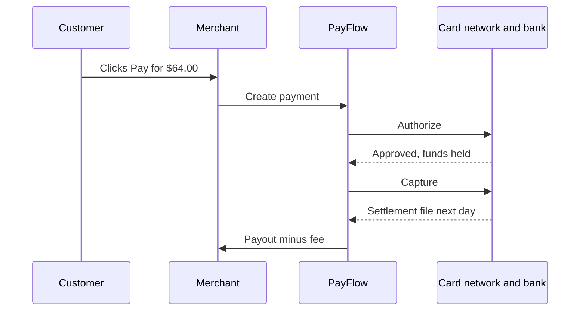
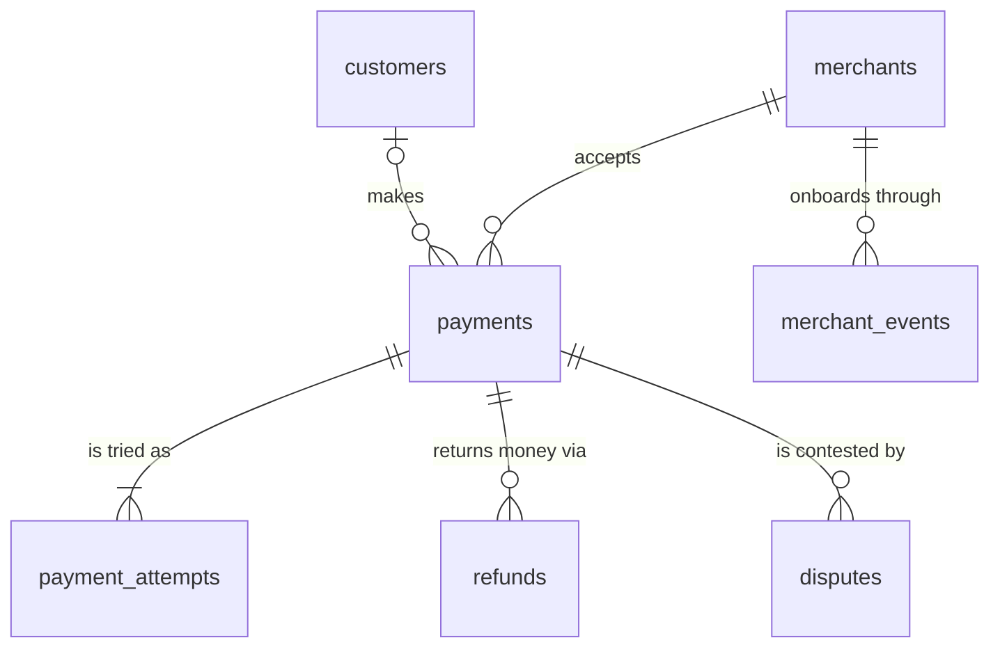
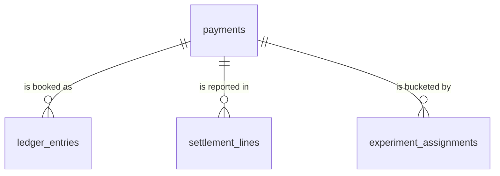
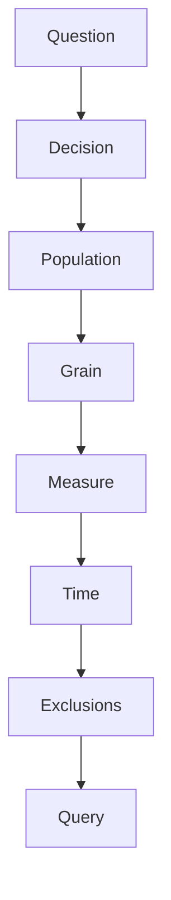
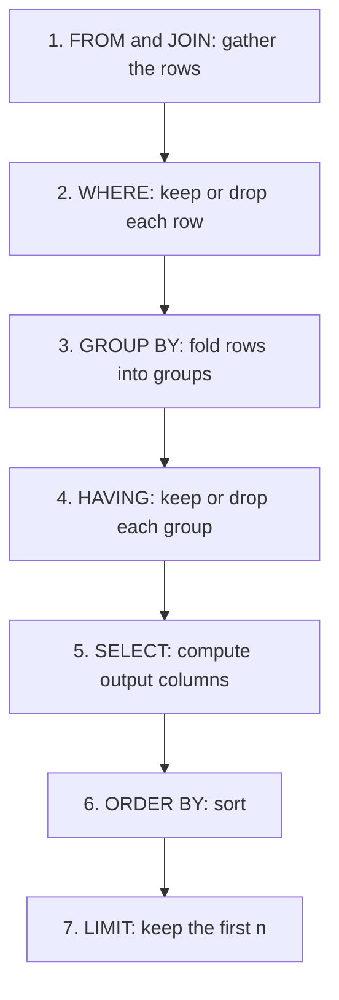
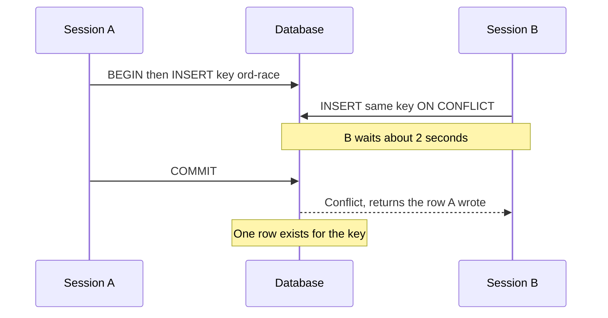

# SQL Handbook for Business Analysts

**Version 2 · October 2026** · Volume 5 of the PM + AI Master Library

> Load one small payments database, run every query in this book against it, and learn to answer business questions with SQL without fooling yourself or your interviewer.

---

## Start here

### Who this is for

You are a product manager or business analyst. You need numbers you can defend: a failure rate, a retention curve, a reconciliation, an experiment readout. You may also have a SQL interview round coming.

You do not need to know any SQL to start. If you already write queries, you will still find the parts most people skip: how to decide what a number means before you compute it, and the handful of traps that produce confident wrong answers.

### What you need before you start

- **PostgreSQL 16, 17 or 18.** Every query in this book was run on PostgreSQL 17 (17.11), and the output you see printed is the real output. The syntax used here also works on 16 and 18. PostgreSQL 18 is the current stable release; version 19 is still in pre-release testing as this is written.
- **The practice file** `payflow_practice.sql`, which ships with this book: it sits next to this handbook's PDF in the library (`01-curriculum/04-sql-and-data/`). It builds a small fictional payments database in a few seconds.
- **A way to type SQL.** The `psql` terminal client that comes with PostgreSQL is enough. Any SQL editor that connects to PostgreSQL also works.

Load the practice database once:

```bash
createdb payflow_book
psql -d payflow_book -v ON_ERROR_STOP=1 -f payflow_practice.sql
psql -d payflow_book
```

The script ends by printing a row count for each table (12 merchants, 138 payment attempts, and so on). It is safe to run again whenever you want a clean copy. It also makes UTC and the `payflow` schema the defaults for that one database, so your output matches the page. That is why you should load it into a scratch database such as `payflow_book`, not one you use for anything else.

> [!NOTE]
> Cannot install PostgreSQL? Browser playgrounds run real PostgreSQL with no account. When this was checked in October 2026, dbfiddle.uk offered versions 16, 17 and 18. Paste the contents of `payflow_practice.sql` into the first box and your queries into the next. The full practice file was not tested there, so treat it as a fallback. Anything pasted into a public playground becomes public, which is fine for this fictional data and never acceptable for real data.

### What you will be able to do

By the end you will be able to:

- Turn a vague question ("is checkout broken?") into a written definition that fixes the population, the unit being counted, the measure, the time window and the exclusions.
- Profile a table you have never seen in ten minutes and say what one row means.
- Write and read joins, aggregations, common table expressions and window functions, and predict the row count before you run them.
- Build the patterns analysts are paid for: de-duplication, time series, percentiles, funnels, cohorts, hierarchies and experiment readouts.
- Check money: read a double-entry ledger, find an imbalance, and reconcile two sources that should agree.
- Recognize when a query is slow, unsafe or leaking future information, and say what to do about it.
- Talk through a SQL interview problem out loud with a repeatable structure.

### How this book is organized

| Part | What you learn | Time |
|---|---|---|
| Meet PayFlow | The company, how a payment moves, the tables | 30 min |
| I. Think before you query | Defining the question, profiling a table, how SQL reads a query | 1.5 h |
| II. Core SQL | Filtering, NULL, time, aggregation, joins, CTEs, set operations, windows | 5 h |
| III. Analyst patterns | De-duplication, time series, percentiles, funnels, cohorts, hierarchies, A/B tests | 4 h |
| IV. Money and risk | Ledgers, reconciliation, point-in-time features, JSON and vectors | 3 h |
| V. Production sense | Transactions, performance, data quality, AI safety, dialects | 3 h |
| VI. Practice | Ten labs and four worked cases, all with answers | 5 h |
| VII. Interview kit | One full worked answer, then fifteen classic problems | 2.5 h |
| VIII. Reference | Cheat sheet, templates, glossary, answers, table appendix | as needed |

### Three ways to read it

**The 90-minute pre-interview path.** Read the Cheat sheet first. Then Chapter 3 (how SQL reads a query), Chapter 5 (NULL), Chapter 8 (joins and fan-out), Chapter 11 (window functions), Chapter 12 (latest row per group), and Chapter 30 (the worked interview answer). Finish with problems 1 to 6 in Chapter 31, covering the solutions and writing your own first.

**The weekend path.** Meet PayFlow, all of Part I and Part II, then Chapters 12 to 16 from Part III. Do Labs 1 to 6 in Chapter 28. Close with Chapters 30 and 31.

**The full path.** Front to back, typing every query yourself, with all ten labs and four cases. Plan on about 25 hours spread over two or three weeks.

### How each chapter works

Every numbered chapter follows the same six steps, so you always know where you are:

1. **Why it matters**: the concrete mistake or pain this chapter prevents.
2. **The idea**: the concept in plain words.
3. **Worked example**: a query against the practice database, followed by its real output.
4. **Common mistakes**: what goes wrong and what to do instead.
5. **Check yourself**: two to four questions. Answers are in the Reference part under the same numbers.
6. **In one line**: the takeaway to remember.

Two markers appear on code. A block that begins `-- WRONG:` runs, but gives a misleading answer on purpose; the corrected query follows it. A block that begins `-- (not run:` is shown for reading only, usually because it is written for a different database product.

### What's new in Version 2

- One practice database that you load once. Every table and column a query mentions exists in it, and every result is printed.
- Each concept is taught, not listed: the reason, the idea, a worked example, the mistakes, and questions with answers.
- Pictures where they help: how money moves, the table map, the order SQL evaluates a query, a two-session race.
- New chapters on profiling an unfamiliar table, percentiles, reading an A/B test, and data quality tests.
- Ten distinct labs and four worked cases, each with a specific scenario and a full tested solution.
- An interview kit that demonstrates the G-R-A-I-N framework on a complete spoken answer, then fifteen classic problems solved.

## Meet PayFlow

PayFlow is a fictional payments company. Online businesses, which PayFlow calls **merchants**, plug PayFlow into their checkout page so that their customers can pay by card, digital wallet or bank transfer. PayFlow takes a 3% fee on each successful payment. Nothing about PayFlow describes a real company, and every number you will see was invented for this book.

You will use the same PayFlow data in every chapter, so it is worth twenty minutes to learn how the business works and what the tables hold.

### How a card payment moves

When Dev Patel buys a $64.00 jacket from Northwind Retail, four things happen. They look like one click, but they are separate steps that can each succeed or fail, and they happen at different times.



*Figure 0.1 — The life of one card payment. Authorization holds the money, capture takes it, settlement reports it, payout delivers it.*

- **Authorize.** PayFlow asks the customer's bank, through the card network, "can this card pay $64.00?" The bank either declines or approves and puts a hold on the money. Nothing has moved yet.
- **Capture.** PayFlow tells the bank to take the held money. Most merchants capture seconds after authorizing. A travel company may authorize today and capture days later, when the trip is confirmed.
- **Settle.** The next day, PayFlow's banking provider sends a **settlement file**: a list of every payment it actually collected. This file is the outside world's version of events, and it does not always agree with PayFlow's own records.
- **Payout.** PayFlow pays the merchant what it collected, minus the 3% fee.

Money can also flow backward. A **refund** is the merchant choosing to return some or all of a payment. A **dispute** (also called a chargeback) is the customer asking their own bank to pull the money back, usually because of fraud or goods that never arrived. The merchant can fight a dispute and win or lose.

Each try at charging is an **attempt**. If Dev's card times out and he tries again, that is still one payment, now with two attempts. This distinction is the single most useful idea in the book, and you will see why in Chapter 1.

Finally, PayFlow keeps a **ledger**: the accounting record of who owes what to whom. The payments tables describe what happened in the product. The ledger describes what happened to the money. Chapter 19 explains it from zero.

### The cast

Twelve merchants use PayFlow. Run this first query to meet them. The `SET` line tells PostgreSQL to look for tables in the `payflow` schema; it is the only time this book shows it, and you need it once per session (the loader also makes it the default for the practice database).

```sql
SET search_path = payflow;

SELECT merchant_id, merchant_name, parent_merchant_id AS parent, category, country
FROM merchants
ORDER BY merchant_id;
```

Result:

```text
SET
 merchant_id |  merchant_name   | parent |   category    | country 
-------------+------------------+--------+---------------+---------
 M01         | Northwind Group  |        | wholesale     | US
 M02         | Northwind Retail | M01    | retail        | US
 M03         | Northwind Outlet | M02    | retail        | US
 M04         | Northwind Travel | M01    | travel        | US
 M05         | Bluebird Coffee  |        | food_beverage | US
 M06         | Cedar Books      |        | retail        | US
 M07         | Lumen Fitness    |        | fitness       | US
 M08         | Thames Tea       |        | food_beverage | GB
 M09         | Harbor Games     |        | gaming        | US
 M10         | Quill Stationery |        | retail        | US
 M11         | Pioneer Pets     |        | retail        | US
 M12         | Juniper Bikes    |        | retail        | CA
(12 rows)
```

Four of them belong to one company: Northwind Group owns Northwind Retail and Northwind Travel, and Northwind Retail owns Northwind Outlet. Thames Tea is in London and charges in pounds. Pioneer Pets and Juniper Bikes have signed up but have not taken a payment yet. Sixteen registered customers pay these merchants, plus some guests who check out without an account.

### The tables



*Figure 0.2 — The core tables. Read each line as "one on the left, many on the right": one payment has one or more attempts and zero or more refunds.*



*Figure 0.3 — Three more tables that hang off a payment in the same one-to-many way.*

| Table | One row is | Rows |
|---|---|---|
| `merchants` | one merchant account | 12 |
| `customers` | one registered payer | 16 |
| `payments` | one intent to pay for one order | 123 |
| `payment_attempts` | one try at charging | 138 |
| `refunds` | one refund request | 9 |
| `disputes` | one chargeback | 4 |
| `ledger_entries` | one accounting line | 307 |
| `settlement_lines` | one line of the provider's daily file | 29 |
| `merchant_events` | one onboarding event delivered | 47 |
| `experiment_assignments` | one payment put into an A/B test arm | 63 |
| `ai_events` | one question asked of PayFlow's AI assistant | 12 |
| `payment_commands` | one "please charge" request from a merchant | 4 |

A thirteenth table, `attempts_big`, holds 20,000 synthetic rows and exists only for the performance chapter. The Reference part has an appendix with every column.

### What one row means

The middle column of that table has a name: **grain**. The grain of a table is what one row stands for. It decides what `COUNT(*)` counts, so it is the first thing to know about any table.

Here is Dev's $64.00 payment from Monday 13 July, during two hours when card payments were timing out. In `payment_attempts` it is three rows:

```sql
SELECT attempt_id, attempted_at, method, status, failure_code
FROM payment_attempts
WHERE payment_id = 'P0111'
ORDER BY attempted_at;
```

Result:

```text
 attempt_id |      attempted_at      | method |  status   |   failure_code    
------------+------------------------+--------+-----------+-------------------
 A0118      | 2026-07-13 14:05:12+00 | card   | failed    | processor_timeout
 A0119      | 2026-07-13 14:07:30+00 | card   | failed    | processor_timeout
 A0120      | 2026-07-13 14:12:05+00 | wallet | succeeded | 
(3 rows)
```

In `payments` it is one row:

```sql
SELECT payment_id, merchant_id, customer_id, amount_minor, currency, status
FROM payments
WHERE payment_id = 'P0111';
```

Result:

```text
 payment_id | merchant_id | customer_id | amount_minor | currency |  status  
------------+-------------+-------------+--------------+----------+----------
 P0111      | M02         | C04         |         6400 | USD      | captured
(1 row)
```

Same event, two grains. Ask the attempts table "how often did checkout fail?" and Dev contributes two failures out of three tries. Ask the payments table and Dev contributes one success. Neither is wrong. They answer different questions, and most arguments about metrics turn out to be arguments about grain.

### Four conventions in the data

**Money is stored in minor units.** `amount_minor = 6400` with `currency = 'USD'` means 6,400 cents, which is $64.00. Whole numbers of cents add up exactly; decimal dollars stored as floating-point numbers do not. Divide by 100.0 only when you display a result, and never add amounts in different currencies.

**Timestamps are instants, shown in UTC.** The type is `timestamptz`. A value such as `2026-07-13 14:05:12+00` is one precise moment worldwide. Chapter 6 covers what happens when your business day is not the UTC day.

**Events are added, never edited.** Attempts, ledger lines and onboarding events record things that happened. When something changes, a new row is written and the old one stays. That is what lets you reconstruct what was known at any moment, and it is why a correction in this book is always a new row, never an update.

**The book has a fixed clock.** The data runs from Monday 1 June to Monday 13 July 2026. Treat "today" as Tuesday 14 July 2026 and "yesterday" as Monday 13 July. Every query uses written-out dates so that your result matches the page. Against live data you would compute the window instead:

```sql
-- (not run: uses the current time, so the result would change every day)
SELECT COUNT(*)
FROM payment_attempts
WHERE attempted_at >= date_trunc('day', now(), 'UTC') - INTERVAL '1 day'
  AND attempted_at <  date_trunc('day', now(), 'UTC');
```

> [!NOTE]
> The practice data contains deliberate flaws: a double charge, an unbalanced ledger posting, duplicate events, a settlement file that disagrees with PayFlow's records, and more. Each chapter uses one to show a trap with real numbers. The appendix lists them all, so skip that list if you want to find them yourself.

# Part I — Think before you query

Part I is about the ten minutes before you write anything. You will see SQL here that Part II has not taught yet. Read the results, not the syntax; every clause is explained properly later.

## 1. From business question to data contract

### Why it matters

It is 9 a.m. on Tuesday 14 July. PayFlow's head of product asks: "Is checkout broken? What was the failure rate yesterday?" Three analysts each run a reasonable query and report 56.5%, 55.0% and 27.3%. All three are correct arithmetic on the same table. The meeting spends forty minutes arguing about whose number is right, and nobody decides anything.

The numbers differ because the question never said what to count. A query cannot fix a question that is vague. You have to fix the question first.

### The idea

Before you query, write down six decisions. Together they form a **data contract** (also called a metric contract): a short written definition of a number, precise enough that two people working alone would compute the same value.



*Figure 1.1 — Six decisions sit between a question and a query. Skipping any of them leaves the answer open to argument.*

1. **Decision.** What will someone do differently depending on the answer? If nothing, do not run the query.
2. **Population.** Which things are eligible to be counted at all? All attempts, or only card attempts, or only one merchant's?
3. **Grain.** What does one counted unit stand for? An attempt, a payment, a customer?
4. **Measure.** The formula, including its **denominator** (the bottom of the fraction). "Failure rate" means failures divided by what, exactly?
5. **Time boundary.** Which instants are in, in which time zone, and compared with what baseline?
6. **Exclusions.** What is deliberately left out, and why?

### Worked example

Here is the unexamined version of "the failure rate yesterday". It counts every row.

```sql
SELECT COUNT(*) AS attempts,
       COUNT(*) FILTER (WHERE status = 'failed') AS failed,
       ROUND(100.0 * COUNT(*) FILTER (WHERE status = 'failed') / COUNT(*), 1)
         AS failed_pct
FROM payment_attempts
WHERE attempted_at >= TIMESTAMPTZ '2026-07-13 00:00:00+00'
  AND attempted_at <  TIMESTAMPTZ '2026-07-14 00:00:00+00';
```

Result:

```text
 attempts | failed | failed_pct 
----------+--------+------------
       23 |     13 |       56.5
(1 row)
```

That 56.5% includes PayFlow's own monitoring probes, counts a customer who changed their mind as if the system had failed them, and has no baseline. Now write the contract.

| Decision | "Is checkout broken?" made precise |
|---|---|
| Decision | Should we page the payments team and tell merchants? |
| Population | Real customer payment attempts, split by payment method |
| Grain | One attempt (and, separately, one payment) |
| Measure | Failed attempts divided by attempts that reached a final answer |
| Time boundary | Monday 13 July 2026, 00:00 to 24:00 UTC, against the four Mondays before |
| Exclusions | Test traffic (`is_test`); attempts the customer canceled |

The same query with the contract applied, split by method:

```sql
SELECT method,
       COUNT(*) AS attempts,
       COUNT(*) FILTER (WHERE status = 'failed') AS failed,
       ROUND(100.0 * COUNT(*) FILTER (WHERE status = 'failed') / COUNT(*), 1)
         AS failed_pct
FROM payment_attempts
WHERE attempted_at >= TIMESTAMPTZ '2026-07-13 00:00:00+00'
  AND attempted_at <  TIMESTAMPTZ '2026-07-14 00:00:00+00'
  AND NOT is_test
  AND status <> 'canceled'
GROUP BY method
ORDER BY failed_pct DESC;
```

Result:

```text
    method     | attempts | failed | failed_pct 
---------------+----------+--------+------------
 card          |       17 |     11 |       64.7
 wallet        |        2 |      0 |        0.0
 bank_transfer |        1 |      0 |        0.0
(3 rows)
```

Now the result says something: cards are failing, wallets and bank transfers are not. Is 64.7% unusual for a Monday? The contract named a baseline, so compute it the same way for the previous four Mondays.

```sql
SELECT attempted_at::date AS day,
       COUNT(*) AS attempts,
       COUNT(*) FILTER (WHERE status = 'failed') AS failed,
       ROUND(100.0 * COUNT(*) FILTER (WHERE status = 'failed') / COUNT(*), 1)
         AS failed_pct
FROM payment_attempts
WHERE attempted_at >= TIMESTAMPTZ '2026-06-15 00:00:00+00'
  AND attempted_at <  TIMESTAMPTZ '2026-07-14 00:00:00+00'
  AND EXTRACT(ISODOW FROM attempted_at) = 1
  AND NOT is_test
  AND status <> 'canceled'
GROUP BY day
ORDER BY day;
```

Result:

```text
    day     | attempts | failed | failed_pct 
------------+----------+--------+------------
 2026-06-15 |        5 |      1 |       20.0
 2026-06-22 |        5 |      1 |       20.0
 2026-06-29 |        6 |      1 |       16.7
 2026-07-06 |        5 |      1 |       20.0
 2026-07-13 |       20 |     11 |       55.0
(5 rows)
```

A normal Monday fails about one attempt in five. Yesterday failed more than half, on four times the usual number of attempts. Something broke.

The last decision is grain. A customer whose card times out usually tries again, so one unhappy payment can produce three failed attempts. Count payments instead, and call a payment a **terminal failure** when none of its attempts succeeded and the customer did not cancel:

```sql
WITH per_payment AS (
  SELECT payment_id,
         COUNT(*) AS tries,
         BOOL_OR(status = 'succeeded') AS succeeded,
         BOOL_OR(status IN ('canceled', 'pending')) AS unresolved
  FROM payment_attempts
  WHERE attempted_at >= TIMESTAMPTZ '2026-07-13 00:00:00+00'
    AND attempted_at <  TIMESTAMPTZ '2026-07-14 00:00:00+00'
    AND NOT is_test
  GROUP BY payment_id
)
SELECT COUNT(*) AS payments,
       COUNT(*) FILTER (WHERE succeeded) AS succeeded,
       COUNT(*) FILTER (WHERE succeeded AND tries > 1) AS saved_by_retry,
       COUNT(*) FILTER (WHERE NOT succeeded AND NOT unresolved) AS terminal_failed,
       COUNT(*) FILTER (WHERE NOT succeeded AND unresolved) AS unresolved
FROM per_payment;
```

Result:

```text
 payments | succeeded | saved_by_retry | terminal_failed | unresolved 
----------+-----------+----------------+-----------------+------------
       13 |         8 |              3 |               3 |          2
(1 row)
```

Thirteen real payments were started. Eight succeeded, three of them only because the customer retried. Three failed for good. That is 3 of the 11 payments that reached an answer, or 27.3%.

So which number is "the failure rate"? Both, with labels. The answer to the head of product is: "Yes. 55% of attempts failed yesterday against a usual 20%, and every failure was a card payment; wallets and bank transfers were unaffected. Three customers gave up and three more got through only by retrying." Someone can act on that sentence, and every figure in it traces to a line of the contract.

### Common mistakes

| Mistake | Why it bites | Do this instead |
|---|---|---|
| Reporting "the failure rate" with no grain | Attempt-level and payment-level rates can differ by 2x on the same day | Name the unit: "per attempt" or "per payment" |
| Leaving test traffic in | Probes are built to fail; they inflate bad news | Exclude `is_test` and say so in the contract |
| Changing the denominator between periods | The trend becomes an artifact of the definition | Compute the baseline with the identical query |
| Writing the contract after the query | You rationalize whatever the query happened to do | Write six lines first; put them in a comment above the SQL |

### Check yourself

**Q1.1** A dashboard shows "payment success rate: 78%". Name three things you would need to know before trusting or comparing it.

**Q1.2** Why is a customer-canceled attempt excluded from the failure rate instead of being counted as a success?

**Q1.3** On 13 July the attempt-level failure rate (55%) was about double the payment-level rate (27%). What customer behavior explains the gap?

> [!IMPORTANT]
> **In one line:** Decide the decision, population, grain, measure, time boundary and exclusions before you write SQL, and report the number with those labels attached.

## 2. Your first ten minutes with an unfamiliar table

### Why it matters

Most wrong analyses are not caused by hard SQL. They come from an assumption about the table that was never checked: that an ID is unique, that a column is always filled in, that the data goes back as far as you think. Ten minutes of **profiling**, which means measuring a table's basic shape before you use it, catches these before they reach a slide.

### The idea

Run the same short routine on every new table, in this order:

1. **Read what the owner wrote.** Table and column comments, if any.
2. **Count rows and test the key.** Is the supposed identifier really unique?
3. **Find the time range.** When does the data start and stop?
4. **Measure the gaps.** How many values are `NULL` (missing) in each important column?
5. **List the values** of every category-like column, with counts.
6. **Look at the spread** of the numeric columns: minimum, middle, maximum.

Each step either confirms an assumption or hands you a question to ask the table's owner.

### Worked example

Profile `payment_attempts` as if you had never seen it.

**Step 1: read the comments.** In PostgreSQL a table's description is stored in the catalog, and you can query it for a whole schema at once.

```sql
SELECT c.relname AS table_name, obj_description(c.oid) AS grain
FROM pg_class AS c
JOIN pg_namespace AS n ON n.oid = c.relnamespace
WHERE n.nspname = 'payflow' AND c.relkind = 'r'
ORDER BY c.relname;
```

Result:

```text
       table_name       |                           grain                           
------------------------+-----------------------------------------------------------
 ai_events              | One row per question asked of the Ask PayFlow assistant.
 attempts_big           | Synthetic: 20,000 attempts for the performance chapter.
 customers              | One row per registered payer (guests have no row).
 disputes               | One row per chargeback raised by a cardholder.
 experiment_assignments | One row per payment-to-arm assignment.
 ledger_entries         | One row per ledger line; a journal_id groups one posting.
 merchant_events        | One row per onboarding event delivered (can repeat).
 merchants              | One row per merchant account.
 payment_attempts       | One row per attempt: one try at charging a payment.
 payment_commands       | One row per charge request (merchant + idempotency key).
 payments               | One row per payment: one intent to pay for one order.
 refunds                | One row per refund request (a payment can have several).
 settlement_lines       | One row per line of the provider's daily settlement file.
(13 rows)
```

The owner claims one row per attempt. Claims are a starting point, so test this one.

**Steps 2 and 3: row count, key, time range.**

```sql
SELECT COUNT(*) AS row_count,
       COUNT(DISTINCT attempt_id) AS distinct_ids,
       COUNT(DISTINCT payment_id) AS payments,
       MIN(attempted_at) AS first_at,
       MAX(attempted_at) AS last_at
FROM payment_attempts;
```

Result:

```text
 row_count | distinct_ids | payments |        first_at        |        last_at         
-----------+--------------+----------+------------------------+------------------------
       138 |          138 |      123 | 2026-06-01 12:05:10+00 | 2026-07-13 23:05:00+00
(1 row)
```

138 rows and 138 distinct IDs: `attempt_id` is unique, so it is a valid **key** (a column whose value identifies exactly one row). There are fewer payments than attempts, which matches the claim that a payment can have several tries. The data covers six weeks.

**Step 4: missing values.** `COUNT(column)` skips `NULL`s, so subtracting it from `COUNT(*)` gives the number missing.

```sql
SELECT COUNT(*) AS row_count,
       COUNT(*) - COUNT(customer_id) AS no_customer,
       COUNT(*) - COUNT(device_id) AS no_device,
       COUNT(*) - COUNT(failure_code) AS no_failure_code
FROM payment_attempts;
```

Result:

```text
 row_count | no_customer | no_device | no_failure_code 
-----------+-------------+-----------+-----------------
       138 |          21 |         6 |             105
(1 row)
```

Three different stories. Twenty-one attempts have no customer: guests and test probes. Six have no device: bank transfers, which do not come from a browser. And 105 have no failure code, which is correct, because only failed attempts should have one. A missing value is not automatically a problem. You need to know why it is missing.

**Step 5: category values.** One query per column; here is `status` with its share of rows.

```sql
SELECT status,
       COUNT(*) AS attempts,
       ROUND(100.0 * COUNT(*) / SUM(COUNT(*)) OVER (), 1) AS pct
FROM payment_attempts
GROUP BY status
ORDER BY attempts DESC;
```

Result:

```text
  status   | attempts | pct  
-----------+----------+------
 succeeded |      100 | 72.5
 failed    |       33 | 23.9
 canceled  |        3 |  2.2
 pending   |        2 |  1.4
(4 rows)
```

Running the same shape of query on `currency` shows 130 rows in USD and 8 in GBP, which warns you never to add `amount_minor` across the whole table. On `is_test` it shows 8 test rows to exclude.

**Step 6: numeric spread.**

```sql
SELECT MIN(amount_minor) AS smallest,
       percentile_cont(0.5) WITHIN GROUP (ORDER BY amount_minor) AS middle,
       ROUND(AVG(amount_minor)) AS average,
       MAX(amount_minor) AS largest
FROM payment_attempts;
```

Result:

```text
 smallest | middle | average | largest 
----------+--------+---------+---------
      500 |   2500 |   16992 |  500000
(1 row)
```

The middle attempt is 2,500 minor units ($25.00) but the average is almost seven times that. A few very large payments are pulling the average up, so any "average order value" from this table will describe almost no real order. Chapter 14 returns to this.

Ten minutes in, you know the grain is real, the key is unique, the window is six weeks, there are two currencies, there is test traffic, and averages are suspect. Each of those would have been a wrong number later.

### Common mistakes

| Mistake | Why it bites | Do this instead |
|---|---|---|
| Trusting a column called `id` to be unique | Duplicated rows silently double every total | Compare `COUNT(*)` with `COUNT(DISTINCT id)` |
| Assuming the table covers "all time" | A partial first or last period looks like a drop | Check `MIN` and `MAX` of the time column |
| Treating every `NULL` as an error | Some are correct by design; "fixing" them corrupts data | Ask what a missing value means for each column |
| Skipping the value list | A category you did not know about (test, a second currency) ends up in your totals | List distinct values with counts for every category column |

### Check yourself

**Q2.1** You run step 2 on a table and get `row_count = 5000`, `distinct_ids = 4988`. What does that tell you, and what would you do next?

**Q2.2** In `payment_attempts`, 105 rows have no `failure_code`. Why is that not a data quality problem?

**Q2.3** Which profiling step would have warned you that summing `amount_minor` over the whole table is meaningless?

> [!IMPORTANT]
> **In one line:** Before using a table, check its grain, key, time range, gaps, category values and spread; ten minutes of profiling prevents most wrong numbers.

## 3. How SQL reads your query

### Why it matters

You write a query starting with `SELECT`, but the database does not read it in that order. Nearly every "why does this not work?" moment in a first month of SQL, and a favorite interview question, comes down to this: a name was used before the database had created it.

### The idea

A query is a pipeline. Rows enter at `FROM` and are filtered, grouped and shaped step by step. This is the **logical order of evaluation**: the order in which the clauses take effect, whatever order you typed them in.



*Figure 3.1 — The logical order of a query. Each step can only see what the steps above it produced.*

Two rules follow directly from the picture:

- `WHERE` runs before `SELECT`, so `WHERE` cannot use a column name you invented in `SELECT`.
- `WHERE` filters rows before grouping; `HAVING` filters groups after it. A condition on a total, such as "at least three failures", can only go in `HAVING`.

### Worked example

Which merchants had the most failed real attempts? Keep only those with at least three, and show the top three.

```sql
SELECT merchant_id,
       COUNT(*) AS failed_attempts
FROM payment_attempts
WHERE status = 'failed' AND NOT is_test
GROUP BY merchant_id
HAVING COUNT(*) >= 3
ORDER BY failed_attempts DESC, merchant_id
LIMIT 3;
```

Result:

```text
 merchant_id | failed_attempts 
-------------+-----------------
 M09         |               9
 M06         |               5
 M02         |               4
(3 rows)
```

Follow the rows through the pipeline:

| Step | Clause | What is left |
|---|---|---|
| 1 | `FROM payment_attempts` | 138 rows |
| 2 | `WHERE status = 'failed' AND NOT is_test` | 26 rows |
| 3 | `GROUP BY merchant_id` | 8 groups, one per merchant |
| 4 | `HAVING COUNT(*) >= 3` | 4 groups |
| 5 | `SELECT` | 4 rows with two columns |
| 6 | `ORDER BY failed_attempts DESC, merchant_id` | the same 4 rows, sorted |
| 7 | `LIMIT 3` | 3 rows |

`ORDER BY` comes after `SELECT`, which is why it may use the name `failed_attempts`. Northwind Retail (M02) and Northwind Outlet (M03) both have four failures; the second sort column, `merchant_id`, decides which of them makes the cut. Without it the database could return either one, and could change its mind between runs.

Now break the first rule on purpose.

```sql
-- (not run: fails on purpose; WHERE cannot see a name created in SELECT)
SELECT attempt_id, ROUND(amount_minor / 100.0, 2) AS dollars
FROM payment_attempts
WHERE currency = 'USD' AND dollars > 1000;
```

Result:

```text
ERROR:  column "dollars" does not exist
LINE 3: WHERE currency = 'USD' AND dollars > 1000;
                                   ^
```

The database reaches `WHERE` at step 2 and looks for `dollars`, which will not exist until step 5. Repeat the expression instead:

```sql
SELECT attempt_id, ROUND(amount_minor / 100.0, 2) AS dollars
FROM payment_attempts
WHERE currency = 'USD' AND amount_minor / 100.0 > 1000
ORDER BY dollars DESC;
```

Result:

```text
 attempt_id | dollars 
------------+---------
 A0060      | 5000.00
 A0099      | 3200.00
 A0133      | 2600.00
 A0003      | 2400.00
 A0027      | 1800.00
 A0065      | 1200.00
(6 rows)
```

> [!NOTE]
> Logical order describes what a query means, not how the database physically runs it. The planner is free to reorder work for speed as long as the result is the same. Chapter 24 shows how to see what it actually did.

### Common mistakes

| Mistake | Why it bites | Do this instead |
|---|---|---|
| Filtering on a `SELECT` alias in `WHERE` | Error: the column does not exist yet | Repeat the expression, or compute it in an earlier step (Chapter 9) |
| Putting `COUNT(*) > 3` in `WHERE` | Error: totals do not exist before grouping | Use `HAVING` |
| Putting a row filter in `HAVING` | It works, but groups rows you were going to throw away | Filter rows in `WHERE`, groups in `HAVING` |
| `LIMIT` without a complete `ORDER BY` | Ties are broken arbitrarily; results change between runs | Add a unique tie-breaker column to the sort |

### Check yourself

**Q3.1** Put these clauses in the order they take effect: `SELECT`, `WHERE`, `ORDER BY`, `FROM`, `HAVING`, `GROUP BY`, `LIMIT`.

**Q3.2** You want merchants whose total captured amount exceeds $1,000. Does the condition go in `WHERE` or `HAVING`, and why?

**Q3.3** Why can `ORDER BY` use a column alias when `WHERE` cannot?

> [!IMPORTANT]
> **In one line:** SQL evaluates FROM, WHERE, GROUP BY, HAVING, SELECT, ORDER BY, LIMIT in that order, and each clause can only use what earlier clauses produced.

# Part II — Core SQL

Part II teaches the language itself, one building block per chapter. Type each query. Change one thing and predict the result before you run it; that habit teaches more than reading does.

## 4. SELECT, WHERE and ORDER BY

### Why it matters

Three clauses do most of the daily work: choose columns, keep the rows you want, sort them. They look too simple to get wrong, and yet one of the most common silent errors in SQL, mixing `AND` with `OR`, lives here.

### The idea

- `SELECT` lists the columns you want back. You can compute new ones and name them with `AS`. A name given this way is an **alias**.
- `FROM` names the table.
- `WHERE` is a test applied to each row. Rows that pass are kept.
- `ORDER BY` sorts the result. Without it, the database promises no order at all.
- `LIMIT n` keeps the first n rows after sorting.

Inside `WHERE` you combine tests with `AND` (both must hold), `OR` (either) and `NOT`. Useful shortcuts: `IN ('a', 'b')` for "one of these", `LIKE 'North%'` for "starts with North" (`%` matches any run of characters), and `DISTINCT` after `SELECT` to remove repeated rows.

### Worked example

Harbor Games (M09) had failures in July. List the five largest.

```sql
SELECT attempt_id, attempted_at, amount_minor, failure_code
FROM payment_attempts
WHERE merchant_id = 'M09'
  AND status = 'failed'
  AND attempted_at >= TIMESTAMPTZ '2026-07-01 00:00:00+00'
ORDER BY amount_minor DESC, attempted_at
LIMIT 5;
```

Result:

```text
 attempt_id |      attempted_at      | amount_minor |   failure_code    
------------+------------------------+--------------+-------------------
 A0105      | 2026-07-09 03:40:00+00 |        10000 | suspected_fraud
 A0100      | 2026-07-09 03:02:10+00 |         5000 | suspected_fraud
 A0101      | 2026-07-09 03:05:44+00 |         5000 | do_not_honor
 A0103      | 2026-07-09 03:14:30+00 |         5000 | suspected_fraud
 A0125      | 2026-07-13 14:50:00+00 |         2000 | processor_timeout
(5 rows)
```

`DESC` sorts largest first. Three rows tie at 5,000, so the second sort column, `attempted_at`, puts them in time order. Notice four failures within forty minutes in the early hours of 9 July. Chapter 21 comes back to that device.

Now the trap. Someone wants Harbor Games attempts that either failed or were canceled, and writes this:

```sql
-- WRONG: AND is evaluated before OR, so this adds every merchant's cancellations
SELECT COUNT(*) AS attempts
FROM payment_attempts
WHERE merchant_id = 'M09' AND status = 'failed' OR status = 'canceled';
```

Result:

```text
 attempts 
----------
       13
(1 row)
```

SQL reads that as "(Harbor Games and failed) or (canceled, anyone's)". Three of the thirteen rows are other merchants' cancellations. Parentheses say what was meant:

```sql
SELECT COUNT(*) AS attempts
FROM payment_attempts
WHERE merchant_id = 'M09' AND (status = 'failed' OR status = 'canceled');
```

Result:

```text
 attempts 
----------
       10
(1 row)
```

`IN` avoids the problem entirely: `status IN ('failed', 'canceled')` is one test, so there is no `OR` to misplace.

One more thing to see with your own eyes before it costs you a metric: dividing two whole numbers gives a whole number.

```sql
SELECT 7 / 2 AS whole_numbers,
       7 / 2.0 AS one_decimal_operand,
       ROUND(7 / 2.0, 1) AS rounded;
```

Result:

```text
 whole_numbers | one_decimal_operand | rounded 
---------------+---------------------+---------
             3 |  3.5000000000000000 |     3.5
(1 row)
```

`7 / 2` is `3`, not `3.5`. PostgreSQL drops the remainder when both sides are integers. Whenever you compute a rate, make one side a decimal (`100.0 * failed / total`), or the answer will quietly round down to zero.

### Common mistakes

| Mistake | Why it bites | Do this instead |
|---|---|---|
| Mixing `AND` and `OR` without parentheses | `AND` binds tighter; the filter means something else | Parenthesize every `OR`, or use `IN` |
| Expecting rows in insertion order | Order is undefined without `ORDER BY` | Always sort when order matters |
| `SELECT *` in saved queries | Breaks or changes meaning when columns are added | Name the columns you need |
| Integer division for rates | `26 / 130` is `0` | Multiply by `100.0` or cast one side to `numeric` |

### Check yourself

**Q4.1** Rewrite `WHERE method = 'card' OR method = 'wallet' AND status = 'failed'` so that it returns failed attempts made by card or wallet.

**Q4.2** A query has `ORDER BY amount_minor DESC LIMIT 1` and two rows share the largest amount. Which row comes back?

**Q4.3** What does `SELECT 1 / 4 * 100` return in PostgreSQL, and how would you fix it?

> [!IMPORTANT]
> **In one line:** Parenthesize every `OR`, never rely on unsorted order, and put a decimal in every division.

## 5. Types, NULL and three-valued logic

### Why it matters

`NULL` is where correct-looking queries lose rows. A filter that reads "not a timeout" drops every successful attempt. A "not in this list" check returns nothing at all. An average is computed over fewer rows than you believe. None of these raise an error.

### The idea

Every column has a **data type** that decides what can be stored and how it compares. The ones in this book:

| Type | Holds | Example |
|---|---|---|
| `text` | characters | `'card'` |
| `integer`, `bigint` | whole numbers | `6400` |
| `numeric` | exact decimals | `64.00` |
| `boolean` | true or false | `is_test` |
| `timestamptz` | an instant in time | `2026-07-13 14:05:12+00` |
| `date` | a calendar day | `2026-07-13` |
| `jsonb` | a JSON document | Chapter 22 |

You convert between types with a **cast**, written `value::type`, as in `'2026-07-13'::date`.

`NULL` is not a value. It is a marker meaning "unknown or not applicable". Because it is unknown, comparing anything with it gives neither true nor false but a third result, **unknown**. This is **three-valued logic**:

| A | B | A AND B | A OR B | NOT A |
|---|---|---|---|---|
| true | unknown | unknown | true | false |
| false | unknown | false | unknown | true |
| unknown | unknown | unknown | unknown | unknown |

The rule that causes the damage: **`WHERE` keeps a row only when its test is true.** Unknown is not true, so the row is dropped, exactly as if the test had been false.

Tools for handling it deliberately:

- `x IS NULL` and `x IS NOT NULL` test for the marker itself.
- `x IS DISTINCT FROM y` is a "not equal" that treats `NULL` as an ordinary, comparable value.
- `COALESCE(x, fallback)` returns the first argument that is not `NULL`.

### Worked example

Start by watching the three results appear. `psql` prints `NULL` as an empty cell.

```sql
SELECT NULL = NULL AS null_equals_null,
       NULL <> 1 AS null_not_equal_1,
       NULL IS NULL AS null_is_null,
       NULL IS DISTINCT FROM 1 AS null_distinct_from_1;
```

Result:

```text
 null_equals_null | null_not_equal_1 | null_is_null | null_distinct_from_1 
------------------+------------------+--------------+----------------------
                  |                  | t            | t
(1 row)
```

Even `NULL = NULL` is unknown: two unknown things are not known to be equal.

**Trap 1: "not equal" drops the missing.** How many attempts did not time out? There are 138 attempts and 14 timeouts, so the answer is 124.

```sql
-- WRONG: failure_code is NULL unless the attempt failed, and NULL <> 'x' is unknown
SELECT COUNT(*) AS not_timeouts
FROM payment_attempts
WHERE failure_code <> 'processor_timeout';
```

Result:

```text
 not_timeouts 
--------------
           19
(1 row)
```

Nineteen. The 105 attempts with no failure code, including every success, vanished. `IS DISTINCT FROM` counts them:

```sql
SELECT COUNT(*) AS not_timeouts
FROM payment_attempts
WHERE failure_code IS DISTINCT FROM 'processor_timeout';
```

Result:

```text
 not_timeouts 
--------------
          124
(1 row)
```

**Trap 2: `NOT IN` with a NULL in the list.** Which merchants are not the parent of any other merchant?

```sql
-- WRONG: the list contains NULLs, so "not in the list" is never known to be true
SELECT merchant_id
FROM merchants
WHERE merchant_id NOT IN (SELECT parent_merchant_id FROM merchants);
```

Result:

```text
 merchant_id 
-------------
(0 rows)
```

Zero rows, although ten of the twelve merchants have no children. `x NOT IN (a, b, NULL)` means `x <> a AND x <> b AND x <> NULL`, and that last piece is always unknown. Use `NOT EXISTS`, which asks "is there no matching row?" and is immune:

```sql
SELECT COUNT(*) AS merchants_without_children
FROM merchants AS m
WHERE NOT EXISTS (
  SELECT 1 FROM merchants AS child
  WHERE child.parent_merchant_id = m.merchant_id
);
```

Result:

```text
 merchants_without_children 
----------------------------
                         10
(1 row)
```

**Trap 3: aggregates skip NULLs.** Three counts on one table, three answers:

```sql
SELECT COUNT(*) AS all_rows,
       COUNT(customer_id) AS rows_with_customer,
       COUNT(DISTINCT customer_id) AS different_customers
FROM payment_attempts;
```

Result:

```text
 all_rows | rows_with_customer | different_customers 
----------+--------------------+---------------------
      138 |                117 |                  16
(1 row)
```

`COUNT(*)` counts rows. `COUNT(column)` counts rows where that column is filled in. `COUNT(DISTINCT column)` counts different filled-in values. `SUM` and `AVG` skip `NULL`s the same way, which changes an average:

```sql
SELECT AVG(x) AS avg_skipping_null,
       AVG(COALESCE(x, 0)) AS avg_null_as_zero
FROM (VALUES (10), (20), (NULL)) AS t (x);
```

Result:

```text
  avg_skipping_null  |  avg_null_as_zero   
---------------------+---------------------
 15.0000000000000000 | 10.0000000000000000
(1 row)
```

Neither is the right one in general. Ask what a missing value means. A missing refund amount probably means zero. A missing delivery time probably means "not delivered yet" and should stay out of the average.

### Common mistakes

| Mistake | Why it bites | Do this instead |
|---|---|---|
| `WHERE col <> 'x'` on a column that can be `NULL` | Rows with `NULL` disappear | `col IS DISTINCT FROM 'x'` |
| `WHERE col = NULL` | Always unknown; returns nothing | `col IS NULL` |
| `NOT IN (subquery)` | One `NULL` in the subquery empties the result | `NOT EXISTS` |
| `COALESCE(x, 0)` by reflex | Turns "unknown" into a real zero and drags averages down | Decide per column what missing means |
| Storing money as floating point | `0.1 + 0.2` is not exactly `0.3` | Integer minor units, or `numeric` |

### Check yourself

**Q5.1** A table has 100 rows; `segment` is `'business'` in 30, `'consumer'` in 60 and `NULL` in 10. How many rows does `WHERE segment <> 'business'` return?

**Q5.2** Why did the `NOT IN` query above return no rows at all, and not merely too few?

**Q5.3** `COUNT(device_id)` on `payment_attempts` returns 132. What does that tell you?

> [!IMPORTANT]
> **In one line:** Any comparison with NULL is unknown, WHERE keeps only true, so decide on purpose what should happen to rows with missing values.

## 6. Time, time zones and half-open intervals

### Why it matters

Monthly revenue is the number everyone agrees on until two teams compute it. Finance closes June at midnight in New York. The data team's dashboard closes it at midnight UTC, four hours earlier. Both are right about different Junes. And a careless date filter can count the same payment in two months.

### The idea

Keep three things apart.

- An **instant** is a single moment, the same everywhere. `timestamptz` stores instants. PostgreSQL shows them in your session's time zone; this book's database is set to UTC.
- A **wall-clock time** is what a clock on someone's wall says: an instant viewed from a particular time zone. `instant AT TIME ZONE 'America/New_York'` gives you that.
- A **business day** or month is a range of instants, and it depends on whose wall clock defines "midnight".

To filter a period, use a **half-open interval**: include the start, exclude the end.

```text
attempted_at >= start   AND   attempted_at < end
[ start ..................................... end )
```

Consecutive half-open intervals share no instant and leave no gap, so every row lands in exactly one period. `BETWEEN` includes both ends, which is the wrong tool for time.

### Worked example

**The double count.** Split the 138 attempts into June and July with `BETWEEN`.

```sql
-- WRONG: BETWEEN includes both ends, so midnight on 1 July is in both months
SELECT
  COUNT(*) FILTER (WHERE attempted_at BETWEEN '2026-06-01' AND '2026-07-01') AS june,
  COUNT(*) FILTER (WHERE attempted_at BETWEEN '2026-07-01' AND '2026-08-01') AS july,
  COUNT(*) AS all_rows
FROM payment_attempts;
```

Result:

```text
 june | july | all_rows 
------+------+----------
   78 |   61 |      138
(1 row)
```

78 plus 61 is 139, one more than the table holds. One attempt happened at exactly `2026-07-01 00:00:00+00` and was counted twice. Writing `BETWEEN ... AND '2026-06-30'` instead would be worse: a date used as a timestamp means midnight at the start of that day, so all of 30 June would be lost. Half-open intervals fix both problems:

```sql
SELECT
  COUNT(*) FILTER (WHERE attempted_at >= '2026-06-01'
                     AND attempted_at <  '2026-07-01') AS june,
  COUNT(*) FILTER (WHERE attempted_at >= '2026-07-01'
                     AND attempted_at <  '2026-08-01') AS july,
  COUNT(*) AS all_rows
FROM payment_attempts;
```

Result:

```text
 june | july | all_rows 
------+------+----------
   77 |   61 |      138
(1 row)
```

**One instant, two wall clocks.** Look at the attempts around that midnight.

```sql
SELECT attempt_id,
       attempted_at,
       attempted_at AT TIME ZONE 'America/New_York' AS new_york_wall_clock
FROM payment_attempts
WHERE attempt_id IN ('A0077', 'A0078', 'A0079', 'A0080', 'A0081')
ORDER BY attempt_id;
```

Result:

```text
 attempt_id |      attempted_at      | new_york_wall_clock 
------------+------------------------+---------------------
 A0077      | 2026-06-30 20:00:00+00 | 2026-06-30 16:00:00
 A0078      | 2026-07-01 00:00:00+00 | 2026-06-30 20:00:00
 A0079      | 2026-07-01 01:10:45+00 | 2026-06-30 21:10:45
 A0080      | 2026-07-01 02:15:00+00 | 2026-06-30 22:15:00
 A0081      | 2026-07-01 12:08:30+00 | 2026-07-01 08:08:30
(5 rows)
```

Attempts A0078 to A0080 are on 1 July in UTC and on the evening of 30 June in New York. They are the same three purchases either way. Which month they belong to depends on the contract.

**The month that moves.** Captured USD revenue by month, with the month defined in UTC:

```sql
SELECT date_trunc('month', captured_at AT TIME ZONE 'UTC')::date AS month,
       COUNT(*) AS payments,
       SUM(amount_minor) AS captured_minor
FROM payments
WHERE status = 'captured' AND NOT is_test AND currency = 'USD'
GROUP BY month
ORDER BY month;
```

Result:

```text
   month    | payments | captured_minor 
------------+----------+----------------
 2026-06-01 |       56 |        1327700
 2026-07-01 |       34 |         514600
(2 rows)
```

The identical query with the month defined on a New York clock:

```sql
SELECT date_trunc('month', captured_at AT TIME ZONE 'America/New_York')::date
         AS month,
       COUNT(*) AS payments,
       SUM(amount_minor) AS captured_minor
FROM payments
WHERE status = 'captured' AND NOT is_test AND currency = 'USD'
GROUP BY month
ORDER BY month;
```

Result:

```text
   month    | payments | captured_minor 
------------+----------+----------------
 2026-06-01 |       59 |        1353200
 2026-07-01 |       31 |         489100
(2 rows)
```

Three payments worth $255.00 move from July to June. The grand total is unchanged. `date_trunc('month', x)` rounds a time down to the start of its month; converting to a wall clock first decides which midnight it rounds to.

**Your session is a hidden input.** A cast such as `attempted_at::date` uses the session's time zone without saying so. The next block changes that setting inside a transaction, so that it is undone at `ROLLBACK`, and shows the same row twice.

```sql
SELECT attempt_id, attempted_at, attempted_at::date AS day
FROM payment_attempts
WHERE attempt_id = 'A0078';

BEGIN;
SET LOCAL timezone = 'America/New_York';
SELECT attempt_id, attempted_at, attempted_at::date AS day
FROM payment_attempts
WHERE attempt_id = 'A0078';
ROLLBACK;
```

Output:

```text
 attempt_id |      attempted_at      |    day     
------------+------------------------+------------
 A0078      | 2026-07-01 00:00:00+00 | 2026-07-01
(1 row)

BEGIN
SET
 attempt_id |      attempted_at      |    day     
------------+------------------------+------------
 A0078      | 2026-06-30 20:00:00-04 | 2026-06-30
(1 row)

ROLLBACK
```

Same row, same instant, different day. In this book `::date` means the UTC day, because the practice database is set to UTC. In any query that leaves your laptop, write the zone out with `AT TIME ZONE` so the result does not depend on who runs it.

> [!NOTE]
> Named zones such as `America/New_York` follow daylight saving time automatically; a fixed offset such as `-04` does not. Use names. On the two days a year when clocks change, a local "day" is 23 or 25 hours long, so hourly reports for those days need a second look.

### Common mistakes

| Mistake | Why it bites | Do this instead |
|---|---|---|
| `BETWEEN` on timestamps | Boundary instants are counted twice, or the last day is lost | `>= start AND < end` |
| Grouping by `::date` without naming a zone | The result changes with the session setting | `AT TIME ZONE 'zone'` before truncating |
| Comparing formatted strings (`'07/13/2026'`) | Strings sort alphabetically, not by time | Compare typed dates and timestamps |
| Storing local time without a zone | You can never recover the true instant | Store `timestamptz`; convert on the way out |
| Reporting "July" from a July that is still in progress | Looks like a collapse next to a full June | State the cutoff; compare like with like |

### Check yourself

**Q6.1** Write the `WHERE` clause for "all attempts on 13 July 2026, UTC" as a half-open interval.

**Q6.2** PayFlow's finance team reports on New York time. An attempt has `attempted_at = 2026-07-01 02:15:00+00`. Which month does finance put it in?

**Q6.3** Two analysts run the same query containing `GROUP BY captured_at::date` and get different daily totals but the same grand total. What is the likely cause?

> [!IMPORTANT]
> **In one line:** Store instants, filter with `>= start AND < end`, and name the time zone whenever you turn an instant into a day or a month.

## 7. Aggregation without lying

### Why it matters

**Aggregation** turns many rows into one summary number. It is how every metric is made and, because it hides the rows, how every metric goes wrong. The row count behind an average, the currency behind a sum, the denominator behind a rate: none of them are visible in the result unless you put them there.

### The idea

An **aggregate function** (`COUNT`, `SUM`, `AVG`, `MIN`, `MAX`) collapses a set of rows into one value. `GROUP BY` splits the rows into groups first, giving one result row per group. Every column in `SELECT` must then be either a grouping column or inside an aggregate.

Two additions do most of the honest work:

- **Conditional aggregation** counts or sums only some of the rows in a group: `COUNT(*) FILTER (WHERE status = 'failed')`. It lets you put the numerator and the denominator side by side in one row, computed from the same set of rows.
- `HAVING` filters groups by an aggregate, after grouping.

Keep the denominator in the output. A rate printed without its counts cannot be checked by anyone.

### Worked example

Failure rate by payment method, real traffic, whole period.

```sql
SELECT method,
       COUNT(*) AS attempts,
       COUNT(*) FILTER (WHERE status = 'succeeded') AS succeeded,
       COUNT(*) FILTER (WHERE status = 'failed') AS failed,
       ROUND(100.0 * COUNT(*) FILTER (WHERE status = 'failed')
             / NULLIF(COUNT(*), 0), 1) AS failed_pct
FROM payment_attempts
WHERE NOT is_test
GROUP BY method
ORDER BY failed_pct DESC;
```

Result:

```text
    method     | attempts | succeeded | failed | failed_pct 
---------------+----------+-----------+--------+------------
 card          |      106 |        78 |     25 |       23.6
 wallet        |       18 |        17 |      1 |        5.6
 bank_transfer |        6 |         4 |      0 |        0.0
(3 rows)
```

Read the bank transfer row before you quote "0% failures": it rests on six attempts. `NULLIF(COUNT(*), 0)` turns a zero denominator into `NULL`, so an empty group shows a blank rate. Without it, an empty group stops the whole query with a division-by-zero error.

**Trap 1: a rate that is always zero.**

```sql
-- WRONG: both counts are integers, so the division throws away the fraction
SELECT COUNT(*) FILTER (WHERE status = 'failed') / COUNT(*) AS failure_rate
FROM payment_attempts
WHERE NOT is_test;
```

Result:

```text
 failure_rate 
--------------
            0
(1 row)
```

Twenty-six failures out of 130 is 0.2, and integer division rounds it down to 0. Multiply by `100.0` first:

```sql
SELECT ROUND(100.0 * COUNT(*) FILTER (WHERE status = 'failed') / COUNT(*), 1)
         AS failure_pct
FROM payment_attempts
WHERE NOT is_test;
```

Result:

```text
 failure_pct 
-------------
        20.0
(1 row)
```

**Trap 2: adding currencies.**

```sql
-- WRONG: adds US cents to British pence as if they were the same unit
SELECT SUM(amount_minor) AS captured_minor
FROM payments
WHERE status = 'captured' AND NOT is_test;
```

Result:

```text
 captured_minor 
----------------
        1857600
(1 row)
```

That number is not an amount of anything. Group by currency, and convert with a stated exchange rate only if someone needs a single figure.

```sql
SELECT currency,
       COUNT(*) AS payments,
       SUM(amount_minor) AS captured_minor,
       ROUND(SUM(amount_minor) / 100.0, 2) AS captured_major
FROM payments
WHERE status = 'captured' AND NOT is_test
GROUP BY currency
ORDER BY payments DESC;
```

Result:

```text
 currency | payments | captured_minor | captured_major 
----------+----------+----------------+----------------
 USD      |       90 |        1842300 |       18423.00
 GBP      |        7 |          15300 |         153.00
(2 rows)
```

**Trap 3: the average of averages.** What is PayFlow's overall failure rate? One tempting route is to compute each merchant's rate and average those.

```sql
WITH per_merchant AS (
  SELECT merchant_id,
         COUNT(*) AS attempts,
         COUNT(*) FILTER (WHERE status = 'failed') AS failed
  FROM payment_attempts
  WHERE NOT is_test
  GROUP BY merchant_id
)
SELECT ROUND(AVG(100.0 * failed / attempts), 1) AS average_of_merchant_rates,
       ROUND(100.0 * SUM(failed) / SUM(attempts), 1) AS pooled_rate,
       SUM(attempts) AS attempts
FROM per_merchant;
```

Result:

```text
 average_of_merchant_rates | pooled_rate | attempts 
---------------------------+-------------+----------
                      17.7 |        20.0 |      130
(1 row)
```

The two differ because the first gives Northwind Group's five attempts the same weight as Bluebird Coffee's twenty-nine. The pooled rate, total failures over total attempts, is the rate of PayFlow's traffic. The average of merchant rates answers a different question: "what does a typical merchant experience?" Both can be legitimate. Know which one you are showing.

**Trap 4: a column that is neither grouped nor aggregated.**

```sql
-- (not run: fails on purpose; method is not in GROUP BY and not aggregated)
SELECT a.merchant_id, a.method, COUNT(*) AS attempts
FROM payment_attempts AS a
GROUP BY a.merchant_id;
```

Result:

```text
ERROR:  column "a.method" must appear in the GROUP BY clause or be used in an aggregate
        function
LINE 1: SELECT a.merchant_id, a.method, COUNT(*) AS attempts
                              ^
```

One merchant has attempts with several methods, so the database has no single `method` to show for the group, and it refuses to guess. Add the column to `GROUP BY`, or aggregate it.

Finally, `HAVING` in its natural habitat: merchants with at least ten real USD attempts.

```sql
SELECT merchant_id,
       COUNT(*) AS attempts,
       COUNT(DISTINCT customer_id) AS customers
FROM payment_attempts
WHERE NOT is_test AND currency = 'USD'
GROUP BY merchant_id
HAVING COUNT(*) >= 10
ORDER BY attempts DESC, merchant_id;
```

Result:

```text
 merchant_id | attempts | customers 
-------------+----------+-----------
 M05         |       29 |         5
 M09         |       20 |         6
 M02         |       19 |         8
 M06         |       19 |         8
 M03         |       11 |         6
(5 rows)
```

### Common mistakes

| Mistake | Why it bites | Do this instead |
|---|---|---|
| Showing a rate without its counts | Nobody can tell 1 of 2 from 500 of 1,000 | Print numerator and denominator beside the rate |
| Numerator and denominator from different queries | Different filters creep in; the ratio means nothing | One query, `FILTER` for the numerator |
| Summing across currencies | The total has no unit | `GROUP BY currency` |
| Averaging group rates | Small groups get the same weight as large ones | Divide total by total, unless you want the unweighted view |
| `COUNT(DISTINCT x)` added up across groups | A customer active in two groups is counted twice | Recount distinct at the level you report |

### Check yourself

**Q7.1** Why does the query with `FILTER` guarantee that numerator and denominator are computed over the same rows?

**Q7.2** Merchant A has 1 failure in 2 attempts; merchant B has 10 failures in 998. What is the average of their rates, and what is the pooled rate?

**Q7.3** A weekly report adds up `COUNT(DISTINCT customer_id)` from seven daily rows to get "weekly customers". What is wrong with that?

> [!IMPORTANT]
> **In one line:** Compute numerator and denominator in the same query, keep the counts visible, never add different units, and say whether a rate is pooled or an average of group rates.

## 8. Joins and cardinality

### Why it matters

A **join** puts columns from two tables side by side. It is also the one operation that can change the number of rows without telling you. Join payments to refunds, add up the payment amounts, and a payment with three refunds is counted three times. The total looks plausible and is wrong by thousands of dollars. This mistake has a name, **fan-out**, and it is the most expensive beginner error in analytics.

### The idea

A join matches each row of the left table with the rows of the right table that satisfy the `ON` condition. What happens to rows without a match depends on the join type:

| Join | Keeps | Typical use |
|---|---|---|
| `INNER JOIN` | only matched pairs | add a lookup column |
| `LEFT JOIN` | every left row; unmatched ones get `NULL`s on the right | keep everything, even with no activity |
| `FULL OUTER JOIN` | every row from both sides | reconciliation (Chapter 20) |
| semi-join (`EXISTS`) | left rows that have at least one match, once each | "customers who ever refunded" |
| anti-join (`NOT EXISTS`) | left rows that have no match | "merchants with no payments" |

The number of output rows is governed by **cardinality**: how many rows on one side can match one row on the other.

- **Many-to-one** (payments to merchants): each payment matches exactly one merchant. Row count is unchanged. Safe.
- **One-to-many** (payments to refunds): one payment can match several refunds. The payment's columns are repeated on every matching row. Dangerous to sum.

So before every join, say out loud: "one what, to many what?" and predict the row count. If the answer is one-to-many and you intend to sum something from the "one" side, aggregate the "many" side first.

### Worked example

**Many-to-one keeps the row count.** There are 123 payments, and each has one merchant.

```sql
SELECT COUNT(*) AS rows_after_join
FROM payments AS p
JOIN merchants AS m ON m.merchant_id = p.merchant_id;
```

Result:

```text
 rows_after_join 
-----------------
             123
(1 row)
```

**LEFT JOIN keeps merchants with nothing to show.** Payments per merchant, including merchants that have none. Look closely at the last two rows.

```sql
SELECT m.merchant_id,
       m.merchant_name,
       COUNT(p.payment_id) AS payments,
       COUNT(*) AS count_star
FROM merchants AS m
LEFT JOIN payments AS p
       ON p.merchant_id = m.merchant_id AND NOT p.is_test
GROUP BY m.merchant_id, m.merchant_name
ORDER BY m.merchant_id;
```

Result:

```text
 merchant_id |  merchant_name   | payments | count_star 
-------------+------------------+----------+------------
 M01         | Northwind Group  |        5 |          5
 M02         | Northwind Retail |       15 |         15
 M03         | Northwind Outlet |        9 |          9
 M04         | Northwind Travel |        6 |          6
 M05         | Bluebird Coffee  |       29 |         29
 M06         | Cedar Books      |       15 |         15
 M07         | Lumen Fitness    |        7 |          7
 M08         | Thames Tea       |        7 |          7
 M09         | Harbor Games     |       17 |         17
 M10         | Quill Stationery |        5 |          5
 M11         | Pioneer Pets     |        0 |          1
 M12         | Juniper Bikes    |        0 |          1
(12 rows)
```

Pioneer Pets and Juniper Bikes have no payments. The `LEFT JOIN` still produces one row for each, filled with `NULL`s on the payment side. `COUNT(*)` counts that placeholder row and reports 1. `COUNT(p.payment_id)` skips the `NULL` and reports 0, which is the truth. After a `LEFT JOIN`, count a column from the right-hand table.

Notice also where `NOT p.is_test` sits: in the `ON` clause. Put a condition on the right-hand table into `WHERE` and unmatched rows, whose right-hand columns are all `NULL`, fail it and disappear. Your `LEFT JOIN` has silently become an `INNER JOIN`.

**Anti-join: who is missing?** `NOT EXISTS` returns the left rows with no match.

```sql
SELECT m.merchant_id, m.merchant_name
FROM merchants AS m
WHERE NOT EXISTS (
  SELECT 1 FROM payments AS p WHERE p.merchant_id = m.merchant_id
)
ORDER BY m.merchant_id;
```

Result:

```text
 merchant_id | merchant_name 
-------------+---------------
 M11         | Pioneer Pets
 M12         | Juniper Bikes
(2 rows)
```

**Semi-join: does a match exist?** How many payments have at least one refund request? `EXISTS` answers per payment; a plain join answers per pair.

```sql
SELECT
  (SELECT COUNT(*) FROM payments AS p
    WHERE EXISTS (SELECT 1 FROM refunds AS r WHERE r.payment_id = p.payment_id)
  ) AS payments_with_a_refund,
  (SELECT COUNT(*) FROM payments AS p
    JOIN refunds AS r ON r.payment_id = p.payment_id
  ) AS rows_from_plain_join;
```

Result:

```text
 payments_with_a_refund | rows_from_plain_join 
------------------------+----------------------
                      6 |                    9
(1 row)
```

Six payments, nine refund rows. That gap between six and nine is fan-out, and here is what it does to money.

**The fan-out trap.** Northwind Travel (M04) has five captured payments. One of them, P0060, a $1,200.00 trip, was partly refunded three times. Join payments to successful refunds and look at the raw rows first:

```sql
SELECT p.payment_id, p.amount_minor AS paid, r.refund_id, r.amount_minor AS refunded
FROM payments AS p
LEFT JOIN refunds AS r
       ON r.payment_id = p.payment_id AND r.status = 'succeeded'
WHERE p.merchant_id = 'M04' AND p.status = 'captured'
ORDER BY p.payment_id, r.refund_id;
```

Result:

```text
 payment_id |  paid  | refund_id | refunded 
------------+--------+-----------+----------
 P0014      |  90000 |           |         
 P0040      |  45000 |           |         
 P0060      | 120000 | R05       |    20000
 P0060      | 120000 | R06       |    30000
 P0060      | 120000 | R07       |    10000
 P0076      |  60000 |           |         
 P0091      |  38000 |           |         
(7 rows)
```

Five payments became seven rows, and `paid = 120000` appears three times. Now add up both columns.

```sql
-- WRONG: P0060 has three refunds, so its 120000 is added three times
SELECT COUNT(*) AS joined_rows,
       SUM(p.amount_minor) AS captured_minor,
       SUM(r.amount_minor) AS refunded_minor
FROM payments AS p
LEFT JOIN refunds AS r
       ON r.payment_id = p.payment_id AND r.status = 'succeeded'
WHERE p.merchant_id = 'M04' AND p.status = 'captured';
```

Result:

```text
 joined_rows | captured_minor | refunded_minor 
-------------+----------------+----------------
           7 |         593000 |          60000
(1 row)
```

Captured revenue reads $5,930.00. The real figure is $3,530.00. The refund total is correct, because refunds are the "many" side and each appears once. The cure is to shrink the many side to one row per payment before joining:

```sql
WITH refund_totals AS (
  SELECT payment_id, SUM(amount_minor) AS refunded_minor
  FROM refunds
  WHERE status = 'succeeded'
  GROUP BY payment_id
)
SELECT COUNT(*) AS joined_rows,
       SUM(p.amount_minor) AS captured_minor,
       SUM(COALESCE(r.refunded_minor, 0)) AS refunded_minor
FROM payments AS p
LEFT JOIN refund_totals AS r ON r.payment_id = p.payment_id
WHERE p.merchant_id = 'M04' AND p.status = 'captured';
```

Result:

```text
 joined_rows | captured_minor | refunded_minor 
-------------+----------------+----------------
           5 |         353000 |          60000
(1 row)
```

Five rows in, five rows out. `refund_totals` has at most one row per payment, so the join is one-to-one and nothing is repeated. This pattern is called **aggregate, then join**.

### Common mistakes

| Mistake | Why it bites | Do this instead |
|---|---|---|
| Summing a "one"-side column after a one-to-many join | Values repeat once per match; totals inflate | Aggregate the many side first, then join |
| "Fixing" duplicates with `DISTINCT` | Hides the symptom; two real payments of the same amount collapse too | Fix the grain, not the output |
| Filtering the right table in `WHERE` after a `LEFT JOIN` | Unmatched rows are dropped; it becomes an inner join | Put that condition in `ON` |
| `COUNT(*)` after a `LEFT JOIN` | Counts the `NULL` placeholder row as 1 | `COUNT(right_table.key)` |
| Joining on a column that is not unique on either side | Many-to-many: rows multiply on both sides | Check uniqueness of the join key first (Chapter 2) |

### Check yourself

**Q8.1** `orders` has 1,000 rows and `customers` has 200. Every order has exactly one customer. How many rows does `orders JOIN customers` return? What about `customers LEFT JOIN orders` if 20 customers never ordered?

**Q8.2** In the fan-out example, why was `refunded_minor` correct even in the wrong query?

**Q8.3** You see `LEFT JOIN refunds r ON ... WHERE r.status = 'succeeded'`. What happens to payments that have no refunds?

> [!IMPORTANT]
> **In one line:** Before every join, name the one side and the many side, predict the row count, and aggregate the many side before you sum anything from the one side.

## 9. Subqueries and CTEs

### Why it matters

Real questions take several steps: pick the eligible rows, attach extra facts, compute, present. Written as one nested statement, that becomes unreadable and, worse, untestable. You cannot check the middle of it. Structure is what lets you and a reviewer verify each step.

### The idea

A **subquery** is a query inside another query, in parentheses. It can supply a single value, a list for `IN` or `EXISTS`, or a whole table in `FROM`.

A **common table expression** (CTE) is a subquery with a name, written before the main query using `WITH name AS (...)`. Later steps refer to earlier ones by name. A CTE exists only for the duration of that one statement.

Build analytical queries as four named steps:

1. **Population**: the eligible rows, with every exclusion from the contract.
2. **Enrichment**: extra facts joined on, each already reduced to one row per unit.
3. **Measure**: the aggregation.
4. **Presentation**: names, ordering, rounding.

Because each step has a name, you can run `SELECT COUNT(*) FROM step` on any of them while developing.

### Worked example

Net revenue (captured minus refunded) by merchant for July so far, in USD.

```sql
WITH eligible AS (              -- 1. population
  SELECT payment_id, merchant_id, amount_minor
  FROM payments
  WHERE status = 'captured'
    AND NOT is_test
    AND currency = 'USD'
    AND captured_at >= TIMESTAMPTZ '2026-07-01 00:00:00+00'
    AND captured_at <  TIMESTAMPTZ '2026-07-14 00:00:00+00'
),
refund_totals AS (              -- 2. enrichment, one row per payment
  SELECT payment_id, SUM(amount_minor) AS refunded_minor
  FROM refunds
  WHERE status = 'succeeded'
  GROUP BY payment_id
),
per_merchant AS (               -- 3. measure
  SELECT e.merchant_id,
         COUNT(*) AS payments,
         SUM(e.amount_minor) AS captured_minor,
         SUM(COALESCE(r.refunded_minor, 0)) AS refunded_minor
  FROM eligible AS e
  LEFT JOIN refund_totals AS r ON r.payment_id = e.payment_id
  GROUP BY e.merchant_id
)
SELECT m.merchant_name,         -- 4. presentation
       pm.payments,
       pm.captured_minor,
       pm.refunded_minor,
       pm.captured_minor - pm.refunded_minor AS net_minor
FROM per_merchant AS pm
JOIN merchants AS m ON m.merchant_id = pm.merchant_id
ORDER BY net_minor DESC;
```

Result:

```text
  merchant_name   | payments | captured_minor | refunded_minor | net_minor 
------------------+----------+----------------+----------------+-----------
 Northwind Group  |        1 |         320000 |              0 |    320000
 Northwind Travel |        2 |          98000 |              0 |     98000
 Northwind Retail |        5 |          40500 |              0 |     40500
 Cedar Books      |        5 |          13900 |              0 |     13900
 Harbor Games     |        5 |          13000 |           2000 |     11000
 Northwind Outlet |        2 |          10100 |              0 |     10100
 Quill Stationery |        3 |           7300 |              0 |      7300
 Bluebird Coffee  |        9 |           6800 |              0 |      6800
 Lumen Fitness    |        2 |           5000 |              0 |      5000
(9 rows)
```

Every decision from Chapter 1 is visible in the `eligible` step, and Chapter 8's aggregate-then-join pattern is the `refund_totals` step. To validate while building, replace the final `SELECT` with a count of one step:

```sql
WITH eligible AS (
  SELECT payment_id, merchant_id, amount_minor
  FROM payments
  WHERE status = 'captured'
    AND NOT is_test
    AND currency = 'USD'
    AND captured_at >= TIMESTAMPTZ '2026-07-01 00:00:00+00'
    AND captured_at <  TIMESTAMPTZ '2026-07-14 00:00:00+00'
)
SELECT COUNT(*) AS payments, SUM(amount_minor) AS captured_minor
FROM eligible;
```

Result:

```text
 payments | captured_minor 
----------+----------------
       34 |         514600
(1 row)
```

Thirty-four payments and 514,600 in total. The `payments` column of the first result adds up to 34 as well, so no row was lost or duplicated along the way. Carrying a control number like this through the steps is the cheapest test there is.

A subquery that returns one value can sit anywhere a value can. Here it supplies the grand total for a share calculation.

```sql
SELECT merchant_id,
       SUM(amount_minor) AS captured_minor,
       ROUND(100.0 * SUM(amount_minor) / (
         SELECT SUM(amount_minor)
         FROM payments
         WHERE status = 'captured' AND NOT is_test AND currency = 'USD'
       ), 1) AS pct_of_total
FROM payments
WHERE status = 'captured' AND NOT is_test AND currency = 'USD'
GROUP BY merchant_id
ORDER BY captured_minor DESC
LIMIT 4;
```

Result:

```text
 merchant_id | captured_minor | pct_of_total 
-------------+----------------+--------------
 M01         |        1240000 |         67.3
 M04         |         353000 |         19.2
 M02         |         101600 |          5.5
 M06         |          39100 |          2.1
(4 rows)
```

Two merchants in one corporate family account for 86.5% of USD volume. Keep that in mind whenever a PayFlow "total" moves: it is mostly Northwind.

> [!NOTE]
> PostgreSQL usually merges a CTE into the main query when planning, so a CTE costs nothing compared with a nested subquery. Writing `WITH x AS MATERIALIZED (...)` forces it to be computed once and stored, which is occasionally faster and occasionally much slower. Leave it off unless you have measured.

### Common mistakes

| Mistake | Why it bites | Do this instead |
|---|---|---|
| One giant nested query | Nobody, including you next month, can verify it | Name each step as a CTE |
| Repeating the same filter in three places | One copy gets changed, the others do not | Filter once in the population CTE |
| Trusting the final number without checking a step | An early join can drop or duplicate rows unseen | Count rows after each step while building |
| Scalar subquery that can return two rows | Runtime error on the day the data changes | Make it an aggregate, or join instead |

### Check yourself

**Q9.1** In the four-step pattern, where do the exclusions from the data contract belong, and why only there?

**Q9.2** The first worked query reports 34 payments across merchants and the validation query reports 34. What would it suggest if the first had reported 36?

**Q9.3** What is the difference between a CTE and a table?

> [!IMPORTANT]
> **In one line:** Write a query as named steps (population, enrichment, measure, presentation) and count the rows after each one.

## 10. Set operations and CASE

### Why it matters

Joins combine tables side by side. Sometimes you need to stack them instead: all the ways money went back to customers, whether by refund or by dispute, in one list. And sometimes the grouping you need is not a column in the data but a rule: small, medium and large payments. Set operations do the first; `CASE` does the second.

### The idea

**Set operations** combine the results of two queries that return the same number of columns with compatible types:

| Operator | Result |
|---|---|
| `UNION ALL` | every row from both, duplicates kept |
| `UNION` | every row from both, duplicates removed |
| `INTERSECT` | rows that appear in both |
| `EXCEPT` | rows in the first that are not in the second |

Default to `UNION ALL`. Plain `UNION` does extra work to remove duplicates and will silently merge two real events that happen to look alike.

**`CASE`** is SQL's if-then-else. It checks conditions top to bottom and returns the value for the first one that is true:

```text
CASE WHEN condition_1 THEN value_1
     WHEN condition_2 THEN value_2
     ELSE fallback
END
```

Use it to turn a number into a labeled band, a code into a readable name, or several statuses into one.

### Worked example

**Stacking.** Every event that took money back from a merchant: successful refunds, plus disputes that are open or lost.

```sql
SELECT 'refund' AS kind, refund_id AS id, payment_id,
       created_at AS happened_at, amount_minor
FROM refunds
WHERE status = 'succeeded'
UNION ALL
SELECT 'dispute', dispute_id, payment_id, opened_at, amount_minor
FROM disputes
WHERE status IN ('open', 'lost')
ORDER BY happened_at;
```

Result:

```text
  kind   | id  | payment_id |      happened_at       | amount_minor 
---------+-----+------------+------------------------+--------------
 refund  | R01 | P0007      | 2026-06-05 16:00:00+00 |         9000
 refund  | R03 | P0036      | 2026-06-19 11:30:00+00 |         1500
 dispute | D02 | P0026      | 2026-06-24 12:30:00+00 |         5000
 refund  | R04 | P0058      | 2026-06-26 14:00:00+00 |        13500
 refund  | R05 | P0060      | 2026-06-29 15:00:00+00 |        20000
 refund  | R06 | P0060      | 2026-07-02 15:30:00+00 |        30000
 refund  | R07 | P0060      | 2026-07-06 10:15:00+00 |        10000
 dispute | D03 | P0057      | 2026-07-08 09:45:00+00 |         5000
 refund  | R08 | P0095      | 2026-07-10 09:00:00+00 |         2000
 dispute | D04 | P0097      | 2026-07-12 08:20:00+00 |         2000
(10 rows)
```

Column names come from the first query. The literal `'refund'` or `'dispute'` in the first column records which table each row came from; always add one when you stack, or you will not be able to tell the sources apart afterward. The single `ORDER BY` at the end sorts the combined result.

**Rows in one list and not another.** Which merchants started onboarding but never recorded a first payment?

```sql
SELECT merchant_id FROM merchant_events WHERE event_name = 'started'
EXCEPT
SELECT merchant_id FROM merchant_events WHERE event_name = 'first_payment'
ORDER BY merchant_id;
```

Result:

```text
 merchant_id 
-------------
 M11
 M12
(2 rows)
```

**Rows in both lists.** Which customers have paid successfully at both Bluebird Coffee (M05) and Harbor Games (M09)?

```sql
SELECT customer_id FROM payment_attempts
WHERE merchant_id = 'M05' AND status = 'succeeded'
INTERSECT
SELECT customer_id FROM payment_attempts
WHERE merchant_id = 'M09' AND status = 'succeeded'
ORDER BY customer_id;
```

Result:

```text
 customer_id 
-------------
 C02
 C04
 C05
 
(4 rows)
```

Three customers and one blank row. The blank is `NULL`: guests paid at both merchants, and set operations treat two `NULL`s as the same value, unlike `=`. Those guests are not known to be the same person. Add `AND customer_id IS NOT NULL` to both halves unless you mean to include them.

**Bucketing with CASE.** How is captured USD volume distributed by payment size?

```sql
SELECT CASE WHEN amount_minor <  1000 THEN '1. under $10'
            WHEN amount_minor <  5000 THEN '2. $10 to $49.99'
            WHEN amount_minor < 20000 THEN '3. $50 to $199.99'
            ELSE                           '4. $200 and over'
       END AS amount_band,
       COUNT(*) AS payments,
       SUM(amount_minor) AS captured_minor,
       ROUND(100.0 * SUM(amount_minor) / SUM(SUM(amount_minor)) OVER (), 1)
         AS pct_of_value
FROM payments
WHERE status = 'captured' AND NOT is_test AND currency = 'USD'
GROUP BY amount_band
ORDER BY amount_band;
```

Result:

```text
    amount_band    | payments | captured_minor | pct_of_value 
-------------------+----------+----------------+--------------
 1. under $10      |       23 |          15400 |          0.8
 2. $10 to $49.99  |       42 |         104300 |          5.7
 3. $50 to $199.99 |       16 |         129600 |          7.0
 4. $200 and over  |        9 |        1593000 |         86.5
(4 rows)
```

Nine payments, one in ten, carry 86.5% of the money. Two details make the query work. The conditions are checked in order, so a 600-cent payment stops at the first `WHEN` and never reaches the others; each band only needs its upper limit. And the labels start with a digit so that sorting the text sorts the bands. (`SUM(...) OVER ()` is a window function that supplies the grand total; Chapter 11 explains it.)

### Common mistakes

| Mistake | Why it bites | Do this instead |
|---|---|---|
| `UNION` where `UNION ALL` was meant | Two identical real events collapse into one | Use `UNION ALL`; de-duplicate on purpose with a key |
| Stacking without a source label | You cannot trace a row back to its table | Add a literal column naming the source |
| `CASE` with no `ELSE` | Unmatched rows get `NULL` and form a nameless group | Always write `ELSE` |
| `WHEN` conditions in the wrong order | The first true condition wins; later ones never run | Order from most specific to most general, or from smallest to largest |
| Columns in a different order in the two halves | Sets combine by position, not by name | Line the columns up explicitly |

### Check yourself

**Q10.1** Two refund rows for the same payment have the same amount, status and timestamp but different `refund_id`s. You select only `payment_id, amount_minor, created_at` from refunds and `UNION` it with disputes. What happens to those two rows?

**Q10.2** In the `CASE` above, what band would a payment of exactly 5,000 minor units fall into, and why?

**Q10.3** Why did the `INTERSECT` result contain a row with no customer ID?

> [!IMPORTANT]
> **In one line:** Stack with `UNION ALL` plus a source label, and build categories with an ordered `CASE` that always ends in `ELSE`.

## 11. Window functions

### Why it matters

`GROUP BY` answers "what is the total per group?" but throws the individual rows away. Many questions need both: this week's volume and last week's on the same line; each merchant's rank; a running total; the first attempt of each payment. Before window functions, each of these needed an awkward self-join. They are also the single most tested topic in SQL interviews.

### The idea

A **window function** computes a value for each row by looking at a set of related rows, called its window, without collapsing them. You get every row back, plus a new column.

```text
function(...) OVER (PARTITION BY group_columns  ORDER BY sort_columns  frame)
```

- `PARTITION BY` splits the rows into independent groups, like `GROUP BY` but without folding them. Leave it out and the whole result is one partition.
- `ORDER BY` inside `OVER` gives the rows in each partition a sequence. Ranking, "previous row" and running totals all need it.
- The **frame** says which rows around the current one are included, such as "this row and the two before it".

The functions you will use most:

| Function | Gives each row |
|---|---|
| `ROW_NUMBER()` | 1, 2, 3 ... with no ties |
| `RANK()` | tied rows share a rank; the next rank skips (1, 2, 2, 4) |
| `DENSE_RANK()` | tied rows share a rank; no skipping (1, 2, 2, 3) |
| `LAG(x)`, `LEAD(x)` | the value of `x` from the previous or next row |
| `NTILE(n)` | a bucket number from 1 to n, splitting the ordered rows into n near-equal groups (quartiles, deciles) |
| `SUM(x) OVER (...)`, `AVG`, `COUNT` | a running or moving aggregate |

In the logical order from Chapter 3, window functions run during `SELECT`, after `WHERE`, `GROUP BY` and `HAVING`. So you cannot filter on one in `WHERE`. Compute it in a CTE, then filter in the next step.

### Worked example

**Ranking, three ways.** Merchants by number of captured payments. Several merchants tie, which is what separates the three functions.

```sql
WITH per_merchant AS (
  SELECT merchant_id, COUNT(*) AS payments
  FROM payments
  WHERE status = 'captured' AND NOT is_test
  GROUP BY merchant_id
)
SELECT merchant_id,
       payments,
       ROW_NUMBER() OVER (ORDER BY payments DESC, merchant_id) AS row_number,
       RANK()       OVER (ORDER BY payments DESC) AS rank,
       DENSE_RANK() OVER (ORDER BY payments DESC) AS dense_rank
FROM per_merchant
ORDER BY payments DESC, merchant_id;
```

Result:

```text
 merchant_id | payments | row_number | rank | dense_rank 
-------------+----------+------------+------+------------
 M05         |       28 |          1 |    1 |          1
 M06         |       14 |          2 |    2 |          2
 M02         |       11 |          3 |    3 |          3
 M09         |       11 |          4 |    3 |          3
 M03         |        7 |          5 |    5 |          4
 M07         |        7 |          6 |    5 |          4
 M08         |        7 |          7 |    5 |          4
 M04         |        5 |          8 |    8 |          5
 M01         |        4 |          9 |    9 |          6
 M10         |        3 |         10 |   10 |          7
(10 rows)
```

M02 and M09 both have 11. `ROW_NUMBER` must give them different numbers, so it needs the tie-breaker `merchant_id`; without one, which of them is 3 and which is 4 could change between runs. `RANK` gives both 3 and then jumps to 5. `DENSE_RANK` gives both 3 and continues with 4. Pick by the question: "top three rows" is `ROW_NUMBER`; "everyone in the top three places" is `DENSE_RANK`.

**Previous row, running total, moving average.** Real payments started per week, for the six complete weeks.

```sql
WITH weekly AS (
  SELECT date_trunc('week', created_at)::date AS week,
         COUNT(*) AS payments
  FROM payments
  WHERE NOT is_test
    AND created_at < TIMESTAMPTZ '2026-07-13 00:00:00+00'
  GROUP BY week
)
SELECT week,
       payments,
       LAG(payments) OVER (ORDER BY week) AS prev_week,
       ROUND(100.0 * (payments - LAG(payments) OVER (ORDER BY week))
             / LAG(payments) OVER (ORDER BY week), 1) AS growth_pct,
       SUM(payments) OVER (ORDER BY week) AS running_total,
       ROUND(AVG(payments) OVER (ORDER BY week
                                 ROWS BETWEEN 2 PRECEDING AND CURRENT ROW), 1)
         AS avg_3wk
FROM weekly
ORDER BY week;
```

Result:

```text
    week    | payments | prev_week | growth_pct | running_total | avg_3wk 
------------+----------+-----------+------------+---------------+---------
 2026-06-01 |       15 |           |            |            15 |    15.0
 2026-06-08 |       13 |        15 |      -13.3 |            28 |    14.0
 2026-06-15 |       15 |        13 |       15.4 |            43 |    14.3
 2026-06-22 |       16 |        15 |        6.7 |            59 |    14.7
 2026-06-29 |       18 |        16 |       12.5 |            77 |    16.3
 2026-07-06 |       25 |        18 |       38.9 |           102 |    19.7
(6 rows)
```

`date_trunc('week', ...)` rounds down to Monday. The first week has no previous row, so `LAG` returns `NULL` and the growth is blank, which is honest: there is nothing to compare with. The moving average for the first two weeks covers fewer than three weeks, because the frame simply has fewer rows to look at. The filter stops at 13 July so that the partial last week does not appear as a collapse.

**Partitions.** Number each attempt within its payment and show how many tries the payment took. These are three of the incident payments from 13 July.

```sql
SELECT attempt_id,
       payment_id,
       status,
       ROW_NUMBER() OVER (PARTITION BY payment_id ORDER BY attempted_at) AS try_no,
       COUNT(*)     OVER (PARTITION BY payment_id) AS tries
FROM payment_attempts
WHERE payment_id IN ('P0111', 'P0112', 'P0115')
ORDER BY payment_id, attempted_at;
```

Result:

```text
 attempt_id | payment_id |  status   | try_no | tries 
------------+------------+-----------+--------+-------
 A0118      | P0111      | failed    |      1 |     3
 A0119      | P0111      | failed    |      2 |     3
 A0120      | P0111      | succeeded |      3 |     3
 A0121      | P0112      | failed    |      1 |     2
 A0122      | P0112      | failed    |      2 |     2
 A0125      | P0115      | failed    |      1 |     3
 A0126      | P0115      | failed    |      2 |     3
 A0127      | P0115      | failed    |      3 |     3
(8 rows)
```

The numbering restarts for each payment. No rows were lost: eight attempts in, eight rows out.

**Frames: ROWS and RANGE.** When `OVER` has an `ORDER BY` but no explicit frame, the default frame is `RANGE BETWEEN UNBOUNDED PRECEDING AND CURRENT ROW`. `RANGE` treats rows with the same sort value as one unit, called **peers**. That matters when the sort column has ties. Harbor Games captured two payments on 9 July:

```sql
SELECT payment_id,
       captured_at::date AS day,
       amount_minor,
       SUM(amount_minor) OVER (ORDER BY captured_at::date) AS default_range,
       SUM(amount_minor) OVER (ORDER BY captured_at::date
                               ROWS BETWEEN UNBOUNDED PRECEDING AND CURRENT ROW)
         AS explicit_rows
FROM payments
WHERE merchant_id = 'M09' AND status = 'captured' AND NOT is_test
  AND captured_at >= TIMESTAMPTZ '2026-07-01 00:00:00+00'
ORDER BY captured_at;
```

Result:

```text
 payment_id |    day     | amount_minor | default_range | explicit_rows 
------------+------------+--------------+---------------+---------------
 P0074      | 2026-07-01 |         6000 |          6000 |          6000
 P0079      | 2026-07-02 |         2000 |          8000 |          8000
 P0095      | 2026-07-09 |         2000 |         12000 |         10000
 P0097      | 2026-07-09 |         2000 |         12000 |         12000
 P0104      | 2026-07-11 |         1000 |         13000 |         13000
(5 rows)
```

Read the two 9 July rows. With the default `RANGE` frame both show 12,000: each includes its peer, so the running total appears to jump once and then stand still. With `ROWS` the total climbs one row at a time, 10,000 then 12,000.

| Frame | "Up to the current row" means | Use when |
|---|---|---|
| `RANGE` (the default) | up to and including all rows tied with this one | you want one value per distinct sort key |
| `ROWS` | up to this physical row only | you want a strict row-by-row running total |

Write the frame out whenever the sort column can repeat. And for "last three weeks" style windows, always use `ROWS BETWEEN n PRECEDING AND CURRENT ROW`.

### Common mistakes

| Mistake | Why it bites | Do this instead |
|---|---|---|
| Ranking with ties and no tie-breaker | Results differ from run to run | Add a unique column to the window's `ORDER BY` |
| Filtering a window function in `WHERE` | Error: windows are computed after `WHERE` | Compute in a CTE, filter outside |
| Relying on the default frame | Tied rows are lumped together | Write `ROWS BETWEEN ...` explicitly |
| Moving average over rows when days are missing | "Last 7 rows" is not "last 7 days" if a day has no row | Fill the gaps first (Chapter 13) |
| Forgetting `PARTITION BY` | One customer's "previous" row belongs to another customer | Partition by the entity you are following |

### Check yourself

**Q11.1** Scores are 90, 85, 85, 70. Give the `ROW_NUMBER`, `RANK` and `DENSE_RANK` of the row with 70.

**Q11.2** Why can you not write `WHERE ROW_NUMBER() OVER (...) = 1`?

**Q11.3** A running total with `SUM(x) OVER (ORDER BY day)` shows the same value on two consecutive rows. What is the most likely reason?

> [!IMPORTANT]
> **In one line:** A window function adds a per-row calculation over related rows without collapsing them; always give it a tie-breaker and, when sort values can repeat, an explicit `ROWS` frame.

# Part III — Analyst patterns

Part II gave you the language. Part III gives you the seven shapes that most analytical questions reduce to. Learn to recognize the shape and the query mostly writes itself.

## 12. Latest row per group and de-duplication

### Why it matters

"What is the current status of each payment?" "Which event is the real one when the same event arrived twice?" Both ask for exactly one row per something, chosen by a rule. Get it wrong and you either keep duplicates, which inflates every count downstream, or keep the wrong row, which is harder to notice.

### The idea

The pattern has three steps and never changes:

1. **Partition** by the thing you want one row for (the payment, the event).
2. **Order** the rows inside each partition so that the one you want comes first.
3. **Keep row number 1.**

`ROW_NUMBER()` from Chapter 11 does steps 1 and 2. Because a window function cannot be filtered in `WHERE`, step 3 happens in an outer query. PostgreSQL also has a shortcut, `DISTINCT ON`, which does all three in one clause.

A **duplicate** is two rows that describe the same real-world thing. Decide what "the same" means by naming the columns that identify the thing in the real world: the **natural key**. An ID generated by the database is useless for this, because a duplicated delivery gets a fresh ID each time.

### Worked example

**Latest attempt per payment.** For the incident window on 13 July, show where each payment ended up.

```sql
WITH ranked AS (
  SELECT payment_id, attempt_id, attempted_at, method, status,
         ROW_NUMBER() OVER (PARTITION BY payment_id
                            ORDER BY attempted_at DESC, attempt_id DESC) AS rn
  FROM payment_attempts
  WHERE attempted_at >= TIMESTAMPTZ '2026-07-13 14:00:00+00'
    AND attempted_at <  TIMESTAMPTZ '2026-07-13 17:00:00+00'
    AND NOT is_test
)
SELECT payment_id, attempt_id, attempted_at, method, status
FROM ranked
WHERE rn = 1
ORDER BY payment_id;
```

Result:

```text
 payment_id | attempt_id |      attempted_at      |    method     |  status   
------------+------------+------------------------+---------------+-----------
 P0111      | A0120      | 2026-07-13 14:12:05+00 | wallet        | succeeded
 P0112      | A0122      | 2026-07-13 14:22:18+00 | card          | failed
 P0114      | A0135      | 2026-07-13 16:10:27+00 | card          | succeeded
 P0115      | A0127      | 2026-07-13 14:58:45+00 | card          | failed
 P0117      | A0129      | 2026-07-13 15:05:00+00 | wallet        | succeeded
 P0118      | A0130      | 2026-07-13 15:15:00+00 | card          | failed
 P0119      | A0132      | 2026-07-13 15:33:20+00 | card          | canceled
 P0120      | A0133      | 2026-07-13 15:45:00+00 | bank_transfer | pending
 P0121      | A0136      | 2026-07-13 16:20:00+00 | card          | succeeded
(9 rows)
```

Seventeen attempts became nine payments, each shown at its last attempt. The second sort column, `attempt_id DESC`, guarantees a single winner even if two attempts share a timestamp.

The PostgreSQL shortcut gives the same nine rows. `DISTINCT ON (payment_id)` keeps the first row for each payment according to the `ORDER BY`, which must start with the same column.

```sql
SELECT DISTINCT ON (payment_id)
       payment_id, attempt_id, method, status
FROM payment_attempts
WHERE attempted_at >= TIMESTAMPTZ '2026-07-13 14:00:00+00'
  AND attempted_at <  TIMESTAMPTZ '2026-07-13 17:00:00+00'
  AND NOT is_test
ORDER BY payment_id, attempted_at DESC, attempt_id DESC
LIMIT 3;
```

Result:

```text
 payment_id | attempt_id | method |  status   
------------+------------+--------+-----------
 P0111      | A0120      | wallet | succeeded
 P0112      | A0122      | card   | failed
 P0114      | A0135      | card   | succeeded
(3 rows)
```

Several analytical databases (Snowflake, BigQuery, Databricks, DuckDB, among others) offer a third spelling, `QUALIFY`, which filters on a window function directly. PostgreSQL does not have it.

```sql
-- (not run: QUALIFY is not PostgreSQL syntax; shown for Snowflake and BigQuery)
SELECT payment_id, attempt_id, method, status
FROM payment_attempts
QUALIFY ROW_NUMBER() OVER (PARTITION BY payment_id
                           ORDER BY attempted_at DESC) = 1;
```

**Finding duplicates.** PayFlow's onboarding events arrive by webhook, a message one system sends another when something happens. Webhooks are sometimes delivered twice. Group by the natural key and look for groups larger than one.

```sql
SELECT merchant_id, event_name, event_at,
       COUNT(*) AS copies,
       MIN(event_id) AS first_id,
       MAX(event_id) AS last_id
FROM merchant_events
GROUP BY merchant_id, event_name, event_at
HAVING COUNT(*) > 1;
```

Result:

```text
 merchant_id | event_name |        event_at        | copies | first_id | last_id 
-------------+------------+------------------------+--------+----------+---------
 M05         | started    | 2026-04-13 16:00:00+00 |      2 | E008     | E009
(1 row)
```

Bluebird Coffee's `started` event was delivered twice, as E008 and E009. `event_id` is unique, so a uniqueness check on the ID would have passed. Only the natural key exposes it.

**Removing duplicates in a query.** Same three steps: partition by the natural key, order, keep the first.

```sql
WITH numbered AS (
  SELECT event_id, merchant_id, event_name, event_at,
         ROW_NUMBER() OVER (PARTITION BY merchant_id, event_name, event_at
                            ORDER BY event_id) AS copy_no
  FROM merchant_events
)
SELECT COUNT(*) AS all_rows,
       COUNT(*) FILTER (WHERE copy_no = 1) AS unique_events
FROM numbered;
```

Result:

```text
 all_rows | unique_events 
----------+---------------
       47 |            46
(1 row)
```

**A duplicate that cost money.** The same idea finds a double charge: a payment with more than one successful attempt.

```sql
SELECT payment_id,
       COUNT(*) AS successes,
       MIN(attempted_at) AS first_success,
       MAX(attempted_at) AS last_success
FROM payment_attempts
WHERE status = 'succeeded'
GROUP BY payment_id
HAVING COUNT(*) > 1;
```

Result:

```text
 payment_id | successes |     first_success      |      last_success      
------------+-----------+------------------------+------------------------
 P0058      |         2 | 2026-06-25 16:05:10+00 | 2026-06-25 16:05:31+00
(1 row)
```

Dev Patel was charged $135.00 twice, 21 seconds apart, when his browser retried a request that had in fact gone through. Chapter 23 shows how an idempotency key prevents this.

### Common mistakes

| Mistake | Why it bites | Do this instead |
|---|---|---|
| `SELECT DISTINCT *` to "remove duplicates" | Rows that differ only in a generated ID survive | Partition by the natural key, keep row 1 |
| No tie-breaker in the ordering | Which copy you keep changes between runs | End the `ORDER BY` with a unique column |
| `MAX(attempted_at)` joined back to the table | Two rows at the same instant both come back | `ROW_NUMBER() = 1` |
| De-duplicating on the generated ID | Every copy has a different ID; nothing is removed | Use the columns that identify the real event |
| Deleting duplicates from the source | Destroys evidence of a delivery problem | De-duplicate in a query or view; report the cause |

### Check yourself

**Q12.1** You need each customer's most recent successful attempt. What do you partition by, what do you order by, and what do you filter on?

**Q12.2** Why did a uniqueness check on `event_id` fail to detect the duplicated `started` event?

**Q12.3** In `DISTINCT ON (payment_id) ... ORDER BY payment_id, attempted_at DESC`, what would change if you sorted `attempted_at` ascending instead?

> [!IMPORTANT]
> **In one line:** For one row per group, partition by the group, order so the row you want is first, keep row number 1, and always include a tie-breaker.

## 13. Time series and filling gaps

### Why it matters

A chart of daily attempts has a hole in it wherever a day had none, because `GROUP BY` can only produce groups for rows that exist. The hole is not drawn as zero. It is not drawn at all, so the line connects the days on either side and the quiet day vanishes. Any moving average built on that series is then averaging the wrong days.

### The idea

A **time series** is one value per time period, in order. To make one that is honest about quiet periods:

1. Build a **calendar**: one row for every period you want, whether or not anything happened. In PostgreSQL, `generate_series(start, stop, step)` produces it.
2. Aggregate your data to the same period.
3. `LEFT JOIN` the data onto the calendar and turn the missing values into zero with `COALESCE`.

The calendar is the left table, so every period survives.

### Worked example

Real attempts per day for the week of 4 to 10 June:

```sql
SELECT attempted_at::date AS day, COUNT(*) AS attempts
FROM payment_attempts
WHERE NOT is_test
  AND attempted_at >= TIMESTAMPTZ '2026-06-04 00:00:00+00'
  AND attempted_at <  TIMESTAMPTZ '2026-06-11 00:00:00+00'
GROUP BY day
ORDER BY day;
```

Result:

```text
    day     | attempts 
------------+----------
 2026-06-04 |        3
 2026-06-05 |        2
 2026-06-06 |        1
 2026-06-08 |        4
 2026-06-09 |        3
 2026-06-10 |        2
(6 rows)
```

Seven days were asked for and six came back. Sunday 7 June had no attempts, so it has no row. Now put the data on a calendar and add a three-day moving average.

```sql
WITH days AS (
  SELECT d::date AS day
  FROM generate_series(DATE '2026-06-04', DATE '2026-06-10', INTERVAL '1 day') AS d
),
daily AS (
  SELECT attempted_at::date AS day, COUNT(*) AS attempts
  FROM payment_attempts
  WHERE NOT is_test
  GROUP BY attempted_at::date
)
SELECT days.day,
       COALESCE(daily.attempts, 0) AS attempts,
       ROUND(AVG(COALESCE(daily.attempts, 0))
             OVER (ORDER BY days.day ROWS BETWEEN 2 PRECEDING AND CURRENT ROW), 2)
         AS avg_3day
FROM days
LEFT JOIN daily ON daily.day = days.day
ORDER BY days.day;
```

Result:

```text
    day     | attempts | avg_3day 
------------+----------+----------
 2026-06-04 |        3 |     3.00
 2026-06-05 |        2 |     2.50
 2026-06-06 |        1 |     2.00
 2026-06-07 |        0 |     1.00
 2026-06-08 |        4 |     1.67
 2026-06-09 |        3 |     2.33
 2026-06-10 |        2 |     3.00
(7 rows)
```

Seven rows, with an explicit zero on 7 June. Compare the moving average with what you get when the gap is left unfilled:

```sql
-- WRONG: "2 preceding rows" skips over the missing day, so it is not a 3-day window
WITH daily AS (
  SELECT attempted_at::date AS day, COUNT(*) AS attempts
  FROM payment_attempts
  WHERE NOT is_test
    AND attempted_at >= TIMESTAMPTZ '2026-06-04 00:00:00+00'
    AND attempted_at <  TIMESTAMPTZ '2026-06-11 00:00:00+00'
  GROUP BY attempted_at::date
)
SELECT day, attempts,
       ROUND(AVG(attempts)
             OVER (ORDER BY day ROWS BETWEEN 2 PRECEDING AND CURRENT ROW), 2)
         AS avg_3day
FROM daily
ORDER BY day;
```

Result:

```text
    day     | attempts | avg_3day 
------------+----------+----------
 2026-06-04 |        3 |     3.00
 2026-06-05 |        2 |     2.50
 2026-06-06 |        1 |     2.00
 2026-06-08 |        4 |     2.33
 2026-06-09 |        3 |     2.67
 2026-06-10 |        2 |     3.00
(6 rows)
```

On 8 June the unfilled version reports 2.33, the average of the 5th, 6th and 8th. The true three-day average, over the 6th, 7th and 8th, is 1.67. The frame counts rows, and a row was missing.

To fill gaps for several series at once, such as one line per merchant, build the calendar as every combination of day and merchant with a `CROSS JOIN`, then left-join the data to that.

### Common mistakes

| Mistake | Why it bites | Do this instead |
|---|---|---|
| Charting straight from `GROUP BY` | Periods with no rows disappear instead of showing zero | Left-join onto a generated calendar |
| Moving window over unfilled rows | "Last n rows" silently spans more than n periods | Fill gaps first, then apply the window |
| `COALESCE` to zero for a rate | A day with no attempts has no failure rate; zero is false | Leave rates `NULL` when the denominator is zero |
| Including the current, incomplete period | The last point always looks like a drop | End the calendar at the last complete period |

### Check yourself

**Q13.1** Why must the calendar be on the left side of the `LEFT JOIN`?

**Q13.2** A day has zero attempts. Should its failure rate be shown as 0%, 100% or blank? Why?

**Q13.3** You need daily attempts per merchant for 43 days and 12 merchants, including zeros. How many rows should the result have?

> [!IMPORTANT]
> **In one line:** Generate the calendar first and left-join the data onto it, so that a period with nothing in it appears as zero and windows cover real time.

## 14. Percentiles and distributions

### Why it matters

"The average PayFlow payment is $204.70." That sentence is arithmetically true and describes almost no payment: only 9 of the 90 captured USD payments are that large. Averages are pulled toward extreme values, and money and time data always have extreme values. Decisions made on the average, such as a pricing tier or a fraud threshold, end up aimed at a customer who does not exist.

### The idea

Sort the values and ask where a given fraction of them falls. That is a **percentile**.

- The **median**, or p50, is the middle value: half are below, half above.
- **p90** is the value that 90% of rows are at or below. It describes a bad-but-normal case.
- **p99** describes the near-worst case, and needs a lot of rows to mean anything.

In PostgreSQL:

```text
percentile_cont(0.5) WITHIN GROUP (ORDER BY amount_minor)
```

`percentile_cont` ("continuous") interpolates between two rows when the exact position falls between them. `percentile_disc` ("discrete") always returns a value that actually occurs in the data. For money, where you may want a real observed amount, the difference matters.

Report the median alongside the mean. When they are far apart, the distribution is **skewed** (lopsided, with a long tail on one side), and the mean should not be used alone.

### Worked example

```sql
SELECT COUNT(*) AS payments,
       ROUND(AVG(amount_minor)) AS mean,
       percentile_cont(0.5) WITHIN GROUP (ORDER BY amount_minor) AS p50,
       ROUND(percentile_cont(0.9) WITHIN GROUP (ORDER BY amount_minor)::numeric)
         AS p90,
       percentile_disc(0.9) WITHIN GROUP (ORDER BY amount_minor) AS p90_observed,
       MAX(amount_minor) AS largest
FROM payments
WHERE status = 'captured' AND NOT is_test AND currency = 'USD';
```

Result:

```text
 payments | mean  | p50  |  p90  | p90_observed | largest 
----------+-------+------+-------+--------------+---------
       90 | 20470 | 2500 | 17300 |        15000 |  500000
(1 row)
```

The mean is eight times the median. A typical payment is $25.00; the mean of $204.70 is produced by a few wholesale invoices up to $5,000.00. Even p90 ($173.00) is below the mean. The two p90 columns differ because the 90% position falls between two payments: `percentile_cont` interpolates to 17,300, and `percentile_disc` returns the lower real payment, 15,000. The cast to `numeric` before `ROUND` is there because `percentile_cont` returns a floating-point number that can print as `17300.000000000044`.

The cure for a mixed population is to stop mixing it. Per merchant:

```sql
SELECT m.merchant_name,
       COUNT(*) AS payments,
       ROUND(AVG(p.amount_minor)) AS mean,
       percentile_cont(0.5) WITHIN GROUP (ORDER BY p.amount_minor) AS p50,
       ROUND(percentile_cont(0.9) WITHIN GROUP (ORDER BY p.amount_minor)::numeric)
         AS p90
FROM payments AS p
JOIN merchants AS m ON m.merchant_id = p.merchant_id
WHERE p.status = 'captured' AND NOT p.is_test AND p.currency = 'USD'
GROUP BY m.merchant_name
ORDER BY p50 DESC;
```

Result:

```text
  merchant_name   | payments |  mean  |  p50   |  p90   
------------------+----------+--------+--------+--------
 Northwind Group  |        4 | 310000 | 280000 | 446000
 Northwind Travel |        5 |  70600 |  60000 | 108000
 Northwind Retail |       11 |   9236 |   8800 |  15000
 Northwind Outlet |        7 |   4543 |   4400 |   5760
 Cedar Books      |       14 |   2793 |   2650 |   3890
 Lumen Fitness    |        7 |   2500 |   2500 |   2500
 Quill Stationery |        3 |   2433 |   2100 |   3140
 Harbor Games     |       11 |   2727 |   2000 |   5000
 Bluebird Coffee  |       28 |    786 |    600 |   1230
(9 rows)
```

Within each merchant the mean and median are close. The skew came from adding a coffee shop to a wholesaler. Note also what the small counts mean: Quill Stationery's "p90" is computed from three payments and is little more than its largest one.

The tiniest possible demonstration of the two functions:

```sql
SELECT percentile_cont(0.5) WITHIN GROUP (ORDER BY x) AS continuous,
       percentile_disc(0.5) WITHIN GROUP (ORDER BY x) AS discrete
FROM (VALUES (10), (20), (30), (40)) AS t (x);
```

Result:

```text
 continuous | discrete 
------------+----------
         25 |       20
(1 row)
```

With four values there is no single middle row. The continuous version returns the midpoint, 25, a value that is not in the data. The discrete version returns 20.

### Common mistakes

| Mistake | Why it bites | Do this instead |
|---|---|---|
| Reporting only the mean for money or durations | A few extremes move it far from the typical case | Report median and p90 next to it |
| Averaging percentiles (mean of daily p90s) | Percentiles do not add or average | Recompute from the underlying rows |
| p99 on a few dozen rows | It is just the maximum | Use p90, or say the sample is too small |
| One distribution for a mixed population | The summary describes nobody | Split by segment first |

### Check yourself

**Q14.1** Ten payments: nine of $10 and one of $1,000. What are the mean and the median? Which describes a typical payment?

**Q14.2** Why can you not get the weekly p90 by averaging seven daily p90 values?

**Q14.3** When would you prefer `percentile_disc` over `percentile_cont`?

> [!IMPORTANT]
> **In one line:** For skewed data such as money and time, lead with the median and a high percentile, split mixed populations, and never average percentiles.

## 15. Funnels

### Why it matters

A **funnel** counts how many of the things that started a multi-step process reached each later step. It is how you find where merchants abandon onboarding. The popular way to compute it has a bug that lets a merchant count as having completed step 3 without having completed step 2, which can produce a step conversion above 100%.

### The idea

A funnel needs four definitions before any SQL:

- **The unit**: what moves through the funnel (here, a merchant).
- **The steps**, in order (started, approved, first payment).
- **The entry condition**: who counts as having started, and in what period.
- **The ordering rule**: each step only counts if it happened at or after the previous step.

The ordering rule is the one that gets dropped. Taking each step's earliest timestamp independently is not enough, because the earliest event of a later step may belong to an older, unrelated run through the process. Build the steps one at a time, each anchored to the one before: the first approval *at or after* the start, then the first payment *at or after that approval*.

PayFlow's onboarding has three steps. **KYB**, "know your business", is the identity and compliance check a payments company must run on a merchant before letting it take money.

### Worked example

Start by looking at one merchant's events, because the bug is easiest to see in raw rows.

```sql
SELECT event_id, event_name, event_at
FROM merchant_events
WHERE merchant_id = 'M07'
ORDER BY event_at;
```

Result:

```text
 event_id |  event_name   |        event_at        
----------+---------------+------------------------
 E001     | kyb_approved  | 2026-03-30 12:00:00+00
 E014     | started       | 2026-04-20 15:00:00+00
 E016     | kyb_submitted | 2026-04-22 09:00:00+00
 E017     | kyb_approved  | 2026-04-27 18:00:00+00
 E031     | first_payment | 2026-05-28 23:05:00+00
(5 rows)
```

Lumen Fitness has two approvals. The first, on 30 March, belongs to an earlier application that it abandoned. It started again on 20 April and was approved on 27 April.

Here is the popular version: the earliest time of each step, then compare neighbors.

```sql
-- WRONG: steps are timed independently; "activated" never checks approval after start
WITH firsts AS (
  SELECT merchant_id,
         MIN(event_at) FILTER (WHERE event_name = 'started') AS started_at,
         MIN(event_at) FILTER (WHERE event_name = 'kyb_approved') AS approved_at,
         MIN(event_at) FILTER (WHERE event_name = 'first_payment') AS paid_at
  FROM merchant_events
  GROUP BY merchant_id
)
SELECT COUNT(*) AS started,
       COUNT(*) FILTER (WHERE approved_at >= started_at) AS approved,
       COUNT(*) FILTER (WHERE paid_at >= approved_at) AS activated
FROM firsts
WHERE started_at >= TIMESTAMPTZ '2026-04-01 00:00:00+00';
```

Result:

```text
 started | approved | activated 
---------+----------+-----------
      12 |       10 |        10
(1 row)
```

Ten approved, ten activated: a perfect 100% from approval to first payment. It is wrong twice over. Lumen's earliest approval (30 March) is before its start, so it is not counted as approved, although it was approved on 27 April. Yet it *is* counted as activated, because its payment came after that stale March approval. Meanwhile Pioneer Pets, approved but not yet paying, is in the approved ten. The two groups of ten are not even the same merchants.

The correct version anchors each step to the previous one.

```sql
WITH started AS (
  SELECT merchant_id, MIN(event_at) AS started_at
  FROM merchant_events
  WHERE event_name = 'started'
  GROUP BY merchant_id
),
approved AS (
  SELECT s.merchant_id, MIN(e.event_at) AS approved_at
  FROM started AS s
  JOIN merchant_events AS e
    ON e.merchant_id = s.merchant_id
   AND e.event_name = 'kyb_approved'
   AND e.event_at >= s.started_at
  GROUP BY s.merchant_id
),
paid AS (
  SELECT a.merchant_id, MIN(e.event_at) AS paid_at
  FROM approved AS a
  JOIN merchant_events AS e
    ON e.merchant_id = a.merchant_id
   AND e.event_name = 'first_payment'
   AND e.event_at >= a.approved_at
  GROUP BY a.merchant_id
)
SELECT COUNT(*) AS started,
       COUNT(a.merchant_id) AS approved,
       COUNT(p.merchant_id) AS activated,
       ROUND(100.0 * COUNT(a.merchant_id) / COUNT(*), 1) AS approved_pct,
       ROUND(100.0 * COUNT(p.merchant_id) / NULLIF(COUNT(a.merchant_id), 0), 1)
         AS activated_pct_of_approved
FROM started AS s
LEFT JOIN approved AS a ON a.merchant_id = s.merchant_id
LEFT JOIN paid AS p ON p.merchant_id = s.merchant_id
WHERE s.started_at >= TIMESTAMPTZ '2026-04-01 00:00:00+00';
```

Result:

```text
 started | approved | activated | approved_pct | activated_pct_of_approved 
---------+----------+-----------+--------------+---------------------------
      12 |       11 |        10 |         91.7 |                      90.9
(1 row)
```

Twelve started, eleven were approved, ten took a payment. Because `paid` is built from `approved`, and `approved` from `started`, a merchant cannot appear at a later step without the earlier one. The funnel can only narrow. Each step CTE has one row per merchant, so the left joins do not fan out, and the duplicated `started` event for Bluebird Coffee is absorbed by `MIN`.

### Common mistakes

| Mistake | Why it bites | Do this instead |
|---|---|---|
| Timing each step independently | Later steps can count without earlier ones | Anchor each step to the previous step's time |
| Counting events instead of units | A merchant with two `started` events counts twice | One row per unit per step |
| No time limit on conversion | Old cohorts look better only because they had longer | Require the step within a fixed window (Chapter 16) |
| Comparing funnels with different entry conditions | The top of the funnel changed, not the conversion | Fix the entry rule and state it |

### Check yourself

**Q15.1** In a correct funnel, can the count at step 3 ever exceed the count at step 2? Why not?

**Q15.2** Why does the correct query use `MIN(e.event_at)` with the condition `e.event_at >= s.started_at` instead of the overall `MIN`?

**Q15.3** Pioneer Pets was approved on 8 July and has not taken a payment as of 13 July. Is it fair to count it as "failed to activate"?

> [!IMPORTANT]
> **In one line:** Define unit, steps, entry and ordering, then build each funnel step from the one before it so that later steps cannot count without earlier ones.

## 16. Cohorts and retention

### Why it matters

"Are customers coming back?" cannot be answered from total activity, because growth hides churn: new signups can lift the totals while earlier customers quietly leave. A cohort view separates the two. It also contains the most common statistical mistake in product analytics: treating customers you have not yet had time to observe as customers who did not return.

### The idea

A **cohort** is a group of units that share a starting event in the same period, such as customers who signed up in the same week. **Retention** is the share of a cohort that does some return action in a later period.

A retention metric needs five definitions:

| Definition | For this chapter |
|---|---|
| Cohort event | customer signup, grouped by week (Monday start) |
| Return event | at least one successful, non-test payment attempt |
| Interval | weeks since the cohort week: week 0, week 1, ... |
| Observation window | data complete through Sunday 12 July 2026 |
| Censoring rule | a cohort's week *n* is shown only if that whole week is inside the window |

**Censoring** is the word for "we cannot know yet". A customer who signed up last week has not failed to return in week 3. Week 3 has not happened. Counting that customer in the denominator for week 3 makes retention look worse than it is, and makes young cohorts look worse than old ones.

### Worked example

The cohort table, as a triangle. The `WHERE` line in the `cells` step is the censoring rule: keep a cohort-week only if it ended on or before the cutoff.

```sql
WITH cohort AS (
  SELECT customer_id, date_trunc('week', signup_at)::date AS cohort_week
  FROM customers
  WHERE signup_at >= TIMESTAMPTZ '2026-06-01 00:00:00+00'
),
activity AS (
  SELECT DISTINCT c.customer_id,
         (date_trunc('week', a.attempted_at)::date - c.cohort_week) / 7 AS week_no
  FROM cohort AS c
  JOIN payment_attempts AS a ON a.customer_id = c.customer_id
  WHERE a.status = 'succeeded' AND NOT a.is_test
    AND a.attempted_at < TIMESTAMPTZ '2026-07-13 00:00:00+00'
),
cells AS (
  SELECT c.cohort_week, w.week_no,
         COUNT(DISTINCT c.customer_id) AS size,
         COUNT(DISTINCT a.customer_id) AS active
  FROM cohort AS c
  CROSS JOIN generate_series(0, 5) AS w (week_no)
  LEFT JOIN activity AS a
         ON a.customer_id = c.customer_id AND a.week_no = w.week_no
  WHERE c.cohort_week + 7 * (w.week_no + 1) <= DATE '2026-07-13'
  GROUP BY c.cohort_week, w.week_no
)
SELECT cohort_week,
       MAX(size) AS size,
       MAX(active) FILTER (WHERE week_no = 0) AS w0,
       MAX(active) FILTER (WHERE week_no = 1) AS w1,
       MAX(active) FILTER (WHERE week_no = 2) AS w2,
       MAX(active) FILTER (WHERE week_no = 3) AS w3,
       MAX(active) FILTER (WHERE week_no = 4) AS w4,
       MAX(active) FILTER (WHERE week_no = 5) AS w5
FROM cells
GROUP BY cohort_week
ORDER BY cohort_week;
```

Result:

```text
 cohort_week | size | w0 | w1 | w2 | w3 | w4 | w5 
-------------+------+----+----+----+----+----+----
 2026-06-01  |    3 |  3 |  2 |  2 |  1 |  1 |  1
 2026-06-08  |    3 |  3 |  2 |  1 |  1 |  1 |   
 2026-06-15  |    2 |  2 |  1 |  1 |  1 |    |   
 2026-06-22  |    2 |  2 |  1 |  0 |    |    |   
 2026-06-29  |    1 |  1 |  1 |    |    |    |   
 2026-07-06  |    1 |  1 |    |    |    |    |   
(6 rows)
```

Read across a row to follow one cohort through time: of the three customers who signed up in the week of 1 June, three paid that week, two the next, and one was still paying in week 5. The blank cells are censored: the week of 6 July cohort has only had its week 0. A blank is not a zero. The one true zero in the table is the 22 June cohort in week 2, a week that was fully observed and in which neither customer paid.

How the query is built: `cohort` assigns each customer a cohort week. `activity` lists the distinct weeks, counted from the cohort week, in which each customer paid. `cells` makes one row for every cohort and week number that has been fully observed, and counts who was active. The final `SELECT` turns week numbers into columns, a **pivot**, using `FILTER`.

Now the trap. Someone asks for "week-3 retention" as one number.

```sql
-- WRONG: divides by all 12 customers, but only 8 have lived through a full week 3
WITH cohort AS (
  SELECT customer_id, date_trunc('week', signup_at)::date AS cohort_week
  FROM customers
  WHERE signup_at >= TIMESTAMPTZ '2026-06-01 00:00:00+00'
),
activity AS (
  SELECT DISTINCT c.customer_id,
         (date_trunc('week', a.attempted_at)::date - c.cohort_week) / 7 AS week_no
  FROM cohort AS c
  JOIN payment_attempts AS a ON a.customer_id = c.customer_id
  WHERE a.status = 'succeeded' AND NOT a.is_test
    AND a.attempted_at < TIMESTAMPTZ '2026-07-13 00:00:00+00'
)
SELECT COUNT(DISTINCT c.customer_id) AS customers,
       COUNT(DISTINCT a.customer_id) AS active_in_week_3,
       ROUND(100.0 * COUNT(DISTINCT a.customer_id)
             / COUNT(DISTINCT c.customer_id), 1) AS retention_pct
FROM cohort AS c
LEFT JOIN activity AS a ON a.customer_id = c.customer_id AND a.week_no = 3;
```

Result:

```text
 customers | active_in_week_3 | retention_pct 
-----------+------------------+---------------
        12 |                3 |          25.0
(1 row)
```

Twenty-five percent. But four of those twelve customers signed up less than four weeks before the cutoff. They could not possibly have a week 3 yet. Restrict each week number to the cohorts that have fully observed it:

```sql
WITH cohort AS (
  SELECT customer_id, date_trunc('week', signup_at)::date AS cohort_week
  FROM customers
  WHERE signup_at >= TIMESTAMPTZ '2026-06-01 00:00:00+00'
),
activity AS (
  SELECT DISTINCT c.customer_id,
         (date_trunc('week', a.attempted_at)::date - c.cohort_week) / 7 AS week_no
  FROM cohort AS c
  JOIN payment_attempts AS a ON a.customer_id = c.customer_id
  WHERE a.status = 'succeeded' AND NOT a.is_test
    AND a.attempted_at < TIMESTAMPTZ '2026-07-13 00:00:00+00'
)
SELECT w.week_no,
       COUNT(DISTINCT c.cohort_week) AS cohorts_observed,
       COUNT(DISTINCT c.customer_id) AS customers,
       COUNT(DISTINCT a.customer_id) AS active,
       ROUND(100.0 * COUNT(DISTINCT a.customer_id)
             / COUNT(DISTINCT c.customer_id), 1) AS retention_pct
FROM cohort AS c
CROSS JOIN generate_series(0, 5) AS w (week_no)
LEFT JOIN activity AS a
       ON a.customer_id = c.customer_id AND a.week_no = w.week_no
WHERE c.cohort_week + 7 * (w.week_no + 1) <= DATE '2026-07-13'
GROUP BY w.week_no
ORDER BY w.week_no;
```

Result:

```text
 week_no | cohorts_observed | customers | active | retention_pct 
---------+------------------+-----------+--------+---------------
       0 |                6 |        12 |     12 |         100.0
       1 |                5 |        11 |      7 |          63.6
       2 |                4 |        10 |      4 |          40.0
       3 |                3 |         8 |      3 |          37.5
       4 |                2 |         6 |      2 |          33.3
       5 |                1 |         3 |      1 |          33.3
(6 rows)
```

Week-3 retention is 37.5%: three of the eight customers who have been around long enough. The wrong figure, 25%, understated it by a third. Notice the `customers` column shrinking as the week number grows. That shrinking denominator is the honest price of not guessing, and it is why the right-hand end of any retention curve rests on little data. Here week 5 is one cohort of three people.

> [!WARNING]
> These cohorts are tiny on purpose, so that you can check every cell by eye. With three customers, one person is 33 percentage points. Real retention analysis needs cohorts large enough that a single customer does not move the number.

### Common mistakes

| Mistake | Why it bites | Do this instead |
|---|---|---|
| Counting unobserved periods as "not retained" | Young cohorts look bad; overall retention is understated | Apply a censoring rule; show blanks, not zeros |
| Comparing a young cohort's partial week with old cohorts | A half-finished week always looks like a drop | Use complete periods only |
| Defining the cohort by first activity inside your data window | Long-standing customers appear as "new" on day one | Use a true start event such as signup date |
| No fixed return event | "Active" drifts between logins, attempts and payments | Name one return event in the contract |
| Reading a retention uptick as a product win | Small cohorts swing on one customer | Show cohort sizes beside every percentage |

### Check yourself

**Q16.1** Today is 14 July. A customer signed up on 7 July and has not paid since their first purchase that day. What is their week-2 retention status?

**Q16.2** In the triangle, why is the week of 22 June cohort's `w2` a zero while its `w3` is blank?

**Q16.3** Overall week-1 retention uses 11 customers, not 12. Which customer is excluded and why?

> [!IMPORTANT]
> **In one line:** Define the cohort event, return event, interval and cutoff, and never count a period a cohort has not finished as a failure to return.

## 17. Hierarchies and recursive CTEs

### Why it matters

Northwind Group wants one revenue number for the whole company, including its subsidiaries and their subsidiaries. The table stores only "who is my parent". A join gets you one level up. Two joins get two levels. But you do not know in advance how deep the tree goes, and the next acquisition will add a level.

### The idea

A **hierarchy** stored as "each row points at its parent" is called an adjacency list. To walk it to any depth you need a query that can refer to its own output: a **recursive CTE**.

```text
WITH RECURSIVE name AS (
    starting rows                    -- the anchor: runs once
  UNION ALL
    rows one step further on,        -- the recursive part: runs again and again,
    found by joining to name         --   each time on the rows found last time
)
```

It stops when a round finds no new rows. If the data contains a loop (A's parent is B and B's parent is A), it never stops. So every recursive query needs a **cycle guard**: carry the path walked so far, and refuse to step onto a node already in it. A depth limit is a cheap second safety net.

### Worked example

Walk the merchant tree from the top. Each row carries its root, its depth and the path taken to reach it.

```sql
WITH RECURSIVE tree AS (
  SELECT merchant_id, merchant_name,
         merchant_id AS root_id,
         0 AS depth,
         ARRAY[merchant_id] AS path
  FROM merchants
  WHERE parent_merchant_id IS NULL
  UNION ALL
  SELECT m.merchant_id, m.merchant_name,
         t.root_id,
         t.depth + 1,
         t.path || m.merchant_id
  FROM merchants AS m
  JOIN tree AS t ON m.parent_merchant_id = t.merchant_id
  WHERE NOT m.merchant_id = ANY (t.path)
    AND t.depth < 20
)
SELECT merchant_id,
       repeat('  ', depth) || merchant_name AS merchant,
       root_id,
       depth,
       array_to_string(path, ' > ') AS path
FROM tree
ORDER BY path;
```

Result:

```text
 merchant_id |       merchant       | root_id | depth |      path       
-------------+----------------------+---------+-------+-----------------
 M01         | Northwind Group      | M01     |     0 | M01
 M02         |   Northwind Retail   | M01     |     1 | M01 > M02
 M03         |     Northwind Outlet | M01     |     2 | M01 > M02 > M03
 M04         |   Northwind Travel   | M01     |     1 | M01 > M04
 M05         | Bluebird Coffee      | M05     |     0 | M05
 M06         | Cedar Books          | M06     |     0 | M06
 M07         | Lumen Fitness        | M07     |     0 | M07
 M08         | Thames Tea           | M08     |     0 | M08
 M09         | Harbor Games         | M09     |     0 | M09
 M10         | Quill Stationery     | M10     |     0 | M10
 M11         | Pioneer Pets         | M11     |     0 | M11
 M12         | Juniper Bikes        | M12     |     0 | M12
(12 rows)
```

The anchor found the nine merchants with no parent. Round one found their children (Northwind Retail and Northwind Travel). Round two found Northwind Outlet. Round three found nothing and the query stopped. `NOT m.merchant_id = ANY (t.path)` is the cycle guard and `t.depth < 20` is the safety net.

**Rolling up.** To total each merchant *including everything beneath it*, build a list of every ancestor-descendant pair, counting each merchant as its own ancestor at distance zero. Then the rollup is an ordinary join and `GROUP BY`.

```sql
WITH RECURSIVE ancestry AS (
  SELECT merchant_id AS ancestor_id, merchant_id AS descendant_id, 0 AS distance
  FROM merchants
  UNION ALL
  SELECT a.ancestor_id, m.merchant_id, a.distance + 1
  FROM ancestry AS a
  JOIN merchants AS m ON m.parent_merchant_id = a.descendant_id
  WHERE a.distance < 20
),
own AS (
  SELECT merchant_id, SUM(amount_minor) AS own_minor
  FROM payments
  WHERE status = 'captured' AND NOT is_test AND currency = 'USD'
  GROUP BY merchant_id
)
SELECT m.merchant_id,
       m.merchant_name,
       COUNT(*) - 1 AS descendants,
       COALESCE(MAX(o.own_minor) FILTER (WHERE a.distance = 0), 0) AS own_minor,
       SUM(COALESCE(o.own_minor, 0)) AS with_descendants_minor
FROM ancestry AS a
JOIN merchants AS m ON m.merchant_id = a.ancestor_id
LEFT JOIN own AS o ON o.merchant_id = a.descendant_id
WHERE m.merchant_name LIKE 'Northwind%'
GROUP BY m.merchant_id, m.merchant_name
ORDER BY m.merchant_id;
```

Result:

```text
 merchant_id |  merchant_name   | descendants | own_minor | with_descendants_minor 
-------------+------------------+-------------+-----------+------------------------
 M01         | Northwind Group  |           3 |   1240000 |                1726400
 M02         | Northwind Retail |           1 |    101600 |                 133400
 M03         | Northwind Outlet |           0 |     31800 |                  31800
 M04         | Northwind Travel |           0 |    353000 |                 353000
(4 rows)
```

Northwind Group captured $12,400.00 itself and $17,264.00 with its three descendants. Northwind Retail's rollup includes Northwind Outlet. Notice that `own` is aggregated to one row per merchant before the join: Chapter 8's rule again.

> [!WARNING]
> The rollup rows overlap. Northwind Outlet's revenue is inside Retail's total, which is inside Group's. Adding the `with_descendants_minor` column gives a number larger than the company. Sum only rows at one level, such as roots.

**Proving the guard works.** The next block temporarily makes Northwind Group a child of Northwind Outlet, which closes a loop, walks the tree, and rolls the change back.

```sql
BEGIN;
UPDATE merchants SET parent_merchant_id = 'M03' WHERE merchant_id = 'M01';

WITH RECURSIVE walk AS (
  SELECT merchant_id, ARRAY[merchant_id] AS path, false AS is_cycle
  FROM merchants
  WHERE merchant_id = 'M01'
  UNION ALL
  SELECT m.merchant_id, w.path || m.merchant_id, m.merchant_id = ANY (w.path)
  FROM merchants AS m
  JOIN walk AS w ON m.parent_merchant_id = w.merchant_id
  WHERE NOT w.is_cycle
)
SELECT array_to_string(path, ' > ') AS path, is_cycle
FROM walk
ORDER BY path;

ROLLBACK;
```

Output:

```text
BEGIN
UPDATE 1
         path          | is_cycle 
-----------------------+----------
 M01                   | f
 M01 > M02             | f
 M01 > M02 > M03       | f
 M01 > M02 > M03 > M01 | t
 M01 > M04             | f
(5 rows)

ROLLBACK
```

The walk reaches M01 a second time, marks that row as a cycle, and does not continue from it. Without the guard this query would run until it exhausted memory or you canceled it. Reporting the cycle rows, instead of only hiding them, turns the guard into a data quality test. PostgreSQL 14 and later can generate this bookkeeping for you with a `CYCLE` clause; the hand-written form above works in more databases.

### Common mistakes

| Mistake | Why it bites | Do this instead |
|---|---|---|
| No cycle guard | One bad parent pointer makes the query run forever | Track the path; stop on a repeat; cap the depth |
| A fixed number of self-joins | Breaks the day the tree gains a level | Recursive CTE |
| Summing rollups across levels | Children are counted in every ancestor | Sum one level only |
| Using today's tree for last year's numbers | Reorganizations rewrite history | Keep effective dates on parent links if history matters |
| Forgetting orphans | A child whose parent ID does not exist never joins the tree | Test for parent IDs that match no merchant |

### Check yourself

**Q17.1** What are the two parts of a recursive CTE, and when does it stop?

**Q17.2** In the `ancestry` step, why include each merchant as its own ancestor at distance 0?

**Q17.3** The rollup shows Group 1,726,400, Retail 133,400, Outlet 31,800 and Travel 353,000. Why is the total for the Northwind family not the sum of those four?

> [!IMPORTANT]
> **In one line:** Walk a parent-child table with a recursive CTE, always carry a path as a cycle guard, and roll up through an ancestor-descendant list without summing across levels.

## 18. Reading an A/B test

### Why it matters

PayFlow tested a new checkout page, `checkout_v2`, on payments started between 22 June and 12 July. The treatment arm converted at 92.6% against 80.6% for control. Twelve points of lift on a checkout page is the kind of result that gets a launch approved in one meeting. It is also, in this data, not real. SQL can show you why if you run three checks before you look at the headline.

### The idea

An **A/B test** randomly assigns each unit (here, each payment) to a **control** arm that sees the existing product or a **treatment** arm that sees the change, then compares an outcome between arms. Random assignment is what lets you credit the difference to the change. So the first job is to check that the assignment was sound.

1. **Clean the units.** Each unit must be in exactly one arm. Remove test traffic and any unit assigned to both arms.
2. **Check the split.** If you assigned 50/50 and got something far from it, the assignment or the logging is broken. This is a **sample ratio mismatch** (SRM), and a test with SRM cannot be trusted whatever the outcome says.
3. **Compute the outcome per arm**, with counts.
4. **Look for one segment driving the result.**

SQL produces the counts and the summary statistics. Whether a difference is larger than chance would produce is a statistical question. The usual tool for two proportions is a **z-score**: the difference divided by its standard error, the amount of variation you would expect from luck alone. As a rule of thumb, an absolute z-score below about 2 means the data is consistent with no real difference at the usual 5% significance level.

### Worked example

**Step 1: is every payment in exactly one arm?**

```sql
WITH per_payment AS (
  SELECT e.payment_id,
         COUNT(*) AS assignment_rows,
         COUNT(DISTINCT e.variant) AS arms,
         BOOL_OR(p.is_test) AS is_test
  FROM experiment_assignments AS e
  JOIN payments AS p ON p.payment_id = e.payment_id
  WHERE e.experiment_key = 'checkout_v2'
  GROUP BY e.payment_id
)
SELECT SUM(assignment_rows) AS assignment_rows,
       COUNT(*) AS payments,
       COUNT(*) FILTER (WHERE is_test) AS test_payments,
       COUNT(*) FILTER (WHERE arms > 1) AS in_both_arms,
       COUNT(*) FILTER (WHERE NOT is_test AND arms = 1) AS clean_units
FROM per_payment;
```

Result:

```text
 assignment_rows | payments | test_payments | in_both_arms | clean_units 
-----------------+----------+---------------+--------------+-------------
              63 |       62 |             3 |            1 |          58
(1 row)
```

Sixty-three rows for 62 payments. Three are test probes and one payment was assigned to both arms. Dropping those four leaves 58 clean units.

**Step 2: sample ratio.** With a 50/50 design, each arm expects half the units. The chi-square statistic measures how far the observed counts are from that; for two arms, a value above 3.84 would signal a mismatch at the 5% level.

```sql
WITH units AS (
  SELECT e.payment_id, MIN(e.variant) AS variant
  FROM experiment_assignments AS e
  JOIN payments AS p ON p.payment_id = e.payment_id
  WHERE e.experiment_key = 'checkout_v2' AND NOT p.is_test
  GROUP BY e.payment_id
  HAVING COUNT(DISTINCT e.variant) = 1
),
arms AS (
  SELECT variant, COUNT(*) AS n FROM units GROUP BY variant
),
total AS (
  SELECT SUM(n) / 2.0 AS expected FROM arms
)
SELECT a.variant,
       a.n,
       ROUND(t.expected, 1) AS expected,
       ROUND(SUM(POWER(a.n - t.expected, 2) / t.expected) OVER (), 3) AS chi_square
FROM arms AS a
CROSS JOIN total AS t
ORDER BY a.variant;
```

Result:

```text
  variant  | n  | expected | chi_square 
-----------+----+----------+------------
 control   | 31 |     29.0 |      0.276
 treatment | 27 |     29.0 |      0.276
(2 rows)
```

31 against 27 gives a chi-square of 0.276, far below 3.84. The split is fine.

**Step 3: conversion by arm.** A payment converted if it ended authorized or captured.

```sql
WITH units AS (
  SELECT e.payment_id, MIN(e.variant) AS variant
  FROM experiment_assignments AS e
  JOIN payments AS p ON p.payment_id = e.payment_id
  WHERE e.experiment_key = 'checkout_v2' AND NOT p.is_test
  GROUP BY e.payment_id
  HAVING COUNT(DISTINCT e.variant) = 1
),
arms AS (
  SELECT u.variant,
         COUNT(*)::numeric AS n,
         COUNT(*) FILTER (WHERE p.status IN ('captured', 'authorized'))::numeric AS x
  FROM units AS u
  JOIN payments AS p ON p.payment_id = u.payment_id
  GROUP BY u.variant
),
s AS (
  SELECT MAX(n) FILTER (WHERE variant = 'control') AS n_c,
         MAX(x) FILTER (WHERE variant = 'control') AS x_c,
         MAX(n) FILTER (WHERE variant = 'treatment') AS n_t,
         MAX(x) FILTER (WHERE variant = 'treatment') AS x_t
  FROM arms
)
SELECT ROUND(100 * x_c / n_c, 1) AS control_pct,
       ROUND(100 * x_t / n_t, 1) AS treatment_pct,
       ROUND(100 * (x_t / n_t - x_c / n_c), 1) AS lift_points,
       ROUND((x_t / n_t - x_c / n_c)
             / SQRT(((x_c + x_t) / (n_c + n_t))
                    * (1 - (x_c + x_t) / (n_c + n_t))
                    * (1 / n_c + 1 / n_t)), 2) AS z_score
FROM s;
```

Result:

```text
 control_pct | treatment_pct | lift_points | z_score 
-------------+---------------+-------------+---------
        80.6 |          92.6 |        11.9 |    1.32
(1 row)
```

An 11.9-point lift with a z-score of 1.32. That is below 2, so with 58 payments this difference is well within what chance produces. The honest readout is "no detectable effect; the test is too small", not "12 points of lift".

**Step 4: is one segment driving it?** In Chapter 4 you saw a burst of failures from one device on 9 July. Remove that device and compare again.

```sql
WITH units AS (
  SELECT e.payment_id, MIN(e.variant) AS variant
  FROM experiment_assignments AS e
  JOIN payments AS p ON p.payment_id = e.payment_id
  WHERE e.experiment_key = 'checkout_v2' AND NOT p.is_test
  GROUP BY e.payment_id
  HAVING COUNT(DISTINCT e.variant) = 1
),
first_device AS (
  SELECT DISTINCT ON (payment_id) payment_id, device_id
  FROM payment_attempts
  ORDER BY payment_id, attempted_at
)
SELECT u.variant,
       COUNT(*) AS n,
       COUNT(*) FILTER (WHERE p.status IN ('captured', 'authorized')) AS converted,
       ROUND(100.0 * COUNT(*) FILTER (WHERE p.status IN ('captured', 'authorized'))
             / COUNT(*), 1) AS conversion_pct
FROM units AS u
JOIN payments AS p ON p.payment_id = u.payment_id
JOIN first_device AS d ON d.payment_id = u.payment_id
WHERE d.device_id IS DISTINCT FROM 'dev-x9'
GROUP BY u.variant
ORDER BY u.variant;
```

Result:

```text
  variant  | n  | converted | conversion_pct 
-----------+----+-----------+----------------
 control   | 27 |        25 |           92.6
 treatment | 25 |        23 |           92.0
(2 rows)
```

The lift is gone: 92.6% against 92.0%. One device made six payments in forty minutes, a fraudster testing stolen cards. Its four declines happened to land in control and its two approvals in treatment. Six payments from one device are not six independent customers, and they produced the entire "effect". (`IS DISTINCT FROM` keeps the bank transfers, whose device is `NULL`; plain `<>` would have dropped them, as Chapter 5 warned.)

### Common mistakes

| Mistake | Why it bites | Do this instead |
|---|---|---|
| Reading the headline before checking assignment | Broken randomization makes any difference meaningless | Clean units and check the split first |
| Keeping units that appear in both arms | They saw both experiences; they belong to neither | Exclude them and report how many |
| Treating a lift as real without a significance check | Small samples produce large differences by chance | Compute a z-score or hand the counts to a statistician |
| Analyzing at a finer grain than the randomization unit | Correlated rows are counted as independent evidence | Analyze at the unit you randomized |
| Stopping the test the day it looks good | Guarantees false positives | Fix the sample size or duration in advance |

### Check yourself

**Q18.1** An experiment designed as 50/50 ends with 10,000 units in control and 9,200 in treatment. What do you do before reading the conversion rates?

**Q18.2** Why are payments assigned to both arms removed instead of being counted in whichever arm came first?

**Q18.3** The z-score here was 1.32. In one sentence, what does that tell the product manager?

> [!IMPORTANT]
> **In one line:** Before trusting an A/B result, clean the units, check the sample ratio, compute the outcome with counts and a z-score, and look for a single segment that explains it; SQL supplies the numbers and statistics supplies the verdict.

# Part IV — Money and risk

Product metrics forgive small errors. Money does not: a ledger that is off by $2.16 is wrong, and someone has to find out why. Part IV covers the checks that finance, risk and audit teams rely on, and that an analyst at a payments company is expected to understand.

## 19. Ledgers and double entry

### Why it matters

The `payments` table says a payment was captured. It does not say who is owed what as a result. If a payout is short, a fee is missing, or a customer was charged twice, the payments table can look perfectly healthy. The record that catches these is the ledger, and it catches them with one rule that is easy to check in SQL.

### The idea

A **ledger** is the accounting record of money. It is organized into **accounts**, each tracking one kind of balance. PayFlow's practice ledger has three:

| Account | What it tracks | Kind |
|---|---|---|
| `processor_receivable` | money the banking provider has collected and owes PayFlow | asset: something PayFlow is owed |
| `merchant_payable` | money PayFlow owes merchants | liability: something PayFlow owes |
| `fee_revenue` | fees PayFlow has earned | revenue |

**Double entry** means every event is recorded at least twice: once as a **debit** and once as a **credit**, for equal amounts. The words do not mean "minus" and "plus". Think of them as the left and right columns of a page. A debit increases an asset. A credit increases a liability or revenue. For any one event, the left column must add up to the same as the right.

The set of lines recording one event is a **journal entry**; in the table, lines that share a `journal_id` belong together. When Dev's $64.00 payment was captured, PayFlow recorded:

| Account | Debit (left) | Credit (right) |
|---|---|---|
| `processor_receivable` | 6,400 | |
| `merchant_payable` | | 6,208 |
| `fee_revenue` | | 192 |
| **Total** | **6,400** | **6,400** |

In words: the provider now owes PayFlow $64.00; of that, PayFlow owes Northwind Retail $62.08 and has earned $1.92 (3%). A refund reverses part of it: debit `merchant_payable`, credit `processor_receivable`.

The rule to test is short: **within every journal entry, and within one currency, debits equal credits.** If they do not, money was created or destroyed on paper, and the ledger is wrong.

### Worked example

Dev's payment in the ledger:

```sql
SELECT entry_id, journal_id, account, direction, amount_minor
FROM ledger_entries
WHERE payment_id = 'P0111'
ORDER BY entry_id;
```

Result:

```text
 entry_id | journal_id |       account        | direction | amount_minor 
----------+------------+----------------------+-----------+--------------
      290 | J0100      | processor_receivable | debit     |         6400
      291 | J0100      | merchant_payable     | credit    |         6208
      292 | J0100      | fee_revenue          | credit    |          192
(3 rows)
```

**The balance check.** Add debits as positive and credits as negative for each journal entry. A balanced entry sums to zero. Return only the entries that do not.

```sql
SELECT journal_id, payment_id, currency,
       SUM(amount_minor) FILTER (WHERE direction = 'debit') AS debits,
       SUM(amount_minor) FILTER (WHERE direction = 'credit') AS credits,
       SUM(CASE direction WHEN 'debit' THEN amount_minor
                          ELSE -amount_minor END) AS imbalance
FROM ledger_entries
GROUP BY journal_id, payment_id, currency
HAVING SUM(CASE direction WHEN 'debit' THEN amount_minor
                          ELSE -amount_minor END) <> 0;
```

Result:

```text
 journal_id | payment_id | currency | debits | credits | imbalance 
------------+------------+----------+--------+---------+-----------
 J0066      | P0070      | USD      |   7200 |    6984 |       216
(1 row)
```

One of 105 journal entries fails. Look at its lines:

```sql
SELECT entry_id, account, direction, amount_minor
FROM ledger_entries
WHERE journal_id = 'J0066'
ORDER BY entry_id;
```

Result:

```text
 entry_id |       account        | direction | amount_minor 
----------+----------------------+-----------+--------------
      192 | processor_receivable | debit     |         7200
      193 | merchant_payable     | credit    |         6984
(2 rows)
```

The fee line is missing. The provider owes PayFlow $72.00 and the merchant is owed $69.84, but the $2.16 fee was never recorded as revenue. A query that returns zero rows when all is well, and the offending rows otherwise, is the standard shape for a financial control. You can schedule it and alert on any output.

**The trial balance.** Totals per account show the same problem from above.

```sql
SELECT currency, account,
       COALESCE(SUM(amount_minor) FILTER (WHERE direction = 'debit'), 0) AS debits,
       COALESCE(SUM(amount_minor) FILTER (WHERE direction = 'credit'), 0) AS credits
FROM ledger_entries
GROUP BY currency, account
ORDER BY currency DESC, account;
```

Result:

```text
 currency |       account        | debits  | credits 
----------+----------------------+---------+---------
 USD      | fee_revenue          |       0 |   55458
 USD      | merchant_payable     |   86000 | 1800126
 USD      | processor_receivable | 1855800 |   86000
 GBP      | fee_revenue          |       0 |     459
 GBP      | merchant_payable     |       0 |   14841
 GBP      | processor_receivable |   15300 |       0
(6 rows)
```

In GBP, debits (15,300) equal credits (14,841 + 459). In USD, debits total 1,941,800 and credits 1,941,584. The difference is 216, the missing fee. The trial balance tells you that something is off; the per-journal check tells you where.

**Ledger against payments.** A second control compares two records that should agree: for each captured payment, the ledger's receivable debits should equal the payment amount.

```sql
WITH booked AS (
  SELECT payment_id,
         SUM(amount_minor) AS receivable_debits,
         COUNT(DISTINCT journal_id) AS capture_journals
  FROM ledger_entries
  WHERE account = 'processor_receivable' AND direction = 'debit'
  GROUP BY payment_id
)
SELECT p.payment_id, p.status,
       p.amount_minor AS payment_minor,
       b.receivable_debits,
       b.capture_journals
FROM payments AS p
LEFT JOIN booked AS b ON b.payment_id = p.payment_id
WHERE p.status = 'captured' AND NOT p.is_test
  AND p.amount_minor IS DISTINCT FROM b.receivable_debits;
```

Result:

```text
 payment_id |  status  | payment_minor | receivable_debits | capture_journals 
------------+----------+---------------+-------------------+------------------
 P0058      | captured |         13500 |             27000 |                2
(1 row)
```

P0058 is the double charge from Chapter 12. The payments table shows one $135.00 payment. The ledger shows two capture entries, which is what really happened to the customer's card. Each of those entries is balanced, so the first check passed. It took a comparison between two sources to see it. That is the subject of the next chapter.

### Common mistakes

| Mistake | Why it bites | Do this instead |
|---|---|---|
| Reading debit as "minus" and credit as "plus" | Asset and liability accounts move in opposite directions | Left column and right column; the two must match |
| Checking balance across currencies | 100 USD debit and 100 GBP credit "balance" | Group by currency |
| Checking only the grand total | Two opposite errors cancel out | Check each journal entry |
| Editing or deleting a wrong ledger line | Destroys the audit trail | Post a correcting entry with a reason and an approver |
| Computing revenue from the payments table | Ignores fees, refunds and adjustments | Revenue comes from the ledger |

### Check yourself

**Q19.1** A refund of $20.00 is posted. Which account is debited, which is credited, and for how much in minor units?

**Q19.2** The grand total of debits equals the grand total of credits. Does that prove every journal entry is balanced?

**Q19.3** Why did the double charge on P0058 pass the per-journal balance check?

> [!IMPORTANT]
> **In one line:** Every journal entry must have equal debits and credits within a currency; test each entry, not only the grand total, and never fix a ledger by deleting lines.

## 20. Reconciliation

### Why it matters

PayFlow believes it captured 27 payments in the first eleven days of July. Its banking provider's settlement files for the same period contain 27 lines. Twenty-seven and twenty-seven: it would be easy to stop there. In fact five of them disagree, and the two sides differ by $57.80. Matching counts and even matching totals prove nothing, because errors in opposite directions cancel.

### The idea

**Reconciliation** is comparing two independent records of the same events, row by row, and explaining every difference. It needs:

- **Two sources** that were produced independently. Here: PayFlow's `payments` table and the provider's `settlement_lines`.
- **A matching key** present on both sides: `payment_id`.
- **A cutoff**: the moment that defines which events are in scope on each side. Without one, yesterday's capture that will arrive in tomorrow's file looks like an error.
- **Categories** for every possible outcome.

| Category | Meaning | Usual cause |
|---|---|---|
| matched | on both sides, same amount, on time | none |
| missing in file | we have it, they do not | not settled; or will arrive later |
| missing in our books | they have it, we do not | our status is stale; or we were never told |
| amount mismatch | both have it, amounts differ | keying error, partial capture, fee netting |
| duplicate | one side has it more than once | file resent; or a real double charge |
| late | present, but in a later file than expected | timing; not an error if it arrives |

The tool is a `FULL OUTER JOIN`, which keeps unmatched rows from both sides. Before joining, each side must be reduced to one row per key. Otherwise a duplicate on one side fans out, as in Chapter 8, and hides itself.

For this chapter the scope is: payments captured from 1 July up to, but not including, 12 July, in UTC. The provider's rule is that a capture appears in the file dated the next day. So the cutoff for the files is the one dated 12 July.

### Worked example

**The reassuring, useless check.**

```sql
SELECT
  (SELECT COUNT(*) FROM payments
    WHERE status = 'captured' AND NOT is_test
      AND captured_at >= TIMESTAMPTZ '2026-07-01 00:00:00+00'
      AND captured_at <  TIMESTAMPTZ '2026-07-12 00:00:00+00') AS our_payments,
  (SELECT COUNT(*) FROM settlement_lines
    WHERE file_date <= DATE '2026-07-12') AS their_lines;
```

Result:

```text
 our_payments | their_lines 
--------------+-------------
           27 |          27
(1 row)
```

**The real check.** One row per payment on each side, then a full outer join, then a category for every row.

```sql
WITH ours AS (
  SELECT payment_id, amount_minor, captured_at::date AS captured_on
  FROM payments
  WHERE status = 'captured' AND NOT is_test
    AND captured_at >= TIMESTAMPTZ '2026-07-01 00:00:00+00'
    AND captured_at <  TIMESTAMPTZ '2026-07-12 00:00:00+00'
),
theirs AS (
  SELECT payment_id,
         COUNT(*) AS lines,
         MIN(gross_minor) AS gross_minor,
         MIN(file_date) AS first_file
  FROM settlement_lines
  GROUP BY payment_id
),
compared AS (
  SELECT COALESCE(o.payment_id, t.payment_id) AS payment_id,
         o.amount_minor AS ours_minor,
         t.gross_minor AS theirs_minor,
         t.lines,
         t.first_file,
         CASE WHEN t.payment_id IS NULL THEN 'missing in file'
              WHEN o.payment_id IS NULL THEN 'missing in our books'
              WHEN t.lines > 1 THEN 'duplicate in file'
              WHEN t.gross_minor <> o.amount_minor THEN 'amount mismatch'
              WHEN t.first_file > o.captured_on + 1 THEN 'late'
              ELSE 'matched'
         END AS result
  FROM ours AS o
  FULL OUTER JOIN theirs AS t ON t.payment_id = o.payment_id
  WHERE o.payment_id IS NOT NULL
     OR t.first_file <= DATE '2026-07-12'
)
SELECT result, COUNT(*) AS payments
FROM compared
GROUP BY result
ORDER BY payments DESC, result;
```

Result:

```text
        result        | payments 
----------------------+----------
 matched              |       23
 amount mismatch      |        1
 duplicate in file    |        1
 late                 |        1
 missing in file      |        1
 missing in our books |        1
(6 rows)
```

Twenty-three clean matches and five exceptions, one of each kind. The final `WHERE` applies the cutoff to the provider's side: a line that matches nothing in our scope is only an exception if its file is dated on or before 12 July. A line from the 13 July file with no partner belongs to the next period.

The same query, showing the exceptions (only the last `SELECT` differs):

```sql
WITH ours AS (
  SELECT payment_id, amount_minor, captured_at::date AS captured_on
  FROM payments
  WHERE status = 'captured' AND NOT is_test
    AND captured_at >= TIMESTAMPTZ '2026-07-01 00:00:00+00'
    AND captured_at <  TIMESTAMPTZ '2026-07-12 00:00:00+00'
),
theirs AS (
  SELECT payment_id,
         COUNT(*) AS lines,
         MIN(gross_minor) AS gross_minor,
         MIN(file_date) AS first_file
  FROM settlement_lines
  GROUP BY payment_id
),
compared AS (
  SELECT COALESCE(o.payment_id, t.payment_id) AS payment_id,
         o.amount_minor AS ours_minor,
         t.gross_minor AS theirs_minor,
         t.lines,
         o.captured_on,
         t.first_file,
         CASE WHEN t.payment_id IS NULL THEN 'missing in file'
              WHEN o.payment_id IS NULL THEN 'missing in our books'
              WHEN t.lines > 1 THEN 'duplicate in file'
              WHEN t.gross_minor <> o.amount_minor THEN 'amount mismatch'
              WHEN t.first_file > o.captured_on + 1 THEN 'late'
              ELSE 'matched'
         END AS result
  FROM ours AS o
  FULL OUTER JOIN theirs AS t ON t.payment_id = o.payment_id
  WHERE o.payment_id IS NOT NULL
     OR t.first_file <= DATE '2026-07-12'
)
SELECT payment_id, result, ours_minor AS ours, theirs_minor AS theirs, lines,
       captured_on, first_file
FROM compared
WHERE result <> 'matched'
ORDER BY payment_id;
```

Result:

```text
 payment_id |        result        | ours | theirs | lines | captured_on | first_file 
------------+----------------------+------+--------+-------+-------------+------------
 P0084      | amount mismatch      | 8800 |   8080 |     1 | 2026-07-06  | 2026-07-07
 P0088      | missing in file      | 5600 |        |       | 2026-07-07  | 
 P0100      | duplicate in file    | 4800 |   4800 |     2 | 2026-07-09  | 2026-07-10
 P0103      | missing in our books |      |   9500 |     1 |             | 2026-07-11
 P0106      | late                 | 2200 |   2200 |     1 | 2026-07-11  | 2026-07-13
(5 rows)
```

Each row is a separate investigation:

- **P0084, amount mismatch.** We captured 8,800; they report 8,080. The difference, 720, is divisible by 9, the classic signature of two digits swapped. Ask the provider.
- **P0088, missing in file.** Captured on 7 July and never reported. Either the money was not collected or the provider lost a line. This is the urgent one: a merchant may be paid out for money PayFlow never received.
- **P0100, duplicate in file.** Two identical lines. Either the file repeated a line or the customer was charged twice. The ledger check from Chapter 19 tells you which.
- **P0103, missing in our books.** The provider settled a 9,500 bank transfer that PayFlow still shows as `pending`. Our status is stale; probably a missed notification.
- **P0106, late.** Captured at 23:52 on 11 July, it arrived in the 13 July file, a day later than the rule says. Nothing is wrong, but it would have been reported as missing on 12 July.

**Control totals.** A **control total** is a summary figure computed independently on each side. It is no substitute for row-level matching, but the row-level differences must add up to its difference, and checking that they do proves you have explained everything.

```sql
SELECT
  (SELECT SUM(amount_minor) FROM payments
    WHERE status = 'captured' AND NOT is_test AND currency = 'USD'
      AND captured_at >= TIMESTAMPTZ '2026-07-01 00:00:00+00'
      AND captured_at <  TIMESTAMPTZ '2026-07-12 00:00:00+00') AS ours_usd,
  (SELECT SUM(gross_minor) FROM settlement_lines
    WHERE currency = 'USD' AND file_date <= DATE '2026-07-12') AS theirs_usd;
```

Result:

```text
 ours_usd | theirs_usd 
----------+------------
   496300 |     502080
(1 row)
```

Their total is 5,780 higher. The exceptions account for it exactly: the provider is 720 short on the mismatch, 5,600 short on the missing line, and 2,200 short on the line that had not arrived by the cutoff; it is 4,800 over on the duplicate and 9,500 over on the transfer we have not booked. Minus 720, minus 5,600, minus 2,200, plus 4,800, plus 9,500 is plus 5,780. Nothing is left unexplained.

> [!CAUTION]
> Never resolve a reconciliation break by editing or deleting rows on either side until the totals agree. The break is evidence. Record an adjustment with a reason and an approver, and keep both original records.

### Common mistakes

| Mistake | Why it bites | Do this instead |
|---|---|---|
| Comparing only counts or totals | Opposite errors cancel; 27 equals 27 with five breaks | Match row by row on a key |
| Joining before reducing each side to one row per key | A duplicate multiplies and hides | Aggregate each side first, keep the line count |
| No explicit cutoff | In-flight items look like errors, or real errors look in-flight | State the cutoff for each side and apply it in SQL |
| `INNER JOIN` or `LEFT JOIN` for reconciliation | Rows that exist only on the other side never appear | `FULL OUTER JOIN` |
| Calling a timing difference an error (or the reverse) | Wastes effort or hides a loss | Separate "late" from "missing"; re-check late items after the next file |

### Check yourself

**Q20.1** Two sources both total $10,000.00 and both have 50 rows. Name two different combinations of errors that could be hiding behind that agreement.

**Q20.2** Why does the `theirs` step group by `payment_id` before the join?

**Q20.3** On 12 July, P0106 would have been classified as "missing in file". What turned it into "late", and why does the distinction matter?

> [!IMPORTANT]
> **In one line:** Reconcile row by row with a full outer join on a shared key, after reducing each side to one row per key and fixing a cutoff, and make the exceptions add up to the difference in control totals.

## 21. Point-in-time features and leakage

### Why it matters

PayFlow's risk team wants a model that scores each payment attempt for fraud at the moment it arrives. An analyst builds a table of inputs, the model tests brilliantly on historical data, ships, and performs no better than a coin. The usual cause is that the historical inputs contained information from after the moment being scored. The model was graded on a test where it could see the answers.

### The idea

Some vocabulary first.

- A **feature** is an input to a model: a number describing the situation, such as "attempts from this device in the last hour".
- The **label** is the outcome you want to predict, such as "this payment was later disputed as fraud".
- The **prediction time** is the instant the model must decide. For a payment attempt it is `attempted_at`.
- **Leakage** is any feature value that uses information not available at the prediction time.

A feature is **point-in-time correct** when it is computed only from rows that existed strictly before the prediction time. In SQL that is one extra condition on the join, and it is the easiest condition in the world to forget:

```text
history.event_time <  current.prediction_time        -- strictly before
history.event_time >= current.prediction_time - window
```

A **velocity feature** counts how much of something happened recently: attempts per device per hour, amount per card per day. Fraud tends to arrive in bursts, so these are among the most useful features in payments, and among the easiest to leak.

### Worked example

On 9 July, device `dev-x9` made six guest attempts at Harbor Games in 38 minutes. Compute three velocity features for each of those attempts, using only what was known at the instant each one arrived.

```sql
SELECT a.attempt_id,
       a.attempted_at,
       a.status,
       COUNT(x.attempt_id) FILTER (
         WHERE x.attempted_at >= a.attempted_at - INTERVAL '1 hour'
       ) AS attempts_1h,
       COUNT(x.attempt_id) FILTER (WHERE x.status = 'failed') AS failed_24h,
       COALESCE(SUM(x.amount_minor), 0) AS amt_24h
FROM payment_attempts AS a
LEFT JOIN payment_attempts AS x
       ON x.device_id = a.device_id
      AND x.attempted_at <  a.attempted_at
      AND x.attempted_at >= a.attempted_at - INTERVAL '24 hours'
WHERE a.device_id = 'dev-x9'
GROUP BY a.attempt_id, a.attempted_at, a.status
ORDER BY a.attempted_at;
```

Result:

```text
 attempt_id |      attempted_at      |  status   | attempts_1h | failed_24h | amt_24h 
------------+------------------------+-----------+-------------+------------+---------
 A0100      | 2026-07-09 03:02:10+00 | failed    |           0 |          0 |       0
 A0101      | 2026-07-09 03:05:44+00 | failed    |           1 |          1 |    5000
 A0102      | 2026-07-09 03:09:02+00 | succeeded |           2 |          2 |   10000
 A0103      | 2026-07-09 03:14:30+00 | failed    |           3 |          2 |   12000
 A0104      | 2026-07-09 03:21:15+00 | succeeded |           4 |          3 |   17000
 A0105      | 2026-07-09 03:40:00+00 | failed    |           5 |          3 |   19000
(6 rows)
```

This is a **self-join**: the table joined to itself, with `a` as the attempt being scored and `x` as its history. The first attempt has no history, so every feature is zero. By the fifth attempt the device has four attempts in the past hour, three of them failures. A model could have learned to block it by then. `COUNT(x.attempt_id)` is used, not `COUNT(*)`, so that the placeholder row a `LEFT JOIN` creates for "no history" is not counted as one prior attempt.

Now the leaky version. It looks harmless: "attempts by this device today".

```sql
-- WRONG: "the same day" includes attempts made after the one being scored
SELECT a.attempt_id,
       a.attempted_at,
       a.status,
       COUNT(x.attempt_id) AS attempts_day,
       COUNT(x.attempt_id) FILTER (WHERE x.status = 'failed') AS failed_day
FROM payment_attempts AS a
LEFT JOIN payment_attempts AS x
       ON x.device_id = a.device_id
      AND x.attempted_at::date = a.attempted_at::date
WHERE a.device_id = 'dev-x9'
GROUP BY a.attempt_id, a.attempted_at, a.status
ORDER BY a.attempted_at;
```

Result:

```text
 attempt_id |      attempted_at      |  status   | attempts_day | failed_day 
------------+------------------------+-----------+--------------+------------
 A0100      | 2026-07-09 03:02:10+00 | failed    |            6 |          4
 A0101      | 2026-07-09 03:05:44+00 | failed    |            6 |          4
 A0102      | 2026-07-09 03:09:02+00 | succeeded |            6 |          4
 A0103      | 2026-07-09 03:14:30+00 | failed    |            6 |          4
 A0104      | 2026-07-09 03:21:15+00 | succeeded |            6 |          4
 A0105      | 2026-07-09 03:40:00+00 | failed    |            6 |          4
(6 rows)
```

Every row says six attempts and four failures, including the very first attempt, when the true history was empty. In training, this feature screams "fraud" on the first attempt of the burst, so the model looks wonderfully accurate. In production, at 03:02:10, the feature's real value is zero, and the model lets it through. The count also includes the attempt itself and its own outcome, which is the label leaking straight into a feature.

**Labels arrive late too.** Disputes are opened days or weeks after a payment. A feature such as "disputes against this merchant" must count only disputes already opened at the prediction time. For four attempts at Harbor Games:

```sql
SELECT a.attempt_id,
       a.attempted_at::date AS attempt_day,
       COUNT(d.dispute_id) FILTER (WHERE d.opened_at < a.attempted_at)
         AS disputes_known_then,
       COUNT(d.dispute_id) AS disputes_known_now
FROM payment_attempts AS a
LEFT JOIN payments AS p ON p.merchant_id = a.merchant_id
LEFT JOIN disputes AS d ON d.payment_id = p.payment_id
WHERE a.attempt_id IN ('A0002', 'A0061', 'A0100', 'A0125')
GROUP BY a.attempt_id, a.attempted_at
ORDER BY a.attempt_id;
```

Result:

```text
 attempt_id | attempt_day | disputes_known_then | disputes_known_now 
------------+-------------+---------------------+--------------------
 A0002      | 2026-06-01  |                   0 |                  3
 A0061      | 2026-06-25  |                   1 |                  3
 A0100      | 2026-07-09  |                   2 |                  3
 A0125      | 2026-07-13  |                   3 |                  3
(4 rows)
```

Querying the disputes table today gives three for every attempt. On 1 June the honest answer was zero. A joined-on-today's-state feature like `disputes_known_now` is the most common leak of all, because nothing in the SQL looks wrong.

Practical rules that follow:

- Give every feature query an explicit prediction-time column and a strictly-before condition.
- Build training data from a frozen **snapshot** (a saved copy as of a stated time), so that re-running it next month gives the same rows.
- Keep the feature's SQL under version control; a changed definition is a different feature.
- Use a sensitive attribute, such as a customer's country, as a feature only when there is an approved purpose for it.
- A row with a `NULL` device, such as a bank transfer, matches nothing in the self-join and gets zeros. Decide whether zero or "unknown" is the right value, and monitor how often it happens.

### Common mistakes

| Mistake | Why it bites | Do this instead |
|---|---|---|
| Joining history on "same day" or "same customer" with no time bound | Future rows leak into the feature | `history_time < prediction_time` in the join |
| Using `<=` instead of `<` | The row being scored, and its outcome, count as its own history | Strictly before |
| Joining to a table's current state | Statuses and counts known today were unknown then | Filter by the time each fact became known |
| `COUNT(*)` over a `LEFT JOIN` self-join | "No history" is counted as 1 | `COUNT(history.key)` |
| Recomputing training data from live tables | Late-arriving rows change old features | Train from a dated snapshot |

### Check yourself

**Q21.1** A feature is defined as "the customer's lifetime number of refunds". Why is it leaky for a model that scores payments at the time they are made?

**Q21.2** In the correct query, what would change in the first row if the condition were `x.attempted_at <= a.attempted_at`?

**Q21.3** Offline accuracy is excellent and production accuracy is poor. Name the first thing you would check in the feature SQL.

> [!IMPORTANT]
> **In one line:** A feature may only use rows from strictly before the prediction time; put that condition in the join, and train from a frozen snapshot.

## 22. JSON, arrays and vectors

### Why it matters

Not everything fits neat columns. Event payloads change shape as products evolve, so teams store them as JSON. That flexibility moves a job from the database to you: nothing guarantees that a field exists, or that it is a number today because it was a number yesterday. PayFlow's AI assistant logs are a small, realistic example.

### The idea

**JSON** is a text format for nested data: objects with named keys, arrays, strings, numbers, true, false and null. PostgreSQL's `jsonb` type stores it in a parsed form that can be queried and indexed. The operators you need:

| Operator | Meaning | Returns |
|---|---|---|
| `payload -> 'key'` | get a field | `jsonb` |
| `payload ->> 'key'` | get a field | `text` |
| `payload #>> '{a,b}'` | get a nested field by path | `text` |
| `payload ? 'key'` | does this key (or array element) exist? | `boolean` |
| `payload @> '{"k": v}'` | does it contain this fragment? | `boolean` |
| `jsonb_typeof(x)` | what type is this value? | `text` |

Everything extracted with `->>` is text. To do arithmetic you cast it, and the cast fails loudly if the text is not a number. So the safe pattern is: check, then cast, and count what you rejected.

An **array** is an ordered list held in one value. `jsonb_array_elements_text` (for JSON arrays) and `unnest` (for PostgreSQL arrays) turn one row holding a list into one row per element. `array_agg` and `string_agg` go the other way.

### Worked example

`ai_events` logs each question put to Ask PayFlow, the company's internal assistant that turns questions into SQL. Look at one payload first.

```sql
SELECT jsonb_pretty(payload) AS payload
FROM ai_events
WHERE event_id = 'AE07';
```

Result:

```text
                         payload                         
---------------------------------------------------------
 {                                                      +
     "tags": [                                          +
         "fraud",                                       +
         "velocity"                                     +
     ],                                                 +
     "model": "pf-analyst-large",                       +
     "usage": {                                         +
         "input_tokens": 980,                           +
         "output_tokens": 140                           +
     },                                                 +
     "question": "Attempts per device in the last hour",+
     "user_role": "risk",                               +
     "latency_ms": 1850,                                +
     "rows_returned": 6,                                +
     "schema_version": 2                                +
 }
(1 row)
```

The `+` at the end of each line is how `psql` marks a line break inside a single value.

**Profile before you trust.** The same routine as Chapter 2, applied to keys.

```sql
SELECT COUNT(*) AS events,
       COUNT(*) FILTER (WHERE NOT payload ? 'model') AS no_model,
       COUNT(*) FILTER (WHERE jsonb_typeof(payload -> 'latency_ms') <> 'number')
         AS latency_not_a_number,
       COUNT(*) FILTER (WHERE payload ? 'usage') AS has_usage_object,
       COUNT(*) FILTER (WHERE payload ? 'prompt_tokens') AS has_flat_tokens
FROM ai_events;
```

Result:

```text
 events | no_model | latency_not_a_number | has_usage_object | has_flat_tokens 
--------+----------+----------------------+------------------+-----------------
     12 |        1 |                    1 |                6 |               6
(1 row)
```

Twelve events, and three surprises. One has no `model`. One stores latency as a string (`"1200"` in quotes). And the token counts live in two places: six events use flat keys, six use a nested `usage` object. That last one is **schema drift**: the shape of the data changed between version 1 and version 2 of the payload, and both shapes are in the table.

**Extract with guards.** Latency by model, handling all three.

```sql
SELECT COALESCE(payload ->> 'model', '(missing)') AS model,
       COUNT(*) AS questions,
       ROUND(AVG((payload ->> 'latency_ms')::numeric)
             FILTER (WHERE jsonb_typeof(payload -> 'latency_ms') = 'number'))
         AS avg_latency_ms,
       SUM(COALESCE((payload ->> 'prompt_tokens')::integer,
                    (payload #>> '{usage,input_tokens}')::integer))
         AS input_tokens
FROM ai_events
GROUP BY COALESCE(payload ->> 'model', '(missing)')
ORDER BY model;
```

Result:

```text
      model       | questions | avg_latency_ms | input_tokens 
------------------+-----------+----------------+--------------
 (missing)        |         1 |            700 |          350
 pf-analyst-large |         5 |           2842 |         5215
 pf-analyst-small |         6 |            638 |         2495
(3 rows)
```

The event with no model gets a visible bucket instead of disappearing. The string latency is left out of the average by the `FILTER`, on purpose, and the profile above tells you it is one row. `COALESCE` reads the token count from whichever shape is present.

**JSON null is not a missing key.** Event AE12 has `"rows_returned": null`.

```sql
SELECT event_id,
       payload ? 'rows_returned' AS has_key,
       jsonb_typeof(payload -> 'rows_returned') AS json_type,
       payload ->> 'rows_returned' AS as_text,
       payload ->> 'no_such_key' AS absent_key
FROM ai_events
WHERE event_id IN ('AE11', 'AE12')
ORDER BY event_id;
```

Result:

```text
 event_id | has_key | json_type | as_text | absent_key 
----------+---------+-----------+---------+------------
 AE11     | t       | number    | 8       | 
 AE12     | t       | null      |         | 
(2 rows)
```

For AE12 the key exists and its JSON type is `null`, yet `->>` returns an SQL `NULL`, exactly as it does for a key that is not there at all. If "present but null" and "absent" mean different things to you, test with `?`.

**Arrays.** Each event has a `tags` list. One row per tag, then count:

```sql
SELECT t.tag, COUNT(*) AS questions
FROM ai_events AS e
CROSS JOIN LATERAL jsonb_array_elements_text(e.payload -> 'tags') AS t (tag)
GROUP BY t.tag
ORDER BY questions DESC, t.tag
LIMIT 5;
```

Result:

```text
   tag    | questions 
----------+-----------
 failures |         3
 revenue  |         3
 incident |         2
 refunds  |         2
 admin    |         1
(5 rows)
```

`LATERAL` lets the function on the right use a column from the row on the left; read it as "for each event, expand its tags". This is a deliberate fan-out: twelve events become more than twelve rows, so count tags here, never events. Going the other way, `string_agg` folds rows back into a list:

```sql
SELECT payload ->> 'user_role' AS user_role,
       COUNT(*) AS questions,
       string_agg(event_id, ', ' ORDER BY event_id) AS events
FROM ai_events
GROUP BY payload ->> 'user_role'
ORDER BY questions DESC, user_role;
```

Result:

```text
 user_role | questions |         events         
-----------+-----------+------------------------
 pm        |         4 | AE03, AE08, AE10, AE11
 analyst   |         3 | AE01, AE02, AE04
 support   |         3 | AE05, AE06, AE12
 finance   |         1 | AE09
 risk      |         1 | AE07
(5 rows)
```

**Promote what you query.** If a field is filtered or grouped on every day, it should become a real, typed column, filled in when the row is written, with the raw payload kept beside it as the source of truth. A typed column gets a type check, a `NOT NULL` rule, an index and a place in the documentation. A JSON key gets none of them.

#### A short, honest section on vectors

A **vector embedding** is a list of numbers, often several hundred, that a machine-learning model produces to represent the meaning of a piece of text or an image. Texts with similar meaning get vectors that point in similar directions. **Cosine similarity** measures how closely two vectors point the same way. Searching for the stored vectors nearest to a query vector is how "semantic search" and the retrieval step of many AI assistants work.

PostgreSQL does not store vectors out of the box. The widely used `pgvector` extension adds a `vector` type, distance operators and index types. It is not installed in the practice database, so the next two blocks are for reading only.

```sql
-- (not run: needs the pgvector extension, which the practice database lacks)
CREATE EXTENSION vector;

CREATE TABLE help_chunks (
  chunk_id        bigint PRIMARY KEY,
  document_id     text NOT NULL,
  merchant_id     text,            -- who may see this chunk
  chunk_text      text NOT NULL,
  embedding_model text NOT NULL,   -- which model and version produced the vector
  embedding       vector(3)        -- real embeddings have hundreds of dimensions
);
```

```sql
-- (not run: needs the pgvector extension, which the practice database lacks)
SELECT chunk_id, document_id,
       embedding <=> '[0.12, 0.80, 0.33]' AS cosine_distance
FROM help_chunks
WHERE merchant_id = 'M02'                      -- enforce access before similarity
  AND embedding_model = 'embed-v2'             -- never compare across models
ORDER BY embedding <=> '[0.12, 0.80, 0.33]'
LIMIT 5;
```

In `pgvector`, `<=>` is cosine distance (smaller means more similar), `<->` is straight-line distance and `<#>` is negative inner product. Its HNSW and IVFFlat index types make the search fast by making it approximate: they may miss some of the true nearest rows.

Three things to carry into any conversation about vector search:

- **Similar is not the same as correct.** The nearest chunk is the most alike in wording, not necessarily the one that answers the question. Evaluate whether retrieved chunks actually support the answer, not just how fast they come back.
- **Vectors from different models are not comparable.** Store the model name and version beside every vector, and re-embed everything when you change model.
- **Access rules still apply.** A similarity search with no tenant filter will happily return another merchant's documents. Filter first.

### Common mistakes

| Mistake | Why it bites | Do this instead |
|---|---|---|
| Casting a JSON field without checking its type | One malformed row aborts the whole query | Guard with `jsonb_typeof`, and count the rejects |
| Filtering out bad rows silently | The total shrinks and nobody knows why | Report how many rows each guard removed |
| Assuming one payload shape | Old and new versions coexist after a change | Check `schema_version`; `COALESCE` across shapes |
| Counting events after expanding an array | One event becomes several rows | Count the expanded items, or `COUNT(DISTINCT event_id)` |
| Leaving heavily queried fields in JSON | No type, no constraint, slow filters | Promote them to typed columns; keep the raw payload |

### Check yourself

**Q22.1** What is the difference between `payload -> 'latency_ms'` and `payload ->> 'latency_ms'`?

**Q22.2** A query with `WHERE payload ? 'model'` reports 11 AI events, but the table has 12. What happened, and how would you make the missing one visible?

**Q22.3** Give one reason a nearest-neighbor vector search can return a wrong or inappropriate result even when the database is working perfectly.

> [!IMPORTANT]
> **In one line:** Treat JSON as unvalidated input: profile the keys, check types before casting, count what you reject, and promote stable fields to typed columns.

# Part V — Production sense

You will not usually build the payment system or tune the database. You will be in the room when those decisions are made, and you will write queries that run against production data. Part V gives you enough understanding to ask the right questions and to avoid being the cause of an incident.

## 23. Transactions, isolation and idempotency

### Why it matters

On 25 June Dev Patel was charged $135.00 twice, 21 seconds apart. His browser sent the payment request, the response was slow, and the page sent it again. Both requests were valid. Each was processed correctly on its own. The system as a whole did the wrong thing, and no single line of code was at fault. Preventing this is a database design question, and it is a favorite interview topic for payments roles.

### The idea

A **transaction** is a group of statements that the database treats as one unit: either all of them take effect, or none do. You open one with `BEGIN` and end it with `COMMIT` (keep everything) or `ROLLBACK` (undo everything).

Databases promise four properties for transactions, abbreviated **ACID**:

| Property | Plain meaning |
|---|---|
| Atomic | all of the transaction happens, or none of it |
| Consistent | rules declared in the database (keys, checks) hold before and after |
| Isolated | transactions running at the same time do not see each other's half-finished work |
| Durable | once committed, it survives a crash |

"Isolated" comes in strengths, called **isolation levels**. Stronger levels prevent more surprises and cost more waiting or retrying. PostgreSQL's default is Read Committed.

| Level | What a transaction sees in PostgreSQL |
|---|---|
| Read Committed | each statement sees everything committed before that statement started |
| Repeatable Read | every statement sees the same snapshot, taken at the transaction's first query |
| Serializable | as Repeatable Read, and the database aborts a transaction if the combined result could not have come from running them one at a time |

ACID covers one transaction in one database. It does not make a workflow that spans a browser, an API and a bank happen exactly once. A retried request is a brand-new transaction, and it will be carried out just as faithfully as the first.

The defense is **idempotency**: designing an operation so that doing it twice has the same effect as doing it once. The client attaches an **idempotency key**, a unique label for "this one intended payment", to the request, and sends the same key on every retry. The server stores the key under a **unique constraint**, a rule the database enforces that no two rows may share that value. The second request collides with the first and is answered with the first one's result instead of creating a second charge.

The unique constraint is the important part. An application-level "check whether the key exists, then insert" has a gap between the check and the insert, and two simultaneous requests can both pass the check. Only the database can close that gap.

### Worked example

**All or nothing.** Change a row inside a transaction, look at it, then roll back.

```sql
BEGIN;
UPDATE payment_commands SET status = 'voided' WHERE command_id = 'CMD-0001';
SELECT command_id, status FROM payment_commands WHERE command_id = 'CMD-0001';
ROLLBACK;
SELECT command_id, status FROM payment_commands WHERE command_id = 'CMD-0001';
```

Output:

```text
BEGIN
UPDATE 1
 command_id | status 
------------+--------
 CMD-0001   | voided
(1 row)

ROLLBACK
 command_id |  status   
------------+-----------
 CMD-0001   | completed
(1 row)
```

Inside the transaction the row reads `voided`. After `ROLLBACK` it is `completed` again, and no other session ever saw the change. Every block in this book that modifies data is wrapped this way, which is why the practice database stays intact.

**The constraint refuses a duplicate.** `payment_commands` has a unique constraint on the pair `(merchant_id, idempotency_key)`. Northwind Retail (M02) already used the key `ord-88121`.

```sql
-- (not run: fails on purpose; the key already exists for this merchant)
INSERT INTO payment_commands
  (command_id, merchant_id, idempotency_key, payload_hash, status,
   created_at, last_seen_at)
VALUES
  ('CMD-0009', 'M02', 'ord-88121', md5('amount=6400&currency=USD&customer=C04'),
   'received', '2026-07-14 09:00:00+00', '2026-07-14 09:00:00+00');
```

Result:

```text
ERROR:  duplicate key value violates unique constraint "uq_idempotency"
DETAIL:  Key (merchant_id, idempotency_key)=(M02, ord-88121) already exists.
```

The key is unique per merchant, not globally: Cedar Books (M06) has its own `ord-88121` in the table, and that is allowed. An error is safe but unfriendly. The client only wants to know what happened to its original request.

**A retry that returns the original.** `INSERT ... ON CONFLICT` says what to do when the constraint is hit. Here the first statement is the original request and the second is the browser's retry 21 seconds later, with the same key.

```sql
BEGIN;

INSERT INTO payment_commands
  (command_id, merchant_id, idempotency_key, payload_hash, status,
   created_at, last_seen_at)
VALUES
  ('CMD-0005', 'M02', 'ord-90001', md5('amount=13500&currency=USD&customer=C04'),
   'received', '2026-07-14 09:00:00+00', '2026-07-14 09:00:00+00')
ON CONFLICT (merchant_id, idempotency_key)
DO UPDATE SET last_seen_at = EXCLUDED.last_seen_at
RETURNING command_id, created_at, last_seen_at;

INSERT INTO payment_commands
  (command_id, merchant_id, idempotency_key, payload_hash, status,
   created_at, last_seen_at)
VALUES
  ('CMD-0006', 'M02', 'ord-90001', md5('amount=13500&currency=USD&customer=C04'),
   'received', '2026-07-14 09:00:21+00', '2026-07-14 09:00:21+00')
ON CONFLICT (merchant_id, idempotency_key)
DO UPDATE SET last_seen_at = EXCLUDED.last_seen_at
RETURNING command_id, created_at, last_seen_at;

SELECT COUNT(*) AS rows_for_this_key
FROM payment_commands
WHERE merchant_id = 'M02' AND idempotency_key = 'ord-90001';

ROLLBACK;
```

Output:

```text
BEGIN
 command_id |       created_at       |      last_seen_at      
------------+------------------------+------------------------
 CMD-0005   | 2026-07-14 09:00:00+00 | 2026-07-14 09:00:00+00
(1 row)

INSERT 0 1
 command_id |       created_at       |      last_seen_at      
------------+------------------------+------------------------
 CMD-0005   | 2026-07-14 09:00:00+00 | 2026-07-14 09:00:21+00
(1 row)

INSERT 0 1
 rows_for_this_key 
-------------------
                 1
(1 row)

ROLLBACK
```

The retry offered a new ID, `CMD-0006`, and the database handed back `CMD-0005`: the row that already existed, with `last_seen_at` moved forward. One row for the key, so one charge. `EXCLUDED` refers to the row that was proposed and refused.

**Same key, different request.** A key identifies one intended operation. If it comes back with different contents, that is a client bug, not a retry. Store a **hash** of the request (a short fingerprint computed from its contents) and compare.

```sql
BEGIN;

INSERT INTO payment_commands
  (command_id, merchant_id, idempotency_key, payload_hash, status,
   created_at, last_seen_at)
VALUES
  ('CMD-0005', 'M02', 'ord-90001', md5('amount=13500&currency=USD&customer=C04'),
   'received', '2026-07-14 09:00:00+00', '2026-07-14 09:00:00+00');

WITH retry AS (
  INSERT INTO payment_commands
    (command_id, merchant_id, idempotency_key, payload_hash, status,
     created_at, last_seen_at)
  VALUES
    ('CMD-0006', 'M02', 'ord-90001', md5('amount=99900&currency=USD&customer=C04'),
     'received', '2026-07-14 09:05:00+00', '2026-07-14 09:05:00+00')
  ON CONFLICT (merchant_id, idempotency_key)
  DO UPDATE SET last_seen_at = EXCLUDED.last_seen_at
  RETURNING command_id, payload_hash AS stored_hash
)
SELECT command_id,
       stored_hash = md5('amount=99900&currency=USD&customer=C04') AS same_request,
       CASE WHEN stored_hash = md5('amount=99900&currency=USD&customer=C04')
            THEN 'replay: return the original result'
            ELSE 'reject: key reused for a different request'
       END AS decision
FROM retry;

ROLLBACK;
```

Output:

```text
BEGIN
INSERT 0 1
 command_id | same_request |                  decision                  
------------+--------------+--------------------------------------------
 CMD-0005   | f            | reject: key reused for a different request
(1 row)

ROLLBACK
```

The key matched an existing command but the amount was $999.00 instead of $135.00, so the stored hash differs and the request is rejected. It is neither charged nor silently treated as the old one.

**What happens when the two requests really overlap.** A single `psql` window cannot show two sessions at once, so the next figure reports a run with two real sessions against a copy of the practice database. Session A inserted a key and held its transaction open for three seconds. One second in, session B sent the retry.



*Figure 23.1 — Two overlapping requests with the same idempotency key. The unique constraint makes the second wait for the first, then answer from the row the first one committed.*

B did not fail and did not create a second row. It waited until A's outcome was known, then took the conflict path. The same two-session method shows the isolation levels. Session A counts the rows in `payment_commands`, waits while session B inserts one row and commits, then counts again inside the same transaction:

| A's isolation level | A's first count | A's second count | A's count after its own COMMIT |
|---|---|---|---|
| Read Committed | n | n + 1 | n + 1 |
| Repeatable Read | n | n | n + 1 |

Under Read Committed, two statements in one transaction can see different data. That matters to an analyst: a multi-query report run against a busy database can be internally inconsistent unless it runs in a single Repeatable Read transaction or against a snapshot.

One more term you will hear: a **deadlock** is two transactions each waiting for a lock the other holds. Neither can proceed, so the database picks one and aborts it. Code that writes to a database has to be prepared to retry, which is one more reason the operations must be idempotent.

### Common mistakes

| Mistake | Why it bites | Do this instead |
|---|---|---|
| "Check if it exists, then insert" in application code | Two requests pass the check at the same moment | Unique constraint plus `ON CONFLICT` |
| Believing ACID means exactly-once | A retry is a new transaction and will run | Idempotency keys on every money-moving request |
| A new key on each retry | Every retry looks like a new payment | Generate the key once per intended operation |
| Ignoring a changed payload under the same key | A different amount is treated as a replay | Store and compare a payload hash |
| Multi-query reports under Read Committed | Totals and breakdowns disagree | One Repeatable Read transaction, or a snapshot |

### Check yourself

**Q23.1** In one sentence each, what do `COMMIT` and `ROLLBACK` do?

**Q23.2** Why is a unique constraint safer than checking for an existing row in application code before inserting?

**Q23.3** A retry arrives with the same idempotency key but a different amount. What should the server do, and how does it know?

> [!IMPORTANT]
> **In one line:** A retry is a new transaction, so make money-moving operations idempotent with a key the database enforces as unique, and compare a payload hash on every replay.

## 24. Performance: reading a plan

### Why it matters

A slow query is not only an annoyance. On a production database it can hold resources that checkout needs; on a cloud warehouse it is billed by the amount of data scanned. "It was slow so I added an index" is how tables end up with twelve indexes that slow down every write. You need to be able to see what a query actually does before changing anything.

### The idea

You tell the database what you want. Its **planner** decides how to get it, producing a **query plan**: a tree of steps such as "scan this table", "look up in this index", "sort", "join". `EXPLAIN` shows the plan and the planner's estimates without running the query. `EXPLAIN (ANALYZE)` runs the query and adds what actually happened.

The two most basic ways to fetch rows:

- A **sequential scan** reads every row of the table and keeps those that pass the filter. Cost grows with the size of the table.
- An **index scan** uses an **index**, a separate sorted structure that maps column values to row locations, like the index at the back of a book. Cost grows with the number of matching rows.

An index pays off when the condition is **selective**, meaning it keeps a small fraction of the rows. To fetch half the table, reading it straight through is faster than jumping around via an index, and the planner knows that. An index also has a price: every insert and update must maintain it.

A seven-step method for any slow query:

1. **Bound the time range**, and filter on the columns the table is organized by.
2. **Select only the columns you need.**
3. **Reduce the big table before joining**, not after.
4. **Look at the plan** with `EXPLAIN (ANALYZE, BUFFERS)` on realistic data, somewhere safe.
5. **Compare estimated rows with actual rows.** A large gap means the planner was working from bad information.
6. **Add an index only for a demonstrated access pattern.**
7. **Re-test**, including the cost to writes, on data shaped like production.

### Worked example

The practice tables are far too small for plans to matter, so this chapter uses `attempts_big`: 20,000 synthetic attempts across 200 merchants. Fetch one merchant's attempts. First, the plan and its estimates only:

```sql
EXPLAIN
SELECT attempt_id, attempted_at, amount_minor
FROM attempts_big
WHERE merchant_id = 'B042';
```

Result:

```text
                           QUERY PLAN                            
-----------------------------------------------------------------
 Seq Scan on attempts_big  (cost=0.00..436.00 rows=100 width=16)
   Filter: (merchant_id = 'B042'::text)
(2 rows)
```

Read it like this. `Seq Scan on attempts_big`: read the whole table. `Filter`: keep rows for this merchant. `cost=0.00..436.00` is the planner's estimate in its own arbitrary units, useful only for comparing plans with each other. `rows=100` is how many rows it expects to return.

Now run it for real. `COSTS OFF` hides the estimates to keep the lines short; `BUFFERS` adds how much data was touched.

```sql
EXPLAIN (ANALYZE, BUFFERS, COSTS OFF)
SELECT attempt_id, attempted_at, amount_minor
FROM attempts_big
WHERE merchant_id = 'B042';
```

Result:

```text
                              QUERY PLAN                              
----------------------------------------------------------------------
 Seq Scan on attempts_big (actual time=0.004..0.643 rows=100 loops=1)
   Filter: (merchant_id = 'B042'::text)
   Rows Removed by Filter: 19900
   Buffers: shared hit=186
 Planning:
   Buffers: shared hit=69
 Planning Time: 0.264 ms
 Execution Time: 0.661 ms
(8 rows)
```

> [!NOTE]
> The timings in this chapter's output are from the machine that produced the book. Yours will differ on every run, and other PostgreSQL versions may add or reword a line. The scan types and the row counts are the parts to read.

- `actual ... rows=100`: it returned 100 rows, exactly as estimated. Step 5 passes.
- `Rows Removed by Filter: 19900`: it read 20,000 rows to keep 100. That ratio, 199 thrown away for each one kept, is the signature of a query an index could help.
- `Buffers`: it touched 186 pages (blocks of 8 kB) of the table. `hit` means a page was already in memory; `read` means it was fetched from disk.
- `actual time=a..b` is milliseconds until the first row and until the last. `Execution Time` is the total.

This is a demonstrated access pattern: one merchant out of 200, half a percent of the table. Add an index on `merchant_id` and look again. The block rolls back, so the index does not persist.

```sql
BEGIN;
CREATE INDEX big_by_merchant ON attempts_big (merchant_id);

EXPLAIN (ANALYZE, BUFFERS, COSTS OFF)
SELECT attempt_id, attempted_at, amount_minor
FROM attempts_big
WHERE merchant_id = 'B042';

EXPLAIN (COSTS OFF)
SELECT attempt_id, attempted_at, amount_minor
FROM attempts_big
WHERE lower(merchant_id) = 'b042';

ROLLBACK;
```

Output:

```text
BEGIN
CREATE INDEX
                                       QUERY PLAN                                       
----------------------------------------------------------------------------------------
 Bitmap Heap Scan on attempts_big (actual time=0.019..0.043 rows=100 loops=1)
   Recheck Cond: (merchant_id = 'B042'::text)
   Heap Blocks: exact=100
   Buffers: shared hit=100 read=2
   ->  Bitmap Index Scan on big_by_merchant (actual time=0.011..0.011 rows=100 loops=1)
         Index Cond: (merchant_id = 'B042'::text)
         Buffers: shared read=2
 Planning:
   Buffers: shared hit=43 read=1
 Planning Time: 0.340 ms
 Execution Time: 0.061 ms
(11 rows)

                  QUERY PLAN                   
-----------------------------------------------
 Seq Scan on attempts_big
   Filter: (lower(merchant_id) = 'b042'::text)
(2 rows)

ROLLBACK
```

Plans are read from the most indented step outward. In the first plan, `Bitmap Index Scan on big_by_merchant` found the 100 matching entries in the index, and `Bitmap Heap Scan` then fetched exactly those 100 rows from the table (`Heap Blocks: exact=100`). No rows were removed by a filter, because none were read that did not match. Fewer pages were touched than before, and on a table of 20 million rows instead of 20 thousand the gap would be enormous.

The second plan is the warning. The condition `lower(merchant_id) = 'b042'` returns the same rows, but the plan is a sequential scan again. The index is sorted by `merchant_id`, not by `lower(merchant_id)`, so wrapping the column in a function hides it from the index. The same happens with `attempted_at::date = '2026-07-01'`, which is one more reason to filter time with a half-open range on the bare column.

**Beyond one index.** Three more ideas complete the vocabulary:

- **Partitioning** splits a huge table into pieces, usually by month. A query that filters on the partition column lets the database skip whole pieces without reading them, which is called **partition pruning**. This is why step 1 says to bound the time range.
- A **materialized view** stores the result of a query so that readers do not recompute it. It is only as current as its last refresh, so it needs a stated freshness promise and a plan for rebuilding history when the logic changes (a **backfill**).
- **Approximate counts**, such as approximate distinct-count functions in analytical databases, trade a small error for a large speed-up. They are fine for exploration. Label them as approximate, and do not use them for money.

Engines keep improving the defaults. PostgreSQL 18, for example, added an asynchronous I/O subsystem that speeds up sequential and bitmap scans, "skip scan" lookups that let a multi-column index be used in more cases, and buffer counts in `EXPLAIN ANALYZE` output without having to ask. None of that changes the method: look at the plan, compare estimates with reality, change one thing, look again.

### Common mistakes

| Mistake | Why it bites | Do this instead |
|---|---|---|
| Adding an index because a query "feels slow" | Every index slows writes and may not be used | Read the plan; index a demonstrated pattern |
| A function or cast around the filtered column | The index on that column cannot be used | Compare the bare column; move the function to the other side |
| `SELECT *` on wide tables | Reads and ships columns nobody uses | Select the columns you need |
| Joining first, filtering later | The join processes rows you then discard | Filter each input to its eligible rows first |
| Running `EXPLAIN ANALYZE` on a data-changing statement in production | It really executes the statement | Wrap it in `BEGIN ... ROLLBACK`, or use a safe copy |
| Testing on a tiny table | The planner picks different plans at different sizes | Test on production-shaped data |

### Check yourself

**Q24.1** What is the difference between `EXPLAIN` and `EXPLAIN (ANALYZE)`?

**Q24.2** A plan line reads `rows=100` estimated and `rows=250000` actual. What does that suggest, and why does it matter?

**Q24.3** A table has an index on `created_at`. Why might `WHERE created_at::date = '2026-07-01'` not use it, and how would you rewrite the condition?

> [!IMPORTANT]
> **In one line:** Read the plan before changing anything: find the step that reads far more rows than it returns, compare estimates with actuals, and index only an access pattern you have seen.

## 25. Data quality tests and governance

### Why it matters

Every trap in this book was caught because someone looked. In production nobody looks at every table every morning. A **data quality test** is a query that looks for you: it encodes one assumption about the data and reports the rows that break it. Teams that have a few dozen of these find out about a duplicated feed at 6 a.m. Teams that do not find out from the CFO.

### The idea

A test is a query written so that **zero rows, or zero violations, means pass**. Six kinds cover most needs:

| Test | The assumption it checks |
|---|---|
| Uniqueness | no two rows describe the same real thing |
| Not-null | a column that must be filled in is filled in |
| Accepted values | a category column holds only known values |
| Relationships | every reference points at something that exists, in the right state |
| Freshness | the newest row is recent enough |
| Control total | a total agrees with an independent source |

Write each test against the natural key or business rule, not against whatever the database already enforces. A primary key cannot be duplicated, so testing it tells you nothing.

**Governance** is the set of rules about who may see and change data, and how definitions are kept consistent. The parts an analyst touches:

- **Least privilege**: each person and program gets the minimum access its job needs. Analysts read; they do not write to production tables. People and automated services have separate accounts.
- **Row-level security** restricts which rows a role can see (one merchant's staff see only that merchant). **Masking** hides or blurs sensitive values, such as showing only the last four digits. Masking on a dashboard does not remove the value from the underlying table, from query logs or from an export.
- **PII** (personally identifiable information), such as a customer's name, should appear in a query only when the question needs it.
- Passwords and access keys live in a secrets manager and are rotated. They are never pasted into a query, a notebook or a chat tool.
- **Lineage** is the record of which sources and steps produced a number. A metric should have a named owner and a versioned definition: the data contract from Chapter 1, stored where people can find it.
- **Schema drift** is an upstream change of shape, such as a renamed column or a new status value. Accepted-values and not-null tests are how you notice it.

### Worked example

Six tests on the practice database. Three pass and three find planted problems.

**Uniqueness**, on the natural key of an onboarding event.

```sql
SELECT merchant_id, event_name, event_at, COUNT(*) AS copies
FROM merchant_events
GROUP BY merchant_id, event_name, event_at
HAVING COUNT(*) > 1;
```

Result:

```text
 merchant_id | event_name |        event_at        | copies 
-------------+------------+------------------------+--------
 M05         | started    | 2026-04-13 16:00:00+00 |      2
(1 row)
```

Fail: the duplicated webhook from Chapter 12.

**Not-null**, as a business rule: a captured payment must have both timestamps.

```sql
SELECT COUNT(*) AS violations
FROM payments
WHERE status = 'captured'
  AND (authorized_at IS NULL OR captured_at IS NULL);
```

Result:

```text
 violations 
------------
          0
(1 row)
```

Pass.

**Accepted values**, on a column the database does not constrain.

```sql
SELECT reason, COUNT(*) AS refunds
FROM refunds
WHERE reason NOT IN ('customer_request', 'product_issue', 'duplicate', 'fraud')
GROUP BY reason;
```

Result:

```text
      reason      | refunds 
------------------+---------
 customer request |       1
(1 row)
```

Fail: one refund has `customer request` with a space instead of an underscore. Any report grouped by reason now has an extra, near-identical bucket. This is how schema drift usually first shows itself.

**Relationships**: every settlement line should point at a payment we hold as captured.

```sql
SELECT s.line_id, s.payment_id, p.status AS our_status
FROM settlement_lines AS s
LEFT JOIN payments AS p ON p.payment_id = s.payment_id
WHERE p.payment_id IS NULL OR p.status <> 'captured';
```

Result:

```text
 line_id | payment_id | our_status 
---------+------------+------------
 S026    | P0103      | pending
(1 row)
```

Fail: the provider settled a payment we still show as pending, as Chapter 20 found.

**Freshness**: the newest attempt must be less than 24 hours old. The book's clock stands at 09:00 UTC on 14 July; a live test would use `now()` in its place.

```sql
SELECT MAX(attempted_at) AS newest_row,
       TIMESTAMPTZ '2026-07-14 09:00:00+00' - MAX(attempted_at) AS age,
       TIMESTAMPTZ '2026-07-14 09:00:00+00' - MAX(attempted_at)
         > INTERVAL '24 hours' AS is_stale
FROM payment_attempts;
```

Result:

```text
       newest_row       |   age    | is_stale 
------------------------+----------+----------
 2026-07-13 23:05:00+00 | 09:55:00 | f
(1 row)
```

Pass: the newest row is under ten hours old.

**Control total**: captured payments should equal the ledger's receivable debits, per currency.

```sql
SELECT p.currency,
       p.captured_minor,
       l.ledger_minor,
       l.ledger_minor - p.captured_minor AS difference
FROM (
  SELECT currency, SUM(amount_minor) AS captured_minor
  FROM payments
  WHERE status = 'captured' AND NOT is_test
  GROUP BY currency
) AS p
JOIN (
  SELECT currency, SUM(amount_minor) AS ledger_minor
  FROM ledger_entries
  WHERE account = 'processor_receivable' AND direction = 'debit'
  GROUP BY currency
) AS l ON l.currency = p.currency
ORDER BY p.currency DESC;
```

Result:

```text
 currency | captured_minor | ledger_minor | difference 
----------+----------------+--------------+------------
 USD      |        1842300 |      1855800 |      13500
 GBP      |          15300 |        15300 |          0
(2 rows)
```

Fail in USD by exactly 13,500: the second capture of the double charge. GBP agrees to the penny.

A seventh kind, the **volume anomaly** test, compares today's row count with a recent average and flags a large jump or drop. On this data it would flag 13 July: 23 attempts against an average of about four a day over the week before.

Three failures out of six, and each one is a problem this book already had to work around by hand. In practice these queries live in a scheduled job or a testing tool, and a non-empty result opens a ticket.

### Common mistakes

| Mistake | Why it bites | Do this instead |
|---|---|---|
| Testing only what constraints already guarantee | The tests always pass and catch nothing | Test natural keys and business rules |
| A test with no owner | It fails every day and everyone ignores it | Each test names who acts on a failure |
| "Fixing" a failing test by loosening it | The assumption was the point | Fix the data or change the contract on purpose |
| Treating a masked dashboard as safe data | The raw value is still in logs and exports | Control access at the table and the export |
| Changing a metric definition in place | Last quarter's number silently changes | Version definitions; record the change date |

### Check yourself

**Q25.1** Why is a uniqueness test on a primary key column nearly worthless, and what should you test instead?

**Q25.2** A freshness test passes, but the dashboard is still wrong because half of yesterday's rows are missing. Which kind of test would have caught it?

**Q25.3** A dashboard shows customer names as `A***`. Is the full name protected? Explain.

> [!IMPORTANT]
> **In one line:** Turn each assumption about your data into a query that returns only violations, give it an owner, and run it on a schedule.

## 26. AI and text-to-SQL safety

### Why it matters

PayFlow has an internal assistant, Ask PayFlow, that turns a typed question into SQL and runs it. On 8 July a support agent asked it to "delete the test payments". On 10 July a product manager asked for net revenue by merchant and got a confident, well-formatted, wrong answer. The first is the risk people worry about. The second is the one that actually reaches a board slide.

### The idea

**Text-to-SQL** means a language model writes a query from a question in plain language. It fails in four distinct ways, and each needs a different control:

| Risk | Example | Control |
|---|---|---|
| Destructive statement | `DELETE`, `UPDATE`, `DROP` | read-only credentials; allow only `SELECT` after parsing |
| Data exposure | selects names, card data, another tenant's rows | limited schema; row and column policies; masking; confirmation before any export |
| Runaway cost | joins two huge tables with no filter | statement timeout, row limit, cost estimate before running |
| Plausible wrong answer | fan-out, missing exclusion, wrong time boundary | metric definitions the model must use; human review; tests |

The first three are engineering controls and can be made close to airtight. The fourth cannot be solved by permissions, because the query is allowed, runs fast and returns numbers. It is caught only by someone who knows what Parts I to IV of this book teach.

Two rules for you personally. Do not paste customer data, credentials or connection strings into an AI tool that your company has not approved for that data. And treat any SQL you did not write, whether from a model or a colleague, as a draft to be reviewed against the data contract.

### Worked example

**Control 1: the database refuses to write.** A read-only transaction, or better a role with only `SELECT` rights, stops a destructive statement regardless of what the model generated.

```sql
-- (not run: fails on purpose; a read-only transaction refuses to change data)
BEGIN READ ONLY;
DELETE FROM payments WHERE is_test;
ROLLBACK;
```

Result:

```text
BEGIN
ERROR:  cannot execute DELETE in a read-only transaction
ROLLBACK
```

This is the control that matters. A prompt that says "never delete anything" is a request. A read-only credential is a guarantee.

**Control 2: values are passed as parameters, never glued into the SQL text.** A **parameterized query** keeps the statement and the user's value separate, so the value can never be read as SQL. `PREPARE` shows the idea. The second `EXECUTE` passes a classic injection string as the value.

```sql
PREPARE attempts_for (text) AS
  SELECT COUNT(*) AS attempts FROM payment_attempts WHERE merchant_id = $1;

EXECUTE attempts_for ('M09');
EXECUTE attempts_for ('M09'' OR ''1''=''1');

DEALLOCATE attempts_for;
```

Output:

```text
PREPARE
 attempts 
----------
       22
(1 row)

 attempts 
----------
        0
(1 row)

DEALLOCATE
```

The first call counts Harbor Games' 22 attempts. The second looks for a merchant whose ID is literally `M09' OR '1'='1`, finds none, and returns zero. Now the same input pasted into the SQL text, which is what string concatenation does:

```sql
-- WRONG: user input became part of the statement, so OR '1'='1' matches every row
SELECT COUNT(*) AS attempts
FROM payment_attempts
WHERE merchant_id = 'M09' OR '1'='1';
```

Result:

```text
 attempts 
----------
      138
(1 row)
```

All 138 rows, every merchant's. In a system that restricts users to their own merchant, that is a data breach.

**Control 3: keep and read the audit log.** Every question, the generated SQL, who asked, and whether it was blocked should be recorded. `ai_events` is that log.

```sql
SELECT event_id,
       payload ->> 'user_role' AS user_role,
       payload ->> 'question' AS question,
       payload ->> 'block_reason' AS block_reason
FROM ai_events
WHERE payload @> '{"blocked": true}';
```

Result:

```text
 event_id | user_role |         question         |  block_reason   
----------+-----------+--------------------------+-----------------
 AE06     | support   | Delete the test payments | write_statement
(1 row)
```

The delete request was stopped and recorded. The wrong revenue answer, event AE08, was not blocked, and should not have been: it was a legal `SELECT`. Chapter 29 audits its SQL line by line and finds seven separate errors.

**A review checklist for generated SQL.** Ask, in this order:

- [ ] Does it state the grain, and does the `GROUP BY` match it?
- [ ] Is every join many-to-one, or is the many side aggregated first?
- [ ] Are test rows, canceled rows and other contract exclusions filtered?
- [ ] Are time boundaries half-open, with a stated time zone?
- [ ] Are different currencies or units kept apart?
- [ ] What happens to `NULL`s in each filter and each aggregate?
- [ ] Does a control total match a figure you trust?

### Common mistakes

| Mistake | Why it bites | Do this instead |
|---|---|---|
| Relying on the prompt to prevent writes | Instructions can be ignored or overridden | Read-only role enforced by the database |
| Giving the assistant the whole schema | It will find and use sensitive columns | Expose a small, documented set of views |
| No time or row limit | One vague question scans everything | Statement timeout and `LIMIT` by default |
| Trusting output because it ran | Running proves syntax, not meaning | Review against the contract; reconcile a total |
| Pasting real data into an unapproved AI tool | The data has left your control | Use approved tools; share schema and fake rows only |

### Check yourself

**Q26.1** Which of the four risks cannot be removed by database permissions, and why?

**Q26.2** Why did the parameterized call with the injection string return 0 rows instead of 138?

**Q26.3** Name three things that should be recorded in the audit log of a text-to-SQL assistant.

> [!IMPORTANT]
> **In one line:** Enforce read-only access, parameters and limits in the database, log everything, and review generated SQL for meaning, because the dangerous failures are queries that run perfectly.

## 27. Dialect differences

### Why it matters

SQL is a standard, and no database implements exactly the standard. The current published edition is ISO/IEC 9075:2023; every vendor supports a different subset and adds its own extensions. A query from this book will run unchanged on PostgreSQL. On your company's warehouse, three or four lines may need translating. Knowing which lines saves an afternoon, and saying "that is PostgreSQL syntax; in Snowflake I would use QUALIFY" in an interview shows you have worked in more than one place.

### The idea

Most differences fall into a few families. The table shows the ones this book uses, for PostgreSQL and four other widely used engines.

| Task | PostgreSQL | MySQL | BigQuery | Snowflake | SQL Server |
|---|---|---|---|---|---|
| Start of month | `date_trunc` | `DATE_FORMAT` | `DATE_TRUNC` | `DATE_TRUNC` | `DATETRUNC` |
| Count matching rows | `FILTER` | `SUM(CASE)` | `COUNTIF` | `COUNT_IF` | `SUM(CASE)` |
| Filter on a window | CTE | CTE | `QUALIFY` | `QUALIFY` | CTE |
| Join strings in a group | `string_agg` | `GROUP_CONCAT` | `STRING_AGG` | `LISTAGG` | `STRING_AGG` |
| `NULL`s, ascending sort | last | first | first | last | first |
| First n rows | `LIMIT` | `LIMIT` | `LIMIT` | `LIMIT`, `TOP` | `TOP` |

The first row spelled out in full, because the arguments differ as much as the names:

```text
Start of the month for a timestamp t
  PostgreSQL   date_trunc('month', t)
  MySQL        DATE_FORMAT(t, '%Y-%m-01')      returns text, not a date
  BigQuery     TIMESTAMP_TRUNC(t, MONTH)       DATE_TRUNC(d, MONTH) for a date
  Snowflake    DATE_TRUNC('month', t)
  SQL Server   DATETRUNC(month, t)             SQL Server 2022 and later
```

Notes on the table:

- `FILTER` on an aggregate is standard SQL but among these five only PostgreSQL has it. `SUM(CASE WHEN c THEN 1 ELSE 0 END)` works everywhere.
- `QUALIFY` is also available in Databricks SQL, DuckDB, ClickHouse, Amazon Redshift and Teradata. PostgreSQL, MySQL and SQL Server do not have it.
- `NULLS FIRST` and `NULLS LAST` can be written explicitly in PostgreSQL, BigQuery and Snowflake, and not in MySQL or SQL Server.
- `DISTINCT ON` (Chapter 12) is PostgreSQL only. Use `ROW_NUMBER()` elsewhere.
- `MERGE`, an insert-or-update in one statement, exists in most of these engines, but its details and its behavior when two sessions write at once differ. Test it on your engine before relying on it for the idempotency pattern in Chapter 23.
- Names behave differently too. PostgreSQL folds unquoted names to lower case, so `SELECT Amount_Minor` works. Other engines have other rules. Stick to lower-case names with underscores and you will rarely notice.

Product versions move. As this is written, MySQL has two long-term-support series, 8.4 and the newer 9.7; SQL Server 2025 has been generally available since November 2025; and PostgreSQL 18 is current. Check the documentation for the exact version your company runs before relying on a feature.

### Worked example

**Writing it portably.** Three ways to count failed attempts. The first is PostgreSQL style; the other two run on every engine in the table.

```sql
SELECT COUNT(*) FILTER (WHERE status = 'failed') AS with_filter,
       SUM(CASE WHEN status = 'failed' THEN 1 ELSE 0 END) AS with_sum_case,
       COUNT(CASE WHEN status = 'failed' THEN 1 END) AS with_count_case
FROM payment_attempts
WHERE NOT is_test;
```

Result:

```text
 with_filter | with_sum_case | with_count_case 
-------------+---------------+-----------------
          26 |            26 |              26
(1 row)
```

The third form works because a `CASE` with no `ELSE` returns `NULL`, and `COUNT(expression)` skips `NULL`s.

**A difference that changes the answer.** Which merchant was onboarded most recently?

```sql
-- WRONG: in PostgreSQL NULLs sort as the largest value, so DESC puts them first
SELECT merchant_id, onboarded_at
FROM merchants
ORDER BY onboarded_at DESC
LIMIT 1;
```

Result:

```text
 merchant_id | onboarded_at 
-------------+--------------
 M12         | 
(1 row)
```

Juniper Bikes has not been onboarded at all. Its `NULL` sorted to the top. On MySQL or SQL Server, where `NULL`s sort lowest, the same query would return a real merchant, so this bug appears or disappears when a query is moved between engines. Say what you mean:

```sql
SELECT merchant_id, onboarded_at
FROM merchants
ORDER BY onboarded_at DESC NULLS LAST
LIMIT 1;
```

Result:

```text
 merchant_id |      onboarded_at      
-------------+------------------------
 M11         | 2026-07-08 16:00:00+00
(1 row)
```

**The same request in another dialect.** Latest attempt per payment with a failure count, as you would write it for BigQuery:

```sql
-- (not run: BigQuery syntax; COUNTIF and QUALIFY do not exist in PostgreSQL)
SELECT payment_id,
       attempt_id,
       status,
       COUNTIF(status = 'failed') OVER (PARTITION BY payment_id) AS failed_tries
FROM payflow.payment_attempts
QUALIFY ROW_NUMBER() OVER (PARTITION BY payment_id
                           ORDER BY attempted_at DESC) = 1;
```

A practical habit: keep one tested version of each important query per engine you use, instead of assuming a query will port. And when a result differs between two engines, look at `NULL` ordering, integer division and time zone defaults before suspecting the data.

### Common mistakes

| Mistake | Why it bites | Do this instead |
|---|---|---|
| Assuming a query that runs on one engine means the same on another | `NULL` order, integer division and time zones differ | Re-test results, not just syntax |
| Using engine-specific shortcuts in shared logic | The query cannot be moved | Prefer the portable form where it costs little |
| Relying on default `NULL` ordering | Top-n results change between engines | Write `NULLS FIRST` or `NULLS LAST`, or filter `NULL`s out |
| Quoting mixed-case column names | They become case-sensitive forever | Lower-case names with underscores |
| Quoting version facts from memory | Features arrive and change | Check the documentation for your exact version |

### Check yourself

**Q27.1** Rewrite `COUNT(*) FILTER (WHERE status = 'failed')` so that it runs on MySQL and SQL Server.

**Q27.2** A "most recent" query returns a row with an empty date on PostgreSQL but a real date on SQL Server. What is the cause?

**Q27.3** Which three engines in the table let you write `NULLS LAST`?

> [!IMPORTANT]
> **In one line:** The ideas carry across engines but dates, conditional counts, window filters, NULL ordering and top-n syntax do not, so translate deliberately and re-test the result.

# Part VI — Practice

Reading a solution feels like understanding. Writing one from a blank editor is the test. For each lab: read the scenario and the task, close the book, write and run your own query, and only then compare. If your numbers differ from the model answer, find out why before moving on. The difference is usually a definition, and finding it is the skill.

## 28. Labs

### Lab 1 — A weekly success rate you can defend

**Scenario.** The weekly business review has a slide titled "Payment success rate". Nobody has written down what it means. You have been asked to supply the number for each of the six complete weeks from 1 June to 12 July 2026.

**Your task.** Write the six-line data contract first. Then produce one row per week with the number of payments that reached a final answer, the number that succeeded, the success rate, and how many payments you left out.

**Hints.** Decide the grain before anything else: the slide says "payment", not "attempt". A payment that is still pending or that the customer canceled has not succeeded and has not failed. An authorized payment has been approved by the bank.

**Model answer.** Contract: *Decision*, whether checkout reliability needs investment. *Population*, real payments. *Grain*, one payment. *Measure*, payments ending captured or authorized, divided by payments ending captured, authorized or failed. *Time*, week of `created_at`, Monday start, UTC, complete weeks only. *Exclusions*, test traffic; canceled and pending payments, reported separately.

```sql
SELECT date_trunc('week', created_at)::date AS week,
       COUNT(*) FILTER (WHERE status IN ('captured', 'authorized', 'failed'))
         AS resolved,
       COUNT(*) FILTER (WHERE status IN ('captured', 'authorized')) AS succeeded,
       ROUND(100.0 * COUNT(*) FILTER (WHERE status IN ('captured', 'authorized'))
             / NULLIF(COUNT(*) FILTER (
                 WHERE status IN ('captured', 'authorized', 'failed')), 0), 1)
         AS success_pct,
       COUNT(*) FILTER (WHERE status IN ('canceled', 'pending')) AS left_out
FROM payments
WHERE NOT is_test
  AND created_at >= TIMESTAMPTZ '2026-06-01 00:00:00+00'
  AND created_at <  TIMESTAMPTZ '2026-07-13 00:00:00+00'
GROUP BY week
ORDER BY week;
```

Result:

```text
    week    | resolved | succeeded | success_pct | left_out 
------------+----------+-----------+-------------+----------
 2026-06-01 |       15 |        14 |        93.3 |        0
 2026-06-08 |       13 |        13 |       100.0 |        0
 2026-06-15 |       14 |        12 |        85.7 |        1
 2026-06-22 |       16 |        15 |        93.8 |        0
 2026-06-29 |       18 |        17 |        94.4 |        0
 2026-07-06 |       23 |        19 |        82.6 |        2
(6 rows)
```

**What a reviewer checks.** That the contract exists and names the grain. That the denominator is visible in the output. That left-out rows are counted, not hidden. That the last week's dip (four failures, all from one device on 9 July) is noted before anyone draws a trend line through it.

### Lab 2 — Meet the refunds table

**Scenario.** Finance asks, "How much have we refunded?" You have never used the `refunds` table.

**Your task.** Profile it: row count, whether `refund_id` is unique, how many payments are involved, the date range, and the breakdown by status. Then say which rows answer finance's question and give the figure.

**Hints.** A refund request is not the same as money returned. Check every category column, including `reason`.

**Model answer.**

```sql
SELECT COUNT(*) AS row_count,
       COUNT(DISTINCT refund_id) AS refund_ids,
       COUNT(DISTINCT payment_id) AS payments,
       MIN(created_at)::date AS first_day,
       MAX(created_at)::date AS last_day
FROM refunds;
```

Result:

```text
 row_count | refund_ids | payments | first_day  |  last_day  
-----------+------------+----------+------------+------------
         9 |          9 |        6 | 2026-06-05 | 2026-07-13
(1 row)
```

```sql
SELECT status, COUNT(*) AS refunds, SUM(amount_minor) AS amount_minor
FROM refunds
GROUP BY status
ORDER BY refunds DESC;
```

Result:

```text
  status   | refunds | amount_minor 
-----------+---------+--------------
 succeeded |       7 |        86000
 failed    |       1 |         1500
 pending   |       1 |         4100
(3 rows)
```

Nine requests for six payments, so a payment can have several refunds and any join from payments will fan out. Only `succeeded` refunds moved money: $860.00, all in USD. One request failed and was retried, and one is still pending. Listing `reason` the same way reveals the value `customer request`, spelled with a space, beside `customer_request`.

**What a reviewer checks.** That the answer is 86,000 and not 91,600, the sum of all nine rows. That the one-to-many relationship was noticed before any join. That the misspelled reason was reported to the table's owner, not silently merged.

### Lab 3 — Failure rate by customer segment, guests included

**Scenario.** The growth team believes business customers have fewer failed payments than consumers and wants the numbers. About one attempt in ten is a guest checkout with no customer record.

**Your task.** Show attempts, failures and failure rate for each segment, with guests as their own row. Real traffic only.

**Hints.** Which join keeps attempts that have no matching customer? What will `segment` be for those rows, and how do you give it a label?

**Model answer.**

```sql
SELECT COALESCE(c.segment, 'guest') AS segment,
       COUNT(*) AS attempts,
       COUNT(*) FILTER (WHERE a.status = 'failed') AS failed,
       ROUND(100.0 * COUNT(*) FILTER (WHERE a.status = 'failed') / COUNT(*), 1)
         AS failed_pct
FROM payment_attempts AS a
LEFT JOIN customers AS c ON c.customer_id = a.customer_id
WHERE NOT a.is_test
GROUP BY COALESCE(c.segment, 'guest')
ORDER BY attempts DESC;
```

Result:

```text
 segment  | attempts | failed | failed_pct 
----------+----------+--------+------------
 consumer |      106 |     20 |       18.9
 guest    |       13 |      6 |       46.2
 business |       11 |      0 |        0.0
(3 rows)
```

An inner join would have returned 117 rows instead of 130 and dropped the segment with by far the highest failure rate. Guests fail 46% of the time, but six of their thirteen attempts are the card-testing burst from one device, so this is a fraud signal more than a checkout problem. Business customers show zero failures on eleven attempts, which is too few to claim a difference.

**What a reviewer checks.** That the three attempt counts add up to 130. That `COALESCE` is applied to the label and not used to invent a customer. That the conclusion mentions the sample sizes.

### Lab 4 — Refund rate by merchant

**Scenario.** Merchant success managers want to know which merchants refund the largest share of what they capture, in USD.

**Your task.** For each merchant with at least one successful refund, show captured payments, captured amount, refunded amount and refund rate. Order by refund rate.

**Hints.** One payment, P0060, has three refunds. What happens to its amount if you join first and sum afterward?

**Model answer.**

```sql
WITH refund_totals AS (
  SELECT payment_id, SUM(amount_minor) AS refunded_minor
  FROM refunds
  WHERE status = 'succeeded'
  GROUP BY payment_id
)
SELECT m.merchant_name,
       COUNT(*) AS payments,
       SUM(p.amount_minor) AS captured_minor,
       SUM(COALESCE(r.refunded_minor, 0)) AS refunded_minor,
       ROUND(100.0 * SUM(COALESCE(r.refunded_minor, 0)) / SUM(p.amount_minor), 1)
         AS refund_pct
FROM payments AS p
JOIN merchants AS m ON m.merchant_id = p.merchant_id
LEFT JOIN refund_totals AS r ON r.payment_id = p.payment_id
WHERE p.status = 'captured' AND NOT p.is_test AND p.currency = 'USD'
GROUP BY m.merchant_name
HAVING SUM(COALESCE(r.refunded_minor, 0)) > 0
ORDER BY refund_pct DESC;
```

Result:

```text
  merchant_name   | payments | captured_minor | refunded_minor | refund_pct 
------------------+----------+----------------+----------------+------------
 Northwind Retail |       11 |         101600 |          22500 |       22.1
 Northwind Travel |        5 |         353000 |          60000 |       17.0
 Harbor Games     |       11 |          30000 |           2000 |        6.7
 Northwind Outlet |        7 |          31800 |           1500 |        4.7
(4 rows)
```

Northwind Retail's 22.1% looks alarming until you see that 13,500 of its 22,500 is the refund of the double charge, a PayFlow fault and not a merchant problem.

**What a reviewer checks.** That refunds were aggregated to one row per payment before the join, so that the payment counts (11, 5, 11, 7) match the merchants' real totals. That only successful refunds count. That the outlier was explained and not just ranked.

### Lab 5 — The $135.00 that appears twice

**Scenario.** Two dashboards report USD payment volume for the whole period. One says $19,308.00 and the other $19,173.00. Both teams insist they are right.

**Your task.** Reproduce both numbers, explain the difference, and find the row responsible.

**Hints.** One dashboard sums successful attempts. The other sums payments that ended captured or authorized. What would make a payment contribute more than once on the attempt side?

**Model answer.**

```sql
SELECT
  (SELECT SUM(amount_minor) FROM payment_attempts
    WHERE status = 'succeeded' AND NOT is_test AND currency = 'USD')
    AS from_attempts,
  (SELECT SUM(amount_minor) FROM payments
    WHERE status IN ('captured', 'authorized') AND NOT is_test AND currency = 'USD')
    AS from_payments;
```

Result:

```text
 from_attempts | from_payments 
---------------+---------------
       1930800 |       1917300
(1 row)
```

The gap is 13,500. Look for a payment with more than one successful attempt:

```sql
SELECT payment_id,
       COUNT(*) FILTER (WHERE status = 'succeeded') AS successes,
       SUM(amount_minor) FILTER (WHERE status = 'succeeded') AS charged_minor
FROM payment_attempts
WHERE NOT is_test
GROUP BY payment_id
HAVING COUNT(*) FILTER (WHERE status = 'succeeded') > 1;
```

Result:

```text
 payment_id | successes | charged_minor 
------------+-----------+---------------
 P0058      |         2 |         27000
(1 row)
```

P0058 succeeded twice. The attempts dashboard is correct about what was charged to cards. The payments dashboard is correct about what customers intended to pay. Neither label says which it is.

**What a reviewer checks.** That you explained the difference to the cent instead of saying "roughly the same". That you named the grain of each dashboard. That you connected it to the ledger, which records two captures and one refund for this payment.

### Lab 6 — How do retried payments end?

**Scenario.** The checkout team is designing a "try another payment method" prompt and wants to know what happens today when a first attempt does not go through.

**Your task.** For every real payment with more than one attempt, show the number of tries, the failure code of the first attempt, the method and status of the last attempt, and the minutes between first and last.

**Hints.** You need values from the first row and the last row of each payment on one line. Window functions over `PARTITION BY payment_id` can carry the first row's values to every row; then keep the last row.

**Model answer.**

```sql
WITH ordered AS (
  SELECT payment_id, attempted_at, status, method,
         ROW_NUMBER() OVER w AS try_no,
         COUNT(*) OVER (PARTITION BY payment_id) AS tries,
         FIRST_VALUE(failure_code) OVER w AS first_failure,
         MIN(attempted_at) OVER (PARTITION BY payment_id) AS first_at
  FROM payment_attempts
  WHERE NOT is_test
  WINDOW w AS (PARTITION BY payment_id ORDER BY attempted_at, attempt_id)
)
SELECT payment_id,
       tries,
       first_failure,
       method AS final_method,
       status AS final_status,
       ROUND(EXTRACT(EPOCH FROM attempted_at - first_at) / 60, 1) AS minutes
FROM ordered
WHERE try_no = tries AND tries > 1
ORDER BY payment_id;
```

Result:

```text
 payment_id | tries |     first_failure     | final_method | final_status | minutes 
------------+-------+-----------------------+--------------+--------------+---------
 P0004      |     2 | authentication_failed | card         | succeeded    |     2.5
 P0022      |     2 | expired_card          | wallet       | succeeded    |     5.9
 P0033      |     2 | do_not_honor          | card         | succeeded    |     3.8
 P0049      |     2 | authentication_failed | card         | succeeded    |     6.4
 P0058      |     2 |                       | card         | succeeded    |     0.4
 P0067      |     2 | expired_card          | card         | succeeded    |     8.7
 P0085      |     2 | insufficient_funds    | wallet       | succeeded    |    15.3
 P0111      |     3 | processor_timeout     | wallet       | succeeded    |     6.9
 P0112      |     2 | processor_timeout     | card         | failed       |     2.3
 P0114      |     2 | processor_timeout     | card         | succeeded    |    95.5
 P0115      |     3 | processor_timeout     | card         | failed       |     8.8
 P0119      |     2 | processor_timeout     | card         | canceled     |     3.3
 P0121      |     2 | processor_timeout     | card         | succeeded    |    30.0
(13 rows)
```

Thirteen payments had more than one attempt, and ten of them ended in success. Three of the ten switched from card to wallet on the way. P0058 has no first failure because its first attempt succeeded: it is the double charge, not a retry. The `WINDOW` clause names a window once so it can be reused.

**What a reviewer checks.** That the ordering has a tie-breaker. That P0058 was spotted as a different phenomenon and not counted as a "successful retry". That the readout separates the incident day (the last six rows) from normal behavior.

### Lab 7 — A daily series with a hole in it

**Scenario.** You are building the chart of daily attempt failure rate for the first week of July. Saturday 4 July had no attempts at all.

**Your task.** One row per day from 1 to 7 July with attempts, failures and failure rate. Real traffic, canceled attempts excluded. Decide what the failure rate should be on the empty day.

**Hints.** Start from a calendar. Counts can be zero. A rate with a zero denominator is something else.

**Model answer.**

```sql
WITH days AS (
  SELECT d::date AS day
  FROM generate_series(DATE '2026-07-01', DATE '2026-07-07', INTERVAL '1 day') AS d
),
daily AS (
  SELECT attempted_at::date AS day,
         COUNT(*) AS attempts,
         COUNT(*) FILTER (WHERE status = 'failed') AS failed
  FROM payment_attempts
  WHERE NOT is_test AND status <> 'canceled'
  GROUP BY attempted_at::date
)
SELECT days.day,
       COALESCE(daily.attempts, 0) AS attempts,
       COALESCE(daily.failed, 0) AS failed,
       ROUND(100.0 * daily.failed / NULLIF(daily.attempts, 0), 1) AS failed_pct
FROM days
LEFT JOIN daily ON daily.day = days.day
ORDER BY days.day;
```

Result:

```text
    day     | attempts | failed | failed_pct 
------------+----------+--------+------------
 2026-07-01 |        5 |      0 |        0.0
 2026-07-02 |        3 |      0 |        0.0
 2026-07-03 |        2 |      1 |       50.0
 2026-07-04 |        0 |      0 |           
 2026-07-05 |        1 |      0 |        0.0
 2026-07-06 |        5 |      1 |       20.0
 2026-07-07 |        2 |      0 |        0.0
(7 rows)
```

**What a reviewer checks.** Seven rows. Zero attempts on 4 July, and a blank rate, not 0%: no attempts means no evidence of reliability either way. And a raised eyebrow at "50%" on 3 July, which is one failure out of two.

### Lab 8 — Roll accounts up to the corporate parent

**Scenario.** The sales team manages relationships at the level of the top-level company. They want one row per top-level merchant with the number of accounts beneath it and the number of captured payments across all of them, including companies with none.

**Your task.** Produce that list, ordered by captured payments.

**Hints.** First attach a root to every merchant with a recursive CTE. Aggregate payments per merchant before joining. A count works across currencies; an amount would not.

**Model answer.**

```sql
WITH RECURSIVE tree AS (
  SELECT merchant_id, merchant_id AS root_id, ARRAY[merchant_id] AS path
  FROM merchants
  WHERE parent_merchant_id IS NULL
  UNION ALL
  SELECT m.merchant_id, t.root_id, t.path || m.merchant_id
  FROM merchants AS m
  JOIN tree AS t ON m.parent_merchant_id = t.merchant_id
  WHERE NOT m.merchant_id = ANY (t.path)
),
per_merchant AS (
  SELECT merchant_id, COUNT(*) AS payments
  FROM payments
  WHERE status = 'captured' AND NOT is_test
  GROUP BY merchant_id
)
SELECT r.merchant_name AS top_level_merchant,
       COUNT(*) AS accounts,
       COALESCE(SUM(pm.payments), 0) AS captured_payments
FROM tree AS t
JOIN merchants AS r ON r.merchant_id = t.root_id
LEFT JOIN per_merchant AS pm ON pm.merchant_id = t.merchant_id
GROUP BY r.merchant_name
ORDER BY captured_payments DESC, top_level_merchant;
```

Result:

```text
 top_level_merchant | accounts | captured_payments 
--------------------+----------+-------------------
 Bluebird Coffee    |        1 |                28
 Northwind Group    |        4 |                27
 Cedar Books        |        1 |                14
 Harbor Games       |        1 |                11
 Lumen Fitness      |        1 |                 7
 Thames Tea         |        1 |                 7
 Quill Stationery   |        1 |                 3
 Juniper Bikes      |        1 |                 0
 Pioneer Pets       |        1 |                 0
(9 rows)
```

**What a reviewer checks.** Nine rows, because nine merchants have no parent. Northwind Group shows four accounts. The two merchants with no payments are present with zero. The payments column adds up to 97, the number of real captured payments, so nothing was lost or double counted in the rollup.

### Lab 9 — What does PayFlow owe each merchant?

**Scenario.** Before a payout run, treasury asks for the balance PayFlow owes each merchant according to the ledger.

**Your task.** From `ledger_entries`, compute each merchant's payable balance per currency: credits to `merchant_payable` minus debits to it.

**Hints.** `merchant_payable` is a liability, so credits increase it and debits (refunds) reduce it. The ledger has no merchant column; reach the merchant through the payment.

**Model answer.**

```sql
SELECT m.merchant_name,
       l.currency,
       SUM(l.amount_minor) FILTER (WHERE l.direction = 'credit') AS credited,
       COALESCE(SUM(l.amount_minor) FILTER (WHERE l.direction = 'debit'), 0)
         AS debited,
       SUM(CASE l.direction WHEN 'credit' THEN l.amount_minor
                            ELSE -l.amount_minor END) AS owed_minor
FROM ledger_entries AS l
JOIN payments AS p ON p.payment_id = l.payment_id
JOIN merchants AS m ON m.merchant_id = p.merchant_id
WHERE l.account = 'merchant_payable'
GROUP BY m.merchant_name, l.currency
ORDER BY owed_minor DESC;
```

Result:

```text
  merchant_name   | currency | credited | debited | owed_minor 
------------------+----------+----------+---------+------------
 Northwind Group  | USD      |  1202800 |       0 |    1202800
 Northwind Travel | USD      |   342410 |   60000 |     282410
 Northwind Retail | USD      |   111647 |   22500 |      89147
 Cedar Books      | USD      |    37927 |       0 |      37927
 Northwind Outlet | USD      |    30846 |    1500 |      29346
 Harbor Games     | USD      |    29100 |    2000 |      27100
 Bluebird Coffee  | USD      |    21340 |       0 |      21340
 Lumen Fitness    | USD      |    16975 |       0 |      16975
 Thames Tea       | GBP      |    14841 |       0 |      14841
 Quill Stationery | USD      |     7081 |       0 |       7081
(10 rows)
```

Both joins are many-to-one (many ledger lines to one payment, many payments to one merchant), so no line is repeated. Thames Tea's balance is in pounds and must not be added to the others.

**What a reviewer checks.** That the join direction was reasoned about, not assumed. That currency is in the grouping. That you flagged Northwind Retail's balance for review, because Chapter 19 found two problems in its postings: a journal entry missing its fee line and a duplicated capture.

### Lab 10 — A point-in-time customer history

**Scenario.** The risk team wants a feature for each attempt: how many attempts, and how many failed attempts, the same customer made in the seven days before it.

**Your task.** Compute both features for every attempt by customer C04 (Dev Patel) from 1 July onward.

**Hints.** Self-join on the customer. History must be strictly earlier than the attempt being scored. Count a column from the history side.

**Model answer.**

```sql
SELECT a.attempt_id,
       a.attempted_at::date AS day,
       a.status,
       COUNT(x.attempt_id) AS prior_7d,
       COUNT(x.attempt_id) FILTER (WHERE x.status = 'failed') AS prior_failed_7d
FROM payment_attempts AS a
LEFT JOIN payment_attempts AS x
       ON x.customer_id = a.customer_id
      AND x.attempted_at <  a.attempted_at
      AND x.attempted_at >= a.attempted_at - INTERVAL '7 days'
WHERE a.customer_id = 'C04'
  AND a.attempted_at >= TIMESTAMPTZ '2026-07-01 00:00:00+00'
GROUP BY a.attempt_id, a.attempted_at, a.status
ORDER BY a.attempt_id;
```

Result:

```text
 attempt_id |    day     |  status   | prior_7d | prior_failed_7d 
------------+------------+-----------+----------+-----------------
 A0079      | 2026-07-01 | succeeded |        4 |               1
 A0088      | 2026-07-05 | succeeded |        3 |               1
 A0090      | 2026-07-06 | succeeded |        4 |               1
 A0109      | 2026-07-10 | succeeded |        2 |               0
 A0114      | 2026-07-12 | succeeded |        3 |               0
 A0118      | 2026-07-13 | failed    |        2 |               0
 A0119      | 2026-07-13 | failed    |        3 |               1
 A0120      | 2026-07-13 | succeeded |        4 |               2
(8 rows)
```

Watch the last three rows, all on 13 July. The failed-attempt count climbs 0, 1, 2 as Dev's own timeouts from minutes earlier enter his history. Each row sees only what came before it.

**What a reviewer checks.** The strict `<`. That the filter on 1 July applies to the attempts being scored and not to their history, so the first row can still look back into June. That guests, whose `customer_id` is `NULL`, would get zeros from this join, and that this was called out as a limitation.

## 29. Worked cases

Each case is a realistic request worked from the first question to a written answer. They combine several chapters, as real work does. Notice how much of each one is deciding what to compute and how little is syntax.

### Case 1 — Diagnose a checkout failure spike

**The request.** Tuesday 14 July, 9:05 a.m. The head of product has your number from Chapter 1: 55% of attempts failed yesterday against a usual 20%. The follow-up arrives at once: "What broke, when, who was affected, and what did it cost us?"

**Step 1: when, and what kind of failure?** All failures were card payments, so look at card attempts by hour and failure code.

```sql
SELECT EXTRACT(HOUR FROM attempted_at)::int AS hour_utc,
       COALESCE(failure_code, '(succeeded)') AS outcome,
       COUNT(*) AS card_attempts
FROM payment_attempts
WHERE attempted_at >= TIMESTAMPTZ '2026-07-13 00:00:00+00'
  AND attempted_at <  TIMESTAMPTZ '2026-07-14 00:00:00+00'
  AND NOT is_test
  AND status <> 'canceled'
  AND method = 'card'
GROUP BY hour_utc, outcome
ORDER BY hour_utc, outcome;
```

Result:

```text
 hour_utc |      outcome      | card_attempts 
----------+-------------------+---------------
       12 | (succeeded)       |             1
       13 | (succeeded)       |             1
       14 | processor_timeout |             8
       15 | processor_timeout |             3
       16 | (succeeded)       |             2
       17 | (succeeded)       |             1
       23 | (succeeded)       |             1
(7 rows)
```

A clean shape: every card attempt in the 14:00 and 15:00 hours failed with `processor_timeout`, and nothing failed before or after. One failure code and a sharp start and end point to a single upstream cause, not to customers' cards.

**Step 2: one merchant or all of them?**

```sql
SELECT m.merchant_name,
       COUNT(*) AS card_attempts,
       COUNT(*) FILTER (WHERE a.failure_code = 'processor_timeout') AS timeouts
FROM payment_attempts AS a
JOIN merchants AS m ON m.merchant_id = a.merchant_id
WHERE a.attempted_at >= TIMESTAMPTZ '2026-07-13 14:00:00+00'
  AND a.attempted_at <  TIMESTAMPTZ '2026-07-13 16:00:00+00'
  AND NOT a.is_test
  AND a.status <> 'canceled'
  AND a.method = 'card'
GROUP BY m.merchant_name
ORDER BY timeouts DESC, m.merchant_name;
```

Result:

```text
  merchant_name   | card_attempts | timeouts 
------------------+---------------+----------
 Harbor Games     |             3 |        3
 Northwind Retail |             3 |        3
 Cedar Books      |             2 |        2
 Northwind Outlet |             2 |        2
 Quill Stationery |             1 |        1
(5 rows)
```

Five merchants, every one at 100%. It is not one merchant's integration. It is PayFlow's card processing path.

**Step 3: what did it cost?** Switch grain from attempts to payments. Take every payment that hit a timeout and see how it ended.

```sql
WITH hit AS (
  SELECT DISTINCT payment_id
  FROM payment_attempts
  WHERE failure_code = 'processor_timeout'
    AND NOT is_test
    AND attempted_at >= TIMESTAMPTZ '2026-07-13 00:00:00+00'
    AND attempted_at <  TIMESTAMPTZ '2026-07-14 00:00:00+00'
)
SELECT CASE p.status WHEN 'captured' THEN 'rescued by retry'
                     WHEN 'failed'   THEN 'lost'
                     ELSE 'abandoned by customer'
       END AS outcome,
       COUNT(*) AS payments,
       SUM(p.amount_minor) AS amount_minor
FROM hit
JOIN payments AS p ON p.payment_id = hit.payment_id
GROUP BY outcome
ORDER BY payments DESC, outcome;
```

Result:

```text
        outcome        | payments | amount_minor 
-----------------------+----------+--------------
 lost                  |        3 |         7600
 rescued by retry      |        3 |        10900
 abandoned by customer |        1 |        11000
(3 rows)
```

Seven payments were touched (all USD, so the sum is valid). Three were rescued, one by switching to a wallet and two by trying again after 16:00. Three were lost and one was abandoned: $186.00 of sales that did not happen.

**Step 4: how long?**

```sql
SELECT MIN(attempted_at) AS first_timeout,
       MAX(attempted_at) AS last_timeout,
       (SELECT MIN(attempted_at) FROM payment_attempts
         WHERE method = 'card' AND status = 'succeeded' AND NOT is_test
           AND attempted_at > TIMESTAMPTZ '2026-07-13 14:00:00+00')
         AS next_card_success
FROM payment_attempts
WHERE failure_code = 'processor_timeout'
  AND NOT is_test
  AND attempted_at >= TIMESTAMPTZ '2026-07-13 00:00:00+00';
```

Result:

```text
     first_timeout      |      last_timeout      |   next_card_success    
------------------------+------------------------+------------------------
 2026-07-13 14:05:12+00 | 2026-07-13 15:50:00+00 | 2026-07-13 16:10:27+00
(1 row)
```

**The readout.** "Between about 14:05 and 16:10 UTC on Monday 13 July, every card payment through PayFlow timed out at the processor: 11 failed attempts across five merchants. Wallets and bank transfers were unaffected. Seven payments were hit; three succeeded on retry, three failed and one was abandoned, for $186.00 in lost sales. PayFlow's own monitoring probes also failed in that window, so alerting should have fired. Recommended: confirm the cause with the processor, check why the alert did not page, and consider prompting customers to switch to a wallet when a card times out, since the one customer who did so got through in seven minutes."

**What made this work.** The contract from Chapter 1 kept test traffic and cancellations out. The sharp time boundary came from grouping by hour. The cost came from changing grain. Volumes here are tiny, so say so: "three lost payments" is a fact, and "a 27% loss rate" would be an overstatement on eleven payments.

### Case 2 — Does the ledger agree with what we think we owe a merchant?

**The request.** Northwind Retail's finance contact says the payout statement PayFlow sent does not match their own sales records and asks for an explanation.

**Step 1: compute it two ways.** From the product tables, what PayFlow should owe is each captured payment minus the 3% fee, minus successful refunds. From the ledger, it is credits minus debits on `merchant_payable`.

```sql
WITH refund_totals AS (
  SELECT payment_id, SUM(amount_minor) AS refunded
  FROM refunds
  WHERE status = 'succeeded'
  GROUP BY payment_id
),
expected AS (
  SELECT p.payment_id,
         p.amount_minor - p.amount_minor * 3 / 100 - COALESCE(r.refunded, 0)
           AS expected_minor
  FROM payments AS p
  LEFT JOIN refund_totals AS r ON r.payment_id = p.payment_id
  WHERE p.merchant_id = 'M02' AND p.status = 'captured' AND NOT p.is_test
),
booked AS (
  SELECT l.payment_id,
         SUM(CASE l.direction WHEN 'credit' THEN l.amount_minor
                              ELSE -l.amount_minor END) AS ledger_minor
  FROM ledger_entries AS l
  JOIN payments AS p ON p.payment_id = l.payment_id
  WHERE l.account = 'merchant_payable' AND p.merchant_id = 'M02'
  GROUP BY l.payment_id
)
SELECT COUNT(*) AS payments,
       SUM(e.expected_minor) AS expected_minor,
       SUM(b.ledger_minor) AS ledger_minor,
       SUM(b.ledger_minor) - SUM(e.expected_minor) AS difference,
       COUNT(*) FILTER (WHERE e.expected_minor IS DISTINCT FROM b.ledger_minor)
         AS payments_that_differ
FROM expected AS e
FULL OUTER JOIN booked AS b ON b.payment_id = e.payment_id;
```

Result:

```text
 payments | expected_minor | ledger_minor | difference | payments_that_differ 
----------+----------------+--------------+------------+----------------------
       11 |          76052 |        89147 |      13095 |                    1
(1 row)
```

The ledger says PayFlow owes $130.95 more than the product tables imply, and the whole difference is in one payment. Changing the final `SELECT` to list the rows where the two disagree names it: P0058.

**Step 2: read that payment's ledger lines.**

```sql
SELECT journal_id, account, direction, amount_minor, posted_at
FROM ledger_entries
WHERE payment_id = 'P0058'
ORDER BY entry_id;
```

Result:

```text
 journal_id |       account        | direction | amount_minor |       posted_at        
------------+----------------------+-----------+--------------+------------------------
 J0052      | processor_receivable | debit     |        13500 | 2026-06-25 16:05:13+00
 J0052      | merchant_payable     | credit    |        13095 | 2026-06-25 16:05:13+00
 J0052      | fee_revenue          | credit    |          405 | 2026-06-25 16:05:13+00
 J0053      | processor_receivable | debit     |        13500 | 2026-06-25 16:05:34+00
 J0053      | merchant_payable     | credit    |        13095 | 2026-06-25 16:05:34+00
 J0053      | fee_revenue          | credit    |          405 | 2026-06-25 16:05:34+00
 J0054      | merchant_payable     | debit     |        13500 | 2026-06-26 14:00:00+00
 J0054      | processor_receivable | credit    |        13500 | 2026-06-26 14:00:00+00
(8 rows)
```

Two capture entries 21 seconds apart, then a refund the next day. This is the double charge. The product tables know about one $135.00 payment and one $135.00 refund, which nets to less than nothing. The ledger knows what happened to the money: two charges and one refund.

**Step 3: decide what is right, then correct it properly.** Northwind Retail sold one jacket. It should be owed one payment minus one fee: 13,500 minus 405, which is 13,095. The ledger shows 13,095 + 13,095 − 13,500 = 12,690. The merchant is $4.05 short, because PayFlow kept its fee on the duplicate charge that PayFlow's own system caused.

The correction is a new, balanced journal entry that gives the fee back. Nothing existing is edited. This block shows it and rolls back, because in real life it needs an approver.

```sql
BEGIN;

INSERT INTO ledger_entries
  (entry_id, journal_id, payment_id, account, direction, amount_minor,
   currency, posted_at)
VALUES
  (9001, 'J-ADJ-01', 'P0058', 'fee_revenue', 'debit', 405,
   'USD', '2026-07-14 10:00:00+00'),
  (9002, 'J-ADJ-01', 'P0058', 'merchant_payable', 'credit', 405,
   'USD', '2026-07-14 10:00:00+00');

SELECT SUM(CASE direction WHEN 'credit' THEN amount_minor
                          ELSE -amount_minor END) AS owed_for_p0058
FROM ledger_entries
WHERE payment_id = 'P0058' AND account = 'merchant_payable';

ROLLBACK;
```

Output:

```text
BEGIN
INSERT 0 2
 owed_for_p0058 
----------------
          13095
(1 row)

ROLLBACK
```

**The readout.** "Your statement was $4.05 short. On 25 June a customer was charged twice for one order because of a retry on our side. We refunded the customer the next day, but we kept our fee on the duplicate charge. We are returning that $4.05 in the next payout. Separately, we have added a control that compares ledger captures with payments daily, so a duplicate is caught the same day."

**What made this work.** Two independent computations of the same figure, compared per payment with a full outer join. Then a judgment about what the right answer is, which no query supplies. Then a correction that adds to the record instead of rewriting it.

### Case 3 — Measure merchant activation by cohort

**The request.** The onboarding team changed its process in July and wants to know whether merchant activation is getting better or worse. Someone has already circulated a chart showing activation at 100% for April, May and June and 0% for July.

**Step 1: define it.** *Unit*: a merchant. *Cohort*: calendar month of its first `started` event. *Activated*: its first payment, counted only after an approval that came after the start (the ordered funnel from Chapter 15), within 30 days of starting. *Cutoff*: the start of 14 July. *Censoring*: a merchant counts only if its full 30 days had elapsed by the cutoff.

A fixed 30-day window matters as much as the censoring. Without one, a merchant from April has had three months to activate and a merchant from June has had three weeks, so older cohorts always look better.

**Step 2: compute the circulated chart and the corrected one side by side.**

```sql
WITH started AS (
  SELECT merchant_id, MIN(event_at) AS started_at
  FROM merchant_events
  WHERE event_name = 'started'
  GROUP BY merchant_id
),
approved AS (
  SELECT s.merchant_id, MIN(e.event_at) AS approved_at
  FROM started AS s
  JOIN merchant_events AS e
    ON e.merchant_id = s.merchant_id
   AND e.event_name = 'kyb_approved'
   AND e.event_at >= s.started_at
  GROUP BY s.merchant_id
),
paid AS (
  SELECT a.merchant_id, MIN(e.event_at) AS paid_at
  FROM approved AS a
  JOIN merchant_events AS e
    ON e.merchant_id = a.merchant_id
   AND e.event_name = 'first_payment'
   AND e.event_at >= a.approved_at
  GROUP BY a.merchant_id
),
per_merchant AS (
  SELECT s.merchant_id,
         date_trunc('month', s.started_at)::date AS cohort_month,
         p.paid_at IS NOT NULL AS activated_ever,
         COALESCE(p.paid_at < s.started_at + INTERVAL '30 days', false)
           AS activated_30d,
         s.started_at + INTERVAL '30 days' <= TIMESTAMPTZ '2026-07-14 00:00:00+00'
           AS matured
  FROM started AS s
  LEFT JOIN paid AS p ON p.merchant_id = s.merchant_id
)
SELECT cohort_month,
       COUNT(*) AS started,
       ROUND(100.0 * COUNT(*) FILTER (WHERE activated_ever) / COUNT(*))
         AS naive_pct,
       COUNT(*) FILTER (WHERE matured) AS matured,
       COUNT(*) FILTER (WHERE matured AND activated_30d) AS activated_30d,
       ROUND(100.0 * COUNT(*) FILTER (WHERE matured AND activated_30d)
             / NULLIF(COUNT(*) FILTER (WHERE matured), 0)) AS pct_30d
FROM per_merchant
GROUP BY cohort_month
ORDER BY cohort_month;
```

Result:

```text
 cohort_month | started | naive_pct | matured | activated_30d | pct_30d 
--------------+---------+-----------+---------+---------------+---------
 2026-04-01   |       4 |       100 |       4 |             3 |      75
 2026-05-01   |       4 |       100 |       4 |             4 |     100
 2026-06-01   |       2 |       100 |       1 |             1 |     100
 2026-07-01   |       2 |         0 |       0 |             0 |        
(4 rows)
```

**Step 3: read it.** The `naive_pct` column is the circulated chart. The right-hand columns tell a different story in three places.

- **April is 75%, not 100%.** Lumen Fitness did activate, but 38 days after starting. Under a 30-day rule it does not count.
- **June has one matured merchant, not two.** Quill Stationery started on 15 June and has already taken a payment, but its 30 days are not up. Counting early successes while being unable to count early failures would bias the rate upward, so it waits.
- **July is blank, not 0%.** Neither July merchant has had 30 days. There is no July number yet.

**The readout.** "We cannot yet say whether the July process change helped: no July merchant has completed the 30-day window, and the first will on 5 August. For mature cohorts, 30-day activation was 3 of 4 in April and 4 of 4 in May. The 0% in the earlier chart was an artifact of measuring merchants who had only just started. With four merchants a month, one merchant moves the rate by 25 points, so we should also track days from start to first payment for each merchant."

**What made this work.** A fixed window, a cutoff, and the discipline to report "not known yet" as blank.

### Case 4 — Audit a query written by an AI assistant

**The request.** On 10 July a product manager asked Ask PayFlow for "net revenue by merchant for June" and pasted the result into a planning document. The numbers look odd. The audit log (`ai_events`, event AE08) holds the SQL the assistant generated. Here it is, reformatted only for line length.

```sql
-- WRONG: the assistant's query, kept as generated; seven separate errors
SELECT m.merchant_name,
       SUM(p.amount_minor) - SUM(r.amount_minor) AS net_revenue
FROM payments p
JOIN merchants m ON m.merchant_id = p.merchant_id
LEFT JOIN refunds r ON r.payment_id = p.payment_id
WHERE p.created_at BETWEEN '2026-06-01' AND '2026-06-30'
GROUP BY m.merchant_name
ORDER BY net_revenue DESC, m.merchant_name;
```

Result:

```text
  merchant_name   | net_revenue 
------------------+-------------
 Bluebird Coffee  |            
 Cedar Books      |            
 Harbor Games     |            
 Lumen Fitness    |            
 Northwind Group  |            
 Thames Tea       |            
 Northwind Travel |      435000
 Northwind Retail |       51200
 Northwind Outlet |       27200
(9 rows)
```

It runs, it is fast, and it is tidy. Six merchants have no revenue at all and Northwind Travel made $4,350.00. Work through the review checklist from Chapter 26.

| # | Error | Effect on this result | Taught in |
|---|---|---|---|
| 1 | `SUM(p) - SUM(r)` when a merchant has no refunds: the second sum is `NULL` | six merchants show blank revenue | Chapter 5 |
| 2 | Payments joined to refunds before summing | Travel's $1,200 payment counted three times | Chapter 8 |
| 3 | No filter on payment status | failed and canceled payments counted as revenue | Chapter 1 |
| 4 | No filter on refund status | a failed refund subtracted | Chapter 8 |
| 5 | Test traffic not excluded | probe payments included | Chapter 1 |
| 6 | `BETWEEN` with a date as the end | all of 30 June dropped | Chapter 6 |
| 7 | No currency in the output | Thames Tea's pence listed beside dollars | Chapter 7 |

Also questionable: it filters on `created_at`, when revenue belongs to the day a payment was captured.

**The corrected query**, built in the four steps from Chapter 9:

```sql
WITH eligible AS (
  SELECT payment_id, merchant_id, currency, amount_minor
  FROM payments
  WHERE status = 'captured'
    AND NOT is_test
    AND captured_at >= TIMESTAMPTZ '2026-06-01 00:00:00+00'
    AND captured_at <  TIMESTAMPTZ '2026-07-01 00:00:00+00'
),
refund_totals AS (
  SELECT payment_id, SUM(amount_minor) AS refunded_minor
  FROM refunds
  WHERE status = 'succeeded'
  GROUP BY payment_id
)
SELECT m.merchant_name,
       e.currency,
       COUNT(*) AS payments,
       SUM(e.amount_minor) AS captured_minor,
       SUM(COALESCE(r.refunded_minor, 0)) AS refunded_minor,
       SUM(e.amount_minor) - SUM(COALESCE(r.refunded_minor, 0)) AS net_minor
FROM eligible AS e
JOIN merchants AS m ON m.merchant_id = e.merchant_id
LEFT JOIN refund_totals AS r ON r.payment_id = e.payment_id
GROUP BY m.merchant_name, e.currency
ORDER BY e.currency DESC, net_minor DESC;
```

Result:

```text
  merchant_name   | currency | payments | captured_minor | refunded_minor | net_minor 
------------------+----------+----------+----------------+----------------+-----------
 Northwind Group  | USD      |        3 |         920000 |              0 |    920000
 Northwind Travel | USD      |        3 |         255000 |          60000 |    195000
 Northwind Retail | USD      |        6 |          61100 |          22500 |     38600
 Cedar Books      | USD      |        9 |          25200 |              0 |     25200
 Northwind Outlet | USD      |        5 |          21700 |           1500 |     20200
 Harbor Games     | USD      |        6 |          17000 |              0 |     17000
 Bluebird Coffee  | USD      |       19 |          15200 |              0 |     15200
 Lumen Fitness    | USD      |        5 |          12500 |              0 |     12500
 Thames Tea       | GBP      |        5 |          11000 |              0 |     11000
(9 rows)
```

| Merchant | Assistant said | Correct | Why |
|---|---|---|---|
| Northwind Travel | 435,000 | 195,000 | fan-out added 240,000 |
| Northwind Retail | 51,200 | 38,600 | failed and canceled payments in; 30 June out |
| Northwind Outlet | 27,200 | 20,200 | fan-out, a failed payment, a failed refund |
| Six others | blank | real values | `NULL` arithmetic |

Not one row of the assistant's answer was right. Northwind Group, the largest merchant by far, was shown as blank.

**The readout.** "The June figures in the planning document are wrong and should be replaced with the attached table. The assistant's query had seven independent errors; none of them is a syntax error and none would be caught by access controls. Recommended: give Ask PayFlow a small set of reviewed views, such as a net revenue view with these rules built in, instead of raw tables; require a control total on any figure that leaves the team; and add this question and its correct answer to the assistant's regression tests."

**What made this work.** Nothing new. Every error in the table is a chapter of this book. That is the point of learning them: an assistant can write SQL faster than you, and only you can tell whether the answer is true.

# Part VII — Interview kit

A SQL interview is rarely won by knowing an obscure function. It is won by doing out loud what Parts I to IV taught: pinning down the question, naming the grain, predicting what each join does to the row count, and checking the answer. This part gives you a structure for that and a bank of the problems that come up again and again.

## 30. The G-R-A-I-N framework: one full worked answer

### The framework

G-R-A-I-N is a five-step order for answering any data question, in an interview or at your desk. It is Chapter 1's data contract arranged so that you can say it aloud.

| Step | You settle | Sounds like |
|---|---|---|
| **G**oal | the decision and the metric | "So that I compute the right thing: what will this be used for?" |
| **R**ows | the output grain and the population | "One row per what? Out of which payments?" |
| **A**ssociations | tables, keys, and one-to-many joins | "Payments to refunds is one-to-many, so I will aggregate refunds first." |
| **I**ntervals | time window, time zone, cutoff, censoring | "June in UTC, by capture time, half-open." |
| **N**umbers | the query, the checks, the interpretation | "Here is the result, here is how I know it is right, here is what it means." |

Spend the first two or three minutes on G, R, A and I before you write any SQL. A candidate who asks four good questions and then writes one correct query makes a far better impression than one who types immediately and patches for twenty minutes.

### The question

The interviewer shares the `merchants`, `payments` and `refunds` tables and says:

"For each merchant category, which merchant had the highest net revenue in June, and what share of its category was that?"

### The answer, spoken aloud

#### G — Goal

**Say:** "Before I write anything, let me make sure I compute what you mean. What is this for? And by net revenue, do you mean what customers paid minus what was refunded, or PayFlow's own fee income?"

**Interviewer:** "It is for account management, to see who dominates each category. Customer payments minus refunds."

**Say:** "Then I will define net revenue as captured payment amount minus successful refunds. Three quick checks. I see a currency column: should I restrict to one currency, since I cannot add dollars to pounds? I see an `is_test` flag: exclude those? And if two merchants tie for first, do you want both?"

**Interviewer:** "USD only. Exclude tests. Show ties."

You have just removed three ways to be wrong, and shown that you looked at the columns.

#### R — Rows

**Say:** "The output is one row per category, or more if there is a tie. To get there I need an intermediate table with one row per merchant: its category and its net revenue. The population is captured, non-test, USD payments."

#### A — Associations

**Say:** "Payments to merchants is many-to-one, so that join cannot change my row count. Payments to refunds is one-to-many: a payment can be refunded in parts. If I join them directly and sum the payment amount, I will count a payment once per refund. So I will total refunds per payment first, then left-join that, so payments without refunds are kept, and treat a missing refund total as zero."

This is the single sentence most likely to distinguish you. Say it even if the interviewer has not asked about refunds in detail.

#### I — Intervals

**Say:** "June meaning 1 June inclusive to 1 July exclusive. Which clock, and which timestamp? I will assume UTC and the capture time, since revenue exists once money is captured. For refunds, I will attribute them to the month of the original payment, so a July refund of a June payment reduces June. That means June's number can still move if more refunds arrive. I will mention that with the result."

**Interviewer:** "That is fine."

#### N — Numbers

**Say:** "I will build it in steps and check each one. First the population, with a count and a total I can use as a control."

```sql
WITH eligible AS (
  SELECT payment_id, merchant_id, amount_minor
  FROM payments
  WHERE status = 'captured'
    AND NOT is_test
    AND currency = 'USD'
    AND captured_at >= TIMESTAMPTZ '2026-06-01 00:00:00+00'
    AND captured_at <  TIMESTAMPTZ '2026-07-01 00:00:00+00'
)
SELECT COUNT(*) AS payments,
       COUNT(DISTINCT payment_id) AS distinct_payments,
       SUM(amount_minor) AS captured_minor
FROM eligible;
```

Result:

```text
 payments | distinct_payments | captured_minor 
----------+-------------------+----------------
       56 |                56 |        1327700
(1 row)
```

**Say:** "Fifty-six payments, no duplicate IDs, 1,327,700 cents captured. Now net revenue per merchant, with refunds pre-aggregated. I will keep the payment count so I can check it still adds up to 56."

```sql
WITH eligible AS (
  SELECT payment_id, merchant_id, amount_minor
  FROM payments
  WHERE status = 'captured'
    AND NOT is_test
    AND currency = 'USD'
    AND captured_at >= TIMESTAMPTZ '2026-06-01 00:00:00+00'
    AND captured_at <  TIMESTAMPTZ '2026-07-01 00:00:00+00'
),
refund_totals AS (
  SELECT payment_id, SUM(amount_minor) AS refunded_minor
  FROM refunds
  WHERE status = 'succeeded'
  GROUP BY payment_id
)
SELECT m.category,
       m.merchant_name,
       COUNT(*) AS payments,
       SUM(e.amount_minor) AS captured_minor,
       SUM(e.amount_minor) - SUM(COALESCE(r.refunded_minor, 0)) AS net_minor
FROM eligible AS e
JOIN merchants AS m ON m.merchant_id = e.merchant_id
LEFT JOIN refund_totals AS r ON r.payment_id = e.payment_id
GROUP BY m.category, m.merchant_name
ORDER BY m.category, net_minor DESC;
```

Result:

```text
   category    |  merchant_name   | payments | captured_minor | net_minor 
---------------+------------------+----------+----------------+-----------
 fitness       | Lumen Fitness    |        5 |          12500 |     12500
 food_beverage | Bluebird Coffee  |       19 |          15200 |     15200
 gaming        | Harbor Games     |        6 |          17000 |     17000
 retail        | Northwind Retail |        6 |          61100 |     38600
 retail        | Cedar Books      |        9 |          25200 |     25200
 retail        | Northwind Outlet |        5 |          21700 |     20200
 travel        | Northwind Travel |        3 |         255000 |    195000
 wholesale     | Northwind Group  |        3 |         920000 |    920000
(8 rows)
```

**Say:** "Eight merchants. The payment counts add to 56 and the captured column adds to 1,327,700, matching my control, so the joins neither dropped nor duplicated anything. Let me spot-check one by hand: Northwind Travel captured 255,000 and I can see 60,000 of refunds on one of its June payments, giving 195,000. Good. Now rank within category and compute the share."

```sql
WITH eligible AS (
  SELECT payment_id, merchant_id, amount_minor
  FROM payments
  WHERE status = 'captured'
    AND NOT is_test
    AND currency = 'USD'
    AND captured_at >= TIMESTAMPTZ '2026-06-01 00:00:00+00'
    AND captured_at <  TIMESTAMPTZ '2026-07-01 00:00:00+00'
),
refund_totals AS (
  SELECT payment_id, SUM(amount_minor) AS refunded_minor
  FROM refunds
  WHERE status = 'succeeded'
  GROUP BY payment_id
),
per_merchant AS (
  SELECT m.category,
         m.merchant_name,
         SUM(e.amount_minor) - SUM(COALESCE(r.refunded_minor, 0)) AS net_minor
  FROM eligible AS e
  JOIN merchants AS m ON m.merchant_id = e.merchant_id
  LEFT JOIN refund_totals AS r ON r.payment_id = e.payment_id
  GROUP BY m.category, m.merchant_name
),
ranked AS (
  SELECT category, merchant_name, net_minor,
         RANK() OVER (PARTITION BY category ORDER BY net_minor DESC) AS position,
         SUM(net_minor) OVER (PARTITION BY category) AS category_net
  FROM per_merchant
)
SELECT category,
       merchant_name,
       net_minor,
       category_net,
       ROUND(100.0 * net_minor / category_net, 1) AS share_pct
FROM ranked
WHERE position = 1
ORDER BY net_minor DESC;
```

Result:

```text
   category    |  merchant_name   | net_minor | category_net | share_pct 
---------------+------------------+-----------+--------------+-----------
 wholesale     | Northwind Group  |    920000 |       920000 |     100.0
 travel        | Northwind Travel |    195000 |       195000 |     100.0
 retail        | Northwind Retail |     38600 |        84000 |      46.0
 gaming        | Harbor Games     |     17000 |        17000 |     100.0
 food_beverage | Bluebird Coffee  |     15200 |        15200 |     100.0
 fitness       | Lumen Fitness    |     12500 |        12500 |     100.0
(6 rows)
```

**Say:** "I used `RANK` so that ties would both show, as you asked. Sanity checks: six categories in, six rows out; no share above 100; and the single-merchant categories are at exactly 100, as they must be.

"Reading it: retail is the only contested category. Northwind Retail leads with 46% of retail net revenue, ahead of Cedar Books and Northwind Outlet. In every other category one merchant has all of the USD revenue.

"Two caveats. Food and beverage shows Bluebird Coffee at 100% only because Thames Tea trades in pounds and I was told USD only; with an exchange rate it would be a two-merchant category. And June can still change if more refunds arrive against June payments.

"If I had more time I would ask whether the three Northwind retail accounts should be treated as one company, since they share a parent. That would change the retail picture completely."

### What the interviewer saw

| Behavior | Where it happened |
|---|---|
| Clarified the metric before coding | G: fee income or customer payments? |
| Read the schema for traps | G: currency, test flag |
| Named the grain | R: one row per category, via one row per merchant |
| Predicted the fan-out and prevented it | A: aggregate refunds first |
| Made time precise and stated assumptions | I: half-open, UTC, capture time |
| Built in steps with a control total | N: 56 payments carried through |
| Checked the result | N: counts, shares, a hand calculation |
| Interpreted and flagged limits | N: one contested category; currency and refund caveats |

None of these required advanced SQL. If you freeze on syntax in an interview, say what you are trying to do in words ("I need the top row per category, which is a window function with a partition") and keep going. The structure earns most of the credit.

## 31. Fifteen classic interview problems

Each problem is stated the way interviewers state it, solved against the practice database, and followed by what the interviewer is really checking. Cover the solution and try each one first.

### Problem 1 — Top N per group

**Ask.** For Northwind Retail (M02), Bluebird Coffee (M05) and Cedar Books (M06), find the two registered customers who spent the most at each.

```sql
WITH spend AS (
  SELECT merchant_id, customer_id, SUM(amount_minor) AS spent_minor
  FROM payments
  WHERE status = 'captured' AND NOT is_test
    AND customer_id IS NOT NULL
    AND merchant_id IN ('M02', 'M05', 'M06')
  GROUP BY merchant_id, customer_id
),
ranked AS (
  SELECT merchant_id, customer_id, spent_minor,
         ROW_NUMBER() OVER (PARTITION BY merchant_id
                            ORDER BY spent_minor DESC, customer_id) AS position
  FROM spend
)
SELECT merchant_id, position, customer_id, spent_minor
FROM ranked
WHERE position <= 2
ORDER BY merchant_id, position;
```

Result:

```text
 merchant_id | position | customer_id | spent_minor 
-------------+----------+-------------+-------------
 M02         |        1 | C04         |       28700
 M02         |        2 | C05         |       21500
 M05         |        1 | C01         |       13600
 M05         |        2 | C02         |        3900
 M06         |        1 | C11         |       11100
 M06         |        2 | C04         |        9900
(6 rows)
```

**What they are really testing.** Whether you reach for `ROW_NUMBER() OVER (PARTITION BY ...)` in a CTE, and whether you ask what to do about ties.

### Problem 2 — Second highest value

**Ask.** What is the second-largest distinct captured USD payment amount?

```sql
SELECT DISTINCT amount_minor AS second_highest
FROM payments
WHERE status = 'captured' AND NOT is_test AND currency = 'USD'
ORDER BY amount_minor DESC
OFFSET 1
LIMIT 1;
```

Result:

```text
 second_highest 
----------------
         320000
(1 row)
```

**What they are really testing.** Whether you clarify "distinct" (if the top amount occurs twice, is the second row also the top amount?) and what should be returned when there is no second value. `DENSE_RANK() = 2` is the other standard answer.

### Problem 3 — Find duplicates

**Ask.** Which payments appear more than once in the settlement file?

```sql
SELECT payment_id,
       COUNT(*) AS lines,
       MIN(line_id) AS first_line,
       MAX(line_id) AS last_line
FROM settlement_lines
GROUP BY payment_id
HAVING COUNT(*) > 1;
```

Result:

```text
 payment_id | lines | first_line | last_line 
------------+-------+------------+-----------
 P0100      |     2 | S022       | S023
(1 row)
```

**What they are really testing.** `GROUP BY` plus `HAVING`, and whether you group by the business key and not the row ID.

### Problem 4 — Running total

**Ask.** Show Bluebird Coffee's captured amount per day for the first week of June, with a running total.

```sql
SELECT captured_at::date AS day,
       SUM(amount_minor) AS day_minor,
       SUM(SUM(amount_minor)) OVER (ORDER BY captured_at::date) AS running_minor
FROM payments
WHERE merchant_id = 'M05' AND status = 'captured' AND NOT is_test
  AND captured_at < TIMESTAMPTZ '2026-06-08 00:00:00+00'
GROUP BY captured_at::date
ORDER BY day;
```

Result:

```text
    day     | day_minor | running_minor 
------------+-----------+---------------
 2026-06-01 |       600 |           600
 2026-06-02 |       600 |          1200
 2026-06-03 |       800 |          2000
 2026-06-04 |       600 |          2600
 2026-06-06 |      1200 |          3800
(5 rows)
```

**What they are really testing.** That a window function can wrap an aggregate (`SUM(SUM(x)) OVER`), because windows are evaluated after `GROUP BY`. A bonus point for noticing that 5 and 7 June are missing and offering to fill the gaps.

### Problem 5 — Period-over-period growth

**Ask.** Week-over-week growth in Bluebird Coffee's captured amount. (Asked as "month over month" just as often; change `'week'` to `'month'`.)

```sql
WITH weekly AS (
  SELECT date_trunc('week', captured_at)::date AS week,
         SUM(amount_minor) AS captured_minor
  FROM payments
  WHERE merchant_id = 'M05' AND status = 'captured' AND NOT is_test
    AND captured_at < TIMESTAMPTZ '2026-07-13 00:00:00+00'
  GROUP BY date_trunc('week', captured_at)
)
SELECT week,
       captured_minor,
       LAG(captured_minor) OVER (ORDER BY week) AS previous,
       ROUND(100.0 * (captured_minor - LAG(captured_minor) OVER (ORDER BY week))
             / LAG(captured_minor) OVER (ORDER BY week), 1) AS growth_pct
FROM weekly
ORDER BY week;
```

Result:

```text
    week    | captured_minor | previous | growth_pct 
------------+----------------+----------+------------
 2026-06-01 |           3800 |          |           
 2026-06-08 |           3600 |     3800 |       -5.3
 2026-06-15 |           3100 |     3600 |      -13.9
 2026-06-22 |           3500 |     3100 |       12.9
 2026-06-29 |           2600 |     3500 |      -25.7
 2026-07-06 |           3900 |     2600 |       50.0
(6 rows)
```

**What they are really testing.** `LAG`, the blank first row, decimal division, and whether you exclude the incomplete current period without being told.

### Problem 6 — Gaps and islands

**Ask.** Ava Chen (C01) buys coffee at Bluebird most days. Find her streaks of consecutive days.

```sql
WITH days AS (
  SELECT DISTINCT attempted_at::date AS day
  FROM payment_attempts
  WHERE customer_id = 'C01' AND merchant_id = 'M05' AND status = 'succeeded'
),
grouped AS (
  SELECT day,
         day - (ROW_NUMBER() OVER (ORDER BY day))::int AS island
  FROM days
)
SELECT MIN(day) AS streak_start,
       MAX(day) AS streak_end,
       COUNT(*) AS days
FROM grouped
GROUP BY island
ORDER BY streak_start;
```

Result:

```text
 streak_start | streak_end | days 
--------------+------------+------
 2026-06-01   | 2026-06-04 |    4
 2026-06-08   | 2026-06-09 |    2
 2026-06-15   | 2026-06-17 |    3
 2026-06-22   | 2026-06-24 |    3
 2026-06-29   | 2026-07-01 |    3
 2026-07-03   | 2026-07-03 |    1
 2026-07-06   | 2026-07-09 |    4
 2026-07-13   | 2026-07-13 |    1
(8 rows)
```

**What they are really testing.** The trick itself: on consecutive days, the date and the row number both rise by one, so their difference is constant. Each constant value labels one island. Explaining why it works matters more than typing it.

### Problem 7 — Simple retention

**Ask.** Of the registered customers who paid successfully in the week of 1 June, what share paid again the following week?

```sql
WITH week_1 AS (
  SELECT DISTINCT customer_id
  FROM payment_attempts
  WHERE status = 'succeeded' AND NOT is_test AND customer_id IS NOT NULL
    AND attempted_at >= TIMESTAMPTZ '2026-06-01 00:00:00+00'
    AND attempted_at <  TIMESTAMPTZ '2026-06-08 00:00:00+00'
),
week_2 AS (
  SELECT DISTINCT customer_id
  FROM payment_attempts
  WHERE status = 'succeeded' AND NOT is_test AND customer_id IS NOT NULL
    AND attempted_at >= TIMESTAMPTZ '2026-06-08 00:00:00+00'
    AND attempted_at <  TIMESTAMPTZ '2026-06-15 00:00:00+00'
)
SELECT COUNT(*) AS active_week_1,
       COUNT(w2.customer_id) AS also_active_week_2,
       ROUND(100.0 * COUNT(w2.customer_id) / COUNT(*), 1) AS retained_pct
FROM week_1 AS w1
LEFT JOIN week_2 AS w2 ON w2.customer_id = w1.customer_id;
```

Result:

```text
 active_week_1 | also_active_week_2 | retained_pct 
---------------+--------------------+--------------
             7 |                  6 |         85.7
(1 row)
```

**What they are really testing.** That the denominator is the first period's customers, kept with a `LEFT JOIN`, and that each side is de-duplicated to one row per customer before joining.

### Problem 8 — Median per group

**Ask.** Median successful USD attempt amount by payment method.

```sql
SELECT method,
       COUNT(*) AS attempts,
       percentile_cont(0.5) WITHIN GROUP (ORDER BY amount_minor) AS median_minor
FROM payment_attempts
WHERE status = 'succeeded' AND NOT is_test AND currency = 'USD'
GROUP BY method
ORDER BY method;
```

Result:

```text
    method     | attempts | median_minor 
---------------+----------+--------------
 bank_transfer |        4 |       280000
 card          |       72 |         2400
 wallet        |       16 |         2550
(3 rows)
```

**What they are really testing.** Whether you know your engine has no `MEDIAN()` (PostgreSQL does not) and what replaces it, and whether you comment that a median of four bank transfers is thin.

### Problem 9 — Sessionization

**Ask.** Group device `dev-04`'s attempts into sessions, where a gap of more than 30 minutes starts a new session. Show sessions with more than one attempt.

```sql
WITH flagged AS (
  SELECT attempt_id, attempted_at,
         CASE WHEN attempted_at - LAG(attempted_at) OVER (ORDER BY attempted_at)
                   <= INTERVAL '30 minutes'
              THEN 0 ELSE 1 END AS new_session
  FROM payment_attempts
  WHERE device_id = 'dev-04'
),
numbered AS (
  SELECT attempt_id, attempted_at,
         SUM(new_session) OVER (ORDER BY attempted_at) AS session_no
  FROM flagged
)
SELECT session_no,
       COUNT(*) AS attempts,
       MIN(attempted_at) AS started_at,
       MAX(attempted_at) - MIN(attempted_at) AS length
FROM numbered
GROUP BY session_no
HAVING COUNT(*) > 1
ORDER BY session_no;
```

Result:

```text
 session_no | attempts |       started_at       |  length  
------------+----------+------------------------+----------
          5 |        2 | 2026-06-25 16:05:10+00 | 00:00:21
          6 |        2 | 2026-06-29 19:30:11+00 | 00:08:41
         12 |        3 | 2026-07-13 14:05:12+00 | 00:06:53
(3 rows)
```

**What they are really testing.** The two-step pattern: flag each row that starts a new group, then take a running sum of the flags to number the groups. The first row's `LAG` is `NULL`, so the comparison is unknown and `ELSE 1` correctly starts session 1.

### Problem 10 — Self-join pairs

**Ask.** Find pairs of different customers who have used the same device.

```sql
SELECT DISTINCT a.device_id,
       a.customer_id AS customer_a,
       b.customer_id AS customer_b
FROM payment_attempts AS a
JOIN payment_attempts AS b
  ON b.device_id = a.device_id
 AND a.customer_id < b.customer_id
ORDER BY a.device_id;
```

Result:

```text
 device_id | customer_a | customer_b 
-----------+------------+------------
 dev-12    | C12        | C14
(1 row)
```

**What they are really testing.** Using `<` instead of `<>` so that each pair appears once and nobody is paired with themselves. A shared device between two accounts is a classic fraud signal, and saying so shows you think about what the data means.

### Problem 11 — Pivot rows into columns

**Ask.** One row per payment method, one column per attempt status.

```sql
SELECT method,
       COUNT(*) FILTER (WHERE status = 'succeeded') AS succeeded,
       COUNT(*) FILTER (WHERE status = 'failed') AS failed,
       COUNT(*) FILTER (WHERE status = 'canceled') AS canceled,
       COUNT(*) FILTER (WHERE status = 'pending') AS pending,
       COUNT(*) AS total
FROM payment_attempts
WHERE NOT is_test
GROUP BY method
ORDER BY total DESC;
```

Result:

```text
    method     | succeeded | failed | canceled | pending | total 
---------------+-----------+--------+----------+---------+-------
 card          |        78 |     25 |        3 |       0 |   106
 wallet        |        17 |      1 |        0 |       0 |    18
 bank_transfer |         4 |      0 |        0 |       2 |     6
(3 rows)
```

**What they are really testing.** Conditional aggregation, and the portable `SUM(CASE WHEN ... THEN 1 ELSE 0 END)` form if the engine lacks `FILTER`. Adding a total column so the row can be checked is a nice touch.

### Problem 12 — Who did not

**Ask.** Which customers signed up in June and have made no successful payment in July?

```sql
SELECT c.customer_id, c.customer_name
FROM customers AS c
WHERE c.signup_at >= TIMESTAMPTZ '2026-06-01 00:00:00+00'
  AND c.signup_at <  TIMESTAMPTZ '2026-07-01 00:00:00+00'
  AND NOT EXISTS (
    SELECT 1
    FROM payment_attempts AS a
    WHERE a.customer_id = c.customer_id
      AND a.status = 'succeeded'
      AND a.attempted_at >= TIMESTAMPTZ '2026-07-01 00:00:00+00'
  )
ORDER BY c.customer_id;
```

Result:

```text
 customer_id | customer_name 
-------------+---------------
 C06         | Farid Haddad
 C07         | Grace Kim
 C09         | Hugo Martin
 C10         | Jonas Weber
 C12         | Liam Murphy
 C13         | Maya Singh
(6 rows)
```

**What they are really testing.** The anti-join, and that you avoid `NOT IN` because of `NULL`s. Also whether you say "as of 13 July; July is not over".

### Problem 13 — First event per user

**Ask.** At which merchant did each registered customer make their first successful payment? Count customers per first merchant.

```sql
WITH firsts AS (
  SELECT DISTINCT ON (customer_id) customer_id, merchant_id
  FROM payment_attempts
  WHERE status = 'succeeded' AND customer_id IS NOT NULL
  ORDER BY customer_id, attempted_at, attempt_id
)
SELECT m.merchant_name AS first_merchant,
       COUNT(*) AS customers,
       string_agg(f.customer_id, ', ' ORDER BY f.customer_id) AS who
FROM firsts AS f
JOIN merchants AS m ON m.merchant_id = f.merchant_id
GROUP BY m.merchant_name
ORDER BY customers DESC, first_merchant;
```

Result:

```text
  first_merchant  | customers |      who      
------------------+-----------+---------------
 Cedar Books      |         3 | C04, C07, C11
 Harbor Games     |         3 | C05, C14, C15
 Northwind Retail |         3 | C06, C10, C13
 Bluebird Coffee  |         2 | C01, C12
 Northwind Outlet |         2 | C09, C16
 Lumen Fitness    |         1 | C02
 Northwind Group  |         1 | C03
 Thames Tea       |         1 | C08
(8 rows)
```

**What they are really testing.** "First row per group" as a building block feeding a second aggregation. In an engine without `DISTINCT ON`, use `ROW_NUMBER() = 1`.

### Problem 14 — Consecutive events

**Ask.** Find payments with three or more failed attempts in a row.

```sql
WITH runs AS (
  SELECT payment_id, attempted_at, status,
         ROW_NUMBER() OVER (PARTITION BY payment_id ORDER BY attempted_at)
         - ROW_NUMBER() OVER (PARTITION BY payment_id, status ORDER BY attempted_at)
           AS run_id
  FROM payment_attempts
  WHERE NOT is_test
)
SELECT payment_id,
       COUNT(*) AS consecutive_failures,
       MIN(attempted_at) AS first_failure,
       MAX(attempted_at) AS last_failure
FROM runs
WHERE status = 'failed'
GROUP BY payment_id, run_id
HAVING COUNT(*) >= 3;
```

Result:

```text
 payment_id | consecutive_failures |     first_failure      |      last_failure      
------------+----------------------+------------------------+------------------------
 P0115      |                    3 | 2026-07-13 14:50:00+00 | 2026-07-13 14:58:45+00
(1 row)
```

**What they are really testing.** The gaps-and-islands idea again in a different costume: the difference between two row numbers is constant within an unbroken run of the same status.

### Problem 15 — New and returning customers

**Ask.** For each complete week, how many paying registered customers were new that week and how many were returning?

```sql
WITH firsts AS (
  SELECT customer_id, MIN(attempted_at) AS first_at
  FROM payment_attempts
  WHERE status = 'succeeded' AND customer_id IS NOT NULL
  GROUP BY customer_id
),
weekly AS (
  SELECT DISTINCT date_trunc('week', a.attempted_at)::date AS week,
         a.customer_id,
         date_trunc('week', f.first_at)::date AS first_week
  FROM payment_attempts AS a
  JOIN firsts AS f ON f.customer_id = a.customer_id
  WHERE a.status = 'succeeded'
    AND a.attempted_at < TIMESTAMPTZ '2026-07-13 00:00:00+00'
)
SELECT week,
       COUNT(*) FILTER (WHERE week = first_week) AS new_customers,
       COUNT(*) FILTER (WHERE week > first_week) AS returning_customers
FROM weekly
GROUP BY week
ORDER BY week;
```

Result:

```text
    week    | new_customers | returning_customers 
------------+---------------+---------------------
 2026-06-01 |             7 |                   0
 2026-06-08 |             3 |                   6
 2026-06-15 |             2 |                   7
 2026-06-22 |             2 |                   7
 2026-06-29 |             1 |                   8
 2026-07-06 |             1 |                   8
(6 rows)
```

**What they are really testing.** Computing each customer's first date once and comparing every activity row with it. The strongest candidates also question the first row: four of those seven "new" customers signed up in April or May, and only look new because the payment data starts on 1 June.

# Part VIII — Reference

## Cheat sheet

Reread this the night before. Each line points back to a chapter.

**Before you write SQL (Chapters 1 to 3)**

- Six decisions: decision, population, grain, measure (with denominator), time boundary, exclusions.
- New table: comments, row count against distinct key, min and max date, `NULL` counts, category values, numeric spread.
- Order of evaluation: `FROM` and `JOIN`, `WHERE`, `GROUP BY`, `HAVING`, `SELECT` (windows here), `ORDER BY`, `LIMIT`.

**Rows and values (Chapters 4 to 7)**

- Parenthesize every `OR`. `LIMIT` needs a complete `ORDER BY`.
- Integer divided by integer is an integer: write `100.0 * a / b`.
- Any comparison with `NULL` is unknown, and `WHERE` keeps only true.
- Use `IS NULL`, `IS DISTINCT FROM`, `NOT EXISTS` (never `NOT IN` with a subquery), `COALESCE` on purpose.
- `COUNT(*)` rows; `COUNT(col)` filled-in rows; `COUNT(DISTINCT col)` different values.
- Time: `>= start AND < end`. Name the zone: `ts AT TIME ZONE 'America/New_York'`.
- One query for numerator and denominator: `COUNT(*) FILTER (WHERE ...)` beside `COUNT(*)`.
- Never add currencies. Pooled rate is total over total, not the average of group rates.

**Joins and structure (Chapters 8 to 11)**

- Before each join: one what, to many what? Predict the row count.
- One-to-many and you need a sum from the one side: aggregate the many side first.
- After `LEFT JOIN`: conditions on the right table go in `ON`; count `right.key`, not `*`.
- CTE steps: population, enrichment, measure, presentation. Count rows after each.
- Stack with `UNION ALL` and a source label. End every `CASE` with `ELSE`.

```text
function() OVER (PARTITION BY entity ORDER BY time, tie_breaker
                 ROWS BETWEEN n PRECEDING AND CURRENT ROW)
ROW_NUMBER  no ties        RANK  1,2,2,4        DENSE_RANK  1,2,2,3
LAG(x)  previous row       SUM(x) OVER (ORDER BY t)  running total
```

**Patterns (Chapters 12 to 18)**

```text
Latest per group   ROW_NUMBER() OVER (PARTITION BY g ORDER BY t DESC, id DESC) = 1
Duplicates         GROUP BY natural_key HAVING COUNT(*) > 1
Gap filling        generate_series(start, stop, step) LEFT JOIN data, COALESCE to 0
Percentiles        percentile_cont(0.5) WITHIN GROUP (ORDER BY x)
Funnel             each step = first event AT OR AFTER the previous step's time
Retention          cohort x period grid; drop cells not fully observed
Hierarchy          WITH RECURSIVE ... path array as cycle guard
Islands            value minus ROW_NUMBER() is constant inside a run
Sessions           flag new group with LAG, then running SUM of the flags
```

- Retention and activation: an unfinished period is blank, never zero.
- A/B test: clean units, check the split, outcome with counts, z-score, look for one segment.

**Money and risk (Chapters 19 to 22)**

- Every journal entry: debits equal credits, per currency. Test each entry, not only the total.
- Reconcile: one row per key on each side, `FULL OUTER JOIN`, a cutoff, a category for every row; exceptions must explain the control-total gap.
- Features: history strictly before the prediction time. "Current state" joins leak.
- JSON: `->` gives jsonb, `->>` gives text; check `jsonb_typeof` before casting; count rejects.

**Production (Chapters 23 to 27)**

- A retry is a new transaction: unique constraint on the idempotency key, `ON CONFLICT`, compare payload hash.
- Slow query: `EXPLAIN (ANALYZE, BUFFERS)`; look for rows removed by filter and for estimates far from actuals; no functions around indexed columns.
- A data test returns only violations: uniqueness, not-null, accepted values, relationships, freshness, control total.
- Generated SQL: read-only role, parameters, limits, audit log, and a human review of meaning.
- Moving engines: check date truncation, conditional counts, `QUALIFY`, string aggregation, `NULL` ordering, top-n.

**In the interview (Chapter 30)**

- G-R-A-I-N: Goal, Rows, Associations, Intervals, Numbers.
- Ask before typing. Say the fan-out risk out loud. Build in steps with a control total.
- Finish with checks: row count, duplicate keys, `NULL` rate, a total that reconciles, one row verified by hand, a sanity range.

## Templates

Six working documents, each shown filled in with a PayFlow example. Copy the left-hand column and replace the right.

### Template 1 — Metric contract

| Field | Filled in: card attempt failure rate |
|---|---|
| Name and version | Card attempt failure rate, v2 (14 July 2026) |
| Owner | Payments product manager |
| Decision it supports | Whether to page the payments on-call and notify merchants |
| Population | Payment attempts with `method = 'card'` |
| Grain | One attempt |
| Measure | Attempts with `status = 'failed'` divided by attempts with status failed, succeeded or pending |
| Time boundary | By `attempted_at`, UTC day, half-open; compared with the previous four same weekdays |
| Exclusions | `is_test = true`; `status = 'canceled'` |
| Known limits | Retries inflate it during incidents; pair it with the payment-level terminal failure rate |
| Check value | 13 July 2026: 11 of 17, 64.7% |

### Template 2 — Join cardinality worksheet

Filled in for the June net revenue query (Case 4, Chapter 29).

| Join | Left key unique? | Right key unique? | Type | Row count effect | Action |
|---|---|---|---|---|---|
| `payments` to `merchants` on `merchant_id` | no | yes | many-to-one | unchanged | join directly |
| `payments` to `refunds` on `payment_id` | yes | no | one-to-many | grows | aggregate refunds per payment first |
| `payments` to `refund_totals` on `payment_id` | yes | yes | one-to-one | unchanged | `LEFT JOIN`, `COALESCE` to 0 |

Rows expected before and after: 56 eligible payments in, 56 out.

### Template 3 — Query review checklist

Filled in for the assistant's query in Case 4.

| Check | Result | Note |
|---|---|---|
| Grain stated and matches `GROUP BY` | fail | groups by name, no currency |
| Every join many-to-one, or many side aggregated | fail | refunds joined raw |
| Contract exclusions applied | fail | tests and failed payments included |
| Half-open time filter with a zone | fail | `BETWEEN` with a date end |
| Units kept apart | fail | pence beside cents |
| `NULL` behavior considered | fail | `x - NULL` blanks six rows |
| Control total reconciles | not attempted | would have exposed the rest |

### Template 4 — Reconciliation control

| Field | Filled in: captures against settlement |
|---|---|
| Sources | A: `payments` with `status = 'captured'`, non-test. B: provider `settlement_lines` |
| Matching key | `payment_id` |
| Scope and cutoff | A: captured from 1 July up to, not including, 12 July, UTC. B: files dated on or before 12 July |
| Expected timing | A capture appears in the next day's file |
| Categories | matched, amount mismatch, duplicate in file, missing in file, missing in our books, late |
| Tolerance | none on amount; one extra file for timing |
| Result for this period | 23 matched, 5 exceptions; totals differ by 5,780, fully explained |
| Each exception goes to | payments operations, with a ticket; adjustments need an approver |
| Evidence kept | both source extracts, the query, the exception list |

### Template 5 — Data quality test plan

| Test | Table and rule | Schedule | Owner | Status on 14 July |
|---|---|---|---|---|
| Uniqueness | `merchant_events` on merchant, event name, time | hourly | onboarding team | fail: 1 duplicate |
| Not-null | captured `payments` have both timestamps | hourly | payments team | pass |
| Accepted values | `refunds.reason` in the four known values | daily | support tooling | fail: 1 unknown value |
| Relationships | every `settlement_lines` row points at a captured payment | daily | payments operations | fail: 1 pending |
| Freshness | newest `payment_attempts` row under 24 hours old | every 15 min | data platform | pass |
| Control total | captured payments equal ledger receivable debits, per currency | daily | finance | fail: USD off by 13,500 |

### Template 6 — Analysis readout

| Section | Filled in: checkout incident of 13 July |
|---|---|
| Question | Is checkout broken, and what did it cost? |
| Answer in one sentence | Card payments timed out from about 14:05 to 16:10 UTC; $186.00 of sales were lost |
| Definition used | Attempt failure rate per the metric contract; impact at payment grain |
| Evidence | 11 of 11 card attempts failed in the window against a usual 20% for a Monday; five merchants; one failure code |
| What it is not | Not a merchant integration issue; wallets and bank transfers unaffected |
| Confidence and limits | High on timing and cause type; volumes are small, so rates are indicative |
| Recommendation | Confirm cause with the processor; review why alerting did not page; test a "try a wallet" prompt |
| Reproduce | Queries in Chapter 29, Case 1, against data through 13 July |

## Glossary

- **A/B test**: An experiment that randomly assigns units to a control arm or a treatment arm and compares an outcome between them.
- **account**: In a ledger, a named bucket that tracks one kind of balance, such as what PayFlow owes merchants.
- **ACID**: The four promises a database makes about a transaction: atomic, consistent, isolated, durable.
- **aggregate function, aggregation**: A function such as `COUNT`, `SUM` or `AVG` that collapses many rows into one summary value.
- **aggregate, then join**: The pattern of reducing the "many" table to one row per key before joining, so that nothing is repeated.
- **alias**: A temporary name given to a column or table inside a query with `AS`.
- **anti-join**: A query that returns rows from one table that have no match in another, usually written with `NOT EXISTS`.
- **approximate count**: A count, usually of distinct values, computed with a fast method that accepts a small error.
- **array**: An ordered list of values stored in a single column value.
- **attempt**: One try at charging for a payment. A payment has one or more attempts.
- **backfill**: Recomputing stored historical results after logic or data changes.
- **business day**: A day as defined by a particular time zone and business calendar, which may not match the UTC day.
- **calendar**: A generated table with one row per period, used so that periods with no data still appear.
- **cardinality**: How many rows on one side of a join can match one row on the other: one-to-one, many-to-one, one-to-many.
- **cast**: Converting a value from one data type to another, written `value::type`.
- **censoring**: The situation where an outcome cannot be known yet because not enough time has passed to observe it.
- **COALESCE**: A function that returns the first of its arguments that is not `NULL`.
- **cohort**: A group of units that share a starting event in the same period.
- **common table expression (CTE)**: A named subquery defined with `WITH` and usable for the rest of that one statement.
- **conditional aggregation**: Aggregating only some of the rows in a group, for example `COUNT(*) FILTER (WHERE ...)`.
- **control**: In an experiment, the arm that sees the existing product. In finance, a check that should return no exceptions.
- **control total**: A summary figure computed independently on two sides to confirm that they agree.
- **cosine similarity**: A measure of how closely two vectors point in the same direction, used to compare embeddings.
- **credit**: The right-hand side of a ledger entry. It increases a liability or revenue account.
- **cutoff**: The moment that defines which events are in scope for a report or reconciliation.
- **cycle guard**: A condition in a recursive query that stops it from walking round a loop in the data forever.
- **data contract**: A short written definition of a metric or dataset: decision, population, grain, measure, time boundary, exclusions.
- **data quality test**: A query that encodes one assumption about data and returns the rows that violate it.
- **data type**: The kind of value a column holds, such as text, integer or timestamp.
- **deadlock**: Two transactions each waiting for a lock the other holds; the database aborts one of them.
- **debit**: The left-hand side of a ledger entry. It increases an asset account.
- **denominator**: The bottom of a fraction: what a rate is "out of".
- **dimension**: A descriptive table, such as merchants or customers, that fact rows point to.
- **dispute**: A cardholder's request to their bank to reverse a payment. Also called a chargeback.
- **distinct count**: The number of different values in a column, `COUNT(DISTINCT x)`.
- **double entry**: Recording every money event as equal debits and credits.
- **duplicate**: Two rows that describe the same real-world thing.
- **fact table**: A table of events or measurements, such as payments, usually with one row per event.
- **fan-out**: The multiplication of rows when one row joins to several, which inflates sums of the repeated values.
- **feature**: An input to a predictive model.
- **feature leakage**: A feature that uses information not available at the moment the prediction would be made.
- **foreign key**: A column whose values must match a key in another table, such as `payments.merchant_id`.
- **frame**: The set of rows around the current row that a window function includes.
- **freshness**: How recent the newest data in a table is.
- **funnel**: A count of how many units that started a multi-step process reached each later step.
- **grain**: What one row of a table or result stands for.
- **half-open interval**: A time range that includes its start and excludes its end: `>= start AND < end`.
- **hash**: A short fingerprint computed from some content, used to check whether two contents are identical.
- **hierarchy**: Data in which each row may have a parent, forming a tree.
- **idempotency**: The property that doing an operation twice has the same effect as doing it once.
- **idempotency key**: A unique label a client attaches to one intended operation and repeats on every retry.
- **index**: A sorted structure that lets the database find rows by a column's value without scanning the table.
- **index scan**: Fetching rows by looking them up in an index.
- **inner join**: A join that keeps only pairs of rows that match.
- **instant**: A single moment in time, the same everywhere; what `timestamptz` stores.
- **isolation level**: How much one running transaction is shielded from the effects of others.
- **join**: Combining rows from two tables according to a matching condition.
- **journal entry**: The set of ledger lines that record one accounting event and must balance.
- **JSON**: A text format for nested data made of objects, arrays, strings, numbers, booleans and null.
- **key**: A column, or set of columns, whose value identifies exactly one row.
- **KYB**: "Know your business": the identity and compliance check on a merchant before it may take payments.
- **label**: In modeling, the outcome you are trying to predict.
- **LAG, LEAD**: Window functions that return a value from the previous or the next row.
- **late-arriving data**: Rows that reach a table after the period they belong to has already been reported.
- **ledger**: The accounting record of money, kept as balanced debit and credit lines.
- **left join**: A join that keeps every row of the left table, filling the right side with `NULL` when there is no match.
- **lineage**: The record of which sources and transformations produced a dataset or number.
- **logical order of evaluation**: The order in which a query's clauses take effect, whatever order they are written in.
- **masking**: Hiding or partly hiding sensitive values when they are displayed.
- **materialized view**: A stored query result that must be refreshed to stay current.
- **median**: The middle value when values are sorted; the 50th percentile.
- **merchant**: A business that accepts payments through PayFlow.
- **natural key**: The real-world columns that identify a thing, as opposed to an ID the database generated.
- **NULL**: A marker meaning a value is unknown or does not apply. It is not zero and not an empty string.
- **parameterized query**: A query in which user-supplied values are passed separately from the SQL text.
- **PARTITION BY**: The part of a window definition that splits rows into independent groups.
- **partition pruning**: Skipping whole partitions of a table that a filter rules out.
- **peers**: Rows that share the same value of a window's `ORDER BY` column.
- **percentile, p50, p90, p99**: The value below which a given percentage of sorted values fall.
- **PII**: Personally identifiable information, such as a name or email address.
- **pivot**: Turning row values into columns, usually with conditional aggregation.
- **planner**: The part of the database that decides how to execute a query.
- **point-in-time correct, point-in-time join**: Computed only from information that existed before a stated moment.
- **population**: The set of things eligible to be counted in a metric.
- **prediction time**: The instant at which a model must make its decision.
- **primary key**: The key a table declares as its row identifier; the database enforces that it is unique and not `NULL`.
- **profiling**: Measuring a table's basic shape before using it.
- **query plan**: The sequence of steps the database chose to run a query.
- **RANK, DENSE_RANK**: Window functions that number rows in order, giving tied rows the same number.
- **reconciliation**: Comparing two independent records of the same events row by row and explaining every difference.
- **recursive CTE**: A CTE that refers to itself, used to walk hierarchies of unknown depth.
- **refund**: Money a merchant chooses to return to a customer for a payment.
- **retention**: The share of a cohort that performs a return action in a later period.
- **ROW_NUMBER**: A window function that numbers rows 1, 2, 3 within each partition with no ties.
- **row-level security**: Database rules that limit which rows a given role can see or change.
- **sample ratio mismatch**: An experiment whose arms have sizes far from the designed split, which signals broken assignment.
- **schema drift**: An unannounced change in the shape or allowed values of upstream data.
- **selectivity, selective**: The fraction of rows a condition keeps. A selective condition keeps few.
- **self-join**: Joining a table to itself, for example to compare each row with earlier rows.
- **semi-join**: A query that returns rows from one table that have at least one match in another, once each; written with `EXISTS`.
- **sequential scan**: Reading every row of a table.
- **serializable**: The strictest isolation level: the result is as if transactions had run one at a time.
- **settlement file**: The banking provider's daily list of payments it actually collected.
- **skewed**: Said of a distribution with a long tail on one side, where the mean is far from the median.
- **skip scan**: A way of using a multi-column index when the query does not filter on its first column.
- **snapshot**: A saved copy of data as of a stated time.
- **subquery**: A query nested inside another query.
- **surrogate key**: An identifier generated by a system, with no meaning outside it.
- **terminal failure**: A payment for which no attempt succeeded and which the customer did not cancel.
- **text-to-SQL**: Using a language model to write a query from a question in plain language.
- **three-valued logic**: SQL's logic, in which a condition can be true, false or unknown.
- **time series**: One value per time period, in order.
- **time zone**: The rule that converts an instant into a local wall-clock time.
- **transaction**: A group of statements that take effect together or not at all.
- **treatment**: In an experiment, the arm that sees the change being tested.
- **unique constraint**: A rule enforced by the database that no two rows may share a value or combination of values.
- **unknown**: The third logical result in SQL, produced by any comparison with `NULL`.
- **vector embedding**: A list of numbers produced by a model to represent the meaning of text or an image.
- **velocity feature**: A count or sum of recent activity, such as attempts per device in the last hour.
- **volume anomaly**: A row count for a period that is far from its recent norm.
- **wall-clock time**: An instant as shown on a clock in a particular time zone.
- **window function**: A function that computes a value for each row from a set of related rows without collapsing them.
- **z-score**: A difference divided by its standard error; a measure of how surprising the difference is if chance alone were at work.

## Answers to "Check yourself"

**Q1.1** The grain (per attempt or per payment), the denominator and exclusions (are test, canceled and pending rows in or out), and the time window with its time zone. A baseline to compare with would be a fourth.

**Q1.2** The customer stopped the attempt, so checkout neither worked nor failed. Counting it as a success would flatter the system; counting it as a failure would blame the system for a choice the customer made.

**Q1.3** Retries. A customer whose card timed out tried again, so one troubled payment produced several failed attempts, and some of those payments succeeded in the end.

**Q2.1** Twelve rows are repeats of an ID that appears elsewhere, so the column is not a key. List the repeated IDs with `GROUP BY id HAVING COUNT(*) > 1`, look at the rows, and ask the table's owner before using it.

**Q2.2** A failure code only applies to failed attempts. There are 33 failed attempts and 138 − 33 = 105 others, so the missing values are exactly the rows where the column does not apply.

**Q2.3** Step 5, listing category values: `currency` shows both USD and GBP.

**Q3.1** `FROM`, `WHERE`, `GROUP BY`, `HAVING`, `SELECT`, `ORDER BY`, `LIMIT`.

**Q3.2** `HAVING`. A merchant's total exists only after rows have been grouped, and `WHERE` runs before grouping.

**Q3.3** `ORDER BY` runs after `SELECT` has created the alias. `WHERE` runs before it.

**Q4.1** `WHERE method IN ('card', 'wallet') AND status = 'failed'`, or put parentheses around the `OR`.

**Q4.2** Either one; the database is free to choose and may choose differently next time. Add a unique column to the `ORDER BY`.

**Q4.3** It returns 0, because `1 / 4` is integer division. Write `100.0 * 1 / 4`, which gives 25.

**Q5.1** Sixty. The ten `NULL` rows give unknown, not true, and are dropped along with the thirty business rows.

**Q5.2** Each row's test included `merchant_id <> NULL`, which is unknown. A chain of `AND`s containing an unknown can be false or unknown but never true, so no row could pass.

**Q5.3** That 132 of the 138 attempts have a device recorded and six do not (the bank transfers).

**Q6.1** `attempted_at >= TIMESTAMPTZ '2026-07-13 00:00:00+00' AND attempted_at < TIMESTAMPTZ '2026-07-14 00:00:00+00'`.

**Q6.2** June. That instant is 22:15 on 30 June in New York.

**Q6.3** Their sessions use different time zones, so `::date` draws the day boundaries in different places. The same rows are counted, on different days.

**Q7.1** Both are computed in the same pass over the rows that `FROM` and `WHERE` produced. `FILTER` narrows only the numerator; it cannot introduce rows the denominator did not see.

**Q7.2** The average of the two rates is (50% + 1%) / 2, about 25.5%. The pooled rate is 11 failures in 1,000 attempts, 1.1%.

**Q7.3** A customer who was active on three days is counted three times. Distinct counts cannot be added; recount distinct customers over the whole week.

**Q8.1** 1,000 rows: each order matches one customer. `customers LEFT JOIN orders` returns 1,020: the 1,000 matched pairs plus one placeholder row for each of the 20 customers with no orders.

**Q8.2** Refunds are the "many" side, so each refund row appears exactly once in the joined result. Only the payment's columns were repeated.

**Q8.3** Their `r.status` is `NULL`, the `WHERE` test is unknown, and the rows are dropped. The left join now behaves as an inner join.

**Q9.1** In the population step, once. Every later step then inherits them, and there is a single place to read or change them.

**Q9.2** That a join after the population step duplicated rows, most likely a one-to-many join to a table that was not reduced to one row per payment.

**Q9.3** A CTE is a name for a subquery that exists only while its statement runs and stores nothing. A table persists and holds data.

**Q10.1** They are merged into one, because `UNION` removes rows that are identical in the selected columns. One real refund disappears.

**Q10.2** "$50 to $199.99". 5,000 is not less than 1,000 and not less than 5,000, so the first two conditions fail and the third matches.

**Q10.3** Guests, whose `customer_id` is `NULL`, paid at both merchants, and set operations treat two `NULL`s as the same value.

**Q11.1** `ROW_NUMBER` 4, `RANK` 4, `DENSE_RANK` 3.

**Q11.2** Window functions are computed during `SELECT`, after `WHERE` has already run. Compute the row number in a CTE and filter in the outer query.

**Q11.3** The two rows share the same `day`, so they are peers, and the default `RANGE` frame gives peers the same total. Use an explicit `ROWS` frame.

**Q12.1** Keep successful attempts only; `PARTITION BY customer_id`; `ORDER BY attempted_at DESC` with a tie-breaker; keep row number 1.

**Q12.2** Each delivery was given its own `event_id`, so the IDs are unique even though the event they describe is the same.

**Q12.3** You would get the earliest attempt of each payment instead of the latest.

**Q13.1** A `LEFT JOIN` keeps every row of the left table. The calendar is the side that must be complete.

**Q13.2** Blank. With no attempts there is no evidence either way, and the rate is undefined.

**Q13.3** 43 × 12 = 516 rows.

**Q14.1** The mean is $109 and the median is $10. The median describes a typical payment.

**Q14.2** Percentiles are positions in a sorted list, not quantities that add. Seven daily p90s ignore how many rows each day had and how the days' values interleave. Recompute from all the week's rows.

**Q14.3** When the answer must be a value that really occurred, such as an actual payment amount, or when the values are not numbers that can be interpolated.

**Q15.1** No. Step 3 is built only from units that reached step 2.

**Q15.2** The overall earliest approval might belong to an older run that ended before this start. Anchoring to the start time guarantees the approval being counted followed it.

**Q15.3** No. It has had five days. Call it "not yet activated"; it only becomes a failure when the activation window you defined has fully elapsed.

**Q16.1** Unknown. Week 2 for that cohort runs from 20 to 26 July and has not happened.

**Q16.2** Its week 2 is 6 to 12 July, which was fully observed and in which neither customer paid: a true zero. Its week 3 starts on 13 July and is not complete: censored.

**Q16.3** Priya Nair (C16), the only member of the 6 July cohort. Her week 1 starts on 13 July and is not complete.

**Q17.1** The anchor, which runs once and supplies the starting rows, and the recursive part, which joins the table to the rows found in the previous round. It stops when a round finds no new rows.

**Q17.2** So that a merchant's own revenue is included in its rollup by the same join that brings in its descendants.

**Q17.3** The rows overlap. Group's 1,726,400 already contains Retail, Outlet and Travel. The family total is Group's figure alone.

**Q18.1** Check for sample ratio mismatch. The expected count is 9,600 per arm and the chi-square statistic is about 33, far above 3.84. Assignment or logging is broken; investigate before reading any outcome.

**Q18.2** They experienced both versions, so their outcome cannot be credited to either. Keeping "whichever came first" would add a rule that is not random.

**Q18.3** A difference this large would often appear by chance with so few payments, so the test gives no evidence that the new checkout is better.

**Q19.1** Debit `merchant_payable` 2,000 and credit `processor_receivable` 2,000.

**Q19.2** No. Two entries with opposite errors would cancel in the total. Each entry has to be checked.

**Q19.3** Each of its two capture entries balanced on its own. The error was that there were two of them.

**Q20.1** For example: one payment missing from the first source and a different, equal-sized one missing from the second. Or one amount overstated by $50 and another understated by $50. Or a duplicate on one side offsetting a missing row.

**Q20.2** To reduce the provider's side to one row per key. Otherwise a duplicated line would fan out in the join, and you would lose the line count that reveals it.

**Q20.3** It turned up in the 13 July file. A late item resolves itself and needs only a re-check; a missing item may mean money was never collected.

**Q21.1** "Lifetime" includes refunds that happen after the payment being scored, which the model could not know at the time.

**Q21.2** The attempt would match itself. The first row would show one attempt in the last hour, one failure and 5,000 in amount: its own outcome, leaked into its features.

**Q21.3** Whether every join to history has a strictly-before condition on the prediction time, and whether any feature joins to a table's current state.

**Q22.1** `->` returns `jsonb` and keeps the JSON type. `->>` returns `text`.

**Q22.2** One event has no `model` key and the filter dropped it without a trace. Group by `COALESCE(payload ->> 'model', '(missing)')` instead, or report the count of rows that fail the filter.

**Q22.3** Any one of: the nearest text is similar in wording but does not answer the question; an approximate index missed the true nearest row; no access filter was applied, so another tenant's content came back; vectors from different models were compared.

**Q23.1** `COMMIT` makes every change in the transaction permanent and visible to others. `ROLLBACK` discards all of them.

**Q23.2** The check and the insert are separate steps, and two requests can both check before either inserts. The database enforces a constraint as part of the insert itself, with no gap.

**Q23.3** Reject it as a client error. The server knows because the stored payload hash differs from the hash of the new request.

**Q24.1** `EXPLAIN` shows the chosen plan and the planner's estimates without running the query. `EXPLAIN (ANALYZE)` runs it and adds the actual row counts and timings.

**Q24.2** The planner's statistics are stale or the condition is hard to estimate. It matters because the plan was chosen for 100 rows and may be a very poor way to process 250,000.

**Q24.3** The index is ordered by `created_at`, not by the result of the cast. Write `created_at >= '2026-07-01' AND created_at < '2026-07-02'`, with the time zone stated.

**Q25.1** The database already guarantees it, so the test can never fail. Test the natural key: the columns that identify the real-world thing.

**Q25.2** A volume anomaly test comparing yesterday's row count with the recent norm, or a control total against the source system.

**Q25.3** No. Masking changes what is displayed. The full value is still in the table, in query logs and in any export, so access must be controlled there.

**Q26.1** The plausible wrong answer. The query is permitted and runs normally; only a review of what it means can catch it.

**Q26.2** The whole string was treated as one value to compare with `merchant_id`, and no merchant has that ID. It was never interpreted as SQL.

**Q26.3** Any three of: the question, the generated SQL, who asked, when, whether it was blocked and why, and how many rows were returned.

**Q27.1** `SUM(CASE WHEN status = 'failed' THEN 1 ELSE 0 END)`.

**Q27.2** `NULL` ordering. PostgreSQL treats `NULL` as the largest value, so it comes first in a descending sort. SQL Server treats it as the smallest.

**Q27.3** PostgreSQL, BigQuery and Snowflake.

## Appendix: the practice database

Everything in the book runs against `payflow_practice.sql`. It creates a schema named `payflow`, loads thirteen tables, and makes UTC and the `payflow` schema the defaults for the database it is loaded into. Timestamps run from 1 June to 13 July 2026, with onboarding events from 30 March.

### Tables and columns

A question mark after a type means the column can be `NULL`. The first column listed is the key, except in `experiment_assignments`, which has none.

| Table | Rows | Columns |
|---|---|---|
| `merchants` | 12 | `merchant_id` text, `merchant_name` text, `parent_merchant_id` text?, `category` text, `country` char(2), `onboarded_at` timestamptz? |
| `customers` | 16 | `customer_id` text, `customer_name` text, `signup_at` timestamptz, `segment` text, `country` char(2) |
| `payments` | 123 | `payment_id` text, `merchant_id` text, `customer_id` text?, `created_at` timestamptz, `amount_minor` bigint, `currency` char(3), `status` text, `authorized_at` timestamptz?, `captured_at` timestamptz?, `is_test` boolean |
| `payment_attempts` | 138 | `attempt_id` text, `payment_id` text, `merchant_id` text, `customer_id` text?, `attempted_at` timestamptz, `amount_minor` bigint, `currency` char(3), `method` text, `status` text, `failure_code` text?, `device_id` text?, `is_test` boolean |
| `refunds` | 9 | `refund_id` text, `payment_id` text, `created_at` timestamptz, `amount_minor` bigint, `status` text, `reason` text |
| `disputes` | 4 | `dispute_id` text, `payment_id` text, `opened_at` timestamptz, `amount_minor` bigint, `reason` text, `status` text |
| `ledger_entries` | 307 | `entry_id` integer, `journal_id` text, `payment_id` text, `account` text, `direction` text, `amount_minor` bigint, `currency` char(3), `posted_at` timestamptz |
| `settlement_lines` | 29 | `line_id` text, `file_date` date, `payment_id` text, `gross_minor` bigint, `currency` char(3) |
| `merchant_events` | 47 | `event_id` text, `merchant_id` text, `event_name` text, `event_at` timestamptz |
| `experiment_assignments` | 63 | `experiment_key` text, `payment_id` text, `variant` text, `assigned_at` timestamptz |
| `ai_events` | 12 | `event_id` text, `occurred_at` timestamptz, `payload` jsonb |
| `payment_commands` | 4 | `command_id` text, `merchant_id` text, `idempotency_key` text, `payload_hash` text, `status` text, `created_at` timestamptz, `last_seen_at` timestamptz |
| `attempts_big` | 20,000 | `attempt_id` integer, `merchant_id` text, `attempted_at` timestamptz, `amount_minor` integer, `method` text, `status` text |

### Category values

| Column | Values |
|---|---|
| `payments.status` | captured, authorized, failed, canceled, pending |
| `payment_attempts.status` | succeeded, failed, pending, canceled |
| `payment_attempts.method` | card, wallet, bank_transfer |
| `payment_attempts.failure_code` | processor_timeout, do_not_honor, insufficient_funds, suspected_fraud, authentication_failed, expired_card |
| `refunds.status` | succeeded, failed, pending |
| `disputes.status` | open, won, lost |
| `ledger_entries.account` | processor_receivable, merchant_payable, fee_revenue |
| `merchant_events.event_name` | started, kyb_submitted, kyb_approved, first_payment |
| `experiment_assignments.variant` | control, treatment |

### The planted flaws

This is the answer key to the data. Each row was put there on purpose.

| What | Where | Used in |
|---|---|---|
| Test traffic, mostly failures | 8 attempts and payments with `is_test` | Chapters 1, 2 |
| Guest checkouts with no customer | 13 real attempts with `customer_id` `NULL` | Chapters 5, 10; Lab 3 |
| A second currency | Thames Tea (M08), 8 attempts in GBP | Chapters 2, 7 |
| An attempt at exactly midnight UTC on 1 July | A0078; A0079 and A0080 are 30 June in New York | Chapter 6 |
| A double charge | P0058: attempts A0062 and A0063, two capture journals, refund R04 | Chapters 12, 19, 23; Lab 5; Case 2 |
| A payment with three partial refunds | P0060: R05, R06, R07 | Chapter 8; Case 4 |
| A failed refund that was retried | P0036: R02 failed, R03 succeeded | Lab 2; Case 4 |
| A misspelled category value | R09 reason `customer request` | Lab 2; Chapter 25 |
| An unbalanced journal entry | J0066 for P0070: fee line missing, off by 216 | Chapter 19 |
| Five settlement breaks | P0084 mismatch, P0088 missing, P0100 duplicate, P0103 not in our books, P0106 late | Chapter 20 |
| A webhook delivered twice | E008 and E009, Bluebird Coffee `started` | Chapters 12, 15, 25 |
| A stale approval before the start | Lumen Fitness (M07), approved 30 March, started 20 April | Chapter 15 |
| Cohorts too young to judge | merchants M11 and M12; customers who signed up from 22 June | Chapter 16; Case 3 |
| A card processing outage | 13 July, 14:05 to 15:50 UTC, `processor_timeout` | Chapter 1; Case 1 |
| A card-testing burst | device `dev-x9`, six attempts on 9 July from 03:02 to 03:40 UTC | Chapters 4, 18, 21 |
| Two customers on one device | `dev-12`: C12 and C14 | Chapter 31 |
| A payment in both experiment arms | P0084; three test payments are also assigned | Chapter 18 |
| Messy JSON | AE04 latency as a string, AE05 no model, AE12 a JSON null, two payload versions | Chapter 22 |
| A wrong query from the assistant | AE08 | Chapters 26, 29 |
| Days with no attempts | 7, 14 and 21 June; 4 July | Chapter 13; Lab 7 |

## References

Primary sources, all checked in October 2026. The PostgreSQL links point at version 17, the version every query here was run on; replace `17` with `18` or `current` in the address for newer documentation.

**PostgreSQL**

- SELECT, including the order of clause processing: https://www.postgresql.org/docs/17/sql-select.html
- Comparison operators, `IS DISTINCT FROM` and `NULL` handling: https://www.postgresql.org/docs/17/functions-comparison.html
- Date and time types and time zones: https://www.postgresql.org/docs/17/datatype-datetime.html
- Aggregate functions, `FILTER`, ordered-set aggregates such as `percentile_cont`: https://www.postgresql.org/docs/17/functions-aggregate.html
- Window functions tutorial: https://www.postgresql.org/docs/17/tutorial-window.html
- Window function reference: https://www.postgresql.org/docs/17/functions-window.html
- WITH queries, including recursive queries and cycle detection: https://www.postgresql.org/docs/17/queries-with.html
- JSON functions and operators: https://www.postgresql.org/docs/17/functions-json.html
- INSERT and `ON CONFLICT`: https://www.postgresql.org/docs/17/sql-insert.html
- Transaction isolation: https://www.postgresql.org/docs/17/transaction-iso.html
- Using EXPLAIN: https://www.postgresql.org/docs/17/using-explain.html
- Row security policies: https://www.postgresql.org/docs/17/ddl-rowsecurity.html
- PostgreSQL 18 release notes: https://www.postgresql.org/docs/18/release-18.html
- "Don't Do This", the community list of common mistakes: https://wiki.postgresql.org/wiki/Don%27t_Do_This
- pgvector extension: https://github.com/pgvector/pgvector

**Other engines and the standard**

- ISO/IEC 9075-1:2023, the SQL standard framework: https://www.iso.org/standard/76583.html
- MySQL 8.4 release notes: https://dev.mysql.com/doc/relnotes/mysql/8.4/en/
- MySQL release model and long-term-support series: https://dev.mysql.com/doc/refman/9.7/en/mysql-releases.html
- SQL Server 2025 lifecycle: https://learn.microsoft.com/en-us/lifecycle/products/sql-server-2025
- SQL Server `DATETRUNC`: https://learn.microsoft.com/en-us/sql/t-sql/functions/datetrunc-transact-sql
- BigQuery query syntax, including `QUALIFY`: https://docs.cloud.google.com/bigquery/docs/reference/standard-sql/query-syntax
- Snowflake `QUALIFY`: https://docs.snowflake.com/en/sql-reference/constructs/qualify
- Snowflake `ORDER BY` and `NULL` ordering: https://docs.snowflake.com/en/sql-reference/constructs/order-by

**Tools**

- dbfiddle, a browser playground offering PostgreSQL: https://dbfiddle.uk
