# User Research and Product Discovery

**Version 2 · October 2026** · Volume 7 of the PM + AI Master Library

> Learn to find out what is true about your users before you build, and to turn what you find into a decision other people trust.

---

## Start here

### Who this is for

You are a product manager, or about to become one. You are asked two kinds of questions all the time. At work: "Why are customers doing that, and what should we build?" In interviews: "How would you find out?" This book teaches you to answer both with evidence.

It is for a PM who has to decide what to learn, run or commission the right study, and explain the result to people who hoped for a different answer. It will not make you a full-time researcher. It will make you someone a researcher is glad to work with.

### What you need before you start

- No research training. Every term is explained when it first appears and again in the Glossary.
- A rough idea of what a payments company does. "Meet PayFlow" gives you all you need.
- School arithmetic. A few chapters calculate a margin of error, a score, or an agreement rate. The code and its output are printed, and the scripts are in `volume-7-examples/`, next to this book's PDF in the library (`01-curriculum/06-user-research/`), if you want to run them (Python 3.13).

### What you will be able to do

After the full path you will be able to:

- Turn a vague request into a decision sentence, and pick the cheapest method that could change the decision.
- Write a research plan, a screener, a consent script, and an interview guide.
- Run an interview that gets stories, and a usability test that gets findings with severity ratings.
- Write survey questions that do not lead, and read NPS, CSAT, and effort scores with their margins of error.
- Turn a pile of notes into a few insights, a persona, and a journey map, each traceable to evidence.
- Test a solution cheaply before building it, and use AI tools without inventing evidence.
- Answer "how would you find out why?" out loud, with a structure, in twelve minutes.

### How this book is organized

| Part | What you learn | Time |
|---|---|---|
| Meet PayFlow | The company, the people, and the onboarding problem the book follows | 10 min |
| I. Foundations (Ch. 1-6) | What research is for, choosing a method, planning, recruiting, consent, inclusion | 75 min |
| II. Watching and talking (Ch. 7-10) | Interviews, prototypes, usability tests, flows and audits | 55 min |
| III. Asking at scale (Ch. 11-14) | Surveys, NPS and CSAT, feedback systems, segments | 55 min |
| IV. Making sense of it (Ch. 15-20) | Synthesis, personas, maps, triangulation, behavioral science, reports | 75 min |
| V. Validating and operating (Ch. 21-25) | Validation tests, betas, competitors, stakeholders, continuous discovery, AI, repositories | 65 min |
| VI. Practice (Ch. 26-27) | Six labs with model answers, three worked cases | 3 hr |
| VII. Interview kit (Ch. 28-29) | One complete spoken answer, how you are scored, a question bank | 60 min |
| VIII. Reference | Cheat sheet, filled-in templates, glossary, answers, syllabus map, sources | As needed |

### Three ways to read it

**The 90-minute pre-interview path.** For the night before a product sense or discovery round.

1. Meet PayFlow, including Figure 0.1 (10 min).
2. Chapter 1, What research is for (10 min).
3. Chapter 2, Choosing a method (10 min).
4. Chapter 7, Interviews (10 min).
5. Chapter 12, NPS, CSAT, and effort scores (10 min).
6. Chapter 15, Synthesis (10 min).
7. Chapter 28, the complete spoken answer (20 min).
8. The Cheat sheet (10 min).

**The weekend path.** About seven hours over two days.

- Day one: Meet PayFlow, Parts I and II. Do Labs 1, 2, and 3.
- Day two: Parts III and IV, then Chapters 21 and 24. Do Labs 4 and 5. Finish with Part VII.

**The full path.** About two weeks at 45 minutes a day. Read in order and do the labs as you go: Labs 1 and 3 after Part I, Labs 2 and 5 after Part II, Lab 4 after Part III, Lab 6 after Chapter 24. Then read the cases and Part VII, and answer three question-bank prompts aloud with a timer.

### How each chapter works

Chapters 1 to 25 follow the same six steps:

1. **Why it matters.** The concrete pain this idea prevents.
2. **The idea.** The concept in plain words, with a picture when one helps.
3. **Worked example.** The idea applied to PayFlow, with real inputs and outputs.
4. **Common mistakes.** What goes wrong in practice and what to do instead.
5. **Check yourself.** Two or three questions, numbered by chapter (Q7.2 is the second question in Chapter 7). Answers are in Part VIII.
6. **In one line.** The single sentence to remember.

One habit runs through the whole book. Before any study, say one sentence: "We will do X unless we learn Y." Chapter 1 explains why.

### What's new in Version 2

- **A teaching order.** Thirty-one topics regrouped into 25 chapters that build on each other.
- **One story.** A six-week study of why merchants abandon sign-up runs through the whole book, with the same people and numbers.
- **Pictures of the real artifacts.** A screener, a consent script, an interview guide, a survey question before and after, an affinity board, a persona card, a journey map, a story map, and an opportunity solution tree, all filled in.
- **Numbers you can check.** Every margin of error, score, and interval comes from a short script that ships with the book.
- **Practice with answers.** Six labs, three cases, an answer to every "Check yourself" question, and one complete spoken interview answer.

## Meet PayFlow

PayFlow is a fictional payments company. It is the only example in this book. Every number attached to it is made up for teaching and describes no real company.

### What PayFlow sells

PayFlow lets businesses accept card payments. A business that uses it is called a **merchant**. PayFlow charges 2.9% plus $0.30 for each successful payment, and also offers a merchant dashboard, payouts to the merchant's bank, tools for disputed payments, and an AI assistant called PayFlow Assist.

### Onboarding, and why it has paperwork

**Onboarding** is everything a new merchant does between deciding to use PayFlow and taking a first payment. PayFlow cannot simply let anyone in. Before it moves a business's money it must check that the business is real and find out who owns it. These checks are called **KYB**, short for "know your business".

One KYB term matters all book. A **beneficial owner** is a person who owns a large share of a business or controls it. PayFlow's form asks for each one. Most new merchants have never seen the phrase.

Sign-up has six steps. Figure 0.1 shows what happens to one week's worth of small merchants.

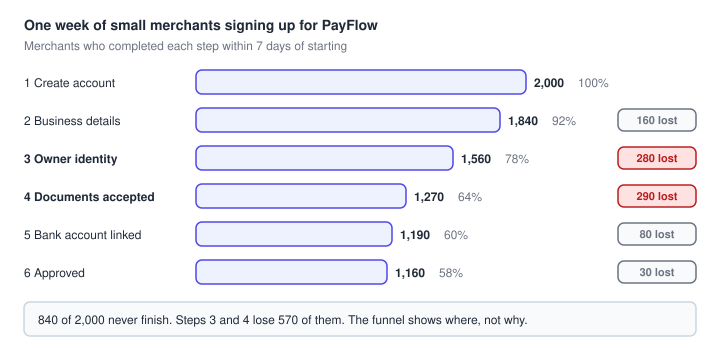

*Figure 0.1 — One weekly cohort of small merchants. A chart like this, counting who reaches each step, is called a funnel.*

### The cast

| Person | Role | What they want |
|---|---|---|
| Aisha Bello | Owner of Bello Braids, a one-chair hair salon | To take a card deposit by Saturday, from her phone |
| Marcus Lee | Co-owner of Tidewater Cycles, a repair shop with two owners | To stop losing customers who carry no cash |
| Rosa Delgado | User researcher at PayFlow | Evidence the team can stand behind |
| Lena Fischer | Product designer | A form people can finish |
| Arjun Mehta | Engineering lead | To build the right thing once |
| Tomás Rivera | Head of growth | More approved merchants, soon |
| Priya Nair | Risk analyst | No rise in fraud |
| Sam Whitfield | Support lead | Fewer "why was my document rejected?" tickets |
| Nadia Rahman | Privacy counsel | Research that handles merchants' data lawfully |
| Elena Marsh | VP of Product | One clear recommendation |

You are the product manager for onboarding.

### The situation this book follows

It is Monday, October 12, 2026. Each week 2,000 small merchants start signing up, and 1,160 of them (58%) are approved within seven days. The other 840 are not. Your team's goal for next quarter is to raise 58% to 62%.

Three people are sure they know how.

- **Tomás** says the form is too long. His bet: let small merchants skip the document step and ask for documents later.
- **Sam** says merchants need a person. His bet: offer every new merchant a setup call.
- **Lena** says the form confuses people and loses their work. Her bet: explain the questions and save progress.

The team can build one of these next quarter. Elena will choose at the planning meeting on Friday, November 20, 2026. You have six weeks to find out who is right.

# Part I — Foundations

## 1. What research is for

### Why it matters

Tomás, Sam, and Lena each have a quarter-sized project and a confident story. If you choose by seniority or volume, you have about one chance in three of spending three months on the right thing.

Teams also fail the other way. They commission a long study "to understand onboarding", receive forty slides, and change nothing, because the study was never aimed at a choice.

### The idea

**User research** is a structured way of learning what the people you build for do, need, and struggle with, so that a decision gets better. **Product discovery** is the wider work of deciding what to build, before and while you build it. Research is its main source of evidence.

Research never gives you certainty. It reduces the uncertainty that matters most, in three moves.

1. **Name the decision.** Who decides, by when, between which options.
2. **Write the decision sentence.** A **decision sentence** has the form "We will do X unless we learn Y." X is what you would do today with no further evidence. Y is the finding that would change your mind.
3. **Find the riskiest assumption.** Every plan rests on beliefs. The **riskiest assumption** is the one that would do the most damage if it were wrong and has the least evidence behind it. That is where research goes first.

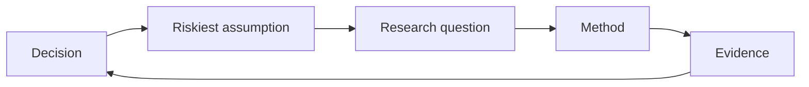

*Figure 1.1 — Research starts from a decision and returns to it. Chapters 2 to 20 fill in the middle.*

Marty Cagan sorts product risk into four kinds: value (will people want it?), usability (can they use it?), feasibility (can we build it?), and business viability (does it work for the business, including law and risk?). User research mostly addresses the first two. Keep the fourth in view, or you will recommend something the company cannot ship.

Research also comes in two modes. **Generative research** finds and explains problems: what is going on, and why? **Evaluative research** judges a solution: does this design work? Using evaluative methods before you understand the problem is how teams polish the wrong thing.

Finally, evidence comes in strengths. From weakest to strongest:

| Rung | Evidence | Example |
|---|---|---|
| 1 | An opinion inside the company | "The form is too long" |
| 2 | What a customer predicts they would do | "I'd use a setup call" |
| 3 | What a customer says they did | "I gave up at the owner page" |
| 4 | What you watched a customer do | Aisha closing the tab |
| 5 | What many customers did, counted | 280 lost at step 3 |
| 6 | What changed when you changed one thing | An experiment |

Higher rungs cost more. Climb only as high as the decision needs. A choice that is cheap to reverse can rest on rung 3; a quarter of engineering deserves rungs 4 and 5.

### Worked example

**The decision.** Which one of three bets gets next quarter. Elena decides on November 20.

**The default.** Tomás's bet. He is the most senior of the three, and his idea is plausible.

**The decision sentence.** "We will spend next quarter shortening the form by deferring the document step, unless we learn that length is not the main reason merchants stop."

Now list what the default depends on.

| Assumption behind "shorten the form" | If it is wrong | Evidence today |
|---|---|---|
| Merchants stop because the form is too long | The quarter is wasted | Rung 1: Tomás's belief |
| PayFlow is allowed to defer documents | The work cannot ship | Unknown; Priya would know |
| Merchants who finish go on to take payments | Completion rises and revenue does not | Rung 5: most do |

The first row combines the highest damage with the weakest evidence, so it is the riskiest assumption and the target of the study. The second row is also dangerous, but a one-hour conversation with Priya settles it. Not every uncertainty needs a study.

### Common mistakes

| Mistake | Why it bites | Do this instead |
|---|---|---|
| Research with no decision attached | Findings are interesting and change nothing | Write the decision sentence; if no result could change the plan, skip the study |
| Researching to confirm a belief | You notice only what agrees with you | Before looking, write down the result that would change your mind |
| Demanding certainty | The study never ends | Match the strength of evidence to how reversible the decision is |

### Check yourself

**Q1.1** Write a decision sentence for a team whose default plan is Sam's bet, setup calls for every new merchant.

**Q1.2** A merchant tells you, "I would definitely finish if the form were shorter." Which rung is that, and what would move it up one rung?

> [!IMPORTANT]
> **In one line:** Research earns its cost only when it can change a named decision, so start from the decision and aim at the assumption most likely to be wrong.

## 2. Choosing a method

### Why it matters

Tomás has a suggestion: "Just survey them. Ask whether they'd finish if the form were shorter." Nearly everyone would tick yes, and you would have a chart that proves nothing.

Every method sees some things and is blind to others. Pick the wrong one and you get a confident answer to a question you did not ask.

### The idea

Two questions sort almost every method. They come from a well-known map of research methods by Christian Rohrer at Nielsen Norman Group.

**Do you need what people say, or what people do?** **Attitudinal data** is what people report: opinions, reasons, memories, intentions. **Behavioral data** is what they actually did, whether you watched it or a system logged it. The two often disagree, and the difference is called the **say-do gap**. When they disagree about behavior, believe the behavior.

**Do you need depth, or a count?** **Qualitative research** studies a few people closely and answers "why" and "how". **Quantitative research** counts many people and answers "how many" and "how much".

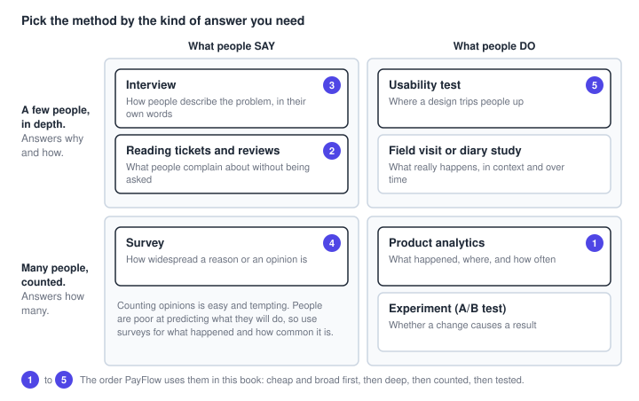

*Figure 2.1 — Where each method sits. No method covers more than one box well.*

**Method fit** means the method can produce the kind of answer the question needs. This table is the one to memorize.

| The question you have | Method | What it cannot tell you |
|---|---|---|
| Where do people drop out, and how many? | Product analytics | Why |
| What do people complain about, unasked? | Tickets, reviews, sales notes | Anything about people who stay silent |
| Why did they do that? How do they think about it? | Interviews | How common it is |
| What really happens in their setting, over days? | Field visit, diary study | Rare events |
| Can people use this design? | Usability test | Whether they want it |
| How common is this reason or opinion? | Survey | Why, and what people will do |
| Does this change cause that result? | Experiment | Why, and anything unmeasured |

Three rules help you choose.

1. **Start with what already exists.** Analytics and support tickets cost an afternoon.
2. **Go deep before you count.** A survey can only count the answers you thought to list. If you do not yet know the possible reasons, interview first.
3. **Count when size decides.** If the choice depends on how many people have a problem, twelve interviews cannot tell you.

### Worked example

Chapter 1 gave you the riskiest assumption: merchants stop because the form is too long. The research question has two halves. "Why do merchants stop?" needs depth. "How common is each reason?" needs a count. No single method does both, so you plan a sequence. The numbers match Figure 2.1.

| Order | Method | What you expect from it |
|---|---|---|
| 1 | Funnel analytics | Where people stop, by step |
| 2 | Read 60 onboarding tickets | First suspects, in customers' words |
| 3 | 12 interviews | The reasons, as stories |
| 4 | Survey of merchants who stopped | How common each reason is |
| 5 | Usability test of a prototype | Whether the fix can be used |

Why not Tomás's survey first? Two reasons. It asks people to predict their own behavior, which is rung 2 evidence. And you cannot write good answer options yet, because you do not know the reasons.

Why not an experiment first? You would have to build something to test, and you do not yet know what. The experiment comes last, to measure a fix the cheaper methods have pointed to.

### Common mistakes

| Mistake | Why it bites | Do this instead |
|---|---|---|
| Choosing the method first | The results cannot change the decision | Write the question, then find the box in Figure 2.1 |
| Asking people to predict themselves | Polite guesses look like data | Ask what they did last time, or watch |
| Discovering with a survey | You count only the reasons you guessed | Interview first, then turn what you heard into options |

### Check yourself

**Q2.1** Support says "merchants hate uploading documents". Is that attitudinal or behavioral data, and which method would show what merchants actually do at that step?

**Q2.2** You want to know whether a new rejection message makes more merchants fix their upload. Which method fits, and why not interviews?

> [!IMPORTANT]
> **In one line:** Decide whether you need what people say or do, and depth or a count, and the method follows.

## 3. The research plan

### Why it matters

Unplanned research drifts. Interviews multiply, nobody knows when to stop, and the findings arrive a week after the decision. There is a second cost. When the result is unwelcome, someone says "you talked to the wrong people" or "that question was biased", and it is too late to fix.

A one-page plan, shared before anyone is recruited, collects those objections while they are still cheap.

### The idea

A **research plan** is one page that says what you will learn, how, from whom, by when, and what each possible result will lead to. Three parts of it do most of the work.

**Research questions.** A **research question** is what the team wants to learn, such as "Why do merchants stop at the owner step?" It is not what you say to a participant. Ask a merchant your research question and you get a theory. Ask "Tell me about the day you started signing up" and you get a story that contains the answer. Chapter 7 covers the difference.

**"If we learn" rows.** Before any data comes in, write what you will do for each plausible result. If every result leads to the same action, the study is not worth running.

**A stopping rule.** A **stopping rule** says in advance when collection ends: a number of sessions, a date, or a point where nothing new is appearing. It protects you from two temptations. One is "just one more interview". The other is stopping the moment you hear what you hoped for.

Then do the step most teams skip. Show the plan to the people whose ideas are at stake and ask one question: "What result would you not believe, and why?" Change the plan until they would believe it.

Plan backward from the decision date. Evidence that arrives after the meeting has no effect on it.

### Worked example

Here is the plan you and Rosa write on October 12.

| Field | PayFlow onboarding study |
|---|---|
| Decision | Which one of three bets gets next quarter. Elena decides Nov 20. |
| Decision sentence | We will shorten the form by deferring documents, unless we learn that length is not the main reason merchants stop. |
| Research questions | 1. Where do merchants stop? 2. Why, in their own words? 3. How common is each reason? 4. Can people use a fix for the top reason? |
| Methods and dates | Funnel and 60 tickets, week of Oct 12. Twelve interviews, Oct 19-30. Survey, Nov 2-9. Prototype test with five people, Nov 11-12. |
| Participants | Small merchants who started in the last 14 days: 8 who stopped, 4 who finished |
| If we learn | Length leads: shorten the form. Another reason leads: the bet that addresses it. No clear leader: ship the smallest fix and run a second round. |
| Stopping rule | Twelve interviews, plus two more if either of the last two adds a new reason. Survey closes Nov 9. |
| Consent and data | Nadia reviews the script. Recordings deleted after 12 months. |
| Readout | Draft to stakeholders Nov 18. Decision Nov 20. |

Then you take it to the three people with a stake.

Tomás objects at once: "You'll only hear from people who like to complain." He has a point. You add the four finishers to the interviews and make the survey a random draw from everyone who stopped, not an open link.

Priya adds a question of her own: how do merchants feel when asked for an identity document? She also answers one of Chapter 1's assumptions on the spot. Identity checks cannot be deferred. Some supporting documents can.

Sam offers his team's ticket tags. That becomes the ticket review in week one.

None of the three has seen a finding yet, and all three have shaped the study. That makes it much harder for any of them to dismiss it later.

### Common mistakes

| Mistake | Why it bites | Do this instead |
|---|---|---|
| Writing the plan after the sessions | It describes what happened, not what you meant to learn | One page before recruiting starts |
| Asking participants the research question | You collect opinions about causes | Translate each research question into prompts about past events |
| No stopping rule | The study ends when patience does, or when you like the answer | Fix a number or a date in advance |

### Check yourself

**Q3.1** What is the difference between a research question and an interview question? Give one of each for the document step.

**Q3.2** Your "if we learn" rows all end in "build the guided form". What does that tell you?

> [!IMPORTANT]
> **In one line:** Put the decision, the questions, the people, the dates, and what each result would lead to on one page, and get skeptics to agree to it before you start.

## 4. Sampling and recruiting participants

### Why it matters

The answer you get depends on who you ask. Interview twelve loyal merchants about sign-up and they will tell you it was fine, because they signed up years ago and have forgotten. Email everyone and talk to whoever replies, and you hear from the conscientious.

Most research that goes wrong does so here: the questions were fine and the people were not the right ones.

### The idea

**Sampling** is choosing which people will stand in for the whole group you care about. What "good" means depends on your goal.

- To count (surveys), you want a small copy of the population, so that percentages carry over. That needs a **sampling frame**, the actual list you draw from, and a random draw. Chapter 11 covers this.
- To understand (interviews, usability tests), you want range. A **purposive sample** is chosen on purpose to include people who differ in ways likely to matter, with a quota for each kind.

A **convenience sample** is whoever is easiest to reach: colleagues, friendly customers, volunteers. It is fine for rehearsing a session and risky for drawing conclusions.

A **screener** is a short questionnaire that decides who qualifies. Figure 4.1 shows the one Rosa uses.

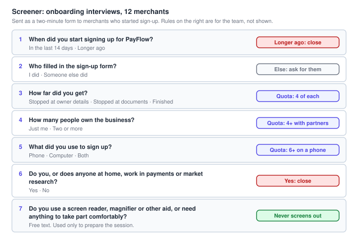

*Figure 4.1 — A screener asks about recent behavior and hides what qualifies.*

Four rules for screeners:

- Ask about behavior and dates. "When did you start?" beats "Are you a new merchant?"
- Hide the wanted answer. "Did you struggle with sign-up?" invites a yes for the gift card.
- Screen out insiders.
- Never screen out on disability. Ask what people need so you can prepare (Chapter 6).

**How many people?** For finding problems, a model by Jakob Nielsen and Thomas Landauer helps. If each participant has a chance *L* of running into a given problem, then *n* participants reveal it at least once with probability 1 − (1 − L)^n. Across the projects they studied, *L* averaged 31%. Here is what happens when a problem is rarer.

```python
for L in RATES:
    seen = "".join(f"{pct(1 - (1 - L) ** n):>8}" for n in SIZES)
    needed = math.ceil(math.log(1 - 0.85) / math.log(1 - L))
    print(f"{L:>16.0%}   {seen}   {needed:>12}")
```

Output:

```text
chance one person      seen at least once by n people     n needed
hits the problem          5      10      15      20        for 85%
             31%        84%     98%    >99%    >99%              6
             10%        41%     65%     79%     88%             19
              5%        23%     40%     54%     64%             37
```

Five people are enough for problems that most people hit. A problem that one person in ten hits will be missed more often than seen. So recruit five *per distinct group*, and when a group is rare, recruit it deliberately with a quota.

For interviews, the usual guide is **saturation**: the point where new sessions stop producing new themes. In one widely cited study of 60 interviews, Guest, Bunce, and Johnson (2006) found that most themes had appeared by the twelfth. Treat twelve as a planning number for one kind of participant. A varied group needs more.

An incentive is what you give participants for their time. Pay it whatever they say, and book a couple of extra people, because some will not turn up.

### Worked example

The population is small merchants who start sign-up. The frame is the product database of merchants who started in the last 14 days. Fourteen days is a choice: after two weeks people remember a tidied-up version of events.

| Quota | Target |
|---|---|
| Stopped at owner details | 4 |
| Stopped at documents | 4 |
| Finished | 4 |
| More than one owner | At least 4 |
| Signed up on a phone | At least 6 |

The first two rows cover the big losses in Figure 0.1. Finishers show what went right.

Rosa emails 400 merchants from the frame. Sixty-one complete the screener, 14 are booked, and 12 take part. Each gets a $75 gift card for 30 minutes.

Maya Okafor, who owns Juniper Bakery and has used PayFlow for three years, offers to help. The screener closes at question 1. She is the friendly, available customer a convenience sample is made of, and she cannot remember her sign-up.

One thing goes in the report later: 339 of the 400 never answered. The twelve are people who open email from PayFlow.

### Common mistakes

| Mistake | Why it bites | Do this instead |
|---|---|---|
| Recruiting whoever is easy | Colleagues and fans do not behave like new users | Write quotas, then recruit to fill them |
| "Five users" spread across different groups | One or two per group finds little | Five per group that behaves differently |
| Only current, happy customers | You never meet the people who left | Recruit people who stopped, complained, or switched |

### Check yourself

**Q4.1** Why can't the twelve interviewees tell you what share of all merchants lose their progress?

**Q4.2** A problem affects one participant in ten. Using the output above, how likely are five participants to show it, and what would you do about that?

> [!IMPORTANT]
> **In one line:** Decide who must be in the room before you invite anyone, recruit on recent behavior, and say plainly who you did not reach.

## 5. Research ethics, consent, and privacy

### Why it matters

A research participant is doing you a favor, and you hold power over them. PayFlow decides whether Aisha gets an account. If she believes the interview affects her application, she will say what she thinks you want to hear. That is unfair to her and it ruins your data.

There is also the recording. A video of a business owner describing her finances is personal data. Mishandle it and you break her trust, and possibly the law.

### The idea

Three principles from the Belmont Report, a 1979 United States statement on research with people, give the best short summary. Respect people's right to choose freely. Do no harm. Share burdens and benefits fairly, so that you do not study only whoever is convenient. Company research usually falls outside the US regulations that grew from that report, but the principles still apply.

**Informed consent** means a person agrees to take part knowing what will happen, what you will collect, how you will use it, and that they can refuse or stop without penalty. Good consent is:

- **Plain.** Spoken or written in everyday words.
- **Voluntary.** Unconnected to their service, account, or price.
- **Specific.** Recording gets its own yes. So does showing a clip outside the team.
- **Revocable.** They can withdraw later, and it is easy to do.
- **Recorded.** You can show that they agreed.

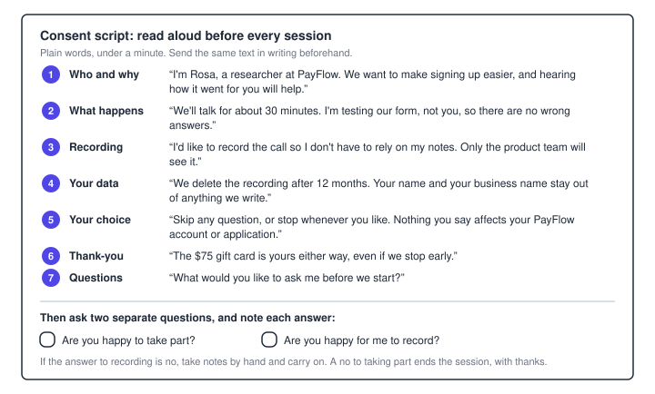

*Figure 5.1 — The script Rosa reads before each session. Taking part and being recorded are two separate questions.*

**Personal data** is any information about an identifiable person: a name, a face, a voice, an email address, a transcript, even a quote specific enough to point at someone. Four habits protect it.

- **Data minimization.** Collect only what the study needs.
- **Purpose limits.** Research data is for research. It never goes to sales or to risk review.
- **A retention period.** The **retention period** is how long you keep the data before deleting it. Set it before you collect.
- **Pseudonyms.** To **pseudonymize** is to replace names with codes such as P1 and keep the key somewhere separate.

Two laws come up most often. This is orientation, not legal advice.

| Law | What matters for research |
|---|---|
| EU General Data Protection Regulation (GDPR), applied since May 25, 2018 | You need a lawful basis to process personal data; consent is one of six. Consent must be freely given, specific, informed, and unambiguous. You must be able to prove it, and withdrawing must be as easy as giving it. At collection, say who you are, why you want the data, and how long you keep it. Health data needs more, such as explicit consent. |
| California Consumer Privacy Act (CCPA), in effect since 2020, amended by the CPRA from 2023 | Give notice at or before collection: what, why, kept how long. People can ask to know, correct, and delete their data. Since 2023 it also covers people acting for a business, such as a merchant's owner. |

On recording calls, United States federal law allows it with one party's consent, but about a dozen states, California among them, require everyone's. Ask every time.

If a transcription or AI service handles recordings for you, GDPR treats that vendor as a processor, and you need a written contract with it. Chapter 24 returns to this.

### Worked example

Nadia reviews the study before the first invitation goes out. She changes three things.

1. **The recording line.** The draft said, "This call may be recorded for quality purposes." That is a notice, and a participant cannot say no to a notice. It becomes line 3 of Figure 5.1 plus a separate question.
2. **Sam's offer.** Sam wanted to join the calls and fix each application on the spot. Nadia says no. A merchant who is being helped toward approval cannot freely decline to answer. Research and service stay apart. After each session Rosa gives the participant a link to support.
3. **Lena's clip.** Lena wants to play a minute of Aisha's interview at the company meeting. The consent said "only the product team". Rosa must ask Aisha again, or Lena reads an anonymous quote.

The data plan fits in four lines.

| Item | Rule |
|---|---|
| Recordings and transcripts | Stored in the research drive; Rosa, you, and Lena only |
| Names | Replaced by P1 to P12; the key is held by Rosa |
| Deletion | Recordings deleted by October 30, 2027 |
| Wall with risk | Priya's reviewers cannot see who took part, or anything said |

### Common mistakes

| Mistake | Why it bites | Do this instead |
|---|---|---|
| Consent buried in terms of service | Nobody read it, so nobody agreed | A short spoken script and a direct question |
| Research that doubles as sales or support | People cannot say no freely, and answers bend | Keep them separate; hand off afterward |
| Keeping recordings forever | Risk grows and nobody remembers what was agreed | Set a deletion date and keep to it |

### Check yourself

**Q5.1** Name four things a participant must be told for their consent to be informed.

**Q5.2** Ten minutes into a session, a merchant says she would like to stop. What happens to her gift card, and to what she has already told you?

> [!IMPORTANT]
> **In one line:** Tell people the truth in plain words, let them say no at any point without cost, and treat what they give you as borrowed.

## 6. Inclusive and accessibility research

### Why it matters

If every participant is a fluent English speaker with good eyesight, a new phone, and a quiet room, you will design for that person. Everyone else fails quietly. They show up in Figure 0.1 as "lost", with no reason attached.

Automated checkers will not rescue you. When the UK Government Digital Service ran ten accessibility tools against a page seeded with 143 known barriers, the tools together found 71% of them, and the best single tool found about 40%. Finding the rest takes people.

### The idea

**Accessibility** is the degree to which people with disabilities can perceive, operate, and understand a product. **Assistive technology** is the equipment and software people use to do so, such as a screen reader (which speaks the screen aloud), a magnifier, voice control, or a switch.

**Inclusive research** means deliberately including people whose abilities, language, devices, or circumstances differ from the team's. People are left out at three points.

| Where | How people get excluded | The fix |
|---|---|---|
| Recruiting | The sign-up form does not work with a screen reader; sessions require a laptop and video | Recruit through disability organizations or specialist recruiters; set a quota; offer choices |
| The session | The prototype cannot be read by assistive technology; thirty minutes is too short | Test a coded version on the person's own device; allow more time |
| Analysis | The finding is filed as an "edge case" | Record a blocked task as a barrier, at top severity |

Five practices carry most of the weight.

1. **Ask everyone what they need.** An **accommodation** is a change that lets a person take part: more time, a different call tool, a sign language interpreter, a break. Ask in the screener and never use the answer to exclude.
2. **Use their own setup.** People configure assistive technology in personal ways. Their phone, with their settings, is the thing you are testing.
3. **Test something real.** Many design-tool prototypes are pictures that a screen reader cannot read. Use a coded prototype or the live product.
4. **Separate barriers from friction.** A barrier means the person cannot do the task at all. Friction means they can, with extra effort. Report them differently.
5. **Pair sessions with a standards check.** Sessions show what stops real people. A review against the Web Content Accessibility Guidelines (WCAG 2.2) catches what a handful of sessions will miss. You need both, and W3C's own guidance says so.

Inclusion is wider than disability. It covers people whose first language is not English, and people on old phones or slow connections. Many limits are situational: a hairdresser holding a phone between clients has, for that minute, one usable hand and little attention.

One caution from Chapter 5: what someone tells you about a disability is health information. Ask only for what the session needs, and get explicit consent to record it.

### Worked example

Rosa reserves places before recruiting starts.

| Study | Reserved places | Who took them |
|---|---|---|
| 12 interviews | 2 | Two owners whose first language is Spanish |
| 5-person prototype test | 2 | An owner who is blind and uses a screen reader on his phone; an owner with low vision who zooms to 200% |

Because of the prototype test, Lena and Arjun build the prototype in code, not in a design tool. That costs two extra days.

It pays for itself in three findings.

- **The upload control has no name.** The screen reader announces "button" and nothing else. The participant cannot upload his license and cannot finish. That is a barrier. In the funnel, a merchant like him is one more person "lost at step 4".
- **At 200% zoom the Continue button slides under a fixed footer.** The participant finds it after a minute of scrolling. That is friction.
- **A phone's translator turns "beneficial owner" into nonsense in Spanish.** One interviewee read the result aloud and laughed. English speakers were confused by the same phrase (Chapter 15). Plain words would help both.

The third finding shows a pattern you will meet often. The person at the edge hit the same problem as everyone else and hit it harder, which made it impossible to miss.

### Common mistakes

| Mistake | Why it bites | Do this instead |
|---|---|---|
| "Accessibility comes later" | Barriers get built in and cost more to remove | Reserve places in every study from the start |
| Trusting an automated scan | Tools miss a large share of real barriers | Scan, then review by hand, then test with people |
| A prototype assistive technology cannot read | The session is wasted and the participant's time with it | Check the prototype with a screen reader the day before |

### Check yourself

**Q6.1** What is the difference between a barrier and friction? Give one example of each from this chapter.

**Q6.2** Your screener asks, "Do you have a disability? (Yes ends the survey.)" Name two things wrong with it.

> [!IMPORTANT]
> **In one line:** Reserve places for people the team does not resemble, test something their own tools can read, and treat what stops them as a finding about the product, not about them.

# Part II — Watching and talking

## 7. Interviews and the interview guide

### Why it matters

An interview feels like a conversation, so everyone assumes they can run one. Then they ask "Was the form confusing?" and "Would you use a shorter one?", collect two polite yeses, and report that customers want a shorter form.

A bad interview misleads, because it produces confident quotes that support whatever the interviewer already believed.

### The idea

An **interview guide** is a one-page plan for a conversation: the goal, a handful of open prompts in order, follow-ups, and timings. You use it as a map and do not read it out as a script. Figure 7.1 shows Rosa's.

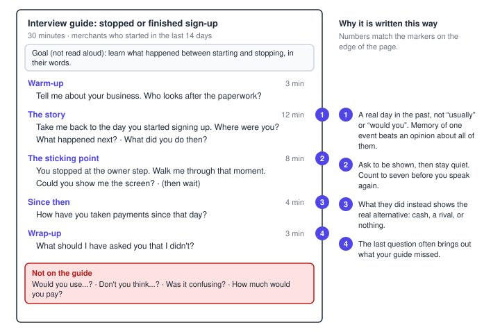

*Figure 7.1 — A guide is mostly five prompts and the discipline not to add the ones in the red box.*

The first minutes build **rapport**, the ease that lets someone speak honestly to a stranger. After that, five rules do most of the work.

1. **Ask about the last time.** "Tell me about the day you started signing up" gets a memory. "How do you usually handle paperwork?" gets a self-portrait. "Would you use a setup call?" gets a guess. Rob Fitzpatrick's short book *The Mom Test* is built on this point: ask about people's lives and about specifics in the past, not for opinions about your idea.
2. **Do not lead.** A **leading question** carries its own answer. "Was the owner page confusing?" tells the person what you expect. Ask "What happened when you got to that page?"
3. **Probe.** A **probe** is a neutral follow-up that digs deeper: "What happened next?" "What do you mean by 'sketchy'?" "Could you show me?" Repeating the person's last few words as a question also works.
4. **Be quiet.** After an answer, count to seven. People fill a silence, and what comes out is often the real answer.
5. **Do not sell, explain, or defend.** If they ask "Can it do X?", say "What would you want that for?"

While you listen, note workarounds, sighs and laughs, anything that surprises you, and the person's own words. Merchants say "sign-up" and "the owner page". Nobody outside PayFlow says "onboarding" or "KYB".

Work in pairs when you can. One person leads and the other takes notes: what was said and done, as close to word for word as possible, with interpretations in a separate column. Straight afterward, spend ten minutes writing down each person's three strongest observations.

### Worked example

Your first session, before Rosa coaches you, goes like this.

- You: "Was the owner page confusing?"
- Aisha: "A little, I guess."
- You: "Would it help if the form were shorter?"
- Aisha: "Sure. Shorter is always better."

You now have a quote that supports Tomás and tells you nothing. The first question led. The second asked for a prediction.

Rosa runs the next one, with the guide.

- Rosa: "Take me back to the day you started signing up. Where were you?"
- Aisha: "At the salon, between two clients. A bride wanted to pay her deposit by card on Saturday."
- Rosa: "What happened next?"
- Aisha: "It asked for my tax ID. That's in a drawer at home. So I closed it."
- Rosa says nothing.
- Aisha: "I went back that night and it had logged me out. Everything was blank. I typed it all again. Then it asked about 'beneficial owners'. I'm just the owner. I didn't know if that meant me."
- Rosa: "What did you do then?"
- Aisha: "I took the deposit in cash."

In two minutes, without being asked a single question about the form's length, Aisha has given you five observations:

- She started with a deadline, on a phone, at work.
- She left to fetch something she did not have with her.
- Her progress was gone when she returned.
- She did not know what a term meant.
- She went back to cash.

She never said the form was long.

### Common mistakes

| Mistake | Why it bites | Do this instead |
|---|---|---|
| Leading or hypothetical questions | You hear your own belief repeated back | Ask what happened, last time |
| Filling every silence | You cut off the real answer | Count to seven |
| Interviewing alone with no notes | You remember what agreed with you | Bring a note-taker and debrief at once |

### Check yourself

**Q7.1** Rewrite this so it neither leads nor asks for a prediction: "Don't you think the upload step is annoying?"

**Q7.2** A participant says, "I'd definitely use a setup call." What do you ask next?

> [!IMPORTANT]
> **In one line:** Ask for the story of the last time it happened, follow it with neutral probes, and let silence do the rest.

## 8. Rapid prototyping

### Why it matters

Arjun estimates six weeks to build save-and-resume properly. If the idea is wrong, you find out in week seven. With a prototype you find out in about three days.

There is a quieter benefit. A team that can try an idea cheaply can try three, and the first idea is rarely the best one.

### The idea

A **prototype** is a cheap, disposable version of an idea, made to answer one question. Rapid prototyping is the habit of making several quickly, testing them, and throwing most away.

Two things, written before you build, keep a prototype from turning into a demo:

- A **hypothesis**: a specific belief that could turn out false. "If merchants see a list of what they will need before starting, more of them will have it ready."
- A **success criterion**: what you would need to observe to keep going. "At least 4 of 5 participants can say, unprompted, what they need to fetch."

**Fidelity** is how close a prototype is to the real thing. It is really four separate dials: how it looks, how real the words are, how much you can interact with it, and how real the data is. Turn up only the dials your question needs.

| Your question | Turn up | Build | Time |
|---|---|---|---|
| Is this the right sequence of steps? | Nothing | Sketches on paper | An hour |
| Do people understand these words? | Words | Plain clickable screens with final text | A day |
| Can people get through the flow? | Words, interaction | Linked screens | Two days |
| Does it work with a screen reader, a slow phone, real data? | All four | Coded prototype | Days |
| Will people do this in real life? | — | Not a prototype: a validation test (Chapter 21) | — |

Four working rules:

1. **Prototype the risky part.** You do not need the whole product, only the piece your hypothesis is about.
2. **Make two or three alternatives.** People compare more reliably than they judge one thing alone.
3. **Say it is rough.** Participants are more honest about something that looks unfinished.
4. **Write down what you learned.** One line each: we believed, we saw, so we will.

AI tools can now turn a description into a clickable prototype in minutes. That lowers the cost of building, but it does not write the hypothesis, and the result looks finished. Polished prototypes attract comments about polish, and executives who see one tend to hear a promise.

### Worked example

Jump ahead to November 4. The interviews are done, and the leading problem is that merchants leave the form to fetch something and never get back (Chapter 15). Lena sketches three responses and has all three clickable in two days.

| Prototype | Hypothesis | Criterion, with 5 people | Dials turned up |
|---|---|---|---|
| A. "What you'll need" list before step 1 | Merchants will gather their items before they start | At least 4 can name what to fetch | Words |
| B. Save and resume, with an emailed link | Merchants who leave can find their way back | At least 4 resume at the right step | Words, interaction |
| C. "Skip for now" on the document step | Merchants understand that skipping delays approval | At least 4 can say what happens next | Words |

You try them with five merchants over two afternoons, in quick informal sessions ahead of the formal test in Chapter 9.

| Prototype | Result | We believed, we saw, so we will |
|---|---|---|
| A | 5 of 5 | We believed a list would help. All five named the tax ID and the license. Keep it. |
| B | 4 of 5 | We believed a link would bring people back. Four used it; one expected to log in from the home page. Keep it, and test the email more carefully. |
| C | 2 of 5 | We believed "skip for now" would be understood. Three thought the document was now optional. Drop it. |

Prototype C matters most. It was the closest thing to Tomás's bet, and it failed in two afternoons at almost no cost. Three merchants would have believed they were finished. Priya did not have to argue against the idea, because the test did.

A and B go forward together as one coded prototype.

### Common mistakes

| Mistake | Why it bites | Do this instead |
|---|---|---|
| High fidelity too early | People comment on colors, and the team gets attached | Lowest fidelity that answers the question |
| No hypothesis | "Let's see what they think" yields opinions | Write the belief and the criterion first |
| One idea only | You learn whether it is acceptable, not whether it is best | Two or three alternatives |

### Check yourself

**Q8.1** You want to know whether merchants understand a new explanation of "beneficial owner". Which fidelity dials do you turn up?

**Q8.2** Write a hypothesis and a success criterion for a prototype of a reminder text message.

> [!IMPORTANT]
> **In one line:** Build the cheapest thing that can prove your belief wrong, decide in advance what "wrong" looks like, and expect to throw most prototypes away.

## 9. Usability tests

### Why it matters

You and Lena now believe in the "prepare and resume" prototype, and have looked at it too often to see what is wrong with it. Watching five strangers use it is the cheapest cure.

Reporting what you saw is where teams lose credibility. "60% of users failed", from a five-person test, invites the first skeptic to discard the whole study.

### The idea

In a **usability test** you watch people from the real user group attempt realistic tasks on a design while you stay out of the way. It answers "can they use it?" and says nothing about whether they want it.

Give each participant a situation and a goal in their own words, with an ending you can check.

For each task, record four things.

| Measure | What it is |
|---|---|
| **Task success** | Did they finish without help? Record success, success with difficulty, or failure. |
| **Critical error** | A mistake that makes the outcome wrong and that the person does not notice |
| Time on task | Seconds from start to finish. Compare designs with the median. |
| Recovery | After a slip, could they get back on track by themselves? |

Then rate each problem's **severity** on Jakob Nielsen's scale from 0 (not a problem) to 4 (catastrophe, fix before release), weighing how many people hit it, how much it hurts, and whether it recurs. On a money product, a critical error outranks a common hesitation.

**Report counts.** Here is why "3 of 5" must never become "60%". The adjusted Wald interval, from Agresti and Coull (1998), is the usual way to put a range on a success rate from a small sample.

```python
def adjusted_wald(successes, n, z=Z):
    n_adj = n + z * z
    p_adj = (successes + z * z / 2) / n_adj
    half = z * (p_adj * (1 - p_adj) / n_adj) ** 0.5
    return max(0.0, p_adj - half), min(1.0, p_adj + half)
```

Output:

```text
observed        95% interval for the true success rate
  5 of 5         51% to 100%
  4 of 5         36% to 98%
  3 of 5         23% to 88%
  2 of 5         12% to 77%
 12 of 20        39% to 78%
 60 of 100       50% to 69%
```

With five people, three successes are consistent with a true rate anywhere from about a quarter to nearly nine in ten. A small test tells you that a problem exists and how it happens. It cannot tell you how common the problem is.

**One standard score.** The **System Usability Scale (SUS)** was created by John Brooke at Digital Equipment Corporation in 1986. After the session, the participant rates ten statements from 1 (strongly disagree) to 5 (strongly agree). Odd-numbered statements are positive (easy, well integrated, quick to learn). Even-numbered ones are negative (complex, inconsistent, awkward). Brooke's paper has the exact wording.

To score it, subtract 1 from each odd-numbered answer, subtract each even-numbered answer from 5, add the ten results, and multiply by 2.5. The result runs from 0 to 100 and is not a percentage. SUS measures how usable the thing *felt* overall. It does not tell you what is wrong. As a rough yardstick, Jeff Sauro's review of about 500 studies puts the average score at 68.

### Worked example

On November 11 and 12 Rosa runs five sessions on the coded prototype.

| Task | Unaided success | What happened |
|---|---|---|
| 1. "You want to take cards by Saturday. Start signing up, and stop when you would need to fetch something." | 5 of 5 | Everyone read the list first and named the tax ID and license |
| 2. "It is evening and you have your documents. Carry on." | 4 of 5 | One looked for a log-in button and never opened the email |
| 3. "Upload your business license." | 3 of 5 | The screen reader user could not find the control. Another participant uploaded a driver's license, the prototype accepted it, and she believed she was done. |

| Finding | Seen in | Impact | Rating |
|---|---|---|---|
| Upload control has no name for screen readers | 1 of 5 | Cannot finish at all | 4 |
| A personal ID is accepted in place of a business license | 1 of 5 | Critical error: the application stalls without the merchant knowing | 4 |
| Resuming depends on finding one email | 1 of 5 | Delay | 2 |

Both top findings were seen once. Frequency alone would have buried them.

Rosa also collects SUS and scores each participant's ten answers with this function.

```python
def sus_score(answers):
    assert len(answers) == 10 and all(1 <= a <= 5 for a in answers)
    odd = sum(a - 1 for a in answers[0::2])    # statements 1, 3, 5, 7, 9
    even = sum(5 - a for a in answers[1::2])   # statements 2, 4, 6, 8, 10
    return (odd + even) * 2.5                  # 0 to 100, not a percentage
```

Output:

```text
P1:  77.5
P2:  55.0
P3:  87.5
P4:  40.0
P5:  70.0
mean 66.0, standard deviation 18.8, n = 5
95% interval for the mean: 43 to 89
```

The mean of 66.0 looks close to average. The interval, 43 to 89, says five scores cannot place it. Look at the individual scores instead. P4, at 40, is the participant who could not upload. An average would have hidden the one person the design shut out completely.

### Common mistakes

| Mistake | Why it bites | Do this instead |
|---|---|---|
| Helping a struggling participant | You erase the finding | Stay quiet, or ask "What are you looking for?" |
| Percentages from five people | False precision; one skeptic sinks the report | Counts, plus severity |
| Quoting a mean SUS from a handful | The interval is too wide to mean anything | Show individual scores, or wait for dozens |

### Check yourself

**Q9.1** A participant answers the ten SUS statements 5, 1, 5, 2, 4, 1, 5, 1, 4, 2. What is the score?

**Q9.2** A colleague writes, "4 of 5 succeeded, so 80% of merchants will." Using the output above, what would you say?

**Q9.3** What makes an error a *critical* error? Give the example from this chapter.

> [!IMPORTANT]
> **In one line:** Watch five real users attempt real tasks, report counts and severity, and never let a small sample borrow the authority of a percentage.

## 10. User flows, friction, and the UX audit

### Why it matters

Each sign-up screen, reviewed alone, looks fine. The failures live between screens: a session that expires while the merchant looks for a document, an error state nobody designed. Screen-by-screen review never finds them.

You can find many of these yourself, before recruiting anyone, if you walk the flow methodically.

### The idea

A **user flow** is the path a person takes through a product to reach a goal, drawn as steps, decisions, and branches. Draw it from the live product, not from the specification, and include the unhappy branches: errors, waits, exits, and returns.

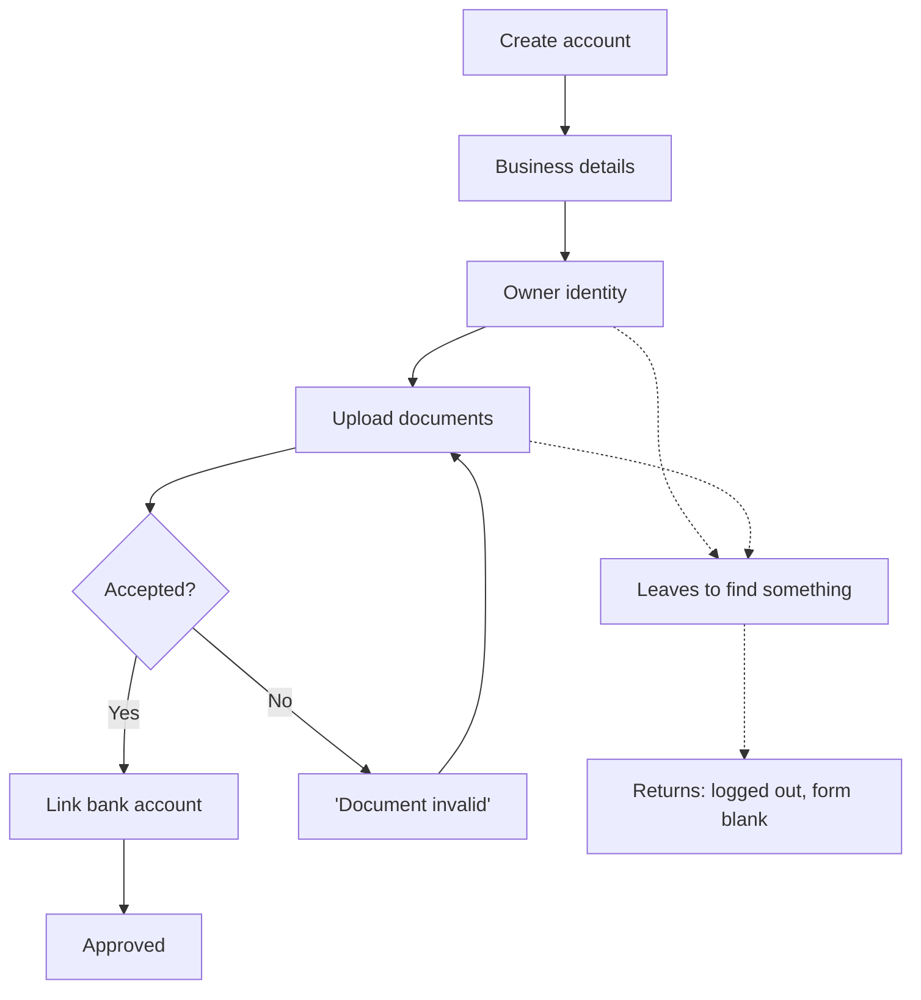

*Figure 10.1 — The sign-up flow as it really is. The dotted branch was in nobody's specification.*

**Friction** is anything that makes a step cost more effort, time, thought, or worry than it has to. Friction is not always bad. Sort it into three kinds before you remove any.

| Kind | Example | What to do |
|---|---|---|
| Necessary | Verifying the owner's identity | Keep it and explain it |
| Misplaced | Asking for a bank statement before saying why | Move it, or ask only when it is needed |
| Accidental | Losing typed answers after 15 idle minutes | Remove it |

A **funnel** counts how many people reach each step, which shows where friction costs you most. A **friction log** records what the friction is: you walk the flow as a new user and write down every hesitation, with the step, what happened, and how bad it is.

A **UX audit** is a structured expert review of an existing flow against known principles, done without users. Its core technique is **heuristic evaluation**, developed by Jakob Nielsen and Rolf Molich in 1990: several people independently check the design against a list of usability principles, then merge their findings. Nielsen's advice is three to five evaluators, because each one misses things the others catch. A full audit adds accessibility checks, a plain-language review, and a run on a mid-range phone.

An audit is cheap and fast, and it clears obvious problems so that user sessions are not wasted on them. Know its limits. It predicts problems; it does not prove users have them. And it cannot find what depends on the user's life. No audit would have told you that Aisha's tax ID was in a drawer.

### Worked example

First, where. The funnel from Figure 0.1 is ten lines of code.

```python
    previous = started
    for name, reached in STEPS:
        lost = previous - reached
        share = f"{lost / total_lost:.0%}" if lost else ""
        row = (f"{name:<24}{reached:>8,}{reached / started:>10.0%}"
               f"{(lost if lost else ''):>11}{share:>11}")
        print(row.rstrip())
        previous = reached
```

Output:

```text
step                     reached  of start  lost here  of losses
1 Create account           2,000      100%
2 Business details         1,840       92%        160        19%
3 Owner identity           1,560       78%        280        33%
4 Documents accepted       1,270       64%        290        35%
5 Bank account linked      1,190       60%         80        10%
6 Approved                 1,160       58%         30         4%

lost in total: 840 of 2,000 (42%)
```

Steps 3 and 4 account for 570 of the 840 merchants lost. That is where you look.

Second, what. On October 13 you, Lena, and Rosa each walk the live flow on a mid-range phone, separately, then merge your logs.

| Step | Finding | Principle broken | Rating |
|---|---|---|---|
| Any | After 15 idle minutes the session ends and typed answers are discarded, with no warning | User control; error prevention | 4 |
| 2 | "Entity type" offers nine legal forms and no explanation | Match with the real world | 3 |
| 3 | "Beneficial owner" is not explained | Match with the real world | 3 |
| 4 | A rejected upload says only "Document invalid" | Help users recover from errors | 3 |
| 4 | The upload control has no name for screen readers | Accessibility barrier | 4 |

The audit took one afternoon and produced five suspects. It could not say which of them explains 570 lost merchants. That is the interviews' job.

The last row should look familiar. It is the barrier that stopped a participant in Chapter 9, four weeks later. The audit had found it. Nobody had been named to fix it, so it was still there.

### Common mistakes

| Mistake | Why it bites | Do this instead |
|---|---|---|
| Drawing only the happy path | The losses are on the branches | Add every error, wait, exit, and return |
| "Remove all friction" | Necessary checks go, and fraud arrives | Sort friction into necessary, misplaced, accidental |
| Findings with no owner | The same problem is found again next month | Every finding gets a name and a date |

### Check yourself

**Q10.1** Classify each as necessary, misplaced, or accidental friction: (a) confirming the bank account with two small deposits; (b) retyping an address after a timeout; (c) asking for the owner's home address on the first screen.

**Q10.2** Name one finding in this book that no UX audit could have produced, and say why.

> [!IMPORTANT]
> **In one line:** Draw the flow with its unhappy branches, count where people fall out, walk it yourself to list suspects, and give every finding an owner.

# Part III — Asking at scale

## 11. Survey design

### Why it matters

A survey takes ten minutes to write and returns hundreds of answers and charts with decimal places. The precision is false if the question pushed people toward an answer or the wrong people replied.

Interviews told you *why* merchants stop. Elena will ask how many stop for each reason, and for that you need a count you can defend.

### The idea

A **survey** asks many people the same questions so that the answers can be counted. Five things have to go right.

**1. Know what you are measuring.** A **construct** is the thing you want to measure but cannot observe directly: satisfaction, ease, trust, a reason for stopping. Name it before you write a question, then check that two readers would understand the question the same way.

**2. Word it neutrally.** One idea per question. A **double-barreled question** asks two things at once, so no answer is interpretable. Avoid loaded words. Ask about what happened, in a stated period, not about what people would do. Give options that cover every case and do not overlap, plus "something else".

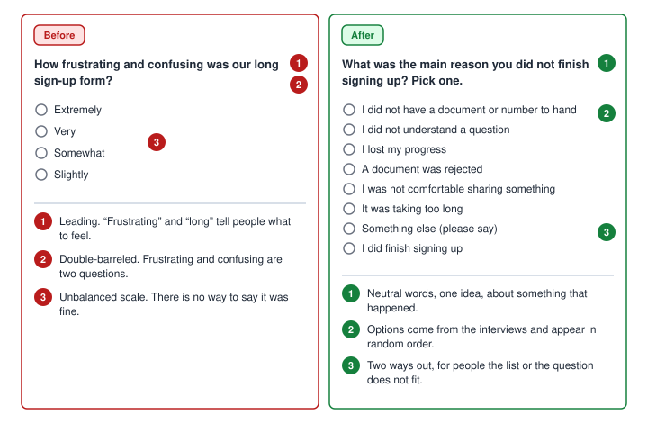

*Figure 11.1 — The same question before and after. The options on the right came from the interviews.*

**3. Choose scales with care.** A **Likert scale**, named for Rensis Likert, who introduced it in 1932, is a row of ordered options such as "strongly disagree" to "strongly agree". Use equal numbers of positive and negative points and label each one. Watch for **acquiescence bias**: people lean toward agreeing with any statement. "How easy or difficult was it?" is safer than "It was easy: agree or disagree?"

**4. Mind the order.** An **order effect** is when an earlier question, or an option's position in a list, changes the answers. Put general questions before specific ones, shuffle option lists, and keep it short.

**5. Reach the right people.** The sampling frame is the list you draw from. The **response rate** is the share of invited people who answer. **Nonresponse bias** arises when those who answer differ from those who do not, in ways related to the question. A thousand answers do not cure it. Compare respondents with the frame on anything you know about both.

Then state your precision. A **confidence interval** is a range built so that, across repeated samples, it would contain the true value 95 times in 100. Half its width is the **margin of error**. For a share *p* from *n* randomly drawn answers:

```python
def margin(p, n, population=None):
    """Half-width of the 95% interval for a share from a random sample."""
    se = math.sqrt(p * (1 - p) / n)
    if population:                       # finite population correction
        se *= math.sqrt((population - n) / (population - 1))
    return Z * se
```

The margin covers the luck of the draw and nothing else. It does not cover leading questions or nonresponse. Strictly, it applies only to random samples; the American Association for Public Opinion Research says it should not be reported for opt-in surveys.

Before sending, sit with five people while they answer aloud. You will rewrite at least one question.

### Worked example

The frame is the 3,360 merchants who started in the last four weeks and did not finish. On November 2 Rosa invites a random 1,200 of them by email. The survey has five questions and takes two minutes. Question 1 is the right-hand side of Figure 11.1. It closes on November 9.

Output:

```text
invited 1,200, answered 216, response rate 18%

Did not have a document or number to hand   78  36.1%  +/- 6.2 points
Did not understand a question               41  19.0%  +/- 5.1 points
Lost my progress and had to start again     32  14.8%  +/- 4.6 points
A document was rejected                     27  12.5%  +/- 4.3 points
Not comfortable sharing the information     19   8.8%  +/- 3.7 points
It was taking too long                      11   5.1%  +/- 2.8 points
Something else                               8   3.7%  +/- 2.4 points

answers needed for a given margin (95%, worst case of 50%)
margin    huge population    population of 3,360
+/- 10%                97                     94
+/- 5%                385                    345
+/- 3%              1,068                    811
```

Three readings, in order of importance.

- **The top reason leads clearly.** "No document to hand" is 30% to 42%; the runner-up is 14% to 24%. The ranges do not touch.
- **Tomás's reason is near the bottom.** "Taking too long" is 5%, and 8% at the most generous end.
- **Some ranks cannot be called.** "Did not understand" at 19% and "lost my progress" at 15% overlap. Say "similar".

Was 216 enough? For a margin of 5 points you would want 345. You got about 6 points, and that is enough here, because the gap you care about is 17 points wide. Ask that question every time: is the range narrow enough for this decision?

One caution goes in the report. Only 18% answered, and they leaned toward merchants who signed up on a computer. Lab 4 corrects for that, and the top answer holds.

### Common mistakes

| Mistake | Why it bites | Do this instead |
|---|---|---|
| Leading or double-barreled wording | You measure your wording | One neutral idea per question; test it on five people |
| Trusting a big *n* from a biased frame | More answers from the wrong people are still wrong | Draw randomly; compare respondents with the frame |
| Percentages with no margin | A 4-point gap gets treated as real | Report *n* and the range |

### Check yourself

**Q11.1** What is wrong with "How satisfied were you with the speed and clarity of verification?", and how would you fix it?

**Q11.2** In a random sample of 100, 30 people choose an answer. Roughly what is the margin of error?

**Q11.3** A survey has 2,000 responses from a link posted in PayFlow's help center. Why is a tiny margin of error misleading here?

> [!IMPORTANT]
> **In one line:** Ask neutral questions about things that happened, draw the sample at random, and report every percentage with its range and its response rate.

## 12. NPS, CSAT, and effort scores

### Why it matters

On October 14 the quarterly dashboard shows PayFlow's Net Promoter Score for small merchants falling from +27 to +20. An executive emails: "What did onboarding break?"

It is one number with no range and no breakdown, already being read as a verdict on your team. Knowing what each score measures, and how noisy it is, lets you answer calmly.

### The idea

Three scores dominate. Each measures something different.

| Score | Asks | Measures | Blind to |
|---|---|---|---|
| **Net Promoter Score (NPS)** | "How likely is it that you would recommend PayFlow to a friend or colleague?" 0 to 10 | Overall feeling about the company | Why, and what to fix |
| **CSAT**, the customer satisfaction score | How satisfied the person was with one thing, often on a 1 to 5 scale | One interaction, such as a support reply | Loyalty; anyone who never got in touch |
| **Customer Effort Score (CES)** | How easy the company made it to get one thing done | Effort on one task | People who gave up before the survey fired |

NPS was introduced by Frederick Reichheld in *Harvard Business Review* in December 2003. People who answer 9 or 10 are promoters, 7 or 8 are passives, and 0 to 6 are detractors. The score is the percentage of promoters minus the percentage of detractors, so it runs from −100 to +100. Its critics include a 2007 study by Keiningham and colleagues in the *Journal of Marketing*, which did not find that it predicts growth better than other satisfaction measures.

CSAT is usually reported as **top-two-box**: the share choosing the top two options. A customer service survey sent after a support ticket is nearly always a CSAT question.

CES comes from a 2010 *Harvard Business Review* article by Matthew Dixon, Karen Freeman, and Nicholas Toman, who argued that reducing customer effort matters more than delighting people.

Scores are also collected in two ways. A **relationship survey** goes to a sample of all customers on a schedule. A **transactional survey** fires after an event.

Five rules keep scores honest.

1. **A score is an estimate.** Show *n* and the range.
2. **Compare like with like.** Same frame, channel, timing, and wording.
3. **Split before you believe a blend.**
4. **A score is an outcome.** It can move with prices, outages, or who happened to answer. It does not name its cause.
5. **The follow-up matters more than the number.** "What is the main reason for your score?" and a call to an unhappy customer are where the value is.

### Worked example

NPS is the average of answers scored +1, 0, or −1, so its uncertainty is the uncertainty of an average.

```python
def nps(promoters, passives, detractors):
    """Return the score and the half-width of its 95% interval, in points."""
    n = promoters + passives + detractors
    p, d = promoters / n, detractors / n
    score = p - d
    se = math.sqrt((p + d - score * score) / n)
    return score * 100, Z * se * 100
```

Output:

```text
n = 180: 81 promoters, 54 passives, 45 detractors
NPS = +20, 95% interval +8 to +32

the same mix of answers at other sample sizes
n =    50: NPS = +20 +/- 22.5 points
n =   100: NPS = +20 +/- 15.9 points
n =   180: NPS = +20 +/- 11.9 points
n =   400: NPS = +20 +/-  8.0 points
n = 1,000: NPS = +20 +/-  5.0 points
n = 2,500: NPS = +20 +/-  3.2 points
```

This quarter's +20 could be anything from +8 to +32. You would need about 1,000 answers to narrow that to 5 points either side.

Now the "drop", and a split by how long merchants have been with PayFlow.

```python
change = this - last
change_half = math.hypot(last_half, this_half)
```

Output:

```text
quarter to quarter
last +27, this +20, change -7 points
95% interval for the change: -24 to +10

this quarter, split by how long the merchant has been with PayFlow
Joined in the last 90 days    n =  60  NPS =  -10  (-31 to +11)
Joined more than 90 days ago  n = 120  NPS =  +35  (+21 to +49)
```

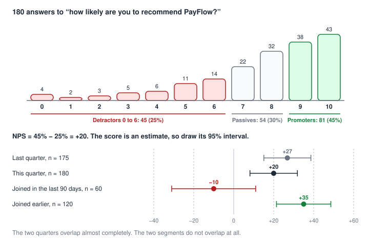

*Figure 12.1 — The same data two ways. The quarter-to-quarter change is noise. The gap between new and established merchants is not.*

The change of −7 has a range from −24 to +10. Zero is well inside it, so nothing shows that NPS moved.

The split is the real finding. Merchants in their first 90 days score −10. Established merchants score +35. Those ranges do not overlap, and the blended +20 describes neither group.

Your reply to the executive is three sentences. "A 7-point move on 180 answers is within the noise, so we cannot say NPS fell. The real pattern is that merchants in their first 90 days are far less happy than established ones. We are six weeks into a study of why, and I will share the result on November 20."

One more trap sits on the same dashboard. PayFlow sends its effort question when a merchant is approved, and the score is high every quarter. Of course it is. The 840 merchants a week who found sign-up hardest never receive it.

### Common mistakes

| Mistake | Why it bites | Do this instead |
|---|---|---|
| A score with no *n* or range | Noise gets explained with invented causes | Report the interval; test a change before discussing it |
| One blended number | Opposite groups cancel out | Split by tenure, size, or plan first |
| Treating the score as a target | People learn to ask only happy customers | Reward follow-up and fixes, not the number |

### Check yourself

**Q12.1** Of 200 answers, 90 are promoters, 70 passives, and 40 detractors. What is the NPS?

**Q12.2** Why can't an effort score sent on approval explain why merchants abandon sign-up?

> [!IMPORTANT]
> **In one line:** NPS, CSAT, and CES are rough thermometers, so read each with its range, by segment, and never as an explanation.

## 13. Customer feedback systems

### Why it matters

Feedback reaches PayFlow every day through support tickets, sales calls, app reviews, survey comments, and account managers. With no system, three things happen. The loudest customer or the most senior colleague sets priorities. The same problem is rediscovered every quarter. And customers who took the trouble to write hear nothing back.

### The idea

A **feedback system** is a routine that gathers feedback from every channel, labels it the same way, counts it against the right base, sends it to someone who can act, and tells the customer what happened.

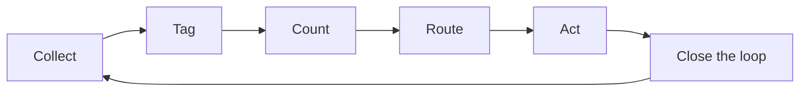

*Figure 13.1 — Six steps. Most companies do the first and skip the last.*

**Collect.** Keep each item in the customer's exact words, with its source, date, and segment. Know what each channel over-represents.

| Channel | Who you hear from |
|---|---|
| Support tickets | People with a problem that blocks them |
| Sales notes | Prospects and large accounts |
| App reviews | The delighted and the furious |
| Survey comments | Whoever answers surveys |

**Tag.** A **taxonomy** is a short, fixed list of tags, each with a definition. Tag the problem, not the requested solution: "cannot tell why a document was rejected", not "add live chat". Keep it under about twenty tags plus "other", and read the "other" pile every month.

**Count.** Raw counts rise as the customer base grows. Divide by a base that makes weeks comparable, such as tickets per 1,000 sign-ups started.

**Route.** Every tag has an owning team. Anything at severity 4 goes the same day.

**Act and close the loop.** To **close the loop** is to tell the person what you did with what they said, including "we are not going to do this, and here is why". There is an inner loop, a reply or call to the individual, and an outer loop, where patterns reach the roadmap.

Remember what a feedback system is. It is a sample of people who speak up. It cannot size a problem across all customers, and it cannot hear people who left without a word.

### Worked example

Sam's team tags one week of onboarding tickets with six tags.

```python
    for tag, count in TICKETS.items():
        print(f"{tag:<38}{count:>8}{count / total:>7.0%}"
              f"{count / STARTS_THIS_WEEK * 1000:>18.1f}")
```

Output:

```text
tag                                    tickets  share  per 1,000 starts
Document rejected                          139    41%              69.5
Which document do you need?                 61    18%              30.5
Ownership or business-type question         54    16%              27.0
Lost progress or locked out                 37    11%              18.5
Verification is taking too long             29     9%              14.5
Other                                       20     6%              10.0
All onboarding tickets                     340                    170.0
```

Sam reads this as proof that rejected documents are the biggest onboarding problem. But the survey in Chapter 11 put "a document was rejected" fourth, at 12.5%. Both numbers are honest, and they measure different groups.

- Tickets come from merchants who hit a wall and still wanted in badly enough to write.
- A merchant who lacks a tax ID does not write to support. She closes the tab.

So a rejected document is the top reason merchants *contact support* and the fourth reason they *stop*. A feedback channel's shares describe that channel, and nothing wider.

The system still earns its keep. The tag "which document do you need?" at 30.5 per 1,000 starts is a question a screen could answer. Sam's team now reviews tags with you for thirty minutes each Monday, each tag has an owner, and every merchant who rates a support reply 1 or 2 gets a call within two working days. When the rejection message is fixed (Chapter 21), the 139 merchants who wrote in that week are told.

### Common mistakes

| Mistake | Why it bites | Do this instead |
|---|---|---|
| Counting raw volume | Growth looks like a worsening problem | Divide by a base, such as per 1,000 starts |
| Reading a channel's share as everyone's share | Silent customers are left out | Size the problem with a survey or analytics |
| Collecting and never replying | People stop telling you things | Reply to individuals; publish what changed |

### Check yourself

**Q13.1** Tickets about payouts rose from 400 to 480 in a quarter while active merchants rose from 10,000 to 13,000. Did the problem get worse?

**Q13.2** A merchant writes, "Please add a phone number I can call." How would you tag it?

> [!IMPORTANT]
> **In one line:** Gather every channel into one tagged, counted, owned list, answer the people who wrote, and remember it only speaks for those who spoke.

## 14. User segmentation

### Why it matters

"The average merchant finishes sign-up 58% of the time." Nobody is the average merchant. If one group finishes at 78% and another at 32%, then a single design, a single target, and a single message are wrong for both, and the blended figure hides where the problem lives.

### The idea

**Segmentation** is dividing users into groups that differ in ways that matter for a decision. Each group is a segment. The attribute you divide by is the **basis**.

| Kind of basis | Examples |
|---|---|
| Who they are | Industry, company size, country |
| What they do | Device, frequency, features used |
| What they need | The job they are trying to get done |
| What they are worth | Payment volume, cost to serve |

A segmentation is good if it passes five tests.

1. **The basis matters.** The segments behave differently on the outcome you care about.
2. **Mutually exclusive.** Segments are **mutually exclusive** when every user fits exactly one, with nobody left over.
3. **Stable.** People do not hop between segments from week to week.
4. **Actionable.** You can tell which segment someone is in at the moment you need to act, and you can do something different for them.
5. **Validated.** The differences show up again in data you did not use to create the segments.

Look at size as well as rate. A segment with a terrible rate and few people may matter less than a large one with a mediocre rate.

Good bases usually start as hints in qualitative work, which you then test in data. Two cautions. If you slice the data twenty ways, one split will look dramatic by chance, so decide what to test before you look. And in financial products, bases tied to protected characteristics raise legal and fairness questions. Segment on behavior and need, and ask counsel when in doubt.

### Worked example

The first interviews hinted at two things: owners with business partners had to ask someone else for details, and people on phones kept being interrupted. You test both against the obvious alternative, industry.

```python
        rates.append(finished / started)
        print(f"  {name:<26}{started:>8,}{finished:>10,}{rates[-1]:>7.0%}"
              f"{(started - finished) / lost_all:>11.0%}")
```

Output:

```text
Split by industry
  segment                    started  finished   rate  of losses
  Retail                         620       357    58%        31%
  Food and drink                 480       283    59%        23%
  Services                       610       352    58%        31%
  Other                          290       168    58%        15%
  finish rate runs from 58% to 59%

Split by number of owners and device
  segment                    started  finished   rate  of losses
  One owner, computer            540       421    78%        14%
  One owner, phone               760       456    60%        36%
  Several owners, computer       320       163    51%        19%
  Several owners, phone          380       120    32%        31%
  finish rate runs from 32% to 78%
```

Industry fails the first test. Every industry finishes at 58% or 59%, so knowing a merchant's industry tells you nothing about whether they will finish.

Owners and device pass it. The finish rate runs from 32% to 78%. Now check the other tests.

| Test | Owners and device |
|---|---|
| Mutually exclusive | Yes: each merchant has one answer on each |
| Stable | Yes, for the days sign-up takes |
| Actionable | Yes: device is known on the first page, owners at step 2 |
| Validated | The same order appears in each of the four previous weekly cohorts |

Two segments stand out, for different reasons. "Several owners, phone" has the worst rate. "One owner, phone" has the most losses, 36% of the total, because it is the biggest group.

That shapes the rest of the study. The interview quotas in Chapter 4 came from this table. The persona in Chapter 16 describes its largest row. And the two phone segments probably need different fixes: a way to come back for the solo owner, and a way to hand part of the form to a partner for the co-owned business.

### Common mistakes

| Mistake | Why it bites | Do this instead |
|---|---|---|
| Segmenting by what is easy to get | Industry is in the database, and explains nothing | Test whether the basis separates the outcome |
| Segments you cannot identify in time | You know who they were after they left | Use attributes available when you act |
| Reading rate without size | A tiny group steals attention | Report each segment's share of the total loss |

### Check yourself

**Q14.1** Which of the five tests does "merchants who will go on to process over $10,000 a month" fail as a basis for redesigning sign-up?

**Q14.2** Using the output above, which segment would you fix first if you cared about the number of merchants gained? Why isn't it the one with the lowest rate?

> [!IMPORTANT]
> **In one line:** Split users by something that changes the outcome and that you can see in time to act, then weigh each segment by both its rate and its size.

# Part IV — Making sense of it

## 15. Synthesis: from notes to insights

### Why it matters

Twelve interviews leave you with about six hours of recordings and three hundred notes. There are two easy ways out. You can pick the three best quotes for the story you already believed. Or you can paste everything into a forty-page document that nobody reads. Either way the interviews are wasted.

### The idea

**Synthesis** is the work of turning raw observations into a few statements a team can act on and trace back. Every finding has four parts, kept separate: the observation (what you saw or heard), the interpretation (what you think it means), the implication (what to do or test), and your confidence. Synthesis builds them from the bottom up.

1. **One observation per note.** Who, and what they did or said. No adjectives, no conclusions.
2. **Group by meaning.** **Affinity mapping** is sorting notes into piles that say the same thing, without deciding the piles in advance. It descends from the KJ method, devised by Jiro Kawakita in the 1960s. Do it with the team, in silence at first.
3. **Name each pile.** A **theme** is a named group of observations that recurs across participants. Name it in the participants' voice. Count *participants*, not notes: one talkative person can fill a pile alone.
4. **Write the insight.** An **insight** is a theme plus its explanation and its consequence. A useful pattern: "[Who] [does or experiences what] because [why], which means [consequence for the decision]." A single word such as "Trust" is a label, not an insight.
5. **Keep the leftovers visible.** Single observations and contradictions go in a parked area. Keep them, because some of them will turn out to matter.

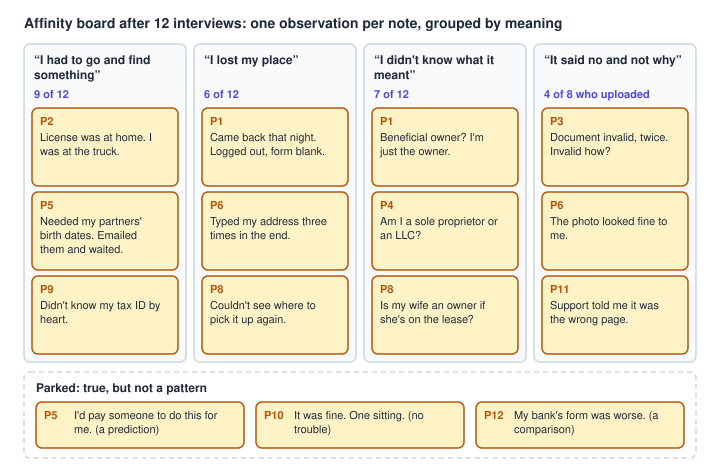

*Figure 15.1 — The board on October 30. Each note is one observation from one participant.*

Affinity mapping suits dozens of notes. For hundreds of survey comments or tickets you need **coding**: giving each item a short label, or code, from a codebook that defines every code with examples. To check that the codes mean the same thing to different people, two coders label the same sample separately. **Cohen's kappa**, published by Jacob Cohen in 1960, then measures how far their agreement exceeds what chance alone would produce.

### Worked example

**From board to insight.** Figure 15.1 shows four themes. Reading across them reveals something no single pile says. Of the nine merchants who left to find something, six found their progress gone when they came back. The four finishers add a contrast: two of them had been told by an accountant what to have ready.

You write it up in the four parts.

| Part | Finding |
|---|---|
| Observation | 9 of 12 left the form to fetch a document or number. 6 of those 9 returned to a blank form. 1 of 12 mentioned length. Finishers typed for a median of 14 minutes, spread over three sittings and two days. |
| Interpretation | Sign-up is not too long. It is interrupted, and nothing saves the merchant's place or brings them back. |
| Implication | Test telling merchants what to have ready, saving progress, and sending a link to resume (Chapter 8). |
| Confidence | High that this happens. How common it is among all who stop is unknown until the survey (Chapter 11). |

Parked: P3's main trouble was a rejected photo, with no interruption involved. That is a second, smaller story, and it stays on the board.

**Checking the codes.** The survey's "something else" box and its final open question produce free text. You and Rosa each code the same 60 answers.

```python
observed = agree / total
by_chance = sum(y * r for y, r in zip(yours, rosas)) / total ** 2
kappa = (observed - by_chance) / (1 - by_chance)
```

Output:

```text
answers coded by both: 60
same code chosen: 46 (77%)
agreement expected by chance: 30%
kappa = 0.67

where you disagreed (your code -> Rosa's code)
  Missing document -> Confusing question: 2
  Confusing question -> Missing document: 3
  Other -> Confusing question: 2
```

You agreed on 77% of answers, but 30% agreement would have come from chance alone, so kappa is 0.67. A common rule of thumb from Landis and Koch (1977) calls 0.61 to 0.80 "substantial". The cut-offs are conventions, so do not lean on the label.

The list of disagreements is more useful. "Missing document" and "confusing question" were swapped five times. Reading those answers, you find the cause: merchants who wrote "didn't know what you wanted". You sharpen the codebook. If they did not know *which* document was meant, the code is confusing question. If they knew and did not have it, the code is missing document. Then you recode.

### Common mistakes

| Mistake | Why it bites | Do this instead |
|---|---|---|
| Sorting into categories you brought with you | You find what you expected | Let groups form from the notes, then name them |
| Counting notes | The most talkative participant wins | Count participants per theme |
| Dropping what does not fit | You lose the next insight and your credibility | Park it where everyone can see it |

### Check yourself

**Q15.1** Turn the fourth column of Figure 15.1 into an insight statement using the pattern from this chapter.

**Q15.2** Two coders agree on 80 of 100 items. Chance agreement is 50%. What is kappa?

> [!IMPORTANT]
> **In one line:** Break notes into single observations, let themes emerge, and write each insight as who, what, why, and so what, with the leftovers still in view.

## 16. Personas

### Why it matters

In meetings, "the user" turns into whoever suits the speaker. For Tomás she is a founder at a laptop who wants speed. For Sam she is someone who needs her hand held. With no shared picture, every design argument is really an argument about who the user is.

A persona fixes the picture. A bad one, with a stock photo, an invented age, and a love of yoga, does more harm than having none.

### The idea

A **persona** is a short description of a type of user, built from research, that stands for a segment when the team makes design decisions. Alan Cooper brought personas into software design in his book *The Inmates Are Running the Asylum*, published at the end of the 1990s.

| Belongs on a persona | Does not belong |
|---|---|
| What they do, in order | Age, hobbies, family, a stock photo |
| What they want from the product | Brand preferences |
| Their setting: device, place, time pressure | Anything invented to seem lifelike |
| What gets in the way, with counts | Personality adjectives |
| A real quote | A made-up quote |
| What it is based on, and what is unknown | |

The left column changes design decisions. The right column mostly triggers stereotypes.

To build one, start from segments that behave differently (Chapter 14) and themes that recur (Chapter 15). Write one persona per pattern of behavior, usually two to four in all, and name each by what the person does. Mark one as primary: the person the design must work for first.

Every persona needs an evidence box: sources, dates, sample size, what is not yet known, an owner, and a review date. Personas go stale when the product or the market changes.

A **proto-persona** is a persona sketched from the team's assumptions before any research. It is useful for getting those assumptions onto the table, provided it is labeled a guess and replaced.

A persona is different from a segment. A segment is a group you can count in data. A persona is a portrait that helps a team imagine one of its members. Both have limits. A persona cannot size anything, and it can hide variety, so keep recruiting people it does not describe.

### Worked example

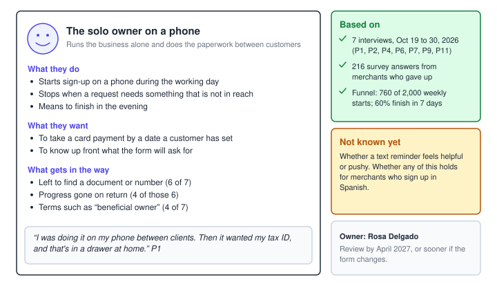

*Figure 16.1 — A persona that shows its sources. The right-hand column is what makes it usable in an argument.*

Compare Figure 16.1 with the proto-persona Tomás wrote on a whiteboard in week one.

| | Tomás's proto-persona | Evidence-based persona |
|---|---|---|
| Who | "Busy founder" | Solo owner who also does the paperwork |
| Where | At a laptop | On a phone, between customers |
| Wants | The shortest possible form | To take a card payment by a date a customer has set |
| Stops because | Too many fields | Something the form asks for is somewhere else |
| Based on | A guess | 7 interviews, 216 survey answers, the funnel |

The difference changes the design. A shorter form does nothing for a merchant whose tax ID is in a drawer at home. A list of what to have ready, and a way back, does.

The team writes one more persona, "the co-owned business", from the four interviewees with partners. The person filling in the form does not know a partner's date of birth or home address, has to ask, and waits. It covers the two segments with the lowest finish rates in Chapter 14. The solo owner is primary because that group is largest.

### Common mistakes

| Mistake | Why it bites | Do this instead |
|---|---|---|
| Invented details | The team designs for a stereotype | Include only what changes a decision |
| No evidence box | Nobody can tell portrait from fiction | State sources, sample, and unknowns |
| Never revisited | The team designs for last year's user | Give it an owner and a review date |

### Check yourself

**Q16.1** A persona says "Maria, 34, loves hiking, drives a hybrid." What is missing, and what should go?

**Q16.2** Why is the solo owner, not the co-owned business, the primary persona, even though co-owned businesses finish less often?

> [!IMPORTANT]
> **In one line:** A persona is a portrait of behavior drawn from evidence, and it should say on its face what that evidence is.

## 17. Journey maps and story maps

### Why it matters

A list of findings loses the order in which things happen. The team argues about screens while the merchant's worst moment takes place in between sessions, when no screen is showing.

A second problem arrives when building starts. A backlog is a flat list, and the team builds from the top. Three months later, step 1 is beautiful and nothing works end to end.

### The idea

There are two maps, and they do different jobs.

A **journey map** shows one persona's experience of reaching one goal, over time. Stages run across. Rows show what the person is doing, thinking, and feeling. It describes today, and every cell should come from research. A **pain point** is a specific moment where the person struggles. An **opportunity** is a need or pain point worth addressing, stated from the customer's side with no solution in it.

Rules for a useful journey map:

- One persona, one goal, one scenario.
- Start before your product appears and end after it leaves.
- Include the time away from the screen.
- Add an evidence row, and mark anything assumed.
- End with opportunities and owners.

A **story map** arranges the work to be built along that journey. The technique comes from Jeff Patton, whose book *User Story Mapping* (2014) describes it in full. The top row is the **backbone**: the big activities in the order the user does them. Under each activity sit smaller pieces of work, most essential at the top. Horizontal lines then cut the map into releases. Each slice is a thin version of the *whole* journey that someone could use from start to finish.

Use the two together. The journey map covers the problem as it stands today and ends in opportunities. The story map covers the solution and turns chosen opportunities into an order of work. If you skip the first you will plan work for a journey you imagined.

### Worked example

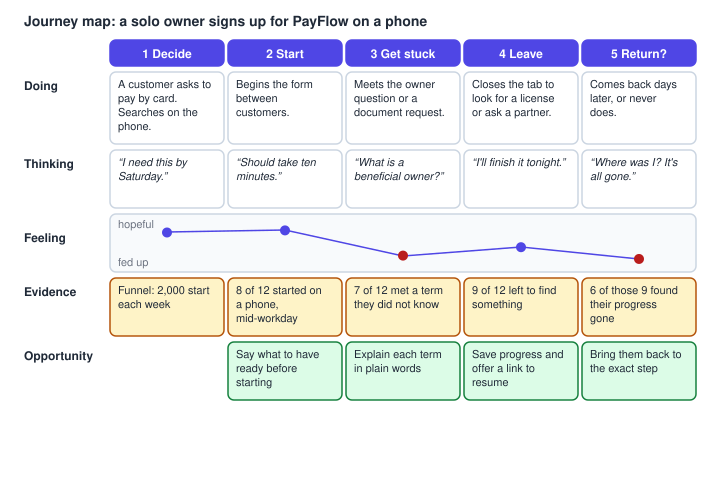

*Figure 17.1 — The solo owner's journey today. Stage 4 happens entirely away from PayFlow.*

Read Figure 17.1 from left to right and notice stage 4, "Leave". Nine of twelve interviewees went through it. PayFlow has no screen there, no saved state, and no message. Nobody ever designed that stage, and it is where the outcome is decided.

The map ends in four opportunities, which Lena and Arjun turn into a story map.

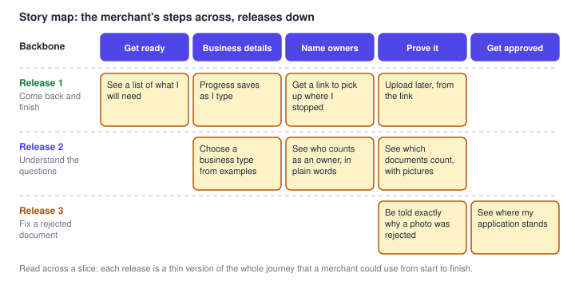

*Figure 17.2 — Each row is a release. Release 1 touches four of the five activities.*

Look at how Release 1 is cut. It contains one small card under each of four activities: a list of what to have ready, saving as you type, a link to resume, and uploading later from that link. None of the four is polished. Together they let a merchant leave and come back, which is the whole point of the release.

The other way to cut it would be by column: "finish the documents step properly first". That would have produced an excellent upload screen and left the interruption problem untouched for two quarters.

### Common mistakes

| Mistake | Why it bites | Do this instead |
|---|---|---|
| A journey map invented in a workshop | It records the team's beliefs | Build each cell from research; mark guesses |
| A map with no opportunities or owners | It becomes a poster | End with a ranked list and names |
| Slicing a story map by team or component | No release works end to end | Cut thin slices across the whole backbone |

### Check yourself

**Q17.1** What does the evidence row add to a journey map?

**Q17.2** Why does Release 1 in Figure 17.2 include a card under "Prove it" when the release is about coming back?

> [!IMPORTANT]
> **In one line:** Map the person's whole journey from evidence, including the time away from your screens, then cut the work into thin slices that each run the full length of it.

## 18. Mixed methods and triangulation

### Why it matters

By November 10 you have five sources, and they seem to point in different directions. The funnel points at step 4. Support points at rejected documents. The survey points at missing documents. Tomás still points at length.

If you quote the source that agrees with you, everyone else will quote theirs, and the decision goes back to whoever is most senior.

### The idea

**Mixed methods** means combining qualitative and quantitative methods in one study so that each covers what the other cannot see. There are three common orders.

| Order | Use it when |
|---|---|
| Explore, then measure | You do not yet know the possible answers. Interviews supply the options a survey counts. |
| Measure, then explain | Data shows *that* something happens. Interviews find out why. |
| Both at once | Time is short and the questions are separate |

**Triangulation** is checking a finding against sources that are independent of one another. When methods with different weaknesses agree, you can be more confident. The sources have to be independent, though. Three executives repeating one customer anecdote count as a single source.

When sources disagree, do not average them or pick a winner. Ask five questions.

1. Are they answering the same question? "Where" and "why" are different.
2. Are the same people in each? Check each sampling frame.
3. Are they from the same period?
4. Is one reporting what people say and the other what they do?
5. Do they define the key term the same way?

Often the disagreement itself is the finding. One special case has a name. **Survivorship bias** is drawing conclusions only from those who got through some filter, such as merchants who finished, or customers who wrote in.

### Worked example

You put the riskiest assumption from Chapter 1, "length is the main reason merchants stop", in front of every source.

| Source | What it shows | Who is in it | Supports "too long"? |
|---|---|---|---|
| Funnel | 570 of 840 losses fall at two steps | All 2,000 starters | No. A form that is simply too long would lose people at every step. |
| Timing data | Finishers type for a median of 14 minutes, over three sittings and two days | 1,160 finishers | No. The typing is short; the gaps are long. |
| Interviews | 9 of 12 left to find something; 1 of 12 mentioned length | 12 recent starters | No |
| Survey | "Too long" 5%; "no document to hand" 36% | 216 of 3,360 who stopped | No |
| Tickets | 41% about rejected documents | Merchants who wrote in | Silent on length |

Four sources, drawing on three different methods and different groups of people, give no support to the assumption. Short of an experiment, evidence does not get much stronger.

One apparent conflict remains: tickets say rejection is first, the survey says fourth. Question 2 resolves it, as Chapter 13 showed. The people in each source are different.

One real gap remains too, and you report it instead of hiding it. The funnel cannot separate "never uploaded a document" from "uploaded and was rejected". Both look like a loss at step 4. Arjun adds the missing event to the product's logging. A hole in the data is a finding, and it now has an owner.

The sentence for Elena writes itself: "Four sources agree that merchants stop because they are interrupted. None supports length as the main cause. We do not yet know how many are lost to rejected documents."

### Common mistakes

| Mistake | Why it bites | Do this instead |
|---|---|---|
| Quoting only the source that agrees | Others do the same, and evidence stops mattering | Put every source in one table, including the awkward ones |
| Counting echoes | One anecdote, repeated, looks like a pattern | Trace each claim to its origin |
| Hiding what does not fit | A skeptic finds it and doubts the rest | Report it as an open question with an owner |

### Check yourself

**Q18.1** Three account managers each tell you that "merchants want instant payouts". What do you check before calling that triangulated?

**Q18.2** Give an example of survivorship bias from this book.

> [!IMPORTANT]
> **In one line:** Line up every source beside the same claim, ask who is in each, and treat disagreement as something to explain, not to average away.

## 19. User psychology and behavioral science

### Why it matters

Interviews tell you what Aisha did. Psychology helps explain why someone with a Saturday deadline said "I'll finish tonight" and then did not. It also suggests fixes.

It can mislead you just as easily. Lists of "fifty cognitive biases" circulate widely, and many famous findings have not held up when repeated. A team that treats them as laws ends up sprinkling countdown timers over its product.

### The idea

Start with a short list of effects that have strong, repeated support.

| Effect | In plain words | What stands behind it |
|---|---|---|
| **Present bias** | A cost right now looms larger than a benefit later, so we put off small hassles | Laibson (1997); O'Donoghue and Rabin (1999) |
| **Default effect** | People tend to stay with whatever is pre-selected | A 2019 review of 58 studies: sizable on average, and highly variable |
| **Loss aversion** and the **framing effect** | A loss weighs more than an equal gain, and the same facts framed as a loss or as a gain lead to different choices | Kahneman and Tversky (1979, 1981); a 2020 replication across 19 countries confirmed the main patterns |
| **Anchoring** | The first number you see pulls your later estimates toward it | Tversky and Kahneman (1974) |
| **Peak-end rule** | We remember an experience by its most intense moment and by how it ended | Kahneman and colleagues (1993, 1996) |
| **Social desirability bias** | People give answers that make them look good or please the person asking | A long-established finding in survey research |

One model is also handy as a checklist. In BJ Fogg's Behavior Model (2009), a behavior happens when motivation, ability, and a prompt arrive at the same moment.

Then the caution. **Replication** means running a study again to see whether the result holds. In 2015 a large collaboration repeated 100 published psychology studies. Ninety-seven percent of the originals had reported a statistically significant result; 36% of the repeats did, with effects about half the size. Specific casualties include "ego depletion", where a 23-laboratory repeat found an effect close to zero. Even the famous jam study, in which a bigger display of jams led to fewer purchases, is shaky: a 2010 review of 50 experiments on choice overload found an average effect near zero.

Size shrinks as well. A 2022 study compared "nudges" in published academic papers with the same kind of interventions run at scale by two government teams. The published average was 8.7 percentage points. At scale it was 1.4.

So treat behavioral science as follows.

1. A principle gives you a hypothesis. It guarantees nothing.
2. Expect small effects.
3. Test in your own product, with an experiment.
4. Prefer removing a real obstacle to applying a psychological trick.
5. Never use an effect against the user. Ask whether they would be glad or annoyed if they understood what you did.

### Worked example

Apply Fogg's three parts to Aisha at the moment she closes the tab.

| Part | At 2 pm in the salon | That evening |
|---|---|---|
| Motivation | High: a deposit is due Saturday | Lower: she is tired |
| Ability | Blocked: the tax ID is at home | Present: the drawer is in reach |
| Prompt | The form is in front of her | None. Nothing reminds her. |

At no point do all three line up. The fix is to bring them together, and each idea becomes a hypothesis with a test.

| Hypothesis | Principle | How you test it |
|---|---|---|
| A list of what to have ready, shown before starting, raises the share who finish | Present bias: move the hassle to a moment of high motivation | Prototype (Chapter 8), then an experiment |
| A reminder the next morning brings people back | A prompt at a moment of ability | Send 50 by hand and count returns |
| A progress bar speeds completion | The "goal gradient" idea, from 2006 loyalty-card field studies with no independent repeat on record | Experiment only, and keep the bar honest |

What you rule out is as important. A countdown reading "Your application expires in 10:00" would probably raise completion a little. It is also false urgency aimed at a hairdresser with a client in the chair. It fails rule 5.

### Common mistakes

| Mistake | Why it bites | Do this instead |
|---|---|---|
| Citing a bias as proof | "Loss aversion says so" ends the discussion with no evidence | Turn it into a hypothesis and test it |
| Expecting textbook-sized effects | Forecasts miss by a wide margin | Plan for a few points at most |
| Using psychology to trap users | Short-term lift, long-term distrust, legal risk | Apply the glad-or-annoyed test |

### Check yourself

**Q19.1** Using Fogg's three parts, explain why a reminder sent at 2 pm the next day might fail for Aisha.

**Q19.2** A colleague says, "A progress bar will lift completion; it's proven psychology." How do you reply?

> [!IMPORTANT]
> **In one line:** Use behavioral science to generate hypotheses about real obstacles, expect small effects, and test every one in your own product.

## 20. The research report

### Why it matters

Research that nobody absorbs has no effect. The usual failures are a forty-slide deck that opens with methodology and reaches the answer on slide 31, or a punchy summary whose claims cannot be checked, which the first skeptic waves away.

The report has two readers. The decider needs to decide. The skeptic needs to verify.

### The idea

A **research report** records what you asked, what you did, what you found, how sure you are, and what you recommend. Write it in two layers.

- The **readout** is one page, or fifteen minutes, for the people deciding. The answer comes first.
- The appendix holds the plan, the participants, the guide, the data, and every finding. It is for checking, and for whoever picks this up next year.

A one-page readout has five blocks, in this order.

1. The decision, and your recommendation, in the first two sentences.
2. Three insights at most, each with its counts and one quote.
3. What the evidence means for each option on the table.
4. Confidence and limits: who you did not hear from, and what you still do not know.
5. Next step, owner, date.

**Traceability** means a reader can follow any sentence in the summary back to the raw material: insight to theme, theme to observations, observation to a participant and a time code, or to a query. Aim for two clicks.

Keep findings and recommendation apart. A finding is what the research showed. A **recommendation** is your judgment, and it also weighs cost, strategy, and risk. Label it as yours.

Three habits of language help. Use counts for qualitative findings and ranges for quantitative ones. Name the group precisely: "merchants who stopped", not "users". Leave adjectives out, because "hated" was not observed.

A result of "we found no support for X" belongs in the report as firmly as any other.

Finally, nobody should be surprised in the meeting. Show the draft, privately, to the people whose ideas the evidence goes against. Ask what would make it more convincing, and do that work.

### Worked example

On November 18 you send Tomás the draft. He asks one sharp question: "Your survey leaned toward computer users. Does the top answer survive on phones?" You run the weighting (Lab 4). It does, and rises from 36% to 40%. He walks into the meeting on November 20 already persuaded.

This is the page Elena reads.

| Block | Readout, November 20, 2026 |
|---|---|
| Recommendation | Spend next quarter on "prepare and resume" (Release 1 in Figure 17.2). Do not shorten the form. |
| Insight 1 | Merchants stop because they are interrupted, not because the form is long. 9 of 12 left to fetch something. Survey: "no document to hand" 36% (30 to 42); "too long" 5% (2 to 8). "It wanted my tax ID. That's in a drawer at home." (P1) |
| Insight 2 | When they come back, their work is gone. 6 of the 9 returned to a blank form. The session ends after 15 idle minutes. |
| Insight 3 | Two terms stop people: "beneficial owner" and "entity type". 7 of 12; survey 19% (14 to 24). |
| For each option | Shorter form: not supported, and Priya confirms identity checks cannot be deferred. Setup calls: untested; a cheap test is planned (Chapter 21). Guided form: supported; start with Release 1. |
| Confidence | High that interruption, not length, is the main cause: four sources, three methods. Medium that the fix works: five participants. |
| Limits | 18% survey response. US merchants only, in English and Spanish. The share lost to rejected documents is unknown until new logging is live. |
| Next | Beta of Release 1 from January 11, then an experiment. Owner: you. |

Elena reads it in four minutes, asks Priya one question about the document guide, and chooses Release 1.

### Common mistakes

| Mistake | Why it bites | Do this instead |
|---|---|---|
| Telling it in the order you did it | The answer is buried | Recommendation first, method in the appendix |
| Claims without counts or links | Nobody can check, so anyone can doubt | Counts, ranges, and a path to the source |
| Unveiling results in the meeting | People defend their position instead of thinking | Share the draft with skeptics first |

### Check yourself

**Q20.1** Put these in the order they should appear in a readout: method, limits, recommendation, insights.

**Q20.2** Rewrite this so it is traceable and free of adjectives: "Users hated the confusing owner page."

> [!IMPORTANT]
> **In one line:** Lead with the recommendation, back each insight with counts a skeptic can trace, say what you do not know, and surprise nobody in the room.

# Part V — Validating and operating

## 21. Validation tests and beta programs

### Why it matters

Everything so far shows that a problem exists. None of it shows that your solution will be used. Interviews are full of people who say "I'd definitely use that" and then never do.

The expensive way to find out is to build the thing. The cheap ways take a week.

### The idea

A **validation test** is a small real-world test of one risky assumption about a solution, run before the solution is fully built, with a pass mark set in advance. Four kinds are standard.

| Test | What you do | What it tests |
|---|---|---|
| **Fake door test**, also called a painted door | Show the entrance to something that does not exist yet and count who tries to enter | Demand |
| **Concierge test** | Deliver the service by hand, openly, to a few customers | Whether the result is valuable, and what delivering it takes |
| **Wizard of Oz test** | The customer sees a working product while a person does the work behind it | Whether the experience works before the technology exists |
| **Pre-order test** | Ask for money or a firm commitment before the product exists | Willingness to pay |

A fake door must say at once that the thing is not available, and should never be used for anything urgent. A Wizard of Oz test involves pretending, so tell people afterward.

The concierge idea was popularized by Eric Ries in *The Lean Startup* (2011). The Wizard of Oz technique is credited to J. F. Kelley, who coined the name around 1980.

Write each test on a card before it runs (Template 4).

A **beta test** comes later. It is the release of the real, nearly finished product to a limited group before everyone gets it, to find what only real use reveals. Plan it with entry criteria (what must be true before it starts) and **exit criteria** (what must be true before general release), plus a feedback channel and a way to roll back.

A beta has one large limit. **Selection bias** means the people in a group differ from everyone else because of how they got in. Beta volunteers are keener and more capable than average, so a beta shows that something *can* work. It cannot show how much the result will lift for everyone; that takes an experiment with random assignment.

### Worked example

After November 20, four tests run in order. Three produce a share, read with the same interval function.

```python
def wilson(successes, n, z=Z):
    p = successes / n
    centre = (p + z * z / (2 * n)) / (1 + z * z / n)
    half = z * math.sqrt(p * (1 - p) / n + z * z / (4 * n * n)) / (1 + z * z / n)
    return centre - half, centre + half
```

Output:

```text
1. Fake door: 'Book a free setup call' on the documents step
   clicked the button              140 of 1000   14%   (12% to 16%)
   rule set in advance: go on if the low end is 10% or more

2. Wizard of Oz: a person writes the rejection reason
   fixed it, generic message        14 of 50     28%   (17% to 42%)
   fixed it, specific message       34 of 50     68%   (54% to 79%)
   difference: 40 points, 95% interval 22 to 58

3. Beta: guided onboarding, 300 volunteers
   approved within 7 days          201 of 300    67%   (61% to 72%)
   today's rate for everyone: 58%
```

**1. Fake door, week of November 30.** One thousand merchants at the documents step see a button, "Book a free setup call". Clicking it shows: "We are trying this idea and it is not available yet. Here is our document guide. May we email you if calls launch?" The pass mark, agreed in advance, was that the low end of the range reach 10%. It is 12%. Pass.

**2. Concierge, December 7 to 11.** Sam's team phones 40 of the merchants who clicked. Twenty-six calls take place. In 19 of them the whole call turns out to be one question: "Which document do you need from me?" So the demand for calls is mostly demand for an answer that a screen could give. At roughly 20 minutes a call, the team decides to build the answer into the form.

**3. Wizard of Oz, December 14 to 18.** One hundred rejected uploads are split at random. Half see "Document invalid". Half see a specific reason, such as "This is a driver's license. We need the business license." It looks automatic, but a reviewer on Sam's team types it within a minute. With the specific message 68% fix the upload in the same session, against 28%. The difference is 40 points, with a range of 22 to 58. Merchants are told in the confirmation email that a person reviewed their upload. The automatic version is now worth building.

**4. Beta of Release 1, January 11 to February 5, 2027.** Three hundred merchants opt in. The exit criteria are no open severity-4 findings, a resume link that works in the three most common phone browsers, and no rise in support contacts or in Priya's manual review rate. All are met.

Of the volunteers, 67% are approved within seven days, against 58% for everyone today. Volunteers are not typical. The beta shows the release works and breaks nothing. The experiment that follows, sized to detect a move from 58% to 62%, will say how much it helps.

### Common mistakes

| Mistake | Why it bites | Do this instead |
|---|---|---|
| No pass mark set in advance | Any result gets called a success | Write the threshold before the test starts |
| A fake door that hides the truth | Customers feel tricked | Say immediately that it is not ready, and offer something useful |
| Reading a beta's lift as the real effect | Volunteers flatter every number | Treat a beta as a safety check; measure lift with an experiment |

### Check yourself

**Q21.1** A fake door gets clicks from 9% of 1,000 merchants, and the pass mark was "at least 10%". A colleague says "close enough". What do you say?

**Q21.2** Give two reasons the beta's 67% should not be reported as "a nine-point lift".

> [!IMPORTANT]
> **In one line:** Test the riskiest assumption about a solution with the cheapest real-world trial, fix the pass mark first, and use a beta to check safety, not to measure lift.

## 22. Competitors and stakeholders

### Why it matters

Two groups besides users shape what you can build. Competitors set what merchants expect and are where merchants go when they give up on you. Stakeholders are the colleagues who can fund your recommendation, block it, or quietly ignore it.

In week one Tomás says, "Our rival's sign-up is three screens." You need to know whether that is true, and whether it matters. And Priya can veto anything that weakens a check. Both deserve the same care you give to users.

### The idea

**Competitor analysis** is an evidence-based comparison of how the alternatives solve the same customer problem, done to inform one decision. The alternatives include things that are not products: cash, a spreadsheet, doing nothing. The interview prompt "How have you taken payments since?" finds them.

1. Start from the decision and the customer's job, not from a grid of every feature.
2. Pick the three to five alternatives that customers actually mention.
3. Do a teardown: go through each one's public flow as a customer would, capturing every step, what it asks for, and how it explains itself.
4. Record the kind of evidence in every cell, with a date: seen first-hand, public documentation, said by a customer, or inferred.
5. Finish each row with an implication for your decision.

Stay honest and legal. Use public information and ordinary use of the product. Do not misrepresent who you are, and do not ask new colleagues for a former employer's secrets.

The main trap is copying what you can see without knowing what you cannot. You can see a rival's form. You cannot see its completion rate or its fraud losses.

Stakeholder analysis applies the same discipline inside the company. A **stakeholder** is anyone who affects the decision or is affected by it. A **stakeholder map** lists each one with what they want, what they fear, how much influence they have, and how you will involve them. A common aid is the **power-interest grid**, usually attributed to Aubrey Mendelow.

| | Low interest | High interest |
|---|---|---|
| High power | Keep satisfied | Work closely |
| Low power | Monitor | Keep informed |

Treat it as research. Interview stakeholders the way you interview users, and ask each one, "What result would you not believe?" The most persuasive thing you can do costs nothing: have them watch a session.

### Worked example

**Competitors.** The decision is whether to defer documents, as Tomás says a rival does. On October 14 you walk through each alternative's public sign-up. The three rivals are fictional types, described without names.

| Alternative | What you found | Evidence | Implication |
|---|---|---|---|
| Rival A, a bank's merchant account | A long application and a branch visit | First-hand; two interviewees had tried it | PayFlow's edge is speed, but only if merchants finish |
| Rival B, an online processor | Three screens to "start accepting payments"; documents requested before the first payout | Screens first-hand; the payout hold from its public help pages | The documents are moved, not removed. The merchant meets them when money is waiting. Its completion and fraud rates are unknown. |
| Rival C, a point-of-sale app | A list of what to have ready; progress saved | First-hand | Someone already ships "prepare and resume" |
| Cash or bank transfer | What 5 of the 8 who stopped went back to | Interviews | For a solo owner the real competitor is not signing up at all |

Tomás was right about the three screens. The teardown shows what the three screens postpone.

**Stakeholders.**

| Person | Wants | Fears | Power, interest | How you involve them |
|---|---|---|---|---|
| Elena | One clear recommendation | A wasted quarter | High, medium | Signs off the plan; gets the one-page readout |
| Tomás | More approved merchants | His idea losing | High, high | Reviews the plan; watches two sessions; sees the draft early |
| Priya | No rise in fraud | Checks weakened | High (veto), high | Constraints gathered in week one; a guardrail in every test |
| Sam | Fewer tickets | Support being ignored | Medium, high | His tags feed the study; he runs the concierge test |
| Nadia | Lawful handling of data | Recordings misused | High (veto), low | Reviews the consent script and data plan |

Tomás watched Aisha's session live on October 20. He said very little afterward. Two weeks later he was the one asking how fast the resume link could ship.

### Common mistakes

| Mistake | Why it bites | Do this instead |
|---|---|---|
| A feature grid with no decision | It grows forever and changes nothing | Start from one decision and one customer job |
| Copying what a rival shows | You inherit choices whose results you cannot see | Note what is unknown beside every observation |
| Stakeholders told at the end | They defend their earlier position | Involve them in the plan and the sessions |

### Check yourself

**Q22.1** A colleague proposes copying Rival B's three-screen sign-up. Name two things you would want to know first that a teardown cannot show.

**Q22.2** Where does Nadia sit on the power-interest grid, and what does that imply?

> [!IMPORTANT]
> **In one line:** Study the alternatives your customers really use and the colleagues who can really say no, with the same evidence standards you apply to users.

## 23. Continuous discovery

### Why it matters

The study you have followed took six weeks and ended in a decision. Most teams then go back to building and do not speak to a customer until the next crisis. By then the findings are stale and recruiting starts from nothing.

Product decisions are made every week, so the evidence for them has to keep arriving every week.

### The idea

**Continuous discovery** is a way of working set out by Teresa Torres in *Continuous Discovery Habits* (2021). In her description, the people who build the product talk with customers every week or more often, in small pieces of research, all aimed at one product outcome. Four ideas hold it together.

**An outcome.** An **outcome** is a measurable change in customer behavior that the team is asked to achieve, such as "approved within 7 days rises from 58% to 62%". It replaces a list of features to deliver.

**A product trio.** The **product trio** is a product manager, a designer, and an engineer doing discovery together, instead of receiving a report. A researcher such as Rosa becomes coach and specialist.

**The opportunity solution tree.** Torres's best-known tool, in use since 2016, is the **opportunity solution tree**. The outcome sits at the top. Under it are opportunities: customer needs, pains, and wishes, as heard in interviews. Under each opportunity are candidate solutions. Under each solution are **assumption tests**, the small trials from Chapter 21.

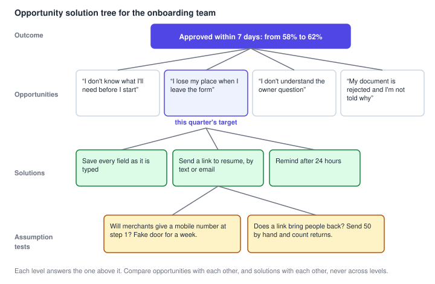

*Figure 23.1 — PayFlow's tree in December. One opportunity is the target; the others wait.*

Three rules keep a tree honest. Opportunities come from customers, never from a brainstorm. Work on one target opportunity at a time. And generate several solutions for it, so that you compare options instead of defending one.

**A weekly rhythm.** The interviews must happen without anyone organizing a project. Automate recruiting: an invitation inside the product, a standing calendar slot, a small thank-you payment.

Continuous discovery does not replace everything else. Surveys still size problems, usability tests still check designs, and accessibility research still needs planning. It also has its own trap. Talking each week to whoever replies is a convenience sample, so rotate segments on purpose.

To see whether the habit is alive, track four things: weeks since the team last spoke to a customer, assumption tests run per month, the share of roadmap items that trace to an opportunity, and which segments you have heard from.

### Worked example

From December the onboarding team works to this rhythm.

| Day | What happens |
|---|---|
| Monday | The product shows 200 recent starters an invitation: "20 minutes with our team, $50 gift card" |
| Wednesday | One 30-minute interview. Lena leads, Arjun takes notes, you observe. Roles rotate. |
| Thursday | Thirty minutes to write a one-page snapshot and update the tree |
| Friday | Last week's assumption test is read against its pass mark |

Figure 23.1 shows the tree. The target is "I lose my place when I leave the form". Under the resume-link solution sit two tests. The first asks whether merchants will give a mobile number at step 1; a fake door finds that most do. The second sends 50 links by hand and counts who returns.

The tree keeps changing. In January, three of the month's four interviewees bring up the owner question, so that opportunity is next in line. A co-owner says, "I can't answer for my partner", and a fifth opportunity is added.

After eight weeks you check coverage: six solo owners on phones, two co-owned businesses, and nobody who uses a screen reader. You change who the Monday invitation goes to.

### Common mistakes

| Mistake | Why it bites | Do this instead |
|---|---|---|
| Weekly chats with no outcome | Pleasant conversations, no direction | Tie every interview to the tree's outcome |
| Solutions written as opportunities | "Needs a mobile app" closes off alternatives | Write the need in the customer's words |
| Drifting toward easy participants | The same kind of merchant every week | Review segment coverage monthly |

### Check yourself

**Q23.1** Which of these is an opportunity and which is a solution? (a) "I can't tell which document you want." (b) "Add a document checklist."

**Q23.2** After eight weeks all your interviewees are solo owners on phones. What is the risk, and what do you change?

> [!IMPORTANT]
> **In one line:** Keep one outcome in view, talk to a customer every week as a team, and let a tree of opportunities, solutions, and small tests decide what you build next.

## 24. AI-assisted research and synthetic users

### Why it matters

An AI model can transcribe twelve interviews in minutes and draft a summary of each. It can also invent a quote, flatten the one unusual participant into the average, and agree with whatever you hinted at. The largest temptation is to skip the people altogether: "Just ask the model to be fifty merchants."

You need to know which jobs to hand over and which to keep.

### The idea

Sort research tasks by what can go wrong.

| Task | Hand to AI? | The check |
|---|---|---|
| Drafting a screener, guide, or survey from your plan | Yes, then edit | Models write leading questions too |
| Transcription | Yes | Spot-check names and numbers; consent and a vendor contract must cover it |
| First-pass tagging of notes or comments | Yes, as a second coder | Compare with a human on a sample (Chapter 15) |
| Summarizing one interview | Yes, with every quote linked to a time code | Verify each quote against the recording |
| Deciding what findings mean, and what to recommend | No | Judgment and accountability are yours |
| Standing in for participants | No | See below |

Three failure modes explain the checks.

- **Hallucination** is fluent output that is false, such as a quote nobody said.
- **Sycophancy** is a model's tendency to agree with the view the user seems to hold. It is a documented behavior of language models. Put your hypothesis in the prompt and the summary will tend to find it.
- **Averaging.** Summaries favor what is common. The one participant who could not upload at all is the first to be dropped.

Two controls follow. Keep **provenance**: a record of where each piece of evidence came from, meaning which session and time code, which tool and date, and who checked it. And protect people's data. A recording of an identifiable person is personal data. The consent script must say that software, including AI tools, will process it. The tool must be one your company has approved under a contract. Nothing a participant said should train anyone's model unless they agreed.

**Synthetic users** are AI-generated stand-ins for participants: a model prompted to answer as a persona would. The research so far is consistent.

- Nielsen Norman Group's 2024 review concludes that user research needs real users, and that synthetic ones are at most a source of hypotheses to check with people.
- A 2024 study in *Political Analysis* by Bisbee and colleagues found that synthetic survey answers matched real averages but varied less than real people do, and shifted with the prompt's wording and from month to month.
- A 2024 preprint by Park and colleagues reported agents that reproduced individuals' survey answers about 85% as well as those people did themselves two weeks later. The agents were built from two-hour interviews with 1,052 real people, so the interviews still had to happen.

A model knows what has been written. It does not know what is in Aisha's drawer. It is more articulate and more agreeable than a real merchant, it cannot be watched doing anything, and no claim it makes traces to a person.

Safe uses are rehearsal and preparation: piloting a guide, stress-testing a survey for ambiguity, listing hypotheses. Label anything synthetic. The 2025 revision of the ICC/ESOMAR research code requires telling clients when AI or synthetic data was used, and that is good practice inside a company too.

### Worked example

Rosa uses AI on the twelve interviews in four steps, and each check catches something.

1. **Transcripts.** An approved tool produces them. Figure 5.1's wording is extended to mention software, and Nadia confirms the vendor contract.
2. **Per-interview summaries, with quotes and time codes.** You check all 48 quotes against the recordings. Forty-six match. Two are paraphrases wearing quotation marks, and you correct them.
3. **A cross-interview summary.** Tomás drafts the prompt: "Summarize why merchants find sign-up too long." The summary's first theme is, predictably, length. You rerun it with a neutral prompt and add, "List the evidence against each theme." Length disappears, and "left to find something" comes first. The summary still omits the Spanish-language translation problem, which appeared once. The team's affinity session had caught it.
4. **A synthetic survey, as a demonstration.** Tomás suggests skipping the real survey and asking a model to answer as 500 merchants. You try it. The synthetic merchants' top reason is "too many steps", explained in tidy paragraphs. Not one mentions a document that was somewhere else. The real survey put that first, at 36%. The model returned the common assumption about sign-up forms, which is what Tomás believed in week one.

### Common mistakes

| Mistake | Why it bites | Do this instead |
|---|---|---|
| Unverified quotes | An invented quote in a readout destroys trust | Check every quote against its time code |
| Synthetic users in place of recruiting | You study the internet's assumptions | Use them to prepare; ask real people |
| Pasting recordings into an unapproved tool | A privacy breach, and broken consent | Approved tools only, and say so in the consent script |

### Check yourself

**Q24.1** Name two research tasks you would hand to an AI model and the check you would run on each.

**Q24.2** Give three reasons synthetic users cannot replace real participants.

> [!IMPORTANT]
> **In one line:** Let AI speed up the clerical work, verify everything it hands back, and keep both the judgment and the participants human.

## 25. The research repository and insight governance

### Why it matters

Eighteen months from now a new PM will ask, "Why didn't we just shorten the form?" Today the answer is spread across Rosa's laptop, a slide deck, and a chat thread.

Without a shared home for research, studies get repeated, old findings are quoted long after they stop being true, and recordings full of personal data sit in private folders forever.

### The idea

A **research repository** is one searchable place for studies and what was learned from them. It holds two kinds of record.

- A study record: the plan, method, participant summary, materials, and report.
- An **insight record**: one insight per record, with its statement, evidence links, the segment it applies to, confidence, date, owner, and status.

Raw recordings and transcripts live in restricted storage. Records link to them and never copy them.

**Governance** is the set of rules for who may add, see, change, and remove things, and for keeping the contents true. Six rules cover most of it.

1. **A quality bar.** An insight needs evidence, a confidence level, and a second reader before it is published.
2. **Consent travels with the data.** Each recording carries the scope the participant agreed to.
3. **Everything has a date to be looked at again.** Each insight has a review date. Each recording has a deletion date.
4. **Insights are open; raw data is restricted.**
5. **Contradictions are linked.** When two insights conflict, connect them and leave both in place.
6. **Someone owns it.** A repository with no named curator decays within a year.

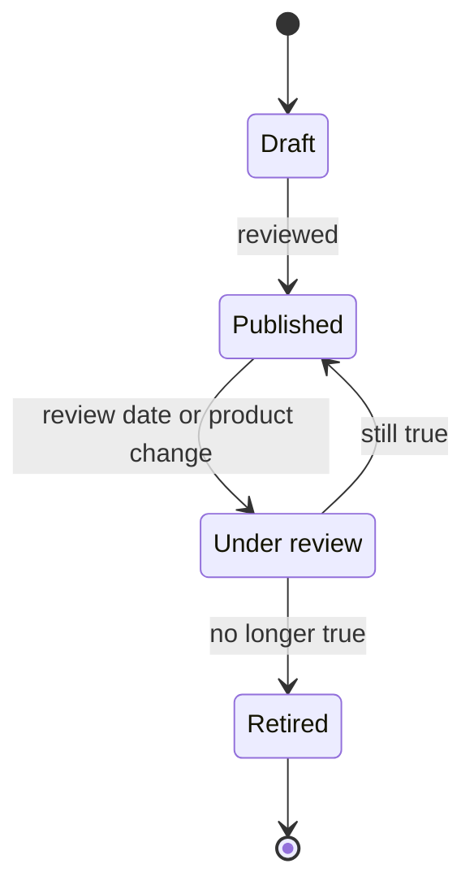

*Figure 25.1 — The life of an insight. A retired insight stays visible, marked as retired.*

Also log decisions. Link each insight to the decisions it informed and each decision to its evidence. That log is how you show that research changed something.

The tool matters less than the rules. A carefully kept spreadsheet is better than a costly product nobody curates. If you add AI search on top, require every answer to cite its records (Chapter 24).

Signs of health: insights cited in plans, few insights past their review date, deletions made on time, and no study run twice.

### Worked example

Rosa files the study's main insight on November 23.

| Field | Record |
|---|---|
| ID | INS-2026-041 |
| Statement | Small merchants stop signing up because they are interrupted, not because the form is long. They leave to fetch a document or number, and nothing saves their place or brings them back. |
| Evidence | Study ONB-2026-10: 12 interviews, survey of 216, funnel for the week of October 5, audit of October 13 |
| Applies to | US small merchants. Strongest for solo owners on phones. |
| Confidence | High on the cause; medium on its size |
| Conflicts with | INS-2025-017, "Merchants want the fastest possible sign-up" (2025 sales survey of stated preferences). Linked; the older record moves to under review. |
| Decisions informed | Q1 2027 roadmap: Release 1, prepare and resume |
| Owner and review | Rosa. Review in April 2027, or when resume ships, whichever comes first. |
| Raw data | 12 recordings, restricted. Delete by October 30, 2027. |

Two fields earn their place within months.

The conflict link sends INS-2025-017 for review. It rested on merchants *saying* they wanted speed, which is rung 2 on Chapter 1's ladder. It is retired with a note pointing to the newer record.

The review trigger fires in February, when save-and-resume ships. The insight describes a form that no longer exists. Rosa moves it to under review, and March's interviews show interruption has faded while the owner question now leads. INS-2026-041 is retired too. When the new PM asks why the form was not shortened, the repository gives the answer, the evidence, and the date it stopped applying.

### Common mistakes

| Mistake | Why it bites | Do this instead |
|---|---|---|
| A folder of slide decks | Nobody can find a finding without reading everything | One record per insight, linked to evidence |
| Insights with no review date | Old findings keep steering new decisions | Review dates and a retired status |
| Raw recordings open to all, kept forever | Privacy risk that grows every year | Restrict access and delete on schedule |

### Check yourself

**Q25.1** What is the difference between a study record and an insight record?

**Q25.2** Why was INS-2026-041 retired even though it was true when written?

> [!IMPORTANT]
> **In one line:** Store each insight as its own dated, owned, evidence-linked record, review it when the product changes, and delete the raw data when you said you would.

# Part VI — Practice

## 26. Labs

Each lab takes 20 to 30 minutes. Work on paper first, then compare with the model answer, which is one good answer and not the only one. The last section of each lab says what a reviewer or interviewer would look for.

### Lab 1 — From a request to a decision sentence

#### Scenario

PayFlow's head of sales writes: "Merchants keep asking for instant payouts. Let's survey them: would you pay 1% to get your money in minutes?" You know four things. Standard payouts take two business days. Forty-six sales call notes last quarter mention payout speed. PayFlow's bank would charge PayFlow for every instant payout. Nobody knows how often merchants actually run short of cash.

#### Your task

1. Write the decision sentence.
2. Name the riskiest assumption.
3. Choose up to three methods, in order, and say why the proposed survey is not one of them.

#### Hints

What would PayFlow do with no further evidence? Which rung of Chapter 1's ladder is "would you pay"?

#### Model answer

Decision sentence: "We will not build instant payouts this half, unless we learn that a meaningful share of merchants regularly need same-day money and already pay something to get it."

Riskiest assumption: that merchants will pay. Forty-six mentions show interest, not payment.

| Order | Method | What it adds |
|---|---|---|
| 1 | Read the 46 call notes, and count payout-timing tickets per 1,000 merchants | Who asks, and in what situation |
| 2 | Ten interviews about the last time money was needed sooner | What they did instead: a credit card, a loan, a late supplier payment |
| 3 | A fake door: "Get paid in minutes for 1%", with an honest "not yet" | Whether people act when a price is shown |

The survey asks for a prediction about paying, which is rung 2 evidence, and it names the price in a way that anchors every answer.

#### What a reviewer checks

- The default is stated, and it is "no".
- Willingness to pay, not interest, is picked as the risk.
- Evidence moves from what people say toward what they do.

### Lab 2 — Repair an interview guide

#### Scenario

A colleague plans to interview merchants whose payout failed last month. The guide reads:

1. "How frustrated were you when your payout failed?"
2. "Would you like a text message when a payout fails?"
3. "Do you usually check your balance every day?"
4. "Don't you think the error message should explain more?"
5. "On a scale of 1 to 10, how likely are you to keep using PayFlow?"
6. "Why did you enter the wrong bank details?"

#### Your task

Say what is wrong with each question, then rewrite the guide as five prompts.

#### Hints

Look for leading, predicting, generalizing, blaming, and one question that belongs in a different method.

#### Model answer

| No. | Problem | Rewrite |
|---|---|---|
| 1 | Leading: assumes frustration | "Tell me about the day the payout didn't arrive. How did you find out?" |
| 2 | Asks for a prediction and pitches a solution | "What did you do first?" |
| 3 | "Usually" invites a self-portrait | "When did you last look at your balance? What prompted that?" |
| 4 | Leading | "What did the screen tell you? What did you make of it?" |
| 5 | A survey item; six answers cannot be counted | Remove |
| 6 | Blames, and assumes the cause | "Walk me through what happened with the bank details." |

End with "What should I have asked that I didn't?"

#### What a reviewer checks

- Every prompt is about one specific past event.
- Nothing blames the participant.
- The rating question is removed, not reworded.

### Lab 3 — Build a sample and a screener

#### Scenario

You will study how finance staff at mid-size merchants put together evidence for disputed payments. You can afford ten sessions. Two sources are on offer.

- Nine volunteers from the customer advisory board. All have used PayFlow for over five years and have a named account manager.
- A database list of 310 merchants with at least five disputes in the last 60 days. Of these, 120 sent evidence for none of them.

#### Your task

1. Say who you recruit, with quotas.
2. Write three screener questions.
3. Name who your sample still misses.

#### Hints

Which group is the product failing most? Which source is a convenience sample?

#### Model answer

Use one advisory board member to rehearse the session, and no more. They are veterans with personal support.

Recruit from the 310.

| Quota | Sessions |
|---|---|
| Sent evidence for most recent disputes | 4 |
| Sent evidence for none (from the 120) | 4 |
| Use an outside bookkeeper or service for disputes | 2 |

Screener: "When did you last respond to a disputed payment?" (within 30 days continues). "Who in your business gathers the evidence?" (if someone else, ask to be introduced). "Of your last five disputes, for how many did you send evidence?" (fills the quota). Add the access-needs question, which never screens out.

Still missing: merchants with fewer than five disputes, merchants who left PayFlow, and anyone who ignores PayFlow's email.

#### What a reviewer checks

- People who do *not* respond to disputes are included on purpose.
- Screener questions ask about recent behavior.
- The gaps are named.

### Lab 4 — Does the survey's top answer survive weighting?

#### Scenario

On November 18 Tomás challenges the survey from Chapter 11: "Your respondents were mostly on computers. Merchants who give up are mostly on phones." He is right. Of the 840 who stop each week, 564 are on phones. Of the 216 respondents, 95 were.

| Answer | Phone (95) | Computer (121) |
|---|---|---|
| No document to hand | 44 | 34 |
| Did not understand a question | 16 | 25 |
| Lost my progress | 21 | 11 |
| Taking too long | 3 | 8 |

#### Your task

1. Recalculate each answer's share as if phones and computers were represented in their true proportions.
2. Say what this correction cannot fix.

#### Hints

Work out the rate within each device first. Then combine the two rates using the shares in the full group.

#### Model answer

```python
        raw = sum(by_device.values()) / n
        weighted = sum(FRAME_SHARE[d] * by_device[d] / RESPONDENTS[d]
                       for d in RESPONDENTS)
```

Output:

```text
phones: 67% of those who gave up, 44% of those who answered

answer                           as collected  weighted
No document to hand                       36%       40%
Did not understand a question             19%       18%
Lost my progress                          15%       18%
Taking too long                            5%        4%
```

"No document to hand" rises from 36% to 40%, because phone users chose it more often (44 of 95) than computer users (34 of 121). "Taking too long" stays near the bottom. Tomás's objection was fair, and the conclusion survives it.

Weighting corrects an imbalance you can measure. It cannot correct for differences *inside* each device group between merchants who answer surveys and merchants who do not.

#### What a reviewer checks

- Rates are computed per group before combining.
- The limit of weighting is stated.
- The objection is treated as a test, not an attack.

### Lab 5 — Write up a usability test

#### Scenario

Five merchants tried a prototype of PayFlow Assist answering "Why is my payout smaller than expected?" Rosa's notes:

- (a) 4 of 5 read the answer and correctly explained the shortfall.
- (b) 2 of 5 could not find where the numbers came from. The "Sources" link is pale gray, below the answer.
- (c) P2 asked a follow-up, "Will I get the $640 back?" The dispute was still open. The assistant said yes. She said "great" and stopped.

| | P1 | P2 | P3 | P4 | P5 |
|---|---|---|---|---|---|
| SUS answers, one digit per statement | 4242424242 | 5151425152 | 3242334232 | 4241424243 | 4152425242 |

#### Your task

1. Rate (b) and (c) from 0 to 4, with reasons.
2. Compute the SUS scores and say how you would report them.
3. Write one sentence for the readout.

#### Hints

Which finding is a critical error? Whose SUS score is highest?

#### Model answer

(c) is a 4. It is a critical error about money: the answer was wrong, and the merchant believed it. Seen once, and impact still leads. (b) is a 3. An answer that cannot be checked asks for blind trust.

```python
scores = {who: sus_score(a) for who, a in ANSWERS.items()}
print("  ".join(f"{who} {score:.1f}" for who, score in scores.items()))
print(f"mean {mean(scores.values()):.1f}")
```

Output:

```text
P1 75.0  P2 92.5  P3 65.0  P4 75.0  P5 82.5
mean 78.0
```

Report the five scores, not the mean. The highest, 92.5, belongs to P2, the participant who was misled. SUS measures how an experience felt. It cannot tell you whether the product was right.

Readout sentence: "Assist explained a short payout correctly for 4 of 5 merchants, but once gave a confident wrong answer about disputed money that the merchant accepted, which must be fixed before any release."

#### What a reviewer checks

- Impact outranks frequency.
- Counts are used, and SUS is not offered as proof of quality.
- The happiest participant is recognized as the one most at risk.

### Lab 6 — Audit an AI-written synthesis

#### Scenario

An AI tool summarized six interviews with administrators at large merchants about user permissions. The prompt was: "Summarize the frustrations admins have with permissions and the features they want." The summary:

1. "All admins are frustrated with the permissions page."
2. "'I spend half my week resetting access,' said one admin."
3. "Most want role templates."
4. "Auditors drive urgency."

You read the transcripts. Three of six expressed frustration; two said the page works fine. The nearest real line to the quote is P4's: "Access resets take up a chunk of my Mondays." Two of six asked for something like templates. Four of six create a new user by copying a colleague's permissions. One, at a bank-owned merchant, mentioned auditors.

#### Your task

1. Mark each claim as supported, overstated, or invented.
2. Say how the prompt shaped the summary.
3. Rewrite claim 3 as a four-part finding.

#### Hints

Count people. Look for a workaround hiding behind a feature request.

#### Model answer

| Claim | Verdict | Evidence |
|---|---|---|
| 1 | Overstated | 3 of 6, and 2 said it works |
| 2 | Invented quote | The real line is milder; use it, with its time code |
| 3 | Overstated | 2 of 6 asked; 4 of 6 copy an existing user |
| 4 | Overstated | 1 of 6; park it |

The prompt presupposed frustrations and features, so the model supplied both. A neutral prompt would ask what administrators did the last time they changed someone's access.

| Part | Finding |
|---|---|
| Observation | 4 of 6 set up a new user by copying a colleague's permissions. 2 of 6 asked for templates. |
| Interpretation | Administrators think "same access as Dana", not in individual permissions. |
| Implication | Prototype "copy access from a person" beside role templates, and compare. |
| Confidence | Medium. Six administrators, all at large merchants. |

#### What a reviewer checks

- Every claim is checked against a count.
- The altered quote is caught.
- The workaround is valued above the request.

## 27. Worked cases

Three cases that combine several chapters. Read them as stories about how the pieces fit together.

### Case 1 — The score that became a scoreboard

**The situation.** PayFlow's support leaders are paid a bonus on CSAT. The score has risen for a year, and so have complaints to account managers. NPS sits on the executive dashboard as one number.

**What was wrong.** Agents chose when to send the CSAT link, and sent it after calls that went well. That is selection bias built into the measure. NPS was blended, had no range, and nobody contacted detractors.

**The redesign.**

1. State the purpose: to find and fix problems. Scoring people is not the purpose.
2. Fix the frame and the channel. NPS goes by email to a random sample of all active merchants each quarter. CSAT is sent automatically after every closed ticket.
3. Report *n*, the range, and splits by tenure and size.
4. Close the loop. Every rating of 1 or 2 gets a call within two working days, and themes are reviewed monthly.
5. Remove the bonus on the score. Reward the share of low ratings that received a call.

**The first honest reading.** One month of automatic CSAT on onboarding tickets:

```python
satisfied = RATINGS[5] + RATINGS[4]
low, high = wilson(satisfied, n)
average = sum(score * count for score, count in RATINGS.items()) / n
```

Output:

```text
n = 150
CSAT (rated 4 or 5): 70%, 95% interval 62% to 77%
average rating: 3.86 out of 5
rated 1 or 2: 17% (25 merchants to call back)
```

The old figure had been in the nineties. Seventy percent is lower because unhappy merchants are now being asked. You warned the executives before the change, so the new number is read as more accurate and nobody takes it for a decline.

**Chapters used:** 12, 13, 18.

### Case 2 — Whose mistake is a failed payout?

**The situation.** Failed payouts are rising, and two teams tell opposite stories.

| Source | What it shows |
|---|---|
| Operations log | 212 of last month's 300 failed payouts had bank details that did not match the account |
| Support tickets | The commonest phrase is "PayFlow lost my money" |
| Survey of affected merchants | 87 of 140 chose "PayFlow made a mistake" |
| Six interviews | 5 of 6 had changed bank accounts shortly before; none saw a warning or a confirmation |

Operations concludes that merchants make typing errors. Support concludes that merchants blame PayFlow. Each wants the other's data discounted.

**Resolving it.** Apply Chapter 18's fifth question: are they using one word for two things? The log records the *mechanical* cause. Merchants report the *experienced* cause. Both are accurate. A wrong digit did cause the failure. PayFlow also accepted the digit without checking it and said nothing useful when the bank returned the money.

**The insight.** "Merchants who change bank accounts enter details once, unchecked, and learn of a mistake only when money fails to arrive, so a typing error is experienced as PayFlow losing their money."

**The decision.** Verify new bank details at entry, and state where the money is when a payout fails. Operations and support both see their own evidence in the insight, and the argument between them stops.

**Still unknown:** the cause of the other 88 failures.

**Chapters used:** 10, 15, 18.

### Case 3 — Testing an AI helper before building it

**The situation.** The concierge test in Chapter 21 found that 19 of 26 setup calls were really one question: which document is needed. Tomás proposes an AI model inside sign-up to answer document questions.

**The risks, ranked.** A wrong answer about a legal document sends a merchant away with false confidence, which is a viability risk. Merchants may not trust a chat box with identity questions, which is a value risk. And the need may be too narrow to justify a model at all.

**The plan.**

| Step | What happens | Pass mark, set in advance |
|---|---|---|
| Baseline | A static page: which document, with pictures | None; this is the comparison |
| Wizard of Oz | A chat box in sign-up for 60 merchants. Sam's team answers, using only the written document policy. | More first-try acceptable uploads than the page; zero answers that contradict policy |
| Read the questions | Sort all 60 conversations by question type | — |

Merchants are told at the start that staff may read the chat, and afterward that a person answered. Transcripts are pseudonymized and train nothing.

**What it showed.** Forty-eight of the 60 conversations fell into five question types, all of which the static page could answer once it was reworded. The assistant only added value on the other twelve.

**The decision.** Ship the page and the specific rejection messages. Do not build the assistant yet. If the unusual questions grow, revisit it with a beta whose exit criteria include an audited sample of answers with no policy contradictions.

**The lesson.** A validation test can end with the cheaper option winning.

**Chapters used:** 5, 21, 24.

# Part VII — Interview kit

## 28. L-E-A-R-N on one complete answer

"How would you find out?" questions turn up in product sense, execution, and analytical rounds. The interviewer is not checking whether you know the names of methods. They are watching whether you start from a decision, use what already exists, and can say what you would do with each result.

**L-E-A-R-N** is this book's own mnemonic for spending about twelve minutes on such a question.

| Step | What you do | Minutes |
|---|---|---|
| **L**ock the decision | Ask what the research is for: which decision, whose, by when. Say the decision sentence. | 2 |
| **E**xisting evidence | Name what is already available and cheap, and what it can and cannot show | 2 |
| **A**ssumptions, ranked | List candidate causes and say which evidence would tell them apart | 2 |
| **R**esearch design | Methods in order, with who, how many, what you would ask, and how long | 4 |
| **N**ext decision | What each result would lead to, how you would validate the fix, and what you still would not know | 2 |

Here is one answer, written as a strong candidate would say it. The prompt is: **"Merchants start onboarding and never finish. How would you find out why?"**

### The answer, as spoken

#### Lock the decision (minutes 0 to 2)

"Before I choose a method, I'd like to know what decision this feeds. I'll assume we are a payments company, that onboarding means the sign-up and verification a business completes before it can take payments, and that the team has about a quarter to improve it. Is the decision 'what do we build next quarter to raise completion', and does someone make it in about six weeks?"

*Interviewer: Yes. And the head of growth already thinks the form is too long.*

"That gives me a default. My decision sentence is: we will shorten the form unless we learn that length is not the main reason people stop. That belief carries the whole quarter, and so far it is one person's opinion, so that is what I'd test."

#### Existing evidence (minutes 2 to 4)

"Two things cost an afternoon. First, the funnel: of everyone who starts, how many reach each step, split by device and business type. I'm looking for the shape. A form that is simply too long should leak a little at every step. A cliff at one or two steps points to something specific. I'd also compare how long finishers spend typing with how many days they take.

"Second, I'd read fifty or sixty support tickets about sign-up. Tickets over-represent people who hit an error and cared enough to write, so I'd treat them as a list of suspects and not as proportions."

#### Assumptions, ranked (minutes 4 to 6)

"That should leave a short list of causes. My guesses: the form is too long; people don't understand a question; they lack something it asks for, such as a document; something breaks, such as an upload being rejected; or they found another way to get paid. The funnel cannot separate these. A drop at the document step fits three of them. So I need the story from the people it happened to."

#### Research design (minutes 6 to 10)

"Step one is interviews. Twelve merchants who started in the last two weeks, because memory fades. Eight who stopped, spread across the steps where the funnel drops, and four who finished, so I can see what they did differently. I'd make sure phone users and businesses with several owners are included, and reserve places for people who use assistive technology, since a barrier for them looks like silent drop-off in the data.

"I would not ask 'Why did you stop?' or 'Was it too long?' I'd ask: 'Take me back to the day you started signing up. Where were you? What happened next? What did you do instead?' Then I'd group what we heard into themes, with the designer and an engineer in the room.

"Step two is sizing. Interviews give reasons, not proportions. I'd turn the themes into answer options for a two-minute survey, sent to a random sample of everyone who stopped in the last month: 'What was the main reason you did not finish?' I'd report each share with its margin of error and compare who answered with who was invited.

"That is about four weeks: one for data and tickets, two for interviews, and one for the survey while we synthesize."

*Interviewer: Why not just A/B test a shorter form?*

"It would take most of a quarter to build and it tests one of my five guesses. If it loses, I know one thing that is not the cause and nothing about what is. I'd spend four weeks finding the likely cause, then use an experiment to measure the fix."

#### Next decision (minutes 10 to 12)

"Here is what each result leads to. If length dominates in both the interviews and the survey, we shorten the form, with the risk team involved, because some verification steps are legally required. If people lack a document, we tell them what to have ready and let them save and return. If it is comprehension, we rewrite the questions and test the wording on a prototype with five users.

"Whichever leads, I'd prototype it and run a small usability test before building, then release behind an experiment, with completion as the measure and fraud and support contacts as guardrails.

"Two limits I'd state up front: we will not hear from people who ignore our email, and we will not know about markets we did not recruit in. And before starting I would show this plan to the head of growth and ask what result he would not believe, so that the answer lands when it arrives."

### Why this answer works

- **It starts from a decision** and names whose belief is being tested.
- **It uses free evidence first** and says what that evidence cannot show.
- **It names rival explanations**, so the research is designed to tell them apart.
- **Each method has a job**, with who, how many, and what would be asked.
- **It answers "just A/B test it"** with a cost argument, not a lecture.
- **It ends with actions, limits, and a stakeholder**, which is where most answers stop short.

## 29. How interviewers score, and a question bank

### What is being scored

| Dimension | A weak answer | A strong answer |
|---|---|---|
| Framing | "I'd run some user interviews" | Names the decision, the default, and the riskiest assumption |
| Use of what exists | Jumps to new research | Starts with analytics and tickets, and states their blind spots |
| Method fit | One favorite method for everything | Matches say or do, depth or count, to each question |
| Rigor | "Talk to users" | Who, how many, how recruited, what is asked, how bias is limited |
| Honesty about limits | Certainty from twelve interviews | Counts, ranges, and what remains unknown |
| Action | Ends with "then we'd have insights" | Says what each result would change, and how the fix gets validated |

### Four ways answers fail, and how to recover

| Pattern | What it sounds like | Recover by saying |
|---|---|---|
| Method first | "I'd send a survey" in the first sentence | "Let me step back. What decision is this for?" |
| Asking users for the answer | "I'd ask them why they left" | "I'd ask what happened the last time, and what they did instead." |
| False precision | "60% of users said" from five people | "Three of five. I'd size it with a survey." |
| No so-what | Stops at findings | "If we learn A, we do X. If B, we do Y." |

Practice aloud with a timer. Twelve minutes is shorter than it feels.

### Question bank

Nine prompts with outlines. The letters refer to L-E-A-R-N. Say each in your own words.

**1. "NPS dropped five points this quarter. What do you do?"**

- L: Is anyone about to act on it? E: Get *n*, the range, and how it was collected both times. A: Noise, a change of channel, a shift in who answered, or a real change. R: Split by tenure and plan; read detractor comments; check behavior such as churn and tickets. N: Act only if a segment moved beyond its range.

**2. "How would you decide whether to build instant payouts?"**

- L: Default is no. E: Sales notes, payout tickets. A: Riskiest is willingness to pay. R: Interviews about the last cash squeeze, then a fake door with a price. N: A pass mark fixed in advance; pilot with a few merchants.

**3. "You have one week and no researcher. Why aren't large merchants adopting role-based permissions?"**

- L: What ships or stops as a result? E: Usage data by account; support tickets. A: Not found, not understood, not needed, or a workaround exists. R: Five 30-minute calls with administrators, some adopters and some not, asking for the last access change. N: Counts, not percentages; name the workaround.

**4. "Design a survey to measure satisfaction with support."**

- L: What will change based on it? E: Existing ticket data. A: Agents choosing who is asked. R: Automatic send after every closed ticket; one rating, one "main reason" question; report top-two-box with *n* and range. N: Call everyone who rates 1 or 2.

**5. "Sales says customers want feature X. Data shows nobody uses the similar feature Y."**

- L: The decision is build X or not. E: Who asked, and who uses Y. A: Different customers, or saying versus doing. R: Interview requesters about the last time they needed it; check whether Y is findable. N: Fix Y's discovery before building X.

**6. "How many users do you need to talk to?"**

- It depends on the goal. To find problems: about five per distinct group, more for rare groups. For interview themes: until new sessions stop adding any, often around a dozen for one kind of user. To measure a share within 5 points: a few hundred randomly drawn.

**7. "How would you use AI in research? Would you use synthetic users?"**

- Delegate transcription, first-pass tagging, and summaries with linked quotes, and verify each. Keep interpretation. Synthetic users for rehearsal and hypotheses only: they echo common assumptions and vary less than people.

**8. "How do you validate demand before building?"**

- Climb from saying to doing: fake door, concierge, Wizard of Oz, pre-order. One assumption per test, a pass mark set first, honesty with customers, then a beta for safety and an experiment for lift.

**9. "Your CEO is sure of the cause and does not want research."**

- L: Accept the CEO's view as the default. E: Show what free evidence already says. A: Ask what result would change their mind. R: Propose the smallest test, days not weeks, running beside the build. N: Agree in advance what each outcome means.

# Part VIII — Reference

## Cheat sheet

Reread this the night before. Each block points back to its chapter.

**Before any study (Ch. 1).** "We will do X unless we learn Y." Find the assumption with the most damage if wrong and the least evidence. Evidence ladder: opinion, prediction, reported behavior, observed behavior, counted behavior, experiment.

**Method (Ch. 2).** Say or do? Depth or count? Start with what exists, go deep before you count, count when size decides.

**Plan (Ch. 3).** Decision, questions, methods, people, dates, "if we learn" rows, stopping rule. Ask skeptics what they would not believe.

**People (Ch. 4-6).** Quotas for range; random draw for counting. Screen on recent behavior. Five per distinct group. Consent in plain words, recording asked separately, stop any time, delete on a date. Reserve places for assistive technology users and test something real.

**Interview (Ch. 7).** The last time, not usually or would. Do not lead. Probe. Count to seven. Never sell.

**Prototype and test (Ch. 8-9).** Hypothesis and success criterion first; lowest fidelity that answers it. Record success, critical errors, time, recovery. "3 of 5", never "60%". Severity 0 to 4, impact first. SUS: odd answers minus 1, 5 minus even answers, sum times 2.5.

**Flow and audit (Ch. 10).** Draw unhappy branches. Friction is necessary, misplaced, or accidental. An audit lists suspects; users confirm them. Every finding gets an owner.

**Survey (Ch. 11).** One neutral idea per question, about what happened. Shuffle options. Random draw from a frame. Margin for a share: 1.96 times the square root of p(1 − p) / n. About 385 answers for 5 points, about 100 for 10.

**Scores (Ch. 12).** NPS = % promoters (9-10) − % detractors (0-6). CSAT = top-two-box. CES = effort on one task. Always *n*, range, segments. A score is an outcome and does not name its cause.

**Feedback (Ch. 13).** Collect, tag, count, route, act, close the loop. Per 1,000, not raw. A channel speaks for those who spoke.

**Segments (Ch. 14).** Basis matters, exclusive, stable, actionable, validated. Rate and size.

**Synthesis (Ch. 15).** One observation per note, group by meaning, count people, write who-what-why-so-what. Kappa = (observed − chance) ÷ (1 − chance).

**Models (Ch. 16-17).** Persona: behavior, goal, setting, obstacles, quote, evidence box. Journey map: today, from evidence, including time away. Story map: backbone across, thin end-to-end slices down.

**Triangulate (Ch. 18).** Same question? Same people? Same time? Say or do? Same definition?

**Psychology (Ch. 19).** Present bias, defaults, loss framing, anchoring, peak-end, social desirability. Hypotheses only. Expect small effects. Would the user be glad or annoyed?

**Report (Ch. 20).** Recommendation, three insights with counts, what it means per option, limits, next step. Two clicks to the source. Surprise nobody.

**Validate (Ch. 21).** Fake door for demand, concierge for value, Wizard of Oz for experience, pre-order for payment. Pass mark first. A beta checks safety; an experiment measures lift.

**Operate (Ch. 22-25).** Tear down the alternatives customers really use. Map who can say no. Weekly interviews by the trio, one outcome, one target opportunity. AI for clerical work, verified; real people for evidence. One dated, owned record per insight.

**Interview (Ch. 28).** Lock the decision · Existing evidence · Assumptions ranked · Research design · Next decision.

## Templates

Four templates, each filled in with a PayFlow example that is not a chapter's worked example. Copy the left-hand column to reuse one.

### 1. One-page research plan

For the dispute-evidence study in Lab 3.

| Field | Filled in |
|---|---|
| Decision | Build an evidence assistant, or fix dispute alerts first. Elena decides March 12, 2027. |
| Decision sentence | We will build the assistant unless we learn that most unanswered disputes went unanswered because the merchant found out too late. |
| Research questions | When and how do finance staff learn of a dispute? What do they do next? Where does the time go? |
| Methods and dates | Review 50 unanswered disputes, Feb 8-12. Ten sessions watching a live dispute being handled, Feb 15-26. |
| Participants | From the 310: 4 who answer most disputes, 4 who answer none, 2 who use a bookkeeper |
| If we learn | Late notice leads: fix alerts. Assembly time leads: build the assistant. Both: alerts first. |
| Stopping rule | Ten sessions; two more if the last two add a new cause |

### 2. Usability test session sheet

For the PayFlow Assist test in Lab 5. One sheet per participant.

| Part | Filled in |
|---|---|
| Say first | "I'm testing the assistant, not you. Please think aloud. I may not answer questions until the end." |
| Task 1 | "Your payout is smaller than you expected. Find out why." Ends when they state a reason. |
| Task 2 | "Decide whether you will get the money back." Ends when they give an answer. |
| Record per task | Success, with difficulty, or failure · critical errors · seconds · recovered unaided? · what they expected · one quote |
| After | Ten SUS statements, then "What would you change first?" |
| P2, task 2 | Success as she saw it; critical error (assistant said yes, dispute open); 40 s; no recovery; "Great." |

### 3. Survey specification

For the automatic support survey in Case 1.

| Field | Filled in |
|---|---|
| Construct | Satisfaction with the help received on one closed ticket |
| Frame and trigger | Every closed ticket; sent automatically two hours after closing |
| Question 1 | "How satisfied or dissatisfied were you with the help you received?" Five labeled points, very dissatisfied to very satisfied |
| Question 2 | "What is the main reason for your rating?" Open text |
| Reported as | Share rating 4 or 5, with *n* and range, by ticket tag and merchant tenure |
| Follow-up | Ratings of 1 or 2 create a callback task due in two working days |

### 4. Validation test card

For the instant payouts idea in Lab 1.

| Field | Filled in |
|---|---|
| Hypothesis | Merchants with payouts pending will choose a paid instant option when it is offered at the moment they check their balance |
| Test | Fake door: a "Get paid in minutes for 1%" button on the balance page, shown to 2,000 merchants for two weeks |
| What they see on click | "This is not available yet. Thank you for telling us you want it. Your payout arrives on its usual date." |
| Measure | Share of merchants shown the button who click it at least once |
| Pass mark | Low end of the 95% range at or above 5% |
| On pass / on fail | Pass: concierge pilot with 20 merchants at the real price. Fail: stop, and file the result. |
| Who could be harmed | A merchant counting on same-day money. Never show it on a failed or held payout. |

## Glossary

- **Accessibility.** The degree to which people with disabilities can perceive, operate, and understand a product.
- **Accommodation.** A change that lets a person take part in research, such as extra time or an interpreter.
- **Acquiescence bias.** The tendency to agree with a statement whatever it says.
- **Affinity mapping.** Sorting observations into groups by meaning, without fixing the groups in advance.
- **Anchoring.** The pull that the first number seen has on later estimates.
- **Assistive technology.** Equipment or software people use to operate a product, such as a screen reader or magnifier.
- **Assumption test.** A small trial of one belief a solution depends on.
- **Attitudinal data.** What people report: opinions, reasons, memories, intentions.
- **Backbone.** The top row of a story map: the user's main activities, in order.
- **Basis.** The attribute by which users are divided into segments.
- **Behavioral data.** What people actually did, observed or logged.
- **Beneficial owner.** A person who owns a large share of a business or controls it.
- **Beta test.** Release of a nearly finished product to a limited group before general launch.
- **Close the loop.** To tell a customer what was done with their feedback.
- **Coding.** Labeling each piece of text with a short code so that it can be counted.
- **Cohen's kappa.** A measure of how far two coders' agreement exceeds chance.
- **Competitor analysis.** An evidence-based comparison of how alternatives solve the same customer problem.
- **Concierge test.** Delivering a service by hand, openly, to learn whether it is valuable.
- **Confidence interval.** A range built to contain the true value in 95 of 100 repeated samples.
- **Construct.** The thing a survey question tries to measure but cannot observe directly.
- **Continuous discovery.** Weekly customer contact by the team building the product, in pursuit of a set outcome.
- **Convenience sample.** Participants chosen because they are easy to reach.
- **Critical error.** A mistake that makes the outcome wrong without the person noticing.
- **CSAT.** Customer satisfaction score: a rating of one interaction or product.
- **Customer Effort Score (CES).** A rating of how easy it was to get one thing done.
- **Data minimization.** Collecting only the personal data a study needs.
- **Decision sentence.** "We will do X unless we learn Y."
- **Default effect.** The tendency to stay with a pre-selected option.
- **Double-barreled question.** A question that asks two things at once.
- **Evaluative research.** Research that judges whether a solution works.
- **Exit criteria.** What must be true before a beta can become a general release.
- **Fake door test.** Showing the entrance to something not yet built and counting who tries to enter.
- **Feedback system.** A routine that collects, tags, counts, routes, and answers customer feedback.
- **Fidelity.** How close a prototype is to the real thing in looks, words, interaction, and data.
- **Framing effect.** A change in choices caused by presenting the same facts as a gain or as a loss.
- **Friction.** Anything that makes a step cost more effort, time, thought, or worry than it needs to.
- **Friction log.** A step-by-step record of every hesitation met while walking a flow.
- **Funnel.** A count of how many people reach each step of a flow.
- **Generative research.** Research that finds and explains problems.
- **Governance.** Rules for who may add, see, change, and remove research, and for keeping it true.
- **Hallucination.** Fluent AI output that is false.
- **Heuristic evaluation.** Several reviewers independently checking a design against usability principles.
- **Hypothesis.** A specific belief that a test could show to be false.
- **Inclusive research.** Research that deliberately includes people unlike the team in ability, language, device, or circumstance.
- **Informed consent.** Agreement to take part, given with knowledge of what will happen and freedom to refuse.
- **Insight.** A theme with its explanation and its consequence for a decision.
- **Insight record.** A repository entry for one insight, with evidence, confidence, owner, and status.
- **Interview guide.** A one-page plan for an interview: goal, prompts, follow-ups, timings.
- **Journey map.** A picture of one persona's experience of reaching a goal, stage by stage.
- **KYB.** "Know your business": the checks a payments company runs before moving a business's money.
- **Leading question.** A question that signals the answer expected.
- **Likert scale.** A row of ordered options, usually from strongly disagree to strongly agree.
- **Loss aversion.** The tendency for a loss to weigh more than an equal gain.
- **Margin of error.** Half the width of a confidence interval.
- **Merchant.** A business that accepts payments through PayFlow.
- **Method fit.** Whether a method can produce the kind of answer the question needs.
- **Mixed methods.** Combining qualitative and quantitative methods in one study.
- **Mutually exclusive.** Describes segments in which every user fits exactly one.
- **Net Promoter Score (NPS).** Percentage of promoters minus percentage of detractors on a 0 to 10 recommendation question.
- **Nonresponse bias.** Error that arises when people who answer differ from those who do not.
- **Onboarding.** Everything a new merchant does between choosing PayFlow and taking a first payment.
- **Opportunity.** A customer need or pain point worth addressing, stated without a solution.
- **Opportunity solution tree.** Teresa Torres's diagram linking an outcome to opportunities, solutions, and assumption tests.
- **Order effect.** A change in answers caused by the position of a question or option.
- **Outcome.** A measurable change in customer behavior a team is asked to achieve.
- **Pain point.** A specific moment where a person struggles.
- **Peak-end rule.** We remember an experience by its most intense moment and its end.
- **Persona.** A research-based description of a type of user, standing for a segment.
- **Personal data.** Any information about an identifiable person.
- **Power-interest grid.** A two-by-two that sorts stakeholders by influence and by how much they care.
- **Pre-order test.** Asking for money or commitment before a product exists.
- **Present bias.** Overweighting costs and benefits that arrive now.
- **Probe.** A neutral follow-up that asks for more.
- **Product discovery.** The work of deciding what to build, before and during building.
- **Product trio.** A product manager, a designer, and an engineer doing discovery together.
- **Proto-persona.** A persona sketched from assumptions before research.
- **Prototype.** A cheap, disposable version of an idea made to answer one question.
- **Provenance.** The record of where a piece of evidence came from and who checked it.
- **Pseudonymize.** To replace names with codes and keep the key separately.
- **Purposive sample.** Participants chosen on purpose to cover a range of relevant differences.
- **Qualitative research.** Studying a few people in depth to learn why and how.
- **Quantitative research.** Counting many people to learn how many and how much.
- **Rapport.** The ease that lets a participant speak honestly.
- **Readout.** The one-page or fifteen-minute summary of a study for the people deciding.
- **Recommendation.** The researcher's judgment about what to do, kept separate from findings.
- **Relationship survey.** A survey sent to a sample of all customers on a schedule.
- **Replication.** Repeating a study to see whether its result holds.
- **Research plan.** One page stating what will be learned, how, from whom, by when, and to what end.
- **Research question.** What the team wants to learn. It is not asked of participants directly.
- **Research report.** The record of a study's question, method, findings, confidence, and recommendation.
- **Research repository.** One searchable home for studies and insights.
- **Response rate.** The share of invited people who answer.
- **Retention period.** How long data is kept before deletion.
- **Riskiest assumption.** The belief with the most damage if wrong and the least evidence.
- **Sampling.** Choosing which people will stand in for a larger group.
- **Sampling frame.** The actual list from which a sample is drawn.
- **Saturation.** The point at which new sessions stop adding new themes.
- **Say-do gap.** The difference between what people report and what they do.
- **Screener.** A short questionnaire that decides who qualifies for a study.
- **Segmentation.** Dividing users into segments.
- **Selection bias.** Distortion that arises because of how people came to be in a group.
- **Severity.** A 0 to 4 rating of how serious a usability problem is.
- **Social desirability bias.** Giving answers that look good or please the asker.
- **Stakeholder.** Anyone who affects a decision or is affected by it.
- **Stakeholder map.** A list of stakeholders with their wants, fears, influence, and involvement.
- **Stopping rule.** A rule, set in advance, for when data collection ends.
- **Story map.** Work arranged along the user's journey and cut into end-to-end releases.
- **Success criterion.** What must be observed for a prototype's hypothesis to stand.
- **Survey.** The same questions asked of many people so that answers can be counted.
- **Survivorship bias.** Drawing conclusions only from those who passed some filter.
- **Sycophancy.** An AI model's tendency to agree with the view its user seems to hold.
- **Synthesis.** Turning raw observations into a few traceable statements a team can act on.
- **Synthetic users.** AI-generated stand-ins for research participants.
- **System Usability Scale (SUS).** John Brooke's ten-statement questionnaire that scores perceived usability from 0 to 100.
- **Task success.** Whether a participant finished a task without help.
- **Taxonomy.** A short, fixed list of tags with definitions.
- **Theme.** A named group of observations that recurs across participants.
- **Top-two-box.** The share of answers in the top two options of a scale.
- **Traceability.** Being able to follow a claim back to its raw evidence.
- **Transactional survey.** A survey triggered by an event, such as a closed ticket.
- **Triangulation.** Checking a finding against independent sources or methods.
- **Usability test.** Watching real users attempt realistic tasks on a design.
- **User flow.** The path a person takes through a product to reach a goal, with its branches.
- **User research.** Structured learning about users so that a decision gets better.
- **UX audit.** A structured expert review of a flow against known principles, without users.
- **Validation test.** A small real-world test of one risky assumption, with a pass mark set first.
- **Wizard of Oz test.** A test in which a person secretly does the work behind an apparently working product.

## Answers to "Check yourself"

### Part I

**Q1.1** "We will offer every new merchant a setup call, unless we learn that merchants who stop would not take one, or that calls do not lead to finished sign-ups."

**Q1.2** Rung 2, a prediction. Asking what she did the last time she met a long form would reach rung 3. Watching her fill one in would reach rung 4.

**Q2.1** Attitudinal, and second-hand. Analytics on the upload step (attempts, rejections, retries) or a usability test would show what merchants do.

**Q2.2** An experiment. Show each message to a random half and compare how many fix their upload. Interviews cannot measure a difference in rates.

**Q3.1** A research question is what the team wants to learn: "Why do merchants stop at the document step?" An interview question is what you say: "Tell me what happened when it asked for your license."

**Q3.2** No result would change the plan, so the study as designed is not worth running.

**Q4.1** They were picked with quotas to cover a range, not drawn at random, and twelve is far too few to estimate a share.

**Q4.2** 41%, so you would more likely miss it than see it. Recruit the affected group on purpose with a quota; the output shows 19 participants are needed for an 85% chance.

**Q5.1** Any four of: who is asking and why; what will happen and for how long; whether it is recorded and who will see it; how long data is kept; that they may skip or stop without penalty; that the thank-you does not depend on their answers.

**Q5.2** She keeps the gift card. Ask whether you may keep what she has said so far, and delete it if she says no.

**Q6.1** A barrier stops the task: the unnamed upload control for a screen reader user. Friction slows it: the Continue button hidden at 200% zoom.

**Q6.2** It removes the very people you need to include, and it asks for health information you do not need. Ask what people need in order to take part.

### Part II

**Q7.1** "Tell me what happened when you reached the upload step."

**Q7.2** "Tell me about the last time someone helped you set something up. What happened?"

**Q8.1** Words only: final text in plain boxes.

**Q8.2** For example. Hypothesis: "A text the morning after stopping will bring merchants back." Criterion: "At least 4 of 5 can say who sent it and where the link leads, and tap it."

**Q9.1** 90. Odd statements: 4 + 4 + 3 + 4 + 3 = 18. Even statements: 4 + 3 + 4 + 4 + 3 = 18. Then 36 × 2.5.

**Q9.2** Four of five is consistent with a true rate anywhere from 36% to 98%. Write "4 of 5" and describe what went wrong for the fifth.

**Q9.3** The outcome is wrong and the person does not notice. The participant uploaded a driver's license, it was accepted, and she thought she was finished.

**Q10.1** (a) Necessary. (b) Accidental. (c) Misplaced.

**Q10.2** That merchants leave to fetch a tax ID kept somewhere else. It depends on the merchant's life, which no screen review can see.

### Part III

**Q11.1** It is double-barreled: speed and clarity are two things. Ask about each separately.

**Q11.2** About 9 points: 1.96 times the square root of (0.3 × 0.7 / 100) is about 0.09.

**Q11.3** The respondents chose themselves and were already looking for help. The margin covers only the luck of a random draw, and this was not one.

**Q12.1** +25: 45% promoters minus 20% detractors.

**Q12.2** It reaches only merchants who finished. The ones who gave up never see it.

**Q13.1** No. It went from 40 tickets per 1,000 merchants to about 37.

**Q13.2** Tag the problem behind it, such as "could not resolve an issue without a person", plus the issue itself. Ask what they were trying to do.

**Q14.1** Actionable. Future volume is not known at sign-up, so you cannot treat those merchants differently in time.

**Q14.2** One owner, phone. It accounts for 36% of all losses because it is the largest group, so the same improvement gains more merchants there.

### Part IV

**Q15.1** "Merchants whose document photo is rejected (4 of the 8 who uploaded) cannot correct it because the message does not say what was wrong, which means they retry blindly, contact support, or leave."

**Q15.2** 0.6: (0.8 − 0.5) ÷ (1 − 0.5).

**Q16.1** Missing: behavior, goals, setting, obstacles, and an evidence box. Remove the age, hobby, and car unless one of them changes a design decision.

**Q16.2** The primary persona is the one the design must work for first, and solo owners on phones are the largest group and the largest share of losses.

**Q17.1** It shows which cells were observed, and how strongly, so the map can be checked and trusted.

**Q17.2** A slice has to work from end to end. A merchant who returns by the link still has to upload a document, so that step must be reachable from the link.

**Q18.1** Whether the three reports are independent. They may be repeating one large account's request. Then check what merchants did, not only what they said.

**Q18.2** Any of: the effort score sent only to approved merchants; tickets standing for all merchants; interviewing only finishers.

**Q19.1** The prompt arrives and motivation may remain, but ability is missing. At 2 pm she is in the salon and the tax ID is at home. Send it in the evening.

**Q19.2** "It might. The support is a pair of loyalty-card studies, and effects in practice are small. Let's run an experiment and keep the bar honest."

**Q20.1** Recommendation, insights, limits, then method, which goes in the appendix.

**Q20.2** "7 of 12 interviewees did not know what 'beneficial owner' meant, and 4 stopped at that step."

### Part V

**Q21.1** The pass mark was written first to prevent exactly this. Nine percent misses it. If the test was too short, say so and rerun it under a stated rule.

**Q21.2** The volunteers chose themselves, so they differ from typical merchants. There was also no randomly assigned comparison group in the same weeks.

**Q22.1** Its completion rate, and its fraud losses or the share of merchants stuck when documents are requested at first payout.

**Q22.2** High power, low interest: keep satisfied. Involve her at the points where she can say no, and do not send her everything.

**Q23.1** (a) is an opportunity. (b) is a solution.

**Q23.2** You are learning nothing about co-owned businesses or assistive technology users. Change who receives the invitation.

**Q24.1** For example: transcription, spot-checking names and numbers; summaries, verifying each quote against its time code; tagging, comparing with a human coder on a sample.

**Q24.2** Any three of: they know what has been written, not what is in a person's life; they are more agreeable and articulate than people; they vary less, so unusual cases vanish; they cannot be watched doing anything; their claims trace to no one.

**Q25.1** A study record describes a whole study. An insight record holds one finding with its evidence, confidence, owner, and status, so it can be reused.

**Q25.2** It described the form before save-and-resume shipped. The product changed, so it no longer described reality.

## Syllabus map

Where each topic of the original syllabus is taught.

| Version 1 topic | Version 2 chapter |
|---|---|
| 1. User Research | 1, 2 |
| 2. Net Promoter Score (NPS) | 12 |
| 3. Customer Service Survey | 12; Case 1; Template 3 |
| 4. Customer Satisfaction Measurement | 12; Case 1 |
| 5. User Friction | 10 |
| 6. Usability Test | 9; Lab 5 |
| 7. Stakeholder Analysis | 22 |
| 8. Competitor Analysis | 22 |
| 9. Product Validation Testing | 21; Case 3 |
| 10. Beta Testing | 21 |
| 11. Research Report | 20 |
| 12. Story Map | 17 |
| 13. Survey | 11 |
| 14. User Segmentation | 14 |
| 15. Customer Survey | 11; Lab 4 |
| 16. User Experience Audit | 10 |
| 17. Rapid Prototyping | 8 |
| 18. User Flow | 10 |
| 19. User Interview Guide | 7; Lab 2 |
| 20. Persona | 16 |
| 21. Research Plan | 3; Template 1 |
| 22. User Journey Map | 17 |
| 23. Continuous Discovery | 23 |
| 24. Customer Feedback Systems | 13 |
| 25. Sampling and Participant Recruitment | 4; Lab 3 |
| 26. Research Ethics, Consent and Privacy | 5 |
| 27. Inclusive and Accessibility Research | 6 |
| 28. Mixed Methods and Triangulation | 18; Case 2 |
| 29. User Psychology and Behavioral Science | 19 |
| 30. AI-Assisted Research and Synthetic Users | 24; Lab 6 |
| 31. Research Repository and Insight Governance | 25 |

## References

Research practice:

- Christian Rohrer, *When to Use Which User-Experience Research Methods*, Nielsen Norman Group: https://www.nngroup.com/articles/which-ux-research-methods/
- Marty Cagan, *The Four Big Risks*, Silicon Valley Product Group: https://www.svpg.com/four-big-risks/
- Rob Fitzpatrick, *The Mom Test* (book, 2013): https://www.momtestbook.com/
- GOV.UK Service Manual, *Plan user research for your service*: https://www.gov.uk/service-manual/user-research/plan-user-research-for-your-service
- G. Guest, A. Bunce, L. Johnson, "How Many Interviews Are Enough?", *Field Methods*, 2006.

Usability:

- Jakob Nielsen, *Why You Only Need to Test with 5 Users* (with the Nielsen and Landauer model): https://www.nngroup.com/articles/why-you-only-need-to-test-with-5-users/
- Jakob Nielsen, *10 Usability Heuristics for User Interface Design*: https://www.nngroup.com/articles/ten-usability-heuristics/
- John Brooke, "SUS: A 'quick and dirty' usability scale", in *Usability Evaluation in Industry* (Taylor & Francis, 1996).
- Jeff Sauro, *Measuring Usability with the System Usability Scale*: https://measuringu.com/sus/
- MeasuringU on the adjusted Wald interval: https://measuringu.com/wald/

Surveys and scores:

- Pew Research Center, *Writing Survey Questions*: https://www.pewresearch.org/writing-survey-questions/
- American Association for Public Opinion Research, *Margin of Sampling Error*: https://aapor.org/wp-content/uploads/2023/01/Margin-of-Sampling-Error-508.pdf
- Frederick F. Reichheld, "The One Number You Need to Grow", *Harvard Business Review*, December 2003: https://hbr.org/2003/12/the-one-number-you-need-to-grow
- T. Keiningham, B. Cooil, T. Andreassen, L. Aksoy, "A Longitudinal Examination of Net Promoter and Firm Revenue Growth", *Journal of Marketing*, 2007.
- M. Dixon, K. Freeman, N. Toman, "Stop Trying to Delight Your Customers", *Harvard Business Review*, July-August 2010: https://hbr.org/2010/07/stop-trying-to-delight-your-customers
- Jacob Cohen, "A Coefficient of Agreement for Nominal Scales", *Educational and Psychological Measurement*, 1960. J. R. Landis and G. G. Koch, "The Measurement of Observer Agreement for Categorical Data", 1977.

Models and discovery:

- Jeff Patton, *User Story Mapping* (O'Reilly, 2014) and *The New User Story Backlog is a Map*: https://jpattonassociates.com/the-new-backlog/
- Teresa Torres, *Continuous Discovery Habits* (2021) and *Opportunity Solution Trees*: https://www.producttalk.org/opportunity-solution-trees/
- Alan Cooper, *The Inmates Are Running the Asylum* (Sams).
- Eric Ries, *The Lean Startup* (Crown Business, 2011).

Ethics, privacy, and accessibility:

- General Data Protection Regulation, Articles 4, 6, 7, 9, 13, and 28: https://gdpr-info.eu/
- California Department of Justice, *California Consumer Privacy Act*: https://oag.ca.gov/privacy/ccpa
- GOV.UK Service Manual, *Getting informed consent for user research*: https://www.gov.uk/service-manual/user-research/getting-users-consent-for-research
- W3C, *Involving Users in Evaluating Web Accessibility*: https://www.w3.org/WAI/test-evaluate/involving-users/
- W3C, *Web Content Accessibility Guidelines (WCAG) 2.2*: https://www.w3.org/TR/WCAG22/
- UK Government Digital Service, *What we found when we tested tools on the world's least-accessible webpage* (2017): https://accessibility.blog.gov.uk/2017/02/24/what-we-found-when-we-tested-tools-on-the-worlds-least-accessible-webpage/

Behavioral science:

- Open Science Collaboration, "Estimating the reproducibility of psychological science", *Science*, 2015.
- M. Hagger and others, "A Multilab Preregistered Replication of the Ego-Depletion Effect", *Perspectives on Psychological Science*, 2016.
- B. Scheibehenne, R. Greifeneder, P. Todd, "Can There Ever Be Too Many Options?", *Journal of Consumer Research*, 2010.
- S. DellaVigna and E. Linos, "RCTs to Scale: Comprehensive Evidence from Two Nudge Units", *Econometrica*, 2022: https://www.econometricsociety.org/publications/econometrica/2022/01/01/rcts-scale-comprehensive-evidence-two-nudge-units
- J. Jachimowicz, S. Duncan, E. Weber, E. Johnson, "When and why defaults influence decisions", *Behavioural Public Policy*, 2019.
- K. Ruggeri and others, "Replicating patterns of prospect theory for decision under risk", *Nature Human Behaviour*, 2020.
- BJ Fogg, *Fogg Behavior Model*: https://www.behaviormodel.org/

AI in research:

- Maria Rosala and Kate Moran, *Synthetic Users: If, When, and How to Use AI-Generated "Research"*, Nielsen Norman Group, 2024: https://www.nngroup.com/articles/synthetic-users/
- J. Bisbee and others, "Synthetic Replacements for Human Survey Data? The Perils of Large Language Models", *Political Analysis*, 2024.
- J. S. Park and others, "Generative Agent Simulations of 1,000 People", preprint, 2024: https://arxiv.org/abs/2411.10109v1
- M. Sharma and others, "Towards Understanding Sycophancy in Language Models", 2023: https://arxiv.org/abs/2310.13548
- ICC/ESOMAR, *International Code on Market, Opinion and Social Research and Data Analytics*, 2025 revision.

Laws differ by country and change over time. Check legal obligations for your own research with qualified counsel. This handbook is for learning and is not legal advice.
