# Growth Strategy and Experimentation

**Version 2 · October 2026** · Volume 8 of the PM + AI Master Library

> Learn to explain how a product grows, find the one thing holding it back, and run experiments you can trust, all inside one payments company you will get to know well.

---

## Start here

### Who this is for

You are a product manager, or about to become one. You want three things:

- To explain, with numbers, how a product grows and where it is stuck.
- To design and read experiments without fooling yourself or your team.
- To answer growth interview questions such as "How would you grow X?" and "This metric dropped. What do you do?"

This is not a marketing course. Volume 9 covers positioning and launches, and Volume 10 goes deeper on lifetime value and financial models. This book stays on growth systems and experiments.

### What you need before you start

- Comfort with percentages. No statistics training: every term is explained when it first appears and again in the Glossary.
- A rough idea of what a payments company does. "Meet PayFlow" gives you all you need.
- Optional: Python 3.13. Every calculation in the book is a short script in the `volume-8-examples` folder, next to this book's PDF in the library (`01-curriculum/07-growth/`), and its real output is printed next to it, so you can read along without running anything.

### What you will be able to do

After the full path you will be able to:

- Build a four-input growth model and say which input matters most.
- Draw a product's growth loops and compare channels on the cost of the next customer.
- Define activation from data, and split a falling rate into mix shift and real change.
- Read a retention curve and a cohort table, and turn them into the value of a customer.
- Write an experiment brief with a sample size, and read the result with its interval, guardrails, and plumbing checks.
- Tell attribution from incrementality, and measure the second.

### How this book is organized

| Part | What you learn | Time |
|---|---|---|
| Meet PayFlow | The company, the cast, and the numbers used everywhere | 10 min |
| I. How growth works (Ch. 1-4) | The growth model, loops, strategy, teams | 60 min |
| II. Acquisition and distribution (Ch. 5-9) | Channels, search, virality, network effects, sales | 75 min |
| III. Activation, engagement, retention (Ch. 10-15) | Activation, onboarding, habits, persuasion, retention, win-back | 90 min |
| IV. Monetization (Ch. 16-17) | Pricing, packaging, subscriptions | 30 min |
| V. Experimentation (Ch. 18-23) | Program, design, plumbing, reading results, traps, incrementality | 100 min |
| VI. New frontiers (Ch. 24-25) | AI growth systems, international growth | 30 min |
| VII. Practice (Ch. 26-27) | Seven labs and three worked cases | 4 hr |
| VIII. Interview kit (Ch. 28-30) | One complete spoken answer, scoring, question bank | 60 min |
| IX. Reference | Cheat sheet, templates, glossary, answers, sources | As needed |

### Three ways to read it

**The 90-minute pre-interview path.**

1. Meet PayFlow (10 min).
2. Chapter 1, The growth model (10 min).
3. Chapter 2, Figure 2.1 and "The idea" (5 min).
4. Chapter 10, Activation (10 min).
5. Chapter 19, Experiment design (10 min).
6. Chapter 21, Reading experiment results (10 min).
7. Chapter 22, the peeking simulation only (5 min).
8. Chapter 28, the complete spoken answer (20 min).
9. The Cheat sheet (10 min).

**The weekend path.** About seven hours.

- Day one: Meet PayFlow and Parts I to III. Do Labs 1, 2, and 3.
- Day two: Chapters 16 and 18 to 23, then Part VIII. Do Labs 5 and 6.

**The full path.** About two weeks at 45 minutes a day. Read in order. Do Lab 1 after Part I, Lab 2 after Part II, Labs 3 and 4 after Part III, Labs 5 and 6 after Part V, and Lab 7 last. Then read the cases and answer three question-bank prompts out loud with a timer.

### How each chapter works

Chapters 1 to 25 follow the same six steps:

1. **Why it matters.** The concrete pain this idea prevents.
2. **The idea.** The concept in plain words.
3. **Worked example.** The idea applied to PayFlow, with real inputs and outputs.
4. **Common mistakes.** What goes wrong and what to do instead.
5. **Check yourself.** Two or three questions, numbered by chapter. Answers are in Part IX.
6. **In one line.** The sentence to remember.

### What's new in Version 2

- **A teaching order.** Thirty-one topics regrouped into 25 chapters that build on each other. The Syllabus map shows where each topic went.
- **One story.** The same company, people, and numbers from the first page to the last.
- **Numbers that were actually computed.** Seventeen short scripts for the chapters and seven for the labs and cases, each printed with its real output.
- **Pictures.** Eleven figures and five diagrams, including a growth model, a cohort heat map, and an experiment readout.
- **Practice with answers.** Seven distinct labs, three worked cases, and an answer for every "Check yourself" question.
- **A complete interview answer.** One growth question answered aloud from the first sentence to the last.

## Meet PayFlow

PayFlow is a fictional payments company and the only example in this book. Every number attached to it is made up for teaching and describes no real company.

### What PayFlow sells

A business that uses PayFlow is called a **merchant**. Merchants accept card payments through PayFlow and receive the money in their bank accounts.

| Product | What it does |
|---|---|
| Payments | Accepts card payments. Costs 2.9% + $0.30 per successful payment. |
| Payouts | Sends the merchant's money to its bank, two business days later |
| Invoices | Lets a merchant email a bill with a "Pay now" link |
| Disputes | Handles payments that customers challenge |
| Dashboard | The website and app where merchants see all of this |
| PayFlow Assist | An AI assistant that answers questions about a merchant's money |
| PayFlow Plus | A $25-a-month plan: instant payouts, advanced reports, Assist |

An average small merchant takes 150 payments a month at $40 each, which is $6,000. PayFlow's fee is 2.9% of $6,000 ($174) plus 150 × $0.30 ($45), or $219. About $135 of that goes to banks and card networks. PayFlow keeps $84. That $84 is its **gross profit** per active merchant per month: revenue minus the direct cost of serving the customer.

PayFlow has two kinds of merchant. **Self-serve** merchants sign up on the website and never speak to anyone. Larger merchants, such as Northwind Outfitters with $4 million a year in card sales, buy through a salesperson. This book follows the self-serve business.

### Five words for a merchant's life

- **Sign-up**: a business creates an account.
- **Activated**: it takes its first live payment within 14 days of signing up.
- **Active**: it took at least one successful payment in the last 30 days.
- **Dormant**: it was active once but has taken no payment in the last 30 days.
- **Resurrected**: it was dormant and is active again.

### The cast

| Person | Role |
|---|---|
| You | Growth PM for self-serve merchants |
| Lena Fischer | Product designer |
| Arjun Mehta | Engineering lead |
| Nadia Rahman | Data scientist |
| Carlos Mendes | Growth marketing lead; owns paid channels and search |
| Hannah Brooks | Head of sales |
| Priya Nair | Risk lead; owns identity verification |
| Maya Okafor | Owner of Juniper Bakery, a new merchant who signs up on her phone |

One partner also appears: ShopNest, a fictional online-store platform whose app store lists a PayFlow plugin.

### The situation

It is the first week of October 2026. The September numbers are in.

| Measure | Value |
|---|---|
| Active merchants | 90,000 |
| Dormant merchants | 60,000 |
| Sign-ups in September | 8,000 |
| Activation rate | 55%, down from 62% in August |
| Active merchants who go dormant each month | 3.0% |
| Dormant merchants who come back each month | 1.5% |

Activation fell seven points in one month, and nobody knows why. Carlos wants a bigger ad budget to make up the difference. Lena wants to redesign setup. You have to decide what the team does this quarter, and prove afterward that it worked.

# Part I — How growth works

## 1. The growth model

### Why it matters

Monday's growth meeting has three proposals. Carlos wants more ad budget. Lena wants to rebuild setup. Support wants a campaign to win back lost merchants. Each comes with a chart that goes up.

Without a shared model, nobody can say which matters most, so the loudest proposal wins. A growth model turns "what should we work on?" into arithmetic.

### The idea

A **growth model** is a small calculation that describes where your active users come from and where they go. Picture a bathtub. The water level is your active merchants. Two taps fill it: newly activated merchants and resurrected ones. One drain empties it: merchants going dormant. The level rises only when the taps beat the drain.

That picture is one line of accounting:

*Active at end of month = active at start + new + resurrected − churned*

**Churn** means customers who stop. Here a merchant churns in the month it goes dormant. Four inputs drive the whole thing:

- Sign-ups per month.
- **Activation rate**: the share of sign-ups that activate.
- **Churn rate**: the share of active merchants that go dormant in a month.
- **Resurrection rate**: the share of dormant merchants that come back in a month.

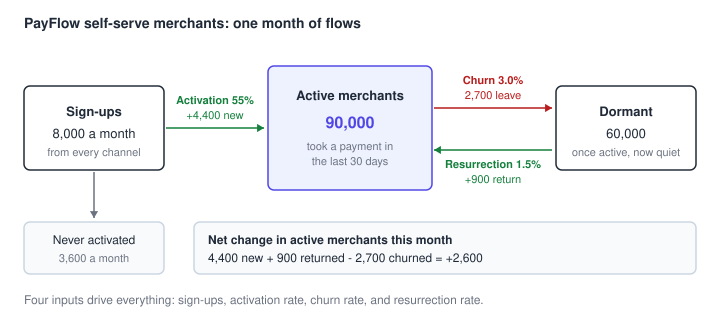

*Figure 1.1 — PayFlow's growth model for one month. Each arrow is one input multiplied by the box it leaves.*

A quick health check is the **quick ratio**: merchants gained divided by merchants lost. PayFlow's is (4,400 + 900) ÷ 2,700 = 1.96. Above 1, you are growing.

The model's real use is **sensitivity analysis**: change one input at a time by the same relative amount and see how much the result moves. The input that limits growth most right now is your **constraint**, and it deserves most of your effort.

### Worked example

Nadia writes the model in a few lines and improves each input by 10% in turn.

```python
BASE = dict(signups=8_000, activation=0.55, churn=0.030, resurrection=0.015)
PROFIT = 84  # gross profit per active merchant per month, in dollars


def simulate(months=12, active=90_000, dormant=60_000, **change):
    p = {**BASE, **change}
    merchant_months = 0
    for _ in range(months):
        new = p["signups"] * p["activation"]
        churned = active * p["churn"]
        resurrected = dormant * p["resurrection"]
        active += new + resurrected - churned
        dormant += churned - resurrected
        merchant_months += active
    return active, merchant_months


base_active, base_months = simulate()
print(f"Base case: {base_active:,.0f} active merchants after 12 months")
print()
print(f"{'Improve one input by 10%':<32}{'Active':>9}{'Extra':>8}{'Extra profit':>14}")
tests = [
    ("Sign-ups 8,000 -> 8,800", dict(signups=8_800)),
    ("Activation 55.0% -> 60.5%", dict(activation=0.605)),
    ("Churn 3.0% -> 2.7%", dict(churn=0.027)),
    ("Resurrection 1.50% -> 1.65%", dict(resurrection=0.0165)),
]
for label, change in tests:
    active, months = simulate(**change)
    profit = (months - base_months) * PROFIT
    print(f"{label:<32}{active:>9,.0f}{active - base_active:>8,.0f}{profit:>14,.0f}")
```

Output:

```text
Base case: 118,291 active merchants after 12 months

Improve one input by 10%           Active   Extra  Extra profit
Sign-ups 8,000 -> 8,800           122,818   4,527     2,598,715
Activation 55.0% -> 60.5%         122,818   4,527     2,598,715
Churn 3.0% -> 2.7%                121,300   3,008     1,684,418
Resurrection 1.50% -> 1.65%       119,301   1,009       561,728
```

Read the table from the right-hand column.

- **Sign-ups and activation tie.** New merchants are sign-ups × activation rate, so a 10% lift in either adds the same 440 merchants a month. Over a year that is 4,527 more active merchants and about $2.6 million of gross profit.
- **They do not cost the same.** Extra sign-ups have to be bought every month. Chapter 5 will show that the next merchants from paid search cost about $400 each and more with every step, so 440 more a month costs at least $176,000 a month, over $2.1 million a year. Most of the first-year gain goes to the ad platform. A better setup flow is built once.
- **Churn is third this year.** It applies to a base that keeps growing, so its value compounds.
- **Resurrection is the smallest lever.** At today's rates it adds least.

So activation is the constraint. One point of activation is worth 80 merchants a month (1% of 8,000), and September just lost seven points. The plan for the quarter starts there.

### Common mistakes

| Mistake | Why it bites | Do this instead |
|---|---|---|
| Counting sign-ups as growth | Sign-ups that never pay add nothing | Count active customers and the flows between states |
| Treating inputs as independent | Cheap sign-ups often activate worse | Re-check each rate when another input changes |
| One churn rate forever | New customers leave faster than old ones | Start simple, then use cohort curves (Chapter 14) |
| A model too big to explain | Nobody trusts it or updates it | Four inputs on one page, refreshed monthly |

### Check yourself

**Q1.1** A product has 20,000 active users, 1,000 sign-ups a month at 40% activation, 4% monthly churn, and 5,000 dormant users of whom 2% return each month. What is this month's net change?

**Q1.2** In the model, 10% more sign-ups and 10% better activation give the same result. Give one reason a PM would still prefer the activation work.

**Q1.3** What is the quick ratio for the product in Q1.1, and what does it tell you?

> [!IMPORTANT]
> **In one line:** Write growth as new plus resurrected minus churned, change one input at a time, and work on the one that moves the result most for the least cost.

## 2. Funnels and growth loops

### Why it matters

A team that sees growth only as a funnel asks one question forever: how do we pour more in at the top? Every new customer then has to be found and paid for. The products that grow fastest tend to have a mechanism in which today's users produce tomorrow's. If you cannot draw that mechanism for your product, you are renting your growth.

### The idea

A **funnel** is a sequence of steps that users pass through, with some dropping out at each one. The best-known growth funnel is **AARRR**, which Dave McClure presented in 2007 as "Startup Metrics for Pirates": Acquisition, Activation, Retention, Referral, Revenue. A funnel is an excellent diagnostic. It shows you where people fall out.

Its weakness is that it is a straight line. It says nothing about where the top comes from.

A **growth loop** is a closed system in which the output of one cycle becomes the input of the next. The framing was popularized in 2018 by a Reforge essay from Brian Balfour, Casey Winters, Kevin Kwok, and Andrew Chen. Every loop has four parts: a new user arrives, takes an action, the action produces an output, and the output is reinvested to bring in the next user.

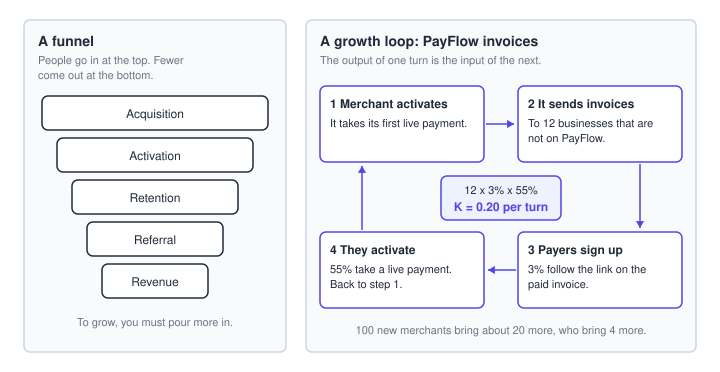

*Figure 2.1 — A funnel drains. A loop feeds itself. PayFlow's invoice loop returns 0.20 new merchants for every merchant that enters it.*

Loops come in a few kinds.

| Kind | Output that gets reinvested | PayFlow example |
|---|---|---|
| Viral | Exposure or invitations to non-users | Invoices sent to other businesses |
| Content | Pages that search engines find | Setup guides for each store platform |
| Paid | Profit that buys more advertising | Paid search |
| Sales | Revenue that funds more salespeople | Hannah's team |

Three numbers describe any loop. The **loop factor** is how many new users one user produces per cycle: multiply the step conversions together. The **cycle time** is how long one turn takes. Together those two set how fast the loop compounds. **Saturation** is whatever runs out as the loop turns, such as people not yet reached.

The two views work together. A funnel tells you where a loop leaks.

### Worked example

You map PayFlow's three loops on a whiteboard.

| Loop | One turn | What saturates |
|---|---|---|
| Invoices | A merchant bills 12 new businesses; 3% of payers sign up; 55% of those activate | Businesses already on PayFlow |
| Paid search | Gross profit funds ads; ads bring sign-ups | Search volume, at rising cost |
| ShopNest plugin | Each install adds reviews, which lift the plugin's rank, which adds installs | ShopNest's own merchant base |

The invoice loop factor is 12 × 3% × 55% = 0.198, call it 0.20. A hundred new merchants bring 20 more, who bring 4, who bring 1: about 125 in all. The loop does not sustain itself, but it turns every merchant gained elsewhere into 1.25 merchants, at no cost.

Notice the last step. The loop's final conversion is the activation rate, the same number that sits in the middle of the funnel. Restore activation from 55% to 62% and the loop factor rises to 12 × 3% × 62% = 0.22. One fix is paid twice: once in the funnel and again in the loop.

### Common mistakes

| Mistake | Why it bites | Do this instead |
|---|---|---|
| Arrows without reinvestment | A "loop" whose output feeds nothing is a funnel drawn in a circle | Name the output and show how it becomes the next input |
| Double counting | One merchant is credited to the loop and to paid search | Assign each new user to one source, or measure incrementally |
| Ignoring quality decay | Later turns bring weaker users | Track the loop factor for each month's new users |
| A loop with no numbers | It cannot be compared or improved | Put a conversion on every arrow |

### Check yourself

**Q2.1** Which is a loop? (a) Ads bring visitors, some sign up, some pay. (b) Users publish public pages, search engines index them, searchers find them and sign up, and they publish pages too.

**Q2.2** Each new user invites 4 people, and 10% of the invited join. What is the loop factor, and about how many users do 1,000 new users become in the end?

> [!IMPORTANT]
> **In one line:** Use a funnel to find the leak and a loop to explain the engine, and put a number on every arrow of both.

## 3. Growth strategy and the growth roadmap

### Why it matters

A backlog of forty experiment ideas is not a strategy. A team without one runs whatever is easiest to build, collects small wins that do not add up, and cannot say what it learned. When the quarter ends, the big number has not moved.

### The idea

A **growth strategy** is a short set of choices about where growth will come from, and what you will not do. It has five parts.

1. **Diagnosis.** What is true now, from the model and the data.
2. **Advantage.** What makes some kind of growth cheaper for you than for rivals: a loop, a partner, an asset nobody else has.
3. **Constraint.** The one input that limits growth most right now.
4. **Allocation.** How people and money are split across bets.
5. **Sequence.** The order. Fix a leaky product before buying traffic for it.

Two tools keep a strategy honest.

A **North Star metric** is one measure of the value customers get that also predicts long-term revenue. Sean Ellis popularized the term, and Amplitude's *North Star Playbook* by John Cutler and Jason Scherschligt pairs it with a handful of **input metrics** that teams can move directly. PayFlow's North Star is active merchants. Its inputs are the four from Chapter 1.

A fit check comes before any of this. Growth work amplifies **product-market fit**, meaning a product that a clear group of customers needs and keeps using. It cannot create fit. Sean Ellis's survey asks users, "How would you feel if you could no longer use this product?" His rule of thumb, from comparing startups, is that products where at least 40% answer "very disappointed" tend to be the ones that grow. A flattening retention curve (Chapter 14) is the same evidence in behavior.

A **growth roadmap** turns the strategy into a sequence of bets. A bet is not a feature. It names the input it targets, the reason to believe it, how it will be tested, and when a decision is due. Group bets into Now, Next, and Later.

### Worked example

Your one-page strategy for the fourth quarter:

| Part | PayFlow, Q4 2026 |
|---|---|
| Diagnosis | Activation fell from 62% to 55% in September. The model ranks activation and sign-ups as the strongest inputs. Churn is steady at 3.0%. |
| Advantage | The invoice loop and the ShopNest plugin bring merchants at almost no cost |
| Constraint | Activation |
| Allocation | 60% activation, 20% loop and partner, 10% win-back, 10% measuring paid social |
| Sequence | Repair activation, then decide what paid acquisition is worth |
| Not doing | Raising ad spend while activation is under 60%; new countries this quarter |

The roadmap follows from it.

| When | Bet | Input | Decision due |
|---|---|---|---|
| Now | Find and fix the September drop (Chapter 11) | Activation | Two weeks |
| Now | Test a guided setup checklist (Chapters 19 to 22) | Activation | Seven weeks |
| Next | Measure whether paid social adds sign-ups (Chapter 23) | Sign-ups | Six weeks |
| Next | Recover failed Plus renewals (Chapter 17) | Churn | Four weeks |
| Later | Plus free trial; Canada | Revenue, sign-ups | Next quarter |

The "Not doing" row is the one Carlos pushes back on. Your answer is arithmetic: at 55% activation, 100 sign-ups yield 55 merchants. At 62% the same spend yields 62. Every dollar of acquisition buys 13% more once activation is repaired, so the repair comes first.

### Common mistakes

| Mistake | Why it bites | Do this instead |
|---|---|---|
| A goal presented as a strategy | "Grow 40%" makes no choices | State the constraint and what you will not do |
| A roadmap of features | Shipping becomes the goal | List bets with a target input and a decision date |
| Local optimization | One team lifts its number and sinks the next step | Judge every bet on the North Star and on what must not get worse |
| No sequence | Traffic is bought for a leaky product | Order bets from retention backward to acquisition |

### Check yourself

**Q3.1** Which is a strategy? (a) "Reach 120,000 active merchants by June." (b) "Activation is our constraint, so 60% of the team works on setup and we freeze ad spend until it recovers."

**Q3.2** Name the five parts of a growth strategy.

> [!IMPORTANT]
> **In one line:** A growth strategy names the constraint, puts most of the effort on it, sequences the rest, and says out loud what will not be done.

## 4. Growth teams

### Why it matters

Activation at PayFlow touches marketing (who signs up), product (the setup flow), risk (identity checks), and engineering (the bank link). When nobody owns the rate itself, each group improves its own piece and the rate falls anyway. That is how a seven-point drop goes unnoticed for a month.

### The idea

A **growth team** is a cross-functional team that owns a metric, not a feature area. A typical team has a PM, a designer, three to five engineers, a data scientist, and a marketer.

Companies place such teams in one of two ways.

| Structure | How it works | Strength | Risk |
|---|---|---|---|
| Independent | A separate group under a head of growth | Speed and focus | Collides with the teams whose screens it changes |
| Embedded | Growth people sit inside each product team | Alignment with the product | Growth work loses to feature work |

Either can work. What matters is a written **team charter**: the metric the team owns, the surfaces it may change, the guardrails it must respect, and who has to approve what.

Three rituals keep the team learning.

- A weekly growth review: the metrics, last week's readouts, next week's launches, decisions.
- A design review before any experiment starts (Chapter 19).
- A monthly refresh of the growth model.

Leading a growth team is mostly about incentives. Give the team inputs it can actually move, not revenue. Pair every target with a **guardrail**, a measure that must not get worse, or the target will be hit in ways you did not want. Praise a well-run test that found nothing as much as a win, or people will stop reporting the tests that found nothing.

### Worked example

The charter you write for PayFlow's activation team:

| Field | Activation team |
|---|---|
| Owns | Activation rate: first live payment within 14 days of sign-up |
| May change | Sign-up, setup, first-payment screens, and setup emails |
| Must not change alone | What identity data is collected, or any risk threshold. Priya's team owns those. |
| Guardrails | Fraud loss rate, failed payouts, support contacts per new merchant |
| Approvals | Priya reviews any change to the order or wording of verification steps |
| Reports | Weekly review, Thursdays, 30 minutes |

The "must not change alone" row prevents the classic fight. The fastest way to raise activation is to skip identity verification, and it would also be the fastest way to fill PayFlow with fraud. Under the charter, the growth team can reorder, explain, and redesign verification screens, and Priya can veto anything that weakens the check itself. Both teams share the fraud guardrail, so neither wins by hurting the other.

The weekly review has a fixed agenda:

1. The four inputs against last week (5 minutes).
2. Readouts of finished experiments, wins and losses (10 minutes).
3. Experiments launching next week, with their briefs (10 minutes).
4. Decisions and owners (5 minutes).

### Common mistakes

| Mistake | Why it bites | Do this instead |
|---|---|---|
| A team named after a channel or feature | It defends the feature, not the outcome | Name the team after the metric it owns |
| Goals on numbers the team cannot move | Effort and results come apart | Set goals on inputs, and report the North Star |
| Changing other teams' screens unannounced | Trust is gone after the first incident | Agree surfaces and approvals in the charter |
| Celebrating only wins | Flat and negative results get buried | Review every readout, and praise sound method |

### Check yourself

**Q4.1** Name the four things a growth team charter should state.

**Q4.2** A growth team is given the goal "raise sign-ups 20%". What guardrail would you add, and why?

> [!IMPORTANT]
> **In one line:** Give a cross-functional team one metric, a written charter with guardrails, and a weekly review that treats losses as results.

# Part II — Acquisition and distribution

## 5. Acquisition and distribution channels

### Why it matters

Carlos's dashboard says paid search brings in merchants for $227 each, less than half of what PayFlow can afford. So he asks to raise the budget from $250,000 to $400,000 a month. The dashboard is right about the average and wrong about the decision. The last dollars of that increase would buy merchants at more than three times today's average.

### The idea

An **acquisition channel** is a repeatable way to turn strangers into sign-ups: paid search, search engine optimization, referrals, outbound sales. A **distribution channel** is someone else's platform or relationship that carries your product to their customers: an app store, a partner such as ShopNest, a reseller. You rent attention from the first kind. You borrow placement and trust from the second, and pay with a revenue share or with dependence on the partner's rules.

Ask five questions of any channel.

| Question | What you are checking |
|---|---|
| Reach | How many of the right people can it touch? |
| Fit | Does it reach them when they have the problem? |
| Cost | What does each activated customer cost? |
| Conversion | What share sign up, and what share activate? |
| Incrementality | Would those customers have come anyway? (Chapter 23) |

Cost has its own vocabulary. **Customer acquisition cost (CAC)** is spend divided by customers acquired. Count activated customers, not sign-ups. The **payback period** is how many months of gross profit it takes to earn the CAC back.

**Channel-model fit**, a term from Brian Balfour's "four fits" essays, is the idea that revenue per customer limits which channels you can afford. A merchant worth $84 a month cannot pay for a salesperson's visit. An account worth $20,000 a month can.

Every channel shows **saturation**: the first dollars reach the people most ready to buy, and each further dollar reaches people a little less ready. So the cost of the *next* customer, the **marginal CAC**, climbs above the average. Budgets should follow marginal cost. Move the next dollar to the channel where it buys the most, and stop when the next customer costs more than you can earn back in your payback limit.

### Worked example

PayFlow's limit is a six-month payback, which is 6 × $84 = $504 per activated merchant. Nadia fits a curve to 18 months of paid search results and prints both costs.

```python
from math import exp

CEILING, SCALE = 1_740, 250_000  # curve fitted to PayFlow's paid search history
PROFIT = 84                      # gross profit per active merchant per month


def activated(spend):
    """Activated merchants per month at a given monthly spend."""
    return CEILING * (1 - exp(-spend / SCALE))


print(f"{'Spend':>9}{'Merchants':>11}{'Average CAC':>13}{'Next $10k CAC':>15}"
      f"{'Payback':>10}")
for spend in range(50_000, 450_000, 50_000):
    merchants = activated(spend)
    marginal = 10_000 / (activated(spend + 10_000) - merchants)
    print(f"{spend:>9,}{merchants:>11,.0f}{spend / merchants:>13,.0f}"
          f"{marginal:>15,.0f}{marginal / PROFIT:>7.1f} mo")
```

Output:

```text
    Spend  Merchants  Average CAC  Next $10k CAC   Payback
   50,000        315          159            179    2.1 mo
  100,000        574          174            219    2.6 mo
  150,000        785          191            267    3.2 mo
  200,000        958          209            326    3.9 mo
  250,000      1,100          227            398    4.7 mo
  300,000      1,216          247            487    5.8 mo
  350,000      1,311          267            594    7.1 mo
  400,000      1,389          288            726    8.6 mo
```

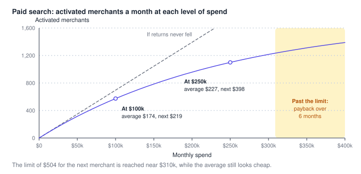

*Figure 5.1 — Paid search saturates. The dashed line is what constant returns would look like.*

Today, at $250,000, the average is $227 and the next merchants cost $398. At $400,000 the average would still read a comfortable $288, but the next merchants would cost $726 each and take 8.6 months to pay back. The limit is crossed just past $300,000. So the curve allows a modest rise and no more, and Chapter 3's sequence says not yet: repair activation first, and every one of these dollars buys more.

### Common mistakes

| Mistake | Why it bites | Do this instead |
|---|---|---|
| Deciding on average CAC | It hides what the next dollar buys | Estimate marginal CAC at the current spend |
| Counting sign-ups | A channel of people who never pay looks cheap | Divide by activated customers |
| One channel carrying most growth | A rule change can halve it overnight | Watch each channel's share and build a second |
| Trusting the channel's own count | Platforms credit themselves generously | Test incrementality before scaling |

### Check yourself

**Q5.1** A channel brings 400 customers at $80,000 a month and 440 at $100,000. What are the average CAC at $100,000 and the marginal CAC of the last $20,000?

**Q5.2** Acquisition or distribution? (a) Sponsoring a podcast. (b) A listing in an accounting tool's app directory.

> [!IMPORTANT]
> **In one line:** Judge a channel by what the next activated customer costs, and stop spending where that cost passes your payback limit.

## 6. Search: SEO and AI answer engines

### Why it matters

Someone types "how to accept card payments online" at the exact moment they have the problem PayFlow solves. Search is the one channel where the customer comes looking. It costs nothing per click, takes months to build, and keeps paying afterward. And more of those questions are now answered by an AI summary at the top of the page, sometimes with no click at all.

### The idea

**Search engine optimization (SEO)** is the work of making pages that deserve to rank and that search engines can find and understand. It has three layers.

- **Technical.** Pages can be crawled and indexed, load fast, and work on a phone.
- **Content.** Each page serves a **search intent**, the goal behind a query. Informational queries want an explanation, commercial ones a comparison, transactional ones a place to act, and navigational ones a specific site.
- **Authority.** Reputable sites link to and mention you.

Google's published guidance asks for "people-first" content: pages made to help readers, not to capture rankings. It describes quality with the letters E-E-A-T (experience, expertise, authoritativeness, trust) and says E-E-A-T is not itself a ranking factor. Its spam policies name "scaled content abuse": producing many pages mainly to manipulate rankings, including with generative AI, without adding value.

Measure search by activated customers from non-branded queries. **Branded search**, where someone types your name, is demand that some other activity created.

An **AI answer engine** writes an answer in the results and cites a few sources. Stay with what the providers document:

- Google says its AI Overviews and AI Mode have no extra requirements and need no special optimization, files, or markup. A page must be indexed and eligible to show a snippet.
- Google says these features may run several related searches behind one question, so a page that answers a specific sub-question can be cited.
- Google reports traffic from these features inside the normal Web totals in Search Console.
- OpenAI documents separate crawlers. OAI-SearchBot gathers pages for ChatGPT's search answers, and GPTBot gathers training data. Each can be allowed or blocked on its own line in `robots.txt`, so opting out of training need not mean vanishing from AI search.

Nobody outside these companies can verify a list of "AI ranking factors". Treat such lists as guesses, and measure for yourself.

### Worked example

Carlos's search plan maps queries to pages.

| Query | Intent | Page | Judged by |
|---|---|---|---|
| "how to accept card payments online" | Informational | A step-by-step guide with costs | Activated merchants |
| "card processing fees for a bakery" | Commercial | Pricing page with worked fee examples | Activated merchants |
| "ShopNest payment plugin" | Transactional | The plugin's install page | Installs that activate |
| "PayFlow login" | Navigational | None needed | Excluded from SEO results |

For AI answers, the team keeps a fixed list of 40 questions that merchants ask. Each month someone runs them through the major answer engines and records whether PayFlow is cited. In September it was cited for 9 of the 40. The misses cluster on fee questions for nonprofits, a case PayFlow's pricing page never states. The fix is not a trick. It is a clear, specific, checkable sentence on the pricing page.

Maya found PayFlow this way. She asked an assistant what a bakery pays to take cards, and the answer quoted PayFlow's worked example.

### Common mistakes

| Mistake | Why it bites | Do this instead |
|---|---|---|
| Counting branded clicks as SEO wins | You claim demand that ads or word of mouth created | Report non-branded separately |
| Mass-producing thin pages | It breaks spam policies and wastes crawl attention | Publish a page only if it helps a reader by itself |
| Blocking every AI crawler by reflex | You may disappear from AI search answers | Decide search and training access separately |
| Buying an "AI ranking" formula | Nobody can verify it | Track your own question list monthly |

### Check yourself

**Q6.1** Classify the intent: (a) "PayFlow dashboard", (b) "best way to invoice clients", (c) "sign up for card reader".

**Q6.2** What does Google say a page needs to appear in AI Overviews?

> [!IMPORTANT]
> **In one line:** Answer real questions with specific, checkable pages, judge search by activated customers from non-branded queries, and measure AI citations yourself.

## 7. Virality and referrals

### Why it matters

"Let's make it go viral" is a wish. Virality has a formula, and the formula tells you three useful things: whether a referral program is worth building, which part of it to improve, and how much of what it claims you would have had anyway.

### The idea

**Virality** is existing users bringing in new users. It happens in four ways.

| Kind | How it works | PayFlow example |
|---|---|---|
| Word of mouth | Users recommend the product, unprompted | One baker tells another |
| Built in | Using the product shows it to non-users | An invoice carries a PayFlow link |
| Incentivized | A **referral program** rewards invitations | Fee credits for both sides |
| Collaborative | The product needs teammates to be useful | Inviting an accountant |

The **viral factor**, written **K**, is the number of new users each new user brings: invitations per user × the share of invitations that convert. It is the loop factor from Chapter 2 applied to a viral loop.

- If K is below 1, each generation is smaller than the last. The total settles at 1 ÷ (1 − K) times the starting group. Virality then acts as an amplifier on your other channels.
- If K is above 1, each generation is larger and growth is exponential. This is rare and never lasts, because the loop saturates: the people most likely to join are reached first.

The **cycle time** is how long it takes a new user to bring in the next ones.

### Worked example

The invoice loop has K = 0.20 and a 45-day cycle. Arjun can either shorten the cycle by prompting new merchants to invoice sooner, or raise K. Which matters more?

```python
def merchants_after(days, seed, k, cycle_days):
    """The seed merchants plus every generation they bring in within `days`."""
    total = generation = seed
    for _ in range(days // cycle_days):
        generation *= k
        total += generation
    return total


k = 12 * 0.03 * 0.55  # payers invoiced x share who sign up x share who activate
print(f"K = 12 x 3% x 55% = {k:.3f}")
print(f"Ceiling for K below 1: 1 / (1 - K) = {1 / (1 - k):.2f}x the seed")
print()
print(f"{'1,000 seed merchants, 180 days later':<40}{'Total':>8}")
scenarios = [
    ("Today: K 0.20, 45-day cycle", k, 45),
    ("Faster: K 0.20, 15-day cycle", k, 15),
    ("Stronger: K 0.40, 45-day cycle", 2 * k, 45),
    ("If K were 1.10, 45-day cycle", 1.10, 45),
    ("If K were 1.10, 15-day cycle", 1.10, 15),
]
for label, factor, cycle in scenarios:
    print(f"{label:<40}{merchants_after(180, 1_000, factor, cycle):>8,.0f}")
```

Output:

```text
K = 12 x 3% x 55% = 0.198
Ceiling for K below 1: 1 / (1 - K) = 1.25x the seed

1,000 seed merchants, 180 days later       Total
Today: K 0.20, 45-day cycle                1,247
Faster: K 0.20, 15-day cycle               1,247
Stronger: K 0.40, 45-day cycle             1,640
If K were 1.10, 45-day cycle               6,105
If K were 1.10, 15-day cycle              24,523
```

At K = 0.20 the ceiling is 1.25 times the seed, and the loop is nearly there after two turns. Making the cycle three times faster changes nothing you would notice. Doubling K adds almost 400 merchants per 1,000.

The last two rows show the other regime. Above 1, the same change in cycle time multiplies the result by four. So work out which regime you are in before choosing what to improve. PayFlow is firmly in the first, and should raise K: more invoices to new businesses, a better "paid" page for the payer, and higher activation.

A referral program is the incentivized version. Five design choices decide whether it pays.

1. **Who is rewarded.** Both sides, so the invitation feels like a gift.
2. **What earns the reward.** The referred merchant's first $1,000 processed, never the sign-up, or fake accounts will farm it.
3. **What the reward is.** Fee credits, which are only worth something to a real merchant.
4. **When to ask.** Right after a moment of value, such as the first payout arriving.
5. **How to measure.** Against merchants who were not offered it, since some referred merchants would have signed up anyway.

### Common mistakes

| Mistake | Why it bites | Do this instead |
|---|---|---|
| K computed on sign-ups | Invited users who never activate invite nobody | Use activated users at both ends |
| Rewarding the sign-up | It invites fraud and low-quality accounts | Reward a value milestone |
| Assuming K holds | Early adopters have the best networks; K falls as the loop saturates | Track K for each month's new users |
| Crediting every referred user | Many would have come anyway | Hold out a group and compare |

### Check yourself

**Q7.1** New users send 6 invitations each, 10% of invited people sign up, and half of those activate. What is K, and what do 2,000 new activated users become?

**Q7.2** Why did tripling the cycle speed make no visible difference for PayFlow?

> [!IMPORTANT]
> **In one line:** Compute K on activated users; below 1 it is an amplifier worth 1 ÷ (1 − K), and cycle time only becomes decisive as K nears 1.

## 8. Network effects and marketplaces

### Why it matters

"We have network effects" is one of the most common claims in product strategy and one of the least checked. If you mistake size or virality for a network effect, you will overrate how defensible the product is. If you do have one and miss it, you will spread your launch too thin for it to start.

### The idea

A **network effect** exists when a product becomes more valuable to each user as more users join. Keep it apart from two neighbors. Virality is about how users arrive. **Economies of scale** mean costs fall as you grow, and the customer's experience does not change.

| Kind | Who benefits from whom | Example |
|---|---|---|
| Direct | Users gain from more users like them | A messaging app |
| Cross-side | One group gains from more of another group | Buyers and sellers |
| Data | Everyone gains because more usage improves the product | A fraud model |

To test a claim, name the value a user gets, then show in data that it rises as the network grows. Check whether the growth that matters is global or local. Most network effects depend on **density**: how many relevant others are near you, not how many exist.

Density explains the **cold start problem**: a new network has too few users to be valuable, so nobody joins. The way out, which Andrew Chen calls building an "atomic network" in *The Cold Start Problem* (2021), is to pick the smallest group that is useful to itself and fill it before expanding.

A **marketplace** connects two sides and takes a cut. Four terms matter.

- **Liquidity**: how reliably a participant finds a match. Its usual measure is the **match rate**, the share of requests filled within a set time.
- **Take rate**: the marketplace's share of each transaction.
- **Disintermediation**: the two sides meet on the marketplace and then deal directly to avoid the fee.

When liquidity is low, subsidize the constrained side, the one where adding a participant creates the most new matches.

### Worked example

**A network effect, tested.** PayFlow One-Tap lets a shopper save a card once and pay in one tap at any PayFlow merchant. The value to a merchant is the share of its checkouts made by shoppers One-Tap already recognizes. Nadia compares two groups. Among Austin coffee shops, where 140 merchants use PayFlow, 31% of checkouts are recognized. Among online retailers scattered across the country, 4% are. The value rises with local density, so this is a real cross-side network effect, and One-Tap should be launched city by city. PayFlow's lower processing costs at higher volume, by contrast, are economies of scale.

**A marketplace, diagnosed.** PayFlow Experts matches merchants with vetted freelancers who set up integrations. PayFlow takes 15% of each project.

| Category | Requests a month | Active experts | Matched in 48 hours |
|---|---|---|---|
| Store plugin setup | 400 | 38 | 91% |
| Bookkeeping setup | 150 | 30 | 88% |
| Custom API integration | 220 | 9 | 41% |

Two categories are liquid. In the third, six requests in ten go unanswered. More merchant demand would make that worse. The constrained side is supply, so the subsidy goes to API experts: a lower take rate and a guaranteed first project.

Experts also report merchants asking to "do the next one directly". Punishing that fails. The better answer is value that only exists on the platform: payment protection, verified reviews, and a lower take rate on repeat projects.

### Common mistakes

| Mistake | Why it bites | Do this instead |
|---|---|---|
| Calling scale or virality a network effect | You overestimate your defenses | Show that user value rises with network size |
| Measuring the network globally | Thin coverage everywhere is worth little | Measure density where value is created |
| Subsidizing the easy side | Unmatched demand piles up | Find the constrained side from match rates |
| Raising the take rate early | It pushes both sides to deal directly | Earn the fee with on-platform value first |

### Check yourself

**Q8.1** Network effect, virality, or economies of scale? (a) Server costs per user fall as users grow. (b) A calendar tool's invitations expose it to non-users. (c) A payment app is more useful when more of your friends use it.

**Q8.2** A marketplace fills 95% of requests in city A and 35% in city B, with the same number of buyers in each. What do you do in city B?

> [!IMPORTANT]
> **In one line:** A network effect means each user's value rises with the number of relevant others nearby, so prove it in data, start dense, and subsidize the side that is short.

## 9. Product-led and sales-led growth

### Why it matters

Maya will never talk to a salesperson, and should not have to. Northwind Outfitters will never buy without one: it needs custom pricing, a security review, and a contract. Use the wrong approach and you either spend salaries on $84-a-month accounts or lose $20,000-a-month accounts that needed a person.

### The idea

In **product-led growth (PLG)** the product itself acquires, converts, and expands customers. People try it before talking to anyone. The term was coined in 2016 by Blake Bartlett at the venture firm OpenView. In **sales-led growth** salespeople find, qualify, and close customers, and the product is shown in demos and bought by contract.

| Question | Points to product-led | Points to sales-led |
|---|---|---|
| Is the buyer also the user? | Yes | No, a committee buys |
| How fast is first value? | Minutes or hours | Weeks of integration |
| What is an account worth? | Tens of dollars a month | Thousands a month |
| What does buying require? | A card | Security review, legal, procurement |

This is channel-model fit again: revenue per account has to cover the cost of the motion.

Sales-led growth has its own funnel. The **pipeline** is the set of open deals and their value. The **win rate** is the share of those deals that close. The **sales cycle** is the time from first contact to signature.

Most companies end up with a hybrid, often called product-led sales. The product does the early work and produces **product-qualified leads (PQLs)**: accounts whose usage shows they are ready for a sales conversation. The skill is in drawing that line. Route by uplift, the difference a call makes, not by account size alone.

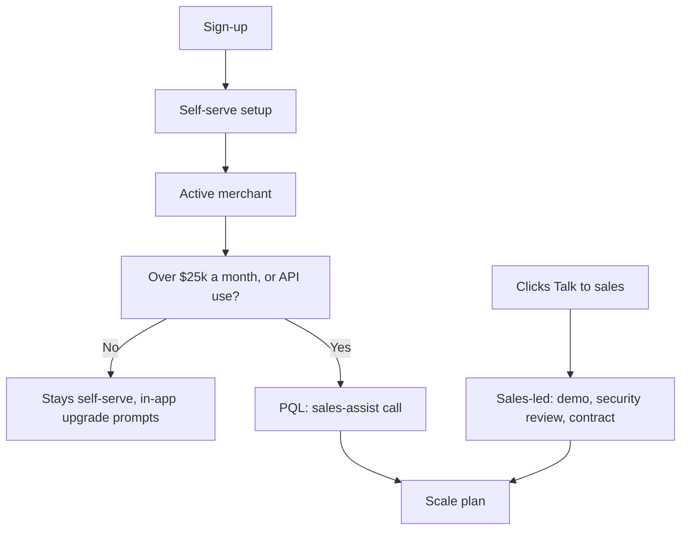

*Figure 9.1 — PayFlow's hybrid. Usage creates the lead, and a person joins only where a conversation adds value.*

### Worked example

You and Hannah agree on three segments.

| Segment | Card volume a year | Motion | Human contact |
|---|---|---|---|
| Self-serve | Under $300,000 | Product-led | None, unless support is needed |
| Sales-assist | $300,000 to $5 million | Hybrid | One call about volume pricing, triggered by usage |
| Enterprise | Over $5 million | Sales-led | Account executive and solutions engineer |

A merchant becomes a PQL when it passes $25,000 in a month, or starts using the API, or adds a third team member. When that happens, the product hands sales a short brief: the volume trend, features used, team size, and the last support topic. Hannah's team should never open with "tell me about your business" to a merchant PayFlow has served for a year.

To learn what calls are worth, 10% of PQLs are randomly left uncalled. Their upgrade rate is the baseline. Lab 7 works through the arithmetic, and it shows why the smallest tier gets no calls at all.

### Common mistakes

| Mistake | Why it bites | Do this instead |
|---|---|---|
| A demo wall in front of a simple product | Small buyers leave | Let people start alone, and offer help |
| No human path for large accounts | Big deals stall on security and contract questions | Keep a visible "Talk to sales" route |
| PQLs defined by size only | Reps call accounts that would have upgraded anyway | Define by usage signals and measure uplift |
| Paying reps for self-serve upgrades | Sales claims what the product did | Credit sales for uplift over the uncalled group |

### Check yourself

**Q9.1** Which motion fits? (a) A $9-a-month note-taking app. (b) A fraud-screening system for banks that takes three months to integrate.

**Q9.2** Why leave a random 10% of PQLs uncalled?

> [!IMPORTANT]
> **In one line:** Let the product sell where accounts are small and value is quick, add people where a conversation changes the outcome, and measure that change against accounts nobody called.

# Part III — Activation, engagement, and retention

## 10. Activation

### Why it matters

Activation rate is on every growth dashboard, and it often measures the wrong thing: "completed profile" or "verified email". A team that is rewarded for a number that does not predict staying will get very good at producing customers who leave. Before you try to raise activation, make sure it is defined as something worth raising.

### The idea

**Activation** is the first time a new user gets the value the product promises. The **activation event** is the action that marks it, and the activation rate is the share of sign-ups that reach it within a set window.

Three early moments are worth telling apart.

- The **setup moment**: the user is ready to get value. A bank account is connected.
- The **aha moment**: the user first experiences the value. The first live payment arrives.
- The **habit moment**: the value has repeated often enough to stick. The fifth payment arrives.

A good activation event passes five tests. It is the value itself, not a chore. It strongly predicts retention. It covers most of the users who stay. It happens early enough to act on. And it plausibly causes retention, not just travels with it.

You find it in data. Take a past group of sign-ups, list candidate events, and for each one compute how many did it, how many of those stayed, how many who skipped it stayed, and what share of everyone who stayed it accounts for.

Then be careful. This is a correlation. Users who do X and users who stay may both be driven by something else, such as how large or how serious the business is. Facebook's early growth team is known for focusing on getting new users to seven friends quickly. That worked as a target for the team. It did not prove that the seventh friend causes anyone to stay. Only an experiment that pushes more users to the event, and then watches retention, shows cause.

### Worked example

Nadia takes the June cohort of 7,000 sign-ups. Of these, 3,150 were still taking payments in days 61 to 90.

```python
SIGNUPS, RETAINED = 7_000, 3_150  # retained = paid again in days 61 to 90

CANDIDATES = {
    # event in the first 14 days: (merchants who did it, how many were retained)
    "Connected a bank account": (5_390, 3_100),
    "First live payment": (4_340, 2_950),
    "Five live payments": (2_800, 2_380),
    "Invited a teammate": (630, 580),
}

print(f"{'Event in first 14 days':<26}{'Did it':>8}{'Kept if yes':>13}"
      f"{'Kept if no':>12}{'Coverage':>10}")
for event, (did, kept) in CANDIDATES.items():
    kept_if_no = (RETAINED - kept) / (SIGNUPS - did)
    print(f"{event:<26}{did / SIGNUPS:>8.0%}{kept / did:>13.0%}"
          f"{kept_if_no:>12.0%}{kept / RETAINED:>10.0%}")
```

Output:

```text
Event in first 14 days      Did it  Kept if yes  Kept if no  Coverage
Connected a bank account       77%          58%          3%       98%
First live payment             62%          68%          8%       94%
Five live payments             40%          85%         18%       76%
Invited a teammate              9%          92%         40%       18%
```

- **Connected a bank account.** Nearly everyone who stayed did this (98%), and almost nobody stays without it. But it is a chore, and 42% of those who do it still leave. It is the setup moment.
- **First live payment.** This is the value itself. It lifts retention from 8% to 68% and covers 94% of merchants who stay. It is the aha moment.
- **Five live payments.** A tighter predictor at 85%, but it misses a quarter of merchants who stay, such as a contractor who sends two large invoices a month. It is the habit moment and a good second metric.
- **Invited a teammate.** The highest retention of all, 92%. But only 18% of retained merchants did it, and those who did not still stay at 40%. Bigger businesses have teammates, and bigger businesses stay. PayFlow tested a teammate prompt last year. Invitations rose and retention did not move.

So PayFlow's definition stands: first live payment within 14 days of sign-up. Write it down fully.

| Field | Definition |
|---|---|
| Event | First successful live payment |
| Window | 14 days from sign-up |
| Counted | Every sign-up, except accounts blocked for fraud |
| Source | The payments table, not a screen-view event |
| Owner | The activation team |

### Common mistakes

| Mistake | Why it bites | Do this instead |
|---|---|---|
| Activation defined as a setup step | The rate rises while customers still leave | Choose the first experience of value |
| Picking the event with the highest retention | It may describe a small, unusual group | Check coverage as well as lift |
| Reading correlation as cause | Pushing the event changes nothing | Test by nudging the event and measuring retention |
| Changing the definition quietly | Trends break and nobody trusts the chart | Announce the change and restate history |

### Check yourself

**Q10.1** Why is "invited a teammate" a poor activation event for PayFlow even though 92% of those merchants stay?

**Q10.2** In a cohort of 1,000 sign-ups, 300 are retained. Of the 400 who did event X, 240 are retained. What is retention with and without X, and what is the coverage?

> [!IMPORTANT]
> **In one line:** Define activation as the first real experience of value, check that it predicts and covers retention, and treat the link as a hypothesis until an experiment confirms it.

## 11. Onboarding

### Why it matters

Activation fell from 62% to 55%. If all of that is real, PayFlow is losing 560 merchants a month (7% of 8,000). The tempting response is to redesign setup at once. But a blended rate can fall for reasons that have nothing to do with the product, and a redesign aimed at the wrong cause fixes nothing.

### The idea

**Onboarding** is everything between sign-up and activation. Its job is the shortest honest path to first value. The main measure is **time to value**: how long a new user takes to reach the activation event.

What slows people down is **friction**, and it comes in three kinds.

| Kind | Example at PayFlow | What to do |
|---|---|---|
| Necessary | Identity verification, which the law requires of payment companies | Keep it. Explain it, time it well, make it easy. |
| Accidental | A link that returns to the wrong page | Remove it |
| Useful | "What do you sell?", which tailors the setup | Keep it only if it pays for itself |

Four tactics do most of the work. Put value first and defer what can wait. Show progress and what is left. Explain why you are asking. Save every step, so that leaving is not starting over.

A checklist helps with the second of these. The **endowed progress effect**, reported by Joseph Nunes and Xavier Drèze in 2006, is that people given a head start toward a goal are more likely to finish it. A checklist that opens with "Create your account" already ticked is an honest use of it.

Before redesigning anything, diagnose in three steps: is the drop real, at which step, and for whom? The first step matters most. A **mix shift** is a change in the makeup of a group. If a new source of weaker sign-ups arrives, the blended rate falls even when no group got worse.

### Worked example

**Step 1: real, or mix?** Nadia splits both months by channel.

```python
def rate(rows, signups, activated):
    return sum(r[activated] for r in rows) / sum(r[signups] for r in rows)


everyone = list(CHANNELS.values())
existing = [row for row in everyone if row[0] > 0]  # channels present in August
aug, sep = rate(everyone, 0, 1), rate(everyone, 2, 3)
sep_existing = rate(existing, 2, 3)
real, mix = (sep_existing - aug) * 100, (sep - sep_existing) * 100
print()
print(f"All sign-ups:            {aug:.1%} -> {sep:.1%}")
print(f"Same four channels only: {aug:.1%} -> {sep_existing:.1%}  "
      f"real change {real:+.1f} points")
print(f"Adding the new channel:  {sep_existing:.1%} -> {sep:.1%}  "
      f"mix shift   {mix:+.1f} points")
```

Output:

```text
Channel                     August  September
Organic and direct           64.0%      61.0%
Paid search                  58.0%      55.0%
Partner platforms            70.0%      67.0%
Invoice loop, referrals      53.0%      50.0%
Paid social (new)             none      27.0%

All sign-ups:            62.0% -> 55.0%
Same four channels only: 62.0% -> 59.0%  real change -3.0 points
Adding the new channel:  59.0% -> 55.0%  mix shift   -4.0 points
```

The first lines of the script hold each channel's sign-ups and activations, and print the top table. Two things happened at once. Every existing channel lost about three points, which is a real change. And paid social, launched on September 1, added 1,000 sign-ups that activate at 27%, which pulled the blend down four more points without anything getting worse for anyone.

**Step 2: which step?**

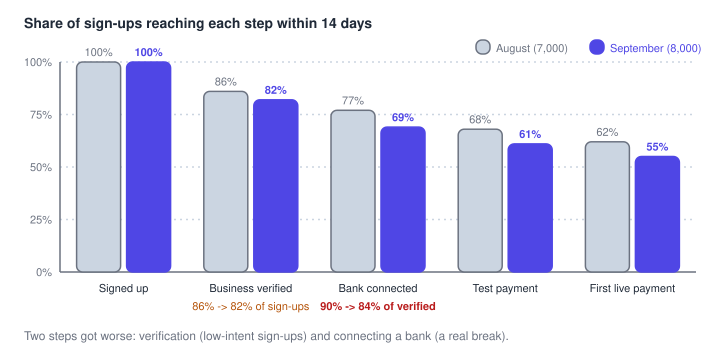

*Figure 11.1 — The setup funnel for both months. Verification fell with the new low-intent sign-ups. Bank connection fell for a different reason.*

**Step 3: for whom?** Inside the four existing channels, desktop sign-ups activated at 66% in both months. Phone sign-ups fell from 58% to 52%. Arjun finds the cause in an afternoon. On September 9 the bank-link provider shipped a new flow that opens the merchant's banking app. On phones, the return link dropped merchants on the PayFlow home page, not back in setup. That is accidental friction.

So the seven points become three separate jobs.

- Arjun fixes the return link. It is a bug, so it needs no experiment.
- Lena redesigns setup around a checklist: a test payment first, verification explained, and the bank requested later, when the first payout needs it. This is a real change with real risks, so it will be tested in Part V.
- Paid social is a channel question, taken up in Chapter 23.

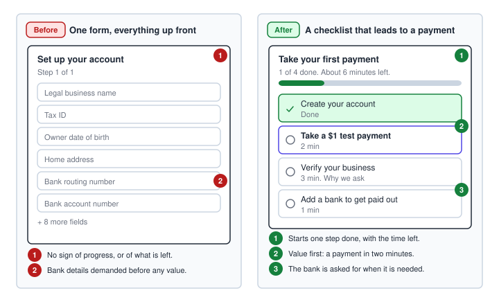

*Figure 11.2 — Setup before and after. The new flow reaches a payment in two minutes and asks for the bank when it is needed.*

### Common mistakes

| Mistake | Why it bites | Do this instead |
|---|---|---|
| Redesigning before decomposing | You fix the product when the mix changed | Split the rate by source, step, and segment first |
| Deleting necessary friction | Fraud and fines follow | Explain it and move it; do not remove it |
| Measuring steps completed | People finish setup and never use the product | Measure the activation event |
| One flow for everyone | A developer and a baker need different paths | Branch on one early question |

### Check yourself

**Q11.1** A product converts 50% of 1,000 organic sign-ups. Next month it adds 500 sign-ups from a new source that converts at 20%, and organic is unchanged. What is the blended rate, and what changed in the product?

**Q11.2** Necessary, accidental, or useful friction? (a) A tax ID field required by law. (b) A password rule shown only after the form fails. (c) A question that picks the right setup guide.

> [!IMPORTANT]
> **In one line:** Before redesigning onboarding, split the falling rate into mix and real change, find the step and the segment, and then remove accidental friction and reorder the necessary kind.

## 12. Engagement and habit

### Why it matters

Activation gets one payment. The business needs the two-hundredth. And some products, like PayFlow Assist, are tried once and forgotten. Engagement work is how "they signed up" becomes "they rely on it". Done badly, it becomes a stream of notifications for a product people need once a month.

### The idea

**Engagement** is how often and how deeply active users get value. It has three dimensions: frequency (how often), depth (how much each time), and breadth (how many features or products).

Start from **natural frequency**: how often the underlying need occurs. A cafe takes payments daily. A merchant reconciles payouts weekly. Taxes come once a year. Natural frequency sets the right clock. Daily active users is a sensible measure for a daily need and a misleading one for a weekly need.

Count the **value event**, the action that delivers what the user came for, not logins or opens. For Payments it is a successful payment. For Assist it is an answer the merchant acted on.

Users are not one group. Split them by how often they have the value event: **power users** well above the natural frequency, core users at it, and casual users below it. An engagement plan names, for each group, the next most valuable behavior.

Two models explain how a behavior becomes routine.

The **Fogg Behavior Model**, published by BJ Fogg in 2009, says a behavior happens when three things meet at the same moment: motivation, ability, and a prompt. If a behavior is not happening, one of the three is missing. Ability is usually the cheapest to fix, and motivation the hardest.

The **Hook Model**, from Nir Eyal's book *Hooked* (2014), describes a repeating cycle: a trigger, an action, a variable reward, and an investment that makes the next round more likely. External triggers such as notifications are supposed to give way to internal ones: the user has the need and thinks of the product unprompted.

Both models describe how habits form. Neither tells you whether the habit is good for the user. Chapter 13 draws that line.

### Worked example

Assist's use decays quickly: most merchants who try it are gone within months (Chapter 14 has the curve). You apply the Fogg model to the behavior you want, "a merchant asks Assist one useful question a week".

| Element | Today | Change |
|---|---|---|
| Prompt | None. The merchant has to remember Assist exists. | A Monday 8:00 digest: "Last week: $4,210 paid out. Two disputes need evidence by Friday." |
| Ability | A blank box. The merchant must think of a question. | Three suggested questions, built from the merchant's own week |
| Motivation | Real but vague: "what happened to my money?" | Unchanged. The digest makes it concrete. |
| Investment | Nothing carries over | Any answer can be pinned as a saved report |

Monday is chosen because reconciling is a weekly job and most merchants do it at the start of the week. The digest carries value in the message itself, so it is worth receiving even unopened.

The metric is the share of active merchants with at least one Assist answer viewed in the week. The guardrails are the email unsubscribe rate and reports of wrong answers. If unsubscribes rise, the prompt is costing more attention than it returns.

For Payments, the plan differs by group. Casual merchants are shown payment links and invoices, which add occasions to get paid. Core merchants are shown team seats and reports. Power users are candidates for the Scale plan.

### Common mistakes

| Mistake | Why it bites | Do this instead |
|---|---|---|
| Daily targets for a weekly or monthly need | The team nags, and users mute it | Set the clock by natural frequency |
| Counting logins or opens | Activity rises while value does not | Count value events |
| Prompts with no value in them | Opt-outs climb and the channel dies | Put the useful fact in the message itself |
| One plan for all users | Power users are bored; casual ones are overwhelmed | Name the next behavior for each group |

### Check yourself

**Q12.1** What is the natural frequency of (a) a payroll product, (b) a team chat tool, (c) a tax-filing product?

**Q12.2** Merchants rarely use a "download report" feature that sits three menus deep. Which element of the Fogg model is weakest, and what would you try first?

> [!IMPORTANT]
> **In one line:** Measure value events on the clock of the user's real need, and raise a behavior by fixing the missing piece among prompt, ability, and motivation.

## 13. Gamification, persuasion, and dark patterns

### Why it matters

Progress bars, streaks, and "only 2 left" banners move numbers fast. Some help people do what they already wanted to do. Others trick them, and the bill arrives later as refunds, complaints, and regulators. In payments, trust is the product, so the line matters more than usual.

### The idea

Growth teams lean on a handful of findings from psychology.

| Principle | What it says | Honest use | Dark use |
|---|---|---|---|
| Defaults | People tend to keep the preselected option | Daily payouts on by default | A paid add-on ticked in advance |
| Loss aversion | A loss weighs more than an equal gain (Kahneman and Tversky, 1979) | "Your dispute evidence is due Friday" | A fake countdown timer |
| Social proof | People follow what others do (Cialdini, *Influence*, 1984) | A real count of merchants on a plugin | Invented reviews |
| Progress | A visible head start helps people finish | A setup checklist | Progress that resets to create pressure |

**Gamification** is the use of game elements, such as points, badges, levels, streaks, and leaderboards, in products that are not games.

It works when it makes real progress visible toward a goal the user already has, and when it can be ignored. It backfires in four ways.

- It rewards an activity the user does not value, so people game the reward.
- Outside rewards can crowd out a person's own reasons for doing something, a finding known as the overjustification effect (Lepper, Greene, and Nisbett, 1973).
- Streaks punish a missed day, and many people quit after the streak breaks.
- Rewards attract abuse. In payments, a reward for transaction counts is an invitation to run fake transactions.

A **dark pattern**, a term coined by Harry Brignull in 2010 and also called a deceptive pattern, is a design that tricks or pressures people into choices they would not otherwise make. Common types are hidden costs, subscriptions that are hard to cancel, fake urgency, preselected extras, and wording that shames the user for declining.

Three tests separate persuasion from manipulation.

1. **Transparency.** Would it still work if the user understood exactly what you are doing?
2. **Alignment.** Does the user end up better off by their own standards?
3. **Reversal.** Is undoing the choice as easy as making it?

Then measure regret. Refunds, cancellations within a day, complaints, and chargebacks are the user telling you which side of the line you were on.

> [!NOTE]
> Law in this area keeps moving. In the United States, a 2024 federal "click-to-cancel" rule was struck down by an appeals court in July 2025, and the Federal Trade Commission reopened the rulemaking in 2026, while older laws against deceptive subscription practices remain in force. Check current rules with counsel.

### Worked example

Carlos proposes three ideas to lift PayFlow Plus. You run each through the tests.

| Idea | Verdict | Replace with |
|---|---|---|
| "Take a payment every day for 30 days to earn a Gold badge and a lower fee" | Fails alignment. A merchant cannot make customers buy daily, a bakery closed on Mondays loses its streak, and the fee reward invites fake payments. | Milestones that mark real progress: first $10,000 processed, five disputes answered on time |
| "Offer ends in 10:00" on the upgrade page, restarting on reload | Fails transparency. It only works if the merchant believes a deadline that does not exist. | A real date, or no deadline |
| Plus ticked by default at sign-up | Fails transparency and reversal. Many would pay without having chosen. | An unticked box with the price beside it |
| The setup checklist, opening with one step done | Passes all three. The step is real, the goal is the merchant's own, and it can be ignored. | Keep it |

The countdown would probably have "won" an A/B test, the two-version experiment of Chapter 19, on upgrades that week. That is why every test of a persuasive design needs guardrails on refunds, early cancellations, and complaints, and a longer look at retention.

### Common mistakes

| Mistake | Why it bites | Do this instead |
|---|---|---|
| Rewarding activity, not value | Users perform the activity and skip the value | Tie rewards to outcomes the user wants |
| Shipping a trick because it won a test | Short-term lifts hide later refunds and churn | Add regret guardrails and a long-run metric |
| Streaks on a need that is not daily | They create anxiety, then quitting | Use milestones, or allow rest days |
| Ignoring abuse | Rewards get farmed, sometimes fraudulently | Ask how a bad actor would earn each reward |

### Check yourself

**Q13.1** Which of the three tests does each fail? (a) Cancelling requires a phone call during office hours. (b) A button to decline reads "No thanks, I don't care about my business".

**Q13.2** A fitness app's streak resets after one missed day, and many users quit at that point. Suggest a redesign.

> [!IMPORTANT]
> **In one line:** A persuasive design is fair if it survives the user understanding it, leaves them better off by their own standards, and is as easy to undo as to do.

## 14. Retention

### Why it matters

Every sign-up bought and every merchant activated is wasted if the merchant leaves. Retention is also the best evidence that a product is worth growing at all. A retention curve that flattens says some customers found lasting value. One that keeps falling says nobody did, and no amount of acquisition will fix that.

### The idea

**Retention** is the share of a group that is still active after a given time. A **cohort** is a group that started in the same period, such as all merchants activated in June. A **retention curve** plots a cohort's retention against time since it started.

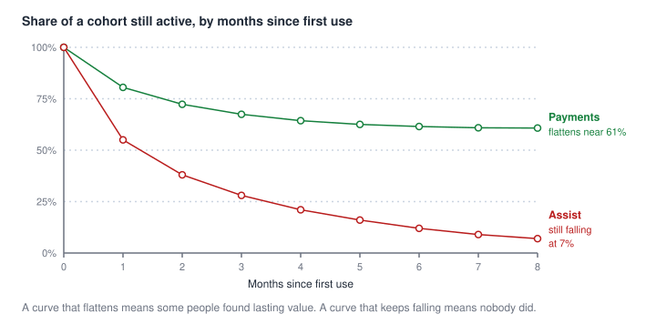

*Figure 14.1 — The shape matters more than any single point. Payments flattens. Assist does not.*

You can move a curve in three ways: lift its start (activation and onboarding), make it flatten sooner (engagement), or raise the level it flattens at (new value, and winning people back).

A **cohort table** stacks the curves: one row per cohort, one column per month of age. Read across a row to watch one cohort age. Read down a column to compare cohorts at the same age, which shows whether the product is getting better. A band along a diagonal is a calendar event that hit every cohort in the same month.

Three cautions.

- The blended churn rate from Chapter 1 hides the **churn hazard**: the chance of leaving at a given age, for those who have lasted that long. It is high early and low later.
- **Survivor bias**: statistics about today's customers describe the ones who stayed. The leavers are missing from the sample.
- Counting customers and counting dollars give different answers. Chapter 16 covers the dollar version.

Retention sets what a customer is worth. **Lifetime value (LTV)** is the gross profit you expect from one customer over their time with you: for each future month, the chance they are still active times the monthly gross profit, added up. Volume 10 treats LTV in depth. Here you need to see where it comes from.

### Worked example

Nadia builds the cohort table for merchants activated from January to June.

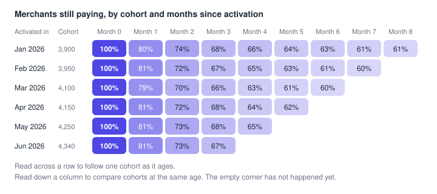

*Figure 14.2 — PayFlow's cohort table as a heat map. The rows look alike, so the product has neither improved nor worsened this year.*

The script pools the cohorts into one curve and extends it to 36 months.

```python
pooled = []
for m in range(9):
    rows = [r for r in COHORTS.values() if len(r) > m]
    pooled.append(sum(r[m] for r in rows) / sum(r[0] for r in rows))
print("All   " + "".join(f"{r:>6.0%}" for r in pooled))


def active_months(curve, horizon=36):
    """Expected months active, extending the curve at its recent monthly ratio."""
    curve, ratio = list(curve), (curve[-1] / curve[-4]) ** (1 / 3)
    while len(curve) < horizon:
        curve.append(curve[-1] * ratio)
    return sum(curve), ratio


print()
for label, curve in [("Payments", pooled), ("Assist", ASSIST)]:
    months, ratio = active_months(curve)
    print(f"{label:<9} keeps {ratio:.1%} a month lately; "
          f"expected active months out of 36: {months:.1f}")
print(f"Payments: 36-month gross profit per activated merchant = "
      f"${PROFIT * active_months(pooled)[0]:,.0f}")
```

Output:

```text
Month      0     1     2     3     4     5     6     7     8
Jan     100%   80%   74%   68%   66%   64%   63%   61%   61%
Feb     100%   81%   72%   67%   65%   63%   61%   60%
Mar     100%   79%   70%   66%   63%   61%   60%
Apr     100%   81%   72%   68%   64%   62%
May     100%   81%   73%   68%   65%
Jun     100%   81%   73%   67%
All     100%   81%   72%   67%   64%   63%   62%   61%   61%

Payments  keeps 99.1% a month lately; expected active months out of 36: 20.7
Assist    keeps 75.9% a month lately; expected active months out of 36: 3.1
Payments: 36-month gross profit per activated merchant = $1,739
```

Three readings.

- **The curve flattens.** Payments loses 19% of merchants in the first month, then less each month, and lately under 1% a month. A core of about 61% has found lasting value.
- **The hazard is early.** Half of all the loss by month 8 happens in month 1. The first 30 days after activation deserve their own program: a first payout that arrives on time, and a first dispute handled well.
- **A merchant is worth about $1,739 over three years.** The expected 20.7 active months times $84. Against that, paying $398 for the next merchant from paid search is sound. The extension assumes recent loss rates continue, which is the weakest part of the figure.

Assist tells the opposite story. A merchant who tries it is expected to use it in 3.1 of the next 36 months. That is not a retention problem to tune. Assist has not yet found a job that recurs, which is what Chapter 12's weekly digest is trying to give it.

### Common mistakes

| Mistake | Why it bites | Do this instead |
|---|---|---|
| One curve for every product | A weekly tool looks dead on a daily curve | Define "retained" by each product's natural frequency |
| Calendar totals only | Growth in new users hides decay in old ones | Track cohorts by age |
| Averages over current customers | Survivor bias flatters you | Start from everyone who began |
| LTV from a curve that has not flattened | The extension is a guess stacked on a guess | State the horizon and the assumption |

### Check yourself

**Q14.1** In a cohort table, what does reading down a column tell you?

**Q14.2** A cohort's retention is 100%, 60%, 50%, 45% in months 0 to 3, and each active customer earns $20 a month. What is the expected gross profit per customer over those four months?

**Q14.3** A product's curve reaches 4% at month 12 and is still falling. What should the team work on before acquisition?

> [!IMPORTANT]
> **In one line:** Read retention by cohort, look for the curve to flatten, and compute customer value from that curve and gross profit.

## 15. Resurrection and win-back

### Why it matters

PayFlow has 60,000 dormant merchants. They have passed verification, connected a bank, and know the product. Bringing back one more percent a month would add 600 merchants, more than the September activation drop cost. Win-back is also where teams fool themselves most easily, because merchants who were returning anyway get counted as wins.

### The idea

**Resurrection** is a dormant user becoming active again. **Win-back** is the deliberate effort to cause it.

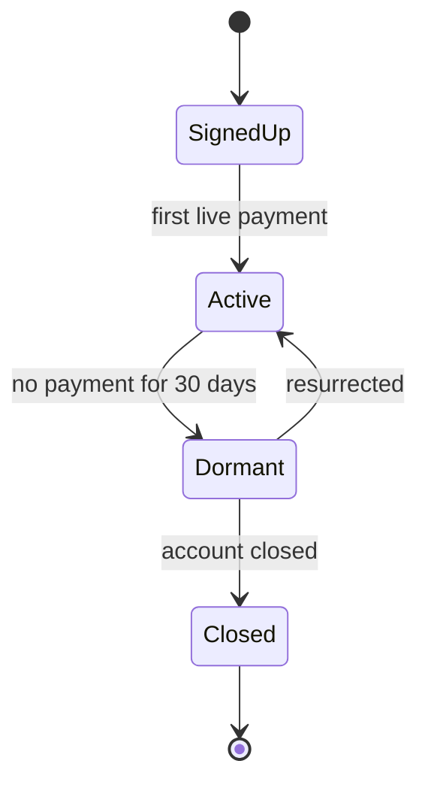

*Figure 15.1 — A merchant's states. Win-back works on the arrow from Dormant back to Active.*

Work through five steps.

1. **Define dormancy by natural frequency.** Thirty days without a payment fits most merchants. A ski shop in July is not lost.
2. **Find out why they left.** Use the last events before they went quiet and a one-question exit survey.
3. **Match the response to the reason.**
4. **Act early.** A merchant dormant for a month is far easier to recover than one gone for a year. Better still, notice the warning before dormancy, such as volume falling by half.
5. **Measure with a holdout.** A **holdout** is a randomly chosen group that gets nothing. The difference between the treated group and the holdout is what you caused. That difference is called **incrementality**, and Chapter 23 returns to it.

| Why they left | Response |
|---|---|
| Seasonal business | A reminder before the season; no discount |
| Hit a problem (a hold, a failed payout) | Fix it, then tell them it is fixed |
| Switched to a competitor | What has changed since, and a reason to compare |
| Business closed | Nothing. Stop emailing. |

### Worked example

Carlos emails 18,000 dormant merchants an offer of $50 in fee credits if they take a payment within 30 days. On your insistence, 2,000 more are randomly held out.

```python
from math import sqrt

from scipy.stats import norm

sent, sent_back = 18_000, 468  # got the email and the $50 fee credit offer
held, held_back = 2_000, 34    # randomly held out, got nothing
CREDIT = 50

p_sent, p_held = sent_back / sent, held_back / held
lift = p_sent - p_held
se = sqrt(p_sent * (1 - p_sent) / sent + p_held * (1 - p_held) / held)
low, high = lift - 1.96 * se, lift + 1.96 * se
p_value = 2 * norm.sf(abs(lift / se))
incremental = lift * sent

print(f"Came back within 30 days: sent {p_sent:.2%}, holdout {p_held:.2%}")
print(f"Lift: {lift * 100:.2f} points (95% CI {low * 100:.2f} to {high * 100:.2f}), "
      f"p = {p_value:.4f}")
print(f"Reactivations the dashboard credits to the email: {sent_back}")
print(f"Reactivations the email caused: about {incremental:.0f}")
print(f"Credit cost per credited reactivation: ${CREDIT}")
print(f"Credit cost per caused reactivation: ${CREDIT * sent_back / incremental:,.0f}")
```

Output:

```text
Came back within 30 days: sent 2.60%, holdout 1.70%
Lift: 0.90 points (95% CI 0.29 to 1.51), p = 0.0040
Reactivations the dashboard credits to the email: 468
Reactivations the email caused: about 162
Credit cost per credited reactivation: $50
Credit cost per caused reactivation: $144
```

The campaign worked: the lift of 0.90 points has a confidence interval that stays above zero. (Chapter 21 explains intervals and p-values.) But look at the two counts. The dashboard credits the email with 468 returning merchants. The holdout shows that 1.70% return with no email at all, which is 306 of the 18,000. The email caused about 162.

All 468 received the $50 credit, so the true cost is $144 per merchant the campaign brought back, almost three times the dashboard's figure. That may still be worth paying. A resurrected merchant who stays even three months returns $252 of gross profit. But two-thirds of the credit budget went to merchants who were coming back anyway.

The next version follows the table above: a plain reminder to seasonal merchants, and the credit only for groups whose holdout return rate is low.

### Common mistakes

| Mistake | Why it bites | Do this instead |
|---|---|---|
| No holdout | Natural returns are counted as wins | Hold out a random group every time |
| One message to every dormant user | The seasonal, the switched, and the closed need different things | Segment by reason for leaving |
| A discount by default | It pays people who were returning and teaches the rest to wait | Start with a reminder or a fix |
| Mailing closed or unsubscribed accounts | Spam complaints damage delivery of all your email | Suppress them |

### Check yourself

**Q15.1** A win-back push reaches 10,000 dormant users and 400 return. In a holdout of 1,000, 25 return. How many returns did the push cause?

**Q15.2** A dormant merchant's last event was a payout that failed. What should the win-back be?

> [!IMPORTANT]
> **In one line:** Segment dormant users by why they left, respond to the reason, and count only the returns a random holdout says you caused.

# Part IV — Monetization

## 16. Monetization and pricing

### Why it matters

Price is the fastest lever on revenue and the one teams touch least, because it feels dangerous. It is also tied to everything in this book. What you charge for decides who can try the product, who pays more as they grow, and which channels you can afford.

### The idea

**Monetization** is how the value you deliver becomes revenue. It rests on three decisions.

1. The **value metric** is the unit you charge for: per payment, per seat, per month. A good one rises as the customer gets more value, is easy to predict, and is hard to game. PayFlow charges a share of each successful payment, so a merchant pays only when it gets paid.

2. **Packaging** is which features go in which plan. The lines between plans are called fences. A good fence lets customers sort themselves: the features in the higher plan are the ones larger or more serious customers want, not ones everybody needs.

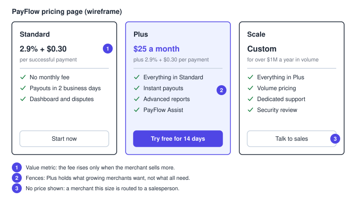

*Figure 16.1 — PayFlow's packaging. Each plan has its own value metric, its own fence, and its own way to buy.*

3. The price level is how much. Evidence comes from four places: what alternatives cost, what serving the customer costs, research on **willingness to pay** (the most a customer would pay), and tests. One common survey method is Peter Van Westendorp's Price Sensitivity Meter from 1976, which asks at what prices a product seems too cheap, a bargain, expensive, and too expensive. Surveys overstate what people will pay, so treat them as a starting range.

Growth from existing customers is **expansion revenue**: more volume, upgrades, add-ons. The summary measure is **net revenue retention (NRR)**: this year's revenue from last year's customers, divided by their revenue last year. Above 100%, revenue grows even with no new customers. Usage pricing builds expansion in, because a merchant that grows pays more without deciding anything.

A **price test** shows different prices to different groups. It is legitimate and it needs rules.

- Test on new customers. Never charge existing customers different prices for the same thing without telling them.
- Prefer testing packaging, trials, or discounts over the raw price of an identical product.
- If someone asks, honor the lowest price shown.
- Never set prices by personal traits such as age, gender, or neighborhood.
- Judge on revenue per customer shown the offer, over time, with retention. Not on sign-ups.

### Worked example

You test Plus at $25 and $35 a month on new merchants.

```python
ARMS = {  # price: (share of merchants shown the offer who subscribe, monthly churn)
    25: (0.060, 0.030),
    35: (0.046, 0.045),
}
SHOWN = 1_000

print(f"{'Price':>6}{'Subscribers':>13}{'Month 1':>10}{'12 months':>11}"
      f"{'Left at 12 mo':>15}")
for price, (take_rate, churn) in ARMS.items():
    subscribers = SHOWN * take_rate
    paid_months = sum((1 - churn) ** month for month in range(12))
    print(f"{'$' + str(price):>6}{subscribers:>13.0f}"
          f"{'$' + format(subscribers * price, ',.0f'):>10}"
          f"{'$' + format(subscribers * price * paid_months, ',.0f'):>11}"
          f"{subscribers * (1 - churn) ** 12:>15.0f}")
```

Output:

```text
 Price  Subscribers   Month 1  12 months  Left at 12 mo
   $25           60    $1,500    $15,308             42
   $35           46    $1,610    $15,188             26
```

After one month, $35 is ahead: fewer subscribers, but $110 more revenue per 1,000 merchants shown the offer. A team that stops reading here raises the price.

Over twelve months the picture reverses. Merchants at $35 cancel faster, so the two prices end almost level on revenue, and $25 leaves 42 subscribers instead of 26. Each of them uses instant payouts and Assist, which gives them more reasons to stay with PayFlow.

The decision is to keep $25. The test also says something more useful: price is not the lever here. Packaging might be. The next test moves a feature across the fence, and leaves the price alone.

### Common mistakes

| Mistake | Why it bites | Do this instead |
|---|---|---|
| Judging a price test on conversion | A lower price always converts more | Use revenue per customer shown the offer |
| Reading it after one month | Higher prices often churn faster | Wait for at least a few renewal cycles |
| Quiet price differences for existing customers | It destroys trust when found, and it will be found | Test on new customers and be ready to explain |
| Too many plans | Buyers stall, and support has to explain | Three plans with clear fences |

### Check yourself

**Q16.1** A team chat tool charges per message sent. What is wrong with that value metric?

**Q16.2** Last year's customers paid $1,000,000. This year the same customers paid $1,080,000 after cancellations and upgrades. What is NRR, and what does it mean?

> [!IMPORTANT]
> **In one line:** Charge for a unit that grows with the customer's value, fence plans by who needs what, and judge any price change on revenue and retention over time.

## 17. Subscription growth

### Why it matters

A subscription looks like price times subscribers. The growth hides in four quieter places: who starts a trial, who converts, who cancels, and whose card fails. The last is the cheapest to fix and the most often ignored. PayFlow sees it from both sides. It sells Plus by subscription, and thousands of its merchants are subscription businesses whose renewals run through PayFlow.

### The idea

Everything here applies to any subscription paid by card, whether the subscriber is a consumer or a small business.

A **paywall** is the point where a product asks for payment. A hard paywall asks before any use. A soft one, often called freemium, keeps a free tier and charges for more. A metered one is free up to a limit. Place the paywall just after the user has felt the value it guards.

A **free trial** comes in two forms.

| | Opt-in trial | Opt-out trial |
|---|---|---|
| Card needed to start | No | Yes |
| At the end | The user chooses to pay | Billing starts unless the user cancels |
| Trial starts | Many | Fewer |
| Share who become paying | Lower | Higher |
| Risk | Casual users who never return | Forgotten trials, refunds, chargebacks, complaints |

Make a trial long enough for the product's natural frequency to deliver value at least twice. With an opt-out trial, state the price and date up front and send a reminder before the first charge.

Subscribers leave in two ways. **Voluntary churn** is a decision to cancel. **Involuntary churn** is a payment that fails: an expired card, a low balance, a bank decline. Nobody decided anything.

The cure for involuntary churn is **dunning**: the process of retrying failed payments and asking customers to update their details. A good sequence retries at sensible intervals, prompts the customer with a one-tap update link, and keeps service running for a short grace period. Not every failure should be retried. A decline for a card reported lost or stolen is final, and your payment processor's rules say which failures may be retried and how often.

For voluntary churn, make canceling easy, offer a pause or a downgrade honestly, and ask one question about why. Annual plans help too: twelve chances a year to churn become one.

The measures to watch are trial-to-paid conversion, churn in the first paid month, **monthly recurring revenue (MRR)**, and the share of churn that is involuntary.

### Worked example

Plus has 12,000 subscribers. In September, 240 renewal charges failed on the first attempt. Until now PayFlow simply canceled those subscriptions. You add a three-step recovery sequence.

```python
SUBSCRIBERS, PRICE = 12_000, 25
failed = 240  # renewal charges declined on the first attempt this month

STEPS = {  # step: subscribers recovered by it (PayFlow Plus, September 2026)
    "Automatic retry on day 3": 60,
    "Email and dashboard prompt to update card": 54,
    "Final retry on day 7": 21,
}

print(f"Failed first attempt: {failed} ({failed / SUBSCRIBERS:.1%} of subscribers)")
left = failed
for step, recovered in STEPS.items():
    left -= recovered
    print(f"  {step:<44}{recovered:>4} recovered, {left:>3} left")
saved = failed - left
print(f"Involuntary churn: {failed / SUBSCRIBERS:.1%} with no recovery, "
      f"{left / SUBSCRIBERS:.1%} with it")
print(f"Kept this month: {saved} subscribers, ${saved * PRICE:,} of monthly revenue")
```

Output:

```text
Failed first attempt: 240 (2.0% of subscribers)
  Automatic retry on day 3                      60 recovered, 180 left
  Email and dashboard prompt to update card     54 recovered, 126 left
  Final retry on day 7                          21 recovered, 105 left
Involuntary churn: 2.0% with no recovery, 0.9% with it
Kept this month: 135 subscribers, $3,375 of monthly revenue
```

Involuntary churn falls from 2.0% to 0.9% of subscribers a month. Voluntary churn is 2.1%, so before the change almost half of all Plus churn was nobody's decision. The 135 subscribers kept are worth $3,375 in the first month, and they keep paying in the months after.

Compare the effort. With 6% of merchants taking Plus when offered, winning 135 new subscribers means putting the offer in front of 2,250 more merchants (135 ÷ 0.06). Recovery needed two emails and a retry schedule.

There is a second prize. PayFlow can offer the same sequence to its merchants who sell subscriptions. Their recovered renewals are payments PayFlow earns a fee on.

### Common mistakes

| Mistake | Why it bites | Do this instead |
|---|---|---|
| Celebrating trial starts | Starts are cheap; paying, retained subscribers are the goal | Report trial-to-paid and month-two retention |
| A card-up-front trial with no reminder | Forgotten trials become refunds and chargebacks | Remind before the first charge |
| Treating a failed payment as a cancellation | You discard customers who wanted to stay | Run a recovery sequence first |
| Making it hard to cancel | It buys a month and loses the customer's goodwill | Cancel in as few steps as subscribing |

### Check yourself

**Q17.1** Voluntary or involuntary? (a) A card expires. (b) A user downgrades to the free tier. (c) A bank flags the charge as suspicious.

**Q17.2** A service has 5,000 subscribers, 4% of renewals fail, and recovery saves 60% of the failures. What is the involuntary churn rate after recovery?

> [!IMPORTANT]
> **In one line:** Put the paywall after the value, choose the trial type knowingly, and recover failed payments before you spend a dollar finding new subscribers.

# Part V — Experimentation

## 18. The experimentation program

### Why it matters

One experiment teaches a little. A program, meaning a steady pipeline of experiments run under shared rules, makes a team smarter every quarter. Without the rules, every experiment "wins", because the person who ran it also chose how to read it.

### The idea

An **experiment** is a deliberate change shown to a randomly chosen part of your users so that you can learn what the change causes. A program moves ideas through the same stages every time.

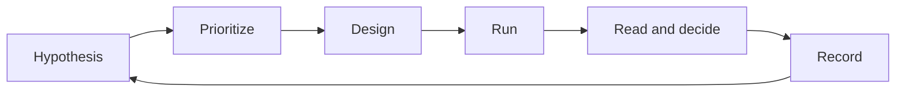

*Figure 18.1 — The experiment pipeline. What gets recorded becomes the evidence behind the next hypothesis.*

Five rules hold it together.

1. **Every test starts from a hypothesis.** A **hypothesis** is a statement of cause and effect that can turn out wrong. Use the form "Because [evidence], we believe [change] will [move this metric] for [these users]."
2. **Prioritize openly.** Two simple scores are common. **ICE**, popularized by Sean Ellis, multiplies impact, confidence, and ease. **RICE**, from Intercom, adds reach. A score is a way to argue about ideas in the same units. It is not a measurement.
3. **Pre-register.** Before launch, write down the design and what you will do for each outcome (Chapter 19).
4. **Record everything.** Wins, losses, and flat results go into a searchable **experiment repository**.
5. **Expect most ideas to fail.** Ron Kohavi, Diane Tang, and Ya Xu, who ran experimentation at large technology companies, argue in *Trustworthy Online Controlled Experiments* that people are poor judges of their own ideas and that most ideas do not improve the metric they were built for. A program whose tests nearly all win has a reading problem.

Do not test everything. Skip the experiment when:

- It is a bug fix or a legal requirement. Ship it and watch the metrics.
- You have too few users to detect any plausible effect. Use research, or make a bolder change.
- The change cannot fairly be shown to only some users, or users affect each other. Chapter 23 has other designs.
- Exposure would harm people or cannot be undone.

Every test also carries the team's standing guardrails, the measures from Chapter 4 that must not get worse.

### Worked example

The activation team scores its backlog.

```python
BACKLOG = {  # idea: (impact, confidence, ease), each scored 1 to 10 by the team
    "Guided setup checklist": (8, 7, 5),
    "Fix mobile bank-link handoff": (6, 9, 8),
    "Shorter sign-up form": (4, 5, 9),
    "Assist setup concierge": (7, 3, 2),
    "Animated welcome video": (2, 3, 6),
}


def ice(scores):
    impact, confidence, ease = scores
    return impact * confidence * ease


print(f"{'Idea':<30}{'I':>3}{'C':>3}{'E':>3}{'ICE':>6}")
for idea, scores in sorted(BACKLOG.items(), key=lambda item: -ice(item[1])):
    print(f"{idea:<30}{scores[0]:>3}{scores[1]:>3}{scores[2]:>3}{ice(scores):>6}")
```

Output:

```text
Idea                            I  C  E   ICE
Fix mobile bank-link handoff    6  9  8   432
Guided setup checklist          8  7  5   280
Shorter sign-up form            4  5  9   180
Assist setup concierge          7  3  2    42
Animated welcome video          2  3  6    36
```

The scores start a conversation.

- The bank-link fix scores highest, and it is a bug. It ships now, without a test.
- The guided setup checklist is the best real experiment: large expected impact, decent evidence from Chapter 11, moderate effort. Its hypothesis: "Because phone sign-ups stall when asked for bank details before any value, we believe a checklist that starts with a test payment and defers the bank will raise 14-day activation for new merchants."
- The Assist setup concierge might matter more than anything, but nobody is confident and it is hard to build. It gets a week of discovery first.
- The welcome video drops off the list.

Notice that 432 against 280 is not a real difference. Each input is a guess from 1 to 10. The scores sort ideas into "now", "later", and "no", and that is all they should be asked to do.

### Common mistakes

| Mistake | Why it bites | Do this instead |
|---|---|---|
| Testing bug fixes | Weeks are spent proving that broken things are bad | Ship fixes and monitor |
| No written hypothesis | Any result can be told as a success | Write the hypothesis and the evidence first |
| Recording only wins | The team retests old failures | Store every readout where it can be searched |
| Treating scores as precise | Arguments move to decimal places | Use scores to sort, and judgment to choose |

### Check yourself

**Q18.1** Rewrite as a hypothesis: "Let's add a progress bar to setup."

**Q18.2** Which should not be A/B tested? (a) A new headline on the pricing page. (b) A fix for a crash on the payout screen. (c) A new legal disclosure.

> [!IMPORTANT]
> **In one line:** Run every idea through the same pipeline, write the hypothesis and decision rule first, record every result, and expect most ideas to lose.

## 19. Experiment design

### Why it matters

Most bad experiments are bad before they start. They have too few users to see the effect, they randomize the wrong thing, or the success metric is picked after the data arrives. None of this can be repaired in the analysis.

### The idea

In an **A/B test** you split units at random into a **control** group, which gets the current experience, and a **treatment** group, which gets the change. Random assignment makes the groups alike in everything except the change. A difference in outcomes is then either caused by the change or due to chance, and statistics measures the chance.

The design is one page with these fields.

| Field | What it settles |
|---|---|
| Hypothesis | The change, the metric, the users, and the evidence |
| **Unit of randomization** | What gets assigned: a user, a merchant, a session, a region. Pick the unit that shares the experience. |
| Primary metric | The one number the decision rests on |
| Guardrails | What must not get worse |
| **Minimum detectable effect (MDE)** | The smallest improvement worth acting on |
| **Significance level** | The false-alarm rate you accept when there is no real effect. By convention, 5%. |
| **Power** | The chance of detecting the MDE if it is real. By convention, 80%. |
| Duration | Whole weeks, plus time for the metric to mature |
| **Stopping rule** | When the test ends, fixed in advance |
| Decision rule | What you will do for each possible result |

The MDE, significance level, and power together fix the **sample size**: how many units each group needs. Two facts are worth remembering. Noisier metrics need more units. And halving the MDE roughly quadruples the sample, because the sample grows with one over the square of the effect.

### Worked example

Your brief for the guided setup test.

| Field | Guided setup checklist |
|---|---|
| Unit | The merchant account, so everyone on one team sees the same setup |
| Primary metric | Activated within 14 days of sign-up |
| Guardrails | Fraud loss rate, first payout failures, support contacts per new merchant |
| MDE | 3 points, from 55% to 58% |
| Significance and power | 5% and 80% |
| Stopping rule | Run the full length. Stop early only for harm on a guardrail. |
| Decision rule | Ship if the whole interval is above zero and guardrails hold |

Why 3 points? Nadia computes what each choice of MDE costs.

```python
from math import ceil, sqrt

from scipy.stats import norm


def sample_size(baseline, lift, alpha=0.05, power=0.80):
    """Merchants per group to detect baseline -> baseline + lift, two-sided."""
    p1, p2 = baseline, baseline + lift
    pooled = (p1 + p2) / 2
    z_alpha, z_power = norm.ppf(1 - alpha / 2), norm.ppf(power)
    spread = (z_alpha * sqrt(2 * pooled * (1 - pooled))
              + z_power * sqrt(p1 * (1 - p1) + p2 * (1 - p2)))
    return ceil((spread / lift) ** 2)


DAILY_SIGNUPS = 8_000 / 30
print(f"{'Lift to detect':<16}{'Per group':>11}{'Both groups':>13}"
      f"{'Days to enroll':>16}")
for lift in (0.01, 0.02, 0.03, 0.05):
    n = sample_size(0.55, lift)
    label = f"+{lift * 100:.0f} points"
    print(f"{label:<16}{n:>11,}{2 * n:>13,}{ceil(2 * n / DAILY_SIGNUPS):>16}")
```

Output:

```text
Lift to detect    Per group  Both groups  Days to enroll
+1 points            38,769       77,538             291
+2 points             9,669       19,338              73
+3 points             4,286        8,572              33
+5 points             1,534        3,068              12
```

A 1-point lift would be worth 80 merchants a month, but detecting it would take most of a year. PayFlow cannot test for it. A 3-point lift needs 4,286 merchants per group, which is 33 days of sign-ups. So the redesign has to be bold enough to plausibly move 3 points, and Lena's is.

The calendar follows.

- **Enrollment:** 35 days. Round 33 up to five whole weeks, so each weekday is represented equally.
- **Maturing:** 14 more days. A merchant who signs up on day 35 needs until day 49 to finish its activation window.
- **Readout:** day 49.

The seven-week estimate in Chapter 3's roadmap came from this arithmetic.

### Common mistakes

| Mistake | Why it bites | Do this instead |
|---|---|---|
| No sample size before launch | The test ends when someone likes the number | Compute it from baseline, MDE, significance, and power |
| An MDE chosen to fit the calendar | A test that cannot see realistic effects is theater | Choose the MDE from what is worth shipping |
| Randomizing users who share an account | Teammates see different versions | Randomize the unit that shares the experience |
| Reading before the metric matures | Late sign-ups look like failures | Add the metric's window to the duration |

### Check yourself

**Q19.1** Your test needs 4,000 units per group to detect a 4-point lift. Roughly how many to detect 2 points?

**Q19.2** A setting is shared by everyone in a company workspace. What is the unit of randomization?

**Q19.3** Sign-ups take up to 30 days to convert, and enrollment takes 21 days. What is the earliest honest readout day?

> [!IMPORTANT]
> **In one line:** Before launch, fix the unit, one primary metric, the guardrails, the smallest effect worth detecting, the sample it requires, and when you will stop.

## 20. A/B testing mechanics and growth engineering

### Why it matters

An experiment is a small piece of software. Something decides who sees what. Something records who saw it. Something counts the outcomes. If any of the three is wrong, the statistics are worthless, and the readout will look perfectly normal. You will not write this code, but you have to know what to ask for.

### The idea

**Growth engineering** builds the systems that make changes safe to ship and possible to measure. Five pieces matter to a PM.

A **feature flag** is a switch in the code that turns a feature on for chosen users without a new release. It allows a gradual **rollout** (1% of users, then 10%, then half) and a **kill switch** to turn the feature off at once.

**Assignment** decides each unit's group. The standard method hashes the experiment name together with the unit's ID, which gives a number that looks random but never changes. The same merchant always lands in the same group, with nothing stored, and a different experiment name reshuffles everyone.

**Exposure logging** records the moment a unit actually meets the difference. Only exposed units belong in the analysis, and both groups must be logged at the same point in the flow.

A **sample ratio mismatch (SRM)** is a split that differs from the plan by more than chance allows. It is checked with a chi-square test, and the usual alarm level is a p-value under 0.001. An SRM is a symptom. It tells you that assignment or logging is broken, not what broke.

An **A/A test** gives both groups the same experience. It checks the pipeline: it should find "no difference" about 95 times in 100.

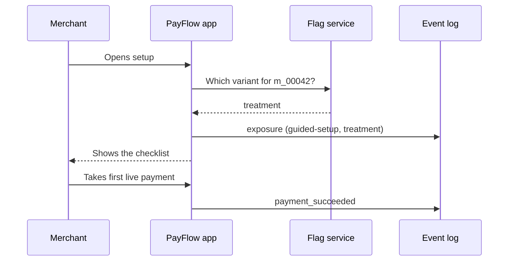

*Figure 20.1 — Assignment, exposure, and outcome are three separate events. The analysis joins the second to the third.*

One limit to know: **interference**. When users affect each other, as in a marketplace or a referral program, the control group feels the treatment and the comparison is spoiled. The fix is to randomize whole clusters such as cities, which Chapter 23 picks up.

### Worked example

Arjun shows you the assignment function.

```python
import hashlib


def variant(merchant_id, experiment, treatment_share=0.50):
    """The same merchant in the same experiment always gets the same answer."""
    digest = hashlib.sha256(f"{experiment}:{merchant_id}".encode()).hexdigest()
    bucket = int(digest[:8], 16) / 16**8  # a number from 0 up to, not including, 1
    return "treatment" if bucket < treatment_share else "control"


ids = [f"m_{i:05d}" for i in range(1, 10_001)]
first = [variant(m, "guided-setup") for m in ids]
again = [variant(m, "guided-setup") for m in ids]
other = [variant(m, "plus-trial-length") for m in ids]
both = sum(a == b == "treatment" for a, b in zip(first, other))

print("m_00001 ->", variant("m_00001", "guided-setup"))
print(f"In treatment: {first.count('treatment'):,} of {len(ids):,}")
print("Same answers on a second call:", first == again)
print(f"In treatment in both experiments: {both / len(ids):.1%}")
```

Output:

```text
m_00001 -> control
In treatment: 5,065 of 10,000
Same answers on a second call: True
In treatment in both experiments: 25.0%
```

The split is close to even, the answers are stable, and being in treatment for one experiment says nothing about the other: a quarter of merchants are in both, as chance predicts.

The guided setup test launches. Eight days in, you run the first check.

```python
from scipy.stats import chisquare


def srm_check(label, control, treatment):
    stat, p = chisquare([control, treatment])  # expects two equal halves
    verdict = "MISMATCH" if p < 0.001 else "split is fine"
    print(f"{label:<15}{control:,} vs {treatment:,}  chi-square {stat:5.2f}  "
          f"p = {p:.5f}  {verdict}")


srm_check("First launch:", 2_440, 2_160)
srm_check("After the fix:", 4_660, 4_672)
```

Output:

```text
First launch:  2,440 vs 2,160  chi-square 17.04  p = 0.00004  MISMATCH
After the fix: 4,660 vs 4,672  chi-square  0.02  p = 0.90114  split is fine
```

The first launch fails. A fair split would be this lopsided 4 times in 100,000. Arjun finds the cause. Control logged exposure when the setup page was requested. Treatment logged it only after the checklist finished drawing. Merchants on slow phones who left before it appeared were never counted in treatment. The treatment group had quietly lost its least patient members, and its activation rate would have looked better than it was.

The fix is to log exposure at the same point for both groups, when the page is requested. The test restarts under a new experiment name, so everyone is reassigned. At the end, 4,660 against 4,672 is exactly what a fair split looks like.

Before any launch, ask engineering for these:

- [ ] The unit of assignment, and a hash that includes the experiment name
- [ ] One exposure event, logged at the same point in both groups
- [ ] An A/A run on this surface
- [ ] An automatic SRM alert
- [ ] A rollout plan and a kill switch
- [ ] Guardrail dashboards that update daily

### Common mistakes

| Mistake | Why it bites | Do this instead |
|---|---|---|
| Logging exposure after the treatment renders | Impatient users vanish from one group | Log at the decision point for both groups |
| Reusing one hash for every test | The same users are always in treatment | Include the experiment name in the hash |
| Changing the split mid-test and pooling | Early and late users are mixed in different ratios | Keep the ratio fixed, or analyze one period |
| No kill switch | A harmful variant runs until the next release | Put every variant behind a flag |

### Check yourself

**Q20.1** Why assign by hashing the ID instead of flipping a coin on each visit?

**Q20.2** A 50/50 test shows 10,300 and 9,700 units, and the p-value for the split is 0.00002. What do you do with the results?

> [!IMPORTANT]
> **In one line:** Trust an experiment only after its plumbing passes: stable assignment, exposure logged identically in both groups, and a split that matches the plan.

## 21. Reading experiment results

### Why it matters

In the readout meeting someone says, "It's significant, ship it." Whether that is right depends on three questions the sentence skips. How big is the effect likely to be? Could chance explain it? And what else moved?

### The idea

Read every result in the same order.

**1. Trust checks.** No sample ratio mismatch. The test ran its planned length. The metric had time to mature.

**2. Effect and interval.** The observed difference is your best single estimate. The **confidence interval** is the range of true effects that fit the data reasonably well. A 95% interval comes from a method that captures the true effect 95 times in 100. Say whether you mean points or percent: 55% to 58.1% is a lift of 3.1 points, or 5.6 percent.

**3. The p-value.** It is the chance of seeing a difference at least this large if the change truly did nothing. It is not the chance that the change works. A result is called **statistically significant** when the p-value is below the significance level you set.

**4. Practical significance.** Would the low end of the interval still be worth shipping?

**5. Guardrails.** Read them the same way.

**6. Decide.** Use the rule you wrote before launch.

| The interval | Guardrails | Decision |
|---|---|---|
| Entirely above zero | Hold | Ship |
| Entirely above zero | One breaks | Fix the cause, then ship or retest |
| Includes zero, and narrow | Hold | Flat. A real finding: the effect is too small to matter. |
| Includes zero, and wide | Any | Inconclusive. The test could not see. Do not say "no effect". |
| Entirely below zero | Any | Do not ship. Record why. |

Two errors are always possible. A **false positive** declares an effect that is not there. A **false negative** misses one that is. The significance level caps the first, and power limits the second.

A caution about wins. Results that clear the bar tend to overstate the true effect, because luck helped them clear it. Expect a little less after launch. And when a result looks too good, check the data before you celebrate. Surprising numbers are more often bugs than breakthroughs.

### Worked example

Day 49. The plumbing checks pass, and Nadia runs the comparison.

```python
from math import sqrt

from scipy.stats import norm


def compare(label, c_n, c_yes, t_n, t_yes):
    pc, pt = c_yes / c_n, t_yes / t_n
    diff = pt - pc
    se = sqrt(pc * (1 - pc) / c_n + pt * (1 - pt) / t_n)
    pooled = (c_yes + t_yes) / (c_n + t_n)
    z = diff / sqrt(pooled * (1 - pooled) * (1 / c_n + 1 / t_n))
    low, high = (diff - 1.96 * se) * 100, (diff + 1.96 * se) * 100
    print(label)
    p_value = 2 * norm.sf(abs(z))
    print(f"  control {pc:.1%}, treatment {pt:.1%}, "
          f"difference {diff * 100:+.1f} points")
    print(f"  95% CI {low:+.1f} to {high:+.1f} points, p = {p_value:.4f}")


compare("Primary: activated within 14 days", 4_660, 2_563, 4_672, 2_714)
compare("Guardrail: first payout failed", 2_563, 49, 2_714, 84)
```

Output:

```text
Primary: activated within 14 days
  control 55.0%, treatment 58.1%, difference +3.1 points
  95% CI +1.1 to +5.1 points, p = 0.0026
Guardrail: first payout failed
  control 1.9%, treatment 3.1%, difference +1.2 points
  95% CI +0.3 to +2.0 points, p = 0.0061
```

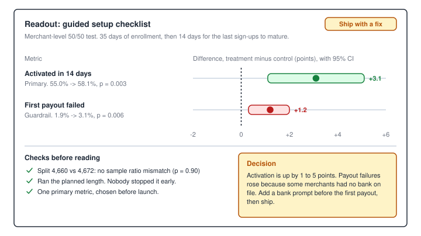

*Figure 21.1 — The whole result on one card: checks, effect with interval, guardrail, decision.*

**The primary metric.** Activation rose 3.1 points. The interval runs from 1.1 to 5.1, so the true lift could be modest or large, but it is very unlikely to be zero: chance alone would produce a gap this big about 3 times in 1,000. In merchants, 3.1% of 8,000 is about 250 more activated each month, with a plausible range from 90 to 410.

**The guardrail.** First payout failures rose from 1.9% to 3.1%, and that interval also excludes zero. The harm is real. These are merchants who took live payments before adding a bank, exactly what the new flow allows.

**The decision.** Not "ship" and not "kill". The win and the harm have the same cause, and the harm has a cheap fix: ask for the bank right after the first live payment, before the first payout is due. You ship the checklist with that prompt to 90% of new merchants and keep 10% on the old flow for two weeks to confirm that payout failures return to normal.

### Common mistakes

| Mistake | Why it bites | Do this instead |
|---|---|---|
| "p = 0.03 means a 97% chance it works" | That is not what a p-value is | Say: "if there were no effect, we would see this 3% of the time" |
| Shipping on the p-value alone | Size and guardrails are ignored | Read the interval and the guardrails |
| Calling a wide interval "no effect" | An underpowered test proves nothing | Report what the interval rules out |
| Quoting percent lift without the baseline | "Up 5.6%" and "up 3.1 points" sound different | Give the two rates and the point difference |

### Check yourself

**Q21.1** A test reports a lift of 0.4 points with a 95% interval from −0.2 to +1.0, and the MDE was 3 points. Flat or inconclusive?

**Q21.2** True or false: a p-value of 0.04 means there is a 4% chance the result is due to chance.

**Q21.3** The primary metric wins clearly and a guardrail clearly worsens. What are your options?

> [!IMPORTANT]
> **In one line:** Check the plumbing, read the size and its interval before the p-value, read the guardrails the same way, and then apply the rule you wrote in advance.

## 22. Peeking, multiple comparisons, and honest ways to go faster

### Why it matters

On day 9 of the test, Carlos opens the dashboard and sees p = 0.03. "We have a winner. Why wait six more weeks?" Every team meets this moment. Stopping when the number looks good is one of the most common ways that honest people produce false results.

### The idea

**Peeking** is checking a running test repeatedly and stopping the first time it looks significant. Each look is another chance for random noise to cross the line, so the real false-positive rate climbs far above the 5% you agreed to.

**Multiple comparisons** is the same problem sideways. Test 20 metrics at the 5% level and you should expect one to "win" by luck. Slice one metric into 12 segments and the same thing happens. Two defenses: declare one primary metric in advance and treat everything else as exploration, or tighten the threshold. The **Bonferroni correction** divides the significance level by the number of tests.

A third trap is time. A **novelty effect** is a lift that exists only because something is new, and fades. To catch it, plot the effect by weeks since each user first saw the change.

There are two honest ways to get answers sooner.

**Sequential testing** is a family of methods built for looking early. Group-sequential designs (Pocock, 1977; O'Brien and Fleming, 1979) set a stricter threshold at each planned look. Always-valid p-values (Johari, Pekelis, and Walsh) stay honest however often you look. Both cost some extra sample.

**Variance reduction** removes noise instead. The best-known method is **CUPED**, introduced in 2013 by Deng, Xu, Kohavi, and Walker at Microsoft. It uses each unit's behavior before the experiment to subtract the predictable part of the outcome, so the same users give a tighter interval.

### Worked example

**What peeking costs.** Nadia simulates 20,000 A/A tests at the size of the guided setup test. Nothing differs between the groups, so every "win" is false.

```python
import numpy as np
from scipy.stats import norm

rng = np.random.default_rng(21)
TESTS, N, RATE = 20_000, 4_300, 0.55  # A/A tests: both groups get the same thing


def false_win_rate(looks, alpha=0.05):
    """Share of A/A tests that show p < alpha at any one of the looks."""
    seen = np.linspace(N / looks, N, looks).round()  # merchants per group so far
    steps = np.diff(seen, prepend=0).astype(int)
    a = rng.binomial(steps, RATE, (TESTS, looks)).cumsum(axis=1)
    b = rng.binomial(steps, RATE, (TESTS, looks)).cumsum(axis=1)
    pooled = (a + b) / (2 * seen)
    z = (a - b) / seen / np.sqrt(2 * pooled * (1 - pooled) / seen)
    return (2 * norm.sf(np.abs(z)) < alpha).any(axis=1).mean()


print("Looks  Threshold  A/A tests that 'win'")
for looks, alpha in [(1, 0.05), (5, 0.05), (10, 0.05), (33, 0.05), (5, 0.0158)]:
    print(f"{looks:>5}{alpha:>11.4f}{false_win_rate(looks, alpha):>22.1%}")
```

Output:

```text
Looks  Threshold  A/A tests that 'win'
    1     0.0500                  5.0%
    5     0.0500                 14.5%
   10     0.0500                 19.3%
   33     0.0500                 28.5%
    5     0.0158                  5.0%
```

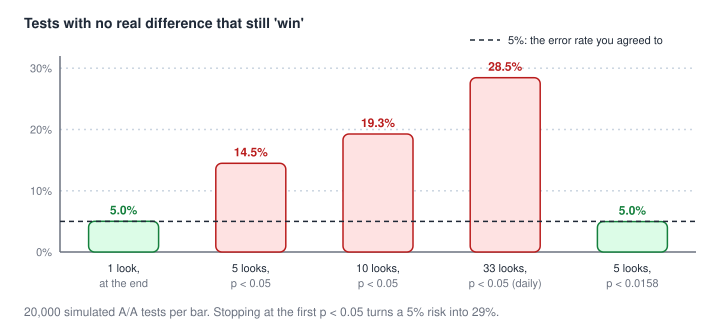

*Figure 22.1 — The same harmless test, declared a winner more and more often as the number of looks grows.*

Looked at once, at the end, the test is wrong 5.0% of the time, as designed. Looked at daily, it is wrong 28.5% of the time. The last row is a group-sequential fix: with Pocock's threshold for five looks, 0.0158, the error rate returns to 5.0%.

Carlos's day-9 result of p = 0.03 would not pass even that threshold. The team waits. You can always look at guardrails for harm; that is a safety check, not a peek.

**What CUPED buys.** CUPED needs history, and new merchants have none, so it cannot help the setup test. It fits a test on existing merchants, such as Chapter 12's Assist digest. Nadia builds synthetic data: each merchant's payments in the four weeks before the test, payments during it, and a planted effect of 5 payments.

```python
import numpy as np

rng = np.random.default_rng(2026)
n = 4_000  # merchants per group
before = rng.gamma(shape=2.0, scale=75, size=2 * n)  # payments, 4 weeks before
during = 0.9 * before + rng.normal(0, 70, 2 * n)     # payments, 4 test weeks
treated = np.arange(2 * n) < n
during[treated] += 5                                 # the true effect we planted


def readout(metric, label):
    lift = metric[treated].mean() - metric[~treated].mean()
    se = np.sqrt(metric[treated].var(ddof=1) / n + metric[~treated].var(ddof=1) / n)
    print(f"{label:<6} lift {lift:5.2f} payments, "
          f"95% CI {lift - 1.96 * se:5.2f} to {lift + 1.96 * se:5.2f}")
    return se


theta = np.cov(before, during)[0, 1] / before.var(ddof=1)
adjusted = during - theta * (before - before.mean())
se_plain = readout(during, "Plain")
se_cuped = readout(adjusted, "CUPED")
print(f"Correlation of before and during: {np.corrcoef(before, during)[0, 1]:.2f}")
print(f"Variance removed: {1 - (se_cuped / se_plain) ** 2:.0%}")
```

Output:

```text
Plain  lift  7.62 payments, 95% CI  2.50 to 12.73
CUPED  lift  5.40 payments, 95% CI  2.34 to  8.46
Correlation of before and during: 0.80
Variance removed: 64%
```

Both intervals contain the true value of 5. The CUPED interval is 6.1 payments wide instead of 10.2, and its estimate landed closer. Removing 64% of the variance is like running the test on 2.8 times as many merchants (1 ÷ 0.36). The one rule: the history must come from before the experiment, so the treatment cannot have touched it.

### Common mistakes

| Mistake | Why it bites | Do this instead |
|---|---|---|
| Stopping at the first significant look | The false-positive rate multiplies | Fix the length, or use a sequential design |
| Choosing the winning metric afterward | Something always wins by chance | One primary metric, declared before launch |
| Treating a segment surprise as a finding | Twelve slices produce a "winner" nearly half the time | Make it the hypothesis of the next test |
| Reading a first-week spike as the effect | Novelty fades | Check the effect by weeks since exposure |

### Check yourself

**Q22.1** You examine 20 metrics, each at the 5% level, and the change truly does nothing. How many do you expect to look significant?

**Q22.2** Why can CUPED not help an experiment on brand-new sign-ups?

**Q22.3** A teammate wants to check results every morning and stop when p drops below 0.05. Give two honest alternatives.

> [!IMPORTANT]
> **In one line:** Decide in advance when and how often you will look and which metric counts, and get speed from sequential designs or variance reduction, never from stopping when it looks good.

## 23. Incrementality and causal inference

### Why it matters

The ad platform reports that paid social produced 1,000 sign-ups in September. Finance asks a different question: if we switched it off, how many would we lose? The gap between those two numbers is where marketing budgets are wasted.

### The idea

**Attribution** assigns credit for a conversion to the ads or messages a customer touched, using a rule such as "the last click gets it all". It is bookkeeping. Incrementality is the number of conversions that happened because of the activity and would not have happened without it. It is a fact about cause.

The two differ whenever an activity reaches people who were going to convert anyway: an ad shown to someone already searching for you, or a coupon shown at checkout. To measure incrementality you need a **counterfactual**, an estimate of what would have happened otherwise. **Causal inference** is the set of methods for building one.

| Method | How the counterfactual is built | Strength |
|---|---|---|
| Randomized experiment or holdout | A random group is not exposed | Strongest |
| **Geo experiment** | Regions are randomly switched on or off | Strong; for channels you cannot control per user |
| **Difference-in-differences** | The change in a treated group is compared with the change in an untreated one | Good, if the groups were moving alike |
| Before and after | Last month stands in for "otherwise" | Weak. Seasons and other launches interfere. |

Difference-in-differences rests on one assumption, called **parallel trends**: without the treatment, the two groups would have moved in step. You cannot prove it. You can check that they moved in step before.

### Worked example

Paid social runs nationwide, so there is no untouched group. Nadia makes one. She sorts the states into two groups with similar sign-up histories, picks one at random, and switches paid social off there for six weeks.

```python
import pandas as pd
import statsmodels.formula.api as smf

ON = [941, 935, 955, 955, 941, 978, 971, 985, 1006, 993, 983, 994]  # ads all 12 weeks
DARK = [923, 900, 926, 934, 921, 943, 886, 876, 885, 904, 887, 898]  # off from week 7
CLAIMED = 115  # weekly sign-ups the ad platform credited itself in the dark states
REPORTED_CAC = 450  # dollars per activated merchant, on the platform's count

data = pd.DataFrame({
    "signups": ON + DARK,
    "dark": [0] * 12 + [1] * 12,
    "after": ([0] * 6 + [1] * 6) * 2,
})
means = data.groupby(["dark", "after"])["signups"].mean().unstack()
change_on = means.loc[0, 1] - means.loc[0, 0]
change_dark = means.loc[1, 1] - means.loc[1, 0]
fit = smf.ols("signups ~ dark * after", data).fit()
low, high = fit.conf_int().loc["dark:after"]

print(f"States with ads on: {means.loc[0, 0]:.0f} -> {means.loc[0, 1]:.0f} "
      f"({change_on:+.0f} a week)")
print(f"States gone dark:   {means.loc[1, 0]:.0f} -> {means.loc[1, 1]:.0f} "
      f"({change_dark:+.0f} a week)")
print(f"Difference-in-differences: {change_dark - change_on:+.0f} a week "
      f"(95% CI {low:+.0f} to {high:+.0f})")
share = (change_on - change_dark) / CLAIMED
print(f"Platform's claim: {CLAIMED} a week. Share that was incremental: {share:.0%}")
print(f"Cost per activated merchant: ${REPORTED_CAC} as reported, "
      f"${REPORTED_CAC / share:,.0f} per incremental one")
```

Output:

```text
States with ads on: 951 -> 989 (+38 a week)
States gone dark:   924 -> 889 (-35 a week)
Difference-in-differences: -73 a week (95% CI -95 to -51)
Platform's claim: 115 a week. Share that was incremental: 63%
Cost per activated merchant: $450 as reported, $709 per incremental one
```

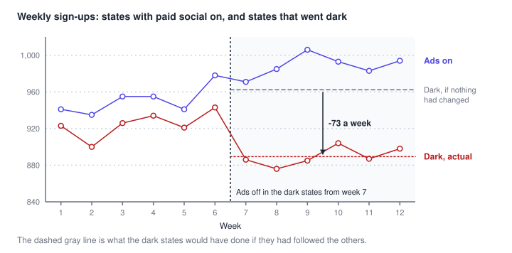

*Figure 23.1 — The go-dark test. Before week 7 the groups move together, which supports the parallel-trends assumption.*

Three readings.

- **Before and after alone would mislead.** Sign-ups in the dark states fell by 35 a week. But the states with ads still on rose by 38 over the same weeks, because the fourth quarter is busy. The dark states should have risen too.
- **The difference-in-differences is 73.** Going dark cost about 73 sign-ups a week, with an interval from 51 to 95.
- **The platform claimed 115.** So about 63% of what it reports is incremental. The other 37% were people who would have signed up through search or directly.

That changes the channel's economics. Its reported cost of $450 per activated merchant becomes about $709 per merchant it actually adds, if incremental sign-ups activate like the rest. That is well past the $504 limit. Carlos does not kill the channel. He cuts the budget and narrows the targeting toward people who already run a business, which should also lift its 27% activation rate.

Two cautions belong in the readout. Twelve weekly points per group is little data, which is why the interval is wide. And states leak: people travel, and national press reaches everyone, so the true effect is probably a little larger than measured.

### Common mistakes

| Mistake | Why it bites | Do this instead |
|---|---|---|
| Treating attribution as cause | You pay for customers you already had | Run a holdout or geo test on every large channel |
| Before and after with no comparison | Seasons and launches get the credit or the blame | Add a comparison group |
| Choosing the comparison after the results | You can produce any answer | Choose and randomize the groups first |
| Ignoring leakage between groups | The effect is understated | Use regions with little overlap, and say so |

### Check yourself

**Q23.1** Treated regions went from 200 to 260 orders a week. Comparison regions went from 300 to 330. What is the difference-in-differences estimate?

**Q23.2** What assumption does that estimate rest on, and how do you check it?

**Q23.3** Which method fits? (a) A new email to existing users. (b) A radio campaign. (c) A price change made everywhere last month.

> [!IMPORTANT]
> **In one line:** Attribution says who gets credit; incrementality says what you caused, and only a comparison with what would have happened otherwise can measure it.

# Part VI — New frontiers

## 24. AI growth systems

### Why it matters

AI now sits inside growth work in three places: deciding who sees what, deciding what to send and when, and acting on a user's behalf. Each can lift a metric. Each can also optimize you into a corner, because a model rewarded for clicks will find the manipulative message faster than any person would.

### The idea

| System | What it does | Use at PayFlow | Main risk |
|---|---|---|---|
| **Personalization** | Chooses content or offers per user from their data | Which setup step or product to suggest next | Chasing clicks; treating groups unfairly |
| **Lifecycle automation** | Chooses the timing, channel, and wording of messages | Win-back timing; when to retry a failed renewal | Message volume creeping up; invented claims |
| **Agent** | Takes actions with tools toward a goal | Assist helping a merchant finish setup | A wrong action on money or identity |

AI also changes the loops from Chapter 2. When content costs almost nothing to produce, content loops flood, quality and trust become the scarce inputs, and a lead built on cheap content stops being a defense. Chapter 6's warning about scaled content applies with full force.

One technique deserves a name. A **bandit algorithm** shifts traffic toward whichever variant is doing better while the test runs. It suits many short-lived options, such as subject lines. It optimizes exactly the metric you hand it, and it does not give the clean effect estimate that an A/B test does.

Six guardrails keep these systems honest.

1. **A global holdout.** A random slice of users gets the plain, non-AI default. It measures the total effect and catches slow drift.
2. **A delayed value metric.** Optimize for activated or retained, not opened or clicked, and add regret guardrails: opt-outs, complaints, refunds.
3. **A bounded action space.** Approved offers only, frequency caps, facts such as fees drawn from one source of truth, and no sensitive traits or stand-ins for them in pricing or eligibility.
4. **Approval boundaries for agents.** Reading and drafting are free. Moving money, changing bank details, and submitting identity documents need the user's explicit yes.
5. **Evaluation before and after.** A fixed test set of real questions before launch; sampled human review after.
6. **Disclosure.** Tell people when they are dealing with AI, and offer a human.

### Worked example

Chapter 18's backlog held an "Assist setup concierge" with high impact and low confidence. After a week of discovery, you write its launch brief.

| Field | Setup concierge |
|---|---|
| Job | Help a new merchant finish setup: explain what verification needs, diagnose a failed bank link, produce the snippet for a ShopNest store |
| May do alone | Read the merchant's setup state, answer, draft, link to the right step |
| Must ask first | Submit a document; add or change a bank account |
| Must never | Promise approval; quote a fee that is not in the pricing table; skip verification |
| Before launch | Graded against 200 real setup questions from support tickets |
| Test | A/B on 10% of new merchants. Primary metric: activated within 14 days. |
| Guardrails | Wrong-answer reports, verification failures, support contacts per new merchant |
| After launch | A 5% holdout with no concierge for one quarter; weekly review of 50 sampled conversations |

The "must never" row matters most. A concierge rewarded only on activation would learn to tell merchants whatever gets them through. The fee rule, the approval rule, and the wrong-answer guardrail are what stop that.

Maya's experience shows the intent. Her bank link fails on her phone. The concierge sees the failure, explains that her bank needs approval inside its own app, and offers to reopen the link. She taps yes. It asks before acting, and it never touches the account number.

### Common mistakes

| Mistake | Why it bites | Do this instead |
|---|---|---|
| Optimizing clicks or opens | The model learns bait | Reward a delayed value metric with regret guardrails |
| "It is always on, so we cannot measure it" | Nobody knows whether it helps | Keep a permanent random holdout |
| Letting generated text state facts freely | It can invent a fee or a promise | Pull facts from a source of truth and review samples |
| Personalizing on sensitive traits | It is unfair, and often unlawful | Exclude them and their stand-ins from offers and prices |

### Check yourself

**Q24.1** A model picks the send time for a weekly digest. What should it be rewarded on, and what guardrail would you add?

**Q24.2** For a setup agent, which actions need the user's approval: (a) explaining a form field, (b) submitting an ID photo, (c) drafting a reply to a customer?

> [!IMPORTANT]
> **In one line:** Give an AI growth system a value metric, a bounded set of actions, approval gates on anything irreversible, and a permanent holdout that tells you what it really adds.

## 25. International growth

### Why it matters

"Launch in ten countries" sounds like ten times the market. In payments, each country is closer to a new product: people pay in different ways, the rules differ, and so does what a fair price looks like. Teams that translate the website and wait learn this slowly and expensively.

### The idea

**Localization** is adapting the whole product to a market. Translation is one small part of it.

| Layer | What changes |
|---|---|
| Language | Words, formats for dates and numbers, tone |
| Payment methods | Cards dominate in some countries; elsewhere bank-based systems lead, such as Pix in Brazil or UPI in India |
| Money | Currency shown, currency paid out, tax and invoice rules |
| Rules | Licenses, identity documents, consumer protection |
| Trust | Local support hours, local references, a local address |

Choose markets on evidence, in this order.

1. **Pull.** Demand you are already turning away: blocked sign-ups, support requests, searches.
2. **Fit.** How much of the product works unchanged.
3. **Cost to enter.** Licenses, payment methods, language, support.
4. **Reach.** Whether your channels, loops, and partners exist there.

Price by market. Converting the home price at the exchange rate ignores local costs (the cost of processing a card differs by region, and the European Union caps part of it by regulation), local alternatives, and local incomes.

Sequence the entry. Start with one market where fit is highest, write down what success there looks like, and expand only after you see it. Measure every market as its own cohort. A new country blended into global numbers produces a mix shift exactly like Chapter 11's, and someone will spend a week explaining a "drop" that is only the new market arriving.

### Worked example

You compare four candidates for PayFlow's first market outside the United States.

| Market | Pull: blocked sign-ups a month | Product gap | Reach |
|---|---|---|---|
| Canada | 310 | Small: payouts in Canadian dollars, local debit cards | ShopNest is strong there |
| United Kingdom | 220 | Medium: a separate license; bank payments are popular | Some ShopNest presence |
| Brazil | 150 | Large: Pix is essential; installments; local entity | No partner |
| Germany | 90 | Large: shoppers often prefer bank-based methods; German-language support | No partner |

Canada has the most pull, the smallest gap, and the one partner loop that already works. It goes first. The United Kingdom is second, and its license application starts now, because that takes longest. Brazil and Germany wait for a local partner.

The entry plan sets its bar before launch.

- **Stage 1:** 200 Canadian ShopNest merchants by invitation.
- **Bar to pass:** activation within 10 points of the United States rate by month three, payout failures no higher, and support contacts per merchant no more than double.
- **Stage 2:** open sign-up, local pricing shown in Canadian dollars, and a Canada-only row in every dashboard.

Pricing is set from Canadian costs and alternatives. Simply converting 2.9% + $0.30 would be a coincidence if it happened to be right.

### Common mistakes

| Mistake | Why it bites | Do this instead |
|---|---|---|
| Translating and calling it a launch | Customers cannot pay or get paid the local way | Localize payments, money, rules, and trust |
| Opening many markets at once | Every one is under-served, and no lesson is clean | Enter one, pass a bar, then the next |
| Pricing by exchange rate | Margins and conversion both miss | Price from local costs and alternatives |
| Blended global metrics | A new market looks like a product problem | Report each market as its own cohort |

### Check yourself

**Q25.1** Name four layers of localization besides language.

**Q25.2** Market A has 400 blocked sign-ups a month but needs a new license and two new payment methods. Market B has 250 and needs only a currency change. Which do you enter first, and what do you start for the other?

> [!IMPORTANT]
> **In one line:** Go where customers are already asking, localize how they pay and get paid, enter one market at a time against a bar you set in advance, and never blend its numbers into the global average.

# Part VII — Practice

## 26. Labs

Each lab takes 20 to 30 minutes. Work on paper first, then compare. A model answer is one good answer, not the only one. The last section of each lab says what a reviewer or interviewer would look for.

### Lab 1 — Find the lever in a growth model

#### Scenario

PayFlow Terminal sells card readers to shops. It has 12,000 active merchants and 9,000 dormant ones. Each month 1,500 shops order a reader, 70% of them take a payment within 30 days, 5% of active merchants go dormant, and 1% of dormant ones return. Three proposals are on the table.

- **A.** Advertising to lift orders by 20%, at $60,000 a month.
- **B.** A "seasonal pause" feature expected to cut churn from 5% to 4%. One quarter of engineering, once.
- **C.** Shipping readers already paired, lifting activation from 70% to 77%. It adds $4 to the cost of each reader.

#### Your task

1. Compute this month's net change and the quick ratio.
2. Rank the proposals by active merchants after 12 and 36 months.
3. Recommend an order of work.

#### Hints

Reuse Chapter 1's loop with new inputs. A paid option has a bill every month. A product option mostly does not.

#### Model answer

This month: 1,050 new + 90 resurrected − 600 churned = +540. Quick ratio: 1,140 ÷ 600 = 1.9.

Chapter 1's `simulate` function, run with Terminal's inputs:

```python
options = [
    ("Today's inputs", {}),
    ("A: sign-ups +20%", dict(signups=1_800)),
    ("B: churn 5% -> 4%", dict(churn=0.04)),
    ("C: activation 70% -> 77%", dict(activation=0.77)),
]
print(f"{'Option':<26}{'12 months':>10}{'36 months':>11}")
for label, change in options:
    print(f"{label:<26}{simulate(**change):>10,.0f}{simulate(36, **change):>11,.0f}")
```

Output:

```text
Option                     12 months  36 months
Today's inputs                17,288     23,728
A: sign-ups +20%              19,237     27,590
B: churn 5% -> 4%             18,657     27,140
C: activation 70% -> 77%      18,262     25,659
```

A adds the most: 1,949 merchants at 12 months. But it costs $720,000 a year, which is $369 for each extra active merchant, and the bill never stops. B adds 1,369 for a one-time build and has nearly caught A by month 36. C adds 974 for about $6,000 a month.

Do B and C first. Both are cheap to keep, and both make every future order worth more. Then price A again against the improved model.

#### What a reviewer checks

- The answer counts flows of active merchants, not orders.
- Options are compared on the same horizon, and cost is weighed against size.
- It notes that product fixes raise the return on later acquisition.

### Lab 2 — Allocate a channel budget

#### Scenario

You have $300,000 a month. Past tests measured activated merchants at each level of spend.

| Monthly spend | Paid search | Partner co-marketing | Podcast sponsorships |
|---|---|---|---|
| $50,000 | 315 | 310 | 150 |
| $100,000 | 574 | 420 | 290 |
| $150,000 | 785 | 470 | 420 |
| $200,000 | 958 | not tested | not tested |
| $250,000 | 1,100 | not tested | not tested |
| $300,000 | 1,216 | not tested | not tested |

Carlos proposes all of it on paid search. Finance proposes $100,000 each.

#### Your task

1. Find the allocation, in $50,000 blocks, that yields the most activated merchants.
2. State the rule you used.
3. Name two things to check before trusting the answer.

#### Hints

Work out what each additional block adds in each channel. Then buy blocks from best to worst.

#### Model answer

The script lists what each $50,000 block adds, then buys the best six.

```python
blocks = []  # (extra merchants, channel, block number)
for channel, totals in CURVES.items():
    previous = 0
    for i, total in enumerate(totals, start=1):
        blocks.append((total - previous, channel, i))
        previous = total

bought = sorted(blocks, reverse=True)[:6]
```

Output:

```text
Paid search            block 1: 315 merchants, $159 each
Partner co-marketing   block 1: 310 merchants, $161 each
Paid search            block 2: 259 merchants, $193 each
Paid search            block 3: 211 merchants, $237 each
Paid search            block 4: 173 merchants, $289 each
Podcast sponsorships   block 1: 150 merchants, $333 each
Total: 1,418 activated merchants a month
Best block not bought: Paid search block 5, $352 each
```

The best plan is $200,000 on paid search, $50,000 on partners, and $50,000 on podcasts: 1,418 merchants. Carlos's plan gives 1,216. Finance's gives 574 + 420 + 290 = 1,284.

The rule is to buy the cheapest next block until the money runs out. At the optimum, the last block bought ($333 each) and the best one left ($352) cost about the same. That near-equality of marginal cost is the sign that you are done.

Check two things. First, incrementality: these counts are each channel's own claims until a holdout says otherwise. Second, quality: a channel whose merchants activate but leave within three months is worth less than its CAC suggests.

#### What a reviewer checks

- Marginal blocks are computed, not averages.
- Every block bought is under the $504 payback limit.
- The answer questions whether the counts are incremental.

### Lab 3 — Define activation for a product that does not retain

#### Scenario

Of 5,000 merchants who first tried PayFlow Assist in June, 600 still use it weekly eight weeks later. You have four candidate events from each merchant's first seven days.

| Event in first 7 days | Did it | Of those, weekly users in week 8 |
|---|---|---|
| Asked one question | 3,400 | 560 |
| Asked three or more questions | 1,100 | 380 |
| Pinned an answer as a saved report | 400 | 260 |
| Connected accounting software | 250 | 200 |

#### Your task

1. For each event, compute retention with and without it, and coverage.
2. Choose an activation event and a second metric to watch.
3. Name the likeliest confound and the test that would settle it.

#### Hints

Use Chapter 10's five tests. Ask which events the product could plausibly cause more of.

#### Model answer

Chapter 10's script with these counts (`lab3_assist_activation.py`) prints:

Output:

```text
Event in first 7 days     Did it  Kept if yes  Kept if no  Coverage
Asked one question           68%          16%          2%       93%
Asked three or more          22%          35%          6%       63%
Pinned an answer              8%          65%          7%       43%
Connected accounting          5%          80%          8%       33%
```

"Asked one question" covers nearly everyone and predicts almost nothing: 84% of those merchants are gone by week 8. It is a first try, not value.

"Connected accounting" predicts best, but it marks a kind of merchant, an organized one with a bookkeeper, more than something Assist did. That is the confound.

"Pinned an answer" is the strongest event the product itself produces. A pinned report is a reason to come back. Choose it as the activation event, and watch "asked three or more" as the step that leads to it. The low coverage, 43%, is a warning that pinning is not yet the only route to staying.

The test: after any answer the merchant rates as useful, offer one-tap pinning to a random half. If week-8 use rises in that half, the link is causal.

#### What a reviewer checks

- Coverage is weighed alongside retention.
- The confound is named as a property of the merchant.
- The proposed test changes the event, then measures retention.

### Lab 4 — Read a cohort table

#### Scenario

PayFlow Invoices tracks the share of merchants who send at least one invoice in each month after their first. Month 0, the month of the first invoice, is 100% by definition.

| First invoice in | Month 1 | Month 2 | Month 3 | Month 4 | Month 5 |
|---|---|---|---|---|---|
| January | 62% | 55% | 51% | 40% | 48% |
| February | 61% | 54% | 42% | 50% | |
| March | 63% | 44% | 52% | | |
| April | 49% | 53% | | | |
| May | 70% | | | | |

#### Your task

1. Find two patterns that break the usual shape.
2. Say whether each belongs to a cohort, an age, or a calendar month.
3. Say what you would check next.

#### Hints

Trace the diagonal that corresponds to one calendar month. Then compare the cohorts at the same age.

#### Model answer

**Pattern 1: a diagonal dip.** January's month 4, February's month 3, March's month 2, and April's month 1 are all low (40%, 42%, 44%, 49%), and all fall in calendar May. Each cohort recovers the month after. That is a calendar event. Check the incident log for May: something stopped invoices being sent or paid for part of the month, such as invoice emails landing in spam.

**Pattern 2: a strong new cohort.** May's cohort keeps 70% in month 1, against about 62% for earlier cohorts. That is a cohort effect, and its month 1 fell in June, after the dip. Find out what changed for merchants who started in May, such as a new template gallery. It is one data point, so wait for months 2 and 3 before claiming a win.

Note what is not a pattern. April's 49% is the May dip, not a bad cohort. Its month 2 is back in line at 53%.

Underneath, the usual shape holds: about 62%, 55%, 51%, then near 50%. The curve is flattening.

#### What a reviewer checks

- The diagonal is identified as one calendar month.
- April is not blamed for the calendar dip.
- A single good cohort is treated as a hypothesis.

### Lab 5 — Design a free-trial test

#### Scenario

Each week 3,000 new merchants see the Plus offer, and 6.0% subscribe within 30 days. The proposal is a 14-day opt-out trial: a merchant who clicks "Try Plus free" gets it at no charge, and the $25 fee starts on day 15 unless the merchant cancels. The team lead wants "trial starts" as the primary metric and hopes for a 1.5-point lift in subscribers.

#### Your task

1. Say what is wrong with "trial starts", and choose a better primary metric.
2. Choose the unit and two guardrails.
3. Compute the sample size and the earliest readout day.
4. Name one requirement for fairness.

#### Hints

In an opt-out trial, starting takes no decision. Ask when a merchant has really chosen to pay.

#### Model answer

"Trial starts" will jump in treatment whatever happens, because starting is free. It says nothing about revenue. The primary metric is the share of merchants who are paying subscribers on day 45: past the trial and past the first charge.

The unit is the merchant. The guardrails are refund requests and complaints about Plus charges, and Payments activity, since an unwanted fee could sour the whole relationship.

Chapter 19's `sample_size` function gives the numbers:

```python
WEEKLY, WINDOW_DAYS = 3_000, 45
n = sample_size(0.060, 0.015)
weeks = ceil(2 * n / WEEKLY)
print(f"Per group: {n:,}. Both groups: {2 * n:,}.")
print(f"Enrollment: {weeks} weeks at {WEEKLY:,} merchants a week.")
print(f"Earliest readout: day {weeks * 7 + WINDOW_DAYS} "
      f"({weeks * 7} days to enroll + {WINDOW_DAYS} days to mature).")
```

Output:

```text
Per group: 4,391. Both groups: 8,782.
Enrollment: 3 weeks at 3,000 merchants a week.
Earliest readout: day 66 (21 days to enroll + 45 days to mature).
```

For fairness, show the price and the first charge date when the trial starts, send a reminder three days before the charge, and make canceling one tap. Chapter 13's reversal test applies.

#### What a reviewer checks

- The metric measures paying after the trial, not starting it.
- The readout day includes the 45-day window.
- Disclosure and a reminder are part of the design, not an afterthought.

### Lab 6 — Review a teammate's readout

#### Scenario

A teammate sends this: "One-page sign-up test. Planned 50/50 for 21 days. Control 5,210 visitors, treatment 4,790. Sign-up completion 61.0% against 63.4%, p = 0.013. We stopped on day 9 because it reached significance. Bonus: of the 12 segments we checked, Android improved by 6 points (p = 0.03). Recommendation: ship, and prioritize Android."

#### Your task

List every problem, most serious first, and say what should happen next.

#### Hints

Start with the plumbing. Then the stopping. Then the slicing. Then ask whether the metric is the right one.

#### Model answer

```python
from scipy.stats import chisquare

control, treatment = 5_210, 4_790
stat, p = chisquare([control, treatment])
print(f"Split {control:,} vs {treatment:,}: chi-square {stat:.2f}, p = {p:.5f}")
print("Sample ratio mismatch" if p < 0.001 else "Split is fine")
segments, alpha = 12, 0.05
print(f"Segments examined: {segments}. Expected false wins by chance: "
      f"{segments * alpha:.1f}")
print(f"Chance of at least one: {1 - (1 - alpha) ** segments:.0%}")
```

Output:

```text
Split 5,210 vs 4,790: chi-square 17.64, p = 0.00003
Sample ratio mismatch
Segments examined: 12. Expected false wins by chance: 0.6
Chance of at least one: 46%
```

1. **Sample ratio mismatch.** A split this uneven happens 3 times in 100,000 by chance. Something removed visitors from treatment, and nothing else in the readout can be trusted until it is found.
2. **Peeking.** The test was stopped at the first significant look, on day 9 of 21. Chapter 22 showed that ten looks turn a 5% error rate into about 19%.
3. **Segment fishing.** With 12 segments, a false "winner" appears 46% of the time. Android is a hypothesis for the next test.
4. **The wrong metric.** A shorter form may simply admit less serious sign-ups. The decision should rest on activation.

Next: find the cause of the mismatch, fix it, and rerun for the full 21 days with activation as the primary metric.

#### What a reviewer checks

- The mismatch is raised first and treated as disqualifying.
- Each problem is tied to its mechanism.
- The rerun changes the metric as well as the method.

### Lab 7 — Decide where sales should call

#### Scenario

Hannah's team can make 400 calls a month to self-serve merchants about the Scale plan. A holdout test measured upgrade rates with and without a call.

| Monthly volume | Merchants a month | Upgrade alone | Upgrade with a call | Monthly gross profit gained per upgrade |
|---|---|---|---|---|
| $10,000 to $25,000 | 900 | 4% | 7% | $150 |
| $25,000 to $100,000 | 350 | 5% | 16% | $600 |
| Over $100,000 | 60 | 3% | 30% | $2,500 |

One rep suggests calling the smallest tier, "because there are so many of them".

#### Your task

1. Compute what one call is worth in each tier.
2. Allocate the 400 calls.
3. Say what the smallest tier should get.

#### Hints

A call is worth the difference it makes, not the rate it reaches.

#### Model answer

```python
rows = []
for tier, (merchants, alone, with_call, profit) in TIERS.items():
    rows.append(((with_call - alone) * profit, tier, merchants))
left, total = CALLS, 0
for per_call, tier, merchants in sorted(rows, reverse=True):
    calls = min(left, merchants)
    left -= calls
    total += calls * per_call
    print(f"{tier:<20} ${per_call:>6.2f} a month per call, {calls:>3} calls")
print(f"Added monthly gross profit from 400 calls: ${total:,.0f}")
```

Output:

```text
Over $100k a month   $675.00 a month per call,  60 calls
$25k-$100k a month   $ 66.00 a month per call, 340 calls
$10k-$25k a month    $  4.50 a month per call,   0 calls
Added monthly gross profit from 400 calls: $62,940
```

A call to a large merchant is worth $675 a month: 27 extra points of upgrade times $2,500. A call to a small one is worth $4.50. So call all 60 large merchants and 340 of the mid tier, for about $62,940 of added monthly gross profit.

The smallest tier gets no calls. It gets an in-app prompt, which costs nothing per merchant. Keep 10% of each called tier uncalled, so these rates stay measured.

#### What a reviewer checks

- Value per call uses the uplift.
- Capacity goes to the highest value per call first.
- The holdout continues after the decision.

## 27. Worked cases

Three situations from start to finish. Each ends with the lesson that carries over to other products.

### Case 1 — A referral program that paid for the wrong thing

**The situation.** PayFlow's first referral program paid the referrer $100 in cash as soon as a referred business signed up. In six weeks it produced 2,300 referred sign-ups, and Carlos reported a record month.

**What the data showed.** Only 11% of those sign-ups activated. Priya's team found clusters of accounts sharing one phone or one bank account. People were referring themselves.

**The redesign.** Four changes, each from Chapter 7.

- The reward moved from sign-up to the referred merchant's first $1,000 processed.
- Cash became $100 in fee credits for each side, worth something only to a merchant who takes payments.
- The invitation moved to the day the first payout arrives.
- A random 10% of merchants were never shown the program.

**The result.** Referred sign-ups fell to 600 a month, and 420 of them activated. The 10% who were not shown the program still produced referred merchants at 40% of the rate, through plain word of mouth. So about 252 of the 420 were incremental. At $200 in credits per activated pair, the program cost $84,000 a month, or $333 per merchant it added. That is inside the $504 limit.

**The lesson.** A reward buys exactly the behavior it names. Name the value, not the sign-up, and keep a holdout so that word of mouth is not counted as a win for the program.

### Case 2 — A churn rate that rose for a good reason

**The situation.** Three months after the Plus free trial from Lab 5 launched, the monthly churn rate on Plus had risen from 3.0% to 4.1%. The first proposal was to roll the trial back.

**The decomposition.** You split it the way Chapter 11 taught.

- Involuntary churn was unchanged at 0.9%, so the recovery sequence still worked.
- Subscribers who had joined before the trial still churned at 3.0%.
- Subscribers who came through the trial churned at 9% in their first paid month, then settled near 3%.

Nothing had become worse for anyone. The trial had added a group of less committed subscribers, and their first month pulled the blended rate up. It was a mix shift.

**The better question.** Is PayFlow ahead? Before the trial, 1,000 merchants shown the offer produced 60 subscribers, about 55 of them still paying three months later. With the trial, the same 1,000 produced 95 paying subscribers on day 45, about 81 of them still paying three months later.

**The decision.** Keep the trial. Change the dashboard to show paying subscribers per 1,000 merchants offered, by cohort, beside the churn rate. Add a check-in message in the first paid month, where the new group's hazard is highest.

**The lesson.** A rate can worsen while the business improves. Before acting on a blended rate, split it by cohort and ask what happened to the count.

### Case 3 — A flat result is still a result

**The situation.** Lena redesigned the Plus paywall as a comparison table. The test was planned to detect a 1.5-point lift in subscriptions and ran its full length with a clean split.

```python
from math import sqrt

c_n, c_yes = 14_950, 897    # old Plus paywall: subscribed within 30 days
t_n, t_yes = 15_020, 931    # new comparison-table paywall
pc, pt = c_yes / c_n, t_yes / t_n
diff = pt - pc
se = sqrt(pc * (1 - pc) / c_n + pt * (1 - pt) / t_n)
print(f"Control {pc:.2%}, treatment {pt:.2%}, difference {diff * 100:+.2f} points")
print(f"95% CI {(diff - 1.96 * se) * 100:+.2f} to {(diff + 1.96 * se) * 100:+.2f} "
      f"points")
```

Output:

```text
Control 6.00%, treatment 6.20%, difference +0.20 points
95% CI -0.34 to +0.74 points
```

**The argument.** The team lead read it as "no effect, so the test failed". Carlos read it as "up 0.2 points, so ship it and claim the win".

**The reading.** Neither is right. The interval runs from −0.34 to +0.74 points. It includes zero, so no lift can be claimed. It is also narrow: any effect of the size the team cared about, 1.5 points, is ruled out. This is a flat result. The test did its job and found that how the paywall is laid out barely matters.

**The decision.** With the metric silent, other considerations decide. The table is easier to keep current when plans change, so it stays. The readout goes into the repository under its real finding: "Paywall layout is not a lever for Plus."

**The lesson.** That entry saved the next quarter. Combined with the price test in Chapter 16, it pointed the team at what is inside Plus, not at its price or presentation.

# Part VIII — Interview kit

## 28. D-R-I-V-E on one complete answer

Growth interviews come in two shapes: "this metric moved, what do you do?" and "how would you grow this product?" Both test the same thing. The interviewer wants to see you get from a vague prompt to a specific, testable plan without guessing.

**D-R-I-V-E** is this book's own way to spend the time. The minutes are for a 25-minute question.

| Step | What you do | Minutes |
|---|---|---|
| **D**efine | Pin down the metric, how it is calculated, the time frame, and why it matters | 3 |
| **R**eality-check | Rule out a measurement artifact before explaining anything | 3 |
| **I**solate | Cut the change by source, step, and segment until it is small and specific | 8 |
| **V**erify | State hypotheses for what is left, and the evidence that would confirm each | 5 |
| **E**xecute | Fix, test, set guardrails, and prevent a repeat | 6 |

Three habits matter more than the letters. Ask before you assume. Size everything, because "it fell" means little and "560 merchants a month" means a lot. And separate what you know from what you would check.

The prompt: **"PayFlow's new-merchant activation rate fell from 62% to 55% last month. Walk me through what you do."**

### The answer, as spoken

#### Define (minutes 0 to 3)

"Let me make sure I understand the number before I chase it. How is activation defined, and what is the denominator?"

*Interviewer: A first live payment within 14 days of sign-up. The denominator is all sign-ups in the month.*

"Good, so it is a real value event and not a setup step. And 'last month' is September against August, with each cohort given its full 14 days?"

*Interviewer: Yes.*

"Then here is why it matters. If PayFlow gets around 8,000 sign-ups a month, seven points is 560 fewer activated merchants a month. Activation also feeds any referral loop, so the loss compounds. It deserves a proper look. I'll go in four steps: check that the drop is real, isolate where it sits, verify the cause, and then act."

#### Reality-check (minutes 3 to 6)

"Before I explain a number, I check that it is not an artifact. Three questions. Did the definition or the tracking change in September? Is this the first full month of a new data pipeline? And does August to September normally dip, say from seasonality?"

*Interviewer: No changes to the definition or the tracking. Last year the two months were within a point of each other.*

"Then I'll treat it as real. One more check on the denominator: did sign-ups change?"

*Interviewer: They rose from 7,000 to 8,000.*

"That is interesting. Seven thousand at 62% is 4,340 activated merchants. Eight thousand at 55% is 4,400. The rate fell, but the count of activated merchants did not. So my first hypothesis is a mix shift: a new group of sign-ups that activates poorly."

#### Isolate (minutes 6 to 14)

"I'd cut the rate three ways, in this order: by acquisition source, by funnel step, and by segment such as device.

"First, source. For each channel I want sign-ups and activation in both months."

*Interviewer: A paid social campaign launched on September 1. It brought 1,000 sign-ups at 27% activation. The other four channels each fell about three points.*

"So there are two stories. If I remove paid social, the same four channels went from 62% to 59%. That is a real three-point drop. Adding 1,000 sign-ups at 27% takes the blend from 59% to 55%, which is four points of pure mix. Nothing got worse for those people. They were always going to activate at a lower rate.

"For the real three points, I go to the funnel: verified, bank connected, test payment, live payment. Which step moved?"

*Interviewer: Bank connection. Completion among verified merchants fell from about 90% to 84%.*

"And by device?"

*Interviewer: Desktop is flat. Phones fell six points.*

"So the real drop is one step on one device. That is narrow enough to be a specific break."

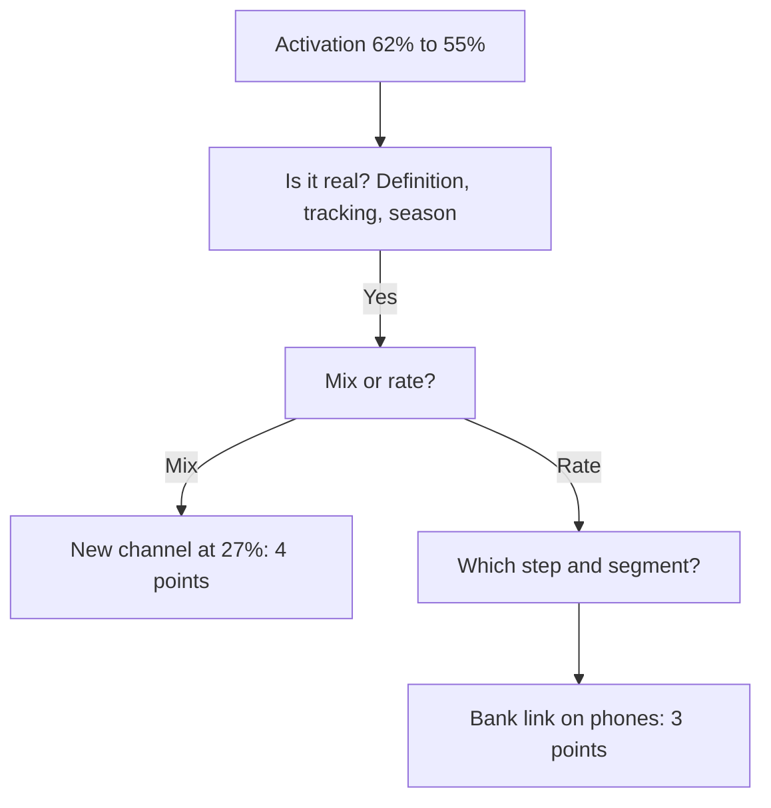

*Figure 28.1 — The whiteboard at minute 14. Seven points have become two separate, sized problems.*

#### Verify (minutes 14 to 19)

"Now causes. For the phone bank-link drop I have three hypotheses, most likely first. One, a release or a vendor change broke the flow. I would look for anything that shipped in early September and plot the step's completion by day, expecting a cliff. Two, the bank-link provider had outages. I would check its error rates. Three, the mix of banks changed, which is unlikely within four stable channels.

"I would also watch five session recordings of phone sign-ups and try it myself on a phone. That costs an hour."

*Interviewer: The daily chart shows a cliff on September 9. The provider shipped a new flow that hands off to the bank's app.*

"Then I expect the return from the bank's app is landing people somewhere wrong. That is a bug to confirm with engineering, not a design question.

"For paid social, the question is different. A 27% rate is not a defect to fix in the product. I want to know whether those sign-ups are incremental and whether they pay back at that rate."

#### Execute (minutes 19 to 25)

"Three actions, in order of speed.

"One: fix the handoff. It is a bug, so I ship the fix without an experiment and watch the daily completion rate return to 90%. That should recover the three real points within days.

"Two: paid social. I'd report its numbers separately so it stops distorting the blended rate. Then I'd measure incrementality by switching it off in a random half of regions for a few weeks and comparing. If the cost per incremental activated merchant is beyond our payback limit, cut it or narrow the targeting.

"Three: prevention. The team found this a month late. I'd add a daily alert on each funnel step by device, and report activation by channel as the standard view, so a mix shift is visible the day it starts.

"And one thing I would not do: redesign onboarding in response to this. The diagnosis says a bug and a channel. A redesign might still be worth testing for its own reasons, as a proper experiment with activation as the primary metric and payout failures and fraud as guardrails.

"To summarize: seven points became four of mix from a new channel and three from a broken bank handoff on phones. One gets a fix, one gets an incrementality test, and both get monitoring."

### The same five steps for "How would you grow X?"

| Step | For a growth question |
|---|---|
| Define | Which metric counts as growth, for which users, over what period? |
| Reality-check | Sketch the growth model: where do users come from, and where do they go? |
| Isolate | Find the constraint: the input that moves the result most |
| Verify | Say what evidence shows it is the constraint, and name the loop you can strengthen |
| Execute | Two or three bets on the constraint, each with a metric, a guardrail, and a test |

## 29. How interviewers score, and how answers fail

### What is being scored

| Dimension | A weak answer | A strong answer |
|---|---|---|
| Metric sense | Accepts the number as given | Asks for the definition, the denominator, and the time frame |
| Structure | A list of guesses | A sequence: real? where? why? what now? |
| Sizing | "It dropped" | "560 merchants a month, of which four points are mix" |
| Causal thinking | Takes correlation or attribution as proof | Separates mix from real change, and asks for a comparison group |
| Experiment judgment | "We'd A/B test it" | Names the unit, primary metric, guardrails, and what would not need a test |
| Action | Stops at the diagnosis | Fixes, tests, and prevents, in an order |

### Six ways answers fail, and how to recover

| Pattern | What it sounds like | Recover by saying |
|---|---|---|
| The instant cause | "It's probably the onboarding" in the first minute | "Before I guess, let me check that the drop is real and find where it sits." |
| The laundry list | Twelve possible causes, unranked | "Let me cut by source, then step, then segment." |
| Mix blindness | Explaining a blended rate without asking about volume | "Did the denominator change?" |
| Test everything | An experiment proposed for a bug | "That is a fix. I'd ship it and monitor." |
| No guardrails | Only the success metric | "And I'd watch fraud and payout failures while we do it." |
| No numbers | Adjectives in place of sizes | "Roughly how many users is that a month?" |

### How to practice

Answer aloud, with a timer, and record yourself once. For every answer, draw the tree from Figure 28.1 and write a size on each branch. Then grade yourself against the six scoring lines and work on the weakest.

## 30. Question bank

Ten prompts with answer outlines. Each outline is a skeleton. The letters refer to D-R-I-V-E.

**1. How would you grow PayFlow's self-serve business?**

- D: Active merchants, over a year. R: The four-input model. I: Sensitivity shows activation and sign-ups lead, and activation is free to keep. V: The funnel by step and device. E: Fix setup, then strengthen the invoice loop, then buy sign-ups up to the payback limit.

**2. Sign-ups are up 30% and revenue is flat. Why?**

- D: Revenue from new or existing merchants? R: Tracking, bots, duplicate accounts. I: Activation by channel; a new low-intent source is the likely cause. V: Compare activation and first-month volume by source. E: Report by channel; test incrementality.

**3. Design a referral program for a payments product.**

- D: Goal is incremental activated merchants under a cost limit. I: Reward both sides, on a value milestone, in fee credits, asked at the first payout. V: A 10% holdout that never sees it. E: Fraud limits; track K by cohort.

**4. How do you decide whether to raise the paid search budget?**

- D: The cost of the next activated merchant against the payback limit. I: Fit the saturation curve; compare marginal, not average, CAC. V: An incrementality test. E: Raise in steps and re-measure.

**5. Your A/B test shows +2% with p = 0.04. Do you ship?**

- R: Sample ratio, planned length, one pre-set metric? I: What is the interval, and is its low end worth shipping? V: Guardrails, novelty. E: Ship, fix, or rerun, by the rule written before launch.

**6. Retention is falling. What do you do?**

- D: Which retention, on what clock? R: Definition or mix change. I: Cohort table: is it a cohort, an age, or a calendar month? Voluntary or involuntary? V: The last events before leaving. E: Aim at the highest-hazard period.

**7. How would you define activation for a new product?**

- D: The value promised. I: Candidate events; retention with and without each; coverage. V: An experiment that pushes the event. E: Write the definition, window, and owner.

**8. Marketing says a campaign drove 5,000 sign-ups. How do you check?**

- D: Attributed or incremental? I: Was there a holdout? If not, a geo test or difference-in-differences. V: Parallel trends before the campaign. E: Report the cost per incremental customer.

**9. When would you not run an A/B test?**

- Bug fixes and legal requirements; too little traffic for any plausible effect; users who affect each other; changes that are unfair or cannot be undone. Offer the alternative each time.

**10. Should this product be sold self-serve or by a sales team?**

- D: Account value, buyer, time to first value, buying process. I: Segment by size. V: Hold out some leads to measure what a call adds. E: Product-led for small accounts, people where uplift pays, and a clean handoff between them.

# Part IX — Reference

## Cheat sheet

Reread this the night before. Each block points back to its chapter.

**Growth model (Ch. 1).** Active at end = start + new + resurrected − churned. Four inputs: sign-ups, activation rate, churn rate, resurrection rate. Quick ratio = (new + resurrected) ÷ churned. Change one input at a time. The biggest mover per dollar is the constraint.

**Loops (Ch. 2, 7).** Loop factor K = the step conversions multiplied together. Below 1, the total is the seed ÷ (1 − K). Cycle time decides only as K nears 1.

**Strategy (Ch. 3).** Diagnosis, advantage, constraint, allocation, sequence, and a "not doing" list. A roadmap holds bets, not features.

**Channels (Ch. 5).** CAC counts activated customers. Payback = CAC ÷ monthly gross profit. Spend until the next customer's cost reaches the limit.

**Search (Ch. 6).** Map each intent to a page. Judge by non-branded results. For AI answers: be indexable, specific, and checkable, and track your own question list.

**Network effects (Ch. 8).** Value per user rises with relevant users nearby. Start dense. Subsidize the constrained side.

**Product-led and sales-led (Ch. 9).** Add a person where a call changes the outcome, measured against accounts nobody called.

**Activation (Ch. 10).** The first real value. It should predict retention, cover most retained users, and survive an experiment.

**A rate dropped (Ch. 11, 28).** Real? Then mix or rate? Then which step? Then which segment? Then why?

**Engagement (Ch. 12).** Natural frequency sets the clock. A behavior needs motivation, ability, and a prompt at the same moment.

**Persuasion (Ch. 13).** Transparency, alignment, reversal. Watch refunds, fast cancellations, and complaints.

**Retention (Ch. 14).** A curve that flattens means fit. In a cohort table, rows age, columns compare, diagonals are calendar events. LTV = the sum of (chance still active × monthly gross profit).

**Holdouts (Ch. 15, 23).** Caused = treated rate − holdout rate. Difference-in-differences = (treated after − before) − (comparison after − before), assuming parallel trends.

**Pricing (Ch. 16, 17).** Value metric, packaging, price level. Judge on revenue and retention over time. Recover failed payments before buying new subscribers.

**Experiment brief (Ch. 19).** Hypothesis, unit, one primary metric, guardrails, MDE, significance 5%, power 80%, duration, stopping rule, decision rule. Halve the MDE and the sample quadruples.

**Before reading a result (Ch. 20).** Sample ratio check (p under 0.001 means stop), planned length, matured metric.

**Reading a result (Ch. 21).** Interval, then p-value, then guardrails. Above zero: ship. Includes zero and narrow: flat. Includes zero and wide: inconclusive.

**Traps (Ch. 22).** Peeking, many metrics, many segments, novelty. Honest speed comes from sequential designs and CUPED.

**AI systems (Ch. 24).** A value metric, bounded actions, approval gates, a permanent holdout.

**New markets (Ch. 25).** Pull, fit, cost, reach. One market at a time, against a bar, as its own cohort.

**PayFlow's numbers.** 90,000 active, 60,000 dormant, 8,000 sign-ups, activation 55% (was 62%), churn 3.0%, resurrection 1.5%, $84 gross profit a month, payback limit $504.

## Templates

Four templates, each filled in with a PayFlow example. Copy the left-hand column to reuse one.

### 1. Activation definition

For PayFlow Invoices.

| Field | Filled in |
|---|---|
| Value promised | Get paid faster by sending a bill with a pay link |
| Activation event | First invoice paid, not first invoice sent |
| Window | 21 days from the first invoice, because businesses pay slowly |
| Evidence | Of merchants with a paid invoice in 21 days, 71% still invoice in month 3, against 12% of the rest. The event covers 88% of merchants who stay. |
| Setup and habit moments | Setup: first invoice sent. Habit: three invoices paid within 60 days. |
| Known confound | Merchants with established customers are paid faster and also stay |
| Causal test | Add a one-tap card option for payers on a random half of invoices, and compare month-3 use |
| Owner and source | Invoices PM; the payments table |

### 2. Experiment brief

For the Monday digest from Chapter 12.

| Field | Filled in |
|---|---|
| Hypothesis | Because merchants reconcile weekly and Assist has no prompt, a Monday digest with the week's figures will raise weekly Assist use |
| Unit | Merchant account |
| Population | Merchants active in each of the last four weeks |
| Primary metric | Share with at least one Assist answer viewed per week, averaged over weeks 3 to 6, after any novelty has faded |
| Guardrails | Email unsubscribes, wrong-answer reports, support contacts |
| MDE, significance, power | 2 points; 5%; 80% |
| Variance reduction | CUPED, using each merchant's Assist use in the four weeks before |
| Duration and stopping | Six weeks, fixed. Stop early only for a guardrail. |
| Decision rule | Ship if the interval is above zero and unsubscribes rise by less than 0.2 points. Otherwise revise the content. |

### 3. Experiment readout

For the win-back email from Chapter 15.

| Field | Filled in |
|---|---|
| What was tested | A $50 fee-credit email to dormant merchants, against a random holdout |
| Design | 18,000 sent, 2,000 held out, 30-day window, by merchant |
| Checks | Holdout share as planned; the full window was observed |
| Result | Returned: 2.60% against 1.70%. Lift 0.90 points (95% CI 0.29 to 1.51), p = 0.004. |
| Guardrails | Spam complaints and unsubscribes unchanged |
| Cost | $144 per reactivation caused. The dashboard's figure was $50. |
| Decision | Keep the campaign. Limit the credit to groups with a low natural return rate. |
| What we learned | About two-thirds of returning merchants would have come back unprompted |
| Next test | Reminder against credit, within merchants who left after a problem |

### 4. Channel test brief

For podcast sponsorships.

| Field | Filled in |
|---|---|
| Channel | Sponsorship of small-business podcasts |
| Why it might work | Owners hear about PayFlow from a host they trust while thinking about their business |
| Budget and length | $50,000 a month for three months |
| Tracking | A promo code and "How did you hear about us?" at sign-up. Both undercount. |
| Incrementality | Sponsor local shows in a random half of 20 matched cities; difference-in-differences on sign-ups |
| Success bar | Incremental activated merchants at under $504 each, with 90-day retention within 5 points of organic |
| Stop rule | Fewer than 100 incremental activated merchants a month by month three |
| Who decides | Carlos proposes; you and Nadia read the result |

## Glossary

- **A/A test.** A test in which both groups get the same experience, used to check the testing system itself.
- **AARRR.** Dave McClure's funnel: acquisition, activation, retention, referral, revenue.
- **A/B test.** An experiment that randomly splits units into groups, gives each a different version, and compares outcomes.
- **Acquisition channel.** A repeatable way to turn strangers into sign-ups.
- **Activated.** At PayFlow, having taken a first live payment within 14 days of sign-up.
- **Activation.** The first time a new user gets the value the product promises.
- **Activation event.** The action that marks activation.
- **Activation rate.** The share of sign-ups that reach the activation event within the window.
- **Active.** At PayFlow, having taken at least one successful payment in the last 30 days.
- **Agent.** An AI system that takes actions with tools toward a goal.
- **Aha moment.** The user's first experience of the product's value.
- **AI answer engine.** A search product that writes an answer and cites a few sources.
- **Assignment.** The step that decides which experiment group a unit belongs to.
- **Attribution.** A rule for assigning credit for a conversion to the ads or messages a customer touched.
- **Bandit algorithm.** A method that shifts traffic toward better-performing variants while a test runs.
- **Bonferroni correction.** Dividing the significance level by the number of tests, to limit false positives.
- **Branded search.** A search that includes your product's name.
- **Causal inference.** Methods for estimating what an action caused.
- **Channel-model fit.** The match between what a customer is worth and what a channel costs.
- **Churn.** Customers stopping their use of a product.
- **Churn hazard.** The chance of churning at a given age, for those who lasted that long.
- **Churn rate.** The share of active customers who stop in a period.
- **Cohort.** A group of users who started in the same period.
- **Cohort table.** Retention by cohort (rows) and age (columns).
- **Cold start problem.** A new network has too few users to be valuable, so few join.
- **Confidence interval.** The range of true effects that fit the data reasonably well.
- **Constraint.** The input that limits growth most right now.
- **Control.** The experiment group that gets the current experience.
- **Counterfactual.** What would have happened without the action.
- **CUPED.** A variance-reduction method that uses each unit's pre-experiment behavior to tighten the result.
- **Customer acquisition cost (CAC).** Spend divided by customers acquired.
- **Cycle time.** How long one turn of a loop takes.
- **Dark pattern.** A design that tricks or pressures people into choices they would not otherwise make.
- **Density.** How many relevant other users are near a given user.
- **Difference-in-differences.** The change in a treated group minus the change in a comparison group.
- **Disintermediation.** Two sides of a marketplace dealing directly to avoid its fee.
- **Distribution channel.** Someone else's platform or relationship that carries your product to their customers.
- **Dormant.** Once active, with no payment in the last 30 days.
- **D-R-I-V-E.** This book's interview structure: define, reality-check, isolate, verify, execute.
- **Dunning.** Retrying failed payments and asking customers to update their details.
- **Economies of scale.** Costs per unit falling as volume grows.
- **Endowed progress effect.** People given a head start toward a goal are more likely to finish it.
- **Engagement.** How often and how deeply active users get value.
- **Expansion revenue.** Revenue growth from existing customers.
- **Experiment.** A deliberate change shown to a random part of users to learn what it causes.
- **Experiment repository.** A searchable record of every experiment and its result.
- **Exposure logging.** Recording the moment a unit actually meets the experiment's difference.
- **False negative.** Missing an effect that is real.
- **False positive.** Declaring an effect that is not there.
- **Feature flag.** A switch that turns a feature on for chosen users without a new release.
- **Fogg Behavior Model.** A behavior happens when motivation, ability, and a prompt occur together.
- **Free trial.** Use of a paid product at no charge for a limited time.
- **Friction.** Anything that slows a user on the way to value.
- **Funnel.** A sequence of steps, with some users dropping out at each.
- **Gamification.** Game elements such as points and streaks used in products that are not games.
- **Geo experiment.** A test that switches a treatment on or off by region.
- **Gross profit.** Revenue minus the direct cost of serving the customer.
- **Growth engineering.** Building the systems that make changes safe to ship and possible to measure.
- **Growth loop.** A closed system in which one cycle's output becomes the next cycle's input.
- **Growth model.** A small calculation of where active users come from and where they go.
- **Growth roadmap.** A sequence of bets, each with a target input and a decision date.
- **Growth strategy.** Choices about where growth will come from and what will not be done.
- **Growth team.** A cross-functional team that owns a metric.
- **Guardrail.** A measure that must not get worse while you pursue a goal.
- **Habit moment.** The point at which value has repeated often enough to stick.
- **Holdout.** A random group that does not get a treatment, kept as the comparison.
- **Hook Model.** Nir Eyal's cycle of trigger, action, variable reward, and investment.
- **Hypothesis.** A statement of expected cause and effect that can turn out wrong.
- **ICE.** A priority score: impact × confidence × ease.
- **Incrementality.** Outcomes that happened because of an action and would not have otherwise.
- **Input metrics.** The few measures a team can move directly that drive the North Star.
- **Interference.** Users affecting each other, so that the control group feels the treatment.
- **Involuntary churn.** Churn caused by a failed payment.
- **Kill switch.** A flag that turns a feature off at once.
- **Lifecycle automation.** Models that choose the timing, channel, and wording of messages.
- **Lifetime value (LTV).** The gross profit expected from a customer over their time with you.
- **Liquidity.** How reliably a marketplace participant finds a match.
- **Localization.** Adapting the whole product to a market.
- **Loop factor.** New users produced per user per cycle.
- **Marginal CAC.** The cost of the next customer at the current level of spend.
- **Marketplace.** A product that connects two sides and takes a cut.
- **Match rate.** The share of marketplace requests filled within a set time.
- **Merchant.** A business that uses PayFlow.
- **Minimum detectable effect (MDE).** The smallest improvement an experiment is built to detect.
- **Mix shift.** A change in a group's makeup that moves a blended rate.
- **Monetization.** How delivered value becomes revenue.
- **Monthly recurring revenue (MRR).** Subscription revenue expected each month.
- **Multiple comparisons.** Testing many metrics or segments, which produces false wins by chance.
- **Natural frequency.** How often the need a product serves occurs.
- **Net revenue retention (NRR).** This year's revenue from last year's customers, divided by their revenue last year.
- **Network effect.** A product becoming more valuable to each user as more users join.
- **North Star metric.** One measure of customer value that predicts long-term revenue.
- **Novelty effect.** A lift that exists only because something is new.
- **Onboarding.** Everything between sign-up and activation.
- **Packaging.** Which features go in which plan.
- **Parallel trends.** The assumption that two groups would have moved in step without the treatment.
- **Payback period.** Months of gross profit needed to earn back the CAC.
- **Paywall.** The point where a product asks for payment.
- **Peeking.** Checking a running test repeatedly and stopping when it looks significant.
- **Personalization.** Choosing content or offers for each user from their data.
- **Pipeline.** A sales team's open deals and their value.
- **Power.** The chance of detecting an effect of the MDE's size if it is real.
- **Power users.** Users well above the natural frequency of use.
- **Price test.** An experiment that shows different prices to different groups.
- **Product-led growth (PLG).** Growth in which the product itself acquires, converts, and expands customers.
- **Product-market fit.** A product that a clear group of customers needs and keeps using.
- **Product-qualified lead (PQL).** An account whose usage shows it is ready for a sales conversation.
- **p-value.** The chance of a difference at least this large if the change did nothing.
- **Quick ratio.** Users gained divided by users lost in a period.
- **Referral program.** A reward for bringing in new users.
- **Resurrected.** Dormant, then active again.
- **Resurrection.** A dormant user becoming active again.
- **Resurrection rate.** The share of dormant users who return in a period.
- **Retention.** The share of a group still active after a given time.
- **Retention curve.** A cohort's retention plotted against time since it started.
- **RICE.** A priority score: reach × impact × confidence ÷ effort.
- **Rollout.** Turning a feature on for a growing share of users.
- **Sales cycle.** The time from first contact to a signed deal.
- **Sales-led growth.** Growth in which salespeople find, qualify, and close customers.
- **Sample ratio mismatch (SRM).** A split between groups that differs from the plan by more than chance.
- **Sample size.** The number of units each experiment group needs.
- **Saturation.** Falling returns as a channel or loop uses up its best prospects.
- **Search engine optimization (SEO).** Making pages that deserve to rank and that search engines can understand.
- **Search intent.** The goal behind a search query.
- **Self-serve.** Signing up and using a product without talking to anyone.
- **Sensitivity analysis.** Changing one input at a time to see how much the result moves.
- **Sequential testing.** Experiment methods designed for looking at results before the end.
- **Setup moment.** The point at which a user is ready to get value.
- **Significance level.** The false-positive rate you accept when there is no real effect.
- **Sign-up.** Creating an account.
- **Statistically significant.** Having a p-value below the significance level.
- **Stopping rule.** When a test ends, fixed in advance.
- **Survivor bias.** Judging from those who stayed, when the leavers are missing from the data.
- **Take rate.** A marketplace's share of each transaction.
- **Team charter.** A written statement of a team's metric, surfaces, guardrails, and approvals.
- **Time to value.** How long a new user takes to reach the activation event.
- **Treatment.** The experiment group that gets the change.
- **Unit of randomization.** What an experiment assigns to groups: a user, an account, a region.
- **Value event.** The action that delivers what the user came for.
- **Value metric.** The unit a product charges for.
- **Variance reduction.** Removing predictable noise so the same sample gives a tighter result.
- **Viral factor (K).** New users brought in by each new user.
- **Virality.** Existing users bringing in new users.
- **Voluntary churn.** Churn by a customer's decision to cancel.
- **Willingness to pay.** The most a customer would pay for something.
- **Win rate.** The share of sales deals that close.
- **Win-back.** A deliberate effort to make dormant users active again.

## Answers to "Check yourself"

### Part I

**Q1.1** New: 400. Resurrected: 100. Churned: 800. Net change: −300.

**Q1.2** Sign-ups must be bought again every month, while a better activation flow is built once. Better activation also raises the return on every later sign-up.

**Q1.3** 500 ÷ 800 = 0.63. Below 1, so the product is shrinking.

**Q2.1** (b). Its output, public pages, becomes the input that brings the next users. (a) is a funnel.

**Q2.2** 4 × 10% = 0.4. The total is 1,000 ÷ (1 − 0.4), about 1,667.

**Q3.1** (b). It names a constraint, an allocation, and something that will not be done. (a) is a goal.

**Q3.2** Diagnosis, advantage, constraint, allocation, sequence.

**Q4.1** The metric it owns, the surfaces it may change, its guardrails, and who approves what.

**Q4.2** Activation rate, or activated customers. Without it the team can hit the goal with sign-ups that never use the product.

### Part II

**Q5.1** Average: $100,000 ÷ 440 = $227. Marginal: $20,000 ÷ 40 = $500.

**Q5.2** (a) Acquisition. (b) Distribution.

**Q6.1** (a) Navigational. (b) Informational. (c) Transactional.

**Q6.2** To be indexed and eligible to show a snippet in Search. Google states no extra requirements.

**Q7.1** 6 × 10% × 50% = 0.30. The total is 2,000 ÷ 0.7, about 2,857.

**Q7.2** With K at 0.20 the loop is close to its ceiling of 1.25 times the seed after two turns, so getting there sooner adds almost nothing.

**Q8.1** (a) Economies of scale. (b) Virality. (c) A direct network effect.

**Q8.2** Demand is equal, so city B is short of supply. Subsidize or recruit sellers there, and hold back on buyer marketing.

**Q9.1** (a) Product-led. (b) Sales-led.

**Q9.2** Their upgrade rate is the baseline. Without it you cannot tell what the calls added.

### Part III

**Q10.1** It covers only 18% of retained merchants, and it marks bigger businesses, which stay anyway. Pushing it did not move retention.

**Q10.2** With X: 240 ÷ 400 = 60%. Without: 60 ÷ 600 = 10%. Coverage: 240 ÷ 300 = 80%.

**Q11.1** (500 + 100) ÷ 1,500 = 40%. Nothing changed in the product. It is a mix shift.

**Q11.2** (a) Necessary. (b) Accidental. (c) Useful.

**Q12.1** (a) Every pay period, usually every two weeks or monthly. (b) Daily. (c) Yearly.

**Q12.2** Ability. Move the download to where merchants already look, such as the payout page, before adding prompts.

**Q13.1** (a) Reversal: undoing is far harder than signing up. (b) Transparency and alignment: it works by shaming, not by informing.

**Q13.2** Count weekly goals, or allow rest days, so that one missed day does not erase progress. Mark milestones reached, not days in a row.

**Q14.1** How different cohorts compare at the same age, which shows whether the product is improving.

**Q14.2** (1 + 0.6 + 0.5 + 0.45) × $20 = $51.

**Q14.3** Lasting value. No durable core of users exists yet, so acquisition would fill a leaking tub.

**Q15.1** The holdout returns at 2.5%, so 250 of the 10,000 would have returned anyway. The push caused about 150.

**Q15.2** Fix the payout problem, then tell the merchant it is fixed. No discount.

### Part IV

**Q16.1** It charges for an activity, not for value, and it makes people use the product less. A seat or a team is a better unit.

**Q16.2** 108%. Existing customers grew revenue by 8% with no new customers.

**Q17.1** (a) Involuntary. (b) Voluntary. (c) Involuntary.

**Q17.2** 200 fail and 120 are saved, so 80 are lost: 1.6%.

### Part V

**Q18.1** For example: "Because recordings show merchants abandoning setup without knowing how much is left, we believe a progress bar will raise 14-day activation for new merchants."

**Q18.2** (b) and (c). A crash fix and a legal requirement ship without a test.

**Q19.1** About 16,000 per group. Halving the effect quadruples the sample.

**Q19.2** The workspace, so that everyone in a company sees the same setting.

**Q19.3** Day 51: 21 days of enrollment plus 30 for the last sign-ups to convert.

**Q20.1** So the same unit always sees the same version, with nothing to store, and assignment can be recomputed at any time.

**Q20.2** Do not read them. It is a sample ratio mismatch. Find the assignment or logging fault, fix it, and rerun.

**Q21.1** Flat. The interval is narrow and rules out anything close to the 3-point MDE.

**Q21.2** False. It means that if the change did nothing, a difference this large would appear 4% of the time.

**Q21.3** Find out whether the gain and the harm share a cause. Then fix and retest, ship with a mitigation and a holdout, or decline to ship. Do not ignore the guardrail.

**Q22.1** One, on average (20 × 0.05).

**Q22.2** CUPED needs each unit's behavior from before the experiment, and new sign-ups have none.

**Q22.3** Fix the length and read once at the end, or use a sequential design with a stricter threshold at each planned look.

**Q23.1** (260 − 200) − (330 − 300) = 30 orders a week.

**Q23.2** Parallel trends. Check that the two groups moved together before the treatment.

**Q23.3** (a) A randomized holdout. (b) A geo experiment. (c) Before and after with the best comparison available, stated as weak evidence.

### Part VI

**Q24.1** Reward it on a value event after the open, such as a useful Assist answer that week. Guard with the unsubscribe rate.

**Q24.2** (b). Submitting an identity document needs approval. Explaining and drafting do not.

**Q25.1** Any four of: payment methods, currency and payouts, tax and invoices, licenses and identity documents, support hours, local trust signals.

**Q25.2** Enter B first: good pull and a small gap. Start A's license application now, because it takes longest.

## Syllabus map

Every topic from the Version 1 syllabus, and where to find it now.

| Version 1 topic | In this book |
|---|---|
| 1. Virality | Ch. 7; loop basics in Ch. 2; Case 1 |
| 2. Sales-Led Growth | Ch. 9; Lab 7 |
| 3. Growth Roadmap | Ch. 3 |
| 4. Network Effect | Ch. 8 |
| 5. Marketplace Growth | Ch. 8 |
| 6. Experiment Results | Ch. 21 and 22; Lab 6; Case 3 |
| 7. Gamification | Ch. 13 |
| 8. Acquisition Channel | Ch. 5; Lab 2 |
| 9. Distribution Channel | Ch. 5 |
| 10. Experiment Design | Ch. 19; Lab 5 |
| 11. Engagement Strategy | Ch. 12 |
| 12. Activation Strategy | Ch. 10; Lab 3 |
| 13. Search Engine Optimization (SEO) | Ch. 6 |
| 14. User Onboarding | Ch. 11 |
| 15. Product-Led Growth | Ch. 9 |
| 16. A/B Testing | Ch. 19 and 20 |
| 17. Experimentation | Ch. 18 |
| 18. Retention Strategy | Ch. 14; Lab 4 |
| 19. Growth Model | Ch. 1; Lab 1 |
| 20. Growth Loop | Ch. 2 |
| 21. Growth Strategy | Ch. 3 |
| 22. Monetization and Pricing Strategy | Ch. 16 |
| 23. Resurrection and Win-Back | Ch. 15 |
| 24. Consumer Subscription Growth | Ch. 17; Lab 5; Case 2 |
| 25. User Psychology for Growth | Ch. 12 (how habits form); Ch. 13 (persuasion and its limits) |
| 26. Growth Engineering | Ch. 20 |
| 27. Growth Team Design and Leadership | Ch. 4 |
| 28. AI Growth Systems | Ch. 24 |
| 29. Search and AI Optimization | Ch. 6 |
| 30. Incrementality and Causal Inference | Ch. 23; holdouts in Ch. 15 |
| 31. International Growth | Ch. 25 |

## References

Growth frameworks:

- Dave McClure, "Startup Metrics for Pirates: AARRR!" (talk, 2007).
- Brian Balfour, Casey Winters, Kevin Kwok, and Andrew Chen, "Growth Loops are the New Funnels" (Reforge, 2018): https://www.reforge.com/blog/growth-loops
- Brian Balfour, "Four Fits for $100M+ Growth": https://brianbalfour.com/four-fits-growth-framework
- John Cutler and Jason Scherschligt, *North Star Playbook* (Amplitude): https://amplitude.com/books/north-star/about-north-star-framework
- Sean Ellis, product-market fit survey: https://pmfsurvey.com/
- Andrew Chen, *The Cold Start Problem* (2021).

Search and AI answers:

- Google Search Central, "AI features and your website": https://developers.google.com/search/docs/appearance/ai-features
- Google Search Central, "Creating helpful, reliable, people-first content": https://developers.google.com/search/docs/fundamentals/creating-helpful-content
- Google Search Central, "Spam policies for Google web search": https://developers.google.com/search/docs/essentials/spam-policies
- OpenAI, "Overview of OpenAI crawlers": https://developers.openai.com/api/docs/bots

Behavior and design:

- BJ Fogg, "A Behavior Model for Persuasive Design" (2009), and https://www.behaviormodel.org/
- Nir Eyal, *Hooked: How to Build Habit-Forming Products* (2014).
- Joseph Nunes and Xavier Drèze, "The Endowed Progress Effect", *Journal of Consumer Research* (2006).
- Daniel Kahneman and Amos Tversky, "Prospect Theory", *Econometrica* (1979).
- Mark Lepper, David Greene, and Richard Nisbett, "Undermining children's intrinsic interest with extrinsic reward", *Journal of Personality and Social Psychology* (1973).
- Robert Cialdini, *Influence* (1984).
- Harry Brignull, Deceptive Patterns: https://www.deceptive.design/
- Peter Van Westendorp, "NSS Price Sensitivity Meter", ESOMAR Congress (1976).

Experimentation:

- Ron Kohavi, Diane Tang, and Ya Xu, *Trustworthy Online Controlled Experiments* (2020).
- Alex Deng, Ya Xu, Ron Kohavi, and Toby Walker, "Improving the Sensitivity of Online Controlled Experiments by Utilizing Pre-Experiment Data" (WSDM 2013): https://exp-platform.com/cuped/
- Aleksander Fabijan and others, "Diagnosing Sample Ratio Mismatch in Online Controlled Experiments" (KDD 2019).
- Ramesh Johari, Leo Pekelis, and David Walsh, "Always Valid Inference: Bringing Sequential Analysis to A/B Testing": https://arxiv.org/abs/1512.04922
- Stuart Pocock, "Group sequential methods in the design and analysis of clinical trials", *Biometrika* (1977).
- Peter O'Brien and Thomas Fleming, "A multiple testing procedure for clinical trials", *Biometrics* (1979).

Laws and platform policies change. Check current rules for subscriptions, pricing, and data use with qualified counsel. This handbook is for learning and is not legal advice.
