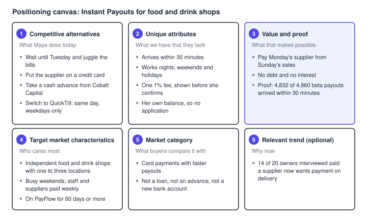
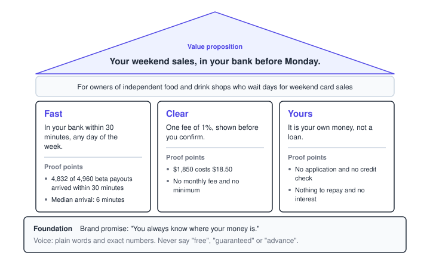
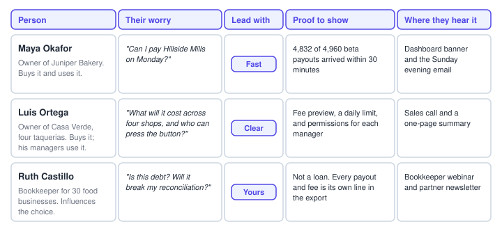
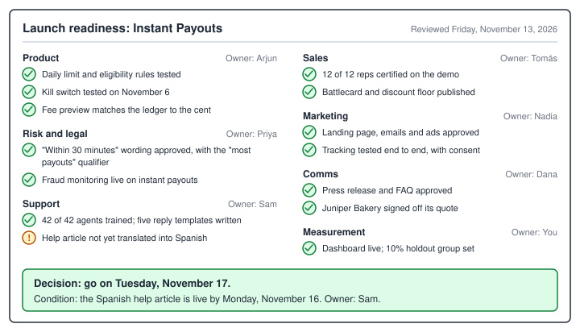
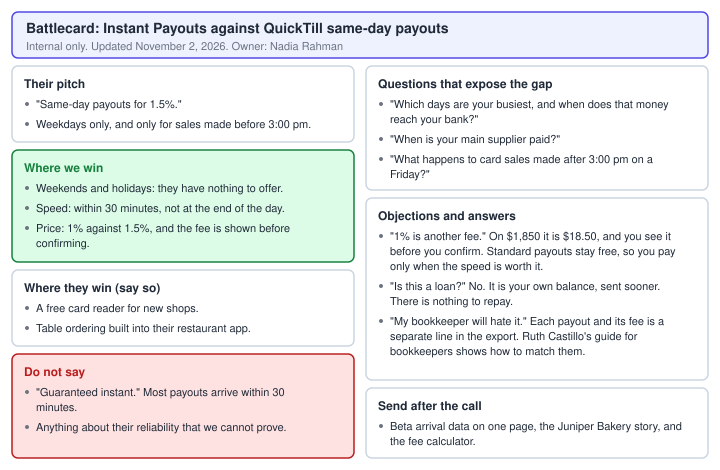
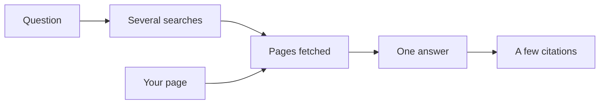
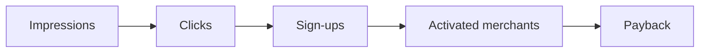

# Product Marketing and Go-to-Market

**Version 2 · October 2026** · Volume 9 of the PM + AI Master Library

> Learn to position a product, say what it does in words customers repeat, price it, launch it, and tell whether the marketing worked, by following one launch from first interview to ninety-day review.

---

## Start here

### Who this is for

You are a product manager, or about to become one. Sooner or later you will sit in a room with marketing and sales and be asked who the product is for, why anyone should switch to it, what it should cost, and whether last quarter's spend did anything. You will also meet these questions in interviews: "How would you launch X?" and "How would you position X against Y?"

This book teaches the marketer's craft from the PM's chair. You will not learn to run an ad account. You will learn how the decisions get made and how to check the arithmetic behind them.

### What you need before you start

- No marketing background. Every term is explained where it first appears and again in the Glossary.
- A rough idea of what a payments product does. "Meet PayFlow" covers it in ten minutes.
- Arithmetic. Twelve short Python listings do the calculations, and their output is printed in the book, so you can read along without running anything.
- Optional: Python 3.13 if you want to run the calculations yourself. The scripts are in the folder `volume-9-examples`, next to this book's PDF in the library (`01-curriculum/08-product-marketing/`); `./run_all.sh` runs them all.

### What you will be able to do

After the full path you will be able to:

- Fill in a positioning canvas and turn it into a message house with proof under every claim.
- Pick a first segment from evidence and describe the ideal customer in traits you can observe.
- Write a one-page go-to-market plan and a tiered launch plan with a readiness check.
- Compare two ways to price and package a feature, from the customer's side and from yours.
- Work a paid campaign from impressions to payback, and spot a healthy-looking return that loses money.
- Explain why three attribution models disagree and what an experiment adds.
- State what is and is not known about how AI answer engines surface a brand.
- Answer a go-to-market interview question with a structure, numbers and a rollout.

### How this book is organized

| Part | What you learn | Time |
|---|---|---|
| Meet PayFlow | The company, the launch, the people, the numbers | 10 min |
| I. Foundations (Ch. 1-4) | The PMM job, segments, positioning, messaging | 75 min |
| II. Brand (Ch. 5-6) | Brand strategy, honest measurement, the brand documents | 35 min |
| III. Going to market (Ch. 7-12) | The plan, pricing, launch, comms, sales, partners | 2 hr |
| IV. Creating demand (Ch. 13-19) | Budget, content, search, AI search, paid, social, lifecycle | 2 hr 15 min |
| V. Systems and proof (Ch. 20-23) | Martech, attribution, AI in marketing, how the team runs | 75 min |
| VI. Practice (Ch. 24-25) | Seven labs with model answers, three worked cases | 4 hr |
| VII. Interview kit (Ch. 26-27) | One complete spoken answer, scoring, nine questions | 60 min |
| VIII. Reference | Cheat sheet, templates, glossary, answers, sources | As needed |

### Three ways to read it

**The 90-minute pre-interview path.** For the night before a go-to-market round.

1. Meet PayFlow (10 min).
2. Chapter 3, Positioning, with Figure 3.1 (10 min).
3. Chapter 4, Figure 4.1 only (5 min).
4. Chapter 7, The go-to-market plan (10 min).
5. Chapter 9, The launch plan (10 min).
6. Chapter 17, the worked example (10 min), then Chapter 21, the worked example (10 min).
7. Chapter 26, the complete answer (20 min), and the Cheat sheet (5 min).

**The weekend path.** About eight hours over two days.

- Day one: Meet PayFlow, Parts I and III. Do Labs 1, 2 and 3.
- Day two: Chapters 13, 17, 19 and 21, then Part VII. Do Labs 5 and 6 and read Case 1.

**The full path.** About two weeks at 45 minutes a day. Read in order and do each lab when its part ends: Labs 1 and 2 after Part I, Labs 3, 4 and 7 after Part III, Lab 5 after Part IV, Lab 6 after Part V. Then read the three cases and answer three question-bank prompts out loud with a timer.

### How each chapter works

Chapters 1 to 23 follow the same steps: why it matters (the pain the idea prevents), the idea in plain words, a worked example on PayFlow with real inputs and outputs, common mistakes, and two or three "Check yourself" questions numbered by chapter, with answers in Part VIII. Each closes with one line to remember.

Four traps come up again and again, so learn their names now: *generic positioning* (a claim any rival could make), *launch-only thinking* (stopping work on the day the product ships), *platform-reported truth* (believing an ad platform's account of its own results), and *claims without proof*.

### What's new in Version 2

- **One launch, start to finish.** Every chapter works on the same product, the same people and the same numbers.
- **A teaching order.** Thirty-six topics are regrouped into 23 chapters that build on each other. The Syllabus map shows where each topic went.
- **Calculations you can rerun.** Segment choice, a message test, pricing, launch tiers, channel costs, the paid funnel and attribution are computed by short scripts, with the output shown.
- **Twelve filled-in artifacts.** A positioning canvas, a message house, a battlecard, a press release, two briefs and more, drawn as figures.
- **Current rules, checked.** Disclosure for creators, consent for tracking, and what search and AI companies publish about how they surface pages, as of October 2026.
- **Practice with answers.** Seven labs, three cases, one complete interview answer and an answer for every "Check yourself" question.

## Meet PayFlow

PayFlow is a fictional payments company and the only example in this book. Every number attached to it is made up for teaching and describes no real company. QuickTill, Cobalt Capital, Tablekeep and every person named here are fictional too.

### What PayFlow sells

PayFlow lets a business accept card payments. A business that uses it is called a **merchant**. PayFlow charges 2.9% plus $0.30 for each successful payment. Around that core it offers a dashboard, dispute handling, an AI assistant called PayFlow Assist, and payouts.

A **payout** is the transfer of a merchant's card sales to its bank account. A standard payout is free and arrives two business days after the sale. So card sales from Friday, Saturday and Sunday all reach the bank on Tuesday.

### The launch this book follows

PayFlow is about to launch **Instant Payouts**: a merchant can send its available balance to a debit card and have the money within 30 minutes, at any hour, on any day. The fee is 1% of the amount, shown before the merchant confirms. A merchant qualifies after 60 days on PayFlow and can move up to $10,000 a day.

Here is the problem it solves. Maya Okafor owns Juniper Bakery. On the weekend of October 3 and 4, 2026, her two shops took $4,180 by card. That money arrives on Tuesday. Her flour supplier, Hillside Mills, delivers on Monday morning and wants $1,850 on delivery. With Instant Payouts she moves $1,850 on Sunday night and pays a fee of $18.50.

### The cast

| Person | Role | What they want |
|---|---|---|
| You | Product manager for Payouts | A launch that merchants use and that makes money |
| Nadia Rahman | Product marketing manager, your counterpart | A clear story the whole company tells the same way |
| Helen Brooks | VP of Marketing | Growth she can prove to the finance team |
| Grace Liu | Paid marketing lead | New merchants at a cost that pays back |
| Ibrahim Saleh | Lifecycle marketing manager | Existing merchants who start and keep using new products |
| Tomás Vega | Sales lead, small business | Deals his twelve reps can win without discounting |
| Dana Kim | Communications lead | Coverage that is accurate |
| Marcus Bell | Partnerships lead | Partners who bring the right merchants |
| Priya Nair | Risk analyst | No fraud losses from fast money |
| Maya Okafor | Owner, Juniper Bakery | To pay Monday's bills from the weekend's sales |
| Ruth Castillo | Bookkeeper for 30 food businesses | Clean books for her clients |

Support is led by Sam Whitfield and engineering by Arjun Mehta.

### The numbers you will see again

**The beta.** From June 1 to July 26, 2026, PayFlow invited 1,200 small merchants to try Instant Payouts. They made 4,960 instant payouts. Of those, 4,832 arrived within 30 minutes, and the median arrival time was 6 minutes.

**The dates.** General availability is Tuesday, November 17, 2026.

**What one merchant is worth.** A typical new small merchant takes $6,000 a month by card, in 150 payments. The script below works out what PayFlow keeps. **Contribution** is what is left of revenue after the costs that come with each customer. **Churn** is the share of customers who leave in a period.

```python
FEE_RATE, FEE_FIXED = 0.029, 0.30      # what PayFlow charges per payment
COST_RATE, COST_FIXED = 0.021, 0.10    # what card networks and banks charge PayFlow
SERVICING = 18.00                      # support and fraud losses per merchant-month
MONTHLY_CHURN = 0.03                   # share of small merchants who leave each month

def monthly_fees(volume, payments):
    return FEE_RATE * volume + FEE_FIXED * payments

def monthly_contribution(volume, payments):
    card_costs = COST_RATE * volume + COST_FIXED * payments
    return monthly_fees(volume, payments) - card_costs - SERVICING
```

Output:

```text
Typical merchant: fees $219.00 a month, contribution $60.00
Contribution margin rate: 27.4%
Sales-won merchant: contribution $216.00 a month
Expected active months in year one: 10.21
Lifetime contribution, typical: $2,000
```

Keep three of these in mind: PayFlow bills a typical merchant $219 a month, keeps $60 of it, and loses 3% of its small merchants every month.

# Part I — Foundations

## 1. What product marketing is, and how you share the work

### Why it matters

Picture two bad launches of Instant Payouts.

In the first, engineering ships it and a line appears in the release notes. Nobody tells merchants what it is for. Sales describes it as "a kind of advance". Three months later 2% of eligible merchants have tried it.

In the second, marketing runs ahead of the product. The ads say "guaranteed instant". On day two a card network slows down, 300 payouts take four hours, and support spends a week apologizing for a promise the product never made.

Both launches failed in the gap between the product and its market. Closing that gap is a job, and you share it.

### The idea

**Product marketing** is the work of connecting a product to the people it is for: deciding who they are, what to tell them, how it reaches them, and bringing what the market says back to the product team. The person who does it is a product marketing manager, or PMM.

**Go-to-market**, often shortened to GTM, is everything a company does to get a product into customers' hands and get paid: the audience, the message, the price, the channels, the sales approach and the launch.

A PMM does four kinds of work. Each has a part of this book.

| Work | The question it answers | Where |
|---|---|---|
| Insight | Who buys, who doesn't, and why? | Ch. 2 |
| Positioning and messaging | What is this, for whom, and why us? | Ch. 3-6 |
| Launch and enablement | How does it reach people, and can our own teams explain it? | Ch. 7-12 |
| Demand and adoption | Did people come, start, stay, and can we prove it? | Ch. 13-23 |

How do you know product marketing is working? Not by counting documents. Five outcome measures recur in this book.

| Measure | What it tells you |
|---|---|
| **Qualified demand** | Interest from customers who fit, not just traffic |
| **Message comprehension** | Whether people can say what the product does after seeing the message |
| **Adoption** | Whether eligible customers start using it and keep using it |
| **Win rate** | The share of sales opportunities that end in a sale |
| **Expansion** | Whether existing customers buy or use more over time |

### Worked example

Before any launch work starts, you and Nadia write down who decides what. It takes half an hour and prevents most later arguments.

| Decision | Owner | The other's part |
|---|---|---|
| Eligibility rules and the $10,000 daily limit | You, with Priya | Nadia checks that the rules can be explained in one sentence |
| The fee | You propose; Helen and your director approve | Nadia brings rival prices and how merchants react to them |
| Which segment goes first | Nadia | You bring the beta data |
| Message and claims | Nadia | You confirm every claim is true of the shipped product |
| Launch date and launch size | You set the date; Nadia sets the size | Each can veto the other with a reason |
| Sales and support training | Nadia | You run the product walk-through |
| Success measures | Shared | Agreed before launch, in writing |

The fourth row earns its place within a week. Nadia drafts "Money in your bank in minutes, guaranteed." You check the beta: 4,832 of 4,960 payouts arrived within 30 minutes, which leaves 128 that did not. "Guaranteed" is false. The line becomes "within 30 minutes" in headlines, with "most payouts" in the supporting text. That one check removes the second bad launch from the opening of this chapter.

### Common mistakes

| Mistake | Why it bites | Do this instead |
|---|---|---|
| Calling marketing in two weeks before launch | Positioning gets bolted on to a finished product | Bring your PMM in when you write the problem statement |
| Treating the PMM as "the deck person" | You lose the one person paid to know the market | Ask for win and loss reasons, not slides |
| Letting claims go out unchecked | A false claim costs trust, and can be unlawful | The PM signs off that every claim is true as shipped |

### Check yourself

**Q1.1** Sort these into "PM owns", "PMM owns" or "shared": (a) the daily limit, (b) the headline on the landing page, (c) the fee.

**Q1.2** A team reports "we shipped 14 launch assets" as its result. Name two outcome measures you would ask for instead.

> [!IMPORTANT]
> **In one line:** Product marketing connects the product to its market in both directions, and it works when you and your PMM agree in writing who decides what.

## 2. Know the market: segments, the ideal customer, and why you win or lose

### Why it matters

"Small merchants" is 60,000 businesses at PayFlow. A bakery, a plumber and an online candle shop have little in common. A launch aimed at all of them needs a message vague enough to fit all three, which means it moves none of them. The budget is spread thin, the sales team chases everyone, and nobody can say afterwards who the product was for.

### The idea

A **segment** is a group of customers who share a need and respond to an offer in a similar way. Useful segments are defined by the need, not by whatever field happens to be in the database.

An **ideal customer profile**, or ICP, describes the kind of customer who gets the most value from the product and is profitable to serve. Write it in traits you can observe from outside, so that marketing can target it and sales can qualify against it. **ICP drift** is what happens when the team quietly starts selling to anyone who will take a meeting.

A **persona** is a person inside the customer's business: a role with goals and worries. Three roles matter in a purchase. The **buyer** decides and pays. The **user** works with the product. An influencer shapes the choice without making it. In a small shop one person may be all three. In a larger one they are different people who need different messages.

**Win/loss analysis** is the habit of asking recent buyers and non-buyers why they chose as they did. Ask the buyer, not only the sales rep, and study losses as carefully as wins.

Geoffrey Moore's *Crossing the Chasm* (1991) adds the idea of sequence. New products are bought first by enthusiasts and only later by cautious, practical buyers, and many products stall in the gap between the two groups. His advice is to win one narrow segment completely before moving to the next. That first segment is the **beachhead**.

### Worked example

You have two sources: the beta, and 80 deals the sales team lost last quarter, each coded by its main reason.

```python
# Columns: segment, invited, tried it, used it 3+ times,
# monthly instant volume per repeat user ($), PayFlow merchants in the segment.
BETA = [
    ("Food and drink", 400, 168, 121, 5_200, 21_000),
    ("Trades", 400, 132, 74, 7_800, 9_000),
    ("Online and retail", 400, 61, 22, 3_100, 30_000),
]

def segment_rows():
    rows = []
    for name, invited, tried, repeat, volume, merchants in BETA:
        fee_per_invited = repeat * volume * INSTANT_FEE / invited
        rows.append({
            "name": name,
            "tried": tried / invited,          # trial rate
            "kept": repeat / tried,            # share of triers who came back
            "repeat": repeat / invited,        # repeat users per invited merchant
            "fee": fee_per_invited,            # monthly fees per invited merchant
            "potential": fee_per_invited * merchants,
        })
    return rows
```

Output:

```text
Segment              Tried  Came back  Repeat  Fee/invited  If all behaved so
Food and drink       42.0%      72.0%   30.2%        15.73            330,330
Trades               33.0%      56.1%   18.5%        14.43            129,870
Online and retail    15.2%      36.1%    5.5%         1.71             51,150

Loss reason            All   Share  Food   Share
Payout speed            26   32.5%    15   48.4%
Price                   21   26.2%     6   19.4%
Missing integration     14   17.5%     4   12.9%
No decision             12   15.0%     4   12.9%
Other                    7    8.8%     2    6.5%
Total                   80            31
```

Read it in three steps.

*Who tries it and comes back?* Food and drink leads on both. Trades businesses use it less often but move bigger amounts, so their fee per invited merchant is close. Online and retail shops barely care: most already get paid every weekday and have no weekend rush.

*How big is the prize?* The last column multiplies the beta result by the number of PayFlow merchants in each segment. Treat it as a ceiling. Beta volunteers are keener than average.

*Does the sales evidence agree?* Payout speed is the top loss reason overall and accounts for nearly half the food and drink losses. Two separate sources point the same way.

So food and drink is the beachhead, trades come second, and online and retail get no launch budget. Nadia writes the ICP:

> Independent food and drink businesses with one to three locations, $8,000 to $60,000 a month in card sales, busiest at weekends, paying staff and suppliers weekly, and on PayFlow for at least 60 days.

Every trait can be checked from PayFlow's own data. She also writes who it is not for: franchise outlets whose head office handles cash, and online shops.

Then the people. At Juniper Bakery, Maya is buyer and user. At Casa Verde, a group of four taquerias, owner Luis Ortega buys and his managers use. Ruth Castillo, who keeps the books for 30 food businesses, uses nothing and influences all 30.

### Common mistakes

| Mistake | Why it bites | Do this instead |
|---|---|---|
| Segmenting by a database field | "Retail" hides a florist and a phone repair shop | Segment by the need, then find fields that predict it |
| An ICP that is a wish list | "Fast-growing brands" cannot be targeted or checked | Use traits visible in data you hold |
| Trusting the loss reason in the sales tool | Reps pick "price" because it is first in the list | Call ten buyers and ask |

### Check yourself

**Q2.1** Trades merchants tried Instant Payouts less than food and drink merchants, yet their fee per invited merchant is almost as high. Why?

**Q2.2** Rewrite "our ICP is modern restaurants that care about cash flow" so that a sales rep could qualify against it.

**Q2.3** In a four-location restaurant group, who is the buyer, who is the user, and who might be an influencer?

> [!IMPORTANT]
> **In one line:** Pick one segment from evidence, describe it in traits you can observe, and know who buys, who uses and who influences.

## 3. Positioning

### Why it matters

In beta interviews, six of twenty owners called Instant Payouts "that loan thing". They had filed it next to cash advances, which they distrust. Others filed it under "another fee". Neither group was wrong about the product. They had been given no frame, so they picked one.

Positioning is how you choose the frame before the customer does.

### The idea

**Positioning** defines what a product is, who it is for, and why it is a better choice than the alternatives. It is an internal decision, not a slogan. Al Ries and Jack Trout popularized the term, in articles from 1969 and a 1981 book, as the place a product holds in the customer's mind.

The most usable method today comes from April Dunford's *Obviously Awesome* (2019). She breaks positioning into five components plus one optional extra, and insists on working through them in this order:

1. **Competitive alternatives.** What would customers do if your product did not exist? Include "nothing" and makeshift fixes, not only rival products.
2. **Unique attributes.** What do you have that those alternatives lack?
3. **Value, and proof.** What do those attributes let the customer achieve, and what evidence shows it?
4. **Target market characteristics.** Which customers care most about that value?
5. **Market category.** What frame of reference makes the value obvious?
6. **Relevant trends.** Optional. Is something changing that makes this matter now?

The order is the method. Most teams start at step 5 by declaring a category and then hunt for reasons. Starting from real alternatives keeps you honest, because "better" only means something next to a specific alternative.

Once the components are settled, you can compress them into a **positioning statement**. The best-known template is from Geoffrey Moore's *Crossing the Chasm* (1991):

> For (target customer) who (need or opportunity), (product) is a (category) that (key benefit). Unlike (main alternative), our product (main difference).

The statement is a summary to align colleagues. It never appears in an ad.

### Worked example

You and Nadia fill in the canvas over two sessions, using the beta interviews.



*Figure 3.1 — The positioning canvas for Instant Payouts, filled in the order the numbers show.*

Three things happened along the way.

**The alternatives were not who you expected.** You assumed the rival was QuickTill's same-day payouts. Interviews said most owners simply wait and juggle, some lean on a credit card, and a few take a cash advance. QuickTill came fourth. A message built against QuickTill would have missed most of the market.

**Attributes had to pass a "so what?" test.** "Runs on debit card rails" is true and nobody cares. "Works nights, weekends and holidays" matters because of what it allows: paying Monday's supplier from Sunday's sales.

**The category was the real decision.** Three frames were on the table: a financing product, a new kind of account, or faster payouts on the card payments merchants already take. The first invites comparison with lenders and triggers the distrust you heard in interviews. The third is accurate and makes the value plain. You chose it and wrote down what the product is not: a loan, an advance, or a bank account.

Then the statement:

> For owners of independent food and drink shops who wait days for weekend card sales, Instant Payouts is a payout option that puts their balance in their bank within 30 minutes, on any day. Unlike a cash advance or a credit card, it is their own money: no debt, no interest, and one 1% fee shown before they confirm.

How will you know the positioning works? Watch five signals after launch: message comprehension in tests, preference against the named alternatives, the reasons given in win and loss interviews, **price realization** (the share of list price you collect once discounts are counted), and adoption in the target segment. If "is this a loan?" stays a top support question, the frame has not landed.

### Common mistakes

| Mistake | Why it bites | Do this instead |
|---|---|---|
| Starting with the category or the tagline | You defend a label and bend the facts to fit | Start from what customers do today |
| "Faster, easier, better" | Any rival can say it, so it says nothing | Name the alternative and the exact difference |
| Proof you cannot show | One challenged claim taints the rest | Attach a number, a demo or a named customer to each |

### Check yourself

**Q3.1** Why does Dunford's method begin with competitive alternatives and not with the market category?

**Q3.2** A colleague proposes the category "working capital solution" for Instant Payouts. Give one argument for it and one against.

**Q3.3** Name two signals that would tell you the "not a loan" framing has failed.

> [!IMPORTANT]
> **In one line:** Decide what customers would do without you, what you alone offer, what that is worth to whom, and only then choose the frame.

## 4. Messaging: from positioning to words people repeat

### Why it matters

Positioning lives in a document. Customers meet words. Without an agreed set, each team writes its own: the ad says "accelerate your cash flow", a sales rep says "advance", the help page says "expedited settlement", and Maya has no idea these are one product.

### The idea

A **messaging framework** turns positioning into the words everyone uses. It has four layers.

- The **value proposition**: one sentence promising a specific outcome to a specific customer.
- **Message pillars**: usually three supporting claims. Each is a benefit, not a feature. A feature is what the product has, and a benefit is what the customer gets.
- **Proof points**: the evidence under each pillar. A number, a demonstration, or a named customer.
- Vocabulary: the words you use and the ones you never use.

A **message house** draws these as a building. The roof is the value proposition, the pillars hold it up, and the foundation is the brand promise and voice. Everything on a landing page, in an email or in a sales script should trace back to one part of the house.

Proof is not optional decoration. In the United States the Federal Trade Commission expects an advertiser to have a reasonable basis for an objective claim before making it. That principle has stood since a 1984 policy statement. "Within 30 minutes" needs data behind it on the day it is published.

One house serves several people, but each walks in through a different door. A **persona-to-message map** records which pillar leads for which person and where they will hear it.

Finally, test. Do it in this order, because each step is cheaper than the next: comprehension (can people say what it is?), preference (which version do they choose?), then behavior (which version makes more people act, measured with an **A/B test**, where you show two versions to random groups and compare).

### Worked example

Here is the house Nadia builds from the canvas in Chapter 3.



*Figure 4.1 — The message house. Every claim on a pillar has a proof point beneath it.*

And here is how it bends for three people.



*Figure 4.2 — The same house, a different door for each person.*

Before the roof line was final, Nadia tested three headlines. Each was shown for five seconds to 80 food and drink owners, who were then asked what the product does and who it is for.

```python
def wilson(k, n, confidence=0.95):
    """Wilson score interval for a share k/n. Safer than p +/- 2 SE at small n."""
    z = NormalDist().inv_cdf(0.5 + confidence / 2)
    p = k / n
    centre = (p + z * z / (2 * n)) / (1 + z * z / n)
    half = z * (p * (1 - p) / n + z * z / (4 * n * n)) ** 0.5 / (1 + z * z / n)
    return centre - half, centre + half
```

Output:

```text
Headline                                             Understood     95% interval
A  Accelerate your cash flow                              38.8%    28.8% to 49.7%
B  Get paid in minutes, even on weekends                  72.5%    61.9% to 81.1%
C  Your weekend sales, in your bank before Monday         77.5%    67.2% to 85.3%
```

A **confidence interval** is the range the true figure plausibly sits in, given how few people you asked. Headline A is clearly worse: its interval does not overlap the others. B and C overlap almost entirely, so 80 people cannot separate them.

Nadia makes a judgment call and says so. C goes on the roof for food and drink because it names the exact moment Maya worries about. B is kept for general use. An A/B test on the launch email will check the choice against behavior.

### Common mistakes

| Mistake | Why it bites | Do this instead |
|---|---|---|
| Pillars that are features | "Debit card rails" means nothing to an owner | Ask "so what?" until you reach an outcome |
| One message for every persona | The bookkeeper's worry goes unanswered | Map a lead pillar and proof to each person |
| Testing on colleagues | They already know what it does | Test on people from the target segment |

### Check yourself

**Q4.1** Turn this feature into a benefit: "Payouts are available 24 hours a day, 7 days a week."

**Q4.2** Headlines B and C scored 72.5% and 77.5%. Why is it wrong to say "C won"?

**Q4.3** Ruth, the bookkeeper, never uses Instant Payouts. Why does she get her own row in the map?

> [!IMPORTANT]
> **In one line:** One value proposition, three benefit pillars, proof under each, and a different door for each person in the decision.

# Part II — Brand

## 5. Brand strategy and brand marketing

### Why it matters

Most of the owners who will one day need a new payments company are not shopping today. On the day Maya's current provider lets her down, she will think of one or two names and look those up. If PayFlow is not one of them, no ad bought that week will reach her in time.

Building that memory is slow and hard to measure, so it is the first thing cut and the easiest to fake results for.

### The idea

A **brand** is what people remember about you and what they expect from you. **Brand strategy** is the set of choices that shape those memories and expectations.

| Choice | The question | Test |
|---|---|---|
| Purpose | Why does the company exist, beyond making money? | Would staff make a different decision because of it? |
| **Brand promise** | What can a customer count on, every time? | Can you name a moment where you keep it at a cost? |
| **Voice** | How do we sound? | Could a stranger pick our email out of five? |
| **Distinctive assets** | What do people recognize as ours without the name? | Do customers identify it unprompted? |
| Governance | Who keeps all of this consistent? | Is there a named owner and an approval path? |

Two ideas from marketing research explain why this matters commercially.

Byron Sharp's *How Brands Grow* (2010), from the Ehrenberg-Bass Institute, argues from purchase data that brands grow mainly by reaching more buyers, not by squeezing more out of loyal ones. To be bought, a brand must be easy to think of, which he calls **mental availability**, and easy to buy. Jenni Romaniuk, of the same institute, added two practical tools. Distinctive assets are the colors, shapes, sounds and phrases that trigger recognition, covered in her 2018 book *Building Distinctive Brand Assets*. **Category entry points** are the situations and needs that make a buyer think of the category at all.

Les Binet and Peter Field's *The Long and the Short of It* (2013) separates two jobs. **Brand marketing**, or brand building, creates memories among people who are not buying yet, and its effect builds slowly. **Sales activation** converts people who are ready now, and its effect is quick and short. In their data on consumer campaigns, a split of about 60% brand to 40% activation worked best as a rule of thumb, varying by category. Their 2019 report on business-to-business marketing found a split closer to half and half, from a small sample. Treat both as starting guesses for your own tests.

Measuring brand honestly means three things. Do not judge brand advertising by clicks. Use a **brand tracker**, a repeated survey of awareness and consideration in your target market, and respect its error bars. Then check the survey against behavior, such as searches for your name in places that saw the campaign and places that did not.

### Worked example

Helen's team keeps PayFlow's brand on one page.

| Element | PayFlow's choice |
|---|---|
| Purpose | Give small businesses back the hours they spend chasing their own money |
| Promise | You always know where your money is |
| Voice | Plain, calm and exact: numbers and dates, no hype |
| Distinctive assets | The indigo flow line, the two-note chime when a payment succeeds, the receipt layout of every notification |
| Category entry points | "When will I get paid?", "A customer disputed a charge", "I am opening a second shop" |

In spring 2026 PayFlow ran a brand campaign aimed at food and drink owners. The tracker asks 400 owners, twice a year, which payment companies they can name without a prompt.

```python
def difference_interval(k1, n1, k2, n2):
    p1, p2 = k1 / n1, k2 / n2
    se = sqrt(p1 * (1 - p1) / n1 + p2 * (1 - p2) / n2)
    diff = p2 - p1
    return diff, diff - Z * se, diff + Z * se
```

Output:

```text
January 2026    36 of 400 named PayFlow = 9.0%
July 2026       48 of 400 named PayFlow = 12.0%
Change: +3.0 points, 95% interval -1.2 to +7.2 points
Respondents per wave for a 3-point change to clear zero: 801
```

The slide Helen was handed said "awareness up 33%". The honest reading is different. The interval runs from a small fall to a large rise, so this tracker cannot tell a three-point gain from no change. It would need about 800 owners per wave.

Helen does two things. She doubles the sample for the next wave. And she asks Grace to compare searches for "PayFlow" in the six campaign cities with six similar cities that got no campaign, which is the kind of test Chapter 21 explains.

### Common mistakes

| Mistake | Why it bites | Do this instead |
|---|---|---|
| Thinking brand means the logo | The promise is kept or broken in the product | Start from what customers can count on |
| Judging brand ads by clicks | They work on people who are not ready to click | Use tracker surveys and place-based tests |
| Refreshing the look every year | Recognition resets to zero each time | Keep distinctive assets for years |

### Check yourself

**Q5.1** Why can't a brand campaign be judged by the sales it produces in the week it runs?

**Q5.2** The tracker moved from 9% to 12%. What can you truthfully tell the finance team?

> [!IMPORTANT]
> **In one line:** A brand is remembered expectations, built slowly among people not yet buying, and its measurement needs error bars.

## 6. Brand guidelines, the brand book, the brand deck, and the workshop behind them

### Why it matters

About forty people write something in PayFlow's name every week: emails, error messages, ads, partner pages, sales slides. Without shared rules, each invents a slightly different company. With money involved, inconsistency reads as carelessness.

Four things with similar names fix this. They are one craft with four outputs.

### The idea

| Artifact | Reader | It answers | Typical form |
|---|---|---|---|
| **Brand guidelines** | Anyone making something: designers, writers, agencies, partners | "How do I make this look and sound like us?" | A web page of rules with right and wrong examples |
| **Brand book** | Employees and new hires | "Who are we, and why?" | The story and strategy, with the guidelines attached |
| **Brand deck** | Executives, the board, the whole company at a kickoff | "What are we changing, and what do you need to approve?" | Twelve to fifteen slides |
| **Brand workshop** | The people who must agree | "What do we stand for?" | A half-day working session |

The workshop comes first, because it produces the raw decisions. The deck gets those decisions approved. The book records them. The guidelines turn them into rules that can be followed without asking anyone.

Good guidelines share four habits. They show pairs of examples, one right and one wrong, since a rule without an example is ignored. They cover words as well as visuals. They include the rules for claims, so "guaranteed" is banned in the same place the logo spacing is defined. And they live at one address that is always current.

**Brand governance** is the answer to "who says yes?". It names an owner, an approval path for new uses, a way to ask for an exception, and a review date. Partners need a short version of their own, which Chapter 12 returns to.

### Worked example

**The workshop.** Helen runs a four-hour session before the Instant Payouts launch, because the product stretches the brand into faster, riskier territory. Eight people attend, including you, Nadia, Sam from support and Priya from risk.

| Time | Exercise | Output |
|---|---|---|
| 30 min | Read twenty customer quotes aloud, good and bad | A shared picture of how merchants talk about PayFlow |
| 40 min | "Only we" statements, each backed by a fact | Six candidate differences; four survive challenge |
| 40 min | Draft the promise; test each draft against a hard case | "You always know where your money is" holds when a payout fails |
| 40 min | Voice pairs: "we are this, not that" | Calm not casual; exact not legalistic; helpful not chirpy |
| 30 min | Asset audit: which assets do merchants recognize? | Keep the chime and flow line; retire three unused icons |
| 30 min | Decisions, owners and dates | One page, sent the same day |

**The guideline it produced.** Here is the part of the voice guidelines that covers money in motion, with the examples that make it usable.

| Situation | Write this | Not this | Rule |
|---|---|---|---|
| Payout sent | "$1,831.50 is on its way to your card ending 5506. Most payouts arrive within 30 minutes." | "Woohoo! Your cash is zooming to you!" | Exact amount, exact place, honest timing |
| Payout slow | "This payout is taking longer than usual. Your money is safe. We will text you when it lands." | "Error: transfer pending (code 48)" | Say what is happening, then what happens next |
| Fee shown | "Fee: $18.50 (1%). You receive $1,831.50." | "A small convenience fee applies." | Always the number, never an adjective |
| Ad | "Your weekend sales, in your bank before Monday." | "Unlock instant liquidity today!" | Customer's words, no jargon, no "guaranteed" |

**The deck.** Helen's brand deck for the leadership team is thirteen slides. Its job is approval, so it is built around the three decisions she needs: adopt the promise as a product rule, fund the larger tracker, and give Nadia sign-off on all launch claims.

### Common mistakes

| Mistake | Why it bites | Do this instead |
|---|---|---|
| A workshop with no customer evidence | The output reflects the room, not the market | Open with real quotes and data |
| Guidelines as a file nobody can find | People copy last quarter's mistake | One live address, linked from every template |
| No owner | Exceptions pile up until there is no standard | Name who approves and how to ask |

### Check yourself

**Q6.1** A partner agency asks how PayFlow writes about fees. Which of the four artifacts do you send, and why not the others?

**Q6.2** Why did Helen invite support and risk to a brand workshop?

> [!IMPORTANT]
> **In one line:** The workshop decides, the deck gets approval, the book explains, and the guidelines let forty people sound like one company.

# Part III — Going to market

## 7. The go-to-market plan

### Why it matters

Ask five teams how Instant Payouts will reach merchants and you get five plans. Marketing is planning a campaign for all small businesses. Sales wants to pitch restaurant chains. Support assumes it will be switched on quietly. Finance has a revenue number nobody else has seen. Each plan is reasonable alone. Together they are a launch that pulls in five directions and has only one thing in common: a date.

### The idea

A **go-to-market plan** is one page that makes the teams' plans the same plan. It answers seven questions.

| Question | What you write |
|---|---|
| Who? | The ICP and the order of segments |
| What problem, and what promise? | The positioning statement and value proposition |
| How do they buy? | The GTM motion |
| What does it cost? | Price and packaging |
| How will they hear? | Channels, in priority order |
| Can our own people sell and support it? | Enablement |
| How will we know? | Targets, guardrails and review dates |

A **GTM motion** is the main way customers come to buy.

| Motion | How it works | Fits when |
|---|---|---|
| **Product-led** | People find, try and buy inside the product, with no salesperson | Low price, simple decision, quick value |
| **Sales-led** | A salesperson guides a buyer through evaluation and contract | High price, several decision makers, risk review |
| Sales-assisted | Self-serve by default; a person steps in for larger accounts | A mix of small and mid-size customers |
| Partner-led | Another company brings or serves the customer | Partners already hold the customer's trust |

The phrase "product-led growth" was coined in 2016 by Blake Bartlett at the venture firm OpenView. The idea is older than the name.

Sales-involved motions have their own vocabulary. The **pipeline** is the set of open sales opportunities and their expected value. Pipeline quality is how much of it fits the ICP and closes. The sales cycle is the time from first conversation to signature.

A plan can fail in four classic ways. *Launch as a date*: the plan ends on launch day. *ICP drift*: the segment widens whenever a target looks hard to hit. *Weak handoff*: a lead passes from marketing to sales, or a customer from sales to support, and the context is lost. *Commitments beyond capability*: a promise made to win a deal that the product cannot keep.

### Worked example

Here is the page you and Nadia agree with Helen and Tomás.

| Question | Instant Payouts, launch plan |
|---|---|
| Who | Independent food and drink shops, one to three locations (Ch. 2). Trades businesses follow in the first quarter of 2027. Online and retail: no spend. |
| Problem and promise | Weekend card sales arrive Tuesday; Monday's bills do not wait. "Your weekend sales, in your bank before Monday." |
| Motion | Product-led for the merchants already on PayFlow: they see it, try it and pay for it in the dashboard. Sales-assisted for new groups with several locations. |
| Price | 1% of the amount, shown before confirming. No subscription (Ch. 8). |
| Channels | First the ones PayFlow owns: dashboard and email. Then bookkeepers, then paid search, then press. |
| Enablement | Twelve sales reps and 42 support agents trained and tested a week before merchants hear anything. |
| Measures at 90 days | 3,000 food and drink merchants have made an instant payout. Six in ten of them make a second within 30 days. 900 new food and drink merchants activated. |
| Guardrails | Fraud losses on instant payouts stay under 0.05% of instant volume. Payout questions to support per 1,000 payouts do not rise. |

Three choices are worth defending in a review.

**Existing merchants first.** PayFlow can reach its own merchants free, inside a product they already open. Winning new merchants with this feature costs money per head, as Part IV shows. So the first phase is adoption, and acquisition follows once the message is proven.

**One segment gets the budget.** The beta said trades businesses like the product too. They still wait a quarter. Splitting a modest budget across two segments would give neither enough repetition to be remembered.

**The guardrails were written by other teams.** Priya set the fraud line. Sam set the support line. A target that risk and support did not help write is a target they will not help hit.

The plan is read again at two weeks, 30 days and 90 days after launch, and it is expected to change.

### Common mistakes

| Mistake | Why it bites | Do this instead |
|---|---|---|
| Channels listed with no order | Everything starts at once and nothing gets enough attention | Rank them, and start with the ones you own |
| Choosing the motion by habit | A sales team on a $20-a-month product loses money | Match the motion to price, complexity and risk |
| Targets with no guardrails | Adoption is bought with fraud or support load | Let risk and support write the guardrails |

### Check yourself

**Q7.1** Why is Instant Payouts product-led for existing merchants but sales-assisted for restaurant groups?

**Q7.2** Tomás wants to pitch a 200-outlet franchise in launch week. Which failure mode is this, and what do you say?

> [!IMPORTANT]
> **In one line:** One page, seven answers, agreed by every team, with review dates that assume the plan will change.

## 8. Pricing, packaging and monetization

### Why it matters

Price is the one decision that changes revenue the day you change it, and it is usually made last, in a hurry, by copying a rival. Packaging is quieter and just as powerful: it decides which customers choose which offer, and a careless package can turn your best customers into your least profitable ones.

### The idea

Three decisions make up a **monetization model**, the way a product turns use into revenue.

The **value metric** is the unit you charge for: per payment, per user, per month, per dollar moved. A good one rises as the customer gets more value, so small customers can afford to start and large ones pay more.

The price level sits between three markers. Your cost is the floor. The price of the customer's alternative is the reference point they will compare you with. Their **willingness to pay** is the ceiling. Madhavan Ramanujam and Georg Tacke argue in *Monetizing Innovation* (2016) that you should learn willingness to pay before you build, and design the product around the price. You learn it by asking and by testing. One long-used survey method, published by Peter van Westendorp in 1976, asks four questions: at what price is this a bargain, getting expensive but still worth considering, too expensive to consider, and so cheap you would doubt it?

**Packaging** is what is bundled into each offer. A common pattern is good, better and best: three tiers aimed at three kinds of customer, described by Rafi Mohammed in *Harvard Business Review* in 2018. Each package needs a fence, a reason a customer who should buy the bigger one cannot get by on the smaller.

After launch, watch price realization (Chapter 3).

### Worked example

Two packages are on the table. Plan A is pay as you go: 1% of each instant payout. Plan B is a flat $25 a month for unlimited instant payouts, which Tomás likes because it is easy to say. Sending the money costs PayFlow 0.35% of the amount either way.

The beta showed three kinds of adopter. Out of every 100, about 50 are light users, 35 typical and 15 heavy.

```python
FLAT_PRICE = 25.00   # plan B: a monthly subscription with unlimited instant payouts

def plan_a(volume):
    """Pay as you go: price and PayFlow's margin at 1% of the amount."""
    price = INSTANT_FEE * volume
    return price, price - INSTANT_COST * volume

def plan_b(volume):
    """Flat subscription: price and PayFlow's margin at $25 a month."""
    return FLAT_PRICE, FLAT_PRICE - INSTANT_COST * volume
```

Output:

```text
Profile    Volume  A price  B price  Picks  A margin  B margin
Light         800     8.00    25.00      A      5.20     22.20
Typical     5,200    52.00    25.00      B     33.80      6.80
Heavy      20,000   200.00    25.00      B    130.00    -45.00
Break-even volume, where A and B cost the same: $2,500 a month
Monthly margin per 100 adopters, only A offered: $3,393.00
Monthly margin per 100 adopters, A and B offered: -$177.00
```

The "Picks" column is the lesson. Offer both plans and each merchant takes the cheaper one. Light users stay on A. Everyone above $2,500 a month moves to B. On a typical user PayFlow's margin falls from $33.80 to $6.80, and on a heavy user it turns negative, because the cost grows with the amount while the price stands still.

Plan B is not a bad price. It is a bad value metric for a cost that scales with use.

Two caveats belong on the slide. The mix of 50, 35 and 15 comes from beta volunteers. And the table assumes the same merchants adopt under both plans, when a flat price might attract more of them. A price test would settle that. For launch, you choose Plan A, and note a later test of a subscription that lowers the rate without removing it.

The level, 1%, sits between the markers: above the 0.35% cost, below QuickTill's 1.5%, and at an amount merchants accepted in the beta, where 72% of the food and drink owners who tried it came back. It is not the cheapest way to cover two days. A credit card can cost less when a supplier accepts one. The price is for speed with no debt, and the message should never pretend otherwise.


*Figure 8.1 — The pricing page. Four choices make the fee easy to judge and hard to be surprised by.*

### Common mistakes

| Mistake | Why it bites | Do this instead |
|---|---|---|
| Cost plus a margin | Ignores what the customer would pay and what the alternative costs | Start from the alternative and the value |
| Copying a rival's price | You inherit their mistakes and their costs | Use it as the reference point only |
| Hiding the fee until the last step | A surprise fee destroys trust and fills the support queue | Show the exact fee before the customer commits |

### Check yourself

**Q8.1** What is the value metric of Plan A, and why does it suit both a small bakery and a busy restaurant?

**Q8.2** Sales asks to offer Plan B "only to customers who ask". What happens, and to which customers?

**Q8.3** List price is 1%. After discounts, PayFlow collects 0.8% on average. What is price realization?

> [!IMPORTANT]
> **In one line:** Charge for the thing that grows with the customer's value and your cost, and check every package from both sides of the table.

## 9. The launch plan

### Why it matters

Treat every release as a big launch and customers learn to ignore you. Treat every release as a release note and the important ones vanish. Either way the worst outcome is the same: a merchant asks support about a feature and the agent has never heard of it.

### The idea

A **launch** is the planned period in which a product becomes available and known. It starts before the public date and continues well after it.

**Launch tiers** match effort to importance. Three is enough.

- Tier 1: a full campaign, press, sales and support training. A few a year.
- Tier 2: targeted messages to the customers affected, and a help article.
- Tier 3: a line in the release notes.

Decide the tier with a score, not a debate, and remember what the score measures: how much communication the release needs, which is not the same as how exciting it is.

Four more ideas shape the plan.

- **Internal launch** comes before external launch. Every person who talks to customers is trained and tested first.
- A **soft launch** opens the product to a small share of customers to find problems while they are small. **General availability**, or GA, is the day it opens to everyone eligible.
- A **launch readiness review** is a checklist walked through by the people who own each item, ending in a **go/no-go decision**: launch, launch with conditions, or wait.
- An **embargo** is an agreement with a journalist to hold a story until a set time.

### Worked example

**Tiering.** Five releases are due this quarter. Nadia scores each on four criteria.

```python
# Each criterion is scored 1 (low) to 5 (high). The weights add up to 10.
WEIGHTS = {"reach": 3, "revenue": 3, "news": 2, "change": 2}

def score(marks):
    return sum(WEIGHTS[name] * marks[name] for name in WEIGHTS)

def tier(points):
    if points >= 38:
        return 1
    return 2 if points >= 24 else 3
```

Output:

```text
Release                           Reach  Rev  News  Change  Score  Tier
Instant Payouts                       4    5     5       4     45     1
Assist payout explanations            3    3     4       3     32     2
Fee change, international cards       3    4     1       5     33     2
Dispute evidence templates            2    3     3       2     25     2
New CSV export columns                2    1     1       1     13     3
Maximum 50. Tier 1 is 38 or more, Tier 2 is 24 to 37, Tier 3 is the rest.
```

"Change" is how much customers must learn, do or accept. Look at the fee change. It has no news value at all, yet it outscores a new AI feature, because it asks every affected merchant to accept something. It gets careful Tier 2 communication and no fanfare. Lab 7 writes that plan.

**The timeline.** Instant Payouts is Tier 1.


*Figure 9.1 — Launch tiers, and the Tier 1 timeline for Instant Payouts. Four of the nine weeks come after launch day.*

The order of milestones 7, 2 and 3 is deliberate: staff first, then one merchant in ten, then everyone. The soft launch week is when you find that a bank rejects payouts over a certain size, while only a few hundred merchants are affected.

**The readiness review.** On the Friday before GA, each owner reports.



*Figure 9.2 — The readiness card on November 13. One open item becomes a condition with an owner and a date.*

Two items on the card are easy to skip and expensive to miss. The kill switch lets Arjun turn Instant Payouts off for everyone in minutes without a code release. And the 10% holdout group, a random tenth of eligible merchants who will not be shown the launch messages for four weeks, is the only way you will later know what the campaign caused (Chapter 21).

### Common mistakes

| Mistake | Why it bites | Do this instead |
|---|---|---|
| Treating launch as a date | Work stops on the day adoption starts | Plan the four weeks after as carefully as the four before |
| Customers hear before staff | Support and sales look uninformed | Internal launch at least a week ahead, with a test |
| A readiness review with no power to delay | It becomes a ritual | Agree in advance what a "no-go" looks like |

### Check yourself

**Q9.1** A release changes how refunds appear on statements. It adds no revenue and nobody will write about it. Why might it still be Tier 2?

**Q9.2** What is the soft launch for, and what would make you extend it?

**Q9.3** Why set aside a holdout group before launch day and not after?

> [!IMPORTANT]
> **In one line:** Size the launch by how much customers must learn, train your own people first, open in stages, and keep working after the date.

## 10. The communication plan and the press release

### Why it matters

A launch has many audiences, and the order they hear in matters as much as the words. A support agent who learns of a new fee from a merchant, or a merchant who learns of it from a news site, has been told something about how much they matter.

### The idea

A **communication plan** is a table. Each row is an audience, and each row answers five things: the objective (what should they know or do), the message, the channel, the timing and owner, and the response (how they can reply and who handles it). The last is the one most plans forget.

Channels come in four kinds. Owned channels are yours: the product, email, the website. Earned is coverage others choose to give you. Paid is advertising. Shared is social conversation. Gini Dietrich named this the PESO model in 2014. For most launches, owned channels reach the customers who matter most, and they cost nothing per message.

A **press release** is a short factual announcement written so a journalist can use it. It follows the inverted pyramid: the most important fact first, detail after. A release earns coverage only if it contains news: something new, a number, a named customer, a change that affects readers. Adjectives are not news.

There is a second, different use of the same form. At Amazon, teams write a press release and a list of questions and answers before building a product. The practice is called **working backwards**, and the document is a **PR/FAQ**. Colin Bryar and Bill Carr, both former Amazon executives, describe it in their 2021 book *Working Backwards*. The release stays under a page: a heading, a subheading, a summary, the problem, the solution, quotes, and how to get started. The FAQ runs to five pages or fewer and has two halves, the questions customers would ask and the hard internal ones. Its purpose is to decide whether the product is worth building. If the release is dull, or the FAQ exposes a hole, you have learned that for the price of a page.

### Worked example

**The plan.** Dana and Nadia build it together. The message for each row comes from the house in Chapter 4, so the table leaves it out.

| Audience | Objective | Channel and date | Response |
|---|---|---|---|
| All staff | Know what it is and where to send questions | Company meeting and written brief, Nov 3 | A staffed chat channel |
| Support and sales | Explain it and handle objections | Training and a test, Oct 27 to Nov 3 | Daily fifteen-minute huddle in launch week |
| Beta merchants | Feel thanked; agree to be quoted | Personal email from you, Nov 9 | Your own inbox |
| Soft launch merchants | Try it; report problems | Dashboard banner and email, Nov 10 | In-product feedback link, read daily |
| Eligible merchants | Know it exists and what it costs | Dashboard and email, Nov 17 | Support, with prepared replies |
| Bookkeepers | Know it is not a loan and how it appears in the books | Webinar, Nov 12; guide by email | Partner manager |
| Press | Report it accurately | Briefings from Nov 3 under embargo to Nov 17, 9:00 am Eastern | Dana, same day |

**The release.**


*Figure 10.1 — A press release in eight parts. Every sentence holds a fact a reporter can check.*

**The working-backwards version.** You wrote an internal release for Instant Payouts back in March, before engineering began. Two questions in its FAQ changed the product.

*"What happens when a payout takes longer than 30 minutes?"* Nobody had an answer. Writing one produced a product decision: the dashboard shows "taking longer than usual", and if the money has not arrived in two hours the fee is refunded automatically.

*"Why would a merchant trust the fee?"* The answer became the fee preview that now sits on the confirmation screen and the pricing page.

Neither change came from a specification. Both came from having to explain the product to an imagined customer.

### Common mistakes

| Mistake | Why it bites | Do this instead |
|---|---|---|
| One announcement for everyone | Staff, merchants and bookkeepers need different facts | One row per audience |
| A release made of adjectives | Nothing in it is reportable | A number, a customer, a date |
| No plan for replies | Questions land on whoever is unlucky | Name an owner for responses on every row |

### Check yourself

**Q10.1** What is the difference in purpose between a launch press release and a working-backwards press release?

**Q10.2** A draft headline reads "PayFlow revolutionizes cash flow with groundbreaking innovation." Rewrite it.

> [!IMPORTANT]
> **In one line:** Give each audience its own row, tell your own people first, fill the release with facts, and write it before you build.

## 11. Sales enablement and revenue alignment

### Why it matters

On the first sales call after launch, a restaurant owner says, "QuickTill does same-day too." A rep who has not been prepared either drops the subject or offers a discount. Both cost money. Multiply by twelve reps and sixty calls a week.

### The idea

**Sales enablement** gives everyone who talks to customers what they need to have a good conversation: who to talk to, what to say, how to show the product, how to answer the hard questions, and where the price limits are.

Four tools carry most of it.

- A **battlecard** is one page about one rival: their pitch, where you win, where they win, questions that reveal the difference, and what not to say.
- **Objection handling** is a set of prepared, honest answers to the reasons buyers hesitate.
- A **demo narrative** is the story a product demonstration follows. Start with the customer's situation, show the moment of value first, then how it works, then proof, then the next step. A feature tour is not a narrative.
- Price guardrails state what a rep may offer without asking.

**Revenue alignment** means marketing, sales and customer support work from the same definitions and targets. The definitions that cause most arguments are the stages of a lead. A **marketing-qualified lead** fits the ICP and has shown interest. A **sales-qualified lead** has been checked by a salesperson and has a real need. The handoff between them needs a written agreement: what marketing passes, how fast sales responds, and how sales sends back a lead that does not fit, with a reason.

Measure enablement by behavior and results: reps who pass the demo test, win rate against the named rival, length of the sales cycle, and how often a discount was needed. The number of documents produced is not a measure.

### Worked example

**The battlecard.** Nadia writes it from eleven lost-deal interviews and from QuickTill's own public pricing page.



*Figure 11.1 — The battlecard. Admitting where the rival wins is what makes the rest believable.*

Two boxes do more work than they seem to. "Where they win" stops reps from being surprised mid-call and tells them which deals to walk away from. "Do not say" protects the company: a claim about a rival's reliability that you cannot prove is a legal risk, and "guaranteed instant" is false.

**The demo narrative.** Five beats, three minutes.

1. *Situation.* "It's Sunday, nine at night. You took $4,180 by card this weekend. Your flour delivery comes at seven tomorrow."
2. *The moment.* Open the dashboard on a phone. Tap "Get paid now". Enter $1,850.
3. *The fee.* Pause on the preview: "Fee $18.50. You receive $1,831.50." Say nothing for two seconds.
4. *Proof.* "In our beta, 4,832 of 4,960 payouts arrived within 30 minutes."
5. *Next step.* "You qualify today. Do you want to try it with a small amount now?"

The rep shows the fee before being asked. That turns the most likely objection into a point in your favor.

**The handoff.** Marketing passes Tomás's team only leads that are food and drink groups with two or more locations and at least $20,000 a month in card sales. Sales calls within one business day. A lead sent back carries one of five reason codes, and Nadia reads the reasons every Monday. Single-shop leads never go to sales. They are sent to the self-serve flow, because a salesperson's time costs more than a single shop returns.

### Common mistakes

| Mistake | Why it bites | Do this instead |
|---|---|---|
| A demo that tours every feature | The buyer never sees their own problem solved | Open with their situation and one moment of value |
| A battlecard that only attacks | Reps lose trust the first time the rival does something well | Say where they win |
| Enablement as a single training session | Half is forgotten within a week | Test, record real calls, refresh monthly |

### Check yourself

**Q11.1** Why show the fee in the demo before the buyer asks?

**Q11.2** Sales says marketing's leads are poor. Marketing says sales does not follow up. What two things in this chapter would settle it?

> [!IMPORTANT]
> **In one line:** Prepare the conversation, including the parts where you lose, and make marketing and sales count the same things.

## 12. Business development, partnerships and analyst relations

### Why it matters

Maya did not hear about her current payments provider from an ad. Her bookkeeper told her. Some customers are cheaper to reach, and far easier to convince, through someone they already trust. For large companies the trusted voice may be an industry analyst.

### The idea

**Business development**, or BD, creates growth through relationships with other organizations instead of selling to each customer directly. The organizations are partners, and together they form a **partner ecosystem**.

| Partner type | What they do | What they want |
|---|---|---|
| Referral | Recommend you to their clients | A fee, or a better service for their clients |
| Reseller | Sell your product as part of theirs | Margin |
| Technology | Connect their product to yours | A more complete product |
| Co-marketing | Share an audience for a campaign | Reach |

A partnership is a small go-to-market plan of its own. It needs an ICP, a value exchange, enablement for the partner's staff, a way to count results, and an owner. A signed agreement with none of these is an announcement, not a channel.

Evaluate partners as you would any channel, on reach, fit, effort and economics. Fit matters most. A partner with a large audience of the wrong customers causes ICP drift at scale.

**Analyst relations**, or AR, is the work of keeping industry analysts accurately informed. Analyst firms advise companies on what to buy, and their published comparisons shape the shortlists of large buyers. The best known are Gartner's Magic Quadrant, which places vendors on two axes, ability to execute and completeness of vision, and the Forrester Wave. Both firms state that vendors cannot buy inclusion or a better position. AR is therefore slow, steady work: regular briefings, honest answers, customers willing to be references. It matters when you sell to large companies and hardly at all for a corner bakery.

### Worked example

**A referral partnership.** Ruth Castillo keeps the books for 30 food businesses. One conversation with her is worth thirty ads. Marcus designs a bookkeeper program around her worries from Figure 4.2.

| Element | The bookkeeper program |
|---|---|
| Who | Independent bookkeepers and small accounting firms serving food and drink businesses |
| What they get | A reconciliation guide, a monthly webinar, a named contact, and $150 for each referred merchant that activates |
| What PayFlow gets | New merchants who arrive already trusting the product |
| Enablement | The message house, rewritten for a bookkeeper: "not a loan; every payout and fee is its own line" |
| Counting | A personal referral link; payment only on activation |
| Rule | The bookkeeper tells clients about the referral fee |

The last row is not politeness. A paid referral is a material connection between the bookkeeper and PayFlow, and the disclosure rules in Chapter 18 apply to it.

In August the program brought 120 activated merchants for $24,000 in fees and running costs, which Chapter 13 compares with the other channels.

**A technology partnership.** Tablekeep makes ordering software for restaurants. Marcus scores it before proposing anything.

| Criterion | Tablekeep | Note |
|---|---|---|
| Reach | High | Used by many of the shops in the ICP |
| Fit | High | Their customers are PayFlow's beachhead |
| Effort | Medium | An integration of about six weeks |
| Economics | Unknown | They want a share of the fee |
| Decision | Pilot with 50 shared customers | Decide on revenue share after the pilot |

Tablekeep also asked for exclusivity in restaurant software. Marcus declined. Promising exclusivity before a pilot is a commitment beyond what either side knows.

**Analysts.** PayFlow has no need of analysts for this launch. It will need them for the move described in Case 2, so Dana starts briefings now, a year before they matter.

### Common mistakes

| Mistake | Why it bites | Do this instead |
|---|---|---|
| Announcing a partnership and stopping | Partner staff never mention you | Enable and measure partners like your own sales team |
| Expecting analyst coverage to follow spending | It cannot be bought | Brief regularly; supply reference customers |
| Granting exclusivity to close the deal | You close off better partners later | Pilot first; keep terms reversible |

### Check yourself

**Q12.1** Name the value exchange in the bookkeeper program from both sides.

**Q12.2** A national franchise association offers to email its 40,000 members about Instant Payouts. Most members are franchise outlets whose head office controls cash. What do you check first?

> [!IMPORTANT]
> **In one line:** A partner is a channel that needs its own ICP, enablement and measurement, and trust borrowed from an advisor has to be disclosed.

# Part IV — Creating demand

## 13. The marketing plan, the budget, and choosing channels

### Why it matters

A weak marketing plan is a list: twelve activities, each with a sliver of budget, none with a reason. At the end of the quarter the team reports a single average cost per customer, the average looks fine, and nobody notices that half the money bought almost nothing.

### The idea

A **marketing plan** states where growth will come from, what you will spend to get it, and in what order. Richard Rumelt's *Good Strategy Bad Strategy* (2011) gives the test of a real one. It has a diagnosis of the challenge, a guiding policy for dealing with it, and coherent actions that carry the policy out. For a marketing plan that becomes five lines: the diagnosis, the advantage you will use, the constraint you must respect, the allocation of money and people, and the sequence.

A **channel** is a repeatable route between you and customers: search, email, partners, a sales team. Judge each one on five things: reach (how many of the right people), fit (do they match the ICP), cost, conversion, and incrementality (would those customers have come anyway, the subject of Chapter 21).

To find channels, Gabriel Weinberg and Justin Mares offer the Bullseye framework in their book *Traction*: list every possible channel (they name nineteen), run cheap tests on the promising few, then put most of your effort into the one or two that work.

Four cost terms do the judging.

- **Customer acquisition cost**, or CAC: spend divided by new customers won.
- **Blended CAC**: all spend divided by all new customers, including the ones who came free.
- **Marginal CAC**: the cost of the next customer, which is what an extra dollar buys.
- **Payback period**: how long a new customer's contribution takes to repay its CAC.

Average and marginal cost drift apart because channels saturate. The first dollars reach the keenest buyers. Each further dollar reaches people who are harder to persuade.

### Worked example

Here is August, with each new merchant credited to the last channel it touched before signing up.

```python
# Columns: channel, spend ($), activated merchants, contribution per merchant-month.
CHANNELS = [
    ("Paid search", 60_000, 300, TYPICAL_CONTRIBUTION),
    ("Paid social", 42_000, 60, TYPICAL_CONTRIBUTION),
    ("Bookkeeper referrals", 24_000, 120, TYPICAL_CONTRIBUTION),
    ("Sales team", 54_000, 90, SALES_CONTRIBUTION),
    ("Organic", 20_000, 430, TYPICAL_CONTRIBUTION),
]
```

Output:

```text
Channel                    Spend  Merchants    CAC  Simple payback
Paid search               60,000        300    200      3.3 months
Paid social               42,000         60    700     11.7 months
Bookkeeper referrals      24,000        120    200      3.3 months
Sales team                54,000         90    600      2.8 months
Organic                   20,000        430     47      0.8 months
Blended, all channels    200,000      1,000    200
Paid channels only       102,000        360    283

Paid search slice         Merchants  Marginal CAC  Average CAC so far
First $20,000                   125           160                 160
Second $20,000                  100           200                 178
Third $20,000                    75           267                 200
Next $20,000 (forecast)          40           500                 235
```

Three readings.

**The blend hides the range.** Blended CAC is $200. Inside it, cost per merchant runs from $47 to $700. Report the blend to the board if you must, and never plan with it.

**Cost alone misleads.** The sales team's CAC is three times paid search's, yet it pays back sooner, because the merchants it wins are about three times larger. A cost is only high or low next to what the customer is worth.

**The next dollar is the decision.** Paid search averages $200. But each $20,000 slice bought fewer merchants than the one before, and the next would cost $500 each. Grace wants another $20,000 for search. The same money in the bookkeeper program still buys merchants at about $200.

Helen's plan for the launch quarter follows from this. Diagnosis: paid channels are saturating while 60,000 existing merchants can be reached for nothing. Advantage: the dashboard and the bookkeepers. Constraint: $180,000 of launch budget and one PMM. Allocation:

| Line | Budget | Reason |
|---|---|---|
| Bookkeeper program | $45,000 | Lowest marginal cost with room to grow |
| Paid search, instant payout terms only | $36,000 | High intent; stop at the third slice |
| Content and creative | $30,000 | Feeds every other line |
| Press and events | $18,000 | Tier 1 launch |
| Paid social, run as a lift test | $18,000 | Unproven; Chapter 21 explains the test |
| Dashboard, email and text | $15,000 | Reaches eligible merchants at almost no media cost |
| Reserve for tests | $18,000 | A tenth of the budget, kept unassigned |

Sequence: existing merchants in November, new food and drink merchants from December, trades in the new year.

### Common mistakes

| Mistake | Why it bites | Do this instead |
|---|---|---|
| Splitting the budget evenly | Good channels starve and bad ones are fed | Fund by marginal return |
| Calling organic free | Content and its writers cost money | Give it a cost line |
| No reserve for tests | You learn nothing new all quarter | Hold back about a tenth |

### Check yourself

**Q13.1** Blended CAC is $200 and paid-only CAC is $283. Why do they differ, and which should guide a decision to buy more ads?

**Q13.2** Why might a channel with a $600 CAC deserve more budget than one at $200?

> [!IMPORTANT]
> **In one line:** Fund each channel by what the next dollar buys and what that customer is worth, never by the average.

## 14. Content marketing and the two briefs

### Why it matters

PayFlow's blog has 140 posts. Nine of them bring four in five of its visitors. The rest were written because someone had a slot to fill. The same waste happens with ads: an agency delivers a clever film with five messages in it, and nobody remembers one.

Both problems start before a word is written, with a missing or muddled brief.

### The idea

**Content marketing** is publishing material your audience would go looking for, so that you earn their attention and trust before they buy. Five things decide whether a piece works: the brief, the reader's intent, the evidence in it, how it is distributed, and how it is measured.

A **brief** is a one-page agreement, made before work starts, about what a piece must achieve. Two kinds matter here.

A **content brief** is for an editorial piece: an article, a guide, a video explainer. Its core is the reader and their intent, meaning what they are trying to do at the moment they find it. It names the one thing they should take away, the evidence the piece must contain, where it will be distributed, and how success is measured.

A **creative brief** is for an ad or campaign. Its core is two lines. The insight is a true observation about the audience that the work can build on. The single-minded message is the one thing the ad must leave behind. It then lists the reasons to believe, the tone, the mandatories (what must appear), and the deliverables.

Three rules apply to both.

- Write the brief first. A brief written after the draft only justifies the draft.
- Plan distribution before production. A piece with no route to its reader is a cost.
- Measure the action that matches the intent. Page views measure curiosity. For a guide on covering a cash gap, the right measure is how many readers go on to check whether they are eligible.

Useful content needs evidence that others lack: your own data, named customers, worked numbers. That is also what makes it worth citing, which matters in the next two chapters.

### Worked example

Nadia writes both briefs for the launch.


*Figure 14.1 — A content brief and a creative brief for the same launch. Each fits on half a page.*

Watch what the content brief does to the article. The writer's first idea was "Introducing Instant Payouts", a product announcement. The brief says the reader is an owner searching for a way through a cash gap who "wants options, not a pitch". So the article becomes a comparison of four ways to cover $1,850 for two days, including the cases where a credit card is cheaper than PayFlow. That honesty is the reason an owner, a bookkeeper or a search engine would trust it.

The creative brief does the opposite job: it removes things. The first storyboard showed speed, the fee, the weekend, the phone app and a customer quote in fifteen seconds. The single-minded message leaves one idea, "your weekend sales, in your bank before Monday", and three reasons to believe it. The mandatories keep the ad truthful: the fee appears on screen and the words "most payouts" are spoken.

Two failure signs are worth knowing. An ad that performed well and then fades as the same people see it repeatedly is suffering **creative fatigue**. That is why the brief asks for three openings, not one.

### Common mistakes

| Mistake | Why it bites | Do this instead |
|---|---|---|
| Several messages in one ad | The viewer keeps none | One message, a few reasons to believe |
| Publishing with no distribution plan | Good work reaches nobody | Name the route to the reader in the brief |
| Measuring volume | More posts and more views can mean less effect | Measure the action that fits the reader's intent |

### Check yourself

**Q14.1** What is the difference between an insight and a single-minded message? Give PayFlow's example of each.

**Q14.2** An article gets 9,000 views and 12 eligibility checks. Another gets 800 views and 90. Which is working, and what would you check about the first?

> [!IMPORTANT]
> **In one line:** A content brief starts from what the reader is trying to do, a creative brief from one true insight and one message, and both come before the work.

## 15. Organic acquisition

### Why it matters

In August, 430 of PayFlow's 1,000 new merchants arrived without a paid click. Paid traffic stops the day the budget stops. Organic traffic, once earned, keeps arriving. It is also slow to build, and easy to take credit for when another channel did the work.

### The idea

**Organic acquisition** is every customer who arrives without you paying for that visit: unpaid search results, word of mouth, referrals, direct visits, communities and directories. The largest and most plannable part is search.

**Search engine optimization**, or SEO, is making your pages easy for search engines to find, understand and rank. A search engine does three things. It crawls, following links to discover pages. It indexes, storing what each page is about. It ranks, choosing which indexed pages best answer a query. Your work maps onto those steps.

- Technical: can the page be crawled, does it load fast, does it work on a phone?
- On the page: does the title say what it is, does the content answer the question, do your own pages link to it?
- Reputation: do other credible sites link to it or mention it?

The idea that ties it together is **search intent**: what the person typing the query wants to do. Queries fall into rough kinds. Some want to learn, some want to compare, some want to buy, and some just want to reach a known site. A page succeeds when it matches the intent behind its query.

Google's published guidance asks for "people-first" content and describes what its systems look for with the letters E-E-A-T: experience, expertise, authoritativeness and trustworthiness, with trust the most important. Google says this is not a single ranking factor. It is still a good checklist. Google also treats mass-produced pages made mainly to manipulate rankings as spam, however they are produced.

Measure organic search with the search engine's own console, which reports the queries, impressions and clicks for your pages. Split queries into **branded search** (they typed your name) and non-branded (they typed their problem). Branded demand was usually created elsewhere, by a recommendation or a campaign. Counting it as SEO success is a quiet form of platform-reported truth.

### Worked example

Nadia and the content lead map queries to pages for the launch.

| Query an owner might type | Intent | Page that should answer it |
|---|---|---|
| "how long do card payments take to reach my bank" | Learn | A plain guide to payout timing |
| "how to pay suppliers when card sales are delayed" | Learn | The article from Figure 14.1 |
| "instant payouts for restaurants" | Compare | The Instant Payouts page, with fee, speed and limits |
| "payflow vs quicktill payouts" | Compare | An honest comparison page |
| "payflow instant payout fee" | Reach a known site | The pricing page from Figure 8.1 |

Two things stand out. The last query is branded: a merchant who types it already knows PayFlow, and the job is to give the fee in the first line. And three of the five pages already half-exist in the help center, where they are hard to crawl and written as support answers. Improving those is cheaper than writing new posts.

The other organic source is word of mouth, and it can be designed. The moment an owner is most likely to recommend PayFlow is the moment money lands. So the arrival message in Figure 19.1 carries one line: "Know another shop owner who waits for Tuesday?" It links to a referral page. If the referrer is rewarded, the page says so.

Organic is not free. The content team costs $20,000 a month, which is why Chapter 13 gave it a CAC of $47 instead of zero.

### Common mistakes

| Mistake | Why it bites | Do this instead |
|---|---|---|
| Chasing high-volume queries | Traffic arrives with no intent to buy | Choose queries by intent and fit |
| Mass-producing thin pages | It breaks search engines' spam rules and wastes readers' time | Fewer pages with evidence others lack |
| Ignoring pages you already have | The help center holds your best answers | Fix and link existing pages first |

### Check yourself

**Q15.1** What are the three things a search engine does, in order?

**Q15.2** Organic sign-ups rose 20% in a month when a brand campaign also ran. What would you look at before crediting the content team?

> [!IMPORTANT]
> **In one line:** Match each page to what the searcher is trying to do, earn trust with evidence, and keep branded demand out of the SEO scorecard.

## 16. AI search optimization

### Why it matters

More owners now put their question to an AI assistant: "What's the fastest way to get weekend card sales into my bank?" They get one composed answer with a handful of sources, not ten links. If PayFlow is absent, or the answer quotes an old fee, there is no second result to click.

This field is young and full of confident advice. This chapter separates what the companies involved have published from what is guesswork.

### The idea

**AI search optimization** means making your brand and pages easy for an **answer engine** to find, understand, and cite correctly. An answer engine is a search product that writes a direct answer from pages it retrieves. You will also see the names GEO and AEO.



*Figure 16.1 — How an answer engine builds a reply. Your page can be cited only if it can be fetched and understood.*

Here is what can be verified as of October 2026.

**Google.** Google's guidance for site owners says there are no additional requirements to appear in its AI Overviews or AI Mode. A page must be indexed and eligible to show with a snippet in ordinary Search. No special files or markup are needed. Google describes a technique it calls query fan-out: the system runs several related searches for one question, so pages that answer a specific sub-question can be cited. Visits from these features are counted inside the normal Search totals in Search Console, with no separate breakdown.

**Other engines.** OpenAI, Perplexity and Anthropic each publish the names of their crawlers and what each is for. OpenAI and Anthropic separate a crawler for search answers from one that collects training data: OAI-SearchBot and GPTBot at OpenAI, Claude-SearchBot and ClaudeBot at Anthropic. Perplexity says PerplexityBot is for its search results and not for training. OpenAI says a site that blocks OAI-SearchBot will not be shown in ChatGPT's search answers. You can allow one kind and refuse the other in your robots.txt file, the text file that tells crawlers what they may fetch.

**llms.txt.** This is a 2024 proposal for a file that summarizes a site for language models. It is not a standard. Google says its Search ignores it.

What cannot be verified: any formula for which sources get cited. No company has published one. Tools that sell an "AI visibility score" are sampling answers that change from one run to the next. Treat their numbers as rough estimates.

So the durable advice is short. Let search crawlers in. State facts plainly on your own pages, with numbers and dates. Keep those facts identical everywhere they appear. Earn honest mentions in places engines read, such as reviews and comparisons. And check a fixed list of questions regularly.

### Worked example

Nadia writes twelve questions an owner might ask and puts each to three assistants: 36 answers. PayFlow is mentioned in 5. Two of the 5 give the Instant Payouts fee as 1.5%.

She traces the error to a 2025 blog post about a pilot that charged 1.5%. It is still indexed and never corrected. The fix has three parts.

1. Correct the old post and add its date and an update note at the top.
2. Publish one facts page: fee, speed, limits, eligibility and the date last checked, each as a plain sentence.
3. Check the crawler rules. An engineer had blocked every AI crawler in 2024. PayFlow's file now reads:

```text
User-agent: OAI-SearchBot
Allow: /

User-agent: PerplexityBot
Allow: /

User-agent: Claude-SearchBot
Allow: /

User-agent: GPTBot
Disallow: /
```

That is a policy choice, made with legal: appear in search answers, decline model training.

She reruns the same 36 questions on the first Monday of each month and records two things for each: is PayFlow mentioned, and are the facts right? The second matters more. A wrong fee in an answer is a broken promise the company never made.

### Common mistakes

| Mistake | Why it bites | Do this instead |
|---|---|---|
| Blocking every AI crawler | You vanish from search answers as well as training | Decide per crawler, by purpose |
| Buying a trick: a special file, hidden text, stuffed keywords | None is documented to work, and some break spam rules | Do what the engines publish |
| Checking one prompt once | Answers vary by run and wording | A fixed question set, on a schedule |
| Seeding fake reviews or forum posts | Fake reviews are unlawful in the US (Ch. 18) | Earn mentions; correct errors at the source |

### Check yourself

**Q16.1** According to Google's published guidance, what must be true of a page for it to be cited in an AI Overview?

**Q16.2** Why did PayFlow allow OAI-SearchBot but block GPTBot?

> [!IMPORTANT]
> **In one line:** Be crawlable, state your facts plainly and consistently, check a fixed set of questions on a schedule, and distrust anyone selling a formula.

## 17. Paid acquisition, performance marketing and SEM

### Why it matters

Paid channels are the easiest to scale and the easiest to waste money in. Every ad platform shows a dashboard in which its own ads look profitable. If you cannot rebuild the arithmetic yourself, you will approve budgets on the platform's word.

### The idea

**Paid acquisition** is buying attention to win customers. **Performance marketing** is paid marketing bought and judged on a measurable action, such as a sign-up. **Search engine marketing**, or SEM, is the paid ads on a search results page.

**How a search ad auction works.** Each time someone searches, the search engine runs an auction among the ads eligible for that query. On Google the outcome is set by Ad Rank, which decides whether your ad shows and where. Ad Rank uses your bid and also the quality of your ad and landing page, the competition, and the context of the search. You pay for a click, not for showing, and usually less than your maximum bid: roughly the least needed to keep your position. Google's Quality Score, a 1 to 10 rating built from expected click rate, ad relevance and landing page experience, is a diagnostic. Google says it is not itself an input to the auction. The practical point is that a more relevant ad and page buy the same position for less.

**The chain.** Every paid campaign is the same arithmetic.



*Figure 17.1 — The paid chain. Each arrow is a rate: click rate, sign-up rate, activation rate, then monthly contribution.*

- An **impression** is one showing of an ad. **Click-through rate** is clicks divided by impressions.
- **Conversion rate** is the share who take the next step.
- **Cost per click** is spend divided by clicks. **Cost per acquisition** is spend divided by whatever action you count. Always say which action.
- **ROAS**, return on ad spend, is revenue credited to the ads divided by their cost.

ROAS counts revenue, not profit. To turn it into a decision you need the **contribution margin**: the share of revenue left after the costs that come with each sale. Break-even ROAS is one divided by that margin.

Do not borrow other companies' click or conversion rates as targets. They vary by industry, price and query. Compute your own chain and improve it.

### Worked example

Grace's paid search campaign in August, and paid social beside it.

```python
def chain():
    clicks = IMPRESSIONS * CLICK_RATE
    signups = clicks * SIGNUP_RATE
    merchants = signups * ACTIVATION_RATE
    return clicks, signups, merchants

def year_one(spend, merchants):
    """ROAS and profit per merchant over the first 12 months, allowing for churn."""
    cac = spend / merchants
    kept = months_kept(12)                 # 10.21 of 12 months, at 3% monthly churn
    fees = TYPICAL_FEES * kept             # revenue PayFlow bills
    contribution = TYPICAL_CONTRIBUTION * kept   # what is left after costs
    return {"cac": cac, "roas": fees / cac, "profit": contribution - cac,
            "payback": payback_month(cac, TYPICAL_CONTRIBUTION)}
```

Output:

```text
Impressions           1,500,000
Clicks                   30,000   2.0% of impressions
Sign-ups                  1,500   5.0% of clicks
Activated merchants         300   20.0% of sign-ups
Cost per click             2.00
Cost per sign-up          40.00
Cost per merchant        200.00   (CAC)

Year one, per merchant        Search    Social
CAC                              200       700
ROAS on fees                   11.17      3.19
Contribution minus CAC          +412       -88
Payback month                      4        15
Contribution margin 27.4%, so break-even ROAS is 3.65
```

**Read the top half as a funnel of costs.** A sign-up costs $40. But four in five sign-ups never take a payment, so a merchant costs $200. A team that optimizes for cheap sign-ups can halve the first number while the second gets worse.

**Read the bottom half for the trap.** Paid social returns $3.19 of fees for each dollar spent. That sounds healthy. But PayFlow keeps only 27.4 cents of each fee dollar, so it needs $3.65 back to break even. In year one each social merchant loses $88, and payback comes in month 15 against PayFlow's rule of 12.

Notice the churn in the calculation. A merchant is not kept for twelve months on average but for about ten, because 3% leave each month. Ignore that and every channel looks better than it is. A related refinement is **quality-adjusted LTV**: lifetime value worked out separately for each channel, since some channels bring customers who are larger or stay longer.

One warning before you cut paid social. The merchant counts here are last-touch. Chapter 21 shows that count is wrong for social, and by how much.

### Common mistakes

| Mistake | Why it bites | Do this instead |
|---|---|---|
| Optimizing cost per sign-up | Platforms find cheap sign-ups who never activate, including fake ones | Optimize to activated customers; audit for **ad fraud** |
| Scaling on average CAC | The next slice costs far more | Ask for marginal CAC |
| Running one ad for months | Response decays as people tire of it | Rotate creative; watch click rate by week |

### Check yourself

**Q17.1** A campaign has 500,000 impressions, a 2% click rate and a $1.80 cost per click. What did it spend?

**Q17.2** A business keeps 40 cents of contribution from each revenue dollar. What ROAS does it need to break even?

**Q17.3** Why can cost per sign-up fall while CAC rises?

> [!IMPORTANT]
> **In one line:** Work the chain yourself from impressions to payback, and never accept a ROAS without the margin beside it.

## 18. Social, influencer and community marketing

### Why it matters

Shop owners trust other shop owners more than they trust a payments company. Social platforms, creators and communities are where that trust lives. They are also where a brand most easily breaks the law without meaning to, through a post that fails to say it was paid for.

### The idea

**Social media marketing** is using social platforms to reach and talk with customers. The unpaid part has three jobs: publishing things worth following, answering people in public (which is customer support with an audience), and listening to what is said about you. Choose platforms by where your ICP spends time, not by where your team likes to post.

**Influencer marketing** is working with people who have an audience's trust, usually called creators, by paying them or giving them products. Judge a creator by who follows them, not by how many. Two thousand food-truck owners are worth more to PayFlow than two million general viewers.

**Community marketing** is bringing customers together to help each other: a forum, a local meetup, a monthly call. A community works when members get something from each other. Run as a broadcast channel, it empties.

**The disclosure rules.** In the United States the Federal Trade Commission's Endorsement Guides, last revised in 2023, require that any **material connection** between an endorser and a brand be disclosed clearly and conspicuously. A material connection is anything that could affect how the audience weighs the endorsement: payment, free products, employment, a family tie. The FTC's guidance for creators is specific.

- Put the disclosure with the endorsement itself, where it is hard to miss. Not only in a profile, not after a "more" link, not at the end.
- Use plain words: "ad", "sponsored", "PayFlow paid me". Tags such as "sp" or "collab" are not clear enough.
- Do not bury it in a string of hashtags.
- In a video, say it and show it. In a live stream, repeat it.
- A platform's built-in "paid partnership" label may not be enough alone. Add your own.

The brand can be held responsible as well as the creator. Employees who post about their employer's product are endorsers too.

A separate FTC rule on reviews and testimonials took effect in October 2024. Among other things it bans fake reviews, including AI-generated ones, paying for reviews on condition that they are positive, reviews by insiders that hide the connection, and buying fake followers.

Rules differ by country. Check with counsel before running a program abroad.

### Worked example

**A creator.** Dee Alvarez runs a dumpling truck and a video channel followed by about 6,000 food-truck owners. She was in the beta and liked the product. Nadia's brief to her is half a page: say what you actually do with it, show the fee screen, say "most payouts", and disclose.

Dee's first draft caption:

> Loving instant payouts from PayFlow!! Game changer. #foodtruck #sp #collab #payments

The version that goes out, with the same words spoken in the first ten seconds of the video:

> Ad: PayFlow paid me to make this. I use Instant Payouts at my truck. Most payouts land within 30 minutes and the fee is 1%.

Three changes: the disclosure moved to the front and into plain words, "game changer" became a fact, and the claim gained its qualifier. Dee's link carries tracking tags (Chapter 20), and results are judged by activated merchants, not views.

**A community.** PayFlow starts "Kitchen Table", a monthly online hour for food and drink owners. The first three sessions are led by members: an owner on staffing, Ruth on year-end books, a baker on supplier terms. PayFlow speaks for five minutes of sixty. The measure is whether members come back and answer each other's questions. Comparing members' retention with non-members' would flatter the program, because keener merchants join communities. That is a selection effect, and only a holdout can remove it.

### Common mistakes

| Mistake | Why it bites | Do this instead |
|---|---|---|
| Picking creators by follower count | Big audiences of the wrong people | Check who the followers are |
| Rewarding only positive reviews | Banned under the 2024 FTC rule | Ask every customer; accept what they say |
| Using the community to broadcast | Members leave | Let members lead; measure member-to-member help |

### Check yourself

**Q18.1** A PayFlow engineer posts on a personal account, "Our new Instant Payouts is brilliant, try it." What is missing?

**Q18.2** Rewrite this caption so it meets the disclosure guidance: "Obsessed with my new card reader @PayFlow #partner #blessed".

> [!IMPORTANT]
> **In one line:** Borrowed trust must be earned from the right audience and disclosed in plain words where nobody can miss it.

## 19. Lifecycle and growth marketing

### Why it matters

In the beta, 1,200 merchants were invited, 361 tried Instant Payouts and 217 came back three times or more. Every invited merchant cost the same to reach. Almost all the value came from the 217. What happens after the first click is where a launch is won, and it is the part with the smallest budget.

### The idea

**Lifecycle marketing** sends each customer the message that fits where they are: new, trying, using, drifting or gone. It rests on a few definitions that your team must agree on before sending anything.

- **Activation** is the first time a customer gets the product's value. Define it as an action and a time limit: "first instant payout within 14 days of becoming eligible".
- The **value event** is the moment of value itself. Here it is the money landing.
- A **habit** is repeated use at the product's natural rhythm. Here: three or more instant payouts in 30 days.
- A **cohort** is a group who started in the same period. Track each cohort separately.
- **Churn hazard** is the share of customers still active at the start of a period who stop during it.
- **Resurrection** is a lapsed customer returning. Expansion is a customer using or buying more.

Three rules follow. Trigger messages on behavior, not on the calendar. Stop a message the moment its job is done. And measure each program against a **holdout**: a random group who do not receive it.

Channels need permission. For email, the US CAN-SPAM Act applies to business recipients as well as consumers and requires, among other things, a working opt-out honored within 10 business days. Since 2024 Gmail and Yahoo also require bulk senders to authenticate their mail, offer one-click unsubscribe and keep spam complaints low. For automated marketing text messages, FCC rules call for the recipient's prior express written consent. Some 2026 court decisions have questioned parts of that rule, and written consent remains the safe practice.

**Growth marketing** treats the whole journey, from first visit to referral, as a series of experiments. Sean Ellis coined the term "growth hacker" in 2010 for a person whose only goal is growth. He is also credited with ICE scoring, which ranks experiment ideas by impact, confidence and ease. Performance marketing buys attention. Growth marketing improves what happens to it. Volume 8 treats experiment design in depth.

### Worked example

Ibrahim maps the messages before writing any of them.


*Figure 19.1 — The lifecycle message map. Each column has one trigger, one message and one measure.*

Three details repay attention.

The first message quotes the merchant's own balance and the exact fee. It goes out on Sunday at 6 pm, when Chapter 14's insight says owners are doing Monday's sums.

The Habit column offers a reminder, not automation. Priya would not approve money moving without a tap, and merchants in interviews wanted control.

The Lapsed column asks a question and offers no discount. A discount teaches merchants to lapse. A reason teaches you something.

**Reading the result.** During the soft launch, 2,000 eligible merchants are split at random. Of the 1,800 who get the Sunday message, 252 make a first instant payout within 14 days. Of the 200 held out, 16 do. That is 14.0% against 8.0%. The six-point gap is what the message caused. The 8% would have found the feature anyway, and an email dashboard would have claimed all 252.

**Four traps in lifecycle numbers.** *No activation definition*: every team counts something different. *Calendar aggregation*: "instant payouts were up in December" mixes new and old cohorts and hides whether newer cohorts are weaker. *Survivor bias*: "customers who use it are loyal" describes those who stayed. *One curve for every job*: a caterer who needs it monthly is not churning when she skips a week.

**The growth backlog.** Ibrahim scores four ideas from 1 to 10 on each ICE measure and averages them.

| Experiment | Impact | Confidence | Ease | Score |
|---|---|---|---|---|
| Show available balance on the dashboard home screen | 8 | 7 | 6 | 7.0 |
| Send the first message on the merchant's own busiest day | 6 | 6 | 8 | 6.7 |
| Referral line in the arrival message | 5 | 5 | 9 | 6.3 |
| First instant payout free | 7 | 6 | 3 | 5.3 |

The free first payout ranks last because it needs finance and risk approval, which makes it hard, not because it is a poor idea.

### Common mistakes

| Mistake | Why it bites | Do this instead |
|---|---|---|
| Calendar blasts to everyone | Most recipients are at the wrong stage | Trigger on behavior; stop when the job is done |
| A discount as the first win-back | You train customers to wait for it | Ask why first |
| Judging by opens and clicks | They measure curiosity | Measure the stage change against a holdout |

### Check yourself

**Q19.1** Write an activation definition for PayFlow's dispute tool, where a merchant uploads evidence to contest a chargeback.

**Q19.2** An email tool reports that the Sunday message "drove 252 first payouts". What is the better number, and why?

**Q19.3** Total instant payouts rose every month this year. Why is that not proof the product is healthy?

> [!IMPORTANT]
> **In one line:** Define the stages as actions, send one triggered message per stage, and count only what a holdout says you caused.

# Part V — Systems and proof

## 20. Martech: the stack in plain words

### Why it matters

Sooner or later you will ask, "Can we message only the merchants who are eligible and have never tried it?" and be told it will take six weeks. Or you will sit in a review where three dashboards give three different counts of new merchants. Both problems live in the marketing technology, and you cannot argue with a system you cannot picture.

### The idea

**Martech** is the software that collects customer data, decides who gets which message, sends it, and measures what happened. It comes in five layers with one gate.


*Figure 20.1 — The marketing stack. Data flows down, and consent decides what may pass.*

The names you will hear:

- A **CRM**, customer relationship management system, is the record of people, companies, deals and conversations. Sales lives in it.
- A **CDP**, customer data platform, joins data from every source into one profile per customer and passes segments to other tools.
- A **marketing automation platform** sends messages by rule: when this happens, send that, unless something else is true.
- A **tag manager** controls the small pieces of tracking code on a site.
- A **consent management platform** asks visitors what they agree to and enforces the answer.
- A data warehouse holds everything for analysis.

Five things decide whether the stack works: clean data, a reliable identity for each customer, workflows people can change without an engineer, consent that is respected, and integration between the tools.

**Identity resolution** is recognizing that the anonymous visitor on Tuesday and the merchant who signed up on Friday are the same. It rests on **first-party data**, which is what customers give you directly or generate in your own product. The alternative, following people across other companies' sites with **third-party cookies**, no longer works reliably. Safari blocks those cookies by default, and Firefox walls them off site by site. Chrome kept them after Google reversed its plan to remove them, and in 2025 Google retired most of the replacement technology it had proposed. Since 2021 Apple has required apps to ask permission before tracking people across other companies' apps.

Consent is a legal matter that differs by place. In the European Union, storing or reading non-essential cookies requires prior consent that is freely given, specific and informed, and as easy to withdraw as to give. The United Kingdom's updated rules allow some basic usage statistics without consent but still require it for advertising. In California, people can opt out of the sale or sharing of their data for advertising, and businesses must honor the Global Privacy Control browser signal as an opt-out. About twenty US states now have broad privacy laws. Your privacy counsel decides what applies. Your job is to make sure the consent answer travels with the data through every layer.

**UTM parameters** are tags added to a link so analytics can tell where a visit came from. The three core ones are source, medium and campaign.

### Worked example

Follow one merchant through the stack. Maya gets the Sunday message and taps the link:

```text
https://payflow.example/instant-payouts
  ?utm_source=lifecycle
  &utm_medium=email
  &utm_campaign=instant-payouts-launch
  &utm_content=sunday-message-a
```

1. *Collect.* The dashboard records a visit with those tags. Maya is logged in, so the event carries her merchant ID, not an anonymous one.
2. *Store and join.* The CDP adds the event to Juniper Bakery's profile.
3. *Act.* At 9:14 pm she sends $1,850. The automation platform sees the payout event, cancels the reminder queued for Monday, and sends the arrival message instead.
4. *Learn.* The warehouse now holds message, click, payout and fee in one row, and Monday's dashboard counts one more activated merchant.

Now the three ways this breaks at PayFlow, found in a two-day audit before launch.

| What broke | Effect | Fix |
|---|---|---|
| Three teams wrote `Email`, `email` and `e-mail` as the medium | One channel appears as three in reports | One naming list, enforced by a link builder |
| 4% of merchants had two profiles, one per email address | Half-informed messages; double counting | Join on merchant ID, not on email |
| The consent answer was stored on the website but not passed to the ad audience sync | Opted-out visitors were added to ad audiences | Carry consent as a field on every event; block the sync without it |

The third is the serious one. It is a legal exposure, and nobody had noticed because each tool was working as designed. The gap was between tools.

### Common mistakes

| Mistake | Why it bites | Do this instead |
|---|---|---|
| Buying tools before defining events | Expensive software full of inconsistent data | Agree the ten events that matter and their names first |
| No reliable ID join | Every report disagrees with every other | One customer ID carried through all layers |
| Treating consent as a banner | The answer is collected and then ignored downstream | Pass consent with the data and test it end to end |

### Check yourself

**Q20.1** What is the difference between a CRM and a CDP?

**Q20.2** A visitor declines advertising cookies on the website and later appears in an ad audience. Where in Figure 20.1 did the failure happen?

> [!IMPORTANT]
> **In one line:** Know the five layers, carry one customer ID and the consent answer through all of them, and look for breaks between tools.

## 21. Attribution and incrementality

### Why it matters

Chapter 17 ended with paid social losing $88 per merchant. On that evidence you would cut it. The evidence was a count of merchants "from" social, and that count came from a rule nobody in the room had chosen on purpose.

### The idea

**Attribution** is assigning credit for a sale to the marketing touches that came before it. A touch is any recorded contact: an ad click, a search, an email. An **attribution model** is the rule for dividing the credit.

| Model | Rule | Tends to favor |
|---|---|---|
| **First-touch** | All credit to the first recorded touch | Channels that introduce you |
| **Last-touch** | All credit to the last touch before the sale | Channels that close: search for your name, email, retargeting |
| **Linear** | Equal credit to every touch | Nothing in particular, which is not the same as being right |
| Time-decay, position-based, data-driven | Weighted variants | Whatever the weights favor |

Every one of these is an accounting rule. None measures cause. They share three blind spots. They see only recorded touches, so a friend's recommendation counts for nothing. They cannot tell whether a customer would have bought anyway. And each ad platform runs its own version in which it is the hero, so the platforms' claims add up to more sales than you made. That is platform self-attribution.

**Incrementality** is the share of results that would not have happened without the marketing. Only an experiment measures it.

- A holdout withholds the marketing from a random group of people and compares outcomes. Ad platforms offer this as a **conversion lift** test.
- A **geo test** does the same with regions when you cannot split people, as with outdoor ads.
- **Marketing mix modeling** estimates each channel's effect from several years of spend and sales data. Open-source tools exist from Meta (Robyn) and Google (Meridian). It covers channels experiments cannot reach, and it finds correlations, not proof.

Use them together: attribution for daily steering, experiments for the truth about a channel, and mix modeling for the overall split.

### Worked example

Take the 1,000 merchants activated in August and look at every recorded touch before sign-up, in order. There are eleven patterns. Three of them:

| Touches before sign-up, in order | Merchants |
|---|---|
| Paid social, then paid search | 110 |
| Organic, then paid search | 120 |
| Organic only | 250 |
| Eight other patterns | 520 |

Then, from August 31 to September 27, Grace runs a conversion lift test. The ad platform withholds PayFlow's ads from a random fifth of the target audience and counts merchants activated in each group, whatever channel they came through.

```python
# Columns: people, merchants activated (from any channel).
SAW_ADS = (320_000, 608)
HELD_OUT = (80_000, 104)

def credit(model):
    """Merchants credited to each channel under one attribution model."""
    totals = dict.fromkeys(CHANNELS, 0.0)
    for touches, merchants in JOURNEYS:
        if model == "first":
            totals[touches[0]] += merchants
        elif model == "last":
            totals[touches[-1]] += merchants
        else:                               # linear: equal shares
            for channel in touches:
                totals[channel] += merchants / len(touches)
    return totals
```

Output:

```text
Channel        First touch  Last touch   Linear
Paid social            310          60      177
Paid search            110         300      205
Organic                410         430      437
Bookkeepers            170         120      145
Sales team               0          90       37

Paid social: merchants credited, and cost per merchant
  First touch   310   $135 each
  Last touch     60   $700 each
  Linear        177   $238 each
  Holdout       192   $219 each
  Holdout 95% interval: 99 to 285 merchants, $147 to $426 each
  Chance of a gap this large if the ads did nothing: p = 0.0003
  Payback month: 15 at the last-touch cost, 4 at the holdout cost
```


*Figure 21.1 — Same merchants, three models, three answers. The green marker is what the experiment measured for paid social.*

**Same data, opposite decisions.** By last touch, paid social won 60 merchants at $700 each: cut it. By first touch it won 310 at $135: triple it. Nothing about the merchants changed between those two sentences.

**What the experiment says.** Among people who could see the ads, 0.19% became merchants. Among those held out, 0.13% did. Scale the difference to the group who saw ads and you get 192 merchants who would not otherwise have come, at about $219 each. The interval is wide, 99 to 285, because activations are rare. Even so, it rules out both the 60 and the 310.

**Why last touch was so wrong here.** Social ads introduce PayFlow. People then search for it by name or come back directly, and search or organic collects the credit. Paid search's 300 includes 110 merchants who started with a social ad.

**What changes.** At $219 a merchant, paid social pays back in month 4, not month 15. It stays in the budget, which is why Chapter 13 funded it as a lift test. Linear happened to land close to the truth this time. That is luck. It has no way of knowing.

One caution about the comparison: the models describe August and the test ran in September. It is the same campaign at the same spend, so the comparison is fair, but not exact.

### Common mistakes

| Mistake | Why it bites | Do this instead |
|---|---|---|
| Picking the model that flatters your channel | Budget follows office politics | Agree one model for steering, and test the big bets |
| Believing each platform's own total | Platforms claim the same sale more than once | Count sales in your own system |
| Stopping a test early when it looks good | Small samples swing wildly | Fix size and length before starting |

### Check yourself

**Q21.1** Why does last-touch attribution usually flatter search ads on your own brand name?

**Q21.2** In the lift test, 104 of the held-out group became merchants without seeing a single ad. What does that number represent?

**Q21.3** The holdout interval runs from 99 to 285. Does that make the test useless?

> [!IMPORTANT]
> **In one line:** Attribution models divide credit by rule, experiments measure cause, and a big budget decision deserves an experiment.

## 22. AI-native product marketing

### Why it matters

The phrase has two meanings, and a PM on an AI product meets both. One is using AI to do marketing work: research, drafts, personalization. The other is marketing a product that is itself AI. Both fail in the same way, with a confident claim nobody checked.

### The idea

**AI-native product marketing** means treating AI as a working tool with controls around it, and holding AI features to the same standard of proof as any other claim. The five parts of the PMM job stay the same: market, audience, positioning, enablement and adoption.

**Using AI in the work.** Each use needs a matching control.

| Task | What AI does well | The control |
|---|---|---|
| Research synthesis | Sorts hundreds of call notes by theme | A person codes a sample too, and agreement is measured |
| Drafting | Twenty variants of a headline in a minute | Only claims already in the message house; a person chooses; customers test |
| Personalization | Picks which pillar leads for which customer | Only data the customer would expect you to use; measured against a holdout |
| Competitive monitoring | Summarizes rivals' public pages weekly | Every point links to its source; a person checks before the battlecard changes |

Customer data should go into an AI tool only when the tool's terms and your own privacy commitments allow it.

**Marketing an AI feature.** An AI feature is probabilistic: it gives the right answer most of the time, not every time. An **eval** is a structured test of an AI system's outputs against answers known to be correct. Every claim about an AI feature should rest on an eval result, and the message should say four things plainly: what it does, how often it is right, what data it uses, and what it cannot do. Customers also need to hear how it changes their work, since adoption depends on trust more than on capability.

**Disclosure.** In the United States the FTC brought a group of cases in 2024, under the name Operation AI Comply, against companies that made deceptive claims about AI. Its reviews rule covers AI-generated fake reviews. In the European Union, the AI Act's transparency duties began to apply in August 2026: people must be told when they are dealing with an AI system unless it is obvious, and AI-generated media must be marked. The details and the transition periods need legal advice. The safe practice does not: label the bot as a bot, and never present an invented customer, quote or photo as real.

### Worked example

**Research.** Nadia has a recorded call with the buyer in each of the 80 lost deals from Chapter 2. Listening to them all would take a week. She writes a codebook of nine reasons and asks an AI model to assign one main reason to each call.

Before trusting it, she codes 12 calls herself. She and the model agree on 10. Both disagreements are calls where the buyer mentioned price and payout speed. She adds a rule to the codebook, "code the first reason the buyer raises", reruns the 12, and gets 12 of 12. Then the model codes all 80, and she spot-checks 10 more. The result is the loss table in Chapter 2. Her note on the method goes in the appendix of the report, including the fact that a model did the first pass.

**Claims.** PayFlow Assist is about to gain a feature that explains why a payout differs from what the merchant expected. Marketing's first draft makes three claims. You bring the eval: 200 real payout questions, each answer audited by a finance analyst. Assist was correct on 188, incomplete on 9 and wrong on 3.

| Draft claim | Evidence | Approved wording |
|---|---|---|
| "Always knows why your payout changed" | Correct on 188 of 200 audited cases | "Explains most payout changes, and shows the ledger lines behind every answer so you can check" |
| "Saves finance teams hours every week" | No measurement exists | Cut until a study is done |
| "Your data is never used for AI training" | Legal confirms: not used to train models shared outside PayFlow | "PayFlow does not use your payment data to train models shared with other companies" |

The first row shows the pattern. "Always" became "most", and the proof moved into the product: every answer shows its sources. That is a better claim than the original, because a merchant can verify it on first use.

The launch message also carries two sentences marketing would not have written unprompted: "Assist can be wrong. It never moves money."

### Common mistakes

| Mistake | Why it bites | Do this instead |
|---|---|---|
| Calling a feature "AI-powered" with nothing behind it | Regulators and customers both punish it | Say what it does and show the eval |
| Personalizing with data that surprises the customer | It feels like being watched | Use only what they would expect; test the reaction |
| Publishing AI drafts unreviewed | One invented statistic costs more than the time saved | A named person approves every public claim |

### Check yourself

**Q22.1** An eval shows an AI feature is right 94% of the time. Write one honest sentence of marketing copy.

**Q22.2** Why did Nadia code 12 calls by hand when the model could do all 80 in a minute?

> [!IMPORTANT]
> **In one line:** Give every AI task a human check and every AI claim an eval, and say plainly what the feature gets wrong.

## 23. Marketing leadership and the operating model

### Why it matters

To a PM, "marketing" can look like one team. It is usually six, with different goals, budgets and calendars. If you do not know how they plan and who decides, your launch arrives after the quarter's money is committed, and you spend launch month asking for favors.

### The idea

An **operating model** is how a function is organized, how it plans, how it decides and how it is judged.

**The functions.**

| Function | Owns | Judged by |
|---|---|---|
| Product marketing | Positioning, messaging, launches, enablement | Adoption, win rate, message comprehension |
| Brand and creative | Brand strategy, guidelines, campaigns | Awareness and consideration in the tracker |
| Growth, also called demand generation | Paid and organic acquisition | Qualified demand, marginal CAC, payback |
| Lifecycle | Onboarding, retention, win-back | Activation, retained cohorts, expansion |
| Communications | Press, analysts, internal announcements | Accurate coverage; staff informed first |
| Marketing operations | Tools, data, consent, reporting | Data quality; one agreed set of numbers |

Teams are arranged either by function, as in the table, or in small mixed groups assigned to a product or segment. Function-based teams build depth and tend to work to their own calendars. Mixed groups move fast on one product and tend to duplicate work. Most companies blend the two.

**The rhythm.** A yearly strategy sets the segments and the budget. A quarterly plan commits money and people to named launches and programs. A weekly review looks at the numbers and moves small amounts. The quarterly plan is the meeting a PM must not miss: after it, the people are booked.

**The leader's five choices.** They are the ones from Chapter 13: the diagnosis, the advantage, the constraint, the allocation and the sequence. A marketing leader who cannot state all five has a calendar, not a strategy.

**One scorecard.** A **marketing scorecard** is the short list of outcome numbers that marketing, sales and product all accept. It contains outcomes such as qualified demand, win rate, activation, expansion and payback. It leaves out activity counts such as emails sent. It names one owner for each number and one source of truth, so that the three-dashboards argument cannot start.

### Worked example

**Helen's fourth quarter on a page.**

| Choice | Fourth quarter 2026 |
|---|---|
| Diagnosis | New-merchant growth is flat while paid costs rise; existing merchants underuse what they already have |
| Advantage | 60,000 merchants reachable at no media cost; bookkeepers who trust us |
| Constraint | Flat budget; one PMM per product line |
| Allocation | No fourth slice of paid search; that $20,000 a month moves to bookkeepers and lifecycle |
| Sequence | Instant Payouts to food and drink in November; trades in the first quarter; the enterprise push after that (Case 2) |

Every row traces to evidence in an earlier chapter: the marginal cost table, the beta, the lift test. A plan you can audit is one you can defend when the finance team asks.

**The scorecard.**

| Number | Owner | Source |
|---|---|---|
| Eligible merchants who made a first instant payout | You | Product analytics |
| Share making a second payout within 30 days | Ibrahim | Product analytics |
| New activated merchants, by channel | Grace | Company database, not ad platforms |
| Marginal CAC and payback, paid channels | Grace | Finance model |
| Win rate against QuickTill | Tomás | CRM, with interviews |
| Unprompted awareness, food and drink owners | Helen | Tracker, with interval |

**The weekly launch review.** Fifteen minutes, every Tuesday for eight weeks after GA. The agenda never changes: the six numbers, what surprised us, one decision, who owns it. Decisions follow a simple rule about rights. For each kind of decision one person drives it, one person approves, named people are consulted, and everyone else is told. You wrote yours down in Chapter 1.

**What this means for you.** Bring three things to quarterly planning: the tier score for your launch, the ICP with its evidence, and the outcome you will be judged on together. A PM who arrives with those gets a PMM, a budget line and a date. A PM who arrives in launch month with a finished product gets a release note.

### Common mistakes

| Mistake | Why it bites | Do this instead |
|---|---|---|
| Scoring marketing on activity | Volume rises while results stay flat | Outcomes only, each with an owner |
| A yearly plan nobody reopens | The market moves and the plan does not | Quarterly commitments, weekly review |
| Every PM lobbying marketing separately | The loudest launch wins | Tier all launches with one scoring method |

### Check yourself

**Q23.1** Which meeting matters most for getting marketing support for a launch, and what three things do you bring?

**Q23.2** Why does the scorecard take new-merchant counts from the company database instead of the ad platforms?

> [!IMPORTANT]
> **In one line:** Learn how marketing plans and who decides, arrive at quarterly planning with evidence, and agree one scorecard before launch.

# Part VI — Practice

## 24. Labs

Each lab takes 20 to 30 minutes. Work on paper first, then compare with the model answer, which is one good answer and not the only one. The last section of each lab says what a reviewer or interviewer would look for.

### Lab 1 — Position an AI feature

#### Scenario

PayFlow Assist will explain why a payout differs from what a merchant expected. Nadia interviewed eight finance operators at mid-size merchants. Her notes:

- Six explain mismatches today with a spreadsheet and the CSV export. Two email support and wait.
- A typical operator handles 30 mismatches a month at about 25 minutes each.
- Three tried pasting exports into a general AI chatbot. All three stopped. One said, "It invented a refund."
- Asked what would make them trust a tool: "Show me the ledger lines."
- Eval result: correct on 188 of 200 audited questions.

#### Your task

Fill in the five positioning components, choose the market category, and write the positioning statement.

#### Hints

Who is the real competitor? What do the three who abandoned a chatbot tell you about the category to avoid?

#### Model answer

| Component | Answer |
|---|---|
| Competitive alternatives | A spreadsheet and the CSV export; emailing support; a general AI chatbot |
| Unique attributes | Reads the ledger directly; shows the lines behind every answer; knows PayFlow's fee and hold rules |
| Value and proof | A mismatch explained in a minute or two, and checkable. Proof: correct on 188 of 200 audited cases; sources shown each time |
| Target market characteristics | Finance operators at merchants with 20 or more mismatches a month, in the days before month-end close |
| Market category | A reconciliation feature of the PayFlow dashboard, not "an AI assistant" |

Statement: "For finance operators who spend hours each month working out why payouts differ from their books, Assist's payout explanations are a reconciliation tool that shows the reason and the ledger lines behind it. Unlike a spreadsheet or a general chatbot, it reads PayFlow's own records and shows its sources."

At 30 mismatches and 25 minutes each, the time at stake is twelve and a half hours a month. Use that figure only as the size of the problem. No study yet shows how much of it Assist saves.

#### What a reviewer checks

- The spreadsheet, not a rival product, is named as the main alternative.
- The category avoids the frame that three of eight users had already rejected.
- The proof is the eval and the visible sources, with no "always" and no invented time saving.

### Lab 2 — Turn a feature list into a message house

#### Scenario

A draft landing page for PayFlow's dispute tool reads: "Introducing Dispute Center 2.0. AI-powered and best-in-class, with 14 evidence templates, auto-fill, deadline tracking and bank-grade security. Win more disputes, guaranteed."

You have two facts from a test with 30 merchants. Median time to prepare evidence fell from 40 minutes to 12 with templates. Merchants using templates submitted before the deadline in 96 of 100 disputes, against 81 of 100 without. There is no data on win rates.

#### Your task

Write a value proposition and three pillars with proof. List every claim in the draft that must go, and why.

#### Hints

Apply "so what?" to each feature. Which claims have a number behind them?

#### Model answer

Value proposition: "Answer a chargeback in minutes, and never miss the deadline."

| Pillar | Message | Proof |
|---|---|---|
| Quick | Evidence ready in about a quarter of an hour | Median 12 minutes with templates, 40 without, in a 30-merchant test |
| On time | The deadline is tracked for you | 96 of 100 submitted on time with templates, 81 of 100 without |
| Guided | The right evidence for each dispute reason | 14 templates, one per common reason; show one in the demo |

Cut: "guaranteed" and "win more disputes" (no win-rate data), "best-in-class" (generic, unprovable), "AI-powered" (says nothing about the outcome, and needs an eval if kept), "bank-grade security" (undefined). "2.0" means nothing to a merchant.

#### What a reviewer checks

- Every pillar is an outcome with a number.
- The missing win-rate data is respected, not papered over.
- The test's small size is stated beside its result.

### Lab 3 — Go or no-go

#### Scenario

Assist payout explanations (Tier 2) is due to reach all merchants on Tuesday. Friday's readiness report:

- Eval: 188 of 200 correct. All 3 wrong answers involved payouts in more than one currency.
- Support: 30 of 42 agents trained.
- Kill switch: built, never tested.
- Legal has not reviewed the claim about training data.
- No holdout group has been set.
- Help article and in-app message: done.

#### Your task

Decide: go, go with conditions, or no-go. Sort each open item into "blocks launch" or "condition with an owner".

#### Hints

Which items cannot be fixed after launch? Which risk is concentrated in a group you can exclude?

#### Model answer

Go with conditions, as a soft launch, with general availability moved back one week.

| Item | Ruling | Reason |
|---|---|---|
| Kill switch untested | Blocks any launch | You must be able to turn it off before turning it on |
| Holdout not set | Blocks any launch | It cannot be created afterwards |
| Multi-currency errors | Condition: exclude those merchants | All known wrong answers sit in one group you can leave out |
| Legal review of the data claim | Condition: remove the claim until reviewed | The feature does not need the claim to ship |
| Support at 30 of 42 | Blocks general availability, not a 10% soft launch | Twelve untrained agents can be routed around for a week |

Tuesday becomes a soft launch to 10% of single-currency merchants, provided the kill switch is tested and the holdout set on Monday.

#### What a reviewer checks

- Irreversible gaps (holdout, kill switch) are treated differently from fixable ones.
- The eval is read for where it fails, not just its total.
- The answer finds a smaller safe launch instead of a flat yes or no.

### Lab 4 — A discount or a tier

#### Scenario

Luis Ortega of Casa Verde expects to move $40,000 a month through Instant Payouts across four taquerias. He asks for a rate of 0.6%. Tomás wants to say yes. PayFlow's cost is 0.35% of the amount.

#### Your task

Compare list price, the flat 0.6%, and a tier that charges 1% on the first $10,000 each month and 0.7% above it. Recommend one, and set a rule for future requests.

#### Hints

Compute PayFlow's margin, not just the fee. How much more volume would the discount need to earn the same margin?

#### Model answer

```python
def tiered_fee(volume):
    below = min(volume, TIER_LIMIT)
    return INSTANT_FEE * below + TIER_RATE * (volume - below)
```

Output:

```text
Offer                      Fee   Margin   Price realization
List price, 1.0%           400      260              100.0%
Flat discount, 0.6%        240      100               60.0%
Tier: 1.0% then 0.7%       310      170               77.5%
Volume needed at 0.6% to match the list-price margin: 2.6 times as much
```

The flat discount gives away 40% of the price and 62% of the margin. Casa Verde would have to move 2.6 times as much for PayFlow to break even on the concession, and nothing suggests it will. Offer the tier. Luis saves $90 a month, PayFlow keeps $170, and the same schedule can be published for every group, so sales is no longer negotiating case by case. The rule: no rate below 0.7%, and no discount that is not a published tier.

#### What a reviewer checks

- Margin, not revenue, drives the answer.
- The fix is a structure anyone can qualify for, not a one-off favor.
- A floor is set so the next request does not restart the argument.

### Lab 5 — Should the trades campaign grow?

#### Scenario

Grace ran a paid search test aimed at trades businesses: 800,000 impressions, a 1.5% click rate, $3.50 a click, 4% of clicks signing up, and 25% of sign-ups activating. A trades merchant takes $14,000 a month in 80 payments. She asks for $14,000 more a month. Her forecast is that it will bring 10 more merchants. PayFlow's rule is payback within 12 months.

#### Your task

Compute spend, CAC and payback for the current campaign, the extra slice alone, and both together. Decide.

#### Hints

Use the contribution function from "Meet PayFlow". Which row answers the question Grace is really asking?

#### Model answer

```python
CONTRIBUTION = monthly_contribution(14_000, 80)
# Forecast for the next slice of budget.
EXTRA_SPEND, EXTRA_MERCHANTS = 14_000, 10
```

Output:

```text
Clicks 12,000, spend $42,000, sign-ups 480, activated merchants 120
Contribution per merchant-month: $110.00
                      Spend  Merchants    CAC  Payback month
Current campaign     42,000        120    350              4
Extra slice alone    14,000         10  1,400             16
Both together        56,000        130    431              5
```

Keep the current campaign: it pays back in month 4. Decline the extra slice. The "both together" row looks healthy at month 5, but it is an average that hides a slice paying back in month 16. The request is about the next $14,000, so the marginal row is the answer. Suggest Grace test a different route to trades businesses with the reserve, such as trade-supply partners.

#### What a reviewer checks

- The three rows are separated, and the marginal one decides.
- Payback allows for churn.
- The "no" comes with a next step.

### Lab 6 — What did the brand search ads add?

#### Scenario

PayFlow pays for ads on searches for its own name. Last-click reporting credits them with 230 merchants in a four-week period across 20 metro areas, for $4,500. To test this, the ads were paused in 20 other, randomly chosen metro areas ("OFF") and left running in the first 20 ("ON"). Activated merchants per four-week period:

| Group | Two periods ago | Period before the test | Test period |
|---|---|---|---|
| ON | 995 | 1,020 | 1,050 |
| OFF | 960 | 980 | 965 |

#### Your task

Estimate how many merchants the ads caused in the ON areas. Compare reported and incremental cost. Recommend what to do.

#### Hints

Compare changes, not levels. The two earlier periods tell you how much the groups wobble with nothing changed.

#### Model answer

```python
def diff_in_diff(first, second):
    """Change in the ON group minus change in the OFF group."""
    return (ON[second] - ON[first]) - (OFF[second] - OFF[first])
```

Output:

```text
Noise check, two periods with ads on everywhere: +5 merchants
Test, ads paused in the OFF metros:               +45 merchants
Share of last-click credit that was incremental:  19.6%
Reported cost per merchant:     $19.57
Incremental cost per merchant:  $100.00
```

The ads caused about 45 merchants, not 230. Four in five of the people who clicked them would have reached PayFlow anyway through the unpaid result just below. The noise check moved by 5, so 45 is a real effect, though one test of 40 areas gives a rough figure.

Two conclusions, and they pull in different directions. Brand search is worth keeping: $100 for an incremental merchant is still well under the $200 other channels cost. But it should stop being reported as the star channel at $19.57, and its budget should not grow on that number.

#### What a reviewer checks

- Difference-in-differences is used, not a raw comparison of ON and OFF.
- "Less incremental than reported" is not confused with "worthless".
- The noise check is mentioned.

### Lab 7 — Announce a fee increase

#### Scenario

On February 1, 2027, PayFlow's surcharge on cards issued outside the United States rises from 1.0% to 1.5%. About 7,400 merchants take such cards. A merchant with $2,000 a month in international sales will pay $10 more. Chapter 9 scored this release Tier 2, with the top mark for "change".

#### Your task

Write the communication plan: audiences, order and timing. Then write the first two sentences of the email to merchants.

#### Hints

Who must never be surprised? What does a merchant most need in the first line?

#### Model answer

| Order | Audience | When | Channel | Response |
|---|---|---|---|---|
| 1 | Support and sales | Six weeks before | Briefing with a question list | Lead in each team |
| 2 | Account managers of the 50 largest affected merchants | Five weeks before | Personal call | Account manager |
| 3 | All 7,400 affected merchants | 30 days before | Email and dashboard notice with their own figure | Support, with prepared replies |
| 4 | Bookkeepers in the partner program | Same day as merchants | Partner email | Partner manager |
| 5 | Unaffected merchants | Not told | None | None |

Email opening: "From February 1, 2027, the fee on cards issued outside the US changes from 1.0% to 1.5%. On your international sales last month, that would have been $10.00 more."

Then one sentence on why, a link to the full pricing page, and how to reach a person. No "exciting update", no burying the change under good news, and no press release.

#### What a reviewer checks

- Staff hear first, largest accounts second, by a person.
- The first sentence states the change and the date; the second gives the merchant's own number.
- Unaffected merchants are deliberately left alone.

## 25. Worked cases

Three cases, each drawing on several chapters. Read them as stories about how the pieces fit.

### Case 1 — The launch incident on day two

**The situation.** At 2:10 pm on Wednesday, November 18, a debit network slows down. Within fifteen minutes 310 instant payouts are pending beyond 30 minutes. Merchants begin posting on social media.

**What happened next.** Each step had been prepared in an earlier chapter.

| Time | Action | Prepared in |
|---|---|---|
| 2:20 pm | Sam's team gets a one-paragraph brief and a reply template | Ch. 10, staff first |
| 2:25 pm | Arjun uses the kill switch to pause new instant payouts. Standard payouts are unaffected | Ch. 9, readiness card |
| 2:30 pm | Dashboard banner: "Instant payouts are paused. Money already sent is safe and on its way." | Ch. 6, voice rules |
| 2:40 pm | Text to the 310 merchants with the same words and no apology theater | Ch. 19, triggered messages |
| 9:00 pm | The last payout arrives. Fees are refunded automatically on every payout that took over two hours | Ch. 10, the internal FAQ |
| Next morning | A plain email to affected merchants: what happened, what was refunded, what changes | Ch. 10 |

**The decision that mattered was made weeks earlier.** The headline said "within 30 minutes" and the supporting text said "most payouts". Nobody had been promised a guarantee, so Dana's statement to two reporters was one sentence and no ad had to be withdrawn. Had the copy said "guaranteed", the same outage would have been a broken public promise.

**The review.** One week later the team adds two things: a check of network status before the "Get paid now" button is offered, and an estimated arrival time on the confirmation screen. Support questions per 1,000 payouts, a guardrail from Chapter 7, rose for one week and returned to normal.

**The lesson.** The readiness items that feel like paperwork, the kill switch, the claim review and the refund rule, are what turned an outage into a footnote.

### Case 2 — A 200-outlet franchise wants in

**The situation.** In January, Harvest Table, a franchise with 200 outlets, asks Tomás for Instant Payouts across the chain. It is ten times the size of any current customer. Tomás wants to close it this quarter.

**Why the small-merchant plan does not transfer.**

| Question | Juniper Bakery | Harvest Table |
|---|---|---|
| Who decides | Maya, in an evening | A finance chief, a treasury manager, security, procurement and the franchisees |
| Motion | Product-led | Sales-led, six to nine months |
| Lead pillar | Fast | Clear: control, permissions, consolidated reporting |
| Proof | Beta numbers | A reference customer, a security review, a pilot |
| Price | 1% | A published volume tier, as in Lab 4 |
| Who else shapes it | A bookkeeper | Industry analysts and the franchise association |

**The gap.** Harvest Table needs consolidated reporting across outlets and permissions by role. PayFlow has neither. Signing now would be a commitment beyond capability, and the first failed month-end would undo the reference value of the deal.

**What you do.** You and Tomás agree on a pilot, not a contract: ten outlets, standard price, a written list of what must exist before a chain-wide rollout. Nadia starts a separate positioning canvas, because the alternatives here are a bank's treasury service and the franchise's own cash pooling, not a credit card. Dana's analyst briefings from Chapter 12 start to matter. Helen puts the enterprise push third in the sequence, after trades.

**The lesson.** A new segment is a new go-to-market plan. The product may be the same, but the buyer, motion, proof and message all change.

### Case 3 — The ninety-day review

**The situation.** Ninety days after GA you put results beside the targets from Chapter 7.

| Measure | Target | Result |
|---|---|---|
| Food and drink merchants with a first instant payout | 3,000 | 3,420 |
| Share making a second within 30 days | 60% | 55% (1,881 of 3,420) |
| New food and drink merchants activated | 900 | 610 |
| Fraud losses on instant volume | Under 0.05% | 0.02% |
| Price realization | Not set | 97% |

**Reading it.** Adoption beat target, and the holdout shows the campaign caused a real share of it. Two targets were missed.

*The repeat rate.* Ibrahim's one-question survey of lapsed merchants gives the reason: "I haven't needed it again yet." Caterers and seasonal shops use it monthly, not weekly. The habit definition, three in 30 days, was written for a bakery. That is the "one curve for every job" trap from Chapter 19. The fix is a second definition for monthly users, not a discount.

*New merchants.* Searches for instant payout terms were fewer than forecast, so paid search spent only two thirds of its line. The bookkeeper program beat its forecast. The lift test put paid social's incremental cost near the earlier estimate.

**Decisions.** Move the unspent search budget to bookkeepers. Keep paid social at its current level. Publish the volume tier from Lab 4, because the three points of lost price realization came from one-off discounts. Begin the trades launch with its own canvas and message house.

**The lesson.** A review is useful when it changes definitions and budgets, and when a missed target is treated as information about the plan and not as a verdict on the team.

# Part VII — Interview kit

## 26. L-A-U-N-C-H on one complete answer

A go-to-market question usually gets 30 to 40 minutes. The prompt is short: "How would you launch X?" The interviewer is not waiting for a list of channels. They are watching whether you choose an audience, say something specific to it, and connect the plan to numbers.

**L-A-U-N-C-H** is this book's way to spend that time. It is a memory aid, not an industry standard. The minutes are for a 35-minute round.

| Step | What you do | Minutes |
|---|---|---|
| **L**isten | Restate the product, ask what the goal is, state your assumptions | 4 |
| **A**udience | Split the market, choose one segment, name buyer, user, influencer and what they do today | 6 |
| **U**nique value | Position it in a sentence or two; give the message and its proof | 5 |
| **N**umbers | Price and package; targets, guardrails and how you will measure | 6 |
| **C**hannels | The motion, channels in order, enablement and partners | 6 |
| **H**ow it rolls out | Stages, readiness, risks, what you would learn | 5 |
| Buffer | Follow-up questions | 3 |

Three habits matter more than the letters. Choose one segment and say why. Put a number on at least three things. And name what you would not do.

The prompt: **"PayFlow is launching instant payouts for small merchants. How would you take it to market?"**

### The answer, as spoken

#### Listen (minutes 0 to 4)

"Let me check I have the product right. Today a merchant waits a couple of business days for card sales to reach the bank. Instant payouts lets them move that money in minutes, for a fee. Is that fair?"

*Interviewer: Yes. Assume the fee is 1%.*

"Two questions. First, what is the goal: adoption by existing merchants, winning new merchants, or revenue?"

*Interviewer: You choose.*

"Then I'll make adoption by existing merchants the goal for the first 90 days, and treat winning new merchants as a second phase. Existing merchants can be reached almost free inside the product, and they will tell us quickly whether the message works. Second, I'll assume risk limits apply: some history with PayFlow and a daily cap, because fast money attracts fraud. I'll come back to that."

#### Audience (minutes 4 to 10)

"'Small merchants' is too broad to market to, so I'd split by how much the wait hurts. Three candidates. Food and drink shops have busy weekends and pay staff and suppliers weekly. Trades businesses buy materials before a job pays. Online shops have steady daily sales and feel little pain.

"If there is beta data, I'd rank segments by who tried it and who came back. Without it, I'd bet on food and drink: the need comes every week and there are many of them. I'd start with that one segment and add the next after a quarter. One segment gets a message that fits and enough repetition to be remembered.

"In a small shop the owner buys and uses. There is also an influencer I would not ignore: the bookkeeper, who can kill this with one sentence if she thinks it is debt.

"And what do owners do today? Mostly they wait and juggle. Some use a credit card or take a cash advance. That matters, because the main competitor is a workaround, not another processor."

#### Unique value (minutes 10 to 15)

"So the positioning is: for owners of food and drink shops who wait days for weekend card sales, instant payouts puts their own money in the bank within minutes, on any day. Unlike a cash advance or a credit card, there is no debt and no interest, just one fee shown up front.

"The category choice is the important part. I would frame it as faster payouts on payments they already take, and say explicitly that it is not a loan. Owners distrust advances, and I don't want that association.

"The message for an owner: 'Your weekend sales, in your bank before Monday.' Three supports: it is fast, the fee is clear, and it is your money. Each needs proof, so I'd want the share of test payouts that arrived within 30 minutes, a worked fee example, and a named customer. I would not say 'guaranteed' unless it is."

#### Numbers (minutes 15 to 21)

"On price, I'd keep the 1% usage fee over a flat subscription. A percentage grows with the value the merchant gets and with our cost of sending the money. A flat monthly price would attract the heaviest users and could lose money on them. I'd show the exact fee before the merchant confirms.

"Targets. The primary one: the share of eligible food and drink merchants who make a first instant payout within 14 days of seeing the offer. The second: the share who do it again within 30 days, because a one-time trial is not adoption. Guardrails: the fraud loss rate on instant payouts, and payout questions to support, neither of which may rise.

"For measurement I'd set aside a random holdout, say one eligible merchant in ten, who do not get the launch messages for a few weeks. Without it I cannot separate what the campaign caused from merchants who would have found the button anyway.

"When we later pay to win new merchants, I'd judge channels on the cost of the next customer and on payback within a year, not on average cost or on return on ad spend."

#### Channels (minutes 21 to 27)

"The motion is product-led. First channel: the dashboard and an email, timed to the moment of need. On Sunday evening: 'You have this much available. Get it tonight for this fee.' Second: bookkeepers, through a referral program and a short guide on how it appears in the books, with the referral fee disclosed. Third: paid search on a narrow set of high-intent terms. Fourth: press, mainly for credibility.

"Sales gets involved only for groups with several locations. For a single shop, a salesperson costs more than the shop returns.

"Before any merchant hears about it, support and sales are trained and tested. They get a one-page battlecard against the nearest rival and prepared answers to the two objections I expect: 'another fee' and 'is this a loan?'"

#### How it rolls out (minutes 27 to 32)

"This is a top-tier launch, so I'd stage it. Staff first. Then a soft launch to one eligible merchant in ten for a week. Then everyone. Before general availability, a readiness review that can actually say no: limits tested, a switch to pause the feature, every claim checked against data.

"Three risks. An outage breaks the speed promise, so the copy says 'most payouts within 30 minutes', and a late payout gets its fee refunded automatically. Fraud, handled by the eligibility rule and the cap. And the message being heard as a loan, which I'd test with a quick comprehension check on real owners before launch.

"After launch I'd review weekly for two months and decide at 90 days whether to add the trades segment.

"To sum up: one segment first, positioned as your own money sooner and not as credit, priced by use, offered inside the product at the moment of need, launched in stages, with a holdout so we know what worked."

*Interviewer: Marketing reports a great return on the paid social ads. Do you scale them?*

"Not on that number alone. Return on ad spend counts revenue, and we keep only part of each revenue dollar, so I'd first compare it with the break-even return. Then I'd ask how the conversions were counted, since platforms credit themselves generously. If the amount is large, I'd run a lift test with a held-out group before scaling."

## 27. How interviewers score, and a question bank

### What is being scored

| Dimension | A weak answer | A strong answer |
|---|---|---|
| Framing | Starts listing channels | Clarifies the goal and states assumptions |
| Audience | "Small businesses" | One segment chosen with a reason, plus buyer, user and current alternative |
| Positioning | "Faster and easier" | A named alternative, a specific difference, a deliberate category |
| Commercial sense | No price, no numbers | Price logic, unit economics, targets with guardrails |
| Execution | "A big campaign" | Motion, channels in order, internal readiness, staged rollout |
| Measurement | "Track engagement" | Outcome measures, a holdout, skepticism about platform numbers |

### Six ways answers fail, and how to recover

| Pattern | What it sounds like | Recover by saying |
|---|---|---|
| The channel list | "Social, email, influencers, events..." in minute one | "Let me step back. Who is this for?" |
| Everyone is the customer | "All merchants would want this" | "I'll pick one segment and say why." |
| Adjective positioning | "A best-in-class solution" | "Compared with what they do today, the difference is..." |
| No numbers | A plan with no price or target | "Let me put three numbers on this." |
| Launch day as the finish | Nothing after the announcement | "Here is what I'd review at two weeks and at 90 days." |
| Trusting the dashboard | "The ads had a great return" | "I'd check margin, then how conversions were counted." |

Practice aloud with a timer. Record one answer and score it against the six dimensions.

### Question bank

Nine prompts with answer outlines. The letters refer to L-A-U-N-C-H.

**1. Position PayFlow Assist against a general-purpose AI chatbot.**

- A: Finance operators with many payout mismatches. Today they use a spreadsheet, or a chatbot they stopped trusting.
- U: It reads the ledger and shows its sources. Category: a reconciliation tool, not "an AI assistant".
- N: Proof is an eval result and visible sources. No "always".

**2. A rival cuts its instant payout fee to 0.5%. What do you do?**

- L: Is the goal share or margin? What do win and loss interviews say since the cut?
- N: At a 0.35% cost, matching leaves almost no margin. Check whether merchants are leaving, and which ones.
- U: Compete on what they lack, such as weekends, before price. If price is needed, use a volume tier, not a blanket cut.

**3. Marketing wants to double paid social because ROAS is 3.2. Agree?**

- N: Break-even ROAS is one divided by the contribution margin. At a 27% margin, 3.2 loses money.
- N: Ask for marginal CAC and payback, not the average.
- H: Run a lift test before deciding. Last-touch counts may understate social, and platform counts may overstate it.

**4. A feature has 4% adoption after a month. Diagnose it.**

- A: Was it shown to the right segment? Compare adoption by segment.
- U: Do people understand it? Run a five-second test on the message.
- C: Is it discoverable at the moment of need?
- N: Define activation precisely, then look at each step of the funnel by cohort.

**5. Price a new add-on that covers the cost of lost disputes.**

- A: Who has the most disputes, and what do they do today?
- N: Value metric tied to the risk covered, such as a percentage of volume. Check both sides: who would choose it, and what they cost.
- N: Interview for willingness to pay, then test. Beware that the riskiest merchants will sign up first.

**6. Sales says the leads are poor. Marketing says sales ignores them. You are the PM.**

- L: Get the definitions. What counts as a qualified lead, and is it written down?
- N: Look at leads by ICP fit and by response time.
- C: Agree a handoff: what is passed, how fast it is called, and a reason code for returns. Review the reasons weekly.

**7. Announce a price increase.**

- A: Only affected customers, and the largest by a person.
- U: Lead with the change, the date and their own number.
- H: Staff first, at least 30 days' notice, prepared replies, no good news wrapped around it.

**8. How should PayFlow show up in AI assistants' answers?**

- L: Separate what is documented from what is guessed.
- C: Allow search crawlers, publish plain facts on your own pages, keep them consistent, correct old errors.
- N: Track a fixed question set monthly for mentions and accuracy. No formula exists to buy.

**9. The launch date is fixed by an event, and support training is not finished.**

- L: What exactly is fixed: the announcement or the availability?
- H: Announce on the date and open in stages. Route questions to trained agents and finish training before everyone has access.
- N: State the guardrail that would pause the rollout.

# Part VIII — Reference

## Cheat sheet

Reread this the night before. Each block points back to its chapter.

**Who decides (Ch. 1).** The PM owns what the product truly does. The PMM owns audience, message and launch size. Price, segment and success measures are shared. Write it down.

**Segment to ICP (Ch. 2).** Segment by need. Describe the ideal customer in traits you can observe. Name buyer, user and influencer. Ask buyers why you won or lost. Win one beachhead first.

**Positioning, five plus one (Ch. 3).** Competitive alternatives, unique attributes, value and proof, target market characteristics, market category, and optionally a trend. In that order. Statement: "For (customer) who (need), (product) is a (category) that (benefit). Unlike (alternative), it (difference)."

**Message house (Ch. 4).** One value proposition, three benefit pillars, proof under each, a different lead pillar per persona. Test comprehension, then preference, then behavior.

**Brand (Ch. 5-6).** Promise, voice, distinctive assets, an owner. Brand building is slow and aimed at people not yet buying. Report tracker changes with their interval. Workshop decides, deck approves, book explains, guidelines instruct.

**GTM plan (Ch. 7).** Who, problem and promise, motion, price, channels, enablement, measures with guardrails. Four failures: launch as a date, ICP drift, weak handoff, commitments beyond capability.

**Pricing (Ch. 8).** Value metric, price level (cost below, alternative beside, willingness to pay above), packaging. Check every package from both sides.

**Launch (Ch. 9).** Score the tier. Staff, then a soft launch, then everyone. A readiness review that can say no. A kill switch. A holdout set before launch day.

**Comms (Ch. 10).** One row per audience: objective, message, channel, timing, response. A release needs a fact, a number, a customer and a date. Write the PR/FAQ before building.

**Sales (Ch. 11).** Battlecard: their pitch, where we win, where they win, questions, objections, do not say. Demo: situation, moment of value, fee, proof, next step.

**The arithmetic (Ch. 13, 17, 21).**

| Term | Formula |
|---|---|
| CAC | Spend ÷ new customers |
| Marginal CAC | Extra spend ÷ extra customers |
| Click-through rate | Clicks ÷ impressions |
| ROAS | Credited revenue ÷ ad spend |
| Break-even ROAS | 1 ÷ contribution margin |
| Payback | First month when cumulative contribution covers CAC |
| Incremental customers | (Rate with marketing − rate in holdout) × people reached |
| Price realization | Price collected ÷ list price |

**Content and search (Ch. 14-16).** Brief first. Match the page to the searcher's intent. For AI answers: be crawlable, state facts plainly and consistently, check a fixed question set. Nobody has published a citation formula.

**Disclosure (Ch. 18).** Any payment, gift or job link is a material connection. Disclose in plain words, up front, spoken and shown. No fake or conditional reviews.

**Lifecycle (Ch. 19).** Define activation as an action with a time limit. One trigger and one message per stage. Judge by holdout.

**Stack and consent (Ch. 20).** Sources, consent gate, collect, store and join, act, learn. One customer ID and the consent answer travel through every layer.

**Attribution (Ch. 21).** First-touch, last-touch and linear are rules for dividing credit. Only an experiment measures cause.

**AI (Ch. 22).** Every AI task gets a human check. Every AI claim gets an eval. Say what it gets wrong.

**Interview (Ch. 26).** Listen, Audience, Unique value, Numbers, Channels, How it rolls out. One segment, three numbers, one thing you would not do.

## Templates

Four templates, filled in for PayFlow's next segment: small trades businesses. The example customer is Andre Lewis, who runs a three-person plumbing firm. Copy the left-hand column to reuse one.

### 1. Positioning canvas and statement

| Component | Filled in |
|---|---|
| Competitive alternatives | A trade account at the supply store; a personal credit card; asking the customer for a deposit |
| Unique attributes | A finished job's card payment in the bank within 30 minutes; works from a phone on site |
| Value and proof | Tomorrow's materials bought with today's earnings. Proof: 74 of 132 trades owners who tried it in the beta used it three or more times |
| Target market characteristics | Trades firms of one to ten people who buy materials per job and are paid by card on completion |
| Market category | Faster payouts on card payments |
| Statement | For owners of small trades firms who buy materials before the job is paid, Instant Payouts is a payout option that puts a finished job's payment in the bank within 30 minutes. Unlike a supply-store account or a credit card, it is money already earned, with one fee shown first. |

### 2. Message house

| Part | Filled in |
|---|---|
| Value proposition | Today's job pays for tomorrow's materials. |
| Pillar: Fast | Paid at four, in the bank by half past. Proof: beta arrival figures |
| Pillar: Clear | 1%, and you see it first. Proof: a $900 job costs $9.00 |
| Pillar: Yours | Not credit. Nothing to pay back. Proof: no application |
| Never say | "Advance", "guaranteed" |
| Test before launch | Five-second test with 80 trades owners |

### 3. Launch plan on a page

| Field | Filled in |
|---|---|
| Release and tier | Instant Payouts for trades. Tier 2: an existing product for a new segment |
| Goal at 90 days | 800 trades merchants with a first instant payout; half repeat within 30 days |
| Guardrails | Fraud loss rate; payout questions to support per 1,000 payouts |
| Stages | Staff brief February 2, 2027; soft launch to 10% February 9; all eligible trades merchants February 16 |
| Must be true to launch | Message tested; support replies updated; 10% holdout set; kill switch retested |
| Owners | You (product), Nadia (message), Ibrahim (lifecycle), Sam (support) |
| Reviews | Two weeks, 30 days, 90 days |

### 4. Channel scorecard

| Channel | Reach | Fit | Cost | Decision |
|---|---|---|---|---|
| Dashboard and text when a job is paid | All 9,000 trades merchants | High | Near zero | Do first |
| Trade-supply store partners | Unknown | High | A referral fee | Test with the reserve |
| Paid search, trades terms | Medium | Medium | $350 a merchant; $1,400 for the next slice | Hold at current spend |
| Local radio | Wide | Low | High, and hard to measure | Not now |

## Glossary

- **A/B test.** Showing two versions to random groups and comparing what each group does.
- **Activation.** The first time a customer gets the product's value, defined as an action within a time limit.
- **Ad fraud.** Fake clicks, impressions or sign-ups that cost money and bring no customers.
- **Adoption.** Eligible customers starting to use a product and continuing to.
- **AI-native product marketing.** Using AI as a controlled tool in marketing work, and holding AI features to normal standards of proof.
- **AI search optimization.** Making your brand and pages easy for answer engines to find, understand and cite correctly.
- **Analyst relations.** Keeping industry analysts accurately informed about your company and product.
- **Answer engine.** A search product that writes a direct answer from pages it retrieves.
- **Attribution.** Assigning credit for a sale to the marketing touches before it.
- **Attribution model.** The rule used to divide that credit.
- **Battlecard.** One page on one rival: their pitch, where each side wins, questions, objections and what not to say.
- **Beachhead.** The first narrow segment you aim to win completely before moving on.
- **Blended CAC.** All marketing spend divided by all new customers, including those who came unpaid.
- **Brand.** What people remember about you and expect from you.
- **Brand book.** The brand's story and strategy, with the guidelines attached.
- **Brand deck.** A short presentation that gets brand decisions approved.
- **Brand governance.** Who owns the brand rules, who approves new uses, and how exceptions are handled.
- **Brand guidelines.** Rules with examples for making things that look and sound like the company.
- **Brand marketing.** Marketing that builds memories among people not yet buying.
- **Brand promise.** What a customer can count on every time.
- **Brand strategy.** The choices that shape what people remember and expect.
- **Brand tracker.** A repeated survey of awareness and consideration in a target market.
- **Brand workshop.** A working session where the people who must agree decide what the brand stands for.
- **Branded search.** A search that includes your company or product name.
- **Brief.** A one-page agreement, made before work starts, on what a piece must achieve.
- **Business development.** Creating growth through relationships with other organizations.
- **Buyer.** The person who decides to purchase and pays.
- **Category entry points.** The situations and needs that make a buyer think of a product category.
- **CDP.** Customer data platform: joins data from every source into one profile per customer.
- **Channel.** A repeatable route between you and customers.
- **Churn.** The share of customers who leave in a period.
- **Churn hazard.** The share of customers active at the start of a period who stop during it.
- **Click-through rate.** Clicks divided by impressions.
- **Cohort.** A group of customers who started in the same period.
- **Communication plan.** A table of audiences, each with an objective, message, channel, timing and response.
- **Community marketing.** Bringing customers together to help each other.
- **Competitive alternative.** What a customer would do if your product did not exist, including doing nothing.
- **Confidence interval.** The range the true figure plausibly lies in, given the sample size.
- **Consent management platform.** A tool that asks visitors what tracking they agree to and enforces the answer.
- **Content brief.** A brief for an editorial piece, built around the reader's intent.
- **Content marketing.** Publishing material your audience would look for, to earn attention and trust.
- **Contribution.** Revenue left after the costs that come with each customer.
- **Contribution margin.** Contribution as a share of revenue.
- **Conversion lift.** An ad platform's holdout test: ads are withheld from a random group and outcomes compared.
- **Conversion rate.** The share of people who take the next step.
- **Cost per acquisition.** Spend divided by a counted action, such as a sign-up.
- **Cost per click.** Spend divided by clicks.
- **Creative brief.** A brief for an ad, built around one insight and one message.
- **Creative fatigue.** The decline in an ad's results as the same people see it repeatedly.
- **CRM.** Customer relationship management system: the record of people, companies, deals and conversations.
- **Customer acquisition cost (CAC).** Spend divided by new customers won.
- **Demo narrative.** The story a product demonstration follows, starting from the customer's situation.
- **Distinctive assets.** Colors, shapes, sounds and phrases people recognize as yours without the name.
- **Embargo.** An agreement with a journalist to hold a story until a set time.
- **Eval.** A structured test of an AI system's outputs against answers known to be correct.
- **Expansion.** Existing customers buying or using more over time.
- **First-party data.** Data customers give you directly or generate in your own product.
- **First-touch.** An attribution model that gives all credit to the first recorded touch.
- **General availability (GA).** The day a product opens to everyone eligible.
- **Geo test.** An experiment that varies marketing by region and compares outcomes.
- **Go/no-go decision.** The ruling at the end of a readiness review: launch, launch with conditions, or wait.
- **Go-to-market (GTM).** Everything a company does to get a product to customers and get paid.
- **Go-to-market plan.** One page stating who, what promise, which motion, price, channels, enablement and measures.
- **Growth marketing.** Improving the whole customer journey through a series of experiments.
- **GTM motion.** The main way customers come to buy: product-led, sales-led, sales-assisted or partner-led.
- **Habit.** Repeated use at the product's natural rhythm.
- **Holdout.** A random group deliberately not given a marketing activity, used for comparison.
- **ICP drift.** Quietly widening the target beyond the ideal customer profile.
- **Ideal customer profile (ICP).** A description, in observable traits, of the customer who gets most value and is profitable to serve.
- **Identity resolution.** Recognizing that records from different times and tools belong to the same customer.
- **Impression.** One showing of an ad.
- **Incrementality.** The share of results that would not have happened without the marketing.
- **Influencer marketing.** Working with people who hold an audience's trust, by paying them or giving them products.
- **Instant Payouts.** PayFlow's feature that sends a merchant's balance to a debit card within 30 minutes for a 1% fee.
- **Internal launch.** Training and testing every customer-facing employee before customers are told.
- **L-A-U-N-C-H.** This book's interview structure: Listen, Audience, Unique value, Numbers, Channels, How it rolls out.
- **Last-touch.** An attribution model that gives all credit to the last touch before the sale.
- **Launch.** The planned period in which a product becomes available and known.
- **Launch readiness review.** A checklist walked through by its owners before launch.
- **Launch tiers.** Levels of launch effort matched to how much communication a release needs.
- **Lifecycle marketing.** Sending each customer the message that fits their stage.
- **Linear.** An attribution model that gives equal credit to every touch.
- **Marginal CAC.** The cost of the next customer: extra spend divided by extra customers.
- **Market category.** The frame of reference that tells buyers what to compare a product with.
- **Marketing automation platform.** Software that sends messages by rule when customers do or do not act.
- **Marketing mix modeling.** Estimating each channel's effect from years of spend and sales data.
- **Marketing plan.** Where growth will come from, what will be spent, and in what order.
- **Marketing-qualified lead.** A lead that fits the ICP and has shown interest.
- **Marketing scorecard.** The short list of outcome numbers that marketing, sales and product all accept.
- **Martech.** Software that collects customer data, decides who gets which message, sends it and measures it.
- **Material connection.** Any link between an endorser and a brand that could affect how the audience weighs the endorsement.
- **Mental availability.** How easily a brand comes to mind in a buying situation.
- **Merchant.** A business that accepts card payments through PayFlow.
- **Message comprehension.** Whether people can say what a product does after seeing the message.
- **Message house.** A picture of the messaging framework: roof, pillars and foundation.
- **Message pillars.** The supporting claims, usually three, under a value proposition.
- **Messaging framework.** The agreed value proposition, pillars, proof and vocabulary.
- **Monetization model.** The way a product turns use into revenue.
- **Objection handling.** Prepared, honest answers to the reasons buyers hesitate.
- **Operating model.** How a function is organized, plans, decides and is judged.
- **Organic acquisition.** Customers who arrive without you paying for that visit.
- **Packaging.** What is bundled into each offer.
- **Paid acquisition.** Buying attention to win customers.
- **Partner ecosystem.** The set of organizations that refer, resell, connect to or co-market a product.
- **Payback period.** How long a new customer's contribution takes to repay its acquisition cost.
- **Payout.** The transfer of a merchant's card sales to its bank account.
- **Performance marketing.** Paid marketing bought and judged on a measurable action.
- **Persona.** A role inside the customer's business, with its goals and worries.
- **Persona-to-message map.** A table of which pillar leads for which person, with proof and channel.
- **Pipeline.** The set of open sales opportunities and their expected value.
- **Positioning.** The definition of what a product is, who it is for, and why it beats the alternatives.
- **Positioning statement.** A one- or two-sentence summary of positioning for internal use.
- **PR/FAQ.** A press release and question list written before a product is built.
- **Press release.** A short factual announcement written so a journalist can use it.
- **Price realization.** The share of list price collected once discounts are counted.
- **Product-led.** A motion in which people find, try and buy inside the product without a salesperson.
- **Product marketing.** The work of connecting a product to the people it is for, in both directions.
- **Proof points.** The evidence under each message pillar.
- **Qualified demand.** Interest from customers who fit the ICP.
- **Quality-adjusted LTV.** Lifetime value worked out separately for each channel's customers.
- **Resurrection.** A lapsed customer returning to active use.
- **Revenue alignment.** Marketing, sales and support working from the same definitions and targets.
- **ROAS.** Return on ad spend: credited revenue divided by ad cost.
- **Sales activation.** Marketing that converts people who are ready to buy now.
- **Sales enablement.** Giving customer-facing staff what they need for a good conversation.
- **Sales-led.** A motion in which a salesperson guides the buyer through evaluation and contract.
- **Sales-qualified lead.** A lead a salesperson has checked and confirmed has a real need.
- **Search engine marketing (SEM).** Paid ads on a search results page.
- **Search engine optimization (SEO).** Making pages easy for search engines to find, understand and rank.
- **Search intent.** What the person typing a query is trying to do.
- **Segment.** A group of customers who share a need and respond to an offer similarly.
- **Social media marketing.** Using social platforms to reach and talk with customers.
- **Soft launch.** Opening a product to a small share of customers to find problems early.
- **Tag manager.** A tool that controls the tracking code on a site.
- **Third-party cookies.** Small files that let one company follow a browser across other companies' sites.
- **Unique attribute.** Something your product has that the alternatives lack.
- **User.** The person who works with the product.
- **UTM parameters.** Tags on a link that tell analytics where a visit came from.
- **Value event.** The moment a customer experiences the product's value.
- **Value metric.** The unit a price is charged on.
- **Value proposition.** One sentence promising a specific outcome to a specific customer.
- **Voice.** How a brand sounds in words.
- **Willingness to pay.** The most a customer would pay for a product.
- **Win/loss analysis.** Asking recent buyers and non-buyers why they chose as they did.
- **Win rate.** The share of sales opportunities that end in a sale.
- **Working backwards.** Amazon's practice of writing the customer-facing announcement before building.

## Answers to "Check yourself"

### Part I

**Q1.1** (a) PM owns, with risk. (b) PMM owns, with the PM confirming it is true. (c) Shared: the PM proposes and leadership approves.

**Q1.2** Any two of: adoption among eligible merchants, message comprehension in a test, win rate, qualified demand, expansion.

**Q2.1** They use it less often but move larger amounts each time: $7,800 a month per repeat user against $5,200.

**Q2.2** For example: "Independent restaurants and cafes with one to three locations, $8,000 to $60,000 a month in card sales, busiest at weekends, on PayFlow at least 60 days." Every trait can be checked.

**Q2.3** The owner buys. The outlet managers use. The bookkeeper or accountant influences.

**Q3.1** Because "better" only has meaning next to what the customer would otherwise do. Starting from the category invites you to defend a label.

**Q3.2** For: it sounds substantial and finance people use the phrase. Against: owners will file it with loans, the association the interviews said to avoid, and it is not the customer's own language.

**Q3.3** "Is this a loan?" remaining a top support question, and bookkeepers recording payouts as borrowing. Loss interviews citing "I don't want debt" would be a third.

**Q4.1** "You can pay Monday's supplier from Sunday's sales." The feature is availability. The benefit is what it lets the owner do.

**Q4.2** Their intervals overlap almost completely, so with 80 people each the gap could be chance. Only A is clearly different.

**Q4.3** She influences 30 buyers and has a worry of her own. A message that answers Maya's worry does not answer hers.

### Part II

**Q5.1** It works mainly on people who are not ready to buy, so its effect arrives over months and through other channels.

**Q5.2** "Unprompted awareness measured 9% and then 12%. With 400 respondents per wave we cannot tell that from no change. We are enlarging the sample and checking search data."

**Q6.1** The brand guidelines, specifically the voice section with examples. The book is for staff, the deck is for approval, and the workshop is a meeting.

**Q6.2** The promise is kept or broken in support conversations and risk decisions. Those teams know where it fails.

### Part III

**Q7.1** Existing merchants are already in the product and the decision is small. A restaurant group has several decision makers and questions about control across locations.

**Q7.2** ICP drift, and likely a commitment beyond capability. Offer a pilot after the beachhead launch, and say what the product lacks for a chain today.

**Q8.1** A percentage of the amount moved. A bakery moving $800 pays $8 and a restaurant moving $20,000 pays $200, each in proportion to the value received.

**Q8.2** Heavy users ask first, because they gain most. Those are the customers on whom the flat plan loses money.

**Q8.3** 80%.

**Q9.1** Every affected merchant must understand a change to something they check. The "change" criterion is high even though reach and news are low.

**Q9.2** To find problems while few merchants are affected. Extend it if error rates, support questions or fraud signals are above the agreed lines.

**Q9.3** A holdout must be chosen at random before anyone is exposed. Once everyone has seen the launch, there is no untouched group left.

**Q10.1** A launch release tells the world about something that exists. A working-backwards release is written first, to decide whether and what to build.

**Q10.2** For example: "PayFlow launches Instant Payouts: card sales in a merchant's bank within 30 minutes, any day."

**Q11.1** The fee is the most likely objection. Showing it unprompted demonstrates the "clear" pillar and removes the surprise.

**Q11.2** Written definitions of a qualified lead, and a handoff agreement with response times and reason codes for returned leads.

**Q12.1** The bookkeeper gets a guide, a contact, a referral fee and a tool that keeps clients' books clean. PayFlow gets new merchants who arrive trusting the product.

**Q12.2** Fit. Franchise outlets whose head office controls cash are outside the ICP, so a large audience would bring the wrong customers.

### Part IV

**Q13.1** The blend includes merchants who came through organic and partner channels at low cost. Neither figure should guide the decision. Marginal CAC for the paid channel should.

**Q13.2** If its customers are worth more, as with the sales team's larger merchants, or if its marginal cost is still flat while the cheaper channel is saturating.

**Q14.1** An insight is a true observation about the audience: "Sunday night is when owners do the sums for Monday." The single-minded message is what the ad leaves behind: "Your weekend sales, in your bank before Monday."

**Q14.2** The second: about one reader in nine acts, against one in 750. For the first, check which query brings the visitors and whether its intent matches the page.

**Q15.1** Crawl, index, rank.

**Q15.2** Split the growth into branded and non-branded queries, and compare regions that saw the campaign with regions that did not.

**Q16.1** It must be indexed and eligible to appear with a snippet in ordinary Search. Nothing extra is required.

**Q16.2** The first decides whether PayFlow can appear in ChatGPT's search answers. The second collects training data. PayFlow wanted to be found and declined training.

**Q17.1** 10,000 clicks at $1.80 is $18,000.

**Q17.2** 2.5.

**Q17.3** The platform finds people who sign up cheaply and never activate. Fewer activations per sign-up push the cost per real customer up.

**Q18.1** A disclosure that the writer works for PayFlow. Employment is a material connection.

**Q18.2** For example: "Ad: PayFlow sent me this card reader free. Here is what I think after a month."

**Q19.1** For example: "Submits evidence on a first dispute before its deadline, within 30 days of the first dispute being opened."

**Q19.2** The gap between the two groups, six percentage points, or about 108 of the 1,800. The rest would have made a payout without the message.

**Q19.3** A growing total can hide newer cohorts that activate or repeat less than older ones. Look at each cohort separately.

### Part V

**Q20.1** A CRM records people, deals and conversations, mainly for sales. A CDP joins data from every source into one profile per customer and feeds other tools.

**Q20.2** Between the consent gate and the "Act" layer. The answer was collected and not passed to the ad audience sync.

**Q21.1** People who search for your name have usually decided already. The ad is the last recorded touch and collects credit for a decision made earlier.

**Q21.2** The baseline: merchants who would have joined with no social advertising at all.

**Q21.3** No. It still rules out both the last-touch and the first-touch figures, and that changes the budget decision.

**Q22.1** For example: "Assist explains most payout changes and shows the ledger lines behind each answer, so you can check it."

**Q22.2** To measure how often the model agrees with a careful human before relying on it, and to fix the codebook where they differ.

**Q23.1** Quarterly planning. Bring the tier score, the ICP with its evidence, and the shared outcome measure.

**Q23.2** Each ad platform counts in its own favor, and their totals overlap. The company database counts each merchant once.

## Syllabus map

Every topic from Version 1, and where it is taught now.

| Version 1 topic | Version 2 |
|---|---|
| 1. Brand Guidelines | Ch. 6 |
| 2. Brand Deck | Ch. 6 |
| 3. Press Release | Ch. 10 |
| 4. Brand Book | Ch. 6 |
| 5. Brand Workshop | Ch. 6 |
| 6. Content Brief | Ch. 14 |
| 7. Creative Brief | Ch. 14 |
| 8. Business Development | Ch. 12 |
| 9. Communication Plan | Ch. 10, Lab 7 |
| 10. Brand Positioning | Ch. 3, Lab 1 |
| 11. Search Engine Marketing (SEM) | Ch. 17 |
| 12. Lifecycle Marketing | Ch. 19 |
| 13. Channel Evaluation | Ch. 13 |
| 14. Brand Strategy | Ch. 5 |
| 15. Performance Marketing | Ch. 17 |
| 16. Social Media Marketing | Ch. 18 |
| 17. Messaging Framework | Ch. 4, Lab 2 |
| 18. Paid Acquisition | Ch. 17, Lab 5 |
| 19. Marketing Plan | Ch. 13 |
| 20. Organic Acquisition | Ch. 15 |
| 21. Brand Marketing | Ch. 5 |
| 22. Launch Plan | Ch. 9, Lab 3, Case 1 |
| 23. Content Marketing | Ch. 14 |
| 24. Martech | Ch. 20 |
| 25. Growth Marketing | Ch. 19 |
| 26. Go to Market Plan | Ch. 7, Ch. 26 |
| 27. Product Marketing | Ch. 1 |
| 28. Marketing Leadership and Operating Model | Ch. 23 |
| 29. Market and Customer Intelligence | Ch. 2 |
| 30. Pricing, Packaging and Monetization | Ch. 8, Lab 4 |
| 31. Sales Enablement and Revenue Alignment | Ch. 11 |
| 32. Influencer and Community Marketing | Ch. 18 |
| 33. Marketing Attribution and Incrementality | Ch. 21, Lab 6 |
| 34. AI Search Optimization | Ch. 16 |
| 35. AI-Native Product Marketing | Ch. 22 |
| 36. Analyst Relations, Partnerships and Ecosystems | Ch. 12, Case 2 |

## References

Books and reports:

- April Dunford, *Obviously Awesome* (2019). Her summary of the method: https://www.aprildunford.com/post/a-quickstart-guide-to-positioning
- Geoffrey A. Moore, *Crossing the Chasm* (first published 1991).
- Al Ries and Jack Trout, *Positioning: The Battle for Your Mind* (1981).
- Byron Sharp, *How Brands Grow* (2010), and Jenni Romaniuk, *Building Distinctive Brand Assets* (2018). Ehrenberg-Bass Institute book list: https://marketingscience.info/learn-with-us/books
- Les Binet and Peter Field, *The Long and the Short of It* (IPA, 2013): https://ipa.co.uk/knowledge/publications-reports/the-long-and-the-short-of-it-balancing-short-and-long-term-marketing-strategies
- Les Binet and Peter Field, *The 5 Principles of Growth in B2B Marketing* (LinkedIn B2B Institute, 2019).
- Colin Bryar and Bill Carr, *Working Backwards* (2021). Excerpt published by Amazon: https://www.aboutamazon.com/news/workplace/an-insider-look-at-amazons-culture-and-processes
- Richard Rumelt, *Good Strategy Bad Strategy* (2011).
- Gabriel Weinberg and Justin Mares, *Traction* (2014; Portfolio edition 2015).
- Madhavan Ramanujam and Georg Tacke, *Monetizing Innovation* (2016).
- Rafi Mohammed, "The Good-Better-Best Approach to Pricing", *Harvard Business Review*, September-October 2018: https://hbr.org/2018/09/the-good-better-best-approach-to-pricing
- Sean Ellis, "Where are all the growth hackers?" (2010): https://www.startup-marketing.com/where-are-all-the-growth-hackers/
- Gini Dietrich on the PESO model: https://spinsucks.com/communication/peso-model-breakdown/
- Gartner, Magic Quadrant questions and answers: https://www.gartner.com/en/about/magic-quadrant-faq
- Forrester, Wave methodology: https://www.forrester.com/policies/forrester-wave-methodology/

Advertising, endorsement and messaging rules (United States):

- FTC, *Policy Statement Regarding Advertising Substantiation* (1984): https://www.ftc.gov/legal-library/browse/ftc-policy-statement-regarding-advertising-substantiation
- FTC, *Disclosures 101 for Social Media Influencers*: https://www.ftc.gov/business-guidance/resources/disclosures-101-social-media-influencers
- FTC, *FTC's Endorsement Guides: What People Are Asking*: https://www.ftc.gov/business-guidance/resources/ftcs-endorsement-guides-what-people-are-asking
- FTC, *Consumer Reviews and Testimonials Rule: Questions and Answers*: https://www.ftc.gov/business-guidance/resources/consumer-reviews-testimonials-rule-questions-answers
- FTC, *CAN-SPAM Act: A Compliance Guide for Business*: https://www.ftc.gov/business-guidance/resources/can-spam-act-compliance-guide-business
- FTC, announcement of Operation AI Comply (September 2024): https://www.ftc.gov/news-events/news/press-releases/2024/09/ftc-announces-crackdown-deceptive-ai-claims-schemes
- Google, *Email sender guidelines*: https://support.google.com/a/answer/81126?hl=en
- Federal Communications Commission, order FCC 24-24 on consent for calls and texts (2024): https://docs.fcc.gov/public/attachments/FCC-24-24A1.pdf

Privacy, consent and tracking:

- Google Privacy Sandbox, 2025 posts on third-party cookies in Chrome and on retiring Privacy Sandbox technologies: https://privacysandbox.google.com/blog/privacy-sandbox-next-steps and https://privacysandbox.google.com/blog/update-on-plans-for-privacy-sandbox-technologies
- WebKit, *Full Third-Party Cookie Blocking and More* (2020): https://webkit.org/blog/10218/full-third-party-cookie-blocking-and-more/
- Mozilla, Total Cookie Protection by default (2022): https://blog.mozilla.org/en/products/firefox/firefox-rolls-out-total-cookie-protection-by-default-to-all-users-worldwide/
- European Data Protection Board, *Guidelines 05/2020 on consent*: https://www.edpb.europa.eu/our-work-tools/our-documents/guidelines/guidelines-052020-consent-under-regulation-2016679_en
- Apple, *User Privacy and Data Use*: https://developer.apple.com/app-store/user-privacy-and-data-use/
- UK Information Commissioner's Office, guidance on storage and access technologies: https://ico.org.uk/for-organisations/direct-marketing-and-privacy-and-electronic-communications/guidance-on-the-use-of-storage-and-access-technologies/
- California Attorney General, *California Consumer Privacy Act*: https://oag.ca.gov/privacy/ccpa
- Google Analytics Help, campaign URL parameters: https://support.google.com/analytics/answer/10917952?hl=en

Search, ads and AI answers:

- Google Ads Help, *How the Google Ads auction works*: https://support.google.com/google-ads/answer/6366577?hl=en
- Google Ads Help, *About Ad Rank*: https://support.google.com/google-ads/answer/1722122?hl=en
- Google Ads Help, *About Quality Score*: https://support.google.com/google-ads/answer/6167118?hl=en
- Google Search Central, *Creating helpful, reliable, people-first content*: https://developers.google.com/search/docs/fundamentals/creating-helpful-content
- Google Search Central, *AI features and your website*: https://developers.google.com/search/docs/appearance/ai-features
- Google Search Central, guide to optimizing for generative AI features: https://developers.google.com/search/docs/fundamentals/ai-optimization-guide
- OpenAI, overview of its crawlers: https://developers.openai.com/api/docs/bots
- Perplexity, crawler documentation: https://docs.perplexity.ai/guides/bots
- Anthropic, crawler documentation: https://support.claude.com/en/articles/8896518-does-anthropic-crawl-data-from-the-web-and-how-can-site-owners-block-the-crawler
- The llms.txt proposal: https://llmstxt.org/
- European Commission, regulatory framework for AI: https://digital-strategy.ec.europa.eu/en/policies/regulatory-framework-ai
- Google Ads Help, *About Conversion Lift*: https://support.google.com/google-ads/answer/12003020?hl=en
- Google, Meridian (marketing mix modeling): https://developers.google.com/meridian
- Meta, Robyn (marketing mix modeling): https://facebookexperimental.github.io/Robyn/

Laws and platform rules differ by country and change often. Check obligations for your product with qualified counsel. This handbook is for learning and is not legal advice.
