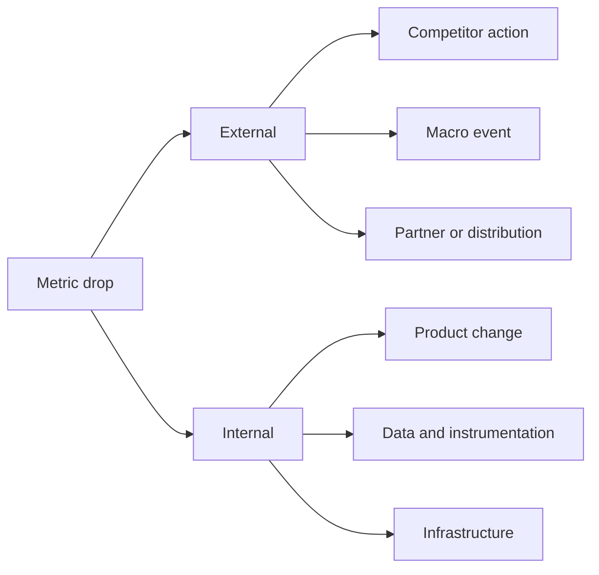
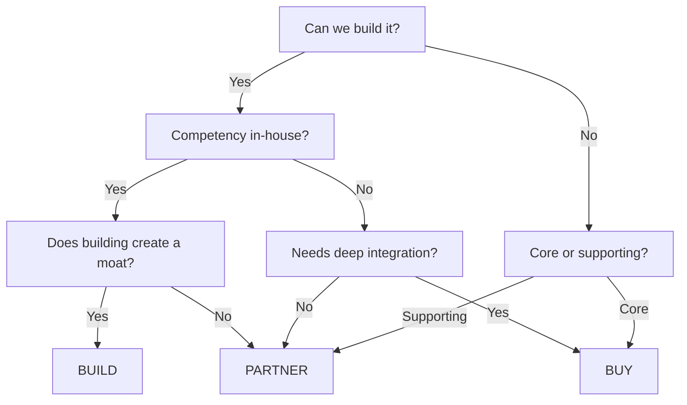
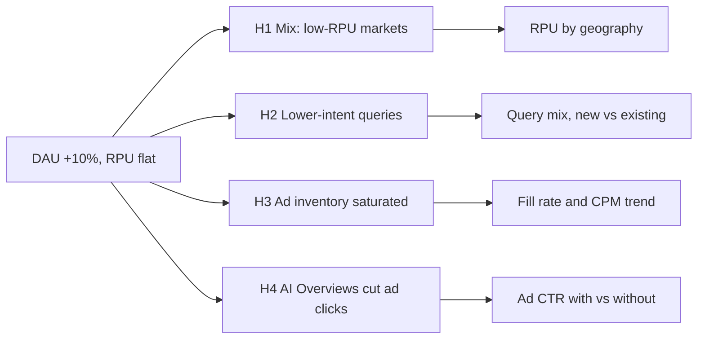
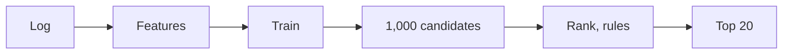

# FAANG L4 PM Interview Prep: Playbook

**Version 2 · October 2026** · Interview preparation · PM + AI Master Library

> For each interview round: what it tests, the framework to use, and worked interviews to rehearse from, followed by an eight-week plan and one-page cheat sheets.

---

## Start here

### Who this is for

This is my preparation for product manager loops at Google, Meta, Amazon, Apple, Microsoft and OpenAI at the L4 / IC4 level. I come to it from payments product work at Paytm and a master's in computer science (AI specialization) at Georgia Tech. The plan assumes eight weeks at ten hours a week.

### Two books

- **Playbook (this book).** For each of nine round types: what the round tests and how it is scored, the framework, and the worked interviews, 38 in all. Then the eight-week plan and the cheat sheets.
- **Question Bank.** 170 practice questions, numbered Q1 to Q170, each in one fixed layout to rehearse from.

The parts line up: Part I in both books is product design. Learn a round here, then drill it there.

### How to use the Playbook

- **Eight weeks out:** follow the plan in Part X.
- **One weak round:** read its three chapters in order, then the matching Question Bank part.
- **One company next:** read "How the loops work", then the parts for the rounds the recruiter names.

### The 10-minute pre-interview path

1. The scoring table in "What the … round tests" for today's round. Two minutes.
2. The framework table in the next chapter, "What you say" column only. Two minutes.
3. "Phrases worth memorizing" and "Common mistakes". Two minutes.
4. The "Copy this" line under each worked interview. Three minutes.
5. The six scoring dimensions in "How the loops work". One minute.

### One round tomorrow

One evening, about two hours:

1. Read the round's first two chapters, including the demonstration. 30 minutes.
2. Read two worked interviews aloud, playing "Me": one generic, one tailored. 30 minutes.
3. Answer one unseen question from the matching Question Bank part against a timer, then compare. 40 minutes.
4. Reread the scoring table, mark the dimension I missed, and fix that one thing. 20 minutes.

### How each part is laid out

Every round type gets three chapters, always in this order.

| Chapter | What it gives me |
|---|---|
| What the … round tests | Purpose, format and timing, a scoring table, how candidates fail, a one-evening plan |
| The … framework | The steps as a table of what to do and what to say, a demonstration, adaptations for my background, phrases, common mistakes |
| Worked interviews | Per mock: one line on what it shows, the transcript, a three-bullet debrief |

In the transcripts, figures about real companies are my stated assumptions unless the interviewer supplied them. Mocks marked Tailored draw on my own background and name the story (S1 to S10) to reach for.

### My gaps, and where each is fixed

| Gap | Go first to | Then |
|---|---|---|
| Consumer breadth outside payments | Part I | Part II |
| Structure under time pressure | The six dimensions in "How the loops work" | Every worked interview |
| Root cause method | Part III | Part VII |
| Strategy and go-to-market rigor | Parts IV and V | Part VI |
| AI evaluation fluency | Part IX | Part VIII |
| Estimation confidence | Part VI | Part III |

Each strength carries a risk. Payments work gives me customer empathy in fintech and technical credibility, but a payments-only mental model fails consumer probes. The pricing engine (S3) and the onboarding migration (S2) show data instinct, strategy and execution, but years of execution make me over-explain and under-structure, and the L4 rubric rewards a clean arc. The master's signals technical and AI credibility, but can sound academic. And AI rounds probe how I evaluate model quality (eval sets, hallucinations, versioning, latency, cost per query, guardrails), not only what was built.

### What's new in Version 2

- Two books with matching parts: one to learn from, one to drill from.
- The same three chapters for every round, so everything is always in the same place.
- Frameworks as tables of what to do and what to say.
- Transcripts cut to what would be said aloud, each with a debrief that names one move to copy.
- Company loop details limited to what each company publishes, dated October 2026.
- Every arithmetic chain rechecked.

## How the loops work

A PM loop has the same skeleton almost everywhere: a recruiter screen, one or two screening interviews, then a final loop of three to six interviews of 45 to 60 minutes, and a review that pools the written feedback. Round names, counts and order vary by company, team and year, so confirm the specifics with the recruiter.

### What each company publishes

Checked against each company's own careers or interview pages, as of October 2026.

- **Google.** The process typically takes six to eight weeks: possible assessments, one or two recruiter conversations, sometimes a small project, then a panel of interviews. Interviews are structured, with the same rubrics for every candidate for a role and open-ended, role-related questions. No brainteasers. AI tools are not allowed during interviews.
- **Meta.** Its PM guide (IC4 to IC6) describes 45-minute interviews. Initial screen: Product Sense and Analytical Thinking. Full loop: Product Sense, Analytical Thinking, and Leadership & Drive, which is four to five behavioral questions in STAR format. No outside help, AI tools included.
- **Amazon.** One or two phone screens, then a loop: four to six interviews of 45 to 60 minutes in one Amazon guide, two to seven interviewers in another. Questions are behavioral and built on the 16 Leadership Principles, with STAR recommended. A Bar Raiser from outside the hiring team sits on the loop. Product and program roles usually include one case study or exercise. Feedback typically comes within five business days of the loop.
- **Microsoft.** Most processes are two to four conversations of up to an hour with potential teammates and cross-functional colleagues; some roles add work samples. It recommends STAR(R), the second R for reflection. No outside assistance in interviews unless explicitly permitted.
- **OpenAI.** Résumé review, introductory calls, a skills-based assessment whose format varies by team, then final interviews: typically four to six hours with four to six people over one or two days. A decision usually follows within a week. Whether AI tools are allowed varies by interview.
- **Apple.** I found no round-by-round description on its careers site. Ask the recruiter.

### The general shape of an L4 PM loop

Not every company runs every round, and several combine them.

| Round | What it tests | Length | Strong-hire signal | No-hire signal |
|---|---|---|---|---|
| Recruiter screen | Motivation, role fit | 30 min | Names specific products and teams; a clear "why here" | "I just want a big company" |
| PM screen | Product sense, structure | 45 min | Clear structure, a user insight, a metric before the end | A solution before the problem is defined |
| Product design or product sense | Users, pain points, trade-offs | 45–60 min | User-first opening, segments, an opinionated choice with reasons, measurable success | No segmentation, no metrics, no point of view |
| Analytical | Metrics, root cause, estimation | 45 min | A hypothesis tree, the right metric, funnel fluency | Random metrics; blaming infrastructure without checking data |
| Strategy | Market judgment, build, buy or partner | 45 min | Frameworks applied with numbers and a competitive lens | Vague claims, no numbers |
| Execution | Prioritization, roadmap trade-offs | 45 min | Objective-driven priorities, stakeholder awareness | A gut-feel roadmap |
| Technical or AI | Feasibility, model limits, evaluation | 45 min | Conceptually accurate; defines eval metrics; asks good questions | Pretends to know; ships AI with no eval plan |
| Leadership or behavioral | Influence without authority, conflict | 45 min | Principled conflict resolution with specific examples | Leans on authority; avoids disagreement; rehearsed stories |
| Hiring manager or cross-functional | Working with design, engineering, marketing | 30–45 min | A clear view of the PM role; deference without abdication | "The PM always decides"; sharing confidential prior work |

### The six dimensions behind every scorecard

No company publishes its scorecard. These six dimensions are this book's working rubric; every scoring table and debrief maps back to them.

| Dimension | Strong | Weak |
|---|---|---|
| Structure | Names the approach up front, signals transitions, revises earlier framing when new information arrives | Paragraphs with no signposting; a solution inside 60 seconds |
| Customer empathy | Two or three personas with different needs; a day in the life before any solution | Features with no beneficiary; "the user" as one person |
| Data instinct | A specific metric and why it is the right one; leading versus lagging; shows the math and sanity-checks it | "We'd measure engagement"; metrics the feature cannot move |
| Strategic depth | Names a competitor and the difference; explains defensibility; ties the decision to the revenue model | "It will grow the user base" as the only strategy |
| Technical credibility | Flags a constraint unprompted; asks whether inference is offline or online before setting a latency target | "Engineering will figure that out"; requirements confused with architecture |
| Communication | Pauses on purpose, answers pushback with evidence, summarizes each section | Rambles three minutes without a check-in; folds at the first push |

### How feedback becomes a decision

Each interviewer writes feedback independently, and a group reviews the whole set. Three things follow, whatever the company.

- **A clear "no" is hard to outvote.** Aim for no weak round over one brilliant round.
- **Values are scored in every room.** Amazon expects examples against its Leadership Principles throughout the loop. OpenAI lists alignment with its mission and values among what it looks for. Microsoft names growth mindset as a cultural focus. Stories must stay consistent from one interviewer to the next.
- **Scales, weights and veto rules are not published.** This book does not rely on the versions that circulate.

# Part I — Product design

## 1. What the product design round tests

A product design question hands you an ambiguous prompt ("design X for Y") and about 45 minutes. The interviewer is not looking for the right product. They are watching whether you can get from that prompt to a prioritized, user-centered solution and defend your choices on the way: a rigorous process, empathy for a specific user, and principled prioritization.

Use this part whenever the prompt says design, build, create or imagine. It also fits "how would you improve" prompts when the change is large enough to need a full design arc. Smaller improvement questions belong to Part II.

> [!NOTE]
> As of October 2026, Meta's PM interview guide calls this round Product Sense and lists four things it assesses: understanding the product landscape and motivation, choosing a target audience, identifying and prioritizing the problem, and developing creative, impactful solutions. It adds that you should lead the conversation and may be asked to sketch an interface. The seven steps in Chapter 2 cover all four.

### Format and timing

Most rounds run 45 minutes; some run 60. Plan 18 to 25 minutes of structured answer and leave about 20 for the interviewer's questions. Follow-ups are where technical credibility and communication get scored, so do not fill the whole slot yourself.

### How it is scored

| Dimension | Strong | Weak |
|---|---|---|
| Structure | Names the steps up front and signals each transition | Proposes a feature in the first 90 seconds |
| Customer empathy | Two or three segments defined by behavior; picks one and says why; a day-in-the-life detail | "Users want…" with no segment |
| Data instinct | A north star with a formula, a baseline, a target, a guardrail and a test design | "We'd measure DAU and engagement" |
| Strategic depth | Ties the goal to the company's business model, names a competitor, sequences a roadmap | Treats the product as if no market existed |
| Technical credibility | Flags a feasibility limit unprompted; offers the simple version before the ML one | "Engineering will figure that out" |
| Communication | Pauses to think, holds a position under pushback, names the trade-off | Presents the choice as obvious, or caves at the first push |

### How candidates fail

- **Solution first.** "I would build a feature that…" before any user has been named.
- **The monolithic user.** One undifferentiated "user", so every pain point comes out generic.
- **A feature list.** Eight ideas and no choice. Three solutions, one pick and one defense score higher.
- **Ignoring the company.** A Google product designed with no mention of how Google makes money.

Chapter 2 covers the quieter mistakes: vague metrics, over-engineering and missing trade-offs.

### Prepare in one evening

1. Memorize the seven steps and their time boxes.
2. Pick one prompt outside payments and answer it aloud against a 25-minute timer.
3. Write that answer's metrics on paper: one north star, two or three supporting, one guardrail.
4. Read two debriefs in Chapter 3 and practice the move each one says to copy.
5. Rehearse the trade-off sentence until it comes out without effort.

## 2. The product design framework

The seven steps follow the same arc as Lewis C. Lin's CIRCLES Method (from *Decode and Conquer*), with the goal and the success metrics pulled out as steps of their own. Budget 18 to 25 minutes in total.

| Step | What you do | What you say |
|---|---|---|
| 1. Clarify and scope (2–3 min) | Ask one or two questions you cannot infer: platform, geography, surface | "Is this mobile-first, and is there a region in mind?" |
| 2. Define the goal (1–2 min) | Tie the product to the company's mission and to how it makes money. Never invent a goal | "The goal is to [user outcome], which drives [business outcome] for [company]." |
| 3. Segment users (3–4 min) | Two or three segments that differ in needs, behavior and constraints. Pick one | "I'll focus on B: highest pain, large, and strategic." |
| 4. Map pain points (3–4 min) | Three or four concrete, falsifiable pains for that segment | "The friction here is…" |
| 5. Generate solutions (4–5 min) | Three options: conservative, innovative, disruptive. Two or three sentences each, no judging yet | "Three options, from safe to bold." |
| 6. Prioritize (3–4 min) | Pick one on user impact, feasibility, business fit and time to value | "I'd build the first. The trade-off is…" |
| 7. Measure success (2–3 min) | One north star, two or three supporting metrics, one guardrail, and the method | "The one number is… I must not harm…" |

### Why each step exists

- **Clarify** shows you scope before you build.
- **Goal** is the test for every later choice: does this serve the company, or only the feature?
- **Segments** are where empathy is scored. No segment, no empathy score.
- **Pain points** must be checkable by research. "Users want a better experience" is not. "Users in Tier-3 cities lose the UPI confirmation when they switch apps before the notification arrives, and fear a double charge" is.
- **Three solutions** prove range without turning into a feature list.
- **Prioritizing** is the judgment the round exists to see.
- **Metrics** turn an idea into something a team could ship and judge.

### Tools inside the steps

**Segmenting (step 3).** Use more than one axis, and never age alone.

| Domain | Axes that work |
|---|---|
| Payments | Merchant size × digital literacy × urban or rural |
| Social and media | Creation frequency × consumption context × social graph density |
| Maps | Trip purpose × device capability × connectivity |
| Health | Motivation type × existing behavior × wish for social accountability |
| Productivity | Solo or collaborative × meeting cadence × async or sync preference |

**Day in the life (step 4).** Before listing pains, narrate two or three sentences of an ordinary day: "A migrant worker in Mumbai checks his balance at 7 AM on a 2G connection before deciding whether to send money home. He needs confirmation in under 3 seconds or he will wait until lunch." The friction falls out of the story.

**Prioritizing (step 6).** Default to an impact-effort view: launch with the high-impact, low-effort option and state the path to the bigger bet. When four or more options look alike, score them with RICE (from Intercom): reach × impact × confidence ÷ effort, with reach as users per quarter, impact on a 0.25-to-3 scale, confidence as a percentage and effort in person-months. Then run three filters. Does it cut real pain for the chosen segment? Does it move the company's north star? Could five to eight engineers ship an MVP in a quarter?

**Metrics (step 7).** The north star captures user value and business value in one number: "weekly active merchants completing at least one QR payment", not "DAU". Supporting metrics cover activation, engagement and retention at 7 and 30 days. Guardrails name what must not get worse: failure rate, NPS, support tickets. Name the method too: the event logged, the A/B test, and a holdout if network effects are involved.

**Trade-offs (step 6 and every follow-up).** Say what you are not building. Four kinds come up constantly:

- Breadth or depth: every user, or deep value for power users.
- Speed or quality: rules now, ML once six months of logs exist.
- Reach or monetization: a free tier first, to build the network.
- Now or later: a batch digest now, real-time next.

### Demonstration: "Design a product that helps people take their medication on time."

1. **Clarify.** "Is this a phone app, for people managing their own medication? I'll assume yes to both."
2. **Goal.** "Help people take the right dose at the right time. For a pharmacy business, that drives refills and loyalty."
3. **Segments.** "Young adults on one daily pill. Adults over 60 on five or more. Caregivers managing a parent. I'll take the over-60 group: most doses, highest cost of a miss."
4. **Pain points.** "They lose track of whether the morning dose was taken. Schedules change after each appointment. Alarms get dismissed mid-task. Refills run out unnoticed."
5. **Solutions.** "A reminder that waits for a 'taken' tap. A schedule imported from a photo of the label. A shared view that alerts a caregiver after a missed dose."
6. **Prioritize.** "The 'taken' reminder first: small build, daily pain. I give up the caregiver view for now and revisit it once 30-day retention holds."
7. **Metrics.** "North star: share of scheduled doses confirmed within an hour. Supporting: week-4 retention and schedules set up in the first session. Guardrail: reminder opt-outs."

### Adapting it to a payments background

- **Practice outside payments.** Interviewers probe social, entertainment and daily-utility journeys. Anchoring every answer on merchants, conversion rates and ARR sounds narrow.
- **Keep three or four consumer personas ready:** a Gen Z creator, a first-generation smartphone user in rural India, an older user in the US.
- **Structure over execution depth.** The interviewer wants the clean arc, not the full Jira story. A project such as the onboarding migration (S2) gets one sentence, not a tour.
- **On a payments prompt, be exact and still run all seven steps.** Mock 6 in Chapter 3 shows domain detail carrying the pain points.

### Phrases worth memorizing

- "Let me take 30 seconds to structure this."
- "I'll go goal, users, pain points, solutions, prioritization, metrics."
- "Now that I've picked the segment, let me move to pain points."
- "I'm prioritizing A over B because [user impact]. The trade-off is [what we lose], and I'm comfortable with that because [business or timeline reason]. We'd revisit B when [trigger]."

### Common mistakes

| Mistake | What it sounds like | Fix |
|---|---|---|
| Vague metrics | "We'd track engagement" | Name the event, the formula and the expected change |
| Over-engineering | An ML model where a rule covers 80% of cases | Offer the simple version first, then say when ML earns its cost |
| No trade-off | The pick presented as obviously right | Say what you give up and why that is acceptable |
| Wasted clarifying questions | "What's the budget? How many engineers?" | Ask only what changes the design |

## 3. Worked interviews: product design

Six mocks, each scored Strong Hire. Read the italic line, then the debrief, then the transcript aloud.

### Mock 1: "Design a product for Google Maps for users in emerging markets."

*Shows the full seven-step arc on a consumer prompt, and two follow-ups answered without retreating.*

**Interviewer:** Design a product for Google Maps that serves users in emerging markets.

**Me:** I'll take a minute to structure. One question: is "emerging markets" one region or a broad category? Connectivity, languages and devices differ between Sub-Saharan Africa and Southeast Asia.

**Interviewer:** Keep it broad. Pick a geography if it helps.

**Me:** I'll anchor on India, Indonesia and Bangladesh: on my assumption, more than 800 million smartphone users, with 4G growing but patchy. My structure: goal, users, pain points, solutions, prioritization, metrics. Maps exists to make information about the physical world useful to everyone. Here the business goal is to be the default for navigation and local discovery, which feeds local-business ad revenue. The product goal: keep Maps useful when the connection is unreliable, the biggest barrier to daily use.

**Interviewer:** Who exactly is this for?

**Me:** Three segments. A, the urban commuter: daily user, mid-range Android with 3 to 4 GB of RAM, drops to 2G underground, watches data use. B, the first-time digital navigator in a Tier-2 or Tier-3 city: new to smartphones, uses Maps to find a government hospital or bank branch more than to navigate, prefers voice in her own language, on 2G or patchy 4G. C, the rural small-business owner who wants the tea stall on the map and may share a phone. I pick B. A is already well served. C is a different product, Google Business Profile. B is, on my estimate, 300 to 400 million people in India alone, has the highest unmet need, and winning her now builds a decade-long habit.

**Interviewer:** What are their specific pain points?

**Me:** Four. The connection dies mid-route: fifteen minutes into a forty-minute auto-rickshaw ride the map freezes, and the only fallback is the driver, who charges for the uncertainty. Addresses are colloquial: "behind the Shiv temple" is a real address, landmark coverage is thin, and the search fails. Voice search trained on formal speech mishears "Sadar Hospital" three times. And data anxiety: on a 1 GB-a-day prepaid plan she opens Maps only when she must.

**Interviewer:** What solutions would you propose?

**Me:** Three, from safe to bold. One, predictive offline caching: Maps learns her home zone and frequent corridors and pre-caches a 5 km radius around each, overnight on Wi-Fi, so navigation continues when signal drops. Two, colloquial landmark search: users pin landmarks with a photo, and a model learns to tie colloquial address strings to coordinates. Three, a Lite mode built offline-first: vector tiles, which I'd assume are far smaller than raster, cached searches, and an SMS fallback that returns a pin for a texted short code. I'd build caching this quarter. Offline maps exist, so this changes the trigger and not the pipeline; it hits the sharpest pain; and retention impact is measurable. The trade-off: address ambiguity waits. Landmark search follows next quarter, since the contribution loop and training pipeline need two to three months. Lite mode is an 18-month, separate workstream.

**Interviewer:** How would you measure success?

**Me:** North star: weekly navigation completion rate for Tier-2 and Tier-3 users, the share of navigation sessions that reach the destination without a connectivity abandonment. My guess is 60% today; target 80% within six months. Supporting: eligible users with a cached zone within 7 days; navigation sessions per active user per week, from an assumed 1.8 to 2.5; cache hit rate. Guardrails: at most 15 MB extra storage per device, and at most 2% extra daily battery drain. I'd log navigation start, connectivity at each waypoint and end state, then run a four-week 50/50 test sized to detect a five-point change.

**Interviewer:** Pre-caching learns from location history. What about privacy?

**Me:** Location history is sensitive, and India's DPDP Act of 2023 is new. Opt-in with a plain value statement: "We'll save your local map so it works without internet." Learning on the device, so raw location history never leaves the phone and only aggregated model updates do. One-tap deletion of cached zones. And a policy review before launch.

**Interviewer:** How is completion rate different from just counting sessions?

**Me:** Sessions is a vanity metric here. Open Maps, fail to load, close: that counts as a session, and it is a failure. Completion rate says whether she got where she was going, and it is harder to game. It is videos started versus videos watched to 80%.

#### Debrief

- **What scored:** Strong on all six: behavioral segments with a reasoned pick; a north star with baseline, target and test design; vector tiles and on-device learning used correctly.
- **Could be stronger:** Label baselines as guesses. Prepare for spam in user-contributed landmarks, how Indonesia differs, and pre-caching on a 3 GB phone.
- **Copy this:** Defending the north star against "why not sessions?" with a one-line analogy.

### Mock 2: "Design an inclusive fitness experience for Meta."

*Shows how to define a vague word in the prompt and let that definition drive the segments.*

**Interviewer:** You're a PM at Meta. Design an inclusive fitness experience. What does that mean to you, and what would you build?

**Me:** Two questions. Is this on an existing surface such as Instagram or WhatsApp, or VR on Quest? And "inclusive" could mean physical accessibility, body diversity, economic access or cultural access. Should I define it?

**Interviewer:** Existing apps, not VR. You define "inclusive". That's part of the test.

**Me:** Then inclusive means reaching people who feel unwelcome or unseen in mainstream fitness: people with physical disabilities, people at higher body weights, adults over 60, and people who can't afford a gym. Goal first. Meta's mission is about human connection. The business goal of a fitness product is more meaningful time on the platform through high-frequency content and community, which raises ad inventory value. Fitness is already a large Instagram category; this grows it by bringing in the people it excludes.

**Interviewer:** Which of those groups do you start with?

**Me:** Three candidates. A, adults with mobility limits, such as wheelchair users or people with chronic joint pain: the workouts they see are physically impossible for them. B, adults at higher body weights starting out: the imagery alienates them, comments can be hostile, and nothing is programmed for their starting point. C, adults over 60 who want balance training, low-impact cardio and fall prevention and find almost nothing. I'll focus on B. It is the largest group: roughly 40% of US adults are classified as obese on CDC figures, and more than a billion people worldwide. Transformation stories are highly shareable. And Meta can fill the content gap.

**Interviewer:** What are their pain points on Instagram today?

**Me:** Four. Discovery makes them feel worse: search "how to start working out" and you get athletes and influencers, because ranking rewards engagement, not fit. No structured programs: creators post single workouts, so someone who can't do a burpee has no "week 1 of 12". Toxic comments cost nothing to post, so this group watches silently and never posts, and no community forms. And no social proof from people who look like them.

**Interviewer:** So what do you build?

**Me:** Three options. One, a creator program: partner with 200 creators who serve under-represented bodies and levels, and boost them in discovery for users who searched "beginner workout" but didn't engage with the results. Content plus ranking, no new surface. Two, Plans, a native format: 4-to-12-week programs of weekly chapters, daily 60-second Reel-style workouts, check-in polls and a private subscriber group. Creators can charge for premium Plans. Three, an AI coach that builds a plan from body type, mobility, health conditions and schedule and adapts weekly. I'd build Plans. It answers three of the four pains: structure, a private group that cuts toxicity, and success stories from similar people. The creator program ships faster but creates no new behavior and no lock-in. The AI coach collects health and body data; I'd expect privacy and regulatory exposure to delay it 12 to 18 months.

**Interviewer:** And how do you know it worked?

**Me:** North star: monthly active Plan participants who complete at least one workout in a given week, which captures activation and habit. Supporting: enrollment within 7 days of exposure; week-4 retention, the share of subscribers completing a workout in week 4; and Plan creators publishing weekly, for supply health. Guardrails: body-related toxic comments on Plan content, measured by a classifier, under 0.5% of comments, and 30-day self-reported sentiment net positive against control.

**Interviewer:** You mentioned a classifier for toxicity. Go deeper.

**Me:** I'd expect Meta to already moderate comments at scale with language models trained on hate speech and harassment. I'd add two things. Extend the training data to body-shaming, whose vocabulary a general model can miss, down to phrases like "you should try harder". That is a labeling project, with annotators from the target community. And default Plan comments to followers only, which shuts out hostile outsiders with no user action and little engineering cost.

#### Debrief

- **What scored:** Strong on all six: "inclusive" defined before any segment, a pick backed by population data, a guardrail with a threshold, a business case through ad inventory.
- **Could be stronger:** Prepare for the cannibalization push (private groups versus the main feed) and for harmful weight-loss advice inside a Plan group.
- **Copy this:** Define the vague word in the prompt aloud, then make the definition do work.

### Mock 3: "Design a product to help elderly users get more out of their smartphone."

*Shows segmentation of a group most candidates treat as one user, and a layered answer to a privacy push.*

**Interviewer:** Design a product to help elderly users get more out of their smartphone. Assume the company is Apple.

**Me:** One question: are we inside iOS, as a feature, an app or a system-level change, or could this be new hardware?

**Interviewer:** Within iOS. Features on the iPhone, no new hardware.

**Me:** Goal first. Apple sells technology that people find easy to use. The business goal is to keep users of 65 and over on iPhone. I'll assume they are about 15% of US smartphone users and the least satisfied with mobile UX. Keeping them supports accessory revenue, the Watch above all, and services revenue, and lowers the risk they move to a simpler device.

**Interviewer:** "Elderly" covers a lot of people.

**Me:** Three segments. A, the newly smartphone-dependent, 75 to 85: got the phone as a gift or because services moved to apps, low digital literacy, leans on family for tech support, mainly calls, texts and video calls. B, active adopters, 65 to 74: comfortable with apps but struggling with small text, gestures and notification overload; loyal to iPhone. C, medical-management users, 70 to 85 with a chronic condition: the phone is for health monitoring, medication reminders and reaching providers, so reliability and simplicity come first. I'll take A: highest unmet need, highest churn risk. They are one bad experience from handing the phone to a relative.

**Interviewer:** What gets in their way?

**Me:** Four things. Invisible accessibility settings: larger text, AssistiveTouch, Speak Selection and Voice Control are excellent but sit several taps deep, and I'd assume most users never open that menu. Notification overload: app updates and marketing arrive mixed with the family texts they care about. App setup: "Grandma, download Zoom" means App Store search, look-alike apps, permissions, an account and audio settings, with a dropout at every step. And gestures: long-press, edge swipes and pinch are not intuitive after sixty years of buttons, and an accidental gesture triggers something they can't undo.

**Interviewer:** Walk me through your options.

**Me:** One, Essentials Mode: a first-run flow for users identified as 65-plus, by self-report or an authorized family account, that walks through text size, display zoom, Speak Screen and notification filtering with a live preview. Three minutes, skippable, relaunchable from Settings. Two, Trusted Helper: a family member on their own iPhone can, with explicit consent, see the app layout, send guided walkthroughs as on-screen overlays, and install apps after approval. No shared Apple ID, which today causes privacy and purchase conflicts. Three, an adaptive UI engine: an on-device model that notices confusion, such as repeated taps on a non-interactive area, and suggests a fix: "You've zoomed in 12 times this week. Turn on Display Zoom?"

**Interviewer:** Which goes first?

**Me:** Essentials Mode this quarter, Trusted Helper next. Essentials Mode has almost no engineering risk, since the settings exist, and it eases the settings and gesture pains at once. The trade-off: it reaches only new setups and resets, not users already past the setup screen. Trusted Helper solves ongoing tech support and is the differentiator. The adaptive engine needs 12 to 18 months of data and validation.

**Interviewer:** What do you measure?

**Me:** North star: weekly active rate among users of 75 and over with at least one accessibility setting on, a proxy for closing the gap between availability and awareness. Supporting: Essentials Mode completion rate; the change in that cohort's share with Larger Text on, baseline against 90 days; and device churn for the cohort at 90 and 180 days, which must not rise. Guardrail: reported unauthorized access attempts through Trusted Helper under 0.01% of helper-enabled devices per quarter.

**Interviewer:** Trusted Helper raises obvious privacy concerns. How would you design consent?

**Me:** If it feels like surveillance, users and regulators will reject it. Three layers. Explicit, revocable consent: the primary user taps Allow on their own device for every session, there is no background access, and one tap in Settings removes a helper. Transparency: a persistent banner, "[Name] is helping you now", with an End Session button. No stealth mode. An audit log: the user, and optionally a spouse, can see who helped, when, and what they did. Then legal and privacy review for GDPR and CCPA before launch.

#### Debrief

- **What scored:** Strong on all six: "elderly" split three ways, the gesture insight, a goal tied to ecosystem revenue, consent in three layers.
- **Could be stronger:** Say what exists first. As of October 2026 iOS has Assistive Access (a simplified interface, iOS 17 onward) and remote control in FaceTime screen sharing (iOS 18 onward); position both ideas as going beyond them.
- **Copy this:** Answer a privacy push in layers: consent, transparency, audit.

### Mock 4: "Design a tool to help remote teams build culture."

*Shows choosing the end user over the buyer, and sequencing a risky feature behind trust instead of refusing it.*

**Interviewer:** Design a product to help remote teams build culture. Assume you're at Microsoft.

**Me:** Thirty seconds to think. One question: standalone, or a feature within an existing surface such as Teams or Viva?

**Interviewer:** A new capability within Teams. Teams already has the distribution.

**Me:** That settles distribution, so the work is the product itself. Goal first. Microsoft's commercial cloud business needs Teams to be where enterprise work happens. This capability should reduce the disengagement and attrition that cost Microsoft's customers money, and differentiate Teams from Slack, which in my read has the stronger culture reputation. I'd aim at companies of 500 to 5,000 employees, where I'd expect remote culture to erode fastest.

**Interviewer:** Whose problem is it?

**Me:** Three users. A, the people manager with 6 to 15 reports: owns cohesion and reviews, can't see informal relationship health remotely, relies on 1:1s. B, the individual contributor on a remote-first team: joined during or after the pandemic, has never met most colleagues, feels isolated some days, and finds Zoom happy hours performative and draining. C, the HR or People Ops leader: runs eNPS quarterly, gets lagging signal, wants early warning by team. I'll pick B. Culture products fail when they are built for managers to observe employees instead of for employees to feel they belong. If the IC gets value, the manager's problem is solved downstream.

**Interviewer:** And that IC's pain?

**Me:** Four. Serendipity is gone: no hallway moment reveals a shared hobby or a complementary skill, so weak ties, which research links to opportunity, don't form. Social events are opt-in theater: say 30% join the trivia night, the other 70% feel guilty, and nobody connects. New hires get no organic community: an onboarding call with 50 strangers, then they vanish into their team. And ICs don't know whom to ask outside their team, so everything routes through a bottlenecked manager.

**Interviewer:** What would you ship?

**Me:** Three options. One, Common Ground introductions: one or two "you might enjoy meeting" suggestions a week, from calendars, titles and optional profile tags, with a three-click hello. Two, a Team Rituals Builder: templated, automated micro-rituals. A Monday async thread, "two things I'm working on, one thing I need". A Friday shoutout prompt. A monthly surprise pair coffee with a conversation prompt. People Ops can author templates, each ritual takes under five minutes, and Teams automates recurrence. Three, a culture health dashboard for People Ops: anonymized, aggregate connection health from cross-team calendar time, message frequency and, with opt-in, channel sentiment. I'd build the Rituals Builder. Pair coffee restores serendipity and gives new hires a network; shoutouts show who knows what. Introductions are passive and convert poorly, while rituals repeat and build habit. The dashboard risks employees feeling surveilled, which destroys the psychological safety the product is meant to create.

**Interviewer:** Success measures?

**Me:** North star: weekly ritual participation per team, the share of members who join at least one ritual a week. A team at 70% is in a different place from a team at 20%. Supporting: new rituals activated per team per month; the share of teams keeping a ritual going 8 weeks running; and distinct colleagues an IC has a 1:1 Teams conversation with per month. Guardrail: no increase in meeting time. Rituals are async by default, and sync ones are capped at 30 minutes.

**Interviewer:** Suppose leadership explicitly wants the dashboard. How do you handle it?

**Me:** I'd earn trust before asking for data. Ship rituals first and let teams feel the benefit for six months. Then an opt-in dashboard with three conditions: team-level aggregates only, with a minimum team size of 8; explicit employee opt-in per data category; and a company data steward who controls what is switched on, with a quarterly usage report to all employees. That is privacy by design, an advantage with European enterprises under GDPR.

#### Debrief

- **What scored:** Strong on five dimensions: the IC chosen over the buyer, a precise north star, the 8-person anonymity floor, Slack and EU enterprises as context.
- **Could be stronger:** Technical credibility was rated Hire; say how matching and automation would run inside Teams. Prepare an adoption plan for the first 100 teams.
- **Copy this:** When leadership wants the risky feature, put it behind conditions and a sequence.

### Mock 5: "Design a new Google product that helps people make better financial decisions."

*Shows a business model and a regulatory line worked into the design before the interviewer asks.*

**Interviewer:** Design a new Google product that helps people make better financial decisions.

**Me:** Is this the full spectrum of budgeting, investing, insurance and borrowing, or one domain? And a new product, or a feature within Search or Assistant?

**Interviewer:** Full spectrum, your choice of scope. New product or new surface. Pitch me.

**Me:** Goal first, then segments. Google's mission is to make the world's information accessible and useful. Financial information is abundant but close to unusable for non-experts: marketing from firms selling something, scattered sites, regulatory jargon. Google handles billions of searches a day, has a trusted brand, and already sits between users and sellers in Shopping. So the goal is personalized, unbiased financial guidance for the billions of adults who, I'd assume, get none today.

**Interviewer:** Who do you build it for first?

**Me:** Three segments. A, the anxious first-timer, 22 to 30: has a job and some savings, searches "how to invest", gets overwhelmed and does nothing. B, the mid-career debt navigator, 30 to 45: student loans, a mortgage and maybe card debt at once. C, the near-retirement self-educator, 55 to 65: 401(k) accounts at several former employers, unsure about consolidation and Social Security timing. I'll focus on A. They have the longest lifetime value for Google, because habits form young. I'd assume a clear majority report money anxiety. And their existing help is weakest: robo-advisors want minimums and human advisors charge fees.

**Interviewer:** Where does the current experience fail them?

**Me:** Four places. Search returns marketing: ask "index fund or ETF" and the top results come from firms that sell the answer. Concepts build on each other: without compound interest you can't value a 401(k) match, and there is no adaptive learning path. Advice stays generic, because Google doesn't know this person has, say, $5,400 in savings, $28,000 in student loans and a $62,000 salary. And there is an action gap: opening a brokerage account or rolling over a 401(k) means several institutions.

**Interviewer:** Options?

**Me:** One, financial knowledge panels in Search: for "should I have an emergency fund", show what it is, the 3-to-6-month benchmark and a calculator from self-entered expenses. Anonymous, informational. Two, Finance Coach: a conversational product where the user enters income, savings, debts and goals and gets a prioritized action list. "First, capture your full employer match. Second, clear card debt before taxable investing, and here is why." It explains principles and sequence; it never manages money or recommends a specific product. Revenue comes from paid listings inside the action steps, such as brokerages with no-fee index funds, on the Shopping model. Three, a financial operating system with account linking: a live dashboard, forecasts and nudges, with heavy regulation, high privacy risk and direct competition with budgeting apps and banks.

**Interviewer:** And your pick?

**Me:** Finance Coach. Panels are a feature with no habit loop. The operating system needs, on my guess, two to three years of regulatory groundwork. Coach needs no account linking, is education and not advice, builds on Search's AI, and creates a high-intent surface for financial advertisers.

**Interviewer:** What would you track?

**Me:** North star: monthly active users who complete at least three action steps, where complete means clicking through to the recommended resource and returning within 7 days. Supporting: the share who get from step one to step three; 30- and 90-day return rates, targeting 40% at 30 days; and completion by category: investing, debt, savings. Guardrail: any output that could count as personalized investment advice is caught by a legal review pipeline before it reaches a user.

**Interviewer:** How does Google make money from this without becoming a regulated financial adviser?

**Me:** The line is drawn by the SEC under the Investment Advisers Act of 1940. Broadly, advice about securities, tailored to a person and given for compensation, triggers registration. Two protections. Everything is principle-based: "invest in low-cost index funds" is education, while "put your $10,000 into this fund" is advice, so the product never names a security. And revenue is referral for product categories, like Shopping listing ads, not portfolio fees. I'd get a formal opinion from securities counsel before launch and add human review for any flagged output.

#### Debrief

- **What scored:** Strong on five dimensions: a goal tied to the business model, a lifetime-value reason for the segment, the regulatory constraint raised early, Shopping as the revenue analog.
- **Could be stronger:** Technical credibility was rated Hire, and the market numbers are guesses: say "I'd assume". Prepare for a user in financial distress and for referral bias.
- **Copy this:** The education-versus-advice test: a principle, never a named security.

### Mock 6 (Tailored): "Design a product for Google to help small merchants in India accept digital payments."

*Tailored: my merchant-payments background supplies the pain points. No core story is told; S2 (onboarding) and S6 (merchant retention) are the proofs if asked.*

**Interviewer:** Design a product for Google to help small merchants in India accept digital payments. Walk me through your thinking.

**Me:** I know this domain well, so I'll be precise about the merchant's reality. One question: is this inside Google Pay for Business, or something new?

**Interviewer:** Your call. Pitch me the right surface.

**Me:** Inside Google Pay for Business. Distribution is the hardest problem in merchant payments. India has roughly 63 million small businesses on the usual count, and getting them onto a new app is expensive. Google Pay already has trust and, I'd assume, tens of millions of monthly users. Google's goal is to be the default payment infrastructure for consumers and merchants. The product goal: let a micro-merchant, a chai stall or a vegetable vendor or a tailor, accept UPI with no technical knowledge and no upfront hardware.

**Interviewer:** Which merchants?

**Me:** Three segments. A, the street-food or market-stall vendor with annual revenue under ₹5 lakh: all cash, a basic Android phone often shared with family, a personal UPI account never used for business, and a first language of Hindi, Marathi, Tamil or Bengali. B, the neighborhood kirana at ₹5 to 25 lakh: takes some QR payments, but has no revenue insight, loyalty tool or credit against digital history. C, the home-based seller under ₹3 lakh who sells over WhatsApp and collects from remote customers. I'll pick A, where cash-to-digital matters most and is least served. B is partly served. C needs a payment-link product. My estimate is about 25 million merchants in A with no digital payment footprint.

**Interviewer:** What stops them today?

**Me:** Four pains. Setup is too hard: KYC upload, bank linking, category selection and QR generation on a shared phone with patchy internet. I'd assume 15 to 30 minutes, often failing at KYC. Confirmation is unreliable at the counter: the phone is in a pocket or at home with a child, the merchant doesn't see the payment and asks for cash anyway, and double-payment disputes erode trust. No record-keeping value: with cash you count the drawer, while digital arrives with no daily total. And support runs in English or formal Hindi, no use to someone who speaks Bhojpuri or Rajasthani.

**Interviewer:** And your solutions?

**Me:** One, one-tap activation: Aadhaar OTP verification that pre-fills KYC through DigiLocker, then an instant QR. Under 3 minutes, under 5 taps, working on 2G. I'd confirm with compliance what the KYC rules allow for this tier. Two, sound confirmation plus a daily summary: a low-cost speaker that announces "Paisa aa gaya, ₹40", the soundbox pattern merchants already know, and an end-of-day WhatsApp message with transactions, total and a comparison with yesterday. Three, a vernacular voice assistant in about ten Indian languages: "How much did I make this week?"

**Interviewer:** In what order?

**Me:** All three, in sequence. Activation first, because without it 25 million merchants can't start. Sound and summary next quarter; Google could subsidize the speaker to ₹99 with six months of cashback. The assistant is a 12-month investment, since financial vocabulary in ten-plus languages is a large labeling effort. Together they differentiate against PhonePe, BharatPe and Paytm, whose payments bank was restricted by the RBI. My read is that rivals lead on devices and rails. Google's edge is distribution: Android, plus Search and Maps, where many merchants already have a Business Profile.

**Interviewer:** How do you measure it?

**Me:** North star: monthly UPI transactions from active Segment A merchants, where active means at least one accepted payment a week. Supporting: onboarding completion to QR in the first session, target above 75%; first payment within 24 hours of onboarding, the aha moment; and the daily summary's open rate. Guardrails: support tickets under 5% of active merchants a month, and payment failures under 2%, against a UPI baseline I'd assume is well below that.

**Interviewer:** You mentioned the RBI restriction on Paytm. What happened, and what does it change for Google?

**Me:** Keeping to what is public: in January 2024 the Reserve Bank of India directed Paytm Payments Bank to stop taking new deposits and credit transactions, citing persistent non-compliance. Two effects: consumers and merchants who relied on the bank looked at alternatives, and regulators signaled that they favor clean compliance. Google Pay is not a bank; it runs as a third-party app on UPI. I'd treat this as a narrow window, perhaps 18 to 24 months, to win merchants who are reconsidering their provider.

#### Debrief

- **What scored:** Strong on all six: the surface justified by distribution, shared-phone and dialect details, three competitors positioned.
- **Could be stronger:** The follow-up concerns a company I worked at: public facts only, no inside detail. Prepare the payback model for the ₹99 speaker and a training-data plan for Bhojpuri, Rajasthani and Maithili.
- **Copy this:** Let domain knowledge show in the pain points, not in jargon.

# Part II — Product improvement

## 4. What the product improvement round tests

An improvement question names a real product and asks what you would change. It tests whether you can diagnose a live product's weaknesses, find the change that matters most, and propose a solution with evidence behind it and a measurable outcome. Unlike a design question, there is a real baseline to reason from. Use it.

The prompt sounds like "how would you improve X", "what would you change about X" or "if you were the PM of X, what would you do first". The key difference from design: the product already exists, so say what works before you say what is broken. Going straight to problems signals weak product analysis.

> [!NOTE]
> As of October 2026, Meta's PM interview guide places this question inside its Product Sense interview: you may be asked about a product you think is great and what you would do as its PM, or how you would evolve an existing Meta product.

### Format and timing

Usually 45 minutes. The structured answer takes about 16 minutes; the rest is dialogue. Interviewers often choose a product they know deeply, sometimes their own, so expect pushback grounded in facts you do not have.

### How it is scored

| Dimension | Strong | Weak |
|---|---|---|
| Structure | Context, what works, the gap, then solutions, in that order | Opens with a fix |
| Customer empathy | One named segment and its specific pain | "Users want more personalization" |
| Data instinct | Anchors to a known figure or a stated assumption; a metric the change can move | "DAU will go up" |
| Strategic depth | Names the business model, the competitive threat and why rivals have not solved it | An improvement in a vacuum |
| Technical credibility | Knows what the product already does; says whether the fix is a model, data or display change | Proposes a feature that already exists |
| Communication | Separates options cleanly and holds the pick under challenge | Lists everything, picks nothing |

### How candidates fail

- **Proposing what already exists.** Research the product before the interview and know its features.
- **Generic improvements.** "Better UX" or "more personalization". Every improvement should be specific enough to write a PRD for.
- **Improving everything at once.** One segment, one pain point, one solution. Depth beats breadth.
- **No baseline.** "Users want this" with no known figure, observed behavior or product signal behind it.

### Prepare in one evening

1. Choose the three products you are most likely to be asked about: the company's flagship, a competitor's, and one you love.
2. Use each for 15 minutes as a new user. Write down two things it does well and one gap.
3. For each, note the mission, the business model and the main competitive threat, one line apiece.
4. Run the five dimensions in Chapter 5 and circle the weakest.
5. Answer one aloud against a 16-minute timer.

## 5. The product improvement framework

Five steps, about 16 minutes.

| Step | What you do | What you say |
|---|---|---|
| 1. Align on goal and context (2 min) | State the product's mission, business model and competitive position | "Its goal is… It makes money through… The main threat is…" |
| 2. Describe the current state (3 min) | Name two or three things it does well, then the gap you will work on | "What works today is… The gap I want to address is…" |
| 3. Diagnose pain points (4 min) | Two or three specific pains for one segment, each tied to something measurable | "For this user the pain is…, and it would show up in…" |
| 4. Propose and prioritize (5 min) | Two or three solutions. Pick one on impact, effort and strategic fit | "I'd build the second. Against the first…" |
| 5. Measure success (2 min) | A north star, two supporting metrics, one guardrail | "Success is… It must not cost us…" |

### Why each step exists

- **Context** proves you understand the business before you change it.
- **Current state** earns credibility. Credit for what works shows you have used the product, and it stops you proposing something that exists.
- **Diagnosis** tied to a metric can be verified. A feeling cannot.
- **One pick** is what the interviewer wants: a single bet, defended.
- **Measurement** links the change to a number it can cause.

### What a strong opening sounds like

Steps 1 and 2 together take under a minute when rehearsed: "Instagram's goal is to connect people through visual content. Its business model is advertising. It faces competition from TikTok on short-form video and from YouTube on creator monetization. What it does well is network density and the Stories format. The gap I want to work on is…" Mission, money, threat, strengths, gap: five beats, in that order.

### Finding the weakest link

Before step 3, run the product through five dimensions. They are Dave McClure's "pirate metrics", AARRR.

| Dimension | Ask |
|---|---|
| Acquisition | Where do users come from? Is the channel saturating? Is awareness-to-signup falling? |
| Activation | What is the first value moment, and what share of new users reach it? |
| Retention | Does the D7 and D30 curve flatten into an engaged core or slide to zero? |
| Revenue | How does it monetize? Is revenue per user growing? Is monetization hurting engagement? |
| Referral | Do users bring other users, and what is the K-factor? Is there a sharing mechanism? |

Name the weakest dimension aloud and build the improvement around it. Do not improve all five.

### Choosing the one bet

In step 4, test each option three ways. Impact: does it hit the pain you diagnosed? Effort and risk: is it a display change, a data change or a model change? Strategic fit: does it strengthen the moat or the revenue model? Then say what happens to the options you passed over (next quarter, a parallel test, or never) and propose a pilot cohort before a full rollout.

### Demonstration: "How would you improve a food delivery app's reorder experience?"

1. **Context.** "A delivery app earns commission and fees per order, so order frequency is the business. Rivals compete on price and speed."
2. **Current state.** "Search, tracking and payment work well. The gap: a repeat order, which should be the easiest order, takes as many taps as a first one."
3. **Diagnose.** "My segment is the weekday regular who orders the same lunch. They rebuild the basket each time, the old order is buried in history, and one missing item breaks the reorder. The weakest dimension is retention."
4. **Propose and prioritize.** "A one-tap 'usual' on the home screen. A scheduled weekly order. Smart substitutes when an item is out. I'd ship the one-tap usual: small build, direct hit. Scheduling waits."
5. **Measure.** "North star: orders per active user per month. Supporting: share of orders placed by reorder, and time from open to checkout. Guardrail: cancellation rate."

### Adapting it to a payments background

- **Use this round to build consumer breadth.** Practice on social, music and marketplace products, not on fintech.
- **In my own domain, be exact.** Mock 6 in Chapter 6 uses transaction volumes, staff workflows and credit rails that only merchant-side work teaches. Keep competitor and employer references to public facts.
- **Check the live product.** Payments apps add features every quarter. A gap that was real last year may be closed.

### Phrases worth memorizing

- "Before I change anything, here is what it does well."
- "The gap I want to address is…"
- "The weakest link is [dimension], so that is where I'll work."
- "Why hasn't a competitor solved this? My read is…"
- "I'll assume about [number]. Correct me if you have the real figure."

### Common mistakes

| Mistake | What it sounds like | Fix |
|---|---|---|
| No competitive context | A fix with no mention of rivals | Say why a competitor hasn't solved it, or how yours differs |
| A metric the change can't move | "DAU will increase" | "7-day retention for new users who complete the new onboarding, against control" |
| Skipping what works | Opening with a list of flaws | Two or three strengths first |
| Unlabeled numbers | A company figure quoted from memory as fact | "I'll assume about…" and invite correction |

## 6. Worked interviews: product improvement

Six mocks. Each opens with context and what works before it names a gap.

### Mock 1: "How would you improve Instagram?"

*Shows a gap named as a causal chain, and a platform-fee follow-up answered with two options and a decision.*

**Interviewer:** How would you improve Instagram?

**Me:** Thirty seconds to structure. First: are we optimizing engagement, creator growth or ad revenue, or do I find the gap myself?

**Interviewer:** You decide. Identify the most important gap and fix it.

**Me:** Context first. Instagram's stated aim is to bring you closer to the people and things you love. The business is advertising, which I'll assume is tens of billions of dollars a year, weighted to feed and Stories. Two structural threats: TikTok is winning short-form time among 18-to-24s, and creator monetization trails YouTube, so mid-tier creators defect or dual-post. What works: network density, with billions of monthly users, the Stories format, photo sharing and commerce. The gap is a creator middle-class collapse. Creators with 10,000 to 500,000 followers are the backbone of content supply. Reels distribution favors virality to strangers over follower relationships, so their reach falls, and their monetization is thin. As their economics worsen they post less, feed quality drops, and engagement follows. A slow spiral. My segment is that mid-tier creator, posting three to five times a week and earning 10 to 80% of income from Instagram-related work.

**Interviewer:** What hurts that creator most?

**Me:** Three things. Reach is unpredictable: someone with 200,000 followers may reach 12,000 on one post and 60,000 on the next for no visible reason, so there is no way to plan content. Recurring income is weak: brand deals are one-off, and Subscriptions, launched in 2022, has an eligibility bar, low awareness and low conversion. And a follower who chose you sees your posts mixed into the same algorithmic feed as strangers. There is no "your people" feed.

**Interviewer:** What are the options?

**Me:** One, a prominent Followed tab, chronological or close to it. A Following view exists but is poorly surfaced. Two, micro-subscription tiers: free follow, $1.99 a month for early access and archive, $4.99 for direct messages and a monthly live, open from 10,000 followers, which I'd check against today's eligibility rule. Instagram takes 15%. Three, a creator analytics suite: reach by format, follower cohorts and benchmarks against anonymized peers in the same tier. I'd invest in tiers first. They fix recurring income and build a flywheel: every dollar a creator earns here makes Instagram stickier, and it is revenue beyond ads. The Followed tab risks lowering Reels distribution metrics, which would meet internal resistance. Analytics is a cheap third-quarter addition that builds lock-in. I'd pilot tiers with 500 creators in the 10,000-to-100,000 band in the US and Brazil first.

**Interviewer:** And success?

**Me:** North star: monthly gross creator revenue from subscriptions, because creator economics is the root of the spiral. Supporting: creator 90-day retention, meaning at least one post a week for all 12 weeks; subscriber conversion within 30 days of a tier going live; and quarterly creator NPS. Guardrail: ad revenue per thousand impressions. If it falls more than 5% in the rollout cohort, pause and investigate.

**Interviewer:** On iOS, Apple takes a cut of in-app purchases by default. How does that square with your 15%?

**Me:** Spotify and Netflix have faced the same problem. Two paths. Web billing: send subscribers to a web checkout. In the EU the Digital Markets Act requires Apple to allow alternatives, and in the US the Epic v. Apple injunction lets apps link out to external payment. Or accept Apple's alternative-billing terms at a reduced commission. Fee terms on both paths have changed more than once, so I'd model each with legal and payments engineering, build web billing first for the US, and recommend after seeing the revenue impact.

#### Debrief

- **What scored:** Strong on all six: the gap diagnosed before any solution, the flywheel, TikTok and YouTube as context, two billing options with a decision.
- **Could be stronger:** Know the live product: confirm today's Subscriptions eligibility and app-store fee terms before quoting them. Prepare for the Followed-tab trade-off, paid engagement pods and "why Brazil?"
- **Copy this:** State the decline as a chain (creator economics, posting, feed quality, engagement) and put the north star at its root.

### Mock 2: "How would you improve Google Search for non-English speakers?"

*Shows a named gap ("language of last resort"), parallel versus serial sequencing, and a north star measured by user study.*

**Interviewer:** How would you improve Google Search for non-English speakers?

**Me:** One question: globally, or one region? A French speaker in Paris and a Swahili speaker in rural Kenya have different problems.

**Interviewer:** Globally, but pick a region to make it concrete.

**Me:** South and Southeast Asia: Hindi, Bengali, Tamil and Bahasa Indonesia speakers. On my rough count that is 1.5 billion people, with smartphone use rising fast and Search engagement below English speakers in the same countries. Search exists to make information universally accessible. The business goal is daily use in emerging markets, where I'd assume ad revenue per user is about a tenth of the US figure and user growth is many times faster. So this is mission and long-term monetization. What works: machine translation has improved a lot, vernacular keyboards on Android are good, and Search in Hindi, Bangla and Tamil has reasonable coverage. The gap is a "language of last resort" problem. Users switch to English when their native-language query fails, even though they read English poorly. That tells me native-language Search is not meeting the need.

**Interviewer:** Make the user concrete.

**Me:** A Hindi-medium, semi-urban user in India, 20 to 35, on Android. She types in Devanagari or romanized Hinglish and consumes mostly Hindi content. She searches for government schemes, health, jobs and local businesses. Four pains. Query formulation: a Hindi query for government jobs in Uttar Pradesh returns auto-translated English pages, low-quality Hindi sites and a few relevant portals. Ranking reflects the smaller Hindi web, so she does worse than with the same query in English. Multimodal: she photographs a ration card with Lens, the OCR works, but the search on the extracted Hindi text is poor. Authoritative sources: for "home remedies for fever" there is no Hindi equivalent of a Mayo Clinic to rank first, so blog spam wins. Voice: Hindi with a Bhojpuri or Awadhi accent is misrecognized by a model trained mainly on formal speech.

**Interviewer:** What do you propose?

**Me:** One, Hinglish query normalization: map variants like "naukri", "nokri" and "noukhri" to a canonical form, query the Hindi and English indexes together, and return the best results in her language. No new UX. Two, an authoritative content accelerator: bring 50 to 100 quality Hindi publishers, such as established news organizations, government health portals and NCERT, into a verified-sources index with preferential ranking for health, government and education queries, and fund grants for reference articles on the 10,000 most common Hindi health and government queries. That is an ecosystem play, not only a technical fix. Three, cross-lingual grounded answers: for high-intent health and government queries, an AI summary in Hindi synthesized from several sources, including English authorities translated on the fly, with citations.

**Interviewer:** What comes first?

**Me:** The accelerator and normalization, in parallel, in the first quarter. Normalization is two to three months of NLP engineering; the accelerator is business development and content strategy. Grounded answers is a 12-to-18-month investment that builds on the ground truth the accelerator creates.

**Interviewer:** How will you know Hindi Search got better?

**Me:** North star: Hindi search task completion rate, from a user study. Hindi speakers get 20 information tasks across health, government and education and rate whether they found a satisfactory answer. I'd estimate 58% today and target 75% in 12 months. Supporting: English fallback rate, the share of sessions where a Hindi query is reissued in English; zero-click parity between Hindi and English; and click-through on verified Hindi sources for health and government queries. Guardrail: the misinformation flag rate on Hindi health results must not rise, because we are surfacing more Hindi content.

#### Debrief

- **What scored:** Strong on all six: the gap named before solutions, the Devanagari-versus-Hinglish distinction, a content ecosystem as moat, parallel and serial work separated.
- **Could be stronger:** Label the 58% baseline and market ratios as guesses. Prepare for hallucination risk in AI health summaries, publisher paywalls and building an accent test set.
- **Copy this:** When logs can't show whether the user got an answer, measure task completion in a user study.

### Mock 3: "How would you improve Spotify's onboarding experience?"

*Shows onboarding tied to the company's moat, and a risky idea sent to a parallel test.*

**Interviewer:** How would you improve Spotify's onboarding experience?

**Me:** Spotify has more than 600 million monthly users and more than 250 million subscribers. Its promise is personalized discovery; that is the moat against Apple Music and YouTube Music. Onboarding is where that promise is won or lost: learn a new user's taste in the first session and every recommendation reinforces the product; fail, and they get generic playlists and no habit. What works: genre selection at signup takes under two minutes, Discover Weekly is best in class, and the app runs well on low-end devices.

**Interviewer:** And the gap?

**Me:** Onboarding captures genres and artists but not situation and mood. Someone who likes hip-hop may want Drake for a workout, lo-fi beats for studying and classic Kendrick for a long drive. Without that context the first three weeks of recommendations are undifferentiated, and I'd expect D30 retention to be decided in that window. My segment: a first-time user, 18 to 28, who switched from YouTube Music or Apple Music for discovery and can't always name the genres they like.

**Interviewer:** Where does the current flow fail that user?

**Me:** Genre is too abstract: a fan of Tyler, the Creator and J. Cole differs from a fan of Cardi B and Nicki Minaj, and both are tagged hip-hop. No context capture: nobody asks when you listen or what you are doing. Social cold start: friends are on Spotify, but onboarding doesn't show it, so a strong retention driver sits unused in week one. And the first playlist is generic: say "jazz" and you get Miles Davis, with no read on bebop versus modal versus contemporary. The first playlist should be a taste quiz in disguise.

**Interviewer:** What changes?

**Me:** One, situation-based onboarding: five cards (gym, working or studying, driving, winding down, with friends). For each one picked, three or four 8-second snippets with different vibes and a thumbs up or down. Two minutes for a much richer signal: situation by vibe by artist. Two, friend discovery: show how many contacts are already on Spotify, follow in one tap, and surface one "listening now" from a friend within 24 hours. Three, an interactive first mix: "Play it and tap heart or skip to teach us." After ten interactions it regenerates and tells the user. I'd ship one and three together as the MVP. The first seeds the model and the third refines it, and together they cover the genre, context and first-playlist pains. Friend discovery runs in parallel with a small cohort, because contact permissions add privacy friction and I want to see whether it helps or hurts conversion.

**Interviewer:** Metrics?

**Me:** North star: D30 retention for new users who complete the new flow, against control. Supporting: onboarding completion, which must not drop; first-week skip rate on the first mix; and the share of new users following at least one friend within 7 days. Guardrail: free-to-premium conversion must not fall. I expect it to rise, but I'd validate.

#### Debrief

- **What scored:** Strong on five dimensions: onboarding tied to the moat, the intra-genre example, D30 as the decisive window, a parallel test.
- **Could be stronger:** Technical credibility was rated Hire; say how the new signal feeds cold-start recommendations. Prepare for snippet licensing and for D30 split by free and premium.
- **Copy this:** "The first playlist should be a taste quiz in disguise": turn an output into an input.

### Mock 4: "How would you improve LinkedIn's job search?"

*Shows a two-sided diagnosis and a north star that both sides of the market care about.*

**Interviewer:** How would you improve LinkedIn's job search?

**Me:** Context. LinkedIn has more than a billion members. Job search drives Talent Solutions, which I'll assume earns several billion dollars a year: recruiters pay for Recruiter, companies pay for postings, and seekers search free with a premium tier. What works: the professional graph, which can match on skills, endorsements and connections, plus Easy Apply and Open to Work signals. The gap is signal-to-noise on both sides. Seekers get mismatched recommendations and apply to dozens of jobs with few replies. Recruiters get a flood of underqualified applicants. My segment is the mid-career seeker, 5 to 12 years in, employed and exploring a transition such as operations into product. Selective, not desperate: say 10 to 20 applications a month and replies on 1 to 3.

**Interviewer:** What frustrates that seeker?

**Me:** Four pains. Recommendations match titles, not skills, so a PM moving toward AI product roles sees few of them. No visibility after applying: "Application submitted", then weeks of silence, with no idea whether the profile was opened, the role filled or a filter removed them. No calibration: they apply without knowing they face, say, 800 applicants, many of them referrals. And AI-drafted cover letters read as generic and get ignored. The problem was never quantity.

**Interviewer:** Your solutions?

**Me:** One, skills-based matching with transferable-skill inference: traverse the skill graph instead of matching titles, and label the reason: "Your cross-functional experience matches this role's top requirement." It surfaces roles they would never search for and gives them confidence to apply. Two, an application status view: whether the recruiter viewed it, where the role is in its timeline, and the expected response time, powered by recruiter-side data LinkedIn already holds. Three, a competitiveness signal for Premium, estimated from the anonymized applicant pool and stated requirements. I'd lead with matching. It improves the core discovery loop for both sides: better matches for seekers, better applicants for recruiters. It is a model change and the engineering cost is real, but the business case is clear. Status follows next quarter, a medium build that cuts frustration churn. The competitiveness signal is a Premium monetization feature.

**Interviewer:** What's the north star?

**Me:** North star: apply-to-response rate for the segment, the share of applications with a recruiter response within 30 days. Supporting: click-through on recommendations; the "moved to interview" rate for skills-matched applications; and the share of applications that come from a skills match instead of a title match. Guardrail: job-posting revenue. If recruiters see worse applicants, they post less.

#### Debrief

- **What scored:** Structure, strategic depth and data instinct: both sides of the market diagnosed, and a metric recruiters and seekers share.
- **Could be stronger:** No trade-off was stated for the pick. Say what skills matching could cost in precision and how a ranking change would be tested. Check what applicant insights LinkedIn already shows.
- **Copy this:** A recommendation that states its own reason.

### Mock 5: "How would you improve Uber's driver retention?"

*Shows marketplace reasoning: retention priced against acquisition cost.*

**Interviewer:** How would you improve Uber's driver retention?

**Me:** Uber is a two-sided marketplace: without drivers, riders can't be served. I'll assume more than half of drivers leave within a year and that Uber replaces them with expensive acquisition, so each point of retention cuts acquisition cost. What works: flexible hours, reliable payouts, an earnings tracker and the Uber Pro tiers. My segment is part-time drivers, 10 to 25 hours a week alongside another income. I'd expect them to be most of the supply and the highest churn risk: when the main income improves, Uber is the first thing cut.

**Interviewer:** Why do they leave?

**Me:** Four reasons. Unpredictable income: they need $200 this week and can't tell whether a four-hour shift pays $40 or $100, and surge feels random. Dead time: 18 minutes between suburban rides, with no signal on where demand is building, so they burn fuel. Opaque deductions: fees and promotion clawbacks appear only on the weekly statement, and they feel deceived. And no progression: no reputation that carries value beyond a rating.

**Interviewer:** What would you build?

**Me:** One, an earnings guarantee plus a forecast: "Drive 15 hours at peak times this week and earn at least $180", for drivers above a rating and hours threshold, and a forecast from historical and live demand: "Thursday 5 to 9 PM, we predict $62–78." Two, real-time earnings transparency: fare, Uber's fee and the driver's net before each trip, a receipt after, and a weekly statement by trip, fee type and promotion. Three, a career ladder, Standard to Pro to Elite: Elite unlocks premium categories, first offer on corporate contracts and a verified driver credential. I'd build the guarantee and forecast first, because they go straight at the economic uncertainty behind churn. The guarantee costs money in weak weeks. My hypothesis, which the model must confirm, is payback within six months through lower acquisition cost. Transparency comes next quarter, mostly a display layer on existing data. The ladder is a 12-month structural change.

**Interviewer:** And the numbers you'd watch?

**Me:** North star: 90-day retention for part-time drivers, active meaning at least one trip a week at day 90. Supporting: forecast error under 15% of actual weekly earnings; guarantee payout rate, where more than 20% of eligible drivers in a week means the bar is too high and too costly; and weekly hours per driver. Guardrails: driver rating must not drop, in case a guarantee breeds complacency, and total subsidy must stay below the acquisition savings.

#### Debrief

- **What scored:** Strategic depth and data instinct: retention framed as acquisition cost.
- **Could be stronger:** Show the payback arithmetic: subsidy per driver-week against acquisition cost avoided.
- **Copy this:** A guardrail that prices the solution.

### Mock 6 (Tailored): "How would you improve Google Pay's merchant experience?"

*Tailored: answered from the merchant side of payments. No core story is told; S6 (merchant retention) is the one to cite if asked.*

**Interviewer:** How would you improve Google Pay's merchant experience in India?

**Me:** I've shipped for the merchant side of digital payments, so I'll be exact. Google Pay has a large consumer base in India and a smaller merchant base, served through Google Pay for Business, which accepts UPI by QR. Consumer trust is strong, but in my read PhonePe and BharatPe are ahead with merchants. What works: clean QR integration, reliability and brand legitimacy for a new merchant. The gap: it is mostly a payment acceptance tool, while competitors are building a merchant operating system that helps run the business. I'll assume the credit offers in the app today are small-ticket and partner-led, with little for customer relationships or staff. Google Pay loses merchants on value beyond the transaction, not on reliability.

**Interviewer:** For which merchant?

**Me:** A kirana owner in a Tier-1 city with annual GMV of ₹25 to 75 lakh: 40 to 70 digital transactions a day, semi-digitized, starting to think about inventory and credit. Credit isn't tied to payment history: 18 months of digital transactions is a strong creditworthiness signal, yet the realistic options are a public-sector bank branch with queues and paperwork or an informal lender at high rates. No customer relationship tools: a payment arrives, but they can't spot repeat customers or send their top 20 a Monday discount. No inventory or demand view: they reorder weekly on intuition, blind to fastest sellers, busiest days and festive shifts. And staff: two or three people collect payments on one account, so the owner can't see who took what, split end-of-day totals or set limits.

**Interviewer:** What do you build?

**Me:** One, embedded working capital: pre-approved loans from NBFCs or SIDBI over OCEN, the open credit protocol, with eligibility computed from transaction history. "You're eligible for a ₹2 lakh business loan at 14% a year. Apply in 2 minutes", disbursed the same day. Those numbers are illustrative. Two, customer insights with a loyalty tool: repeat customers this week, average spend, top segments, and a "send offer" button that messages recent payers over WhatsApp Business, with consent under the DPDP Act. Three, multi-staff QR: a QR per staff member with separate logs, daily limits and an end-of-day report by person.

**Interviewer:** Where do you start?

**Me:** Credit and staff QR, in parallel. My view is that embedded credit is the strongest retention driver in merchant fintech. Staff QR is low effort and fixes a daily pain. Insights wait a quarter for the DPDP legal review and the WhatsApp integration. Rivals already lend, so the differentiation is better rates and speed from lenders competing over OCEN, plus the merchant's Google Business Profile as an extra revenue signal.

**Interviewer:** How will you judge it?

**Me:** North star: monthly merchant GMV through Google Pay for Business. If credit and retention tools work, merchants grow and transact more. Supporting: loan uptake within 30 days of an eligibility notice; merchant 90-day retention, at least 5 transactions a week at days 30, 60 and 90; and staff QR activation within 60 days among merchants with more than two staff. Guardrails: loan default under 3%, against an assumed 2 to 4% range for this segment, and payment failure under 0.5%.

**Interviewer:** What is OCEN, and why use it over direct NBFC partnerships?

**Me:** OCEN is the Open Credit Enablement Network, an open protocol from the think tank iSPIRT. It does for credit roughly what UPI did for payments: a standard API layer between borrowers, loan service providers and lenders. Bilateral deals mean a separate agreement and integration for each NBFC. With OCEN, Google Pay acts as the loan service provider. It originates the application, contributes transaction data for underwriting, and passes the qualified application to several lenders, who compete on rate. Google earns an origination fee and carries no credit risk on its balance sheet. The lending itself stays with regulated lenders under the RBI's digital lending rules; I'd confirm our obligations with compliance and plan six to nine months.

#### Debrief

- **What scored:** Strong on all six: merchant operating system versus payment tool, operational detail such as the multi-staff pain, a protocol explained by mechanism.
- **Could be stronger:** Check the live product before calling credit a gap: in October 2023 Google Pay announced small-ticket merchant loans and a merchant credit line through partners. Prepare for reputational risk in lending and for the basis of the 14% rate.
- **Copy this:** Explain a protocol by what it replaces and by who carries the risk.

# Part III — Root cause analysis

## 7. What the root cause round tests

A root cause question gives you a metric that moved ("engagement dropped 12% overnight") and asks why. It tests whether you diagnose systematically: build a hypothesis tree, eliminate branches with data, and reach a defensible cause before you propose a fix.

The core principle: this is not a brainstorm. It is structured elimination. Every hypothesis you name comes with two things: how you would test it, and what evidence would confirm or kill it.

> [!IMPORTANT]
> I have marked this round as a weak area. Read every section of this part twice.

> [!NOTE]
> As of October 2026, Meta's PM interview guide puts this kind of question in its Analytical Thinking interview. Its sample prompt is a 10 percent drop in newly registered users, and it says you will be asked how you troubleshoot as new information arrives.

### Format and timing

Usually a 45-minute analytical round, sometimes shared with a metrics or estimation question. The structured part takes 14 to 20 minutes. The interviewer holds the data. Ask for a cut ("can I see this by platform?") and they will answer or tell you to assume. Either way, say what each possible result would mean before you hear it.

The prompt comes in two shapes. A sudden drop ("overnight") points toward deployments and incidents. A slow slide ("over two weeks") points toward competition, seasonality and stale data. Say which shape you are looking at.

### How it is scored

Analytical rigor replaces customer empathy in this round.

| Dimension | Strong | Weak |
|---|---|---|
| Structure | Verify, define, scope, tree, eliminate, fix, each step signposted | Names a cause in the first minute |
| Analytical rigor | Decomposes and slices the metric before hypothesizing | Hypotheses with no decomposition |
| Data instinct | Names the query, the source and how long each check takes | "I think it's a competitor" |
| Strategic depth | A fix plus prevention: alerts, guardrails, process | Stops at the cause |
| Technical credibility | Accurate on pipelines, deployments, latency and model serving | Blames "a bug" without a check |
| Communication | Handles two scenarios cleanly; answers follow-ups in numbered parts | Wanders between branches |

### How candidates fail

- **Premature hypothesis.** A cause named before the change has been scoped.
- **A single hypothesis.** "It must be the deployment." Interviewers expect three or four branches at least.
- **Internal causes only.** Competitors, seasonality and macro events belong in every tree.
- **Stopping at the cause.** A root cause with no fix and no prevention reads as a Lean Hire.

### Prepare in one evening

1. Memorize the six steps and the two-level tree in Chapter 8.
2. Write the four decomposition formulas from memory.
3. Take one prompt from Chapter 9, cover the answer, and talk it through in 18 minutes.
4. For every hypothesis you said, check that you also said the test.
5. Read the debrief, then repeat with a root cause question from the Question Bank.

## 8. The root cause framework

Six steps, 14 to 20 minutes.

| Step | What you do | What you say |
|---|---|---|
| 1. Verify the signal (1–2 min) | Rule out a logging or pipeline change, seasonality and a changed reporting cohort | "Before I diagnose: is this real? Did logging or the definition change?" |
| 2. Define the metric (1–2 min) | Pin down exactly what is counted. The cause may sit inside the definition | "What counts as an active user here?" |
| 3. Scope the change (2–3 min) | Slice by time, geography, platform, user segment and feature cohort | "Is it every region and platform, or one?" |
| 4. Build the tree (4–5 min) | External and internal branches, top down | "External: competitor, macro, partner. Internal: product, data, infrastructure." |
| 5. Eliminate (4–5 min) | For each branch, the check that confirms or kills it, cheapest first | "Five minutes to rule this out. I'd look at…" |
| 6. Cause and solution (2–3 min) | A specific, falsifiable cause, the immediate fix, the prevention, and how you confirm recovery | "Fix now… Prevent with… I'd expect recovery within…" |

### Why each step exists

- **Verify.** Logging bugs are common, and diagnosing a phantom drop wastes the interview.
- **Define.** "DAU dropped 8%" means little until you know whether a DAU opened the app, completed a session or fired a specific event.
- **Scope.** The slices often point straight at the cause. One country suggests regulation, a competitor or a carrier. One platform suggests an OS update or an SDK. New users only suggests onboarding. A drop that starts at a specific hour suggests a deployment. Users of one feature only puts the cause in that feature. Geography and platform cuts take under five minutes each, so do them first.
- **Tree.** It forces breadth, so you do not anchor on the first idea.
- **Eliminate.** It turns guesses into tests.
- **Cause and solution.** The answer is not finished until it says how the fix will be verified.

### The hypothesis tree

*Figure 8.1 — The two-level tree to say aloud before any hypothesis.*

| Branch | Typical causes | First check |
|---|---|---|
| Competitor action | A launch, a copied feature, a price drop | Search trends and app-store reviews (under 15 min) |
| Macro event | Holiday, news event, platform policy change | The same period last year |
| Partner or distribution | App-store feature removed, carrier deal ended | Traffic by source |
| Product change | A deployment bug, an A/B test, a UX, ranking or pricing change | Deployment and experiment logs (under 10 min) |
| Data and instrumentation | Events misfiring after an SDK update, a changed metric definition | Event counts before and after (under 30 min) |
| Infrastructure | Latency or crash regression, a third-party failure (payments, CDN, push) | p95 response time and crash rate (under 15 min) |

### Decomposition formulas

Any aggregate metric breaks into parts, and decomposition is the fastest route to the cause.

- **DAU** = new users who activate + existing users who return + resurrected users.
- **Conversion** = the product of the step-to-step rates. If the total fell, find the step that moved.
- **Revenue** = users × frequency × average order value.
- **Engagement** = DAU × sessions per day × actions per session.

### Demonstration: "Weekly orders on a grocery delivery app are down 5% week over week."

1. **Verify.** "Is the order event logged the same way as last week, and was last week a holiday week?"
2. **Define.** "Orders means completed orders, not carts?"
3. **Scope.** "All cities or one? iOS, Android, web? New or returning customers?" Suppose the answer is Android only, all cities, starting Wednesday.
4. **Tree.** "An external cause is unlikely to be Android-only. Internally: an Android release, the payment SDK on Android, or Android push notifications."
5. **Eliminate.** "Release log first: was there an Android build on Wednesday? Then the Android checkout funnel by step."
6. **Cause and solution.** "If payment submission fell on the new build: roll back, confirm the step recovers within a day, and add checkout conversion as a release guardrail."

### Adapting it to a payments background

- **Payments has its own first cuts:** by error class (timeout, decline, address error), by bank, by rail (UPI, wallet, cards) and by merchant size. Mock 6 in Chapter 9 uses all four.
- **Treat payment failures as a severity-one incident.** They harm merchants and consumers directly, and saying so shows judgment.
- **Stories to reach for:** S4 (interchange cost reconciliation) for digging beneath an aggregate number, and S2 (onboarding engine) for reliability patterns.
- **Second pass:** Part VII, execution and metrics, exercises the same muscle.

### Phrases worth memorizing

- "Before I hypothesize, let me verify the signal and scope it."
- "Is that relative or absolute?"
- "That narrows it, so I can drop the external branch."
- "My leading hypothesis is X. The test is Y. If I see Z, it's confirmed."
- "Timing is evidence, not proof."
- "Fix, prevention, and how I'd know it worked."

### Common mistakes

| Mistake | What it sounds like | Fix |
|---|---|---|
| No data check | "I think it's a competitor" | Pair every hypothesis with the query that tests it |
| Correlation as cause | "We launched X that day, so it's X" | Treat timing as evidence; name the confounders; isolate with a revert or holdout |
| Forgetting instrumentation | Diagnosing a drop the logging created | Check logging and definitions first |
| Percent versus points | "Dropped 6%" when the rate fell 6 points | Ask "relative or absolute?" and restate both numbers |

## 9. Worked interviews: root cause analysis

Six mocks. In each, count how many hypotheses arrive with their test attached.

### Mock 1: "Instagram feed engagement dropped 12% overnight. Diagnose it."

*Shows all six steps in order, elimination by cost of check, and a model-versus-deployment follow-up.*

**Interviewer:** You're an Instagram PM. Monday morning the dashboard shows Instagram feed engagement down 12% overnight against the same day last week. How do you diagnose it?

**Me:** Before hypotheses, I verify and scope. Is this real or an artifact? Did the logging SDK update in the last 24 hours? Did the metric definition change, say from any feed action to non-passive actions only? And do the event stream, the warehouse tables and the real-time dashboard agree? If they diverge, it is instrumentation.

**Interviewer:** All three agree.

**Me:** Then it is real. Next, the definition. Is feed engagement any interaction with a post, or one type? A like is passive intent, a share is high intent, a save is future intent. If one type fell and the rest held, the cause is narrower. I'll assume likes plus comments plus shares plus saves, per daily active user.

**Interviewer:** That's the definition. Scope it.

**Me:** Fastest cuts first. Geography: US-only suggests an iOS update, a US experiment or a news event; one emerging market suggests a carrier issue or a regional competitor; global and uniform suggests ranking. Platform: iOS-only points to an OS update or our iOS SDK, Android-only to the same or one manufacturer's update, web-only to a browser change. Segment: new users only means onboarding broke, power users means ranking, everyone means a broad change. Time: the exact minute it started, against the deployment log. Two patterns to watch for. Global, all platforms, from 2 AM Pacific on Sunday looks like a backend deployment window: check for a ranking model update, a config change or an experiment, and whether the drop sits in the treatment group. iOS-only and US-only from Saturday afternoon looks like an OS release changing background behavior or notification delivery, or more users declining tracking prompts.

**Interviewer:** Say it's global and on every platform. What's your tree?

**Me:** External: a competitor feature pulling time away, checked in Sensor Tower download data; a macro event such as a disaster or an election; a platform OS update. Internal, product: a ranking update showing less engaging content, an experiment that reduced click affordance, or a notification change bringing fewer people to feed. Internal, instrumentation: events misfiring or a formula change. Internal, infrastructure: a feed latency spike so people scroll less, or a CDN issue so images don't load. I eliminate by cost. Instrumentation took five minutes. Latency dashboard: did p95 feed response time spike Sunday night? Deployment log: a ranking push at 2:00 with the drop starting at 2:15 gives high confidence. Experiment log: any test launched that night on more than 5% of traffic. The platform split. Then the competitor check, through app-store review sentiment.

**Interviewer:** Your primary hypothesis?

**Me:** Given "overnight", a ranking model change or an experiment with an unintended effect. Ranking updates can look delayed because caches take time to turn over, so a 2 AM push may not show fully until 4. If confirmed: roll back by config flag, which should take hours and not days, then watch for six hours for engagement to return to within 2% of baseline. Then ask why it passed offline evaluation and failed online. Likely the offline set didn't represent Sunday-evening content, so I'd require a time-stratified holdout before any ranking push. Prevention: a circuit breaker that rolls back and pages the on-call PM if engagement falls more than 5% within four hours of a deployment, and engagement as an experiment guardrail that pauses any test down more than 3% in its first hour.

**Interviewer:** How do you tell a bad model from a bad deployment?

**Me:** A bad model has learned the wrong signal. A bad deployment is the right model served wrongly: wrong weights, wrong preprocessing or misconfigured serving. Four checks. Serving logs: are feature vectors correctly formed? A feature normalized in training but not at serving is a deployment fault. The offline-online gap: plus 2% offline and minus 12% online is too large for traffic variance, and suggests training-serving skew or contaminated training data. Feature importance: if the top feature's live distribution differs from training, that is skew again. And shadow mode: run old and new side by side for an hour on the same users and content, serving nothing from the new one. Very different rankings point at the model itself.

#### Debrief

- **What scored:** Four dimensions Strong: explicit steps, named sources, training-serving skew and shadow mode used correctly.
- **Could be stronger:** Strategic depth was rated Hire. Prepare for a four-hour rollback while engagement keeps falling, and for the breaker's blind spot: a total collapse in a 1% experiment moves the aggregate by only 1%, so guardrails must run per arm.
- **Copy this:** Eliminate by cost of check, cheapest first, and say how long each takes.

### Mock 2: "Google Maps DAU dropped 8% in the last 2 weeks in Southeast Asia."

*Shows scoping by country, two trees for two scenarios, and seasonality checked by name.*

**Interviewer:** Google Maps DAU in Southeast Asia dropped 8% over the last two weeks. You're the PM. Diagnose it.

**Me:** Two weeks in one region is a different profile from an overnight drop. A two-week trend is unlikely to be a logging artifact, since those are usually caught within days, but I'd still check whether what counts as a Maps DAU changed. And is 8% relative? If DAU were 80 million, that is 6.4 million users.

**Interviewer:** It's relative, and the definition is unchanged.

**Me:** Then scope. Southeast Asia is not one market, so I split by country: Indonesia, Vietnam, Thailand, the Philippines, Malaysia. A drop concentrated in one country suggests an external cause there, such as a super-app's maps gaining share, a local competitor or a carrier change. A drop spread evenly across all five suggests something internal.

**Interviewer:** Give me both trees.

**Me:** Say it is concentrated in Indonesia. External: Grab shipping navigation parity inside its app, checked through app-store reviews and download data; deeper mapping inside the Gojek super-app, so users never leave it; or a carrier data-plan change affecting urban 4G. Internal: an accuracy regression from changed roads or stale places, so people stop trusting directions; offline maps broken on common Android devices; stale schedules for Jakarta's commuter rail; or regional CDN latency. Now say it is uniform. Internal: a Google app update that changed the Maps entry point, since many Android users reach Maps through that app; an Android release changing defaults or location-permission prompts; or a core routing change. External: seasonality. Ramadan is worth checking by name. Indonesia is about 87% Muslim, and less daytime commuting would mechanically cut navigation sessions.

**Interviewer:** In what order do you check?

**Me:** By speed and likelihood. Seasonality, ten minutes: does the drop line up with Ramadan or a regional holiday, and what happened in the same period last year? Competitor intelligence, thirty minutes: Grab's download trend in Indonesia and "navigation" mentions in reviews. Google app releases in the last two weeks, fifteen minutes: anything touching the Maps entry point or home-screen shortcut. Accuracy, thirty minutes: navigation completion rate and route deviation rate for Indonesia, where rising deviation suggests routes people don't trust. Last, the timestamp of the latest transit feed update for commuter rail and bus.

**Interviewer:** Ramadan doesn't match. What's most likely?

**Me:** Competitive displacement in Indonesia. Assume the evidence shows Grab's navigation now matches ours; it sits in one app with rides and food, so switching cost is low. There is no overnight fix. Within 90 days: a place-data accuracy audit for Jakarta, Surabaya and Bandung, because our edge has to be accuracy and not brand; a partnership conversation to become the maps layer inside the Gojek app; and better offline maps for Indonesia, the same population as Mock 1 in Chapter 3. Prevention: country-level DAU alerts at a 3% drop against both the prior week and the same week last year. An 8% slide built for two weeks without an investigation.

#### Debrief

- **What scored:** Strong on all five dimensions scored: both scenarios handled, seasonality tested year on year, route deviation and feed freshness as accuracy proxies, a partnership as the response.
- **Could be stronger:** Prepare for what Google offers the super-app and what it wants back, for a Maps decline last Ramadan too, and for route deviation rising because users explore.
- **Copy this:** Give each check a time and run the ten-minute one first.

### Mock 3: "Your AI chatbot's user satisfaction score dropped 15 points this month."

*Shows measurement checks specific to surveys, a manual audit as the first test, and hallucination detection in three layers.*

**Interviewer:** You're the PM of an AI customer support chatbot. This month CSAT fell from 74% to 59%. Diagnose it.

**Me:** That is 15 points, about a fifth in relative terms. CSAT is a lagging indicator, so the cause may have started two or three weeks ago. First, is the measurement consistent? Did the survey change, for example from a five-point scale to thumbs up or down, or in where it appears? Did the response rate change? If it went from 30% to 70%, the sample is different people. Did the trigger change? A survey that fires only after failed conversations drops mechanically.

**Interviewer:** The survey is unchanged. CSAT is the share rating 4 or 5 out of 5.

**Me:** Then I scope along four cuts. Intent: if billing fell and account questions held, it is a specific flow or data source; if everything fell evenly, it is foundational, meaning model quality, latency or a system change. Outcome: if escalations to human agents rose, say by 30%, users couldn't get answers; if escalation held and CSAT fell, the answers got worse. Segment: new users point to the greeting or first impression, returning users to answers that used to work. Date: an abrupt start lines up with a deployment, model update or prompt change; a gradual four-week slide suggests a stale knowledge base or new query types from a seasonal launch.

**Interviewer:** Lay out the tree.

**Me:** Five branches. Measurement: survey method or response mix. Model quality: a model version update, a system prompt change, truncated conversation history so the bot forgets context, or more hallucination. Knowledge: a stale knowledge base after a pricing or policy change, new query types, or an embedding update that hurt retrieval. Infrastructure: slower responses, or rate limits producing errors and partial answers. External: a competitor's better assistant resetting expectations. My top three for a drop this size. Knowledge base staleness: the company changed something and the bot answers confidently from old information. A prompt or model change: guardrails added for safety often make the bot refuse things it used to answer, so I'd ask who touched the system prompt this month. And a new query influx from a campaign the bot was never prepared for.

**Interviewer:** What do you run first?

**Me:** A manual audit. Pull 100 random conversations rated 1 or 2 this month and code each by failure type: wrong answer, no answer or needless escalation, slow or timed out, misunderstood intent, tone. Two hours, and it shows the dominant failure mode.

**Interviewer:** Suppose it's the knowledge base.

**Me:** Then: a new subscription tier launched this month and the knowledge base wasn't updated. Say 40% of queries are about the tier. The bot answers "I'm not sure" or, worse, quotes old pricing, which destroys trust. Fix now: an emergency update with the tier's documentation within four hours, and a fallback for tier questions that links to the official page meanwhile. Prevention: "update the chatbot knowledge base" as a mandatory launch-checklist item; a weekly freshness audit comparing documentation timestamps with ingestion timestamps by topic; and a low-confidence path, where a weak retrieval score makes the bot hand off to a specialist instead of guessing.

**Interviewer:** You listed hallucination. How would you detect it in production, and what would you do about it?

**Me:** It is hard, because the model is confidently wrong and there is no labeled truth for every answer. Three methods together. Entailment checking: for any factual claim, such as "your return window is 30 days", check that a knowledge-base passage supports it, and flag it if none does. That adds latency, on the order of 100 milliseconds. Calibration: score the model's confidence; high confidence with low entailment is a strong hallucination signal. Human sampling: review 0.5% of conversations or 100 a day, whichever is larger, label confirmed cases, and use them to train a detector refreshed monthly. When one is caught live, gate it: hold the answer and hand off or link to the source. The small CSAT cost of an escalation is far lower than the trust cost of a wrong answer.

#### Debrief

- **What scored:** Four dimensions Strong: survey-specific verification, the 100-conversation audit, entailment plus calibration.
- **Could be stronger:** Strategic depth was rated Hire; size the business cost to argue priority. Prepare for a 200 ms latency budget with 180 already spent, and for hallucination versus knowledge gap.
- **Copy this:** When logs can't classify the failure, read 100 bad conversations and count.

### Mock 4: "Checkout conversion on a fintech app dropped 10% after a UI redesign."

*Shows refusing to stop at a timing correlation, and a funnel table that locates the step before any cause is guessed.*

**Interviewer:** Your fintech app's checkout conversion dropped 10% two weeks after a full UI redesign. Diagnose it.

**Me:** The timing gives me a starting hypothesis, but I still have to rule out coincidence and find which element did it. Is 10% relative, 60% to 54%, or absolute, 60% to 50%? Was the drop steady, or a dip that partly recovered? Recovery suggests users adapting; a steady decline is more fundamental. And was this an A/B test or a big-bang launch? With a test I compare arms; otherwise it is pre versus post.

**Interviewer:** Relative, steady, big-bang.

**Me:** Scope. Platform: one platform only means a build regression. Segment: returning users down means familiar elements moved; new users down means the first-time flow changed. Payment method: cards only points at the card form, UPI or Apple Pay only at the one-tap flow. Then the funnel by step, before and after. Say it looks like this.

| Step | Before | After | Change |
|---|---|---|---|
| Cart to checkout start | 78% | 72% | -6 pts |
| Start to address | 91% | 90% | -1 pt |
| Address to payment method | 95% | 95% | 0 |
| Method to submit | 92% | 91% | -1 pt |
| Submit to confirmed | 99% | 99% | 0 |

**Interviewer:** Where is the problem?

**Me:** Step one. Fewer people who view the cart start checkout, so the new cart creates friction before checkout begins. Four hypotheses: the checkout button moved from a sticky bottom position or lost visual weight; added cross-sells and banners compete with it; fees are displayed more prominently and cause price shock; or trust signals such as security badges and payment logos were removed. To isolate: heatmaps and session recordings of cart abandoners; a five-person think-aloud test, which finds confusion within hours; and a reverse test that reverts one element at a time against the full redesign.

**Interviewer:** Most likely cause?

**Me:** The button was repositioned and now sits below the fold on small Android screens, which I'd assume are common in this market, and many users don't scroll. Fix: restore the sticky button in its original color within 24 hours. Prevention: checkout start as a mandatory experiment guardrail that pauses any UI test down more than 2%; testing on the real screen-size distribution; and a five-person moderated test before any checkout change.

#### Debrief

- **What scored:** Analytical rigor: correlation treated as a lead, and the step found before the cause.
- **Could be stronger:** Tie the table to the headline: the steps multiply to 61.4% before and 55.5% after, a 10% relative drop.
- **Copy this:** Multiply the steps, then look only where one moved.

### Mock 5: "Uber driver supply in 3 major cities dropped sharply on Friday evenings."

*Shows the shape of a pattern ranking hypotheses before any data is pulled.*

**Interviewer:** Uber driver supply in Chicago, Houston and Phoenix dropped sharply on Friday evenings over the last three weeks. Diagnose it.

**Me:** Three cities, the same day and hour, three weeks running. Three weeks on one time window is unlikely to be instrumentation, but did the definition of supply change? Drivers online, drivers available and drivers inside a geofence are different counts. Scope: is Friday evening also down in Detroit, Dallas or Atlanta? If so, it's broader. If it is only these three, what do they share: recurring Friday events that drivers attend, extreme heat in Houston and Phoenix, a new local rideshare rule, or a competitor promotion?

**Interviewer:** Only these three. Build the tree.

**Me:** External: a competitor's Friday-evening earnings guarantee; a new ordinance raising insurance costs for drivers; alternative weekend work such as warehouse shifts; or recurring stadium and concert nights. Internal: surge capped or reduced on Fridays, so driving doesn't pay; a Friday bonus removed; a driver-app update adding friction; or a payout delay. Same day, same time, three weeks in a row points to an internal incentive or algorithm change. Events and competitors rarely line up that neatly across three cities.

**Interviewer:** How do you test that?

**Me:** Pull the incentive change log for the last month. Was any Friday-evening bonus, quest or surge guarantee removed in these cities, and does the removal date match the first drop? Secondary: check the competitor's public promotions and reviews there.

**Interviewer:** Assume a bonus was removed.

**Me:** Then the root cause is a Friday quest, something like "complete 8 trips between 5 and 9 PM, earn $30", cut in a cost-reduction push. Drivers who logged on for it have no reason to prioritize Fridays. Now: restore a variant, not necessarily the same amount, and expect supply back within two weeks. Medium term: model supply elasticity to incentives, and before removing any regional bonus run a holdout in a few zip codes. Prevention: an alert when supply in a major metro falls more than 10% on a recurring day and hour against the prior four-week average, investigated within 24 hours.

#### Debrief

- **What scored:** The pattern's regularity used as evidence for an internal cause.
- **Could be stronger:** Quantify what the bonus bought against its cost, so "restore it" is not the only option.
- **Copy this:** Ask "why these three and not others?" before building the tree.

### Mock 6 (Tailored): "Paytm's QR-code transaction success rate dropped 6 points in Tier-2 Indian cities last week. Diagnose it."

*Tailored: a payments incident in my own domain. S2 (bank callbacks with idempotency keys) backs the last answer.*

**Interviewer:** Paytm's QR-code transaction success rate dropped from 97% to 91% in Tier-2 Indian cities last week. Walk me through your diagnosis.

**Me:** Six points in a week. I'd treat it as a severity-one incident, because payment failures hurt merchants and consumers directly. A drop this size should show in complaints: did Tier-2 support tickets spike, and in which categories? Is it 91% everywhere or concentrated in a few states? And is success measured from the scan or from payment initiation? If that moved, the denominator changed. My definition: confirmed transactions over initiated transactions. Failures fall into four classes: bank declines, timeouts, network failure before the request reached the UPI network, and merchant address errors.

**Interviewer:** Tickets did spike. Scope it.

**Me:** Geography: Tier-2 cities in Uttar Pradesh, Rajasthan, Madhya Pradesh, or all? Rail: UPI only, or wallet and cards too? UPI-only points at UPI infrastructure or bank integrations. Merchant size: under ₹500 average order, ₹500 to 5,000, or all. Time of day: uniform, or peaks at lunch and 7 to 9 PM. And the error mix for Tier-2 against metros, this week against last. Whichever class spiked tells me where to dig.

**Interviewer:** And the hypotheses?

**Me:** External: degraded performance at NPCI; a core banking update at Tier-2-heavy banks; a telecom problem in particular states; or a regulatory change to UPI processing. Internal: a change in our UPI switch or orchestration layer; address verification errors for a batch of Tier-2 merchants; a QR generation bug after a certain date; or a shortened timeout configuration. Instrumentation: the Tier-2 classification itself changed in reporting. My top three. A bank-side issue: Tier-2 leans more on public-sector and co-operative banks than metros do, so a slow core banking update there surfaces as timeouts in just these cities. A shorter timeout on our side, which hits slow networks hardest. Or a partial routing problem upstream, which I'd confirm with NPCI.

**Interviewer:** How do you investigate?

**Me:** Five checks, 80 minutes. Error class for Tier-2 against metro, fifteen minutes: timeouts up means network or bank; declines up is a different problem, such as balances or limits. Success rate by bank, thirty minutes. NPCI's status notices and partner communication, ten. Our deployment log for the last ten days, ten. And support tickets by complaint type, fifteen: "declined", "pending for two days" and "debited but merchant not credited" are different failure modes.

**Interviewer:** Say the bank cut shows it.

**Me:** Then the root cause: two Tier-2-heavy banks upgraded their core banking systems last weekend, and their UPI responses now arrive close to the timeout limit. Add two to five seconds of network latency in Tier-2 and borderline transactions fail. Now: ask NPCI whether a fallback route or a slightly longer window is permitted; add retries for timeouts on those bank integrations, with idempotency keys so nobody is debited twice; and send the banks the error logs. Prevention: an alert to payments ops when any partner bank's success rate drops more than one point for two consecutive hours; 48 hours' notice from banks before maintenance; and Tier-2 failure rate as its own dashboard metric.

**Interviewer:** Explain idempotency, and why it matters in payment systems.

**Me:** A retry without idempotency can debit a customer more than once. The debit request carries a transaction ID that acts as the idempotency key. If we time out and resend the same ID, the network recognizes it and returns the original result without a new debit. Charged exactly once, however often we retry. The failure case is generating a new ID for each retry: every one is a fresh request, and two successes are two debits. So the rules: keep the original ID, cap retries at two, retry only timeouts and never declines, which are final, and back off, at 5 and then 15 seconds, so we don't hammer a slow bank.

#### Debrief

- **What scored:** Severity first, error class before hypothesis, the Tier-2 bank mix as the key insight, buildable retry rules.
- **Could be stronger:** This is a company I worked at: describe the method, never real incident data. Quote UPI response codes or timeout values only if sure they are current.
- **Copy this:** For payment failures, split by error class and by bank first.

# Part IV — Strategy

## 10. What the strategy round tests

Strategy questions test whether you can reason about market entry, build, buy or partner decisions, competitive response and long-term bets. Design questions are user-centered. Strategy questions are market-centered: who wins, why, and what this company should do about it.

> [!NOTE]
> Strategy is one of your designated weak areas. Read this part twice.

### Format and timing

The prompt takes one of three shapes: "Should X build, enter or acquire Y?", "What should X do about Y?" or "X is losing share: why, and what should they do?" Plan about 20 minutes of structured answer inside a 45-minute interview and keep the rest for follow-ups. The seven steps in Chapter 11 run 2, 3, 3, 2, 4, 4 and 2 minutes. Nobody expects the one right answer. They expect one recommendation, defended, from someone who can say what would change their mind.

### How it is scored

| Dimension | Strong | Weak |
|---|---|---|
| Structure | Objective, market, competitors, advantages, options, one recommendation with risks, metrics | Jumps to what to build |
| Data instinct | Sizes the prize in a few lines, assumptions stated | No numbers, or numbers from nowhere |
| Strategic depth | Explains each player's incentives; names an exit condition | Lists options and will not choose |
| Customer empathy | Names the segment and its pain | Talks about "users" in general |
| Technical credibility | Knows the constraint that shapes the options: a license, a platform, infrastructure | Hand-waves feasibility |
| Communication | Answers follow-ups from the other party's point of view | Repeats the first answer |

In the scored mocks in Chapter 12, a Strong Hire meant Strong on at least four of these six dimensions and Hire on the rest. Customer empathy and technical credibility were the usual Hire ratings, so that is where extra preparation pays.

### How candidates fail

- They treat it as a design question and jump to what to build, before showing why the market is worth entering, what the company's unfair advantage is, and how competitors will react. Strategy without competitive analysis is ordinary product management.
- They name generic advantages: "brand" or "distribution" with nothing specific behind them.
- They spend ten minutes sizing the market. Three is enough: show you can do it, then move on.
- They judge options while listing them, so the comparison never happens.
- They give no exit condition, so the plan has no way to fail.

### Prepare in one evening

1. Memorize the seven steps and their minutes (Chapter 11).
2. For three companies you may interview with, write two or three specific unfair advantages each.
3. Run Mock 1 aloud against a 20-minute timer and record it.
4. Redraw the build, buy or partner tree and the risk table from memory.
5. For each mock in Chapter 12, say the exit condition without looking.
6. Reread the scoring rows and mark your two weakest.

## 11. The strategy framework

The seven steps are a working sequence, not a named public framework.

| Step | What you do | What you say |
|---|---|---|
| 1. Objective (2 min) | Name the company's position, the question type (entry, competitive response, M&A, build or buy) and the horizon: one-year opportunity or five-year bet | "The question is whether this adds strategic value, not whether they can build it." |
| 2. Market size (3 min) | Top-down or bottom-up; TAM, SAM, SOM; assumptions stated; a range with an anchor | "I'll assume $8 to 12 billion and use 10." |
| 3. Competitors (3 min) | For each player: position, unfair advantage, key weakness. A 2×2 if it helps | "Three players matter. Here is what each has that is hard to copy." |
| 4. Unfair advantages (2 min) | Two or three assets a generic entrant lacks, each specific | "Not 'brand'. Billions of logged-in users across Search, YouTube and Gmail." |
| 5. Options (4 min) | Build, buy, partner or their equivalents, two or three sentences each. No judging yet | "Three ways to play this. I'll describe them before I judge them." |
| 6. Recommendation (4 min) | Pick one. Defend it on market logic, fit with advantages, defensibility and execution risk. Top three risks with mitigations | "I'd pick B. Three things could make me wrong." |
| 7. Metrics and exit (2 min) | Two or three metrics for the first 18 months, and the threshold that triggers a pivot | "Under $10 million ARR at 24 months, we reassess." |

### Why each step exists

Step 1 gives the yardstick for judging options. Step 2 proves the prize is worth a fight. Steps 3 and 4 establish the right to win, which comes from asymmetry, not effort. Step 5 shows you saw alternatives. Step 6 is what gets scored. Step 7, which most candidates skip, shows you would know when you were wrong.

### Tools inside the steps

| Tool | Where | Short version |
|---|---|---|
| Porter's Five Forces (Michael Porter) | Step 3 | New entrants, suppliers, buyers, substitutes, rivalry. Intense when switching costs and capital needs are low, suppliers or buyers are few, substitutes are many, rivals look alike |
| Jobs to be done (popularized by Clayton Christensen) | Steps 2 and 3 | If an incumbent already does the job the customer is hiring for, you need a structural advantage. If the job is underserved, the opportunity is real |
| Moats | Steps 4 and 6 | Network effects, data, switching costs, economies of scale, brand, regulatory license |
| Beachhead, then land-and-expand | Step 6 | Whom do we win first, and how does that widen? Entering through an existing platform is faster but limits independence |

*Figure 11.1 — Build, buy or partner: the decision tree.*

| Dimension | Build | Buy | Partner |
|---|---|---|---|
| Time to market | 12 to 24 months | 3 to 6 months after close | 1 to 3 months |
| Capital | High: headcount | Very high: acquisition premium | Low: revenue share or license |
| Control | Full | Full after integration | Limited |
| Integration risk | Low | High: culture, tech, attrition | Medium: API dependency |
| Moat | High if differentiated | Medium: team and IP | Low: others can partner too |
| Use when | Core competency, high differentiation | Time pressure plus strategic IP | Non-core, commodity capability |

When a competitor moves, ask "why now?" (investor pressure means fast, lower-quality shipping; a declining core means an underfunded push), then size the threat.

| Threat | Signal | Response |
|---|---|---|
| Existential | Copies the core product with equal quality and distribution | All hands: accelerate the roadmap, consider acquisition, respond on price |
| Significant | Enters an adjacent market that threatens a key segment | Competing feature within 90 days; defend the segment with incentives |
| Moderate | Adds a feature we lack | Monitor, add to the roadmap, accelerate if adoption is strong |
| Low | Buys a startup in our space | Gather intelligence; act only if the deal size shows serious intent |

For step 6, give each risk as probability, impact, mitigation. Four recur. Regulatory (medium, high): pre-engage regulators, build legal capacity early. Competitive response (high, high): launch before they can react, build switching costs. Execution (medium, medium): phased rollout, domain experts on the founding team. Market adoption (medium, high): pilot before full commitment.

### Demonstration

Prompt: "A regional coffee chain asks whether to launch its own delivery app."

1. Objective: grow revenue per customer over two years without hurting store margins.
2. Size: assume 200 stores × 400 orders a day × 15% delivered × $9. That is $108,000 a day, about $39 million a year.
3. Competitors: delivery marketplaces own demand and couriers, but charge commission (assume 25%) and keep the customer data.
4. Advantages: a loyalty app (assume 1 million members) and stores near most customers.
5. Options: build a courier fleet; buy a local courier firm; partner, taking orders in our app and handing off delivery.
6. Recommend partner. Risks: fees rise (sign two partners); quality slips (contract service levels); pickup is cannibalized (track it).
7. Metrics: orders through our app, repeat rate, margin per order. Exit: under 30% of delivery orders in our app after 12 months.

### Using your payments background

When a prompt touches payments, lead with the rule that shapes the market (a license, a fee cap, a data rule), then size the wedge it leaves open, as Mock 6 does. Claim domain knowledge in one sentence; prove it with specifics.

### Phrases worth memorizing

- "Give me 30 seconds to set up my structure."
- "The prize is not the hardware. It is the software and services."
- "Lower risk, but it builds no moat."
- "Here is what would make me abandon this."

### Common mistakes

| Mistake | Fix |
|---|---|
| Answering "what to build" before "why this market" | Finish steps 1 to 4 first |
| Generic advantages | Attach a number, or an asset no entrant has |
| No exit condition | Name the metric, the threshold and the date |

## 12. Worked interviews: strategy

Cover the **Me** turns, answer aloud, then compare. Market figures are the candidate's assumptions unless dated.

### Mock 1: "Should Samsung build a video game console?"

*Demonstrates all seven steps, and a follow-up answered from the partner's incentives.*

**Interviewer:** Samsung is considering a console to compete with PlayStation and Xbox. Should they?

**Me:** Let me take 30 seconds to set up my structure. I'll treat this as market entry and take the seven steps in order. Objective first. Samsung earns over $200 billion a year from TVs, phones, appliances and chips. The question is whether a console adds strategic value (growth, ecosystem lock-in, differentiation) or is a distraction.

**Me:** Market. Assume gaming hardware is $55 billion a year, console hardware $20 billion of that, and games and subscriptions six times console hardware, near $120 billion. Hardware often sells at a loss at launch. The prize is software and services.

| Player | Advantage | Weakness |
|---|---|---|
| PlayStation | Exclusive titles, developer ties, an installed base above 100 million; assume 65% of dedicated consoles | Costly hardware, no mobile strategy |
| Xbox | Game Pass (34 million subscribers reported in 2024), Azure cloud gaming, first-party studios; assume 35% | Fewer exclusives |
| Nintendo | Exclusive IP: Mario, Zelda, Pokémon | A separate, casual market |
| PC and mobile (assume $30 billion and $100 billion) | Open catalog; no extra hardware | PC is costly and not sofa-friendly; Samsung is already in mobile |

**Me:** Samsung has four assets a new entrant lacks: it designs and manufactures chips; it is the largest TV maker, so games could target its displays natively; it has global retail and carrier distribution; and Galaxy phones bridge to Android games. It lacks studios and developer relationships.

**Me:** Three options. A: a standalone console with its own exclusives. B: make the TV the console. Samsung's Gaming Hub has streamed Xbox and GeForce Now games on its TVs since 2022; B scales that into a platform with a Samsung store on Tizen and revenue share. C: buy a mid-size studio or cloud gaming company and enter through software.

**Me:** I recommend B. Consoles are an oligopoly protected by installed base and exclusives, which take three to five years to build, and Samsung has no track record there. Its right to win is the living-room screen: assume over 100 million Samsung smart TVs in homes, a footprint no console maker can match. Revenue: 15% to 20% of purchases on the platform, a share of partner subscriptions, and premium content. Risks. Platform holders keep exclusives off the TV: negotiate before announcing. No gaming brand: lead with partner brands. Immature cloud infrastructure: rent compute from Azure and own the experience layer.

**Me:** Targets: 20 million monthly players within 18 months, 10 gaming hours a month per active TV, and a $500 million store run rate within 24 months. Exit: under 5 million monthly players at 18 months, drop the store, keep the partner apps and cut internal investment.

**Interviewer:** Why would Microsoft help? Doesn't this compete with Xbox?

**Me:** The tension is real, but the incentives line up. Microsoft's business is subscriptions and software; hardware margin is a cost. Every Samsung TV that streams Game Pass is a device Microsoft did not have to sell, and I'd assume its cloud capacity is not filled by console owners alone. Samsung's bargaining chip is default placement on every new TV: distribution Microsoft cannot buy elsewhere.

#### Debrief

- **What scored:** Four dimensions rated Strong. Sizing came before competitors, and the follow-up was argued from Microsoft's side.
- **Could be stronger:** Customer empathy and technical credibility rated Hire. Prepare three probes: what a studio costs and how long it takes, why this differs from Google's Stadia, and whether a controller reopens the hardware problem.
- **Copy this:** State the exit condition before anyone asks.

### Mock 2: "Should Spotify enter live event ticketing?"

*Demonstrates pressure-testing an attractive story by listing disadvantages before options.*

**Interviewer:** Make the case for or against, and give me your recommendation.

**Me:** Spotify plus concerts sounds natural, so I want to pressure-test it. Objective: Spotify earns from subscriptions and ads and pays roughly 70% of revenue to rights holders, so it needs higher-margin lines. Ticketing is one: assume the leader earns 30% to 40% margins on service fees. Size: assume live music is $30 billion a year worldwide with $7 to 8 billion in ticketing fees, $5 billion of it in the US.

**Me:** Competitors. Ticketmaster and Live Nation: assume 70% US share, integrated across venues, promotion and ticketing, with exclusive venue contracts; disliked for fees and under antitrust scrutiny. StubHub and Viagogo: resale liquidity, no primary access. SeatGeek: good UX and transparent pricing, small share. DICE: music-first and anti-scalping, strongest in the UK and Europe.

**Me:** Spotify's advantages: the best concert-intent data anywhere, since it knows what more than 700 million listeners play and whether an artist is rising; artist trust; concert discovery already in the app; and reach in more than 180 markets. Its disadvantages matter more: no venue contracts; no ticketing infrastructure (barcodes, fraud prevention, box office integration, accessibility); and managers and labels, not artists, control ticketing deals.

**Me:** Options. A: build Spotify Tickets end to end, with presales for Premium members. B: buy a music-first challenger with infrastructure and venue ties. DICE was the natural target until Fever bought it in 2025, so I'd look for that profile at an assumed $400 million; SeatGeek, at an assumed $1.4 billion, would buy US primary access. C: stay a discovery and referral layer over partners for a fee per ticket, close to what Spotify does today.

**Me:** My recommendation is B. It is the fastest route to a real capability without a three-year build, and it brings a team that knows ticketing. A fan-friendly, artist-first brand fits Spotify and gives a base in the UK and EU, where Ticketmaster's grip is weaker; then enter the US with artist relationships and Premium presales. C is lower risk but builds no moat: the partner can swap Spotify for another referral source. Risks: Ticketmaster locks artists into exclusives (counter with artist tools and playlist reach); integration (keep brand and team independent; Spotify supplies distribution, not management); regulators (pre-engage, and note that the incumbent's antitrust trouble makes room for a challenger).

**Me:** Metrics at 18 months: $500 million gross ticket value, 200 artists with Spotify-exclusive presales, NPS above 60. Exit: under $200 million and fewer than 50 artists, sell the business and fall back to C.

#### Debrief

- **What scored:** Rated Strong Hire: disadvantages came before options, and the exit condition has two numbers.
- **Could be stronger:** Check on the day that the acquisition target is still independent. Using playlist reach as a counter invites the antitrust attention the plan relies on.
- **Copy this:** Dismiss the safe option in one line: it builds no moat.

### Mock 3: "Should Google build a social network to compete with TikTok?"

*Demonstrates reframing the question before answering it.*

**Interviewer:** Should they?

**Me:** First, what TikTok is: less a social network than an entertainment recommendation engine. The value is not "connect with people you know" but "discover content from people you have never heard of". So it competes with YouTube and Netflix more than with Facebook. And Google already has a competitor: YouTube Shorts, launched in 2020, which Google said had 2 billion logged-in monthly users by 2023 and more than 70 billion daily views. The real question is whether to build a standalone social app or double down on Shorts.

**Me:** Market: assume 18-to-24-year-olds spend 60 minutes a day on short video, split 55% TikTok, 25% Shorts, 15% Reels; that TikTok earned $18 billion in ads in 2023; and that short-video advertising could reach $150 billion by 2027. TikTok has the best algorithm, creator culture and music; its weakness is regulatory risk. Shorts has Search, creator revenue sharing and 2 billion users, but a weaker feed. Reels has Meta's graph and shopping, but reads as a copy.

**Me:** Options. A: a new standalone social app. B: invest in Shorts: recommendation quality, creator earnings, Shorts inside Search results. C: buy in. The obvious target was TikTok's US business during the forced-sale period, but it went to an investor joint venture in January 2026, so I treat C as closed.

**Me:** B is the answer. A new network would be at least Google's fourth try after Orkut, Buzz and Google+. Social graphs are winner-take-most and Meta holds that layer, so Google has no right to win there. It does have one in recommendation plus search. Search "how to make focaccia" and video already appears. If Shorts appear too, Google has a discovery surface TikTok cannot copy. Priorities: fix cold start (say TikTok learns a new user in 3 sessions and Shorts needs 20), raise creator revenue share to match TikTok's economics, and surface Shorts for recipe, how-to and explainer queries.

**Me:** Metrics: Shorts daily views growing 40% a year against an assumed 20% today; average monthly revenue per creator doubled by year end; a relevant Short on 30% of how-to queries.

#### Debrief

- **What scored:** Rated Strong Hire: the reframe (recommendation engine, not social network) changed the option set, and past failures served as evidence.
- **Could be stronger:** There is no risk table and no exit condition. Add both.
- **Copy this:** "They already have a competitor. The real question is whether to double down on it."

### Mock 4: "Should a large bank acquire a neobank vs. build their own?"

*Demonstrates rejecting both offered options for a third.*

**Interviewer:** A large US bank, think JPMorgan Chase or Bank of America, wants to enter digital-native banking. Acquire a neobank such as Chime or Dave, or build?

**Me:** These banks already have apps with millions of users. The real question is how to win the segment neobanks captured: 18-to-35-year-olds with low incomes or thin credit files. That cohort is choosing a bank now; cards, car loans and mortgages follow. Miss them in their twenties and they are gone for 40 years. Size: assume 55 million unbanked or underbanked Americans, roughly what FDIC household surveys imply, worth $3,000 to $5,000 each in net revenue over ten years. At $4,000 that is $220 billion; 10% of it is $22 billion.

**Me:** Build: JPMorgan tried with Finn and closed it in 2019, a year after its national launch. Incentives are misaligned: a bank that earns overdraft fees cannot sell a no-fee account without cannibalizing itself, and I'd assume 18-to-24-month release cycles against weekly at a neobank. Buy: Chime was valued at $25 billion privately in 2021 and listed in 2025 for far less. Assume $15 billion, a few percent of JPMorgan's market value, for millions of young primary-account members. But regulators would scrutinize a megabank buying the leading challenger, and the team that joined to disrupt banks would leave.

**Me:** So neither. Partner: a co-branded account with the neobank's brand and UX on the bank's charter and deposit insurance. Chime already runs this way, as a technology company on partner banks. In parallel, build in-house for customers aged 25 to 45 earning $50,000 to $100,000, where the bank's credit and investment products give it the right to win. Metrics: 1 million new 18-to-35 accounts in 18 months; NPS above 60 against an assumed 35 for the bank's own app; under $50 per acquired account against an assumed $300 to $500 through branches.

#### Debrief

- **What scored:** Rated Strong Hire: a segment replaced "digital banking", and each branch got a precedent.
- **Could be stronger:** The partnership has no risks or exit condition. Who owns the customer?
- **Copy this:** When both offered options fail, say why, then offer a third.

### Mock 5: "Amazon is losing market share in grocery. What should they do?"

*Demonstrates diagnosing before prescribing.*

**Interviewer:** Diagnose why, and tell me what they should do.

**Me:** Diagnosis first. Amazon has tried many formats: Fresh delivery in 2007, Whole Foods for $13.7 billion in 2017, cashierless Go stores in 2018, Fresh stores, Dash Cart. It closed some Go and Fresh stores in 2023 and 2024, and in January 2026 said it would close the rest. That is strategic drift, with four causes. One, fragmented formats with no clear customer for each: Whole Foods is premium, Fresh mid-market, Go convenience, and they compete for resources. Two, delivery economics: I'd assume 15% to 20% retailer margins and a costly last mile. Prime's cross-subsidy helps but does not fix it, and Instacart, Walmart+ and Kroger sell the same promise. Three, Walmart's density: about 4,700 stores within 10 miles of 90% of Americans, so same-day orders start in the customer's neighborhood. Four, brand conflict: the Whole Foods shopper buying organic avocados is not the Prime member buying electronics.

**Me:** Options. A: anchor on Whole Foods, expand in affluent cities, and use its stores as dark stores for delivery. B: leave physical grocery and sell the technology and logistics layer, licensing Just Walk Out to other retailers. C: buy a regional chain for store density.

**Me:** I'd choose B. Amazon's right to win is technology and logistics, not running stores, and its physical stores have worked as test beds. Just Walk Out is already licensed to airports and stadiums. Extend it to convenience and grocery chains. Assume $1 million per store: 1,000 stores is $1 billion, at software-like margins on the recurring part and with no grocery inventory. For shoppers, keep Fresh online-only, delivered from Whole Foods dark stores in the top 30 metros.

#### Debrief

- **What scored:** Rated Strong Hire: four causes came before any option, and the recommendation follows from the right to win.
- **Could be stronger:** No metrics, risks or exit condition. The $1 million per store needs a sanity check, since installed hardware does not carry software margins.
- **Copy this:** "Diagnosis first."

### Mock 6: "Should Stripe enter the Indian payments market?"

*Tailored: payments domain knowledge. Demonstrates finding a wedge instead of attacking the incumbent, and sizing it in one line.*

**Interviewer:** Give me your recommendation.

**Me:** This is a market I know deeply. Stripe's usual playbook does not work here without adaptation, but there is one wedge where it has a right to win. Stripe sells payment infrastructure to internet companies for a percentage of each transaction, typically 2.9% plus 30 cents on cards, and wins with developers: easiest API, best documentation, global coverage.

> [!WARNING]
> **Your fact needed:** one sentence of proof for "a market I know deeply", from S5 (RuPay credit card launch on UPI) or S3 (pricing engine).

**Me:** India is the world's largest real-time payments market. Assume $3 trillion of digital payments a year; UPI moved about $2.2 trillion in 2023 and carries about 85% of digital transactions. UPI is a public rail that long carried no merchant fee (MDR) on ordinary bank-account payments; from 15 October 2026 a 0.4% fee, capped at ₹300, applies to merchant payments above ₹2,000, with small merchants exempt. Either way it costs a fraction of card pricing. That is Stripe's pricing model inverted. Razorpay, PayU and Cashfree hold RBI payment aggregator licenses, deep bank integrations and local sales teams. The license is itself a barrier: an Indian entity, a net worth requirement that rises to ₹25 crore, and years of approval. Stripe got its authorization in January 2024.

| Player | Strength | Weakness |
|---|---|---|
| Razorpay | Largest local share, every Indian payment method, SME relationships | Young global product; developer experience behind Stripe's |
| PayU | Regional reach, multiple currencies | Legacy tech |
| Cashfree | Payouts and pay-ins | Smaller ecosystem |
| Stripe | Developer experience, global methods, subscription billing | No local sales team; card pricing does not fit UPI |

**Me:** So Stripe's right to win is not replacing Razorpay at home. It is Indian companies that sell abroad. A Bengaluru SaaS company charging US customers $50 a month needs subscription billing, international cards, US and EU tax compliance and marketplace payouts. No local gateway does all of that well. Size: assume India has 25,000 SaaS startups, that 4,000 funded ones sell internationally, and each processes $500,000 a year. If Stripe wins 20% at a 2.9% take rate, that is 800 × $500,000 × 2.9%, or $11.6 million a year. Small today; if the segment grows tenfold by 2030, about $116 million.

**Me:** Options. A: fight Razorpay at home with UPI, a large sales team and aggressive pricing: high cost, heavy regulation, little differentiation. B: an international-first wedge: serve only Indian companies with foreign revenue, price well on international cards, stay out of domestic UPI, build developer community in Bengaluru. C: acquire a licensed local aggregator and layer Stripe's global stack on top.

**Me:** I recommend B, and Stripe's own conduct points the same way: it moved to invite-only in India in May 2024. Once Stripe is the global payments layer for 500 or more Indian SaaS companies, UPI for their domestic sales is a natural next step, because developer trust exists. Risks: Razorpay ships a competitive global product (a decade of global infrastructure is hard to copy quickly); RBI tightens the rules (keep a regulatory team in Delhi, engage early); the segment grows slowly (even at five times, $58 million is a real business). Metrics: 1,000 Indian companies on international payments in 18 months, $1 billion of international volume in 24 months, developer NPS above 70 against an assumed 55 for the incumbent.

**Interviewer:** What does the PA license let Stripe do?

**Me:** Under RBI's payment aggregator rules, first issued in 2020, anyone who collects payments for merchants and settles to their bank accounts must be authorized. With authorization Stripe can settle rupees to Indian merchants for domestic and cross-border sales, offer UPI, onboard merchants under Indian KYC and AML rules, and hold funds in escrow before settlement. It must also store payment data in India: an infrastructure investment, not a filing.

#### Debrief

- **What scored:** Five dimensions rated Strong, customer empathy Hire. The wedge was framed first, and the $11.6 million was shown step by step.
- **Could be stronger:** Add the proof sentence flagged above. Prepare three probes: UPI's fee regime extended to cards, a Razorpay global product within 12 months, and Adyen or Braintree chasing the same segment.
- **Copy this:** Size the wedge honestly even when it is small, then show the path to scale.

# Part V — Go-to-market

## 13. What the go-to-market round tests

A go-to-market (GTM) plan says how a product reaches its target customer, creates value and earns revenue: segment, positioning, pricing, channels, launch sequence and success metrics. The round tests whether you can make a deliberate, resource-constrained plan to win one segment before expanding. "Advertise everywhere and let the market decide" is not a plan.

> [!NOTE]
> Go-to-market is a designated weak area for you. Give this part a second read.

### Format and timing

Prompts start with "How would you launch...", "Walk me through the go-to-market for..." or "How would you take X to market?" The five-step answer takes 13 to 15 minutes (3, 2, 2, 4 and 2), shorter than a design or strategy answer. That leaves more time for dialogue, so expect one sharp follow-up about a partner's incentives, ethics or regulation. At L4 nobody expects you to know media rates. They expect you to pick a customer, give a reason for every choice and attach a number to every phase.

### How it is scored

| Dimension | Strong | Weak |
|---|---|---|
| Structure | Five steps in order, beachhead named early | A list of marketing tactics |
| Customer empathy | A segment with thresholds, and the alternative it uses today | "Small businesses" |
| Data instinct | Sizes the beachhead and anchors the price, arithmetic shown | No numbers on size, price or conversion |
| Strategic depth | Phases with gates, a scaling trigger, a plan for partners and regulators | Everything launches at once |
| Technical credibility | Knows how the channel works: API access, licenses, integrations | Assumes channels simply work |
| Communication | Takes the awkward follow-up head on | Defensive or vague |

In the two mocks scored dimension by dimension, every row was rated Strong except technical credibility in Mock 5. The details that earned Strong were small and specific: 5 to 50 payments a day, a per-message cost, a grace period on the first missed payment.

### How candidates fail

- They describe a marketing campaign: press release, influencers, paid ads, done. That skips the question everything else depends on: why would this customer choose the product over what they do today?
- The segment is a category, not a customer.
- The price has no reference point.
- They claim to be fastest, cheapest and most complete at once. Credibility dies when you claim everything.
- Nothing says when to expand, so scaling starts before the beachhead is proven.

### Prepare in one evening

1. Memorize the five steps and Geoffrey Moore's positioning statement (Chapter 14).
2. Write that statement for two products you use.
3. Learn the pricing matrix, and the channel rows for consumer apps, B2B SaaS and fintech.
4. Run Mock 1 aloud in 15 minutes, including the follow-up.
5. For every mock in Chapter 15, recite the scaling trigger from memory.
6. Practice one awkward follow-up aloud, such as the ethics question in Mock 2.

## 14. The go-to-market framework

Five steps. The positioning statement and the beachhead idea come from Geoffrey Moore's *Crossing the Chasm*; the rest is a working template.

| Step | What you do | What you say |
|---|---|---|
| 1. Segment and beachhead (3 min) | Pick the most specific first customer: large enough to matter, small enough to win, reachable through named channels, a reference for the next segment | "Not 'small businesses'. Food truck operators in US cities of 200,000 to 1 million people who use Square today." |
| 2. Positioning (2 min) | Who it is for, the problem, the alternative, the difference | "For [customer] who [problem], [product] is a [category] that [benefit]. Unlike [alternative], it [differentiator]." |
| 3. Pricing (2 min) | Choose a model and justify it. Anchor to what the alternative costs and to the buyer's return | "The alternative costs $3,000 a year, so I price at $1,200." |
| 4. Channels and sequence (4 min) | Channels in priority order. For each: who (job title), how (mechanism), why there, cost and conversion hypothesis. Phases with gates | "Phase 1 is 500 customers in one city. I expand only if..." |
| 5. Metrics and trigger (2 min) | The metrics that validate the beachhead, and the threshold that starts the next phase | "At $1 million ARR in the beachhead within six months, we open the next segment." |

### Why each step exists

A vague segment makes a vague plan. Step 2 forces the question "What is the customer doing today instead?" That alternative sets the competitive frame: a sales tool replacing spreadsheets needs a simple improvement message; one replacing the dominant CRM must prove it is better. Step 3 turns value into revenue, step 4 is where the budget goes, and step 5 stops you from scaling something unproven.

### Messaging, pricing and channels

Messages change with the buyer's stage.

| Level | Audience | Message | Channel |
|---|---|---|---|
| Category | Awareness, wide | "The world has changed. Here is why this matters now." | Content, PR, thought leadership |
| Feature | Consideration | "Here is what we do and how it compares." | Demos, comparison pages, case studies |
| Value | Decision | "Here is what this is worth to you." | Sales conversations, ROI calculators, proposals |

Positioning fails in three ways: against the wrong competitor (spreadsheets, when the buyer is comparing you with the incumbent suite), with several value propositions at once, or with benefits and no proof.

| Market condition | Pricing model | Why |
|---|---|---|
| Strong network effects, low switching costs | Freemium | Mass adoption first, monetize at scale |
| Infrastructure or API | Usage-based | Cost tracks value; easy to start |
| Recurring value (SaaS) | Subscription, per seat or flat | Predictable revenue, focus on retention |
| Marketplace or payments | Transactional, a share of volume | No upfront barrier; you earn when the customer does |
| Enterprise with measurable ROI | Value-based annual contract | Captures a share of the return |

Four price anchors. Competitive: "The incumbent charges $300 a seat; we charge $75." ROI: "Two hours saved a week at $50 an hour is $400 a month of value for $99." Loss: "One compliance failure can cost millions; this cuts that risk for $500 a month." Tiering: with good, better and best, most buyers pick the middle; the top tier makes it look affordable.

| Product | First channels | Common mistake |
|---|---|---|
| Consumer app | App store optimization, paid social, content and SEO | Brand advertising before product-market fit |
| B2B SaaS under $5,000 a year | Self-serve, content, community, review sites | Hiring direct sales before self-serve signals |
| B2B SaaS, $5,000 to $100,000 | Inside sales plus self-serve, outbound, LinkedIn | Underfunding sales, overspending on marketing |
| Enterprise above $100,000 | Direct sales, partners, executive briefings | Trying to close without a named champion |
| Payments and fintech | Direct merchant sales, ISO and vertical SaaS partnerships | Relying on brand without local merchant relationships |
| Hardware | Direct to consumer first, then retail | Going to retail before unit economics are proven |
| AI API | Developer communities, developer advocacy, usage-based trial | Selling to enterprises before developers create pull |

### Demonstration

Prompt: "A language-learning app is adding paid live tutoring. How do you launch it?"

1. Beachhead: learners on a 30-day streak studying Spanish for work. Assume 2% of 5 million users: 100,000.
2. Positioning: for learners who stall at speaking, live 25-minute sessions in the app that, unlike a tutor marketplace, pick up where the course left off.
3. Pricing: $39 a month for four sessions, anchored to an assumed $80 for four marketplace sessions.
4. Channels: an in-app offer after a failed speaking exercise, then email to streak holders. Phase 1: 1,000 learners, one language.
5. Metrics: trial-to-paid above 20%, month-two retention above 70%. Trigger: at 5,000 paying learners with tutor utilization above 60%, add French.

### Using your payments background

Fintech launches add two things generic answers miss. The regulator belongs in the launch sequence, as in Mock 5. And pricing starts with who pays: merchant, consumer or both. For a real launch decision, cite S5 (RuPay credit card launch on UPI).

### Phrases worth memorizing

- "Who do we win first, and why them?"
- "What is the customer doing today instead?"
- "Trust comes before purchase."
- "I expand only when this number crosses that line."

### Common mistakes

| Mistake | Fix |
|---|---|
| A launch described as a campaign | Start from why the customer would switch |
| "All small merchants" | A beachhead with thresholds and a size |
| Phases without gates | A numeric trigger before each expansion |

## 15. Worked interviews: go-to-market

Each answer follows the five steps in order. Sizes, prices and conversion rates are the candidate's assumptions.

### Mock 1: "How would you launch a new Google Pay feature for small merchants?"

*Demonstrates a beachhead with thresholds, gated phases, and a follow-up on a partner's incentives.*

**Interviewer:** Google Pay is launching an end-of-day business summary sent to merchants on WhatsApp. How would you take it to market?

**Me:** Segment, positioning, pricing, channels, metrics. The beachhead is not "all Indian small merchants". It is existing Google Pay for Business merchants in Tier-1 cities (Mumbai, Delhi, Bengaluru, Hyderabad, Chennai) who take 5 to 50 UPI payments a day and already use WhatsApp (assume 98% of smartphone owners there do). They need no onboarding, five to 50 payments is enough for a summary to mean something, and they value data but have no accounting software. Assume 3 million merchants on the product and 30% in this profile: 900,000.

**Me:** Positioning. For small city merchants who accept UPI and struggle to track daily sales, this is a daily WhatsApp message with total earnings, number of payments and the change from yesterday. Unlike checking payment history entry by entry, it takes zero seconds: it arrives every evening. The emotional line: "You work hard all day. Now know how hard your business worked for you."

**Me:** Pricing: free. The purpose is retention, a reason to stay beyond payment collection. Adoption comes before monetization.

**Me:** Channels, in three phases. Phase 1, months 1 to 2: a closed beta with 500 Bengaluru merchants, recruited by in-app notification, enabled in two taps, surveyed in-app after 30 days. Gate: 60% daily open rate and NPS above 40. Phase 2, months 3 to 4: 200,000 Tier-1 merchants through in-app push, the product blog and social channels, ten mid-size finance creators making Hindi demos, and a co-announcement with WhatsApp, which wants more business messaging. Phase 3, months 5 to 6: every merchant, in eight languages, a press release timed to a major fintech event, beta testimonials, and a notification telling consumers their neighborhood store uses Google Pay.

**Me:** Metrics. North Star: the share of eligible merchants who activate within 90 days of availability in their region. Supporting: daily open rate above 65%; the difference in 30-day active rate between activated merchants and a control group; feature NPS above 50. Scaling trigger: if Phase 2 shows activation above 40%, opens above 60% and retention up 5% or more, go national two weeks early.

**Interviewer:** Doesn't Google need WhatsApp's permission? Why would Meta let a Google product integrate so deeply?

**Me:** The WhatsApp Business API is a product Meta sells, through approved solution providers, and it charges per message. So the incentives align. Assume $0.007 a message: 900,000 merchants at one message a day is $6,300 a day, about $2.3 million a year from the beachhead alone. Meta and Google compete in advertising, not in business messaging, where Meta wants large senders. I'd integrate through an approved provider that handles the API and compliance. The remaining risk is Meta favoring its own business tools; with that revenue at stake, denial is unlikely.

#### Debrief

- **What scored:** All six dimensions rated Strong: thresholds in the segment, a sized beachhead, gated phases, and per-message math in the follow-up.
- **Could be stronger:** Prepare three probes: which language each merchant receives; a summary that reports a 30% drop from yesterday; a competitor harvesting the feature to target these merchants.
- **Copy this:** End every phase with a gate that has numbers.

### Mock 2: "How would you launch a B2B SaaS product for healthcare compliance?"

*Demonstrates a trust-first launch through an association channel, and an ethics follow-up.*

**Interviewer:** The product automates HIPAA compliance documentation for small practices: clinics, independent physicians, dentists. How do you go to market?

**Me:** Compliance is high-stakes and trust-driven, so this is not a self-serve product. Beachhead: independent US dental practices with 3 to 15 staff and $500,000 to $3 million in revenue that track HIPAA on paper or spreadsheets. Why dental: assume 200,000 practices, 80% independent, so 160,000. They face the same rules as physicians with fewer administrators, the dentist-owner decides, and the American Dental Association, with about 160,000 members, is a ready channel. One percent is 1,600 practices at about $1,200 a year, $1.9 million ARR: enough to prove the model before physicians.

**Me:** Positioning. For independent practice owners who spend five or more hours a month on HIPAA paperwork and fear an audit, this is a compliance automation platform that generates, tracks and stores every required document. Unlike binders, spreadsheets or consultants, it costs less each month than the staff hours it replaces. Proof point: federal penalties run from under $200 to over $70,000 per violation, with annual caps near $2 million in the worst tier.

**Me:** Pricing: $99 a month per practice with all staff included, because compliance is organization-wide. Anchors: assume consultants charge $1,500 to $3,000 a year for the same documents, and that one audit letter costs $5,000 in legal fees, four times the annual price. A $149 tier covers multi-location groups. The 30-day full trial needs no card: trust comes before purchase.

**Me:** Four channels in order. One, ADA endorsement: apply to its member-benefits program, offer members 20% off and the association a 10% revenue share, which makes it a sales channel with built-in trust. Two, practice-management software: a compliance module inside the leading dental systems, on revenue share, so we appear where patient records are managed. Three, outbound to practices on the public federal breach portal; I'd expect it to convert three to five times better than cold. Four, two or three dental conferences, with a free 30-minute risk assessment at the booth. Sequence: month 1, QA, ADA talks, legal review of our claims; month 2, founder-led beta with 20 practices; month 3, ADA announcement and integration beta; month 4, association press and a regional conference; months 5 to 6, outbound and the ADA annual meeting.

**Me:** North Star: $100,000 MRR, about 1,000 practices, within 12 months. Supporting: trial-to-paid above 25%, net revenue retention above 110%, and the share of new customers from the ADA channel. Trigger: at $100,000 MRR with acquisition cost under $500 and retention above 105%, run the same playbook for independent physicians.

**Interviewer:** Is it ethical to target practices that had a breach?

**Me:** It is legal: the portal is a public database kept by the HHS Office for Civil Rights for accountability. The ethics are in the tone. Done badly it is predatory; done well it helps. The message is about current exposure and preventing the next incident, never the incident itself, with no shame language. Post-breach outreach is common in security sales. I'd still run it past legal and a healthcare ethicist, and cap it at two touches.

#### Debrief

- **What scored:** Rated Strong Hire: endorsement was the shortcut to trust, the price was anchored twice, and the ethics answer separated legal from right.
- **Could be stronger:** The outbound and conference conversion figures are guesses. Say so, and how the 20-practice beta will test them.
- **Copy this:** Name the buying constraint first, then design trial, channel and tone around it.

### Mock 3: "How would you launch Meta's first hardware product in India?"

*Demonstrates category creation: one anchor use case, a locally built price, demand seeded before launch. Treat the prompt as hypothetical; Ray-Ban Meta glasses went on sale in India in May 2025.*

**Interviewer:** The product is a pair of smart glasses with AI photo capture, call handling and real-time translation. How do you take it to market in India?

**Me:** Two jobs at once: create the category and win the early adopter. Beachhead: urban professionals aged 25 to 38 in the Bengaluru, Hyderabad and Mumbai tech corridors, with household income above ₹15 lakh a year, heavy on Instagram and WhatsApp. They trust Meta's apps, can afford ₹30,000, travel abroad, and their circles copy them. Assume 2 million such people; the year-one goal is 50,000 units, 2.5%.

**Me:** Positioning: lead with translation. India has 22 scheduled languages, and glasses that translate Tamil, Marathi or Bengali during a meeting have no analog. For professionals who work across languages every day, these are AI glasses that let you hear anyone in your own language, instantly. Unlike a translation app, they keep you present in the conversation. Photo capture is the second line: "Your hands are free. Your memories aren't."

**Me:** Pricing: ₹29,999, about $360. The US price of $299 is about ₹25,000 at an assumed ₹83 to the dollar, and import duties and GST add 28% to 32%, so parity would be ₹32,000 or more. Just under ₹30,000 is premium but aspirational. The reference is premium headphones near ₹27,000, not flagship phones above ₹1.2 lakh. No-cost installments at retail partners lower the barrier.

**Me:** Channels. Months −3 to 0: seed 100 pairs with tech and lifestyle creators who have 500,000 to 5 million followers, with no official PR, so curiosity builds; file for BIS certification, which takes about three months; sign Croma, Reliance Digital and Vijay Sales. Launch: an event in Bengaluru, to signal tech-native, streamed live with translation across four Indian languages; day-one sales on Meta's own site and demo units in 50 stores across the top 10 cities. Months 1 to 3: a translation demo for senior professionals on LinkedIn, an Instagram AR filter that simulates the experience, a jobs-platform campaign framing the glasses as a professional edge, and a cricketer with 50 million followers. Months 4 to 6: Flipkart and Amazon, demos in 200 stores, and a business edition for Diwali corporate gifting.

**Me:** North Star: 50,000 units in 12 months. Supporting: 40% direct and 60% retail in year one, reversing in year two; NPS above 55 from the first 5,000 buyers; 100 million organic impressions before launch. Guardrails: returns under 8%, and translation rated above 4 out of 5 for Hindi-English and Tamil-English.

#### Debrief

- **What scored:** Rated Strong Hire: one anchor use case, a price built from duties, and guardrails that fit hardware.
- **Could be stronger:** No scaling trigger, and no plan if translation misses its guardrail.
- **Copy this:** Seed demand before the launch event, not after it.

### Mock 4: "You're launching a marketplace for freelance AI trainers. Walk me through your GTM."

*Demonstrates sequencing a two-sided marketplace: supply first, demand second.*

**Interviewer:** The marketplace connects AI companies with freelance data labelers and RLHF trainers.

**Me:** Two sides, solved in sequence, not equally. AI companies post batch jobs (label 10,000 images, compare 500 chat completions) and freelancers complete them: Upwork, specialized for AI training data. My assumption about the gap: established vendors sell enterprise contracts with large minimums and slow setup, and open crowd platforms have a low quality floor. Demand beachhead: AI startups with 10 to 100 employees that raised a seed or Series A in the last 18 months and spend $5,000 to $100,000 a year on labeling. Assume 800 in the US. Supply: native English speakers with degrees doing freelance writing, tutoring or content work at $20 to $40 an hour, who would take AI work at $25 to $50. The job needs judgment, fluency and reliability, not ML expertise. Supply comes first, because no company posts to an empty marketplace: 500 qualified freelancers before any demand launch.

**Me:** Positioning. To companies: quality RLHF and annotation, staffed in 24 hours, no enterprise contract. To freelancers: premium AI work at up to twice the pay of content work, fully remote, paid within three business days. Pricing: a 20% take rate, in line with freelance marketplaces, and no minimums, so a $1,000 job is viable. Buyers pay no fee at launch and 5% once there are 1,000 active buyers. Freelancers keep 80%.

**Me:** Channels. Supply, months 1 to 2: paid qualification tasks posted where freelancers already look for work; freelancer communities on Reddit and Discord; outreach to top-rated crowd workers; a $100 bonus per qualified referral for the first 100 freelancers. Demand, from month 3: outreach through public startup directories and launch sites; content such as "How to run RLHF annotation at startup scale"; a one-month pilot with 10 startups at zero take rate, in return for case studies; the main ML conferences.

**Me:** North Star: monthly gross transaction volume. Supply: 500 active qualified freelancers at launch, 2,000 by month 6. Demand: 50 companies with a posted job at launch, 200 by month 6. Liquidity: 90% of jobs get a bid within 24 hours. Guardrails: quality disputes on under 5% of jobs, freelancer NPS above 50. Trigger: $500,000 a month by month 6 with liquidity above 85%, then raise a Series A and add Chinese, Spanish and Arabic.

#### Debrief

- **What scored:** Rated Strong Hire: it said which side to build first and why, with 500 freelancers as the gate.
- **Could be stronger:** Check each platform's terms before recruiting there; moving freelancers off-platform is usually prohibited. Say how quality is verified.
- **Copy this:** "Supply first, demand second", plus a liquidity metric.

### Mock 5: "How would you launch a BNPL product for college students in the US?"

*Tailored: fintech domain knowledge; no core story is told. Demonstrates designing regulatory risk into the launch plan.*

**Interviewer:** It is a Buy Now, Pay Later product built for US college students. Walk me through your GTM.

**Me:** This market has real need and real regulatory risk; I'll address both. Segment: students aged 18 to 22 at four-year universities with limited credit history, spending $200 to $600 a month on textbooks, electronics, food delivery and clothing. The need: assume 20 million US college students, $1,800 of average card debt, and card limits that rarely exceed $500. The risk: the CFPB has scrutinized BNPL for harm to financially vulnerable consumers, which students are. Any unclear fee will draw attention, so I design around that. Beachhead: five campuses (UT Austin, UCLA, Michigan, Georgia Tech, Penn State), each with roughly 40,000 to 60,000 students, an entrepreneurial culture and a strong student paper.

**Me:** Positioning. For students who want to buy now without stress about this month's balance, and who lack credit access or want to avoid card interest, this is a student BNPL that splits any purchase into four zero-interest payments, with no late fee on a first miss. Unlike general BNPL or credit cards, it understands student cash flow: payment dates move around financial aid disbursements in August and January, mid-semester money from home, and the end of semester.

**Me:** Pricing. Purchases under $500: 0% APR, four installments over eight weeks, no fee on the first missed payment (grace plus a reminder), then $15 per miss, stated plainly, because transparency is regulatory protection. Revenue: a merchant fee of 2% to 4% of the transaction, the standard BNPL model, plus Student Pro at $4.99 a month for $500 to $2,000 limits, 12-week repayment, and rent and tuition payments.

**Me:** Channels. Months 1 to 2: two campus ambassadors per school, ten in all, juniors and seniors from student government, Greek life or athletics, paid a $500 signing bonus and $10 per activated referral. Months 2 to 3: 20 merchants per campus: the bookstore (high order values in textbook season), food delivery apps, five to seven local clothing stores. The pitch: BNPL providers advertise order-value lifts of 20% to 35%. Months 3 to 4: student papers ("Students are drowning in card debt. Here is a better way.") and campus creators on "how I manage money in college", with the referral push in August, when purchase intent peaks. Months 4 to 6: regulatory alignment. File for state lending licenses where required, with a legal opinion in each of the five states. Send the CFPB a submission explaining structure and fees before scaling. Apply for campus financial-services partner status, which opens co-promotion with financial aid offices.

**Me:** North Star: monthly active student borrowers. Supporting: 40% of target merchants live within 60 days; referral rate; default rate (two or more missed payments) under 6%, against an assumed 4% to 8% benchmark. Guardrails: zero enforcement actions or state attorney-general inquiries in year one; and when a declined student signals distress in the in-app survey, show how to apply for emergency funds. Trigger: 20,000 active borrowers at month 6, defaults under 5% and over 70% merchant acceptance, then 25 universities.

**Interviewer:** Most startups avoid regulators early. Why engage before you must?

**Me:** Because regulators punish harder after the fact. Chime settled with California's regulator in 2021 over calling itself a bank, and Robinhood paid $65 million in 2020 over undisclosed payment for order flow. The CFPB's BNPL reports in 2022 and 2023 named the concerns: stacked loans, weak dispute handling, vulnerable borrowers. We launch into a watched space. Going first signals we are not hiding. It lets us frame the product before a competitor or advocacy group does. And where a no-action or sandbox route exists, it can give legal cover during the pilot.

#### Debrief

- **What scored:** Five dimensions rated Strong, technical credibility Hire. Cash-flow-aware scheduling, grace on the first miss and the distress signal made empathy concrete.
- **Could be stronger:** Ten ambassadors cannot carry 20,000 borrowers, 2,000 each: show merchant checkout doing the volume. Defend the $15 fee, say what happens to a student who cannot pay, and how you beat Klarna. For merchant-fee economics, cite S3 (pricing engine).
- **Copy this:** Put the regulator in the launch sequence, with a month attached.

# Part VI — Estimation

## 16. What the estimation round tests

Estimation questions test whether you can reason with numbers under uncertainty: break an unknown into parts you know or can estimate, do the arithmetic without a calculator, sanity-check the result and say your assumptions out loud. The goal is not the right answer. It is structured reasoning. An interviewer forgives an assumption that is off by 2×. They do not forgive a missing decomposition step or an answer that cannot be checked.

> [!NOTE]
> Estimation is the third of your designated weak areas. Rehearse the mocks aloud, with a timer, more than once.

### Format and timing

Ten to twelve minutes: one to clarify, one to choose a path, six to eight to estimate, two to aggregate and check. Say the arithmetic aloud as you go, because silence reads as guessing. The question may be a round of its own or a step inside a strategy or metrics answer, where market sizing gets only three minutes. Expect the interviewer to challenge one assumption while you work. That is not a sign of failure. It tests whether you can swap an input and carry the change through to the answer.

### How it is scored

| Dimension | Strong | Weak |
|---|---|---|
| Decomposition | Names two paths, picks one and says why | Guesses a number from the top |
| Assumptions | Each one stated, ranged and defended | Cannot say where a number came from |
| Arithmetic | Shown inline with round numbers and units | Silent math, lost zeros |
| Sanity check | A second method or a per-unit check, then reconciliation | No check, or a 5× gap ignored |
| Interpretation | Says what the number means for the decision | Stops at the number |

The hiring ladder follows the same rows. Strong Hire: at least two decomposition paths, every assumption stated and defended, a sanity check, and a strategic reading of the result. Hire: clean decomposition, reasonable assumptions, correct math. Lean Hire: reaches a number but cannot explain the assumptions. No Hire: guesses from the top.

### How candidates fail

- They start multiplying before defining the metric, the period and the geography.
- They state assumptions as facts, so one wrong input sinks the whole answer.
- They carry false precision: "896,000" instead of "about 900,000".
- They skip the check, or run one and ignore the gap.
- They bend inputs until the answer matches a figure they half remember.
- They defend a challenged assumption instead of replacing it and recomputing.

### Prepare in one evening

1. Memorize the four steps and the anchors in Chapter 17.
2. Work Mocks 1 and 4 aloud against a 12-minute timer.
3. Drill percent-of-a-billion arithmetic until it is automatic.
4. For each mock, name the weakest assumption before reading the debrief.
5. Practice one sentence of interpretation for every final number.
6. Rebuild one mock along a different path and compare the two answers.

## 17. The estimation framework

Four steps, in the tradition of Fermi estimation.

| Step | What you do | What you say |
|---|---|---|
| 1. Clarify and scope (1 min) | Ask one focused question about period, geography or platform. Define the metric before estimating it | "Which period and geography? I'll count rides only, not deliveries." |
| 2. Choose a path (1 min) | Name two paths and pick one with a reason. Top-down: a large known population times rates. Bottom-up: a known unit scaled up. Supply-side: drivers, servers, stores. Demand-side: users times frequency | "I'll build from drivers and cross-check from riders." |
| 3. Estimate each component (6 to 8 min) | State the assumption, give a range if unsure, show the arithmetic | "I'd estimate 20% to 30%, so I'll use 25%. 800 million × 25% is 200 million." |
| 4. Aggregate and check (2 min) | Combine, then check with a different method. Within 2×, the estimate is defensible. At 5× apart, one assumption is wrong | "Two methods agree within 2×. My weakest input is..." |

### Why each step exists

Scope can move the answer tenfold. Naming two paths gives you the cross-check for free. Stated assumptions let the interviewer correct one input without discarding your structure. Step 4 is where Strong Hire is earned, through three kinds of check:

- Per unit: "That is 22 rides per driver per day. Is that plausible?"
- Benchmark: "This implies a tenth of the world uses it. Do published numbers agree?"
- Time: "This implies six uses per person per day. Is that reasonable?"

### Demonstration

Prompt: "How many paid haircuts happen in the US each day?"

| Step | Assumption | Result |
|---|---|---|
| People who pay for haircuts | 340M × 85% | 290M |
| Haircuts a year | One every 8 weeks: 6.5 each | 1.9B |
| Per day | ÷ 365 | 5.2M |
| Supply check | 1M stylists × 8 cuts × 250 days | 2.0B a year |

The paths agree, so "about 5 million a day" is defensible. The weakest input is the stylist count.

### Reference numbers

Memorize one or two significant figures. "Verified" rows were checked against the named source in October 2026. The rest are rounded assumptions: say "I'll assume" when you use one.

| Anchor | Memorize | Basis |
|---|---|---|
| World, India, China | 8.2B, 1.45B, 1.41B | Rounded |
| US population | 342M | Verified: Census Bureau, July 2025 |
| EU; urban India | 450M; 500M | Rounded |
| People online | 6B | Verified: ITU, 2025 |
| People on mobile internet | 4.7B | Verified: GSMA, 2024 data |
| Smartphones: US, India, China; US internet users | 275M, 700M, 1.1B; 300M | Rounded |
| US age bands | 0–14: 60M. 15–24: 45M. 25–54: 130M. 55–64: 40M. 65+: 65M | Rounded; Census puts 65+ at 18.9% |
| Google Search | 5 trillion searches a year, about 14B a day | Verified: Google, 2025 |
| YouTube | 1B hours watched a day; 2B+ logged-in monthly users | Company figures; the hours figure dates from 2017 |
| Meta | 3.58B people a day across its apps; Instagram and WhatsApp 3B monthly each; Facebook 2.1B daily when last reported, in 2023 | Verified: Meta, 2025 |
| TikTok; LinkedIn | 1B+ monthly, 170M in the US; 1B+ registered members | Company statements |
| Uber | 3.8B trips a quarter, about 41M a day | Verified: Uber, Q4 2025 |
| Netflix | 325M paid memberships; 95B hours per half-year, about 500M a day | Verified: Netflix, 2025 |
| Spotify | 751M monthly users, 290M subscribers | Verified: Spotify, Q4 2025 |
| E-commerce a year | Global $6T, US $1.2T, India $70B; Amazon about 38% of US | Rounded |
| US online order | $75 to $100; SMB card payment $65 | Rounded |
| UPI, 2025 | 228B transactions, ₹300T; about 700M a day by December | Verified: NPCI data in press reports |
| UPI app shares | PhonePe about 48%, Google Pay about 37% | Rounded |
| India | GDP about $4T; 500M WhatsApp users; 350M UPI users; mobile ARPU about ₹200 a month; median urban household income ₹25,000 a month | Rounded |
| Paytm | 100M monthly users in 2023, before the RBI action | Rounded |

| Company | Revenue, fiscal 2025 | Company | Revenue, fiscal 2025 |
|---|---|---|---|
| Amazon | $717B | Meta | $201B |
| Apple | $416B | Uber | $52B on $193B gross bookings |
| Alphabet | $403B | Netflix | $45B |
| Microsoft | $282B | Airbnb | $12B |

Spotify earns about €17 billion. YouTube ads were $36 billion in 2024. Meta does not report Instagram revenue; analysts put it near 40% of its ad revenue.

US daily behavior, as assumptions: 4.5 hours on the phone, 2.3 on social media, 1.5 streaming video; 3.5 trips; 5 meals out a week; 3 to 5 online purchases a month. Funnel benchmarks, also assumptions: site visit to purchase 2% to 4%; cart to checkout 55% to 60%; checkout to purchase 50% to 65%; store page to install 25% to 35%; B2B email open 25% to 35%, click 3% to 5%; ad click-through 5% to 10% on search, 0.1% to 0.5% on display; freemium to paid 2% to 5%; SaaS trial to paid 15% to 25%.

### Using your payments background

Your background shows in the India and UPI rows. Quote them with the year, as Mock 5 does, add a payments PM's interpretation, and cite S5 (RuPay credit card launch on UPI) if asked how you know.

### Phrases worth memorizing

- "I'll assume this, and flag it as my weakest input."
- "Let me check that with a different method."
- "That implies this many per user per day. Does that seem right?"
- "The number matters less than what it tells us."

### Common mistakes

| Mistake | Fix |
|---|---|
| Guessing from the top | Decompose first, even roughly |
| False precision | Round at the end and give a range |
| Forcing a match to a remembered figure | Report the gap and name the input you would verify |

## 18. Worked interviews: estimation

Every chain has been re-run. Inputs are the candidate's assumptions unless a source is named.

### Mock 1: "How many Uber rides happen in NYC on a weekday?"

*Demonstrates a supply-side build, a demand cross-check and a per-driver check that forces a revision.*

**Interviewer:** How many, on a weekday?

**Me:** Rides only, no Eats. I'll build from drivers and cross-check from riders.

| Step | Assumption | Result |
|---|---|---|
| App drivers | Assume 80,000 licensed across Uber and Lyft | 80,000 |
| Active on a weekday | 50% | 40,000 |
| Rides per driver-hour | 70% utilization, 15-minute rides: 60 × 0.7 ÷ 15 | 2.8 |
| App rides (supply) | 40,000 × 8 hours × 2.8 | 896,000 |
| Commuters | 3.5M, less 2.5M on transit: 1M × 20% | 200,000 |
| Tourists | 60M a year is 165,000 a day × 30% | 50,000 |
| Residents | 8.3M × 10% | 830,000 |
| App rides (demand) | Sum | 1,080,000 |

**Me:** Supply says 900,000 and demand 1.1 million, within 20%. But the per-driver check fails: 22 rides each, 5.6 hours on trips, means every active driver works a full, busy shift. Many drive part-time, so I'd cut the active share to 35%, which gives about 630,000. That pool covers both apps. At an assumed 70% Uber share, my answer is about 440,000 Uber rides, or 630,000 at the original active share.

#### Debrief

- **What scored:** Two paths, then a per-unit check that overruled both.
- **Could be stronger:** State the Uber share at the start, and flag the 10% of residents riding daily, which drives the demand total. One anchor to know: the city's taxi regulator counted 243 million Uber and Lyft trips in 2025, about 670,000 a day.
- **Copy this:** "The two methods agree, but the per-driver number looks wrong."

### Mock 2: "What is the market size for AI coding assistants?"

*Demonstrates users × adoption × price, checked against one vendor's disclosure.*

**Interviewer:** Size it.

**Me:** Global subscription revenue as of 2024, then three years out, bottom-up from professional developers.

| Step | Assumption | Result |
|---|---|---|
| Developers | 26M professionals; 10M students and hobbyists excluded | 26M |
| Paying now | 10%, half on the leading tool | 2.6M |
| Blended price | 60% at $120, 40% at $350 a year | $212 |
| Market, 2024 | 2.6M × $212 | $551M |
| Paying, 2027 | 40% | 10.4M |
| Market, 2027 | 10.4M × $300 | $3.1B |

**Me:** About $550 million now and $3 billion by 2027. Adjacent tools such as code review and testing add two to three times that. Check: Microsoft reported 1.3 million paid Copilot subscribers in early 2024. At $212 that is $276 million, half my total, which fits a market leader.

#### Debrief

- **What scored:** Tiered pricing, and a check built from a public disclosure.
- **Could be stronger:** The jump from 10% to 40% carries the forecast. Give a low case, and refresh the 2024 inputs.
- **Copy this:** Size "now" and "later" in one table.

### Mock 3: "How many Google searches happen per day globally?"

*Demonstrates a top-down regional build, tested against a published figure.*

**Interviewer:** How many?

**Me:** All platforms, a typical day. Top-down: people online by region, share searching Google daily, searches each.

| Step | Assumption | Result |
|---|---|---|
| North America | 330M × 80% | 264M |
| Europe | 550M × 75% | 413M |
| Asia-Pacific excluding China | 2.8B × 60% | 1.68B |
| Latin America | 500M × 65% | 325M |
| Africa and Middle East | 900M × 50% | 450M |
| China | 1.1B × 5% | 55M |
| Daily searchers | Sum, from 6.2B online | 3.19B |
| Searches a day | × 3.5 (heavy users 5 to 7, light 1 to 2) | 11.2B |

**Me:** About 11 billion. Google has said it handles over 5 trillion searches a year, about 14 billion a day, so I am 20% low. Frequency is the likely miss: 4.3 per searcher would match.

#### Debrief

- **What scored:** Regions that sum to the online population; a blended frequency.
- **Could be stronger:** Name the weakest row: Asia-Pacific.
- **Copy this:** Report the gap. Do not bend inputs to erase it.

### Mock 4: "Estimate the annual revenue of Instagram."

*Demonstrates a bottom-up build that misses by 2×, and finding the missing factor.*

**Interviewer:** Go ahead.

**Me:** Ad revenue, worldwide, 2023. Daily users × ads seen × price per ad.

| Step | Assumption | Result |
|---|---|---|
| Daily users | 500M of 2B monthly | 500M |
| Ads per session | 30 minutes × 2.5 a minute is 75: too high. Use 20 | 20 |
| Impressions a day | 500M × 20 × 1 session | 10B |
| Revenue a day | $7 blended CPM (US $8 to $15, India $1 to $3) | $70M |
| Revenue a year | × 365 | $25.6B |
| Top-down check | 40% of Meta's $131.9B ad revenue | $52.8B |
| Revised | 2.5 sessions: 50 ads, $175M a day | $63.9B |

**Me:** My first pass is $12.80 per monthly user, low next to about $35 across Meta's apps, and half the top-down figure. The missing factor is sessions: people open the app several times a day. At 2.5 sessions I get $63.9 billion. Stories and Reels earn lower CPMs, so my answer is $50 to 60 billion.

#### Debrief

- **What scored:** Two methods, a 2× gap found and explained. Analyst forecasts for 2023 were near $50 billion.
- **Could be stronger:** 500 million daily users is low for 2 billion monthly; that closes the gap too.
- **Copy this:** "The gap is large. Let me find the error."

### Mock 5: "Estimate the annual transaction volume of UPI in India."

*Tailored: payments domain. Demonstrates segmenting users and ticket sizes, then diagnosing a miss against published data.*

**Interviewer:** Go ahead.

**Me:** Value for calendar 2023, in rupees and dollars. Bottom-up: active users × transactions a month × average ticket.

| Step | Assumption | Result |
|---|---|---|
| Monthly users | Conservative, given 700M smartphone users and 500M UPI-linked accounts | 300M |
| Daily urban | 20% × 40 a month | 2,400M |
| Regular urban | 30% × 15 | 1,350M |
| Occasional semi-urban | 30% × 5 | 450M |
| Rural, monthly bills | 20% × 2 | 120M |
| Transactions a month | Sum: 14.4 per user | 4.32B |
| Average ticket | P2P 30% × ₹2,500; small merchants 40% × ₹200; online 20% × ₹1,500; bills 10% × ₹3,000 | ₹1,430 |
| Value a month | 4.32B × ₹1,430 | ₹6.18T |
| Value a year | × 12, at ₹83 to the dollar | ₹74T, $890B |

**Me:** I know the published totals for 2023: about 117.6 billion transactions worth ₹182 trillion, or $2.2 trillion. My 51.8 billion transactions is 2.3× low and my value 2.5× low. The ticket held up: ₹1,548 actual against my ₹1,430. Users and frequency were the miss: 350 million users at 28 a month gives 117.6 billion. So the answer is ₹182 trillion, the largest real-time payment system in the world by count. What it means: with zero merchant fee on most of that volume, payment apps earn almost nothing from payments. Their business is cross-selling loans, insurance and investments.

#### Debrief

- **What scored:** Segments on both users and tickets, and a diagnosis of which input failed.
- **Could be stronger:** Update the anchor: 2025 closed near ₹300 trillion on 228 billion transactions.
- **Copy this:** End with what the number means for the business.

# Part VII — Execution and metrics

## 19. What the execution round tests

Execution questions test whether you can turn a product decision into a prioritized roadmap, manage trade-offs between engineering constraints and stakeholder needs, and run a live product with discipline. A typical prompt: "You're the PM for X. Your team has four engineers for Q3. What do you build?" Metrics questions belong to the same round: a number moved and you must say what it means, or a feature is launching and you must define success and design the experiment.

At L4, nobody is testing whether you know Scrum or Jira. They are testing three things: that you connect engineering priorities to user outcomes, that you can sequence work under resource constraints, and that you anticipate the operational risks of shipping.

### Format and timing

Three prompt families appear: a metric movement to diagnose (Mock 1), success metrics plus an A/B test (Mock 2), and prioritization under limited capacity (Mock 3). Aim to reach a decision within about 15 minutes and keep the rest for pushback, because the follow-up usually attacks one decision: a threshold, a trade-off or a customer you disappointed.

### How it is scored

| Dimension | Strong | Weak |
|---|---|---|
| Structure | Hypotheses, capacity math or a metric hierarchy before any decision | Jumps to a roadmap |
| Data instinct | Segments the metric; states sample size, thresholds and engineer-weeks | "I'd look at the data" |
| Strategic depth | Names the trade-off and sets a rule for resolving it in advance | Optimizes one metric |
| Customer empathy | Plans the message to the customers who lose out | Ignores whoever wanted the cut feature |
| Technical credibility | Knows randomization units, interference, platform and device constraints | Treats every test as a simple 50/50 split |
| Communication | Frames hard news for leadership or customers in clear steps | "It's on the roadmap" |

In the three scored mocks, structure, data instinct and communication were always rated Strong. Technical credibility was held at Hire in two of the three. The remedy is one precise mechanism per answer, such as how ad fill rate works or why device policies block push notifications.

### How candidates fail

- They prescribe a fix before diagnosing the metric.
- They pick a North Star that is only revenue or only daily active users.
- They set no guardrails, so a "win" can hide harm.
- They treat shipped as done.
- They prioritize without capacity arithmetic, or accept the stated constraint untested.
- They infer causation from a correlation in usage data.

### Prepare in one evening

1. Memorize the five execution steps and the three metric levels (Chapter 20).
2. Write a North Star and two guardrails for three products you use.
3. Redo the capacity math in Mock 3 from memory.
4. Recite the experiment checklist: hypothesis, unit, audience, sample size, duration, interference, analysis plan, decision rule.
5. Rehearse the three-step "not this quarter" message from Mock 3.

## 20. The execution and metrics framework

Two tools: five steps for deciding what to build, and a three-level metric hierarchy for knowing whether it worked. Both are working templates; AARRR is Dave McClure's "pirate metrics".

| Step | What you do | What you say |
|---|---|---|
| 1. Objective and constraints | Name the company goal this work serves, the team size and horizon, and anything fixed: a regulatory deadline, an executive commitment, a technical dependency | "Which goal does this quarter serve, and what is fixed?" |
| 2. Candidate work | List five to eight items, each written as "[outcome] via [specific technical work]" | "Faster onboarding via CSV bulk import." |
| 3. Score | Value, effort and risk, 1 to 3 each. Value: how much it moves the North Star. Effort: 1 is under 2 engineer-weeks, 2 is 2 to 6, 3 is over 6. Risk: the chance of technical debt, regression or stakeholder conflict | "I'll score on three dimensions so the trade-off is visible." |
| 4. Sequence and defend | Order the work and say why each item precedes the next | "The pipeline comes before the dashboard that reads from it." |
| 5. Define done | Done means shipped, instrumented, analyzed and a decision made | "Done is not shipped. Done is shipped and validated." |

### Why each step exists

Step 1 stops you from optimizing the wrong goal. Step 2 ties every item to an outcome, which makes scoring possible. Step 3 makes the trade-off visible. Step 4 is where judgment shows. Three principles cover most cases: dependencies first; validation before investment (a two-week A/B test before a three-month build); risk early, so you can pivot before costs are sunk. Step 5 separates output from outcome.

### The metric hierarchy

**Level 1: North Star.** One metric that captures user value and business value together. Revenue alone is business value without user value. Engagement alone is not a business. Illustrative examples, not the companies' stated metrics: for Spotify, monthly listeners who complete at least five songs; for Uber, weekly riders who rate a trip four stars or more; for LinkedIn, monthly professionals who apply to or post a job. Pitfalls: DAU is easily gamed (one push notification inflates it); revenue can rise while satisfaction collapses; NPS lags, is hard to decompose and carries survey bias.

**Level 2: Supporting metrics (AARRR).**

| Stage | Metric | Example |
|---|---|---|
| Acquisition | New users a week; CAC | 50,000 installs a week at $2.50 |
| Activation | Share reaching the "aha" moment within 3 days | 45% complete a first transaction |
| Retention | D7, D14, D30 curves | D7 40%, D30 20% |
| Revenue | ARPU, LTV, MRR growth | $12 ARPU, $180 LTV, 8% a month |
| Referral | K-factor | 0.4: ten users bring four more |

**Level 3: Operational metrics.** Quality guardrails alert you when shipping harms users: crash rate under 0.1%, p99 latency under 500 ms. Health indicators warn early: support ticket rate, NPS, one-star review rate. Leading indicators predict the North Star: search-to-click rate predicts purchases.

| Trap | What it looks like | Fix |
|---|---|---|
| Vanity metrics | Total downloads or registered users | Count active users |
| Metric gaming | A team hits the number at users' expense | Add guardrails; audit quarterly |
| Correlation as causation | "Users of feature X retain 2× better", but power users use everything | Run a controlled experiment |
| Wrong attribution window | A 1-day window on a 30-day decision | Match the window to the buying journey |
| Missing counterfactual | "MAU rose 20% after launch", but it was already rising | Compare with a control group or the pre-trend |

### Demonstration

Prompt: "Checkout team, two engineers, four weeks. Candidates: saved cards, address autocomplete, a redesigned order summary."

1. Objective: raise checkout conversion this quarter. Fixed: a one-week compliance review for anything touching card data.
2. Items: fewer payment failures via saved cards; faster entry via autocomplete; clearer totals via the redesign.
3. Scores for value, effort, risk: saved cards 3, 2, 2; autocomplete 2, 1, 1; redesign 1, 3, 2.
4. Capacity: 8 engineer-weeks, 6.4 after 20% overhead. Autocomplete first (1.5 weeks, low risk). Saved cards next (4.5 weeks), with the compliance review started in week 1 as a dependency. The redesign waits until a test shows buyers drop at the summary.
5. Done: each ships behind a flag with conversion instrumented, and a decision follows two weeks of data.

### Using your own experience

When asked whether you have done this for real, the story bank maps execution to S1 (BINARY invoicing automation) and metrics to S4 (interchange cost reconciliation), S3 (pricing engine) and S6 (merchant retention).

### Phrases worth memorizing

- "Standard engagement metrics will show a drop. That is a false negative."
- "I'll set the decision rule before we see the data."
- "We sequence for impact, not for feature count."

### Common mistakes

| Mistake | Fix |
|---|---|
| A North Star with no guardrail | Pair it with one quality and one retention guardrail |
| Accepting the stated constraint | Do the capacity math and ask what the real limit is |
| "It's on the roadmap" | A date, a bridge and a beta |

## 21. Worked interviews: execution and metrics

One mock per prompt family. Ratios and thresholds are the candidate's assumptions.

### Mock 1: "You're the PM for Google Search. DAU is up 10% but revenue per user is flat. What do you do?"

*Demonstrates reading a metric pair, four hypotheses each with a test, and framing bad news for leadership.*

**Interviewer:** DAU grew 10% last quarter but revenue per user (RPU) is flat. What does this mean, and what do you prioritize?

**Me:** First, what the pair says: 10% more users at the same revenue each means total revenue grew about 10%. Not a crisis, but a strategic signal. I'll diagnose before prioritizing, with four hypotheses.

*Figure 21.1 — Four hypotheses, each with its test.*

**Me:** One, composition: the new users come from markets that monetize less. Assume a US user earns eight times an Indian user per query. If US RPU is rising while global RPU is flat, this is mix, not a product problem. Two, query type: new users search more informational topics. Assume "best running shoes" earns ten times "who won the World Cup". Three, inventory saturation: the valuable slots are full, so more of the same searches add nothing advertisers want. A fill rate under 95% means unsold inventory, a demand problem; over 98% means we are supply-constrained. Four, AI Overviews answer queries directly, so fewer people click ads. Ad click-through 40% lower on Overview queries would be a serious headwind.

**Me:** I'd pull the geographic cut first: it takes minutes, and I'd guess it explains 60% to 70% of the dilution. If so, do not over-monetize new markets. Users in India or Indonesia are still building trust, and more ads now would cost retention and lifetime value. Invest in the flywheel: search quality, local-language content, local advertisers. If H4 holds, it needs urgent product work: clearly labeled commercial elements inside Overviews, and longer term perhaps subscriptions or paid APIs.

**Me:** Roadmap: a geographic RPU dashboard (2 engineers, 2 weeks); an Overviews ad experiment if H4 holds (4 engineers, 6 weeks); a local advertiser program for India and Southeast Asia if H1 holds (business development plus product, 8 weeks); better query-intent classification for new cohorts (a 12-week ML project). The North Star stays RPU per daily user, segmented by geography. I'd add RPU by query category, with D30 retention of new cohorts as the guardrail.

**Interviewer:** If Overviews drive zero-click searches, isn't Google cannibalizing itself? How do you frame that to leadership?

**Me:** As a long-term trust investment that dilutes ad revenue in the short term, with a bridge built on purpose. First, the alternative is not the old Search. It is users taking those questions to an AI assistant, and a zero-click query on Google beats a query lost to a competitor. Second, two product paths protect revenue: contextual commerce inside Overviews, such as a sponsored comparison table for "best noise-canceling headphones", and a paid tier at about $20 a month, modeled on YouTube Premium. Each needs 6 to 12 months. Third, this is transition management, not a crisis. Meta faced the same shift from desktop to mobile between 2012 and 2015, committed, rebuilt its ad product, and ended with higher revenue per user. I'd bring a three-year bridge: year 1 quantifies the dilution, year 2 shows commerce in Overviews restoring part of it, year 3 adds subscriptions.

#### Debrief

- **What scored:** Four dimensions rated Strong, technical credibility Hire. Every hypothesis came with a test and a threshold.
- **Could be stronger:** Prepare three probes: how many would pay $20 a month and whether that offsets the ad loss; separating Overview-driven zero-click from snippets and knowledge panels; weighing a business-development program against engineering-only work.
- **Copy this:** Read the metric pair aloud before diagnosing: "total revenue still grew 10%."

### Mock 2: "You're launching a new feature. Define success metrics and explain how you'd run the A/B test."

*Demonstrates metrics for a feature that lowers short-term engagement, and a full experiment design. Instagram has since shipped a Quiet Mode; the exercise stands.*

**Interviewer:** Assume a new Instagram feature, Quiet Mode: it silences notifications for a set period and tells senders "This user is in Quiet Mode." Define success and design the experiment.

**Me:** Quiet Mode trades short-term engagement, fewer notification-driven opens, for long-term trust and retention. Standard engagement metrics will show a drop, and that is a false negative. User value: people feel in control of their attention and trust Instagram more. Business value: those users stay, so D30 and D90 retention improve.

**Me:** Metrics. North Star for the experiment: D30 retention of Quiet Mode activators against matched controls. Supporting: activation rate among eligible users, meaning those who got a "50+ notifications" alert in the last week, a sign of fatigue; target 5% to 15% within 30 days. Session quality after a quiet period: length and feed engagement, on the hypothesis that a voluntary open is a better session. Sender experience: the share of senders who see the status and keep the conversation going. Guardrails: daily session starts in treatment must not fall more than 10% against control; that would signal a lasting habit loss that hurts the ad business. And 7-day reactivation: above 80% returning to normal notifications means it works as designed. If people never turn it off, it has become a mute button, a different product.

**Me:** Experiment. Hypothesis: exposure lifts D30 retention by 5%. Treatment gets the feature in settings plus a proactive prompt; control gets neither. Randomize by user, not session, so each person's experience is consistent. Audience: notification-fatigued users in the US and UK, excluding under-18s (regulatory sensitivity around mental-health features) and anyone who changed notification settings in the last 30 days, who already has a coping mechanism. Sample: a 5% relative lift on a 60% baseline at α = 0.05 and 80% power needs about 4,100 per arm by the standard formula. I'd enroll 20,000 per arm, 40,000 in all, to cover clustering and segment cuts. Duration: 30 days to observe D30 plus 5 for the pipeline, so 35.

**Me:** Interference is the main threat. If my friend in treatment goes quiet, I see the status even in control, so control is contaminated. The clean fix is cluster randomization by social graph: whole friend groups share one condition. It costs precision. The cheaper fallback is individual randomization with a spillover correction. Analysis: intent-to-treat on D30 as primary; per-protocol on activators as secondary, to separate using the feature from merely having it. The decision rule is set in advance: ship if D30 lifts more than 3% and session starts drop less than 5%; pause and investigate if they drop more than 10%.

**Interviewer:** What does cluster randomization mean technically?

**Me:** Standard A/B assigns users independently, even when they are friends. In a social feature one user's treatment changes another's experience, which violates SUTVA, the assumption that one unit's assignment does not affect another's outcome. Cluster randomization assigns groups: partition the friend graph into communities, with Louvain community detection or METIS, give each cluster one condition, and keep clusters similar in size. The cost is power: friends behave alike, so observations are correlated and you need a larger sample. I'd pay that here, because a contaminated control gives a biased estimate of the true effect.

#### Debrief

- **What scored:** All five rated dimensions Strong: metrics before design, a decision rule fixed in advance, SUTVA explained in plain words.
- **Could be stronger:** Prepare three probes: who sets the 3% and 5% thresholds; confounds from other launches during the 35 days; whether to ship when retention rises 8% for women 18 to 25 and not at all for men 25 to 34.
- **Copy this:** Name the metric that will look bad, and say in advance why that is not failure.

### Mock 3: "Your team wants to build 5 features in Q3 but only has capacity for 2. How do you prioritize?"

*Demonstrates capacity math, testing the stated constraint, a scoring table, and saying no to customers.*

**Interviewer:** You're the PM for B2B project-management software for 10-to-50-person companies. Six engineers, 12 weeks. Five proposals with engineering estimates: Slack integration, 3 weeks; Gantt chart view, 8; AI task assignment from historical patterns, 12; mobile push notifications for overdue tasks, 4; CSV bulk import for onboarding, 2. How do you decide?

**Me:** Capacity, then scores, then sequence. Six engineers for 12 weeks is 72 engineer-weeks. Less 20% for reviews, planning, bug fixes and deployment: 57.6, call it 55. Reading the estimates as engineer-weeks, all five total 29, about half of capacity. So hours are not the constraint. I'll take "capacity for two" to mean two major features shipped well: tested, instrumented, documented. I score 1 to 3 on business impact (revenue, conversion, churn), user impact (frequency times severity) and strategic fit.

| Feature | Effort | Business | User | Strategic | Total |
|---|---|---|---|---|---|
| Slack integration | 3 | 3 | 3 | 3 | 9 |
| CSV bulk import | 2 | 3 | 2 | 3 | 8 |
| Gantt chart | 8 | 2 | 3 | 2 | 7 |
| AI task assignment | 12 | 2 | 2 | 3 | 7 |
| Push notifications | 4 | 3 | 3 | 1 | 7 |

**Me:** I'd build CSV import and Slack integration in Q3 and target Gantt for Q4. CSV import has the clearest return: churned prospects cited import friction, so it is a conversion fix, and at two weeks it ships in month 1. Slack is the top retention request from existing customers; I'd assume teams that connect a tool to their chat retain two to three times better. Gantt is parity: every competitor has it, so it removes an objection without differentiating, and that loss is smaller than churn from missing Slack. AI assignment is 12 weeks and may slip. Shipping AI badly is worse than not shipping it, so it gets discovery (user research, a training-data assessment) and a Q1 slot. Push notifications need a compliance review, because some customers' device-management policies restrict them, and B2B users lean on email alerts. Scope it in Q4.

**Me:** Sequence. Weeks 1 to 2: CSV import, 2 engineers. Weeks 2 to 5: Slack, 3 engineers, overlapping the end of CSV. Weeks 6 to 12: Gantt discovery and spec, 1 engineer plus me, no coding commitment, so Q4 starts from a ready design. Throughout: 1 engineer on bugs, tech debt and instrumenting both features. Metrics: for CSV, onboarding completion up 15% within 60 days of shipping; for Slack, 25% of active teams connected within 30 days and 90-day retention 10% to 15% higher for connected teams.

**Interviewer:** Gantt is the most requested feature. How do you tell customers it isn't coming in Q3?

**Me:** In three steps. One, be specific about the trade-off. I'd write to everyone who requested it, from the feature-request list in the CRM: "We've heard you. Gantt is on our second-half roadmap and ships in Q4; here is the month." A date builds trust; "it's on the roadmap" frustrates people. Two, offer a bridge: a documented workaround now, such as a third-party integration or a spreadsheet export rendered as a timeline. Three, invite the ten most vocal requesters into a Q4 beta; beta customers forgive slips and give better feedback. For sales, the internal line: "CSV fixes the prospect pipeline and Slack fixes churn. Gantt answers 'the competition has it' but fixes neither. We are sequencing for impact, not feature count."

#### Debrief

- **What scored:** Technical credibility rated Hire and the other five Strong. The capacity math showed that hours were not the real constraint.
- **Could be stronger:** The staffing plan uses about 35 of 72 engineer-weeks and puts two engineers for two weeks on a 2-engineer-week item. Reconcile it, and say what the others do from week 6. Also prepare: what sales data supports a 3 on business impact, and what to do if the CEO promised Gantt "soon".
- **Copy this:** Test the stated constraint with arithmetic before accepting it.

# Part VIII — Technical fluency

## 22. What the technical round tests

### What the round is for

Nobody in this round wants you to write code. The interviewer wants to know whether an engineer could have a productive conversation with you without stopping to explain the basics. A PM who keeps asking what an API is loses the room, and then loses the cross-functional decisions.

Four things are tested:

- **Trade-offs, raised first.** Latency against consistency, batch against real time. You name them before the engineer has to.
- **Two kinds of risk.** Feasibility risk (can we build this at all?) is different from complexity risk (how long will it take, and what can go wrong?).
- **Translation.** You can turn a user requirement into a technical constraint and back with no engineer in the room.
- **Product consequences.** You see when a technical choice is really a product decision. Eventual consistency means some users see stale data, and that is a user-experience call.

Three things are not tested: writing SQL, Python or Java; designing a system from scratch, which is the engineer's job; the details of any programming language.

### Format and timing

Expect one of two prompt shapes in a 45-minute slot.

| Shape | Sounds like | Practice with |
|---|---|---|
| System walk | "Walk me through how ride matching works and the trade-offs you'd care about." | Chapter 24; Q136, Q137 |
| Concept and decision | "Explain eventual consistency and a decision it forces on a PM." | Q138 to Q145 |

A workable clock: one minute to frame, eight to walk the flow, ten on trade-offs and metrics, the rest for follow-ups. Not every loop has a separate technical round. Where there is none, the same signal is scored inside the design and execution rounds, so ask your recruiter which applies.

### How it is scored

| Dimension | Strong | Weak |
|---|---|---|
| Structure | One request followed end to end, each component named in order, then trade-offs | A pile of components; opens on a favorite detail |
| Technical credibility | The right term with the reason behind it; names the data needed, the latency limit and the main failure mode | "We'll use machine learning"; "engineering will figure it out" |
| Data instinct | Every trade-off gets a metric and a threshold, stated as an assumption | No numbers, or invented numbers quoted as a company's facts |
| Strategic depth | Ties each technical choice to a product decision and a business risk | Treats the choices as engineering trivia |
| Customer empathy | Says who feels the trade-off: the driver's battery, the rider's anxiety | No user anywhere in the answer |
| Communication | Precise on follow-ups; ends on a position | "It depends," with no decision |

### How candidates fail

- **Answering as an engineer.** A tour of the architecture with no product consequence answers a different question.
- **Vocabulary without mechanism.** "We'd cache it," with no word on what goes stale or for how long.
- **Quoting a real company's internals as fact.** You do not know them. Say "I'd assume" and keep moving.
- **Happy path only.** Nothing on what the user sees when a dependency is down.
- **Bluffing.** "I don't know how that works inside; here is how I'd reason about it" scores higher than a confident guess.
- **The rabbit hole.** Ten minutes on index internals and none on the user.

### Prepare in one evening

| Time | Do this |
|---|---|
| 30 min | Read the chapter 23 tables. Say each definition aloud in 20 seconds. |
| 30 min | Pick an app you use. Draw one request from tap to response and mark every place it can fail. |
| 40 min | Speak Mock 1 in chapter 24 using the six-step structure, then its follow-up. |
| 20 min | Take three rows of the constraint table and say the PM decision for each. |
| 20 min | Rehearse one technical story of your own: S3 (pricing engine), S2 (onboarding migration) or S8 (operations assistant). |

## 23. Technical fluency for PMs

Each concept below has three parts: a definition you can say in 20 seconds, the reason a PM cares, and the trap. Learn the definitions cold. The round is won in the other two columns.

### The answer structure

| # | Step | What you do | Minutes |
|---|---|---|---|
| 1 | Frame | Say the level you will work at: the data flow, the key design choices, and where they become product decisions. State the user action and your scale assumption. | 1 |
| 2 | Walk the flow | Follow one request from the user's tap to the result, naming each component in order. | 6 |
| 3 | Name the hard part | Pick the component that makes this system difficult and say why the default tool does not fit. | 2 |
| 4 | Trade-offs | Three or four, each as "choice A or choice B, and here is what the user feels." | 7 |
| 5 | Measure | Give each trade-off a metric and a guardrail. | inside step 4 |
| 6 | Take a position | Say what you would push back on and what evidence would change your mind. | 1 |

### Systems

| Concept | 20-second definition | Why a PM cares | Trap |
|---|---|---|---|
| Client and server | The app or browser sends a request; a server processes it and replies. | Ask what happens between tap and result, where it can fail, and how long it should take. | Designing the screen and ignoring the round trip. |
| API | A contract between systems. REST exposes resources through HTTP verbs (GET, POST, PUT, DELETE). GraphQL lets the client ask for exactly the fields it needs. | Third-party data arrives through their API, under their rate limit. | Reading a rate limit as a user limit. It caps calls; your design decides how many calls one user costs. |
| Relational and non-relational stores | Relational (SQL) stores hold structured tables with relationships and transactions. Non-relational (NoSQL) stores hold documents, key-value pairs or graphs and scale out easily. | Payments and ledgers need transactions. Feeds, catalogs and analytics favor scale and flexible shape. | "SQL is consistent, NoSQL is not." Consistency depends on how a store is replicated and read, not on its query language. |
| Consistency | Strong: every read sees the latest write. Eventual: replicas catch up, so a read may briefly be stale. | Staleness is a user-experience decision. A balance must be right; a like count can lag. | Demanding strong consistency everywhere and paying in latency and availability. |
| Cache | A copy of frequently read data kept somewhere faster. | Speed against freshness. Ask: "What staleness is acceptable for this data?" | Caching a price or a balance with no expiry rule. |
| CDN | Servers around the world that hold static content (images, video, scripts) close to users. | Launch far from your origin servers without edge nodes nearby and pages load slowly. | Expecting it to speed up personalized responses. |
| Queue and async work | Slow jobs (email, reports, payment processing) go onto a queue such as RabbitMQ, SQS or Kafka and finish later, so the user is not blocked. | You must design the waiting state: what the user sees and how they learn the result. | Promising an instant result for asynchronous work. |
| Webhook | System B tells system A that something happened by sending an HTTP POST to a URL that A supplied. | It is how integrations hear about payments, shipments and status changes. | Assuming exactly-once delivery. Webhooks arrive late, twice or not at all. |
| Polling and push | Polling: the app asks again and again. Push: one connection stays open (WebSocket, server-sent events or a streaming RPC) and the server sends updates. | Live tracking, chat and dashboards depend on it, and so do battery life and server load. | Building push for data that changes once an hour. |

### Data

| Concept | 20-second definition | Why a PM cares | Trap |
|---|---|---|---|
| Event logging | Recording each user action as an event: user, event type, time, properties. | Every feature needs an instrumentation plan. Which events prove it worked? | Shipping, then finding the event was never logged. |
| Pipeline (ETL) | Extract, transform, load: moving data from source systems into the warehouse. | A broken pipeline means stale metrics. | Acting on a dashboard without asking how fresh it is. |
| Data warehouse | The central store of structured data for analytics (BigQuery, Snowflake, Redshift), built for reads. | Is the data you need in it, and how old is it? | Treating it as real time. |
| Experiment platform | The system that assigns users to variants, tracks their behavior and aggregates results. | You choose the randomization unit (user or session), the share exposed and the minimum runtime. | Stopping the test on the day the result looks good. |

### Machine learning

| Concept | 20-second definition | Why a PM cares | Trap |
|---|---|---|---|
| Training and inference | Training: the model learns from data, offline and at high cost. Inference: the trained model predicts on new input, usually live. | Three numbers: how often you retrain, the latency inference must meet, and the cost per prediction at scale. | Budgeting the build and forgetting the per-request bill. |
| Overfitting | A model that scores well on its training data and poorly on new data. It memorized instead of generalizing. | It appears as strong offline results and a flat or negative online test. | Trusting a metric measured on data the model has seen. |
| Drift | Quality decays because the world changed. The inputs shift (data drift), or the link between inputs and outcome shifts (concept drift). | Someone must own monitoring and the retraining schedule. | Launching with no alert and hearing about drift from users. |
| Features | Raw data turned into model inputs: 100 clicks on running shoes becomes "running intent 0.85." | Features cost engineering time to compute and to maintain. | Computing a feature one way in training and another in serving: training-serving skew. |
| Precision and recall | Precision: of everything the model flagged, the share that was right. Recall: of everything it should have flagged, the share it found. | You choose the balance. Fraud screening leans toward recall and sends false alarms to manual review. | Reporting "accuracy" when one class is rare. |
| Retrieval, then ranking | Stage one pulls about a thousand candidates cheaply from a huge catalog. Stage two scores only those with a heavier model. | It is how feeds and search fit a latency budget. Business rules run after ranking. | Asking the ranking model to score the whole catalog live. |

### From constraint to product decision

| Constraint | What it means for the product | PM decision |
|---|---|---|
| API rate limit of 1,000 calls a minute | Past that rate, calls are rejected at peak | Queue requests, back off and retry, and tell users when there is a wait |
| Latency target of 200 ms at p99 | Slower work cannot sit in the request path | Make it asynchronous with a status indicator, or pre-compute and cache |
| Eventually consistent reads | Users may briefly see stale data | Design the refresh; show an "as of" time where it matters |
| No budget for real-time inference | Predictions come from a nightly batch | Accept next-day freshness, or use simple rules in real time |
| Third-party dependency | Your availability is tied to theirs | Design graceful degradation: what the feature does when the partner is down |
| Training data six months old | The model may not match current behavior | Retrain on a schedule, quarterly for example, and add a feedback loop for fresh labels |
| Processing that rests on GDPR consent | Consent must be opt-in and withdrawable; users can ask for erasure | Build the consent and deletion flows before launch |

### Demonstration: one constraint, six steps

**Interviewer:** Your engineer says the partner API you depend on allows 1,000 calls a minute. What do you do with that?

**Me:** I'll treat it as a product question. The flow: a user opens the order page, we call the partner for live status, and we show it. The hard part is that the limit caps calls, not users, so I first ask what one user costs. Say each page view makes two calls and we expect 800 views a minute at peak. That is 1,600 calls, 60% over the limit, so some users would see errors. I have three options. Cache the status for 30 seconds, which cuts calls sharply and shows data up to 30 seconds old. Queue and retry with backoff, which keeps data fresh and makes some users wait. Or buy a higher tier from the partner, which costs money and time. I'd cache, because a delivery status that is 30 seconds old is acceptable, and I'd print "updated 20 seconds ago" so nobody is misled. I'd watch two numbers: the share of requests that hit the limit, which should be near zero, and the share of views served past the freshness window. If the partner goes down, the page shows the last known status and its time, not an error. And I would push back on any plan that ships without that fallback.

## 24. Worked interviews: technical

Two system walks. In both, details about a real company's systems are stated as assumptions. Do the same in the room.

### Mock 1: "Walk me through how you'd design the backend architecture for a real-time ride-matching system at Uber."

*Demonstrates the six-step structure: one request followed end to end, then four trade-offs, each tied to a metric.*

**Interviewer:** I'm not asking you to be a systems architect. Walk me through how real-time ride matching works at a high level, and tell me which trade-offs you'd care about as a PM.

**Me:** I'll stay at PM level: the flow, the key design choices, and where they turn into product decisions. I don't know Uber's internals, so treat my numbers as assumptions. There are seven steps. One: the rider's app sends a request with pickup location, destination and ride type. Two: a dispatch service receives it and looks for drivers nearby, say within two to three kilometers, widening if nobody is there. Three is the hard part: the driver location store. Every active driver's app reports its position every few seconds, say every four. That is millions of writes a minute, read constantly, so an ordinary relational table is the wrong default. I'd expect an in-memory store with a geospatial index. Uber open-sourced one such index, H3, which divides the map into hexagons, so "drivers within two kilometers" becomes a lookup of nearby cells. Four: matching. The service scores candidates on proximity and pickup ETA and, I'd assume, rating and acceptance rate, and ranks them in milliseconds. Five: the top driver gets the offer with about 15 seconds to accept; otherwise it moves to the next driver. The rider sees "finding your driver," so this is an asynchronous flow. Six: on acceptance, both apps receive the match over a persistent connection, not by repeated polling. Seven: during the trip, positions stream every two to four seconds to drive the live map.

**Interviewer:** And the trade-offs?

**Me:** Four. First, matching speed against match quality. The system could search ten seconds for the best driver, but the rider is waiting. A good-enough match in under 300 milliseconds beats the optimal one in three seconds. That is a product decision dressed as an algorithm choice. I'd monitor quality as well as speed: average ETA at match, and the share of matches where a driver within 10% of the chosen distance was free and not picked. If quality is poor in dense areas, I'd argue for a longer matching window there. Second, location accuracy against battery. Updates every two seconds are precise and drain phones; every four is gentler. I'd vary the rate: faster on a highway, slower at a red light. With too few updates the car "teleports" on the map, and riders get anxious. My guardrail is stutter events, a jump of more than 100 meters in one update, on under 5% of trips. Third, surge pricing: real time against predicted. Recomputing demand per zone every 30 seconds is expensive, so I'd pre-compute from time of day and history and correct with live signal. The risk is mispricing, so I'd track the share of zones where the actual rider-to-driver ratio lands within 20% of the prediction. A model that is often wrong costs rider trust and driver trust together. Fourth, grid resolution. Fine cells suit Manhattan, where a driver across the river is near only on paper. Coarse cells suit suburbs. Set it wrong in a new city and matching feels broken, so I'd add a per-city configuration step to the launch playbook.

**Interviewer:** You chose a persistent connection for live tracking. Why not have the app poll every few seconds?

**Me:** Polling means the app asks "where is the driver?" every two seconds. Each request carries roughly 200 to 500 bytes of headers before any payload. Assume 30,000 simultaneous rides in one city. That is 15,000 requests a second and 3 to 7.5 megabytes a second of header overhead, mostly to learn that nothing changed. With a persistent connection, set up once at trip start, the server pushes a few tens of bytes per update, and only when the car has moved meaningfully, say more than ten meters. Battery follows the same logic: polling keeps waking the radio, and a quiet open connection lets it idle. I would measure that rather than quote a figure. So if an infrastructure team proposed going back to polling to save cost, I'd push back. Map lag and battery drain across an eight-hour shift are a driver-retention risk. I'd want an A/B test on driver battery use, app-open time per shift and trip completion rate before I agreed.

#### Debrief

- **Structure:** a numbered flow first, then four trade-offs; no component is named without a reason.
- **Technical credibility and data:** geospatial index, asynchronous offer, push against polling, each with a metric and a threshold (stutter under 5%, surge within 20%).
- **Communication:** the follow-up is answered with arithmetic and ends on a position: push back, then test.

### Mock 2: "Explain how a recommendation system works and what you'd measure as a PM."

*Demonstrates explaining an ML system in layers (approaches, pipeline, metrics, experiments) and surviving a mechanism-level follow-up.*

**Interviewer:** Explain how a recommendation system works conceptually, and tell me what you'd measure if you owned it.

**Me:** There are three approaches. Collaborative filtering says "people who behaved like you liked this." It builds a matrix of users and items from plays, ratings and purchases. Its weakness is cold start: a new user has no history, and recommendations stay poor for the first 10 to 20 interactions. That is why music apps ask you to pick a few artists at sign-up. Content-based filtering says "you liked items with these attributes." It needs no other users, so it works on day one, but it builds a filter bubble, and the PM decides when to inject diversity. Modern systems are neural hybrids that combine user-history embeddings, item embeddings and context such as time and device. They are powerful and opaque. That matters for fairness, for debugging and for regulation: the EU's Digital Services Act makes platforms disclose the main parameters of their recommenders.

**Interviewer:** How does that run in production?

**Me:** As a six-step pipeline. Interactions are logged, turned into features such as a recency-weighted play count, and used to train a model that predicts the next engagement. Serving then runs in two stages, because a catalog of, say, 100 million items cannot be ranked for every user in real time. Candidate generation uses approximate nearest-neighbor search on embeddings to pull about 1,000 items cheaply. The heavy ranking model scores only those, business rules for diversity, freshness and promoted items are applied, and the top 20 return in under 100 milliseconds.

*Figure 24.1 — The recommendation pipeline, from logging to serving.*

**Interviewer:** What would you measure?

**Me:** Quality has several dimensions, and each metric goes wrong if you push it alone. Click-through rate shows immediate appeal and breeds clickbait. Completion rate shows quality and favors safe, boring picks. Satisfaction from thumbs or ratings is true value but suffers survey fatigue. Novelty, the share of recommendations new to the user, shows discovery and can alienate. Diversity across categories and creators fights the bubble and can make a session incoherent. Day-30 retention shows habit and is slow to read. My North Star is daily active users who complete at least one recommended item a day: a click abandoned at once counts as a failure. I'd guard against three things. An engagement bubble: clicks and completion can rise while satisfaction falls, and those users churn later, so I'd sample an opt-in thumbs rating weekly. Creator concentration: a pure engagement model surfaces the top 1% of creators and starves supply, so I'd target 20% of recommendations from creators with under 100,000 followers. And a new content type: if a music app adds podcasts, a model trained on songs misreads them, so I'd retrain with podcast features before surfacing them widely.

**Interviewer:** How would you experiment?

**Me:** Carefully, because a plain A/B test can leak: what treatment users engage with changes the content pool that control users see. Two designs. Interleaving mixes results from models A and B into one list for the same user and credits whichever earns more clicks. Each user is their own control, so it is much more sensitive than a split test, and I'd use it to shortlist before a longer A/B on retention. Or a time-based holdout: model A for two weeks, model B for the next two, each compared with the same weeks a year earlier to control for seasonality. It is less clean and simpler to build.

**Interviewer:** You said a model trained on music would misread podcasts. Is that training-serving skew? What would the user see?

**Me:** Training-serving skew is a gap between how a model performs in training and in production. It comes from handling data differently in the two pipelines, from data changing between training and serving, or from a feedback loop. The podcast case is the second kind at its extreme. Say the model learned from music signals: play count, skip within 10 seconds, save to playlist, share. A new episode has no play count, listeners scrub instead of skipping, and they follow shows instead of saving to playlists. At serving time those features arrive empty, which the model never saw in training. It either predicts erratically or reads empty as "nobody engages with this." So a user with 200 true-crime episodes behind them opens the app and gets five songs and no podcasts, or only the most popular shows, because those have data. My fix has four steps. Define podcast features (completion, follows, shares, re-listens) and confirm the training pipeline can compute them. Retrain on at least six months of podcast data before switching podcast recommendations on. Meanwhile, run a separate content-based podcast model built on descriptions and topics. Then A/B test the separate model against the unified one on click-through and completion among heavy podcast listeners.

#### Debrief

- **Structure:** three approaches, one pipeline, six metrics, two experiment designs, in that order.
- **Technical credibility:** two-stage retrieval and ranking, interleaving, and skew explained by mechanism instead of by label.
- **Data instinct and strategy:** completion as the quality signal, and a 20% rising-creator target that protects content supply.

# Part IX — AI product management

## 25. What the AI PM round tests

### What the round is for

An AI product behaves probabilistically. The same input can give different outputs, building it means choosing data and models as well as writing code, and its failures (hallucination, bias, drift, misuse) have no equivalent in ordinary software. The round checks whether you can manage all of that. The usual way to fail is to treat the job as regular product management plus a chatbot. A master's degree in computer science with an AI specialization should make this your strongest round. Today it is also one of your marked gaps, so it gets extra depth here.

Behind almost every prompt sit five questions, covered in chapter 26: what the model can and cannot do, how you evaluate it, what it costs, what the user sees when it is wrong, and how feedback improves it.

### Format and timing

Expect 45 minutes and one of four prompt shapes.

| Shape | Sounds like | Practice with |
|---|---|---|
| Design an AI product | "Design an AI-native enterprise workspace companion." | Mock 1; Q156, Q170 |
| Diagnose an AI metric | "Containment rate fell eight points. Diagnose it." | Mock 2; Q162 |
| Set goals and safety metrics | "An AI social network: set the goals and the safety metrics." | Mock 3; Q148, Q166 |
| Design an agent in a regulated domain | "An agent that resolves merchant payment disputes." | Mock 4; Q147, Q153, Q169 |

Run the clock as you would in a design or root-cause round, and reserve the last ten minutes for the AI block: evaluation plan, failure modes, cost and safety. If time runs out before that block, you have given a generic product answer.

### How it is scored

| Dimension | Strong | Weak |
|---|---|---|
| Structure | Goal, user, pain, solution, then an explicit AI block | A feature list with "AI-powered" in front |
| Technical credibility | Describes the mechanism (retrieval, tool calls, confidence signals) and its limits | "The model will handle it" |
| Data instinct | An offline metric paired with an online one; launch thresholds; a cost model | "We'll track accuracy" |
| AI safety fluency | Names the failure modes and a design response to each; human review where actions cannot be undone | Safety as a closing sentence |
| Strategic depth | Challenges the premise; fixes the process as well as the model | Takes the prompt as given |
| Customer empathy | Thresholds and escalation set by what an error costs the user | One threshold for every case |
| Communication | Sequenced, with a reason for each priority | Lists without reasons |

### How candidates fail

- **"Accuracy" as the metric.** Accuracy at what task, on which data set, built how?
- **One kind of metric.** Offline only, or online only.
- **No cost model.** A feature that is free at 100 users can be unaffordable at a million.
- **"Retrieval stops hallucination."** It reduces it. Say how you will measure what is left.
- **Autonomy with no brakes.** An agent with no permission model, confirmation step or audit trail.
- **Overclaiming your own work.** See the note below.

> [!IMPORTANT]
> When you cite your own AI work (S8, and any AI element of S6 or S7), say whether it was shipped, piloted, prototyped or proposed. Use "led product design," "defined requirements" or "partnered with data science and engineering," and keep "built" for things you built. A truthful limit sounds more senior than an improvised detail.

### Prepare in one evening

| Time | Do this |
|---|---|
| 30 min | Recite the five questions, then answer each for one AI product you use. |
| 30 min | Take the failure-mode table in chapter 26, cover the right-hand column and say each design response. |
| 20 min | Rebuild the cost model from the demonstration with your own numbers. |
| 40 min | Speak Mock 2 or Mock 4 aloud. |
| 20 min | Rehearse S8 in 90 seconds, ending on its status: shipped, piloted, prototyped or proposed. |

## 26. The AI PM framework

### The answer spine: five questions

| # | Question | What a strong answer contains |
|---|---|---|
| 1 | What can the model do, and where are its hard limits? | Knowledge cutoff, context window, the domains where it is weak. Skip this and you will overpromise. |
| 2 | How do we evaluate quality before and after a change? | Which task, which eval set, how it was built, whether it mirrors production traffic. "Accuracy" is a category, not a metric. |
| 3 | What does one request cost, and how does that scale? | Tokens per request, price and volume. A call that costs $0.01 is noise at 100 users and $10,000 a day at a million calls. |
| 4 | What does the user see when the model is wrong? | Severity sets the safety budget. A bad recommendation annoys; a wrong medical or legal answer harms. |
| 5 | How does feedback improve it? | Explicit ratings, implicit signals, human review (RLHF is the training-side version), and a named owner for the loop. |

For classical ML prompts (a classifier, a ranker), use the lifecycle skeleton on the frameworks cheat sheet.

### What a language model is

A large language model (LLM) is a neural network trained on very large amounts of text to predict the next token. Its output is statistically likely given the input, which is not the same as true. It is not a database: it holds patterns, not records, so it can state a falsehood fluently. That is a hallucination.

| Concept | 20-second definition | Why a PM cares | Trap |
|---|---|---|---|
| Tokens and context window | Text is processed as tokens, roughly word pieces. The context window is the most tokens the model can consider at once. | It caps document length and conversation history. Long prompts cost more and answer slower. | Filling the window because you can. |
| Sampling (temperature) | How much randomness goes into choosing each token: low for consistent output, high for varied. | Factual tasks want consistency; creative tasks want range. | Assuming you control it. Several current models fix sampling and reject or ignore the setting. You steer them with the prompt and a reasoning-effort control. |
| Knowledge cutoff | The date the training data ends. | Anything later needs retrieval or a tool. | Trusting the model on recent events. |
| Latency | Two numbers: time to first token, and tokens per second after it. Reasoning adds thinking time first. | It decides whether a feature is conversational, streamed or a background job. | Quoting an average. Ask for p95. |
| System prompt | Standing instructions: role, scope, output format, safety rules. | It is your main design tool. You write the requirements, engineering implements and tests, and you review outputs before launch. | Treating it as a security boundary. Users can talk a model past it. |
| Retrieval-augmented generation (RAG) | Fetch relevant passages from your own content, then have the model answer from them with citations. | It grounds answers in current, approved knowledge. | Believing it ends hallucination. The model can still misread its sources or go beyond them. |
| Fine-tuning | Further training on your own examples, to change behavior or let a smaller model do one job well. | It can cut cost and latency at volume. | Reaching for it first. It needs labeled data and upkeep; try prompt and retrieval changes before it. |
| Tool calling | The model emits a structured request to call a function you defined; your code runs it and returns the result. Open standards such as the Model Context Protocol define how tools are exposed. | It is what turns a chat model into an agent that acts. | Granting broad permissions because it was easy. |

### Evaluation

Shipping an AI feature with no evaluation plan is the most common gap. A plan has four parts.

1. **An eval set.** Inputs paired with what a good output must contain. For a support bot: "My order hasn't arrived in 10 days" must produce an apology and an offer to track the order, with no mention of competitors. The set mirrors production traffic, includes edge cases and adversarial inputs, and grows whenever a new failure appears.
2. **Metrics that fit the task.**

| Task | Metric |
|---|---|
| Short factual answers | Exact match, F1 |
| Open-ended answers | Rubric scores from people or a calibrated model judge. Word-overlap scores such as BLEU and ROUGE track quality poorly here. |
| Factual accuracy | Share of claims supported by the knowledge base |
| Tone | Human rating against a rubric |
| Task completion | Did it do the task: yes or no |
| Safety | Harmful-output rate on adversarial prompts; false refusals on benign ones |
| Latency | p50, p95, p99 |

3. **Methods.** A model as judge is fast and scales, but it carries its own biases, so check it against human labels. Human review is the standard for sensitive domains, and it is slow and costly. Regression runs put the whole eval set through every prompt or model change and compare with the previous version.
4. **A launch bar, set in advance.** For example: more than 85% of claims supported, no harmful output on the red-team set, p95 under 3 seconds.

### Failure modes and design responses

| Failure | What it looks like | Design response |
|---|---|---|
| Hallucination | Confident, false output | Ground with retrieval; show sources; abstain or escalate below a confidence threshold |
| Bias | Different quality or treatment across groups | Evaluate on demographic slices; review training and eval data |
| Jailbreak | A user talks the model past its rules | Layered defense: input classifier, output filter, rate limits on abusive patterns |
| Prompt injection | Instructions hidden in a web page, file or email take over the model | Treat fetched content as untrusted; least-privilege tools; human approval for consequential actions. No filter is foolproof. |
| Drift | Quality decays as inputs change or the vendor updates the model | Scheduled evals; production monitoring; pinned model versions |
| Over-refusal | Legitimate requests are refused | An eval set of legitimate edge cases; tuned thresholds; a separate moderation layer |
| Context loss | Early details are forgotten in a long conversation | Summarize earlier turns back into context; add a memory store |

### Cost

There are two costs: training, paid per model version and usually by the vendor, and inference, paid on every request for as long as the feature lives.

Monthly inference cost = daily users × requests per user per day × tokens per request × price per token × 30. Price lists charge input and output tokens separately, output higher, and bill hidden reasoning tokens as output.

| Lever | How | Trade-off |
|---|---|---|
| Smaller model for simple work | Route classification and extraction to a fast tier; keep the large model for hard generation | Quality drops on hard cases; you need an eval to prove it holds |
| Shorter prompts | Cut tokens from the system prompt and the context | Prompt engineering time |
| Caching | Reuse answers to repeated questions; use the provider's prompt caching for repeated prefixes | Pays only on repetitive traffic |
| Batch | Send non-urgent work through a batch interface at a discount | Hours of delay |
| Fine-tuned small model | Replace the large model for one narrow task | Upfront cost, labeled data, upkeep |
| Usage limits | Cap free use, for example ten AI requests a day | Friction for your heaviest users |

Streaming is not on this list. It sends the same tokens sooner, which improves perceived speed and leaves the bill unchanged.

### Responsible AI: five obligations

| Principle | What you owe users |
|---|---|
| Transparency | They know they are dealing with an AI. In the EU this is law: the AI Act's transparency rules have applied since August 2026. |
| Accountability | A defined chain from AI output to human review threshold to escalation path. In medical, legal and financial decisions, human review is not optional. |
| Privacy | Data handled under GDPR, CCPA and local law. Data used for tuning is permitted, minimized and deletable on request. |
| Fairness | Performance tested across protected groups before launch. A material gap blocks the launch. |
| Safety | Red-teaming before launch, automated detection of harmful output, monitoring afterward. |

### Agents: five design questions

An agent is an LLM system that takes actions (browsing, running code, sending email, calling APIs) and keeps state across the steps of a task.

| Question | What you decide |
|---|---|
| Scope | Read, draft or send? Define it exactly. A sent email cannot be unsent. |
| Error recovery | What the agent does when a step fails, and where a human checkpoint sits before a hard-to-reverse action. |
| Observability | A trace of every step and its reason, readable by the user and by support. |
| Permissions | Minimal, explicit and revocable. |
| Cost per task | One task may take ten model calls and several tool calls. Put a budget in the execution logic. |

### Alignment, for a PM

An aligned system pursues the goal you meant, not a proxy that happened to correlate with it in training. Three product-level failures show the gap. A recommender tuned for watch time learns that outrage holds attention. A chatbot tuned for satisfaction ratings learns to flatter. A moderation model tuned to remove harm becomes so cautious that it removes legitimate speech. You have three jobs: state objectives at the level of the value ("user well-being," not "watch time"), audit regularly for metric gaming, and red-team for misuse before launch.

### Launch gates

| Gate | Requirement | Owner |
|---|---|---|
| Eval coverage | Eval set covers more than 95% of expected query types | PM, ML |
| Quality | Every eval metric meets its launch bar | ML |
| Safety | Red team complete; no high-severity finding open | Trust and safety |
| Bias | Performance gap across demographic groups under 5% | ML, PM |
| Cost | Monthly inference at full projected scale is within budget | PM, finance |
| Latency | p95 meets the product requirement | ML |
| Fallback | A graceful degradation path exists for model failure | Engineering |
| Privacy | Legal review complete; retention policy documented | Legal, PM |
| Disclosure | AI disclosure visible at the right touchpoints | PM, design |
| Monitoring | Quality dashboard live and alerts configured | Data engineering |

### Demonstration: size the inference bill

**Interviewer:** Before we approve the assistant, what will it cost to run?

**Me:** I'll build it from four numbers, each an assumption. 10,000 daily users. Three requests each per day. About 2,000 tokens per request, prompt and answer together. A blended price of $15 per million tokens. That is 30,000 requests and 60 million tokens a day, so $900 a day, about $27,000 a month. Real price lists charge more for output than input, so before we commit I'd split the 2,000 tokens and redo this on the current rate card. Then I'd set the $27,000 against what the feature earns. If it does not cover its cost, I have three moves: fewer tokens per request, a cheaper model for the easy requests with an eval to prove quality holds, or a cap such as ten free requests a day. Routing 70% of requests to a model at a tenth of the price, for instance, brings the bill to about $10,000 a month.

## 27. Worked interviews: AI product management

Four interviews, one for each prompt shape in chapter 25. Numbers about products and markets are the candidate's assumptions.

### Mock 1: "Design an AI-native enterprise workspace companion."

*Demonstrates a design answer that closes with an AI block: retrieval design, a hallucination guardrail, a cost model and data boundaries.*

**Interviewer:** Design an AI-native enterprise workspace companion. Think of it as a product you'd pitch to Microsoft or Google.

**Me:** Two questions first. Is this inside an existing suite or standalone? And does "enterprise" mean the largest companies or the mid-market?

**Interviewer:** Inside Google Workspace: Gmail, Drive, Docs, Meet. Target Fortune 1000 companies.

**Me:** Then I'll go goal, users, pains, solutions, priorities and metrics, and finish on the AI-specific risks. The goal: Microsoft 365 Copilot has raised what buyers expect from a suite. The companion should make Workspace measurably more productive by taking low-value work (email triage, meeting follow-up, hunting for documents) off knowledge workers. The business outcome is higher enterprise renewal and more seats in Fortune 1000 accounts. There are three segments. Executives sit in 50 to 80 meetings a month and need synthesis, not documents. Individual contributors lose their time to email, meetings and search. Chiefs of staff and assistants track action items across meetings. I'll focus on individual contributors. I'd assume they are over 90% of seats, and a productivity gain there is the return-on-investment case that procurement asks for.

**Interviewer:** What hurts them most?

**Me:** Four pains. Email is a context-switching machine: 100-plus messages a day in a chronological list, the important one next to a newsletter. Gloria Mark's field research found that interrupted work takes about 23 minutes to resume. Second, meetings leave nothing durable. Notes are personal and patchy, and by Thursday Monday's action items are half forgotten. Third, finding a document a colleague edited three months ago means imprecise search or asking the colleague. Fourth, every review, proposal or spec starts from a blank page. I'd solve the first three. Meeting intelligence: with permission, the companion transcribes each Meet call, posts a five-bullet summary at the end, turns "I'll send the report by Friday" into a task for the speaker, resurfaces unresolved questions after 24 hours, and shows a weekly status of action items across meetings. Knowledge query: natural-language search across Gmail, Drive, Meet transcripts and Chat, such as "What did we decide on Q3 pricing in the September leadership meeting?", answered with a link to the source. Email triage: a "needs your attention" section capped at five messages, scored on sender importance, urgency language and direct asks, with two-sentence thread summaries and one-tap replies, learning from what the user answers or archives.

**Interviewer:** How does the knowledge query work, and what do you build first?

**Me:** It is retrieval-augmented generation. The question is embedded, relevant passages are pulled from an index of the content this user is permitted to see, and the model answers from those passages with citations. That cuts hallucination sharply. It does not remove it, so I measure it. On sequencing: months one to three, meeting intelligence. It is the visible "aha," and Meet integration and transcription already exist. Months four to six, knowledge query. The infrastructure is harder, but competitors have it, so Workspace must. Months seven to nine, email triage, last because it changes Gmail's core experience and needs the most research and A/B testing.

**Interviewer:** Metrics?

**Me:** The North Star is weekly users of at least one companion feature by intentional use: they opened a summary, ran a query or acted on an action item. Background processing does not count. Supporting metrics: the share of meeting summaries viewed within two hours, the share of AI-created action items done by their deadline, and the share of queries rated satisfactory. Guardrails: zero cases of the companion reading or sharing anything outside the user's permissions, and under 2% of query answers containing a claim that is not in the retrieved documents, checked daily on a sample by a model judge. Two AI-specific points to close. Cost: assume three meetings a week and $0.05 per meeting to transcribe and summarize. That is $0.15 a week, or $7.80 a year, against an assumed $30 monthly seat, about 2% of revenue. That is affordable for a differentiator. Privacy: processing stays in the customer's data region, nothing crosses tenants, and admins can switch the feature on or off by team. Regulated industries will require that.

#### Debrief

- **Structure and empathy:** goal, segment, pains, solutions, sequence, metrics, with a reason given for each priority.
- **Technical credibility:** retrieval described by mechanism and scoped to the user's permissions; data residency named.
- **Data instinct:** a per-seat cost model ($7.80 a year) and a hallucination guardrail under 2%.

### Mock 2: "Your AI customer support bot's containment rate dropped 8%. Diagnose it."

*Demonstrates root-cause discipline on an AI metric, then a mechanism-level answer on how a bot knows it is unsure.*

**Interviewer:** You're the PM of an AI support chatbot. Containment rate, the share of conversations the bot resolves without a human, fell from 72% to 64% over the last three weeks. Diagnose it.

**Me:** That is eight points, about 11% in relative terms, so it is significant. Before causes, I verify the signal. Did the definition of containment change, for example now requiring the user to confirm resolution where the bot used to auto-close? That alone would move the number. Is the drop uniform, or concentrated in some conversation types? And is volume up? A launch, an outage or a promotion can flood the bot with questions it was never built for. Then I scope with four cuts. By intent category: is this a broad decline or one failing intent? By escalation reason: the user asked for a human, the bot had low confidence and handed off, or the bot answered wrongly and the user got frustrated. By time of day and day of week. And by new against returning users.

**Interviewer:** What are your hypotheses?

**Me:** Four branches. The inputs changed: a launch, a seasonal shift such as month-end billing, or a campaign that brought in new users. The bot got worse: a model update, a stale knowledge base, an intent-classifier regression, or answers that are correct but confusing. The configuration changed: someone moved an escalation or confidence threshold. Or something external, such as press coverage creating questions the bot cannot answer. Given three weeks and eight points, I'd test three in order. First, and most common, a product or policy change that shipped without a knowledge-base update. Users ask about it, the bot says it has no information, and they escalate. Test: pull every escalated conversation from the three weeks, cluster by intent, and look for clusters that did not exist before and that line up with an announcement. Second, a classifier regression. Test: compare the intent distribution with the prior three weeks. A jump in "unknown intent" volume means queries that used to route correctly now fall to the fallback handler. Third, a surge of new users with onboarding questions. Test: split containment by users registered in the last four weeks. If new users sit at 45% and returning users at an unchanged 75%, it is a mix problem, not a quality problem.

**Interviewer:** Assume the first is confirmed: a pricing change three weeks ago.

**Me:** Within 48 hours, I'd write knowledge-base articles for the new pricing, even brief ones, and add an interim handler that sends pricing questions containing the new plan terms to a scripted answer with a link to the pricing page. Within two to four weeks, I'd fix the process: no product or policy change ships until support has had 48 hours' notice to update the knowledge base. I'd add a weekly novelty alert on any intent category whose volume grows more than 20% week over week. And I'd put containment by intent category on the weekly dashboard. On the aggregate number this took three weeks to see. By category it shows in three to five days.

**Interviewer:** You mentioned low confidence triggering a hand-off. How does the bot know it has low confidence?

**Me:** Two ways, depending on the architecture. In a retrieval-based bot, each retrieved passage has a similarity score against the question. If the best score is under a threshold, say 0.75, tuned for that embedding model, the bot probably has no relevant content, so it says so or hands off. In a generation-only bot it is harder, because language models do not give calibrated confidence the way a classifier does. There are three proxies. Token probabilities, where the API exposes them: a model that was not surprised by its own output is more likely right. Self-consistency: generate the answer five times, and if four agree, confidence is high. And uncertainty prompting: instruct the model to say when it is unsure, then detect that language. In production I'd combine them. The retrieval score is the cheap default, and self-consistency is reserved for high-stakes intents such as refunds and account closures, where five calls are worth paying for. The threshold is my decision, set per intent by the cost of being wrong. A wrong answer to "where is my order" is cheap, so the bot can try at moderate confidence. A wrongly processed cancellation is expensive, so that intent needs high confidence or a human.

#### Debrief

- **Structure:** verify, scope, hypothesis tree, ranked tests, fix, prevention.
- **Technical credibility:** retrieval score, token probabilities and self-consistency, with the limits of each.
- **Strategic depth and empathy:** a process fix beside the technical one, and thresholds set by what an error costs the customer.

### Mock 3: "OpenAI is building an AI social network. Set goals and define safety metrics."

*Demonstrates challenging the premise before answering, then safety metrics grouped by who is harmed, each with a target.*

**Interviewer:** OpenAI is considering a social network powered by AI: AI-generated content, AI-moderated discussion, AI-personalized feeds. Set the product goals and define the safety metrics.

**Me:** I'd first pin down what "AI social network" means, because there are three readings. AI-augmented: people create, and AI helps them create, summarize and moderate. AI-generated: AI makes most of the content and people react. AI-mediated: people connect with each other, and AI improves discovery, moderation and conversation. I'd build the third. A network of synthetic content undercuts the reason social networks exist, which is human connection, and it multiplies trust and safety risk. So, four goals. Increase authentic human connection: relationships formed and deepened around shared interests. Reduce toxicity: fewer users exposed to misinformation, hate and harassment than on existing platforms, because a toxic network would contradict OpenAI's stated mission that AI should benefit all of humanity. Enable diverse discourse: connect users to views outside their network so the AI does not build radicalization loops. And a sustainable business that does not depend on maximizing time spent: subscriptions or creator revenue ahead of pure advertising.

**Interviewer:** And the safety metrics?

**Me:** Four categories, each with targets. I'd treat the targets as opening positions to calibrate.

| Category | Metrics and targets |
|---|---|
| Content | Hate, violence or child-safety violations under 0.01% of content; AI posts with verifiably false claims under 0.1%; synthetic media detected and labeled over 95%; impersonation accounts removed over 99% |
| Algorithm | Sessions with three or more recommendations in an increasingly extreme direction under 1%; over 30% of feed from outside the user's stated preferences; engagement and toxicity negatively correlated |
| User | Users reporting harassment in 30 days under 2%; under-13 accounts detected and removed over 99.9%; detected crisis signals answered with a resource in-session 100%; AI content accurately labeled 100% |
| Society | Coordinated election-interference campaigns caught before reaching 100,000 users over 80%; market-manipulation campaigns detected over 70%; harm that starts here and spreads to other platforms reported quarterly |

**Interviewer:** Where is the hardest trade-off?

**Me:** Safety against free expression: where harmful content ends and protected speech begins. I'd use a user-sovereignty model. The platform enforces a fixed floor (illegal content, non-consensual imagery, child safety), and above it users set their own tolerance. One morality applied to everyone has historically produced either over-moderation or under-moderation. For oversight, an independent advisory board of civil-society groups, academics and affected communities reviews these metrics quarterly, can recommend threshold changes, and publishes its findings. That is accountability an internal team cannot give itself.

#### Debrief

- **Strategic depth:** the premise is challenged first, and the business model is chosen so that it does not fight the safety goals.
- **AI safety fluency:** content, algorithm, user and society are separate layers, each with numeric targets.
- **Communication:** the free-expression trade-off gets a position (a fixed floor, user control above it) and a named owner for oversight.

### Mock 4: "Design an AI agent for Paytm to help merchants automate dispute resolution."

*Tailored. Demonstrates agent design where money moves: bounded autonomy, payment-specific controls and a shadow-mode launch. If asked for your own experience, bridge to S8 and S7.*

**Interviewer:** Design an AI agent for Paytm that helps merchants automatically resolve payment disputes: cases where a customer says they paid but the merchant did not receive the funds.

**Me:** These disputes are high-stakes and time-sensitive: a merchant who waits days loses the sale and the customer. My assumptions about the plumbing would need confirming with engineering and compliance. On UPI this usually happens when the customer's account is debited but the merchant sees "pending" or "failed": a bank processing delay, a network drop mid-transaction, a transaction stuck in processing or, rarely, fraud. Assume resolution takes three to five business days today. My goal: resolve more than 85% of disputes with no human, in under four hours, with false resolutions (marked resolved when the money did not move) under 0.1%. The user is the small or mid-sized merchant with 5 to 100 UPI transactions a day and three to five disputes a month. Enterprise merchants have account managers; this serves the long tail.

**Interviewer:** What does the agent do?

**Me:** Five things. It authenticates the merchant by OTP or biometric and confirms the transaction: reference number, amount, time, customer UPI ID. It gathers evidence in parallel from our own transaction records, the network's status check for that transaction, and the bank-side debit and settlement confirmations. It classifies the dispute into one of four types. Type A, pending: money left the customer and is stuck in processing, so it raises a status inquiry and, if that confirms, a reconciliation request. Type B, failed: the action depends on whether the customer was debited. Type C, succeeded but not credited: funds reached our side and not the merchant's settlement account, so it triggers settlement for that transaction. Type D, customer error, such as a wrong UPI ID or amount: this is not our dispute, so it explains and guides the refund. Then, for A, B and C, it acts instead of only recommending, and it notifies both parties. The boundary matters. The model interprets the case and proposes a plan, a deterministic policy layer checks the plan against the rule for that type, and typed tool APIs execute it. The payment systems stay the authority on financial state.

**Interviewer:** Where do humans come in, and what keeps it safe?

**Me:** A human reviews before execution in four cases: Type D, any dispute above ₹10,000, any classification under 70% confidence, and any transaction the fraud model scores above 0.8, whatever the amount. Then three controls specific to payments. Idempotency: every action carries a key built from the dispute ID and attempt number, and after any interruption the agent checks whether the action already ran, so nothing executes twice. An irreversibility check: before money moves, the merchant sees the plan, "We will credit ₹X to your account. Confirm?", with a 60-second window. And an audit trail: every step, API response and decision branch is logged with its time and reason. Regulators expect complete dispute records, and I'd confirm the current RBI and NPCI requirements with compliance. The log is also a feature: merchants see what the agent did and why.

**Interviewer:** How do you measure it and launch it?

**Me:** The North Star is the share of disputes resolved without a human within four hours. Supporting metrics: correct-resolution rate, confirmed by merchants in a 30-day survey; false-resolution rate, proxied by disputes reopened within seven days; and mean time to resolution. Guardrails: false resolution under 0.1% and human escalation under 15%. Above 15%, either the agent is too cautious or the classifier is weak. Launch starts with four weeks of shadow mode: human agents resolve every dispute as usual while the agent records what it would have done and executes nothing. I compare the two. Only at 90% agreement or better on Types A, B and C do we move to limited production, with the ₹10,000 cap and human review of ambiguous cases still in place.

#### Debrief

- **Technical credibility:** parallel evidence gathering, four dispute types, idempotency keys, shadow-mode evaluation.
- **AI safety fluency:** the model proposes, rules decide, tools execute; humans approve high-stakes and ambiguous cases; every step is logged.
- **Data instinct:** 85% autonomous resolution, 0.1% false resolution, a 15% escalation ceiling, 90% shadow agreement.

# Part X — The eight-week plan

## 28. The eight-week plan

Eight weeks at about ten hours a week is 80 hours. Each week is five two-hour blocks, Monday to Friday, and every block ends in an output you can check against a pass-or-fail gate. An optional two-hour stretch closes each week. Weeks 3, 4, 5 and 7 go to the four areas marked as gaps: root cause, estimation, strategy and go-to-market, and AI PM with technical depth. Question numbers refer to the Question Bank; chapter numbers refer to this Playbook.

### The plan at a glance

| Week | Theme | Read first | Questions | You pass when |
|---|---|---|---|---|
| 1 | Product design | Ch. 1 to 3 | Q1 to Q7 | You can walk the design framework end to end under time pressure, unprompted |
| 2 | Product improvement | Ch. 4 to 6 | Q26 to Q32 | You separate primary from secondary metrics and offer three or more distinct ideas |
| 3 | Root cause analysis | Ch. 7 to 9 | Q46 to Q52 | You reach a root cause in 12 steps or fewer with the right data requests |
| 4 | Estimation | Ch. 16 to 18 | Q101 to Q112 | Your answer is within 2× of the published value and your method can be audited |
| 5 | Strategy and go-to-market | Ch. 10 to 15 | Q66 to Q70, Q86, Q87 | You name two or more defensible moats and sequence alpha to general availability correctly |
| 6 | Metrics and execution | Ch. 19 to 21 | Q116, Q118, Q119, Q122, Q126, Q128, Q133, Q139 | Every scenario gets a primary metric and a guardrail, and none can be gamed easily |
| 7 | AI PM and technical | Ch. 22 to 27 | Q125, Q136, Q154, Q162, Q168 | You separate offline from online metrics and name two or more failure modes |
| 8 | Mock loops | Ch. 29 | Drawn cold | You score 3 of 4 or better on all six dimensions in the final mock |

### Week 1 — Product design foundations

**Goal.** Build the habit of structured user empathy before solutions. Every answer states a user segment, a ranked problem and a measurable success criterion before it names a feature.

| Day | What to do | Output |
|---|---|---|
| Mon | Write the chapter 2 framework from memory (20 min). Write Q1 in 40 minutes and Q2 in 45. Check both: segment before problem, problems ranked by severity × frequency, success metric before features. | 2 written answers |
| Tue | Build a segment taxonomy for Google Maps, Amazon Shopping and WhatsApp: five segments each, one sentence apiece covering who, job to be done, context, current pain and success state. Then answer Q3 and Q4. | Segment map for 3 products |
| Wed | Q5: eight solution ideas in 10 minutes, each scored 1 to 3 on effort and on impact; defend the top pick in writing in 15 minutes. Rehearse: "I'll focus on X because the evidence suggests this segment has the largest unmet need and the feature fits one sprint." | 1 answer with a trade-off table |
| Thu | Q6 and Q7 aloud, 20 minutes each, recorded, no notes. Play back at once. Flag fillers and any feature named before a user problem. | 2 recordings |
| Fri | Score the week's answers on the six dimensions in chapter 29. Name your lowest dimension and write a one-paragraph gap hypothesis for week 2. | Gap list and week 2 plan |

**Self-check.**

- An answer that names a feature before the user fails. Redo it.
- Two segments with the same pain are one segment. Merge them or sharpen them.
- If your top pick changes each time you reread the matrix, add explicit weights.
- No spoken answer runs past 22 minutes on a 20-minute target.
- Scoring is not optional. Straight 3s in week 1 mean you have misread the rubric.

**Stretch.** Read Gibson Biddle on the GEM model (growth, engagement, monetization). Note three points that change how you frame success metrics.

### Week 2 — Product improvement

**Goal.** Diagnose before you prescribe: problem first, evidence second, solution third.

| Day | What to do | Output |
|---|---|---|
| Mon | Define the North Star for Gmail, Spotify, LinkedIn and Airbnb: what it measures, its blind spot, and the anti-metric most likely to rise with it while signaling harm. Write Q26 and Q27, each opening with a North Star and a metric tree. | 2 written answers |
| Tue | Build metric trees three levels deep for Google Maps (sessions per user per month), Instagram and Amazon. Mark two nodes where your payments work makes you credible, such as payment conversion. Apply the method to Q28. | 3 metric trees |
| Wed | Q29 as a feature health review for a feature shipped six weeks ago: launch hypothesis, day-7 and day-30 metrics, gap against expectation, next action (iterate, hold or kill). Q30 in the same format. | 2 memos |
| Thu | Q31 and Q32 aloud, 20 minutes each, recorded. Listen for a distinct diagnosis phase before any prescription. | 2 recordings |
| Fri | Score the week and compare with week 1. Write a remediation note for any dimension that did not rise by at least 0.25. | Updated scores |

**Self-check.**

- The North Star is one number. Two metrics fail.
- Each tree has at least 12 leaves. A leaf no existing event can measure is marked "instrumentation gap."
- Every recommendation cites a threshold: "If the day-30 retention lift is under 2 points, kill it."
- Diagnosis fills at least 7 of the 20 minutes. Prescribing before minute 8 is rushing.

**Stretch.** The opposite-user drill: take your best answer and redo it for the opposite segment (casual users instead of power users). Compare the priorities.

### Week 3 — Root cause mastery

**Goal.** Make "confirm, segment, hypothesize, test, fix" a reflex. The failure this week removes is naming a cause before confirming the drop is real.

| Day | What to do | Output |
|---|---|---|
| Mon | Write the chapter 8 steps from memory. Then Q46 and Q47 in full: confirm the drop, check instrumentation, scope it (when, where, who, what), generate hypotheses (internal, external, product, data), rank by likelihood × ease of testing, test the top two or three, fix and monitor. | 2 written walkthroughs |
| Tue | Instrumentation drill: "DAU shows a 20% spike on Friday and the product team does not believe it." Check SDK rollout timing, bot traffic, a changed definition of "active," double counting of login and session events, and time-zone offsets. Draw the decision tree: if check A fails, go to B. Repeat on Q48. | 1 instrumentation audit |
| Wed | Learn the default order of cuts: platform, geography, user cohort, feature surface, device, app version, traffic source, time of day and day of week. For Q49 and Q50, write which cuts you would run first and why ("iOS first, because we shipped an iOS update on Monday"). | Segmentation map |
| Thu | Q51 and Q52 aloud, 25 minutes each, each made compound by adding a second metric that fell in the same period. Open with: "Before I analyze both, let me check whether these drops share a cause or are independent." | 2 recordings |
| Fri | Run the RCA diagnostic checklist three times: on Q46, on Q51 and on a scenario you invent. Then score the week. RCA is graded hardest on data instinct. | 3 completed checklists |

**Self-check.**

- Instrumentation comes before hypotheses, every time.
- The decision tree has at least 8 nodes and covers both the data-artifact and the real-signal branches.
- Each answer justifies an order for at least 6 cuts. "I'd check everything" fails.
- On a two-metric drop, the shared-or-independent question arrives in the first 3 minutes.
- Zero unchecked boxes on at least 2 of the 3 checklist runs.

**Stretch.** Write a one-page instrumentation playbook for a hypothetical launch: the events you would log, the dashboards you would build, the anomaly alerts you would set before shipping.

### Week 4 — Estimation

**Goal.** Install the loop "anchor, build, sanity-check, communicate." It cures both paralysis (no anchor) and false precision (too many significant figures).

| Day | What to do | Output |
|---|---|---|
| Mon | Spend 30 minutes on the estimation constants sheet, quizzing yourself. Then Q101 to Q103, naming the method before you start. | 3 written estimates |
| Tue | Q104 to Q106. Show the tree, round each node to one or two significant figures, and give the final answer as a range. | 3 written estimates |
| Wed | Solve Q107 both top-down and bottom-up. If the answers differ by more than 3×, find the assumption that drives the gap. Write your rule for choosing a method, then apply it to Q108 and Q109. | Written comparison |
| Thu | Q110 to Q112 aloud while a partner pushes back, or pause your own recording to challenge yourself: "That share seems high. Why?" Reply: "Good challenge. With 7% instead of 10% my answer drops to about X, and my conclusion holds." | 2 recordings |
| Fri | Build a calibration table for all 12 estimates: yours, the published value, the ratio. If more than 5 are off by over 3×, relearn the constants. Add any correction factors to your sheet. | Calibration table |

**Self-check.**

- Every estimate ends with a sanity check against a known comparable.
- The final answer is a range, never a single point.
- You can say which method you are using, and why, in 30 seconds before you begin.
- You absorb at least two pushbacks per estimate without starting over.
- At least 7 of 12 land within 2× of the published value. Otherwise, spend 30 minutes recalibrating before week 5.

**Stretch.** Ten estimates in ten minutes, in your head, writing only the final number. Target: 7 of 10 within 3×.

### Week 5 — Strategy and go-to-market

**Goal.** Think like a general manager. Strategy questions want positioning and moats; launch questions want sequencing. Describing features fails both.

| Day | What to do | Output |
|---|---|---|
| Mon | Memorize six moat types, each with an example and a two-sentence test ("How would I know it exists? What would have to be true?"): network effects (WhatsApp), switching costs (Salesforce), data advantage (Google Search), economies of scale (AWS), regulation or IP (pharma), brand (Apple). Write Q66 and Q67: market size, competitive dynamics, moat, build-buy-partner, go or no-go. | 2 strategy memos |
| Tue | Market entry: Q68 and Q69. Cover the size of the adjacent market, transferable assets, competitive intensity, fit with existing moats, risks and mitigations. | 2 written answers |
| Wed | A full go-to-market plan for Q86 against the GTM launch checklist: ideal customer, positioning, channels, phases from alpha to general availability, success metrics for each phase. Answer two questions explicitly: what is the day-0 success metric, and what gates beta to general availability? | Full GTM plan |
| Thu | One strategy question (Q70) and one launch question (Q87) aloud in a single 40-minute sitting, 20 minutes each, recorded. | 2 recordings |
| Fri | Score the week. Run the GTM checklist against Wednesday's plan and add what is missing. Write two one-line analogies from your own work for big-tech strategy or launch problems; S5 and S2 are natural sources. | Completed checklist, 2 analogies |

**Self-check.**

- Every strategy answer contains a moat assessment and a build-buy-partner view.
- The recommendation is exactly one of three: enter with conditions, do not enter, or enter by acquisition.
- The launch plan has at least four phases, each with an explicit gate.
- Goal and scope are clarified in the first 90 seconds.
- You have two analogies from your own experience ready.

**Stretch.** Read about Amazon's six-page narrative format and write a one-page narrative brief for Q66. Note what the format forces you to defend.

### Week 6 — Metrics and execution

**Goal.** Precision. Set exact metrics, design valid experiments and work through ambiguity without inventing facts. "We'll track engagement" is the failure.

| Day | What to do | Output |
|---|---|---|
| Mon | Set OKRs for a Google Maps navigation feature, Meta Reels and Amazon Subscribe & Save: one qualitative objective, three key results, one guardrail you will not trade away. Then Q118 and Q122. | 2 written OKR sets |
| Tue | Design A/B tests for Q139 and Q133: null hypothesis, primary metric and guardrail, sample size from the MDE formula, runtime, who gets the treatment, how you will read the result. | 2 test designs |
| Wed | For a checkout funnel (product page, add to cart, begin checkout, payment, confirmation), list three events to log per step, two segments to break out, and what healthy and worrying conversion look like. Then Q128 and Q119. | 2 funnel maps |
| Thu | Q116 and Q126 aloud, recorded. Add one compound prompt: "Design the Q3 roadmap, set the metrics, and tell me how you'd know in eight weeks that you are on track." Cover all three parts without being asked. | 2 recordings |
| Fri | Score the week. Review the metrics formulas sheet, and write a practice problem for any formula you did not use this week. | Annotated formula sheet |

**Self-check.**

- Every key result has a baseline, a target, a time horizon and an owner. No baseline, no pass.
- Every test design states its minimum detectable effect.
- Funnel analysis gives the absolute and the relative drop at every step.
- You raise metrics and check-in cadence before anyone asks.
- You can define and compute LTV to CAC, stickiness and MDE from memory in under two minutes each.

**Stretch.** Read about Goodhart's law. Write three examples of metrics that could be gamed at large technology companies and propose a counter-metric for each.

### Week 7 — AI PM and technical depth

**Goal.** Own the ML lifecycle, reason about responsible AI and send technical-credibility signals. Your computer science degree can make this your differentiator; "regular PM plus a chatbot" wastes it.

| Day | What to do | Output |
|---|---|---|
| Mon | Walk the ML lifecycle as a PM: problem framing, data and labeling, features, training and validation, offline evaluation, online evaluation, monitoring and retraining. Write one PM decision or risk at each step. Drill: "You are the PM for a spam classifier. How do you improve it?" Then Q168. | 2 written answers |
| Tue | For spam detection, content ranking, ad targeting, fraud detection and recommendations, tabulate the offline metric, the online metric and what a gap between them reveals. Then Q154 and Q162: what degradation looks like and how you would detect it. | Metrics map |
| Wed | Responsible AI drill: "Your moderation model has a much higher false-positive rate on non-English posts." Quantify the harm, find the cause (training data imbalance?), give a short-term fix (human review) and a long-term fix (multilingual data), and plan the stakeholder communication. Second drill: thresholds for a model that flags possible self-harm content. Then Q125. | 2 memos |
| Thu | Technical walk: "Design a real-time feed ranking system." Name the features (recency, engagement history, author relationship, content type), the model type (two-tower retrieval, then pointwise ranking), the serving design (batch pre-compute or real-time inference) and the latency limit that shapes it. Then Q136. | 1 system walk |
| Fri | Run the AI evaluation checklist on Monday's and Thursday's answers. Score the week across all six dimensions. | Completed checklist |

**Self-check.**

- Every answer names an offline metric and an online metric.
- You can describe a case where offline metrics improve and online metrics fall, such as a model fitted to old labels after behavior has shifted.
- Every responsible-AI answer has a measurable fairness threshold ("false-positive rate for non-English within 10% relative of English") and a timeline.
- You can explain why retrieval and ranking are separate stages: latency at retrieval, accuracy at ranking.
- Technical credibility scores 3 of 4 or better. If not, spend the weekend on chapter 23.

**Stretch.** Read Google's People + AI Guidebook and write three PM decisions it implies but never states.

### Week 8 — Mock loops and hardening

**Goal.** Simulate the real thing. Stop practicing in the comfortable format and add time pressure, pushback and cold questions.

| Day | What to do | Output |
|---|---|---|
| Mon | Solo loop 1, run as chapter 29 describes: four rounds of 25 minutes with 5-minute breaks, questions drawn cold from four different Parts of the Question Bank, all recorded. Score yourself before you look at any notes. | Scored recording |
| Tue | Gap sprint. Take Monday's worst round and drill that question type in 20-minute reps with a 5-minute review after each. Aim to lift the score by half a point in one day. | 3 targeted drills |
| Wed | Peer mock, using the partner brief in chapter 29. Your partner runs two 45-minute rounds and scores you blind; then you swap. Run all four rounds if you both have four hours. | Peer feedback form |
| Thu | Solo loop 2 with 20-minute rounds. Same quality, less time. | Scored recording |
| Fri | Final calibration. Put every score from weeks 1 to 8 in one table and check that each dimension trends up. Write your interview-day brief, one page to read each interview morning: three strongest selling points, three weakest areas with a one-sentence mitigation each, five anchor examples from your own work mapped to question types by story ID, and your composure trigger. | 1-page brief |

**Self-check.**

- You finish all four rounds without stopping. A stopped round is a failed round.
- At least one re-drill beats Monday's baseline on that dimension.
- Peer and self scores sit within 1 point on every dimension. A wider gap is a calibration risk.
- Loop 2 averages 3.0 or better across all six dimensions in all four rounds.
- The brief is written and saved.

**Stretch.** Book one paid mock and use the feedback to update your gap list before real interviews start.

### Reading by gap

Read only what closes a gap you have scored.

| Gap | Read | Time |
|---|---|---|
| Metrics and experiments | Mixpanel's guide to product metrics; Evan Miller, "How Not To Run an A/B Test"; Cassie Kozyrkov, "Statistics for people in a hurry" | 2 to 3 hr |
| Root cause | PagerDuty's public postmortem guide; Amplitude's product analytics playbook | 2 hr |
| Strategy and launch | Hamilton Helmer, *7 Powers* (skim chapters 1 to 4); three Stratechery articles on a target company; Amazon's Working Backwards PR/FAQ format | 6 hr |
| AI PM | Google's People + AI Guidebook; Chip Huyen, *Designing Machine Learning Systems* (chapters 1 to 3); Andrej Karpathy, "A Recipe for Training Neural Networks"; the OpenAI Model Spec | 7 hr |

## 29. Self-assessment, gap closure and mock loops

### The scoring rubric

Score every practice answer on six dimensions, each on its own, before you form an overall impression.

| Dimension | 1 | 2 | 3 | 4 |
|---|---|---|---|---|
| Structure | No visible structure; restarts mid-answer | An opening and a close around a disorganized middle | Clear framework, each step signposted, minor tangents | The framework is invisible; you know which step to shorten and which to expand |
| Customer empathy | No user named | User named by demographic; generic pain | Specific behavioral segment; concrete, ranked pain; evidence cited | A surprising insight: edge cases, underserved segments, emotional context, your own background used credibly |
| Data instinct | No data | Generic metrics ("engagement") | Specific metrics with baselines or targets; North Star and guardrails; an A/B design where relevant | Precise and complete; you say how the metric could be gamed |
| Strategic depth | A feature list | Mentions competitors; obvious recommendation | Moat, build-buy-partner, a recommendation with conditions, second-order effects | A non-obvious insight: "the feature is cheap to copy, so the moat is the data" |
| Technical credibility | "Engineering will figure it out" | Loose vocabulary ("we'll use ML") | Says what the model does, the data it needs, the latency limit and the main failure mode | Hands-on intuition, deep in one area without a rabbit hole |
| Communication | Hard to follow; heavy filler | Clear but flat; ambiguous enough to need clarifying questions | Well paced; answers the question asked; summarizes | Feels like a conversation; concrete examples; a crisp last line |

- **Target for week 8:** an average of 3.0 or better across all six.
- **Estimated L4 pass bar:** 3.0 or better on structure, data instinct, and one of strategic depth or technical credibility. This is a working estimate, not a published standard.
- **Trend rule:** a dimension that fails to improve for two weeks running gets one extra drill session of its own.
- **Red line:** a dimension still at 1.5 or below after week 4 needs a paid mock on that dimension before you start week 6.

### The scoring sheet

Fill this in after every Friday's scoring session.

| Dimension | W1 | W2 | W3 | W4 | Target |
|---|---|---|---|---|---|
| Structure | | | | | 3.0 |
| Customer empathy | | | | | 3.0 |
| Data instinct | | | | | 3.0 |
| Strategic depth | | | | | 3.0 |
| Technical credibility | | | | | 3.0 |
| Communication | | | | | 3.0 |

| Dimension | W5 | W6 | W7 | W8 | Target |
|---|---|---|---|---|---|
| Structure | | | | | 3.0 |
| Customer empathy | | | | | 3.0 |
| Data instinct | | | | | 3.0 |
| Strategic depth | | | | | 3.0 |
| Technical credibility | | | | | 3.0 |
| Communication | | | | | 3.0 |

### Ten highest-return drills

Ranked by expected improvement per hour of practice.

| # | Drill | Fixes | How | You have it when |
|---|---|---|---|---|
| 1 | Silent structure check | Solutions before the problem | Before speaking, write three words: user, problem, metric. Twenty reps on any question type, in 20-minute sessions. | The three words arrive in your first sentence without writing. |
| 2 | Instrumentation first | A root cause named before the data is validated | Take any RCA prompt and spend the first five minutes only on "is the data real?" Ten reps. | A metric anomaly makes you ask about artifacts first. |
| 3 | Estimation sanity loop | Ungrounded estimates | Five estimates a session; look up all five afterward; keep a calibration log. | Ten in a row within 2× of the published value. |
| 4 | Recorded 20-minute rep | Fillers, rambling, no signposting | Record, listen within 10 minutes, flag every filler and every departure from structure. Three reps a session. | Under five fillers in 20 minutes and no structure slips. |
| 5 | North Star forcing | Several "north stars" | One metric per product; name two and you start over. Ten products in 10 minutes. | You never say "we'd track both." |
| 6 | Moat speed | Vague strategy answers | Name a company and identify its primary moat in 60 seconds. Fifteen companies in 15 minutes. | You give the moat and a challenger's line of attack inside a minute. |
| 7 | AI metric pairing | Offline-only or online-only metrics | For any AI use case, say the offline metric and its online partner. Ten in 10 minutes. | "Precision and recall, then click-through" is a reflex. |
| 8 | Assumption push | Assumptions you cannot defend | After any answer, raise three challenges to yourself: "If X is off by 50%, does my conclusion change?" | You flag your weakest assumption before the interviewer does. |
| 9 | Experience bridge | Treating big-tech products as foreign ground | For any question, find within 90 seconds where the problem showed up in your payments work and write a one-sentence bridge. Twenty questions. | Each answer carries one unforced sentence from your own work. |
| 10 | Compression | Running over time | Cut a 45-minute answer to 20 minutes without losing a framework step. Repeat until it is clean. | A full design answer in 20 minutes that scores 3 or better on every dimension. |

### Story bridge

For drill 9, start from the ten core stories.

| Question type | Reach for |
|---|---|
| Product design and improvement | S6 (segmentation that reframed the problem) |
| Root cause and metrics | S4 (tracing a hidden reconciliation mismatch), S3 |
| Strategy and pricing | S3, S10 |
| Launch and go-to-market | S5, S2 (staged migration) |
| Execution | S1, S9 |
| Technical | S3, S2, S8 |
| AI PM | S8, S7 (automation boundaries in a regulated flow) |

> [!WARNING]
> **Your fact needed:** five more story seeds would widen this table, but each must be confirmed from your own records, with its numbers, before you use it: a merchant device launch (units shipped and months taken), a payment-success improvement (percentage points), a DAU drop traced to a payment-network policy change, market sizing for a pay-later product, and a multi-bank API integration. Leave out any you cannot support.

### Calibration examples

Use these as benchmarks for drill 3. Every input is an assumption; the last column is the public check.

| Prompt | Chain | Estimate | Check |
|---|---|---|---|
| Google Search revenue per day | 6B internet users × 60% daily = 3.6B; × 4 searches = 14.4B; × 30% commercial = 4.3B; × $0.09 per commercial search | About $390M | Alphabet reported $63.1B of Search revenue for Q4 2025, about $690M a day. Low by 1.8×; the weak input is revenue per commercial search. |
| Uber rides per day in the US | 260M adults × 25% monthly riders = 65M; × 3.5 rides a month = 228M; ÷ 30 | About 7.6M; say 7M to 10M | Uber reported 3.9B trips for Q2 2026, about 43M a day worldwide with deliveries included. The driver is rides per rider: at 5 a month the answer is near 11M. |
| US market for AI legal document review | $350B legal services × 35% document review = about $120B; × 40% automatable = $48B; × 5% adoption | About $2.4B now; about $14B at 30% adoption | One leading vendor's public revenue should be a small share of your figure. If it is not, revisit adoption. |

### Running a solo mock loop

A solo loop is a performance simulation, not a practice session: no pausing, no searching, no notes while you answer.

**Setup, 15 minutes before.**

1. Clear the desk: one blank sheet and a pen.
2. Close every tab except a timer.
3. Write your composure trigger at the top of the sheet, for example "Pause. User. Problem. Metric."
4. Draw four questions from four different Parts of the Question Bank. Do not read them.
5. Put your phone in airplane mode.
6. Start recording with the camera facing you.

**The full loop.**

| Round | Type | Minutes | Draw from | Scored hardest on |
|---|---|---|---|---|
| 1 | Product design | 45 | Q1 to Q25 | Structure, customer empathy |
| 2 | Root cause | 45 | Q46 to Q65 | Data instinct, instrumentation |
| 3 | Strategy or estimation | 45 | Q66 to Q85 or Q101 to Q115 | Strategic depth, arithmetic |
| 4 | AI PM or technical | 45 | Q136 to Q170 | Technical credibility, AI evaluation |

Take five minutes between rounds to walk around, with no screens. That is three hours of answering and 3 hours 15 minutes in all. In the final week, weight the draw toward the rounds your target company runs (see "How the loops work" at the front of this book).

**Schedules.**

| Schedule | Rounds | Total | Use it |
|---|---|---|---|
| Full | 4 × 45 min | 3 hr 15 min | On a free half-day; closest to the real thing |
| Compressed | 4 × 25 min | 1 hr 55 min | Week 8, Monday |
| Sprint | 4 × 20 min | 1 hr 35 min | Week 8, Thursday; trains compression |
| Peer | 2 × 45 min each way | 3 hr or more | Week 8, Wednesday |

**Recording.** Use the room, the conditions and the clothes of the real video interview. Set the camera face-on, not top-down, and the phone microphone at arm's length.

**Playback: five checks.**

- **Pacing.** Note the timestamps where you speed up. You will.
- **Fillers.** Count "um," "like," "you know" and "so." Target: under five per 20 minutes.
- **Structure.** Stop at minute 5. Had you stated the segment and the problem?
- **Energy.** Do you still sound engaged at minute 40 of round 1?
- **Time.** Did you finish each round? More than five minutes unused is under-answering; more than three minutes over is poor control.

### The debrief form

Complete one per round.

| Field | Entry |
|---|---|
| Round, type and date | |
| Question | |
| Time taken (target 40 to 45 min in a full loop) | |
| Six dimension scores, 1 to 4, and their average | |
| Strongest moment, with timestamp | |
| Weakest moment, with timestamp | |
| The one thing to fix before the next mock | |

Score before you listen to the recording, then score again after. If the first score is usually the higher one, you are overconfident, and the second score is the one to trust.

### Peer mocks

A good partner has at least two years as a PM or is interviewing for PM roles now, knows products well enough to push back, and can give two three-hour sessions so that you interview each other. Look in your university's alumni network, in interview-prep communities and forums, or post: "Preparing for L4 PM interviews. Looking for a mock partner with PM experience for a two-session exchange."

Give your partner this brief:

1. Act as an L4 PM interviewer. Use one question per round, from my list or your own.
2. Do not help when I get stuck.
3. At 40 minutes, say "we have about five minutes left."
4. After each round, score me 1 to 4 on the six dimensions and write the scores down before we talk.
5. Push back on two assumptions per round: "Why did you assume X?" or "What if Y is off by 50%?"
6. Do not tell me mid-answer whether a fact is right. Debrief afterward.

### Paid mocks

A paid session earns its fee when any of these is true: you have done two solo loops and one peer mock, so the coach is not correcting basic errors; a dimension is still under 2.5 after week 6; you are within three weeks of the interview; or your peer score and self score differ by more than a point. Coaching marketplaces list former big-tech PMs. Prices and rosters change, so compare current listings.

To get full value: send the coach your scores and gap list 24 hours ahead, ask for your weakest question type, and close with "Would I pass an L4 PM interview at this company today? Be direct." Treat the answer as data, not as a verdict on you.

### Tuning the final week to the company

This is a working read as of October 2026, not any company's rubric. Round names and counts change, so confirm them with your recruiter and the company's careers pages.

| Company | Lean on | Stories to carry |
|---|---|---|
| Google | Clean structure, a measurable success criterion in every answer, user focus and technical depth. Its mission is to organize the world's information and make it universally accessible and useful; cite it only where it fits. | S4, S3 |
| Meta | Network effects and social behavior, growth mechanics (acquisition, activation, referral), scale, and exact metric definitions with a counter-metric to engagement | S6 |
| Amazon | The customer at the start and the end of every answer, working backwards from a press release and FAQ, data you can read yourself, and a firm recommendation. Its Leadership Principles run through every interview. | S10, S5, S4 |
| Microsoft | Enterprise and productivity users, platform fit, AI assistants across the product line, and the build-or-partner question | S2, S8 |
| Apple | A clear opinion, fewer and more polished features, privacy as a product value, hardware and software together. Say why not to build. | S10, S7 |
| OpenAI | How language models work and fail, safety beside product metrics, first-principles reasoning, and turning a model capability into a product | S8, S7 |

### Recovery scripts

| When | Say |
|---|---|
| You blank on the framework | "Let me pause for a second so I structure this well." Wait five seconds. "I've covered segments and pain ranking. Next is solutions, so I'll continue from there." |
| An assumption is challenged and you have a reason | "Fair push. I anchored on a comparable: [name it]. If this market is less comparable, I'd revise to 10%, which halves my estimate. My conclusion holds, because [reason]." |
| It is challenged and you have none | "Good challenge. That number was a rough heuristic, not tied to a comparable. With a more conservative 10% my estimate is about X. The insight stands, and I'd validate the number against a public benchmark." |
| You picked the wrong segment | "I want to flag something. This segment may not be the highest-value one, because [reason]. A second pass would focus on [better segment] and adjust the feature. The framework and metrics still stand, so I'll keep going." |
| The question is outside your prep | "I haven't worked directly in this domain, so I'll reason from first principles: user first, data-driven, structured. I'll flag where I'm assuming." |
| You are out of time | "We're close to time, so let me compress. Metrics: a North Star with two guardrails. Main risk: one sentence. Summary: segment, top pain, solution, success metric. Happy to go deeper on any of those." |

The logic is the same in all six. A composed pause beats filler, an honest revision beats a defended guess, and a compressed ending beats an answer that never lands.

# Part XI — Reference

## Cheat sheets

Seven sheets, each sized to print on one page.

### Frameworks on one page

| Round | You hear | Skeleton | Never skip | Ch. |
|---|---|---|---|---|
| Product design | "Design," "build," "create" | Clarify and scope → goal → segment users → map pains → generate solutions → prioritize → measure | The user before any feature | 2 |
| Product improvement | "How would you improve…" | Goals and context → current state → diagnose gaps → propose and prioritize → measure | What works, before what is broken | 5 |
| Root cause | "Metric X dropped Y%" | Verify the signal → define the metric → scope the change → hypothesis tree → eliminate branches → root cause and fix | Instrumentation before any cause | 8 |
| Strategy | "Should X enter, build or buy?" | Objective → market size → competitors → unfair advantages → options → recommendation and risks → metrics and exit conditions | A moat check (network, switching cost, data, scale, regulation, brand) and one recommendation | 11 |
| Go-to-market | "How would you launch…" | Beachhead segment → positioning → pricing → channels and launch sequence → metrics and scaling triggers | Alpha → closed beta → open beta → GA, each with a gate | 14 |
| Estimation | "Estimate…" | Clarify and scope → choose the path → estimate each component → aggregate and sanity-check | Say top-down or bottom-up; answer as a range; name the driver | 17 |
| Execution and metrics | "Measure success," "set OKRs" | Objective and constraints → candidate work → score value, effort, risk → sequence → define done | One North Star, a primary metric, two guardrails, one diagnostic | 20 |
| Technical | "Walk me through how X works" | Frame → walk the flow → hard part → trade-offs → measure → position | What the user feels in each trade-off | 23 |
| AI PM | "Design or improve an AI feature" | Capability and limits → evaluation → cost → failure experience → feedback loop | An offline metric paired with an online one | 26 |

**Classical ML prompts:** frame the prediction and the label → data → offline evaluation → online evaluation → safety and fairness → monitoring for drift → retraining.

### Metrics formulas

| Metric | Formula | Read it as |
|---|---|---|
| DAU, WAU, MAU | Distinct users with a qualifying event in 1, 7 or 30 days | The qualifying event is the whole definition |
| Stickiness | DAU ÷ MAU | Above 20% is good, above 50% exceptional |
| Retention, churn | Cohort users active on day N ÷ cohort size; churn = users lost ÷ users at start | Retention = 1 − churn. Consumer apps: about D1 40%, D7 20%, D30 10% |
| ARPU, LTV | ARPU = revenue ÷ users; LTV = ARPU × average lifespan, or ARPU ÷ churn | Name the period. Multiply by gross margin for contribution |
| CAC, LTV to CAC | CAC = sales and marketing spend ÷ new customers; ratio = LTV ÷ CAC | Above 3 healthy, above 5 excellent, under 1 loses money |
| Payback, months | CAC ÷ (monthly ARPU × gross margin) | Shorter is safer |
| GMV, take rate | Transactions × average order value; take rate = revenue ÷ GMV | GMV is not revenue. Marketplaces take roughly 10% to 20% |
| Funnel | Step conversion = completed ÷ started; funnel = product of the steps | 80% × 60% × 50% × 40% = 9.6%. Drop-off = 1 − conversion |
| NPS | % promoters (9 or 10) − % detractors (0 to 6) | Ranges from −100 to +100 |
| CSAT, CES | CSAT = ratings of 4 or 5 ÷ all ratings; CES = mean ease rating on a 7-point scale | For CES, state which direction is good |
| MDE | `2.8 × sqrt(2 × p × (1 − p) / n)` | Absolute points at 95% confidence, 80% power; `p` baseline, `n` per variant |
| Sample size | `n ≈ 15.7 × p × (1 − p) / MDE²` | At a 5% baseline: 5.0% → 5.5% needs about 30,000 per variant; 5% → 6%, about 7,500 |
| Significance, errors | p-value under 0.05; interval = estimate ± 1.96 × standard error. Type I (false win) α = 5%; Type II (missed effect) β = 20% | Check the effect is big enough to matter. A day-1 lift far above day 14 is novelty |

> [!NOTE]
> The "good" and "healthy" levels in the right-hand column are common interview rules of thumb, not sourced benchmarks. Say "as a rough rule of thumb" when you use one, and prefer the company's own numbers if the interviewer offers them.

- Retention curve flattens above zero: a retained core. Invest in growth.
- Curve decays to zero: no long-term retention. Fix activation or the core value.
- Curve dips, then rises: casual users leave, power users return. Work on power-user activation.
- Newer cohorts retain better: the product is improving. Find out why.

### Estimation constants

Rounded anchors, checked against the named source in October 2026. Say "I'm assuming" for any row marked assumption.

| Anchor | Value | Basis |
|---|---|---|
| World | 8.3B; India about 1.48B; China about 1.4B and the EU about 450M | UN, mid-2026; China and EU are assumptions |
| United States | About 340M people, 135M households of 2.5, about 265M adults | Census, 2025; adults derived |
| Internet users | About 6B, three-quarters of the world | ITU, 2025 |
| US median household income | $87,460 a year, about $7,300 a month | Census, 2025 income |
| US consumers | 91% of adults own a smartphone; e-commerce is 17% of retail sales | Pew, 2025; Census, Q2 2026 |
| Google Search | Over 5 trillion searches a year, about 14B a day; $63B revenue in a quarter, about $690M a day | Google, 2025; Alphabet, Q4 2025 |
| Meta | 3.6B people a day across its apps; WhatsApp and Instagram over 3B monthly users each | Meta, June 2026 and 2025 |
| Subscriptions | Spotify 777M monthly users, 300M paying; Netflix 302M paid memberships | Spotify, June 2026; Netflix, Q4 2024, its last report |
| Uber | 208M monthly consumers; 3.9B trips a quarter, about 43M a day, deliveries included | Uber, Q2 2026 |
| Other networks | LinkedIn 1.2B registered members; YouTube about 2.5B and TikTok about 1.5B monthly users | Microsoft, mid-2025; the last two are third-party estimates |
| Funnels | Visit → purchase 2% to 5%; add to cart → purchase 50% to 70%; store page → install 30% to 50%; install → activation 40% to 60%; paywall → subscription 5% to 15% | Assumption |
| Trial and email | Free trial → paid 15% to 25% consumer, 5% to 15% B2B; marketing email opens 20% to 25%, clicks 2% to 5% of sends | Assumption |
| US habits | Food delivery $35 to $40 an order, three to four a month; grocery basket $90 to $110; ride-hail fare $20 to $25; about 7 screen hours a day, 4.5 on a phone | Assumption |

### AI evaluation checklist

**Offline**

- [ ] Task stated precisely; the primary metric fits it (F1 or AUC, not accuracy, when a class is rare)
- [ ] Labels consistent (inter-annotator agreement above 80%); eval set held out, leak-free, under 18 months old
- [ ] Beats a non-ML baseline (rules or the prior version); model card written
- [ ] Metric computed per subgroup (language, geography, device); a sample of errors read by a person

**Online**

- [ ] Primary metric tied to a user outcome; guardrails on latency, errors, complaints and safety
- [ ] Clean holdback; sample size from the MDE; fixed end date; no peeking
- [ ] Read at steady state, two weeks or more after launch, and across segments (new and returning, mobile and desktop)
- [ ] Every event verified before the test starts

**Drift and retraining**

- [ ] Inputs monitored against the training baseline (PSI or KS test), per segment
- [ ] Prediction distribution monitored; fresh labels checked for concept drift
- [ ] Alert when the primary metric falls a set percentage below its 30-day average
- [ ] Retraining trigger defined (schedule, performance or data volume); pipeline automated
- [ ] A new model shadows production first; rollback takes under an hour

**Safety and fairness**

- [ ] Harms listed and rated by severity; human-review threshold set (for example confidence under 0.7)
- [ ] Fairness metric and acceptable gap defined (for example false-positive rate within 10% relative)
- [ ] Adversarial inputs, edge cases and jailbreaks tested
- [ ] High-stakes decisions reviewed by a person; user flags feed retraining
- [ ] Legal check: GDPR, CCPA, EU AI Act risk class, local law

**Cost**

- [ ] Cost per request × requests per day computed, with a daily cost alert
- [ ] A smaller model tested against the quality bar; p99 latency budget met
- [ ] Real-time or batch choice justified; benefit exceeds inference, labeling and retraining cost

### RCA diagnostic checklist

Work in order. A yes in phase 2 is investigated first: a data artifact is not a product problem.

**1. Confirm the drop**

- [ ] The right metric, not a proxy; size in absolute units and in percent; sharp or gradual start
- [ ] Seasonality and the right comparison period (same day last week, same week last year)
- [ ] Data freshness: is the pipeline lagging?

**2. Rule out instrumentation**

- [ ] Logging or SDK version, sampling rate, or the definition of "active" or "session" changed
- [ ] Bot traffic appeared or was removed; a dedup rule changed; time-zone rollover
- [ ] Pipeline outage or schema migration; a live experiment leaking into the population

**3. Scope the drop, in this order**

- [ ] Platform, geography, cohort (new, returning, resurrected), feature surface
- [ ] Device, app version against rollout dates, traffic source, time of day and day of week

**4. Generate hypotheses**

- [ ] Internal: release, infrastructure incident, push or email campaign, pricing or paywall change, ranking update, copy or flow change, throttling
- [ ] External: competitor launch, news or holiday, OS change to notifications or privacy prompts, third-party outage, app-store policy, payment or telecom partner trouble

**5. Read the funnel**

- [ ] The first step where the drop appears: acquisition, activation, retention or resurrection
- [ ] The count fell, or only the rate (a larger denominator)
- [ ] A related metric that should have moved and did not: sessions flat with purchases down points to checkout

**6. Act**

- **Fix or revert** when the cause is found: deploy the fix or roll back the change, set an alert, write the post-mortem.
- **Monitor** when the cause is external or ambiguous: daily alert, re-check in 48 hours.
- **Dig deeper** when it is still unclear: replay a 5% sample of affected sessions and add logging.
- **Escalate** when a core metric is past your severity line: page on-call and open an incident.

### GTM launch checklist

Positioning: "[Product] helps [customer] achieve [outcome] by [differentiator], unlike [alternative]."

| Phase and who is in it | Measure | Gate to the next phase |
|---|---|---|
| **0. Pre-launch.** Product, engineering, design, legal, security, data, marketing | Readiness: customer profile, positioning, pricing, legal, security and privacy reviews, instrumentation, rollback in under an hour, support FAQ | Every item done; engineering signs off |
| **1. Alpha.** Employees and 20 to 50 trusted outsiders | Core-journey completion; critical bugs per session (under 0.5); "would you use this over your current alternative?" (over 60% yes) | Completion over 70%; zero P0 bugs; logging verified; three design-partner interviews |
| **2. Closed beta.** 500 to 5,000 waitlist users chosen by fit, unannounced | D1 retention (over 40% consumer, 50% B2B); D7; activation in 24 hours; NPS at day 7; P1 bugs and tickets per user per week | D7 over 20% consumer, 30% B2B; activation over 60%; NPS over 30; ten users tried to pay |
| **3. Open beta.** Anyone, under a "beta" label | Stability at 10× load (p99 at or under 500 ms); CAC by channel; K-factor (over 0.3); D30 retention (over 10% consumer, 20% B2B); conversion to paid | No P0 incident for 14 days; D30 on target; CAC payback under 18 months; legal sign-off per market |
| **4. General availability.** Everyone in the target markets | First 48 hours: live error rate, support queue against capacity, reviews, first payments, autoscaling | The targets below |

| After launch | Day 0 | Day 7 | Day 30 | Day 90 |
|---|---|---|---|---|
| Sign-ups | X, from the channel plan | 3× | 10× | 25× |
| Activation, retention | Beta baseline | D7 at closed-beta level | D30 at open-beta level | Stable |
| NPS | Not yet | 30 consumer, 40 B2B | Rising | 40 consumer |
| New P0 and P1 bugs; tickets per user per week | 0; under 0.05 | Under 5; under 0.05 | Under 2 a week; falling | No new P0; under 0.02 |
| Revenue | First dollar | Baseline set | Up over 20% a month | Payback on track |
| K-factor, app rating | Not yet | Above 0; 4.0 | Above 0.3; 4.2 | Above 0.5; 4.3 |

**Launches fail when** everyone gets it on day 0, the date beats the gates, downloads are the headline metric, AI features skip legal and ethics review, or support is not briefed.

### Quick-reference card

**The 60-second opener, for any question**

1. **Clarify.** "Before I start, one question. I'll assume X unless you tell me otherwise."
2. **Frame.** "I'll structure this in three parts."
3. **Anchor.** "Starting with the user" (or the metric, or the market) and your most important opening point.
4. **Signal.** "I'll flag my assumptions as I go. Push back any time."

**Five ways answers fail**

| Failure | Symptom | Fix |
|---|---|---|
| Feature before user | Your first words name a feature | Name the user in sentence one |
| Vague metrics | "We'd track engagement and retention" | One number with a target |
| Cause before data | "It's probably X," before any check | Instrumentation comes before hypotheses |
| No moat | A strategy answer that lists features | One moat assessment in every strategy answer |
| Undefended estimate | A number with no working | Show the calculation tree |

**Bridges from your own work**

- "In my payments work we faced a similar problem when [context]. What we found was [insight]. Here, that translates to [application]."
- "Having managed [area] in the Indian market, where acquisition cost is highly sensitive and usage can swing on a UPI policy change, I'd apply that lens here by [application]."
- "My graduate coursework in AI gave me direct exposure to [area]. In this scenario that means [credibility point]."

## Facts to reconcile

Places where two of my own documents state the same fact differently, or where a claim needs a decision before I say it aloud. Nothing here has been resolved for me. "First edition" means the 2026 guide this book replaces.

| Fact | The values and where they appear |
|---|---|
| Length of PM experience at Paytm | First edition: "5 years PM at Paytm" and "~5 yrs PM @ Paytm". Résumé: "~5 years of experience" overall; the Paytm roles are Product Manager Apr 2022-Mar 2025 and Sr. Product Manager Apr 2025-Dec 2025 (about 3 years 9 months), plus Infosys Aug 2019-Aug 2020. This edition states no duration. |
| Current role and title at Paytm | First edition cover: "Senior PM, Paytm" in the present tense; elsewhere it says "PM". Résumé: Sr. Product Manager "Apr 2025-Dec 2025", which has ended. This edition says "payments product work at Paytm" and, in two tailored debriefs, "a company I worked at". Confirm the tense and the title. |
| Dates of the master's against the Paytm role | Résumé: MS at Georgia Tech, Atlanta, "Jan 2025 - May 2026"; Sr. Product Manager at Paytm, Noida, "Apr 2025-Dec 2025". The two overlap by nine months in different countries. Not stated in this edition; listed because an interviewer may ask. |
| Name of the degree | First edition cover: "MS CS/AI, Georgia Tech"; elsewhere "Georgia Tech MS CS (AI Spec.)". Résumé education line: "MS in Computer Science (AI Spec.)"; résumé summary: "Completed MS in AI at Georgia Tech". This edition: "a master's in computer science (AI specialization) at Georgia Tech". |
| Georgia Tech GPA | Résumé: 3.8. Technical AI PM guide: 3.66, twice. Not used in this edition. |
| How the merchant-retention AI work is described | First edition: "Agentic merchant-retention with LangChain+Gemini" and "Having shipped LangChain + Gemini agents". Résumé: "Gradient Boosting & PU learning ... churn-propensity scoring to trigger LangGraph & RAG based workflow". The Technical AI PM guide's Claim Integrity Ledger: "Describe the LLM as a later proposal or bounded extension unless it was part of treatment assignment." This edition follows the Ledger: the front matter makes no shipped-agent claim and names no framework. |
| Pricing engine verb | First edition: "Shipped pricing engine for 30M merchants". Résumé: "Owned Pricing engine for 30M Payment gateway merchants". This edition refers to "the pricing engine (S3)" with no verb or number. |
| BOSS wording | Résumé: "DeepSeek V3 + MCP-compliant tool APIs". Ledger: "typed tool APIs". Mock 4 in this edition follows the Ledger. |
| Description of Paytm | First edition: "India's largest fintech". Résumé: "India's PayPal & largest Fintech". This is a claim about a real company that has not been verified, so this edition leaves it out. |
| AI PM: strength or gap? | The first edition calls it a "weak area" in two places and the "biggest differentiator" in its Week 7 plan. Chapters 25 and 28 of this edition say both. |
| Story seeds in the first edition that none of my other documents support | Semi-urban low-literacy merchant design; payment success "by [X]%" via UPI callback; DAU drop from an NPCI policy change; BNPL sizing in Tier-2/3; Soundbox launch "0 to [X]M units in [Y] months"; north star "active merchants per quarter"; fraud-model FP/FN trade-off; UPI 2.0 across "5 bank partners". This edition maps tailored answers to stories S1 to S10 and lists the seeds under "Your facts needed". |
| "Paytm angles" in the first edition that none of my other documents support | "designing for feature phones and low-bandwidth"; "ML for fraud detection and credit scoring" (the Technical AI PM guide records killing an AI credit-scoring feature); "merchant onboarding GTM in Tier-2/3 cities". Left out of this edition. |
| Coursework areas | First edition: "[NLP / recommendation systems / computer vision]", never filled in, so this edition keeps "[area]". |

## Your facts needed

Each of these is marked in the text. They are facts only I can supply.

- **Chapter 12, Mock 6** ("Should Stripe enter the Indian payments market?"): one sentence of proof for "This is a market I know deeply": the product I ran and its scale, taken from S5 (RuPay credit card launch on UPI) or S3 (pricing engine and revenue protection).
- **Chapter 29, "Story bridge":** five story seeds from the first edition that the Story Bank does not support in that form and that the first edition itself left with blanks. Each needs confirming from my own records, with numbers, before use: (1) a merchant device (Soundbox) launch, units shipped and months taken (first edition: "0 to [X]M units in [Y] months"); (2) a payment-success-rate improvement, percentage (first edition: "by [X]%") via the UPI callback flow; (3) a DAU drop traced to an NPCI policy change; (4) bottom-up market sizing for a pay-later product in Tier-2/3 cities; (5) a UPI 2.0 API integration across five bank partners from a 200-page specification.
- **Chapter 29, bridge templates:** the coursework "[area]" to name when I cite my graduate work.

