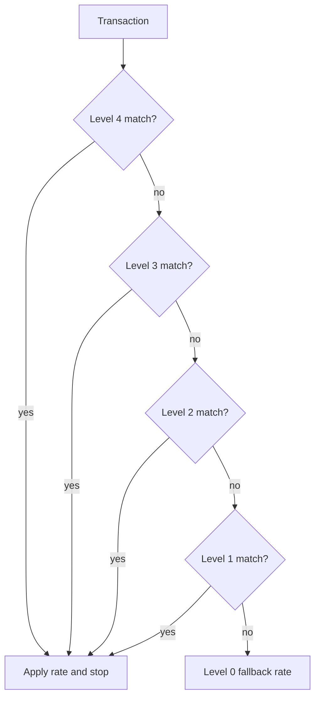
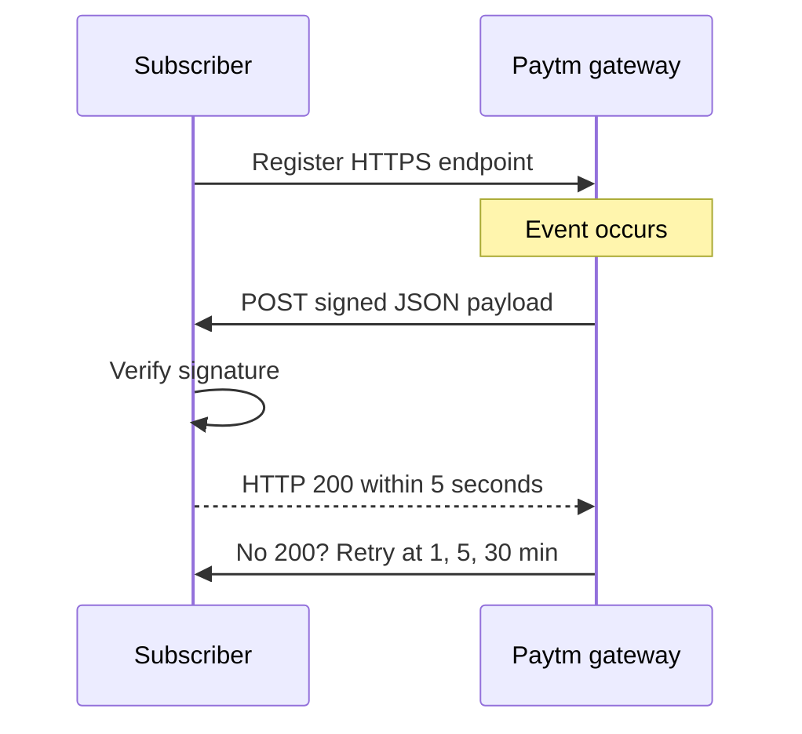
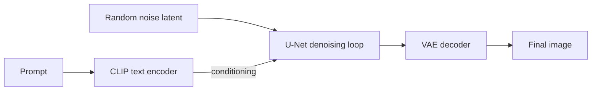
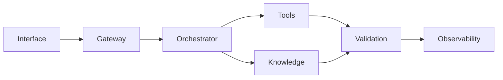
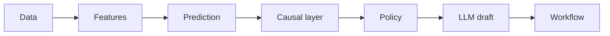
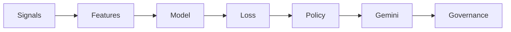
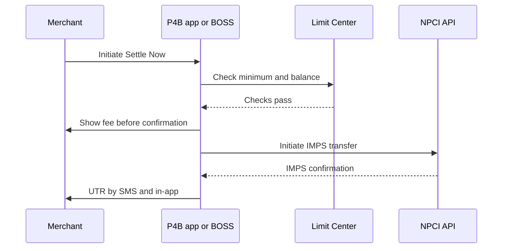
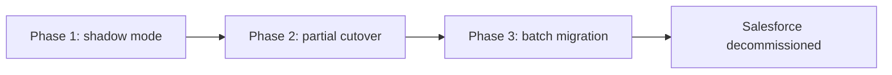

# Technical AI PM Interview Guide

**Version 2 · October 2026** · Interview preparation · PM + AI Master Library

> Every technical concept I must explain and every system I must defend, said once, with the honest wording for each claim.

---

## Start here

### How to use this guide

Use this guide when an interviewer probes systems, APIs, data, AI PM judgment, LLM safety, fintech architecture, or model and product trade-offs. The Paytm stories are told in full in the Story Bank. This guide keeps the technical explanation and the architecture defense, and points to stories by ID (for example "S3, Pricing engine and revenue protection").

| Part | Holds | Layout of every item |
|---|---|---|
| I | Concepts I can explain | In one breath, How it works, Why a PM cares, Where I used it, Trap |
| II | What I built and decided | What it is, The problem, Architecture, Decisions, Metrics, Questions, Limits |
| III | How I think | Short version, full version, example |
| IV | Drills | Prompt, approach, answer |
| V | Reference | Ledger, numbers, open facts, sources |

In Part I, "How it works" is general knowledge and "Where I used it" is my own experience. Keep them separate when speaking: explain the concept, then say what I did with it.

Learn the material in layers. Do not memorize the longest answer first. Start with a truthful one-line position, then learn the architecture, the metrics, the failure modes, and only then the advanced material.

1. Repair the CV. Replace unsupported production claims with portfolio, proposal, prototype, or assisted-workflow language.
2. Memorize the control boundary (below).
3. Practice 30-second, 90-second, and 5-minute versions of each project.
4. For every number, prepare the formula, denominator, time window, baseline, and uncertainty.
5. For every model name, prepare why it was chosen, what baseline it beat, and what would make you switch.
6. For every workflow, prepare one privacy failure, one quality failure, one operational failure, and the rollback.
7. Answer hostile follow-ups with precision. A truthful limitation usually sounds more senior than an improvised detail.

> [!IMPORTANT]
> **Use boundary.** This is a technical case-study and interview-preparation guide. It cannot turn an unperformed project into production experience. Use the designs as portfolio work, as a proposal for how I would solve the problem, or to repair CV language so it matches evidence I can actually produce.

### The technical PM bar

A technical PM answer should not sound like a software engineer trying to code the solution. It should sound like a product leader who can define the system boundary, name the scale constraint, make an architecture trade-off, and protect the user and the business with metrics, fallbacks, and launch controls.

A strong answer includes seven things:

1. the user goal,
2. the system boundary,
3. the main data objects,
4. the read and write paths,
5. the latency or reliability constraint,
6. the failure modes, and
7. the rollout plan.

The center of the answer is ownership of trade-offs: when to use rules versus ML, sync versus async, cached versus real-time, human review versus automation, and a read-only assistant versus an action-taking agent. The interviewer should hear that I can partner with engineering without pretending to be the engineer.

### The control boundary

Memorize this sentence. It is the spine of every AI answer in this guide.

> [!IMPORTANT]
> ML predicts, rules govern, tools retrieve, LLMs interpret and explain, humans approve high-risk actions.

The longer form: the LLM is not the source of truth or the policy authority. It is a bounded interpretation, retrieval, explanation, and workflow layer around authoritative systems and deterministic controls. [Chapter 7](#7-rules-ml-and-llms-which-tool-for-which-job) expands this.

### The DIRECT answer framework

DIRECT is how I structure any technical answer about a system I worked on.

| Letter | Move | What to say |
|---|---|---|
| D | Define | Define the problem, user, unit of decision, and desired outcome. |
| I | Isolate | Separate deterministic systems, structured ML, retrieval, LLM, and human authority. |
| R | Reason | Explain why this architecture beats rules or a manual workflow and what trade-off it accepts. |
| E | Evidence | Give the metric, baseline, evaluation, experiment, and artifact status. |
| C | Controls | Name authorization, privacy, guardrails, fallback, monitoring, and rollback. |
| T | Truth qualifier | State whether this was shipped, piloted, prototyped, proposed, or designed as a case study. |

DIRECT applied to "Tell me about the merchant operations assistant" (BOSS-GPT, [Chapter 13](#13-boss-gpt-merchant-operations-assistant)):

| Letter | My answer |
|---|---|
| D | Merchant-operations agents lose time switching across transaction, settlement, merchant-profile, pricing, dispute, and SOP systems for repetitive but context-heavy queries. The unit is one agent query. The outcome is a permissioned lookup, an evidence-backed answer, a next step, and a safe escalation. |
| I | Deterministic services own authentication, authorization, tool execution, system-of-record data, redaction, audit logs, schema validation, and any write action. Retrieval covers approved SOPs. The LLM interprets intent, collects missing parameters, chooses among approved read-only tools, and summarizes the evidence. Humans take the ambiguous or high-impact cases. |
| R | Language varies widely, intent may be implicit, and one question can need several tools and a summary of mixed results. Deterministic routing still handles obvious intents. The price is more engineering and governance complexity. |
| E | Primary metric: supported-query average handling time and correctly self-resolved query rate. My material claims 180 agents, 24,000 monthly queries, 12-to-3.5-minute AHT, and 64% self-resolution. I treat all four as unverified until supported by dashboards or experiment records. |
| C | Restricted-channel use, SSO identity propagation, least-privilege tools, deny-by-default fields, prompt-injection defenses, rate limits, immutable audit logs. Fallback: ask for missing identifiers, return exact system data without interpretation, or deep-link the agent to the source system. A feature flag disables one intent or one tool. |
| T | See the placeholder below. |

> [!WARNING]
> **Your fact needed:** (F1) the truth qualifier for BOSS-GPT. Choose one status you can evidence: shipped, piloted, prototyped, proposed, or designed as a case study. The résumé and Story Bank say shipped; this guide's charter says portfolio design unless deployment records, dates, users, and metrics are verifiable (see R1 and R4 in Part V).

### Truth protocol

Before memorizing any answer, give every metric and every technical noun one status: VERIFIED (an artifact exists), ESTIMATED (a formula and its assumptions exist), ASSUMED (case-study design), or REMOVE.

The claim integrity ledger in Part V gives the defensible wording for the riskiest claims. This guide already uses it.

### The 10-minute pre-interview path

| Minutes | Do this | Where |
|---|---|---|
| 0 to 2 | Read the claim integrity ledger. Say each defensible replacement aloud. | Part V |
| 2 to 4 | Say the control boundary and walk DIRECT once. | This chapter |
| 4 to 7 | Say the 30-second version of each of the four AI projects. | [Chapter 13](#13-boss-gpt-merchant-operations-assistant), [Chapter 14](#14-merchant-retention-churn-model-and-human-in-the-loop-agent), [Chapter 15](#15-donut-document-extraction-for-merchant-onboarding), [Chapter 16](#16-transaction-limit-risk-scoring) |
| 7 to 9 | For each number you plan to use: formula, denominator, baseline. | Master numbers, Part V |
| 9 to 10 | Read "What not to say". | [Chapter 40](#40-defending-my-claims-under-pressure) |

With more time, follow this order: claim ledger, 30-second stories, architecture diagrams, metrics and formulas, hostile questions, advanced sections.

### What's new in Version 2

- One guide: each topic and project appears once, in a fixed layout, with concepts split from projects.
- The claim integrity ledger wording is applied in every answer; remaining conflicts are listed in "Facts to reconcile".
- General technical explanations were checked against primary sources in October 2026 and corrected.
- New: a question finder, a 10-minute path, a master numbers table, and a list of facts only I can supply.

## Question finder

Find the question, go to the chapter. Numbers are chapter numbers.

### System design as a PM

| Question or topic | Ch. |
|---|---|
| What does a strong technical PM answer include? | Start here |
| How do you answer system design as a PM? | [27](#27-answering-system-design-as-a-pm) |
| Design drills: AI assistant, pricing rule engine, onboarding platform, reconciliation pipeline, KYB extraction | [41](#41-technical-case-drills) |
| How did the payment gateway work? Rules, predicates, fallback | [1](#1-payment-gateway-rules-predicates-and-reliability) |
| Idempotency, retries, circuit breakers, dead letter queues | [1](#1-payment-gateway-rules-predicates-and-reliability) |
| Scaling a system that outgrew its architecture; migration risk | [31](#31-scaling-a-system-that-outgrew-its-architecture) |
| How do you manage tech debt? | [30](#30-managing-tech-debt) |
| Pull requests and how a PM interacts with them | [6](#6-pull-requests-and-working-with-engineering) |

### APIs and integrations

| Question or topic | Ch. |
|---|---|
| API components, API contract, data contract | [4](#4-apis-components-contracts-webhooks-deeplinks-and-deprecation) |
| Webhooks; deeplinks and the welcome email; API deprecation | [4](#4-apis-components-contracts-webhooks-deeplinks-and-deprecation) |
| How do you design an API? APIs I worked on; API metrics | [29](#29-designing-an-api) |
| FastAPI versus Flask, Django REST Framework, Express | [5](#5-web-frameworks-fastapi-and-the-alternatives) |
| CleverTap: events, triggers, channels | [20](#20-clevertap-integration-sms-push-and-email) |

### Data and databases

| Question or topic | Ch. |
|---|---|
| Indexes; OLTP versus OLAP | [2](#2-databases-indexing-oltp-and-olap) |
| Database versus schema; normal forms; keys; canonical models; migrations | [3](#3-data-modeling-schemas-normal-forms-keys-and-canonical-models) |
| How do you design a data model and schema? | [28](#28-designing-a-data-model-and-schema) |
| Heatmap analysis | [11](#11-heatmap-analysis) |

### AI and LLMs

| Question or topic | Ch. |
|---|---|
| When should a product use AI? How are you integrating AI in your work? | [32](#32-deciding-whether-ai-belongs-in-a-product) |
| Rules versus ML versus LLMs | [7](#7-rules-ml-and-llms-which-tool-for-which-job) |
| RAG, fine-tuning, tool calling, MCP, self-hosted models | [8](#8-llm-building-blocks-rag-fine-tuning-tool-calling-and-mcp) |
| How do you evaluate an LLM product? | [34](#34-evaluating-an-llm-product) |
| Metrics, calibration, leakage, drift, shadow mode, guardrails | [9](#9-evaluation-metrics-and-guardrails) |
| Lifecycle, rollout, incidents, governance | [33](#33-running-an-ai-product-from-idea-to-scale) |
| Build, buy, or fine-tune? | [35](#35-build-buy-or-fine-tune) |
| Stable Diffusion | [10](#10-stable-diffusion-how-image-generation-works) |
| The questions every AI project gets; rapid-fire definitions | [42](#42-cross-project-question-bank), [43](#43-rapid-fire-ai-pm-questions) |
| What does your Georgia Tech degree add? | [39](#39-georgia-tech-ai-studies-and-how-they-differentiate-me) |

### Risk and compliance

| Question or topic | Ch. |
|---|---|
| What technical risks matter most in AI fintech products? | [41](#41-technical-case-drills) |
| Prompt injection, authorization, privacy, threat model | [36](#36-security-and-privacy-for-ai-products) |
| Compliance issues found in operations | [22](#22-compliance-issues-found-in-operations) |
| US merchant onboarding: profile, documents, screening | [12](#12-us-merchant-onboarding-kyb-profile-and-documents) |
| Transaction limits, risk scoring, SHAP, fairness | [16](#16-transaction-limit-risk-scoring), [17](#17-limit-center) |
| An unpopular decision; AI washing | [37](#37-unpopular-ai-decisions-i-took), [38](#38-ai-washing-and-how-i-evaluate-ai-claims) |
| "Did you build this?" "This sounds invented." | [40](#40-defending-my-claims-under-pressure) |

### My projects

| Project | Story | Ch. |
|---|---|---|
| BOSS-GPT, merchant operations assistant | S8 | [13](#13-boss-gpt-merchant-operations-assistant) |
| Merchant retention agent and churn model | S6 | [14](#14-merchant-retention-churn-model-and-human-in-the-loop-agent) |
| Donut document extraction for onboarding | S7, S2 | [15](#15-donut-document-extraction-for-merchant-onboarding) |
| Transaction-limit risk scoring; Limit Center | S7, S3 | [16](#16-transaction-limit-risk-scoring), [17](#17-limit-center) |
| Platform and convenience fee | S3, S5 | [18](#18-platform-and-convenience-fee-strategy) |
| Dynamic terms charter | S10 | [19](#19-dynamic-terms-charter) |
| Settle Now and the tiered fee | | [21](#21-settle-now-and-the-tiered-fee) |
| Merchant complaint classifier; self-hosted open models | | [23](#23-merchant-complaint-classifier-fine-tuned-bert), [24](#24-self-hosted-open-models-and-their-infrastructure) |
| Salesforce migration; pricing rule engine | S2; S3 | [31](#31-scaling-a-system-that-outgrew-its-architecture), [1](#1-payment-gateway-rules-predicates-and-reliability) |
| n8n pipelines; Smart Stadium Fanplay (personal) | | [25](#25-n8n-pipelines-job-autoscoring-and-inbox-triage), [26](#26-smart-stadium-fanplay-ai-posters-and-location-scouting) |

# Part I — Concepts I can explain

## 1. Payment gateway: rules, predicates and reliability

### Rule table with specificity fallback

**In one breath.** Pricing rules live in a table instead of in code. Each transaction gets the most specific rule that matches it, and a catch-all rule guarantees that no transaction is ever priced at zero by accident.

**How it works.** Store each rule as a row: the conditions it matches (its predicates) and the rate it applies. Give each rule a specificity score, where more conditions means more specific. For a transaction, look for a match at the highest specificity first and step down one level at a time. Stop at the first match (short-circuit evaluation). Keep one rule with no conditions at the bottom so every transaction gets a rate. If rules are pre-indexed in memory by specificity level, each level is one hash lookup, so the cost does not grow with the number of rules. The structure is the same as longest-prefix matching in an IP routing table.

**Why a PM cares.** Commercial terms change more often than code ships. Rules as data let the business change pricing without a deployment, and the PM owns which fallback is safe.

**Where I used it.** S3, Pricing engine and revenue protection. The gateway was not a single service. It was a layered decision engine that evaluated 15,000+ rule combinations in <50ms per transaction and routed money across acquiring banks, card networks, and payment instruments. Every commercial agreement with an acquirer or card network produced a set of pricing rules. Rather than hardcoding these in application logic, we stored them in a structured rule table:

```sql
CREATE TABLE pricing_rules (
  rule_id        UUID PRIMARY KEY,
  card_network   VARCHAR(20),  -- VISA | MASTERCARD | RUPAY | AMEX
  card_type      VARCHAR(20),  -- CREDIT | DEBIT | CORPORATE | PREPAID
  mcc_code       CHAR(4),      -- NULL = wildcard for all MCCs
  instrument     VARCHAR(30),  -- STANDARD | BNPL | SUPER_PREMIUM | CO_BRANDED
  rate_bps       SMALLINT,     -- fee in basis points e.g. 40 = 0.40%
  specificity    TINYINT,      -- 0 = catch-all, 4 = exact match
  effective_from DATE,
  effective_to   DATE,
  acquirer_id    UUID          -- which bank this rule applies to
);
```

Total active rows: ~15,000. Rules were loaded into an in-memory nested hash map at service startup, partitioned by specificity level (0-4). That made per-transaction lookups O(1): 5 hash lookups regardless of rule count. Evaluation was a greedy descent from highest specificity to lowest:

| Level | Name | Fields specified |
|---|---|---|
| 4 | Exact | card_network + card_type + mcc_code + instrument |
| 3 | Near-exact | card_network + card_type + instrument (mcc = wildcard) |
| 2 | Partial | card_network + card_type only |
| 1 | Network-only | card_network alone |
| 0 | Universal catch-all | all fields wildcard (prevents $0-fee fallthrough) |

The engine stopped at the first level where a matching rule existed. If no rule matched at any level, the universal fallback rate was applied. This was a hard guarantee that prevented revenue leakage from zero-fee transactions.



*Figure 1.1 — Predicate evaluation order in the pricing rule engine: greedy descent with a guaranteed fallback.*

| Measure | Value |
|---|---|
| p50 evaluation | 8ms |
| p99 evaluation | 34ms |
| Fallback rate target | <3% |
| Zero-fee incidents | 0 post-fix |

**Trap.** Saying "the engine scans the rules". It does five hash lookups. And the fallback is a product decision, not an error path.

### Idempotency and delivery semantics

**In one breath.** An operation is idempotent if performing it many times produces the same result as performing it once. An idempotency key makes a non-idempotent call safe to retry.

**How it works.** GET requests are idempotent. POST requests are not: calling `POST /settlements` twice creates two settlements. PUT and DELETE are defined as idempotent; PATCH is not guaranteed to be. To make a POST safe, the client generates a unique key (a UUID) for each logical operation and sends it in a request header. The server checks whether it has seen the key. If yes, it returns the previous response without executing again. If no, it executes and stores the result under the key.

| Guarantee | Meaning | Cost |
|---|---|---|
| At-most-once | Send once, never retry | Messages can be lost |
| At-least-once | Retry until acknowledged | Duplicates arrive |
| Exactly-once effect | At-least-once delivery plus idempotent handling | Keys and stored results |

**Why a PM cares.** Clients retry when networks fail. In payments, a retry without idempotency moves money twice.

**Where I used it.** S3. Every transaction request carried a client-generated UUID idempotency key. The gateway stored key → result in a Redis TTL store (24-hour expiry). Duplicate requests returned the cached result without re-executing, which guaranteed at-most-once side effects even with network retries. Idempotency keys were also required on the Settle Now API and the BINARY invoice trigger API (S1). Any network failure during a settlement trigger would cause the client to retry. Without idempotency this could create duplicate settlements. With it, the second call returned the result of the first call with no side effects. The Central Data Store sync used CDC events with idempotency keys (S2, [Chapter 28](#28-designing-a-data-model-and-schema)).

**Trap.** Claiming "exactly-once delivery". No network can promise that a message arrives exactly once. The defensible wording is "at-least-once delivery with idempotent processing, so each transaction takes effect once".

### Failure handling: staged settlement, circuit breaker, backoff, dead letter queue

**In one breath.** Four patterns keep a payment flow correct when a bank is slow or down: commit money in two steps, stop sending traffic to a failing partner, space out retries, and park what still fails for a human.

**How it works.**

- **Reserve, then confirm.** Hold the funds first; finalize only after the other party acknowledges; release the hold on timeout.
- **Circuit breaker.** Watch a dependency's success rate; when it falls below a threshold, stop calling it for a while and route elsewhere; probe before resuming.
- **Exponential backoff with jitter.** Double the wait after each failed retry and add randomness so clients do not all retry at the same instant.
- **Dead letter queue (DLQ).** Move messages that exhausted their retries to a separate queue for review instead of dropping them.

**Why a PM cares.** Each pattern has a number in it that decides merchant experience during an outage: when to fail over, how many retries, who clears the queue and how fast.

**Where I used it.** S3, on the gateway (the Story Bank describes the same circuit breaker and backoff settings on the onboarding API gateway, S2; see R23).

- **Settlement in two steps.** (1) Reserve funds in the merchant wallet. (2) Confirm settlement only after acquirer acknowledgment. If step 2 timed out, the reservation was rolled back and the transaction was marked PENDING for retry.
- **Circuit breaker per acquirer.** If an acquirer's callback success rate dropped below 80% in a 15-minute sliding window, the gateway stopped routing new transactions to that acquirer and failed over to the next eligible acquirer in the routing priority table.
- **Backoff and jitter.** Failed bank callbacks were retried at 2^n seconds (2s, 4s, 8s, 16s… capped at 5 min) with randomized jitter (±20% of the delay) to prevent thundering-herd reconnection bursts after an acquirer came back online.
- **Dead letter queue.** Transactions that exhausted all retries were routed to a DLQ for manual Finance team review rather than silently dropped. Finance had a daily DLQ clearance SLA of 4 hours.

**Trap.** My notes call the two-step settlement a "two-phase commit pattern". Textbook two-phase commit is a database protocol with a coordinator and prepare and commit votes. If I use the term, the next question is about the coordinator. Safer: "reserve, then confirm, with rollback on timeout" (D2).

## 2. Databases: indexing, OLTP and OLAP

### Indexes

**In one breath.** An index is a separate data structure the database maintains alongside a table so it can find rows without reading the whole table.

**How it works.** Without a usable index, a query runs a full table scan, O(n). With a B-tree index, lookups are O(log n). With a hash index, an equality lookup is roughly O(1).

| Type | Works for | Note |
|---|---|---|
| B-tree | Equality and ranges (`=`, `<`, `>`, `BETWEEN`) | The default in PostgreSQL and MySQL; right for most OLTP queries |
| Hash | Exact equality only | No range queries; in practice the gain over B-tree is small |
| Composite | Filters on the leading column(s) | An index on (col_a, col_b) serves col_a alone or both together |
| Partial | A subset of rows | `CREATE INDEX ON transactions(merchant_id) WHERE status = 'PENDING'` indexes only pending rows: smaller and faster for retry-queue queries |
| Covering | Queries whose columns are all in the index | The database never touches the base table (an index-only scan) |

Column order in a composite index follows the queries: columns filtered by equality first, then the column filtered by a range. An index on (col_a, col_b) is a poor fit for a filter on col_b alone. PostgreSQL 18 can sometimes still use it through a skip scan when col_a has few distinct values, but do not design for that.

**Why a PM cares.** Every index speeds some reads and taxes writes: it adds work to every INSERT and DELETE and to any UPDATE that touches its columns, and it takes disk space.

**Where I used it.** B-tree indexes on merchant_id, transaction_date, and settlement_status in Paytm's transaction table. A hash index on idempotency_key, where we only ever did `=` lookups, never range queries. Three real examples:

| Query | Index | Effect |
|---|---|---|
| "Fetch all PENDING transactions for merchant M123 created in the last 7 days" | Composite on (merchant_id, status, created_at) | Without it, a full scan of 4B+ rows. With it, ~2ms. |
| Pricing rule lookup (S3) | Composite on (card_network, card_type, specificity) | Rule evaluation inner loop went from 12ms to <1ms: the database returned only the relevant rule tier without scanning all 15,000 rows. |
| Settlement report query | Partial on (merchant_id) WHERE settlement_status = 'UNSETTLED' | Daily batch reconciliation job went from 45 minutes to 6 minutes. |

On the transactions table (~4B rows), each index added ~8-15GB of storage. That had real infrastructure cost implications that I factored into index decisions. I never approved a new index without asking the DBA four questions: (a) what query is this for, (b) what is the current query cost, (c) what will it cost after indexing, and (d) what is the write overhead on this table. Index decisions have P&L implications in high-scale systems.

**Trap.** "More indexes means faster." Also avoid two folk rules: "most selective column first" and "twelve indexes means twelve times the write cost". Order columns by how queries filter; write cost grows with each index, without a fixed multiple.

### OLTP versus OLAP

**In one breath.** OLTP (online transaction processing) runs the business one small transaction at a time. OLAP (online analytical processing) answers questions about the business by scanning large amounts of history.

**How it works.**

| | OLTP | OLAP |
|---|---|---|
| Purpose | Process individual business transactions in real time | Analyze large volumes of historical data for business intelligence |
| Workload | Thousands of transactions per second | Tens of queries per hour |
| Rows per query | 1-10 | Millions |
| Response time | <100ms | Seconds to minutes |
| Data freshness | Must be consistent and durable | Some staleness acceptable; a 1-24 hour lag from ETL is normal |
| Storage | Row-oriented | Columnar: reads one column at a time, which suits aggregation |

**Why a PM cares.** When a Finance stakeholder asks "can we just run this revenue query on the production database?", the answer is always no. It would compete with payments for CPU, memory, and I/O and degrade payment processing for thousands of merchants.

**Where I used it.**

OLTP at Paytm:

- Payment gateway transaction table: each payment creates one row in ~8ms. Queries are always narrow: "fetch transaction TXN_123" or "update status to SETTLED". Never "aggregate all transactions for the last year".
- Merchant wallet: balance debit and credit operations. Must be ACID-compliant; atomicity prevents double-deductions in retry scenarios.
- KYB status update: when the Karza API returns a verification result, the KYB table is updated for one merchant_id. A point update at high frequency (S7).
- Database: PostgreSQL with row-level locking, WAL (write-ahead log) for durability, and connection pooling via PgBouncer. Read replicas for SELECT queries that do not need real-time consistency.

OLAP at Paytm:

- Monthly interchange reconciliation (S4, Interchange cost reconciliation). This query scans millions of rows and would never be run on the OLTP database:

```sql
SELECT SUM(amount), COUNT(*), AVG(mdr_rate)
FROM transactions
WHERE date BETWEEN '2024-01-01' AND '2024-01-31'
  AND acquirer = 'AXIS'
GROUP BY card_type, mcc_code;
```

- Merchant churn cohort analysis (S6): identifying which merchant segments had >30% GMV decline in the last 30 days relative to their prior 90-day average. A complex aggregation across 30M+ merchants.
- Revenue MIS generation: aggregating MDR revenue by instrument type, merchant category, and geographic region for Finance's monthly P&L report.
- Database: an Amazon Redshift data warehouse, loaded daily from OLTP via an ETL pipeline. Columnar storage made aggregation queries 10-100x faster than on row-oriented OLTP databases.

**Trap.** Saying the analytical query "would lock production tables". In PostgreSQL, reading never blocks writing. The harm is resource contention.

## 3. Data modeling: schemas, normal forms, keys and canonical models

### Database, schema and data model

**In one breath.** A data model is the design, a schema is the blueprint written for one database, and the database is the running system that stores the data.

**How it works.**

- **Data model.** A design artifact: entities, attributes, and relationships in conceptual or logical terms, independent of any technology.
- **Schema.** The structural blueprint: tables, columns, data types, relationships, constraints. It lives inside the database. In PostgreSQL, "schema" also means a namespace within a database, and one database can hold several.
- **Database.** The physical system: the software (PostgreSQL, MySQL, MongoDB, Cassandra), the data stored in it, and the infrastructure it runs on.

If the database is a city, the schema is the zoning map. It defines what can be built where and which rules apply, but it is not the buildings. The same data model can be implemented in different databases.

**Why a PM cares.** Data model decisions are architectural and long-lived; database technology can be changed, with effort. Get the entity relationships and normalization level right first, then choose the technology that fits the access patterns.

**Where I used it.** S2, Salesforce to custom onboarding engine. The ER diagram I drew for the Paytm onboarding system was a data model: it showed Merchant, Device, Plan, BankAccount, and their relationships without specifying PostgreSQL syntax. [Chapter 28](#28-designing-a-data-model-and-schema) has my full method.

**Trap.** Using "database" and "schema" as synonyms, or answering a data-model question with a technology name.

### Normal forms

**In one breath.** Normalization removes duplicated facts so that one change is made in one place.

**How it works.**

| Form | Rule | Removes |
|---|---|---|
| 1NF | Each column holds atomic values and each row is unique. A comma-separated list in a column violates it. | Repeating groups |
| 2NF | 1NF, and every non-key attribute depends on the whole primary key, not part of a composite key | Partial dependencies |
| 3NF | 2NF, and no non-key attribute depends on another non-key attribute. If city → state and merchant → city, then merchant → state is a transitive dependency. | Transitive dependencies |
| BCNF | A stricter 3NF: every determinant must be a candidate key | Anomalies from overlapping candidate keys |

3NF is the standard target for OLTP systems. Beyond 3NF, the performance cost of joins often outweighs the integrity benefit. Data warehouses often denormalize on purpose into a star schema (fact tables with dimension tables) for query performance.

**Why a PM cares.** Under-normalized transactional data produces update anomalies. Over-normalized reporting data produces slow dashboards.

**Where I used it.** S2. The Central Data Store at Paytm was normalized. The data warehouse for reporting was partly denormalized.

**Trap.** "Always normalize fully." The answer depends on whether the system is read-heavy or write-heavy.

### Keys and secondary indexes

**In one breath.** A primary key identifies a row, a foreign key ties a row to a row in another table, and a secondary index is a performance aid, not a rule.

**How it works.**

- **Primary key.** The column or columns that uniquely identify each row. Cannot be null or duplicated.
- **Foreign key.** A column that references the primary key of another table. It enforces referential integrity: you cannot create a transaction with a merchant_id that does not exist in the merchants table. It can be nullable (optional relationship) or non-nullable (mandatory).
- **Secondary index.** Not a uniqueness constraint. An index on merchant_id in the transactions table makes queries filtered by merchant_id much faster, at a write-time cost. Add one only for columns that appear often in WHERE clauses.
- **Surrogate key.** A system-generated identifier (UUID or sequential integer) with no business meaning.
- **Natural key.** A real-world identifier such as a merchant registration number or tax identifier.

For distributed systems, UUID v4 (random) avoids sequential ID collisions across shards but has worse index locality than sequential IDs. UUID v7 (timestamp-ordered) keeps insertion order while staying globally unique. It was standardized in RFC 9562 in May 2024, and PostgreSQL 18 generates it natively with `uuidv7()`.

**Why a PM cares.** Natural keys change and surrogate keys do not. A key choice is expensive to undo once other systems store it.

**Where I used it.** I use surrogate keys for all internal-facing tables and index natural keys as unique columns for lookup. [Chapter 28](#28-designing-a-data-model-and-schema), step 3.

**Trap.** Calling a secondary index a "secondary key" and implying it enforces anything.

### Canonical data model

**In one breath.** One shared definition of a business entity that every system maps to and from, instead of each system keeping its own version.

**How it works.** Without a canonical model, each system defines "Merchant" with its own field names, data types, and validation rules, and every pair of systems needs its own sync. With n systems that is n*(n-1)/2 possible sync relationships. With a canonical model, each system syncs with the hub only: n relationships.

**Why a PM cares.** Many cross-system bugs are two systems holding different views of the same entity.

**Where I used it.** S2. At Paytm, the Central Data Store (CDS) was the canonical data model for merchant entities. Every downstream system (the Pricing Engine, BINARY, the Charging System, SAP) consumed merchant data from the CDS via APIs rather than maintaining its own merchant tables. This eliminated the class of bugs caused by different systems having inconsistent views of the same merchant. With 6 systems, point-to-point integration creates 15 potential sync relationships. The CDS reduced this to 6.

**Trap.** Describing the hub as "one big database everyone writes to". Consumers read from it through APIs and events.

### Schema migrations and event schema versioning

**In one breath.** Schema changes are code: versioned, reviewed, applied in the same order everywhere, and compatible with consumers that have not upgraded yet.

**How it works.** A migration tool (Flyway, Liquibase, Alembic) tracks schema version in source control. Every schema change is a migration file, and every environment (dev, staging, production) runs the same migrations in sequence. For event schemas, a schema registry with Avro or Protocol Buffers enforces compatibility rules: new optional fields (fields with defaults) can be added; existing fields cannot be removed or renamed without breaking someone. A column rename with zero downtime is a multi-step migration (add the new column, backfill, update consumers, drop the old column), not a single ALTER TABLE.

**Why a PM cares.** I am not writing migrations, but I own the decision of when a schema change is a breaking change for downstream consumers and what the migration window needs to be.

**Where I used it.** S2. On the Central Data Store, event payload schemas were versioned so new fields could be added without breaking consumers on older versions.

**Trap.** Treating a rename as a small change. To every consumer it is a removal plus an addition.

## 4. APIs: components, contracts, webhooks, deeplinks and deprecation

### Components of an API

**In one breath.** An API call is a method on a URL, with headers and a body, answered by a status code and a body.

**How it works.**

| Component | What it is |
|---|---|
| Endpoint | The URL that identifies the resource. Example: `POST https://api.paytm.com/v2/transactions/initiate` |
| HTTP method | GET (read), POST (create), PUT (replace), PATCH (partial update), DELETE (remove). The choice sets idempotency expectations ([Chapter 1](#1-payment-gateway-rules-predicates-and-reliability)). |
| Request headers | Authorization (Bearer token or API key), Content-Type (application/json), Idempotency-Key (UUID for safe retries), X-Request-ID (request tracing in logs) |
| Request body | JSON payload with the resource data, validated against a schema (a Pydantic model or JSON Schema) |
| Response body | JSON with the result. A common envelope: data (the resource), meta (pagination info, request_id, timestamp), and errors (an array of error objects, if any) |
| Status codes | 200 OK, 201 Created, 204 No Content, 400 Bad Request (client error), 401 Unauthorized, 403 Forbidden, 404 Not Found, 409 Conflict (duplicate), 422 Unprocessable Entity, 429 Too Many Requests, 500 Internal Server Error |
| Rate limit headers | X-RateLimit-Limit (max requests per window), X-RateLimit-Remaining (left in the current window), X-RateLimit-Reset (Unix timestamp when the limit resets) |

Two precision points. 401 means "not authenticated"; 403 means "authenticated but not allowed". The X-RateLimit headers are a widely used convention, not a standard; the IETF's standard `RateLimit` and `RateLimit-Policy` fields were still an Internet-Draft in 2026.

Request and response shapes from well-known public APIs:

```http
POST https://api.uber.com/v1.2/requests
  body: {start_latitude, start_longitude, end_latitude, end_longitude,
         product_id, payment_method_id}
  response: {request_id, status: 'processing',
             driver: {name, rating, vehicle}, eta_minutes}

GET https://maps.googleapis.com/maps/api/directions/json
    ?origin=Delhi&destination=Mumbai&key=API_KEY
  response: {routes: [{legs: [{distance, duration, steps}]}], status: 'OK'}

POST https://api.stripe.com/v1/payment_intents
  body: {amount: 2000, currency: 'usd', payment_method: 'pm_xxx', confirm: true}
  response: {id: 'pi_xxx', status: 'succeeded', amount: 2000, client_secret: '...'}
```

These show shape only. Google now labels the Directions API "Legacy" and points new projects to its Routes API, so check live documentation before quoting an endpoint.

**Why a PM cares.** Each component is a product decision clients depend on: what a 409 means, what a retry returns, how a client learns it is being throttled.

**Where I used it.** The APIs I worked on at Paytm and the metrics I tracked are in [Chapter 29](#29-designing-an-api).

**Trap.** Listing status codes without saying what the client should do next.

### API contract

**In one breath.** A formal, binding specification of how an API behaves: what it accepts, what it returns, and what it guarantees. It is the source of truth for the team building the API and the teams consuming it, and it prevents the "we thought the field was optional" class of production incidents.

**How it works.** A contract must contain ten things:

| # | Section | What it pins down |
|---|---|---|
| 1 | Resource definition | The entity, its fields, data types, and constraints (nullable, max length, enum values) |
| 2 | Operation specification | For each endpoint: HTTP method, URL pattern, required and optional parameters, query string parameters and their types |
| 3 | Request validation rules | For every field: what is valid and which error code comes back when it is not |
| 4 | Response schema | The success response and every possible error response |
| 5 | Side effects | Which state changes the operation causes, and when state is committed versus provisional |
| 6 | Idempotency guarantee | Whether the endpoint is idempotent, how it is keyed, the TTL of the idempotency store, and what a duplicate call returns (cached response or 409) |
| 7 | Rate limits | Requests per minute or hour, per merchant and global, and what happens when exceeded (429 with a Retry-After header) |
| 8 | Versioning policy | Which version this is, the deprecation policy, and what counts as a breaking change (removing a field, changing a field type, making an optional field required) |
| 9 | Authentication and authorization | The mechanism (API key, OAuth 2.0, HMAC signature) and the permissions the caller needs |
| 10 | SLA and availability | p99 latency target, uptime SLA (99.9% allows about 8.76 hours of downtime a year), planned maintenance windows |

Worked examples for the rows that need one:

- Resource definition: a TransactionRequest object must have merchant_id (string, required, max 36 chars), amount_paise (integer, required, > 0, max 10000000), instrument (enum: UPI | CARD | BNPL), and idempotency_key (UUID v4, required, unique per merchant).
- Validation: amount_paise must be > 0. If <= 0, return 400 with error_code: INVALID_AMOUNT.
- Response schema: the success schema lists field names, types, and whether each field is always present or conditional. The error schema has error_code, error_message, field (for validation errors), and suggestion (a human-readable fix hint).
- Side effects: a POST to /transactions does not mean the transaction has been processed. It means it has been queued.
- Authorization: the GET /settlement/reports endpoint requires the reports:read scope in the OAuth token.

**Why a PM cares.** The contract resolves product ambiguity before it becomes an incident: is this field required, what does a duplicate return, what is a breaking change?

**Where I used it.** My own API work is in [Chapter 29](#29-designing-an-api).

**Trap.** Specifying only the success response. The error contract needs the same care.

### Data contract

**In one breath.** The same idea as an API contract, for data that flows between teams: who produces it, who consumes it, and what each side can rely on.

**How it works.** A good data contract defines the producer, consumer, schema, freshness expectation, allowed nulls, ownership, validation rules, failure behavior, and backward compatibility plan. For data that feeds an AI system, add three rules:

- Every input field has an owner, meaning, timestamp, freshness SLA, null behavior, permitted purpose, and retention rule.
- Every feature or retrieved passage is traceable to a source snapshot and version.
- Production logs mask direct identifiers and separate audit retention from model-improvement datasets.

**Why a PM cares.** It prevents teams from discovering ambiguity during integration. The PM value is reducing integration risk by forcing product decisions about states before engineering discovers them in production.

**Where I used it.** In onboarding and pricing, merchant identity, KYB status, pricing plan, activation state, and bank details must have explicit source-of-truth ownership (S2, S3). The four AI project charters in Part II each carry a data contract.

**Trap.** A schema alone is not a contract. Freshness, nulls, and failure behavior are the parts that break integrations.

### Webhooks

**In one breath.** A webhook is an HTTP callback: a server-to-server notification the provider pushes to the subscriber when a specific event occurs. Unlike polling, where the subscriber keeps asking "has anything happened?", a webhook sends data only when there is something to send.

**How it works.** The subscriber registers an HTTPS endpoint with the provider. When an event occurs, the provider POSTs a signed JSON payload to it. The subscriber recomputes the signature (an HMAC over the payload with a shared secret) and rejects any mismatch, which prevents spoofing. It acknowledges quickly with a 2xx response. If no acknowledgment arrives, the provider retries, so the same event can arrive more than once and handlers must be idempotent.



*Figure 4.1 — Webhook delivery on the Paytm gateway, as I describe it.*

**Why a PM cares.** The PM defines the events, the payloads, and the retry promise that downstream systems build on.

**Where I used it.** On the Paytm gateway, the subscriber (a merchant or an internal system) had to respond with HTTP 200 within 5 seconds. If no 200 was received, Paytm retried with exponential backoff (3 retries: 1 min, 5 min, 30 min). Paytm signed each webhook payload with the merchant's secret key using HMAC-SHA256.

| Event | Payload and use |
|---|---|
| PAYMENT_SUCCESS | Transaction result (example below) |
| SETTLEMENT_PROCESSED | Settlement UTR, amount settled, deductions breakdown, settlement period. Used by the merchant's ERP to auto-reconcile. |
| DISPUTE_RAISED | dispute_id, chargeback_reason_code, response_deadline, required_evidence_types. Triggers the merchant's internal dispute response workflow. |
| REFUND_PROCESSED | Confirms a refund has been credited to the consumer's account. Used to update the merchant's order management system. |

```json
{
  "txn_id": "TXN_X",
  "status": "SUCCESS",
  "amount": 5000,
  "currency": "INR",
  "merchant_id": "M_123",
  "timestamp": "2024-03-15T14:23:11Z",
  "instrument": "UPI",
  "utr": "UTR_987654"
}
```

How I used webhooks in product design:

- BINARY invoicing (S1, BINARY invoicing automation): the invoicing system subscribed to SETTLEMENT_PROCESSED webhooks from the gateway to trigger invoice generation. No polling. Invoice generation kicked off within seconds of a settlement event, which eliminated the 9-day lag from the previous batch-file approach (see R24).
- Dispute automation: when DISPUTE_RAISED fired, our internal system automatically fetched the original transaction details, checked the dispute reason code against the RAG knowledge base, pre-populated the evidence package, and sent the merchant a CleverTap push with the deadline date.
- Real-time limit tracking: each PAYMENT_SUCCESS webhook decremented the merchant's daily GMV counter in the Limit Center Redis store ([Chapter 17](#17-limit-center)), keeping real-time limits accurate without polling the transaction table.

**Trap.** Assuming a webhook arrives once and in order. Design for duplicates, delays, and out-of-order delivery.

### Deeplinks

**In one breath.** A deeplink is a URL that opens a specific screen inside a mobile app, or a specific section of a web app, instead of the home screen. In onboarding, it turns a communication touchpoint (email, SMS, notification) into one specific product action.

**How it works.** There are two kinds, and they behave differently:

| Kind | Looks like | Behavior |
|---|---|---|
| Custom URL scheme | `myapp://path` | The app registers a scheme with the OS. No ownership check. If the app is not installed, nothing useful happens. |
| Universal Links (iOS), App Links (Android) | `https://example.com/path` | Ordinary web URLs for a domain the app has proven it owns through a file hosted on that site. If the app is installed, the OS opens it at the matching screen. If not, the same URL opens in the browser. |

If the user is not logged in, the app stores the destination and redirects after login.

**Why a PM cares.** Every extra tap between a message and the action loses users. A deeplink removes the "find the right section" step.

**Where I used it.** The format `paytm://merchant/payment-settings?highlight=rupay_credit` opened the P4B app's Payment Settings screen with the RuPay Credit toggle highlighted, showing the merchant exactly what to activate (S5, RuPay credit card launch on UPI).

The welcome email to new merchants was one of the most impactful product decisions I made for merchant activation. Previously it said "Visit your dashboard" with a link to the BOSS dashboard home. Activation rate from welcome emails: 8%. The redesign made it a 4-step activation guide with a deeplink per step:

| Step | Message | Deeplink | Opens |
|---|---|---|---|
| 1 | "Generate your API keys" | `boss://developer-settings/api-keys` | The credential page |
| 2 | "Enable payment methods" | `paytm://merchant/payment-settings` | The Payment Settings page |
| 3 | "Set up your settlement account" | `boss://settlement/bank-account` | The bank account linking screen |
| 4 | "Download your first settlement report" | `paytm://merchant/reports?type=settlement` | The Settlement Reports section |

Outcome: merchant activation rate from welcome emails improved from 8% to 27% within 30 days. Each step had exactly one tap to reach the relevant product surface. Each deeplink carried UTM parameters (utm_source=welcome_email, utm_campaign=merchant_activation, utm_step=1). CleverTap tracked which steps merchants completed and where they dropped off, which enabled personalized follow-up nudges for incomplete steps.

**Trap.** Treating all deeplinks as one thing. My examples use custom schemes (`paytm://`, `boss://`); the web fallback belongs to verified https links (D10).

### API deprecation

**In one breath.** Deprecation is retiring an old API version while giving existing consumers time and guidance to move to a newer one. In a payments platform with 30M merchants and thousands of active integrations, it must be managed with extreme care.

**How it works.** A four-phase process over six months:

| Phase | When | What happens |
|---|---|---|
| 1. Announce | 6 months before end of life | Publish the deprecation notice in the developer changelog and API docs. Add deprecation and sunset headers to every response from the old version. Log which merchant_ids still call it. |
| 2. Active migration support | Months 1-4 | Migration guides with side-by-side old and new formats. The sandbox keeps both versions available. The support team proactively contacts the top 20 merchants by call volume on the old version. |
| 3. Soft cutoff | Month 5 | Every response from the old version carries a warning: "This API version will be decommissioned on [date]. Please migrate to v3." |
| 4. Hard cutoff | Month 6 | The old version returns HTTP 410 Gone. No new requests are processed. Emergency rollback window: 2 weeks. If a critical integration partner cannot migrate, a time-limited exception is granted via support ticket. |

The current standard signals are three response headers:

```http
Deprecation: @1688169599
Sunset: Sun, 30 Jun 2024 23:59:59 UTC
Link: <https://developer.example.com/deprecation>; rel="deprecation"
```

`Deprecation` (RFC 9745, March 2025) carries the date the version became or becomes deprecated. `Sunset` (RFC 8594) carries the date it stops responding. The link points to the migration guide.

**Why a PM cares.** A merchant who has integrated the API cannot update their system overnight. The PM owns the timeline, communication, and exception policy.

**Where I used it.** I tracked API version distribution: what % of calls were on deprecated versions. This informed the deprecation timeline. You cannot deprecate a version that 30% of your merchants are still using.

> [!WARNING]
> **Your fact needed:** (F2) a specific deprecation you ran or took part in (which API, which versions, the dates, how many merchants had to migrate). The notes describe the process but not an instance.

**Trap.** Two details I used to say are wrong. `Deprecation: true` is not the standard form; the header carries a date. And there is no "HTTP 299" status: 299 was a code inside the `Warning` header, which RFC 9111 retired.

## 5. Web frameworks: FastAPI and the alternatives

### FastAPI

**In one breath.** FastAPI is a Python web framework for building APIs with automatic validation, serialization, and OpenAPI documentation. It is built on Starlette (ASGI) and Pydantic. Its appeal is speed in two senses: runtime concurrency and developer velocity.

**How it works.**

- Type-hint driven. Function parameters are annotated with Python types. FastAPI validates request data against these types, serializes responses, and generates OpenAPI (Swagger) documentation, all from the same annotations. No separate schema files.
- Async-first. It runs on ASGI (Asynchronous Server Gateway Interface) and supports async/await natively. One server process can hold thousands of concurrent connections while they wait on I/O, which matters for high-concurrency endpoints such as transaction status polling.
- Pydantic validation. Request and response schemas are Pydantic models. Invalid input is rejected with a structured error (field name, error type, received value) before any business logic runs.

| Framework | Concurrency model | Validation and docs | Fits best |
|---|---|---|---|
| FastAPI (Python) | Async native on ASGI | Automatic through Pydantic; OpenAPI docs generated | Microservices and high-performance APIs. Lightweight, bring your own ORM, less opinionated. Smaller ecosystem than Express, stronger type safety. |
| Flask (Python) | Synchronous by default. Async views exist since Flask 2.0, but each request still occupies one worker. | No built-in validation; manual schema docs | Small services. Slower for I/O-heavy workloads. |
| Django REST Framework (Python) | Sits on Django. Django has async views and ORM calls; DRF is sync-first. | Full-featured: ORM, admin, auth | Traditional CRUD apps. Heavy, more opinionated. |
| Express.js (Node) | Non-blocking I/O in JavaScript | None built in | Large ecosystem, weaker type safety. |

**Why a PM cares.** The framework sets how quickly a team ships a validated endpoint and how it behaves under concurrent load.

**Where I used it.**

- BOSS-GPT inference server (S8): the LLM tool-calling middleware was built in FastAPI. Each tool was a FastAPI endpoint. Async handlers meant 400+ concurrent tool calls were handled by a single server process without thread exhaustion.
- KYB document extraction API (S7): the Donut model inference was wrapped in a FastAPI service. Pydantic models validated the document upload request (file type, size limit) before the expensive model inference ran.
- Internal pricing rule API (S3): the pricing engine's rule-evaluation service was a FastAPI microservice. The Pydantic request model automatically rejected malformed rule evaluation requests with field-level error details, eliminating a class of bugs where missing fields caused silent zero-fee fallthrough.

The pricing rule evaluation endpoint, in outline:

```python
from typing import Literal
from fastapi import FastAPI
from pydantic import BaseModel, Field

app = FastAPI()
Network = Literal["VISA", "MASTERCARD", "RUPAY", "AMEX"]

class RuleRequest(BaseModel):
    merchant_id: str
    card_network: Network             # validated against the allowed set
    amount_inr: float = Field(gt=0)   # validated > 0
    instrument: str

@app.post("/evaluate-rule")
async def evaluate(req: RuleRequest):
    rate = await rule_engine.evaluate(req)
    return {"rate_bps": rate.bps, "rule_id": rate.id}
```

**Trap.** "FastAPI is faster." Async is not faster by itself; it lets one process serve many requests that are waiting on I/O. Do not quote a fixed speed multiple over Flask.

## 6. Pull requests and working with engineering

### Pull requests

**In one breath.** A pull request (PR) is the formal mechanism in Git-based development for proposing code changes and having them reviewed before they merge into the main codebase. It is the gate between "code written" and "code in production".

**How it works.** A developer creates a branch from main, makes changes on it, and opens a PR to merge them back. The PR includes the diff (a line-by-line view of what changed), a description (what the change does, why, and how to test it), links to the Jira ticket or GitHub issue it addresses, and deployment notes (database migrations to run, feature flags to toggle). Reviewers examine the diff, leave comments ("this function could be a security risk if input_value is not sanitized"), request changes, or approve. Once approved, the PR is merged; many teams require two approvals. A CI/CD (continuous integration and continuous deployment) pipeline runs on every PR: unit tests, integration tests, linting, security scanning. A PR with failing required checks cannot be merged.

**Why a PM cares.** The PR is where deployment risk is written down: flags, migrations, test coverage.

**Where I used it.**

- Reading PR descriptions. I read every PR description for features I owned. Not the code diff, but the description, deployment notes, and test results. This told me: is this deployed behind a feature flag? Are there DB migrations that could cause downtime? Is the test coverage adequate? I could not evaluate the code quality, but I could evaluate the deployment safety.
- Acceptance criteria verification. I added acceptance-criteria comments on PRs for features I cared about: "This PR should produce a Merchant_Instrument_Activated event in CleverTap when the toggle is switched. Please confirm this is covered in the integration test." This kept the acceptance criteria top of mind during code review.
- Blocking PRs for compliance reasons. Twice during my tenure I explicitly requested changes in PR review: (1) a PR that removed the audit log entry for MDR rate changes (I commented: "This removes our compliance audit trail. This cannot be merged until we have an alternative logging mechanism"), and (2) a PR that added a new settlement mode without the corresponding Maker-Checker step for Finance review.
- Release coordination. I tracked which PRs were part of a sprint release and made sure all acceptance-criteria-critical PRs were merged and tested in staging before I signed off on the sprint as shippable to production.

**Trap.** Claiming to review code. I do not review code for correctness, performance, or style. That is the engineer's job. My PR interactions are limited to behavior against requirements, compliance and audit-trail implications, deployment safety, and release coordination.

## 7. Rules, ML and LLMs: which tool for which job

### Seven approaches and when each one wins

**In one breath.** Technology selection starts with the task and its risk profile. Hybrid systems are the normal production answer.

**How it works.**

| Approach | Best for | Strength | Failure mode | Example in my projects |
|---|---|---|---|---|
| Rules | Exact policy and thresholds | Predictable, auditable, fast | Brittle coverage and maintenance | Discount bands, authorization, limit caps |
| Classical ML | Structured prediction and ranking | Learns nonlinear patterns, measurable | Label bias, drift, leakage | Churn, uplift, risk probability |
| Document AI | Visual document classification and extraction | Uses text and layout | Template drift, field hallucination | Donut for KYB fields |
| RAG | Grounded document questions | Current approved knowledge | Bad retrieval or poisoned content | SOP and policy lookup |
| LLM tool use | Language-to-action orchestration | Flexible intent and synthesis | Wrong tool or parameters, injection | BOSS-GPT |
| LLM generation | Explanation and drafting | Natural, personalized output | Unsupported claims and inconsistency | Retention outreach, analyst summaries |
| Human review | Ambiguous or high-risk cases | Judgment and accountability | Cost, inconsistency, automation bias | Offers, KYB exceptions, limit overrides |

The selection rules:

- Use rules when the answer must be exact and the policy is enumerable.
- Use structured ML when the task is prediction from historical features.
- Use document AI when visual layout and text jointly determine fields.
- Use RAG when the answer must be grounded in versioned documents.
- Use an LLM when natural language, clarification, synthesis, or flexible tool selection creates material value.
- Use humans when ambiguity, financial impact, regulation, or model uncertainty exceeds the automation threshold.

The model can assist higher in the stack, but authoritative data and policy controls remain below it.

**Why a PM cares.** "Why this technology for this task?" is the first question in any AI product review.

**Where I used it.** All four AI projects in Part II are built on this split. [Chapter 32](#32-deciding-whether-ai-belongs-in-a-product) has my spoken answer.

**Trap.** "Because AI is modern." The right answer is a task-to-technology argument.

### Existing rules and ML versus a generative AI layer

**In one breath.** A generative layer extends the rules and models already running. It does not replace them.

**How it works.**

| Dimension | Existing rules and ML | Generative AI layer | Correct PM boundary |
|---|---|---|---|
| Input | Structured, fixed schema, engineered features | Text, documents, conversation, tool descriptions | Minimize and structure before prompting |
| Output | Score, class, threshold, deterministic action | Text, JSON, tool choice, summary | Validate and constrain generated output |
| Reliability | Repeatable for the same model and data | Probabilistic and prompt-sensitive | Keep high-stakes decisions outside the LLM |
| Evaluation | AUC, PR, calibration, loss, lift | Grounding, faithfulness, tool accuracy, policy adherence | Tie both to workflow and business outcomes |
| Drift | Feature and label drift | Model, prompt, retrieval, tool, and policy drift | Version every component |
| Explainability | Features, reason codes, SHAP, policy | Natural-language explanation can sound plausible | Generate only from validated reason codes |
| Security | Data access and model endpoint | Adds prompt injection, tool abuse, data leakage | Authorization outside the model; least privilege |
| Best use | Risk, churn, pricing, eligibility | Ops assistance, drafting, document and case synthesis | Compose layers based on the task |

**Why a PM cares.** "How is this different from the ML you already had?" is a standard follow-up.

**Where I used it.** My Paytm work already includes rules engines, XGBoost-style risk models, funnel analytics, and automated billing. I position the four AI projects as extensions of that stack, not as a claim that LLMs replaced proven decision systems.

**Trap.** Describing the LLM layer as an upgrade of the scoring model. It sits beside it.

## 8. LLM building blocks: RAG, fine-tuning, tool calling and MCP

### Retrieval-augmented generation (RAG)

**In one breath.** Retrieve relevant approved evidence and provide it to the model for grounded generation.

**How it works.** Ahead of time, documents are split into chunks, each chunk is turned into a vector by an embedding model, and the vectors are stored in an index. At question time, the system retrieves the best-matching chunks, puts them in the prompt, and the model answers from them, ideally with citations. Hybrid retrieval combines two searches: lexical search catches exact IDs and terms, dense (vector) search catches semantic similarity, and a reranking step improves the ordering.

Three settings decide quality: chunk size, embedding model choice, and the retrieval threshold. A long chunk carries more context but blends several topics into one vector. A short chunk matches precisely but loses the sentences around it. Embedding models also have an input limit; text beyond it is cut off.

**Why a PM cares.** RAG is the right tool when the answer must come from versioned documents. It is the wrong tool for live facts. Use tool calling for live facts and RAG for approved documents: transaction status belongs in a system-of-record API, a troubleshooting SOP belongs in retrieval. Mixing the two creates stale or unauditable answers.

**Where I used it.** Three RAG systems at Paytm shared one embedding model, Sentence-Transformers all-MiniLM-L6-v2 ([Chapter 24](#24-self-hosted-open-models-and-their-infrastructure)). One was the compliance document Q&A system. BOSS-GPT retrieved policy from a RAG knowledge base ([Chapter 13](#13-boss-gpt-merchant-operations-assistant)), and dispute automation checked reason codes against it ([Chapter 4](#4-apis-components-contracts-webhooks-deeplinks-and-deprecation)). The use cases themselves are told in the Story Bank.

**Trap.** Treating RAG as a magic solution for knowledge retrieval. A wrong chunk produces a wrong answer with a citation.

### Fine-tuning

**In one breath.** Fine-tuning takes a pre-trained model and continues training it on a domain-specific dataset to improve its performance on one task.

**How it works.** I evaluate options in a fixed order:

1. Prompting first. Can a well-engineered system prompt reach the required quality? If yes, no fine-tuning is needed.
2. RAG second. If the model needs domain-specific knowledge (regulatory documents, product specifications, historical data), RAG is usually faster and cheaper than fine-tuning.
3. Fine-tuning third. Reserved for cases where (a) the task requires a very specific output format or style that prompting cannot reliably produce, (b) the model needs to internalize domain-specific patterns that are too large to fit in a context window, or (c) inference latency is critical and a fine-tuned smaller model outperforms a larger prompted model.

**Why a PM cares.** The first bottlenecks in an LLM product are usually tool contracts, data quality, eval coverage, and workflow design. Fine-tuning is justified only after stable failure patterns show that prompting, retrieval, and constrained decoding are insufficient.

**Where I used it.** The merchant complaint classifier, a fine-tuned BERT model ([Chapter 23](#23-merchant-complaint-classifier-fine-tuned-bert)). The Donut document model, fine-tuned on Indian business documents ([Chapter 15](#15-donut-document-extraction-for-merchant-onboarding)).

**Trap.** Proposing fine-tuning for every use case, or fine-tuning before the task and labels are stable.

### Tool calling and MCP

**In one breath.** In tool calling, the model selects a declared function and produces arguments; the application authorizes and executes it. MCP (Model Context Protocol) is an open standard for connecting AI applications to tools and data.

**How it works.** The application describes each tool to the model with a name, a purpose, and a typed parameter schema. The model returns a structured request to call one. The application validates the parameters, checks permissions, runs the call, and hands the result back to the model. The model never executes anything itself.

MCP standardizes that connection so one tool server can serve many AI applications: a host application's clients talk to servers over JSON-RPC 2.0, and servers offer tools, resources, and prompts. Anthropic introduced it publicly on November 25, 2024 and donated it to the Agentic AI Foundation, under the Linux Foundation, in December 2025.

What makes a system agentic rather than a chatbot is bounded agency: it can choose a tool, gather missing parameters, call it, interpret the response, retrieve policy, and choose between answering and escalating. It cannot invent authority or mutate financial state.

**Why a PM cares.** The tool list is the product's real permission boundary: which tools exist, whether they are read-only, and who authorizes each call.

**Where I used it.** BOSS-GPT's typed tool APIs ([Chapter 13](#13-boss-gpt-merchant-operations-assistant)) and the retention agent's tool-calling layer ([Chapter 14](#14-merchant-retention-churn-model-and-human-in-the-loop-agent)).

**Trap.** The MCP loophole. If the original system predates November 25, 2024, call the integrations "typed tool APIs" or "MCP-style". Only say "MCP-compliant" for a documented implementation after that date (ledger, Part V).

### Self-hosting open-weight models

**In one breath.** Running a downloadable model on your own infrastructure so that prompts and data never leave your network.

**How it works.** Take published weights, usually shrink them with quantization (4-bit or 8-bit precision, to cut memory at some cost in quality), and serve them behind an internal endpoint. You then own capacity planning, batching, isolation, monitoring, and upgrades. "Open-weight" is the accurate term because licenses vary: Mistral 7B and all-MiniLM-L6-v2 are Apache 2.0; Llama 2 ships under Meta's own license with an acceptable-use policy.

**Why a PM cares.** Self-hosting buys control and data residency and costs GPUs, security work, and serving complexity ([Chapter 35](#35-build-buy-or-fine-tune)).

**Where I used it.** [Chapter 24](#24-self-hosted-open-models-and-their-infrastructure) lists the models we self-hosted at Paytm. [Chapter 37](#37-unpopular-ai-decisions-i-took) has the decision to self-host instead of using GPT-4.

**Trap.** Casual hosting claims. Do not say a large model "ran on a few GPUs" without the serving details.

## 9. Evaluation, metrics and guardrails

### The metric stack

**In one breath.** An AI product is measured at seven layers, and a good number at one layer says nothing about the others.

**How it works.**

| Layer | Question | Typical metrics |
|---|---|---|
| Data | Is the input complete, fresh, legal, and representative? | Missingness, freshness, coverage, label agreement, slice volume |
| Model | Did the model perform its bounded task? | Accuracy, F1, AUC, calibration, field match, tool-call accuracy |
| Generation | Is the output supported and policy-safe? | Groundedness, faithfulness, schema validity, unsupported claims |
| Workflow | Did the user complete the job? | AHT, STP, review rate, resolution, override, adoption |
| Business | Did the outcome improve? | Contribution margin, retained active devices, risk-adjusted volume, TAT |
| Safety | What must not worsen? | PII incidents, wrong financial action, loss, complaints, fairness gaps |
| Operations | Can it run reliably? | p95 latency, availability, tool failures, queue depth, cost per outcome |

Three reporting rules apply to every number:

- Report numerator, denominator, unit, eligibility, time window, baseline, and confidence interval.
- Use contribution or risk-adjusted value where financial cost matters. Avoid vanity adoption or gross revenue alone.
- Separate leading indicators from lagging business outcomes and define the causal chain between them.

**Why a PM cares.** Offline quality can rise while the business metric stays flat. The stack tells me where to look.

**Where I used it.** Each project in Part II names a primary outcome and its guardrails using these layers.

**Trap.** Quoting a model metric as if it were a business result.

### Metric formulas

| Metric | Definition |
|---|---|
| Self-resolution | Correctly completed supported queries without another panel or escalation within the window / eligible supported queries |
| AHT reduction | (Baseline supported-query AHT - treatment AHT) / baseline AHT |
| STP | Cases completed without human review and meeting the quality standard / eligible cases |
| Absolute retention lift | Treatment retention rate - control retention rate |
| Relative lift | (Treatment rate - control rate) / control rate |
| Incremental retained devices | Eligible treated population x absolute treatment-control difference |
| Incremental contribution | Incremental retained revenue + avoided costs - discounts - ops - model and platform costs |
| Expected loss | Probability of loss x exposure x loss severity, with recovery and timing assumptions |
| Calibration | Agreement between predicted probability buckets and observed outcome frequency |
| Override rate | Human-changed model recommendations / reviewed recommendations |
| Wrong-offer rate | Recommendations outside policy or unsupported by evidence / recommendations |
| Field exact match | Correct normalized field values / labeled field values |

### Precision, recall, AUC and calibration

**In one breath.** Precision protects against costly false positives, recall protects against expensive misses, AUC measures ranking, and calibration measures whether predicted probabilities match observed frequencies.

**How it works.** Set thresholds by action cost and segment, not by habit. Accuracy alone can be meaningless when classes are imbalanced or errors cost different amounts. AUC ranks cases but does not make a 0.2 score mean 20% risk; financial policy often needs calibrated probabilities as well, checked by cohort and over time with reliability curves and the Brier score. For imbalanced multi-class problems, macro-averaged F1 treats every class equally.

**Why a PM cares.** The business acts on a threshold, not on a curve.

**Where I used it.**

| Model | What was reported |
|---|---|
| Churn prediction ([Chapter 14](#14-merchant-retention-churn-model-and-human-in-the-loop-agent)) | AUC-ROC 0.84 on a held-out test set. Precision at the top-10% risk decile: 0.67. |
| Merchant complaint classifier ([Chapter 23](#23-merchant-complaint-classifier-fine-tuned-bert)) | Evaluated on macro-averaged F1, not accuracy, because of class imbalance. Macro-F1 = 0.87, accuracy = 89.3%. |
| Credit scoring ([Chapter 37](#37-unpopular-ai-decisions-i-took)) | 79% accuracy, and a fairness failure that accuracy hid. |

**Trap.** "Accuracy was 95%." It names no task, denominator, slice, or severity. Name the exact metric, dataset, threshold, and critical-slice result.

### Leakage and drift

**In one breath.** Leakage means training used information that is unavailable at decision time, or evaluation splits were contaminated. Drift means the world moved after training.

**How it works.**

- **Data leakage.** Training uses information unavailable at decision time or contaminates evaluation splits.
- **Feature drift.** The input distribution changes; it may or may not reduce outcome performance.
- **Concept drift.** The relationship between inputs and outcome changes.
- **Label drift.** Outcome prevalence or definition changes.

To prevent leakage: split by the correct entity and time boundary, freeze features at decision time, exclude post-outcome fields, and reproduce the production feature pipeline during offline evaluation.

**Why a PM cares.** Leakage produces a model that looks excellent offline and fails in production. Drift makes a good model quietly wrong later.

**Where I used it.** Each project chapter names its own leakage risk, for example a return ticket created after the save call ([Chapter 14](#14-merchant-retention-churn-model-and-human-in-the-loop-agent)) or near-duplicate documents on both sides of a split ([Chapter 15](#15-donut-document-extraction-for-merchant-onboarding)).

**Trap.** Reporting test accuracy without saying how the split was made.

### Release controls: shadow mode, canary, kill switch, challenger

**In one breath.** Four controls let a model meet real traffic without betting the business on it.

**How it works.**

- **Shadow mode.** Run the new system on live inputs without affecting real decisions; compare outputs and operational behavior.
- **Canary rollout.** Activate for a small controlled cohort with monitoring and instant rollback.
- **Kill switch.** A tested control to disable a model, tool, intent, cohort, or automation path rapidly.
- **Challenger model.** A candidate evaluated beside the current champion without silently replacing it.

**Why a PM cares.** These are the launch gates I define. A rollback that has never been tested is not a rollback.

**Where I used it.** Shadow mode in the Salesforce migration (S2, [Chapter 31](#31-scaling-a-system-that-outgrew-its-architecture)). The six-phase rollout plan for AI products is in [Chapter 33](#33-running-an-ai-product-from-idea-to-scale).

**Trap.** Calling a limited launch a "canary" when there is no monitoring and no rollback.

### Explainability and SHAP

**In one breath.** SHAP estimates how much each feature contributed to one model prediction.

**How it works.** It can aid debugging and reason-code mapping. It does not prove causality, fairness, or legal compliance, and correlated features can make explanations unstable.

**Why a PM cares.** When a model affects a merchant, someone has to explain the decision to them and to an auditor.

**Where I used it.** In the merchant risk work, explainability and auditability were product requirements; SHAP was one candidate method ([Chapter 16](#16-transaction-limit-risk-scoring)). From my Georgia Tech work I can review feature importance plots and catch a model that is pattern-matching on spurious correlations ([Chapter 39](#39-georgia-tech-ai-studies-and-how-they-differentiate-me)).

**Trap.** Saying SHAP was "required by RBI". It is a useful technique, not a universal RBI-mandated implementation.

### Guardrails

**In one breath.** A guardrail is either a metric that must not get worse while the primary metric improves, or a control that stops a bad output from reaching the user.

**How it works.** Guardrail metrics for an LLM product are listed in [Chapter 34](#34-evaluating-an-llm-product). Guardrail controls: schema, grounding, freshness, policy and PII checks on every answer; a fallback path; and abstention, where the system explicitly declines automation when confidence, data, authorization, or policy conditions are not met.

**Why a PM cares.** Optimizing a single productivity or growth number can create hidden financial or trust damage. Any headline can be gamed: self-resolution by suppressing escalations, STP by accepting bad documents, retention by buying unprofitable saves, risk loss by rejecting good merchants.

**Where I used it.** Every project chapter lists its guardrails next to its primary outcome.

**Trap.** "We eliminated hallucinations." That is an impossible absolute claim. Say: we reduced unsupported claims and contained high-risk failures with grounding, validation, and fallback.

### Versioning every component

**In one breath.** A decision must be reproducible from its input snapshot and the versions of everything that touched it.

**How it works.**

- Log model ID and weights or build, prompt version, retrieval index version, tool schema version, policy version, feature version, and response validator version.
- A model upgrade is not isolated if tool selection, JSON behavior, tokenization, latency, or safety changes.
- Reproduce a decision from its input snapshot and component versions.
- Use feature flags by intent, document class, treatment, and merchant cohort.
- Keep a stable policy fallback independent of the generative model.

**Why a PM cares.** Without versions, an incident review cannot say what changed.

**Where I used it.** At Paytm we kept an internal model registry in MLflow that tracked model version, training data version, evaluation metrics, deployment date, and inference endpoint URL. This was a compliance requirement: every AI decision needed to be traceable to a specific model version ([Chapter 24](#24-self-hosted-open-models-and-their-infrastructure)).

**Trap.** Versioning the model and forgetting the prompt.

## 10. Stable Diffusion: how image generation works

### Stable Diffusion

**In one breath.** Stable Diffusion is an openly released text-to-image model. It uses latent diffusion: it generates images in a compressed mathematical space rather than in pixel space, which makes it efficient enough to run on consumer hardware.

**How it works.** The original design (versions 1.x and 2.x) has three components:

- **Text encoder (CLIP).** The prompt is tokenized and encoded into a high-dimensional vector (768 or 1024 dimensions, depending on the version) using CLIP (Contrastive Language-Image Pre-training). The vector tells the model what the image should represent. It is not used directly for pixel generation; it is a conditioning signal throughout the diffusion process.
- **U-Net (the denoiser).** Works in latent space: 64x64x4 for a 512x512 output, much smaller than the 512x512x3 pixel space. It iteratively denoises a random noise tensor over ~20-50 steps. At each step it uses the text embedding through cross-attention layers: given what the text says, which direction should I denoise toward?
- **VAE (variational autoencoder).** Encodes images into the latent space for training and decodes latents back into pixels for output. It is pre-trained on image reconstruction, not on the text-to-image objective. After the denoising steps, its decoder expands the 64x64 latent to the final 512x512 image.



*Figure 10.1 — Generating an image with Stable Diffusion 1.x: denoise in latent space, then decode to pixels.*

Training has two halves. In the forward process, real images are progressively degraded by adding Gaussian noise over T timesteps until they become pure noise. In the reverse process, the U-Net is given a noisy latent, the timestep, and the text embedding, and learns to predict the noise that was added. The loss is the mean squared error between the predicted noise and the actual noise. The first versions were trained on LAION-2B (en), the English-captioned part of the LAION-5B web-scraped collection, and on subsets of it. The scale of that data is what gives the model its broad visual vocabulary.

Newer versions changed the core: Stable Diffusion 3 and 3.5 replace the U-Net with a diffusion transformer and use three text encoders. "CLIP plus U-Net plus VAE" describes the early versions, not the whole family.

**Why a PM cares.** The strength is style variation at almost no marginal cost: once a base prompt works, generating 20 demographic-specific variations costs next to nothing. The weakness is precise spatial control. "Put the logo exactly in the upper right corner" needs ControlNet or inpainting.

**Where I used it.** The Smart Stadium VIP Fanplay project ([Chapter 26](#26-smart-stadium-fanplay-ai-posters-and-location-scouting)). I ran Stable Diffusion locally through DiffusionBee (a Mac app) for higher-resolution final renders than Canva AI produced. I used ControlNet, a Stable Diffusion extension, to hold specific spatial layouts, for example keeping the stadium seating area in the lower half and the VIP atmosphere in the upper half regardless of prompt variation. I added negative prompts ("no player faces, no logos, no text, no blurry backgrounds") to suppress outputs the model tends to get wrong. Faces and text are notoriously poor in the early versions without fine-tuning.

**Trap.** Three errors: the model "predicts the image" (it predicts noise); it was "trained on all 5 billion LAION images" (subsets); it is "open source" (the weights are public under a use-restricted license).

## 11. Heatmap analysis

### Heatmaps

**In one breath.** A heatmap visualizes user interaction density on a screen: where users click, tap, scroll to, and hover. It is one of the fastest ways to find UX problems because it shows behavior without requiring users to articulate it.

**How it works.**

| Type | Shows | Reads as |
|---|---|---|
| Click map | Where users click or tap | A cluster of clicks on a non-clickable element, such as a static text label, means users expect it to be interactive: a UX mismatch |
| Scroll map | How far down the page users scroll, as the percentage of users who reach each section | Content below the point where half the users stop is poorly placed if it is high priority |
| Move map | Mouse movement on the web, a rough proxy for attention | What users are reading versus skipping |
| Rage click map | Where users click several times in rapid succession | Frustration or an expectation mismatch |

**Why a PM cares.** A heatmap shows where users interact. A funnel shows whether they complete the intended action. Together they answer: are users interacting with the right elements, and are those elements leading to the right outcomes?

**Where I used it.** We used Hotjar on the web (Hotjar is now part of Contentsquare) and a custom in-app analytics layer on P4B mobile. Three findings:

- The "My Services" navigation problem. The Payment Settings page redesign was partly driven by heatmap evidence. The heatmap of the legacy "My Services" page showed 73% of users clicked on the device management section, 8% on payment method settings, and 4% on the bottom-half content. The payment method activation area had 4% interaction despite being the highest-value section (see R25 on the 8% and 4%). This was visual confirmation of the funnel drop-off data: users were not finding payment settings.
- Settle Now button placement ([Chapter 21](#21-settle-now-and-the-tiered-fee)). At launch the button was in the Reports section, where settlement data lived. The heatmap showed that 62% of P4B users never scrolled far enough to see it. We moved it to the home screen wallet balance section, next to the balance display, where users naturally looked when thinking about their funds. Click rate on Settle Now increased 3.4x within 2 weeks.
- Rage clicks on MDR rate labels. The rage click heatmap for the Payment Charges page showed a high concentration of rapid taps on the MDR rate text labels. Users expected the rate text to open a tooltip explaining what MDR meant. We added an info icon (?) next to each rate label that expanded a plain-English explanation. Support tickets asking "what is MDR?" decreased 34% in the following month.

My working rules:

- Segment heatmaps by user cohort. A heatmap that mixes enterprise merchants (who use BOSS mainly on desktop) with micro-merchants (who use P4B mainly on Android) shows a blended pattern that is useful for neither. Always filter by device, session_type, and merchant_segment.
- Run heatmaps for at least 1,000 sessions before drawing conclusions. Low-session heatmaps have high variance; a few power users can dominate the pattern.
- Pair heatmaps with funnel data.

**Trap.** Presenting a heatmap as proof. It is evidence of where attention went, not of why, and not of whether the outcome improved.

## 12. US merchant onboarding: KYB profile and documents

### Onboarding a point-of-sale merchant in the United States

**In one breath.** Onboarding a PoS merchant in the US involves KYB (Know Your Business), AML screening, bank account verification, and device provisioning. The regulatory framework is significantly different from India: the Bank Secrecy Act, OFAC sanctions, and card network rules apply, and the CFPB matters where consumers are affected.

**How it works.** Required profile information:

- **Business identity.** Legal business name (as registered with the Secretary of State), DBA (Doing Business As) name if different, EIN (Employer Identification Number) from the IRS, business type (LLC, Corporation, Sole Proprietorship, Partnership), date of formation, state of formation
- **Business address.** Physical address, not a PO Box, for the primary business location. This is where the PoS device will be deployed, and it must match the address on state registration documents.
- **Beneficial ownership.** Under FinCEN's Customer Due Diligence (CDD) Rule: every individual who owns 25% or more of the equity, plus one individual who controls the entity. For each: full legal name, date of birth, residential address (not business address), SSN or ITIN, passport or driver's license number.
- **Authorized signatory.** The person who signs the merchant agreement, verified as having authority to bind the business
- **Bank account for settlement.** Routing number and account number for the business checking account where daily settlements will be deposited. It must be a business account, not a personal one.
- **Business category (MCC).** The Merchant Category Code. It determines which card network rules apply, which fraud risk profile applies, and what interchange rates the merchant pays. Incorrect MCC assignment is a compliance risk.

Required documents:

- **Business registration.** The Secretary of State filing: Articles of Incorporation, Articles of Organization for an LLC, or a DBA certificate. Must be active and in good standing.
- **EIN confirmation.** The IRS EIN confirmation notice (CP 575), an IRS verification letter (147C), or a recent tax return showing the EIN
- **Beneficial owner ID.** Government-issued photo ID for each beneficial owner with a 25%+ stake: US driver's license or state ID (preferred), or passport. Must not be expired.
- **Voided check or bank letter.** A voided business check showing routing and account number, or a letter from the bank on letterhead confirming the account details. Used to verify the settlement account.
- **Physical address proof.** A recent utility bill or bank statement showing the business address, dated within 90 days
- **High-risk MCC extras.** Businesses in high-risk categories (CBD, firearms, adult entertainment, online gambling, financial services) need more: a state business license, evidence of regulatory permits, and possibly a security deposit or reserve hold

KYB and AML screening:

- OFAC screening. Every beneficial owner and business name is screened against OFAC's SDN (Specially Designated Nationals) list, automated through a provider API such as Socure or Middesk. Any match blocks onboarding and requires manual review by the compliance team.
- State registration verification. An automated lookup against state Secretary of State databases confirms the business is active.
- Adverse media screening. An automated search for negative news about the business or its principals (bankruptcies, fraud cases, regulatory actions).
- Bank account verification. Two small deposits (typically $0.01-$0.99) are sent to the business account and the merchant confirms the exact amounts. The alternative is instant bank verification through Plaid, with the account holder's consent.

Two scope points. The CDD Rule binds covered financial institutions (banks, broker-dealers, and similar); a payment processor meets it through its sponsor bank and the card networks' underwriting rules. And in 2026 FinCEN listed exceptive relief from identifying and verifying beneficial owners at each new account opening (FIN-2026-R001), so check the current rule before an interview at a US payments company.

**Why a PM cares.** Each requirement is a field, a document upload, a third-party check, and a possible failure state in the onboarding flow.

**Where I used it.** Not used at work. My hands-on KYB experience is in India: Karza API validation and PAN-GST cross-validation (S7, [Chapter 22](#22-compliance-issues-found-in-operations)) and the onboarding engine migration (S2, [Chapter 31](#31-scaling-a-system-that-outgrew-its-architecture)). The Story Bank frames Karza as India's equivalent of Socure or Plaid Identity.

**Trap.** Presenting this as lived experience. Say: "I have not onboarded US merchants; here is how the requirements map to what I built in India." A second trap is citing Form SS-4 as the EIN confirmation. SS-4 is the application; the confirmation is the CP 575 notice.

# Part II — What I built and decided

## 13. BOSS-GPT: merchant operations assistant

Story: S8, BOSS or merchant operations assistant.

### What it is

BOSS-GPT is an internal AI operations assistant for the Merchant Operations team. A self-hosted DeepSeek-family open-weight model is connected to BOSS panel data through typed tool APIs (MCP-style) and reached through a Slack bot.

> [!CAUTION]
> **How to position it.** Present it as a portfolio design using a self-hosted DeepSeek-V3-family model. Do not call it a Paytm production launch unless deployment records, dates, users, and metrics are verifiable. Call the V3 version a portfolio redesign unless dated deployment evidence exists; otherwise say "DeepSeek-family open-weight model". Say "typed tool APIs" or "MCP-style", and reserve "MCP-compliant" for a documented post-release migration. Older wording still lives in the résumé and the Story Bank (R1, R2, R4; F1).

### The problem

**30-second version.** Merchant-operations agents lose time switching across transaction, settlement, merchant-profile, pricing, dispute, and SOP systems for repetitive but context-heavy queries. The product turns a natural-language operations question into a permissioned lookup, an evidence-backed answer, a next step, and a safe escalation. The AI layer interprets intent, collects missing parameters, chooses among approved read-only tools, summarizes the returned evidence, retrieves relevant SOP passages, and decides whether to answer or escalate. Deterministic systems keep authority over authentication, role-based and field-level authorization, tool execution, system-of-record data, policy enforcement, redaction, audit logs, schema validation, and any write action. Success is supported-query average handling time and correctly self-resolved query rate.

**90-second version.** Add the users, sources of truth, MVP, launch design, and guardrails from the sections below.

- **Users.** Tier-1 and Tier-2 merchant-operations agents. Supervisors and quality teams are secondary users. Keep the direct user distinct from the merchant who experiences the downstream decision.
- **Why AI.** Language varies widely, intent may be implicit, and one question can require selecting among several tools and summarizing heterogeneous results. Deterministic routing still handles obvious intents.
- **Why AI fit this query load.** The ops query problem was high volume, high variance, and language-dependent: 24,000 queries per month, ranging from "why did transaction TXN_XYZ fail?" to "is merchant M123 being charged the correct MDR?". (a) The query set was too diverse for a rule-based FAQ system. (b) The answer required multi-source reasoning across transaction data, compliance rules, and merchant profiles. (c) The system needed to generate natural-language responses, not just retrieve records.

### Architecture



*Figure 13.1 — BOSS-GPT reference architecture. The human and policy path owns ambiguous or high-impact decisions.*

| Layer | Responsibility | Output |
|---|---|---|
| Interface | Slack DM or restricted app surface | Identity, query, feedback |
| Gateway | SSO, RBAC/ABAC, rate limits, redaction | Authorized request context |
| Orchestrator | Intent, parameter extraction, routing, state | Plan or clarification |
| Tools | Read-only merchant, transaction, settlement, pricing, dispute APIs | Typed system records |
| Knowledge | Hybrid retrieval over approved SOPs with version metadata | Cited policy passages |
| Validation | Schema, grounding, freshness, policy and PII checks | Answer or safe failure |
| Observability | Trace, tool calls, latency, feedback, outcome | Dashboards and eval cases |

Data contract:

- **Authoritative sources.** Merchant profile service, transaction ledger, settlement system, pricing configuration, dispute system, ticketing system, and approved SOP repository. The model is never the source of truth; it reads or explains evidence from these systems.
- **Minimal model input.** Agent identity and role, query text, extracted identifiers, tool schemas, minimal retrieved records, relevant SOP chunks, and conversation state.
- **Typed output.** Structured intent, selected tool, typed parameters, concise answer, cited evidence fields, recommended next step, uncertainty state, and escalation target.
- **MVP.** Five high-volume read-only intents, direct-message Slack interface, clarification flow, evidence display, feedback buttons, audit logging, and manual fallback.

Use cases beyond basic queries, as my notes describe them:

- **Multi-step dispute investigation.** Asked why dispute DISP_4421 for merchant M_99142 was marked LOST, it fetched the dispute lifecycle via dispute_lifecycle(DISP_4421), retrieved the original transaction, checked evidence upload status, retrieved the dispute deadline policy from the RAG knowledge base, and summarized: valid proof, uploaded 4 minutes past the 7-day deadline; LOST is correct per policy; acknowledge the frustration and explain the appeal process. Average human resolution for this type: 35 minutes. BOSS-GPT: 45 seconds.
- **MDR discrepancy batch investigation.** Finance asked for all Axis Bank transactions from the last 30 days where the charged rate exceeded the agreed rate by more than 5bps. It ran a batch query via the reconciliation tool, grouped results by card_type and mcc_code, identified HDFC co-branded card transactions classified as Corporate Debit (a higher rate tier), estimated the overcharge at Rs 12.3L, and drafted an email to the Banking Alliances team with the evidence. Previously a 3-day Finance analysis. With BOSS-GPT: 8 minutes.
- **Merchant onboarding status check.** A sales team member asked why merchant M_NEW_8821, onboarded 3 days earlier, still could not process transactions. It found KYB status PENDING (the Karza API returned a mismatch on business name versus PAN), retrieved the mismatch reason, checked for an outstanding document upload request in the BOSS portal, confirmed the document request email was received but not opened, and triggered a CleverTap follow-up SMS through the notification tool. The merchant completed KYB the same day. Previously an ops agent would have taken 25 minutes across 4 systems.
- **Proactive settlement anomaly alerts.** A scheduled 8 AM check queried all merchants whose settlement had not processed in the last 48 hours despite transactions marked SETTLED in the gateway. On a given day this surfaced 12 merchants stuck on a bank IFSC code mismatch in the beneficiary account. It pre-populated the correction request for the Finance team. Finance approved in one click.

> [!WARNING]
> **Reconcile before use (R5).** The charter says read-only tools, with any write action outside the model. The third use case sends an SMS and the fourth prepares a correction request. Decide which description is true, or present those two as approved actions behind a human click.

### My decisions and trade-offs

- **Model and baseline.** DeepSeek V3 is the portfolio reference model because it is open-weight and supports strong general language capability. Production selection must come from a benchmark against smaller open models and approved closed models. A credible answer includes the benchmark, not only the vendor name.
- **Hosting.** The full model is operationally heavy (the public release has 671B parameters, with 37B active per token). A realistic architecture requires approved inference infrastructure, quantization or serving optimizations, capacity planning, batching, isolation, and a benchmark showing that the quality gain beats a smaller model.
- **Fallback.** Ask for missing identifiers, return exact system data without interpretation, retry safe idempotent reads, or deep-link the agent to the source system. Never guess.
- **Latency.** Budget separately for Slack ingress, intent and parameter extraction, tool calls, retrieval, generation, and response posting. A practical target is a fast acknowledgment plus a p95 full answer under the workflow's manual alternative.
- **Cost.** Track GPU or API cost, retrieval cost, platform cost, and operations-review cost per correctly resolved query. Route simple classification and formatting to smaller models or deterministic code.
- **Security and privacy.** DM or restricted-channel use, SSO identity propagation, least-privilege tools, deny-by-default fields, prompt-injection defenses, output encoding, secrets isolation, rate limits, and immutable audit logs.
- **Fairness.** Measure answer quality and access patterns by language, agent tenure, shift, region, and merchant segment. Do not let lower-quality language support create operational disadvantage.
- **Launch design.** Phased or randomized rollout by agent team for a fixed intent set; normalize by issue type, complexity, tenure, and shift. Compare AHT only on supported queries and pair it with quality sampling.
- **Team.** PM, tech lead, two backend engineers, one ML/LLM engineer, data/platform engineer, security partner, compliance partner, ops SME, designer, and QA/evaluation owner.
- **Timing.** A credible pilot is 10-14 weeks if read-only APIs already exist: discovery and taxonomy, tool contracts, prototype, eval harness, security review, pilot, then expansion.

### Metrics

- **Primary outcome.** Supported-query average handling time and correctly self-resolved query rate.
- **Guardrails.** Wrong-answer severity, unsupported-claim rate, PII exposure, policy violation, post-answer escalation, agent override, tool-call failure, p95 latency, and cost per correct resolution.

| Claimed number | Value | Status |
|---|---|---|
| Ops agents served | 180 | Unverified until supported by dashboards or experiment records |
| Monthly queries handled | ~24,000 | Same |
| AHT | 12min → 3.5min | Same |
| Query self-resolution | 64% | Same |

Scale claims must include eligible volume, supported scope, quality threshold, infrastructure, and operational capacity.

### Likely questions and my answers

- **How is this different from existing ML at Paytm?** Existing ML can classify tickets or predict escalation, search can retrieve documents, and rules can map known intents. The LLM adds flexible language understanding, multi-tool orchestration, clarification, and synthesis.
- **How do you evaluate tool use?** Score tool selection, parameter extraction, authorization behavior, retries, response interpretation, and whether the model asked a clarification when required. Report by intent and severity, not only aggregate accuracy.
- **How do you stop indirect prompt injection from SOPs?** Treat retrieved text as data, not instructions; isolate it in the prompt; allow only enumerated tools; validate tool parameters; filter or quarantine suspicious documents; and test adversarial instructions embedded in knowledge content.
- **Can the bot display a confidence score?** A raw model probability is usually misleading. Prefer calibrated workflow states such as verified, partial evidence, conflicting evidence, stale source, or manual review required, each tied to deterministic checks.
- **What is self-resolution?** A supported query is self-resolved only when the agent completes the case without opening another panel, escalating, or reversing the answer inside a defined window. Validate with workflow telemetry and sampled QA.
- **How do you prevent automation bias?** Show evidence, uncertainty, source freshness, and an easy escalation path. Audit cases where agents follow incorrect answers and train supervisors to distinguish assistance from authority.
- **What comes in the next version?** Guided forms, multilingual queries, richer case summarization, supervisor analytics, approved write actions behind maker-checker controls, and model routing by intent.

Agentic versus chatbot, RAG versus tool calling, "why not fine-tune first", and the MCP loophole are answered in [Chapter 8](#8-llm-building-blocks-rag-fine-tuning-tool-calling-and-mcp). The shared questions every AI project gets are in [Chapter 42](#42-cross-project-question-bank).

### Limits

- **Worst failures.** A wrong settlement status, fabricated policy, PII leak, false claim that an action completed, or silent use of stale data is a high-severity incident.
- **Evidence.** The four headline numbers are unverified claims until I can show dashboards or experiment records.

## 14. Merchant retention: churn model and human-in-the-loop agent

Story: S6, Merchant retention and subscription automation.

### What it is

Two pieces of work that must stay separate when I speak:

1. **The dynamic-pricing and subscription program.** An A/B experiment on device charging: treatment received dynamic pricing, control stayed on the fixed-rate model. The 1.3-point retention lift comes from here. The full story is S6 in the Story Bank.
2. **The retention agent.** A churn model finds at-risk card machine (mPOS) merchants, a policy layer selects an approved intervention, an LLM drafts the explanation and outreach, and a human reviews the risky cases.

> [!CAUTION]
> **How to position it.** Present the agent as a reference design or as an LLM extension proposal to the verified dynamic-pricing and subscription program. Do not merge the LLM layer with the original 1.3-point retention experiment unless it actually ran in that experiment. Describe the LLM as a later proposal or bounded extension unless it was part of treatment assignment (R7, R9; F3).

### The problem

**30-second version.** Device-return and merchant-churn risk creates lost subscription revenue, payment volume, logistics cost, support work, and competitor migration. The product identifies merchants whose behavior can be changed, selects a profitable approved intervention, explains the reason, drafts outreach, and measures incremental long-term retention. The LLM (Gemini in the reference design) receives compact features, approved actions, policy snippets, and reason codes, and generates the explanation, channel-specific outreach, clarification, and case summary. Deterministic systems keep authority over churn and uplift scoring, LTV, offer economics, margin floors, frequency caps, eligibility, randomization, payment execution, and approval routing. Success is incremental active retained merchants or devices and incremental retained contribution margin at 30/60/90 days.

**90-second version.** Add the users, sources of truth, MVP, experiment design, and guardrails from the sections below.

- **Users.** Retention agents, merchant success teams, key-account managers, finance and revenue operations, and merchant-operations supervisors.
- **Why AI.** Structured ML is useful for risk and uplift prediction. A Gemini layer can convert reason codes and policies into tailored explanations and messages. Rules remain superior for eligibility and financial controls.
- **Size of the problem, from my notes.** Card machines were being returned at a rate of approximately 14,000 units per month. Each return meant lost device rental revenue ($8-15/month per device), lost payment processing volume (average $2,400/month in GMV per device), and redeployment cost ($45-60 per device to refurbish and redeploy). The total monthly economic impact of returns was approximately $2.8M with all three factors included.
- **What existed before.** A rule-based trigger sent a generic SMS to merchants who had not transacted in 7+ days. Response rate: 4%. Too little, too late, too generic.

### Architecture



*Figure 14.1 — Merchant retention reference architecture. The human and policy path owns ambiguous or high-impact decisions.*

| Layer | Responsibility | Output |
|---|---|---|
| Data | Transactions, billing, device, support, offers, profile | Daily or streaming aggregates |
| Features | RFM, trend, failures, complaints, tenure, value, prior offers | Versioned feature vector |
| Prediction | Churn or survival score plus reason codes | Calibrated baseline risk |
| Causal layer | Uplift or heterogeneous treatment estimate | Persuadability by action |
| Policy | Eligibility, margin floor, caps, approvals | Allowed action set |
| Gemini | Explanation, message, case summary | Schema-constrained draft |
| Workflow | Queue, approval, CRM delivery, outcome capture | Treatment and labels |

Data contract:

- **Authoritative sources.** Transaction aggregates, device telemetry, subscription and billing records, support tickets, merchant profile, offer history, pricing policy, and experiment assignment.
- **Minimal model input.** Risk and uplift scores, calibrated uncertainty, top reason codes, merchant segment, recent trend summaries, LTV or contribution estimate, approved intervention set, and channel and tone constraints.
- **Typed output.** Action recommendation selected from an approved set, evidence-linked rationale, merchant message draft, agent talking points, no-action option, and escalation state.
- **MVP.** Daily prioritized queue with reason codes and approved non-discount actions; Gemini drafts the agent-facing explanation and outreach. All financial offers require policy-engine validation, and high-risk offers require human approval.

### The agent build, as my notes record it

Timeline: September 2023 to March 2024 (6 months).

- **September 2023: problem scoping (3 weeks).** Clustered return patterns by merchant vintage, LOB, geographic region, and device type. Found that 68% of returns were predictable 21+ days in advance from behavioral signals: transaction velocity decline, support ticket increase, offer non-utilization.
- **October 2023: churn prediction model (4 weeks).** A gradient boosting churn model with a 21-day prediction window, trained on 18 months of historical device return data. Features: 30-day transaction velocity trend, day-over-day GMV slope, support ticket frequency, wallet balance versus rental amount ratio, offer engagement rate, geographic cluster churn trend.
- **November 2023: agent architecture design (3 weeks).** The agent reasoning loop and four design decisions (below).
- **December 2023: engineering build and internal testing (4 weeks).** The engineering team built the infrastructure: tool-calling layer, CleverTap integration, human review queue UI, audit logging. Internal testing used 50 synthetic merchant profiles.
- **January 2024: pilot (4 weeks).** 500 at-risk merchants, with a control group of 500 matched merchants on the standard retention workflow (R8).
- **February-March 2024: full rollout and optimization (8 weeks).** Rolled out to all at-risk merchant segments. Trained the human review team. Set up a weekly "agent quality review" where the ML team and product team reviewed a random sample of agent interventions for quality and accuracy.

The pitch to leadership after scoping: "We can predict 8,000 of the 14,000 monthly returns early enough to intervene. If we save 30% of those with targeted retention, that is 2,400 devices/month retained, approximately $420K in monthly revenue protection."

What testing and the pilot taught us:

- Internal testing found three edge cases the agent handled incorrectly: merchants who had proactively notified support of a planned closure, merchants in a compliance hold, and merchants who had already accepted a retention offer within 90 days. We added rule-based pre-filters to exclude these cases before the agent ran.
- The human review team flagged a design issue: reviewers were spending too long understanding the agent's reasoning before approving. We redesigned the review UI to surface the top-3 factors from the agent's reasoning in a summary card instead of the full reasoning chain.
- The quality review found cases where the agent chose the wrong intervention type, for example recommending a fee waiver when a direct outreach call was more appropriate for high-value merchants.

### My decisions and trade-offs

Four design decisions for the agent. I led the product design and partnered with data science and engineering:

1. The LLM generates the personalized message from the agent's context summary, not from a template.
2. Human review is required for any intervention where the risk score is > 0.25 (approximately 23% of cases).
3. The agent stores its reasoning chain for audit.
4. An A/B test framework is built in from day one.

The human-in-the-loop design was not a limitation. It was a feature. The cases that required human review were precisely the cases where the agent's confidence was low, the edge cases where human judgment was needed. The 91% approval rate showed the agent was generating the right intervention in the vast majority of cases; the reviewers were not correcting bad outputs, they were providing the final quality gate. The most unexpected outcome: the reviewers developed domain expertise that they fed back into the agent's system prompt over time. The agent quality review became a feedback loop that improved the agent's reasoning without model retraining.

Reference-design decisions:

- **Model and baseline.** A gradient-boosted churn model or survival model estimates baseline risk; an uplift model estimates treatment effect; Gemini is a bounded language and orchestration layer, not the risk scorer.
- **Fallback.** Show the deterministic reason codes and approved action list without generated text, route conflicting evidence to an agent, or choose no action. Failure must never create an unapproved offer.
- **Latency.** Most decisions can be batch-scored daily. Interactive latency matters when an agent opens a case; precompute scores and reason codes, then generate a concise summary on demand.
- **Cost.** Include model inference, discounts, agent time, support, and reverse-logistics savings. Optimize incremental contribution, not response rate or gross retained revenue.
- **Security and privacy.** Use pseudonymous merchant IDs, aggregate transactions before prompting, minimize support-ticket text, redact PII, enforce vendor and data-residency review, and log the policy version with every recommendation.
- **Fairness.** Audit eligibility, offer rate, approval rate, and realized benefit by merchant size, category, region, language, and tenure. Separate commercial segmentation from protected or proxy-sensitive characteristics.
- **Experiment design.** Randomize eligible merchants before agent contact, stratified by value, risk, category, geography, and device age. Use intent-to-treat analysis; track contamination and concurrent campaigns.
- **Team.** PM, data scientist, ML engineer, backend engineer, CRM/engagement engineer, data engineer, finance partner, retention-ops lead, legal/compliance partner, analyst, and experimentation owner.
- **Timing.** 12-16 weeks for a pilot if churn labels and offer policy exist: outcome definition, baseline, score, policy engine, Gemini prompts and evals, experiment setup, agent pilot, and 30-day readout.

### Metrics

- **Primary outcome.** Incremental active retained merchants or devices and incremental retained contribution margin at 30/60/90 days.
- **Guardrails.** Discount cost, margin leakage, repeat-offer dependency, complaint rate, unfair offer distribution, support burden, gaming, opt-outs, and delayed rather than durable churn.

| Number | Value | What it belongs to |
|---|---|---|
| Retention lift | 1.3 percentage points | Dynamic-pricing A/B experiment (S6). If 1.3% is relative, the result is very different, so always say absolute points or relative percent. |
| Fewer returns | Annualized estimate of up to 120K fewer returns from the observed absolute lift | Derived from the 1.3 points. If roughly 9 million eligible devices get a 1.3-point absolute reduction, the arithmetic is about 117,000. |
| Retained revenue | About $420K per month | Needs its formula before use (F4) |
| Churn model quality | AUC-ROC 0.84 on a held-out test set; precision at the top-10% risk decile 0.67 | Of merchants flagged high-risk, 67% returned their device within 21 days without intervention |
| Pilot retention | 78% vs 61% 30-day retention, +17pp | The agent pilot |
| Human review | About 23% of cases reviewed; 91% human review approval | The agent |
| At full scale | 23% reduction in returns; Rs 1.2Cr/month revenue protected | The agent rollout |

> [!WARNING]
> **Your fact needed:** (F4) the formula behind $420K per month. State the denominator, ARPU or contribution, persistence, offer cost, and confidence, or remove the number. My notes give two different derivations: 2,400 devices retained per month, and a persistent base of about 120,000 devices times roughly $3.50 monthly net revenue (R7).

### Likely questions and my answers

- **Churn model or uplift model?** A churn model finds likely leavers, including people a discount cannot save. Uplift estimates the incremental effect of an action and better identifies persuadables. Start with churn plus randomized data collection, then move to uplift.
- **How do you define churn?** Use a business-specific event such as device return, subscription cancellation, or sustained transaction inactivity over a declared window. Avoid a label that can only be known because the intervention already happened.
- **What is the biggest leakage risk?** Features measured after the intervention or near the outcome can reveal the label. Examples are a return ticket created after the save call or a post-offer payment. Freeze features at decision time and reproduce that cutoff offline.
- **Why not let Gemini choose the discount?** Financial amounts require deterministic policy and auditable economics. Gemini may explain or choose among enumerated approved actions, but it cannot create a new price or override margin floors.
- **How do you measure delayed churn?** Track active usage, payment volume, subscription status, and profitability at 30, 60, and 90 days. A saved device that becomes inactive or churns after the subsidy expires is not durable retention.
- **Can a bandit replace the A/B test?** Not initially. Retention rewards are delayed and non-stationary, while policy risk is high. Establish causal baselines with randomization before considering constrained bandits for low-risk message or timing choices.
- **What are good non-discount treatments?** Resolve settlement or device issues, simplify onboarding, change plan, provide education, schedule service, activate useful features, or route a high-value merchant to a relationship manager.
- **What is the role of an API privacy review for Gemini?** The prompt should contain only decision-relevant aggregates and policy text. Use an approved paid or enterprise configuration and contractual review; never send raw financial or personal data merely because the API can accept it.
- **How is this different from existing ML at Paytm?** Traditional ML predicts risk or treatment response from structured history. Gemini does not replace that; it makes the recommendation usable by translating features and policy into an agent workflow and tailored communication.
- **What comes in the next version?** Uplift modeling, contextual bandits only for short-horizon low-risk choices, multi-channel sequencing, root-cause interventions, and causal personalization with stricter profitability constraints.

### Limits

- **Worst failures.** Giving an unauthorized discount, inventing a churn reason, targeting natural retainers, repeatedly subsidizing gamers, or showing lift that disappears after the offer period.
- **Scale claims.** Existing claims include 9-10 million devices, a 1.3 percentage-point lift, about 120,000 annualized saves, and about $420,000 monthly retained revenue. The arithmetic can be plausible, but denominator, persistence, and gross-versus-contribution definitions must be explicit.
- **Attribution.** The causal 1.3-point lift may belong to pricing and billing, not to an LLM layer.
- **Arithmetic.** Three figures in the agent notes do not line up and need checking before use (D3).

> [!WARNING]
> **Your fact needed:** (F3) whether an LLM layer was part of treatment assignment in the 1.3-point experiment, and which status the agent build has (shipped, piloted, prototyped, proposed). The notes name three different LLM stacks for it (R9).

## 15. Donut document extraction for merchant onboarding

Stories: S7, Compliance, AML-KYB and risk auto-upgradation; S2, Salesforce to custom onboarding engine.

### What it is

A document-extraction pipeline for merchant onboarding (KYB). Donut (Document Understanding Transformer, from Naver Clova) is an OCR-free vision encoder-decoder: it reads a document image and writes out structured fields directly. Deterministic validators and human reviewers decide what is accepted.

> [!CAUTION]
> **How to position it.** A credible portfolio design can use Donut for OCR-free extraction. Existing claims of 8,000 labeled documents, 2-3 days to 4-6 hours, and 23% review require evidence. Credit Donut only for field accuracy, review reduction, and turnaround time. Do not attribute the onboarding program's 60% fraud reduction to Donut alone; attribute fraud to the combined control system (R10, R11, R14; F5).

### The problem

**30-second version.** Merchant onboarding requires extracting and validating fields from scans and photos of GST certificates, PAN cards, bank proofs, shop licenses, and other documents with varied layouts and image quality. The product classifies each document, extracts required fields, validates cross-document consistency, auto-accepts high-confidence cases, and sends ambiguous cases to a reviewer with evidence. Donut converts the document image directly into a task-specific structured sequence for classification or field extraction, and proposes values and confidence signals for downstream validation. Deterministic systems keep authority over file safety checks, image normalization, document requirements, checksum and format validation, external KYB API calls, cross-field rules, fraud rules, reviewer decisions, and the final onboarding state. Success is straight-through onboarding rate at required field-level accuracy, plus end-to-end onboarding turnaround time.

**90-second version.** Add the users, sources of truth, MVP, launch design, and guardrails from the sections below.

- **Users.** Onboarding applicants, operations reviewers, KYB analysts, fraud and risk teams, and compliance quality teams.
- **Why AI.** Layouts, fonts, scan quality, regional formats, and field positions vary too much for a growing library of regex and fixed coordinates. A document model can learn visual-text structure, while deterministic validators remain essential.
- **What was failing.** Traditional rule-based regex was failing to scale for unstructured Indian business registration documents: GST certificates, PAN cards, shop establishment certificates. Each document had slightly different formatting, regional language variations, and scan quality differences. Rules cannot enumerate every variation.

### Architecture


*Figure 15.1 — Donut onboarding reference architecture. The human and policy path owns ambiguous or high-impact decisions.*

| Layer | Responsibility | Output |
|---|---|---|
| Upload | File type, malware, size, page checks | Safe document object |
| Preprocess | Deskew, crop, rotate, denoise, quality score | Normalized page |
| Classify | Document type and page grouping | Class with confidence |
| Extract | Donut task-specific JSON generation | Candidate fields |
| Validate | Formats, checksums, cross-field and external KYB APIs | Pass, fail, or review |
| Review | Evidence image, values, reasons, correction capture | Adjudicated truth |
| Learning | Drift, error slices, active-learning queue | New labeled set |

Data contract:

- **Authoritative sources.** Submitted document images, annotation guidelines, authoritative KYB APIs, merchant-entered form data, historical reviewer corrections, and versioned document templates.
- **Minimal model input.** Normalized page image, task prompt or token, document-class hint where available, and model and version metadata.
- **Typed output.** Document class, structured fields, page-level quality flags, model confidence proxies, and token and field provenance for reviewer display.
- **MVP.** Two high-volume document classes, 8-12 required fields, image-quality gate, extraction, deterministic validation, reviewer UI with highlighted evidence, correction capture, and audit trail.

What my notes say ran at Paytm: we self-hosted a Donut model, fine-tuned on a dataset of 8,000 Indian business registration documents (GST certificates, PAN cards, shop establishment certificates) annotated by the KYB operations team. The inference was wrapped in a FastAPI service ([Chapter 5](#5-web-frameworks-fastapi-and-the-alternatives)). The Story Bank says it ran on Paytm's internal GPU cluster (R11).

### My decisions and trade-offs

- **Model and baseline.** Donut is well suited to task-specific structured extraction but must be benchmarked against OCR-plus-rules, LayoutLM-style models, and modern multimodal APIs.
- **Fallback.** Route low-quality, out-of-distribution, multilingual, multi-page, or low-confidence cases to human review. Optionally use an OCR baseline or a second model for disagreement detection.
- **Latency.** Model inference is rarely the full bottleneck. Track upload, virus scan, image preprocessing, queue time, inference, validation APIs, review queue, and merchant correction loops.
- **Cost.** Include labeling, GPU inference, image storage, reviewer time, KYB API calls, rework, and onboarding abandonment. Cost per correctly straight-through case is more useful than cost per page.
- **Security and privacy.** Encrypt documents, isolate processing, malware-scan uploads, restrict access, redact logs, define retention, prevent training-data leakage, and make sure reviewer screenshots cannot be exported casually.
- **Fairness.** Measure performance by document type, state or region, language and script, capture device, image quality, business type, and accessibility needs. Poorer cameras must not create systematically higher rejection.
- **Launch design.** Run in shadow mode against human decisions, then auto-process only document-field combinations whose calibrated precision exceeds the acceptance threshold. Keep a random sample of auto-accepted cases for QA.
- **Team.** PM, document-ML engineer, data/annotation lead, backend engineer, reviewer-tool engineer, compliance/KYB SME, fraud partner, QA lead, and onboarding-ops manager.
- **Timing.** 14-20 weeks for a safe pilot: taxonomy, annotation guide, data collection, baseline, Donut fine-tuning, validation layer, reviewer UI, shadow mode, threshold calibration, and limited auto-accept.

### Metrics

- **Primary outcome.** Straight-through onboarding rate at required field-level accuracy, plus end-to-end onboarding turnaround time.
- **Guardrails.** False acceptance, false rejection, KYB mismatch, reviewer burden, extraction error by field, document, and language, duplicate or tampered document rate, and abandonment.

| Claimed number | Value | Status |
|---|---|---|
| Labeled documents | 8,000 | Requires evidence |
| KYB processing time | 2-3 days to 4-6 hours | Requires evidence |
| Human review rate | 100% to 23% | Requires evidence. It implies 77% straight-through only if every non-reviewed case was safely auto-decided. Verify definitions and quality before using either number. |
| Fraud reduction | 60% | Belongs to the onboarding program's combined controls (S2), not to Donut |

### Likely questions and my answers

- **What does OCR-free mean?** The system does not first run a separate OCR engine and pass its text to a layout model. Donut directly encodes the image and decodes the target sequence. It can still make reading errors, so OCR-free does not mean error-free.
- **How do you label 8,000 documents?** Define document classes, field ontology, transcription rules, null handling, multi-page linking, ambiguity tags, and adjudication. Split by merchant or template family so near-duplicate documents do not leak across train and test.
- **What metric matters most?** Field-level exact match or normalized match by criticality, plus document-level all-required-fields-correct. A 98% average can still be unsafe if GSTIN accuracy is weak.
- **How do you calibrate confidence?** Sequence likelihood alone is not a trustworthy business confidence. Build empirical calibration by field, model agreement, validation passes, image quality, and out-of-distribution signals; then choose thresholds from false-accept cost.
- **What if the model emits valid-looking but wrong JSON?** Schema validity checks syntax, not truth. Validate formats, checksums, cross-document equality, registry lookups, date logic, and arithmetic; expose source-region evidence to reviewers.
- **Donut versus LayoutLM?** Donut is end-to-end OCR-free generation; LayoutLM-family approaches fuse OCR text, coordinates, and image features. Benchmark on the actual document mix, latency, annotation cost, multilingual performance, and ease of evidence display.
- **How do you handle new templates?** Monitor embedding or confidence drift, validation failures, reviewer overrides, and class distribution. Route novel templates to review, label representative cases, and retrain only after enough coverage.
- **Can the model reduce fraud?** It can improve data capture and surface inconsistencies, but fraud reduction usually comes from registry checks, duplicate detection, tamper signals, velocity rules, and risk policy.
- **How do you prevent reviewer automation bias?** Show the image region, validation results, model uncertainty, and disagreement flags. Randomly QA accepted cases and measure reviewer corrections, not just throughput.
- **What is straight-through processing?** A case completes without manual review while meeting the declared accuracy and validation standard. Extraction success alone is not STP if a human still verifies every field.
- **How is this different from existing ML at Paytm?** Traditional OCR reads text and downstream rules infer fields. Donut jointly learns visual layout and text generation. The trade-off is less OCR error propagation but more end-to-end opacity and a need for careful field-level validation.
- **What comes in the next version?** More document classes, multilingual augmentation, active learning, template-drift detection, duplicate and tamper signals, multimodel disagreement, and merchant-facing correction guidance.

### Limits

- **Worst failures.** Wrong legal name or tax ID accepted, hallucinated field, cross-document mismatch ignored, expired document accepted, or a reviewer trusting a high-confidence score without visible evidence.
- **Evidence.** The three headline numbers need evidence before I use them as outcomes. My separate portfolio prototype, KYB Donut, treats the 4-6 hour onboarding and the 23% review rate as product targets, not observed production impact (see its interview brief, and R10).

> [!WARNING]
> **Your fact needed:** (F5) the evidence and status for each Donut number (8,000 labeled documents, 2-3 days to 4-6 hours, 100% to 23% review): VERIFIED, ESTIMATED, ASSUMED, or REMOVE.

## 16. Transaction-limit risk scoring

Story: S7, Compliance, AML-KYB and risk auto-upgradation.

### What it is

A risk system that sets and adjusts merchant transaction limits. Structured ML and deterministic policy produce the score and the limit. Gemini extracts unstructured facts and explains validated reasons.

> [!CAUTION]
> **How to position it.** The safest architecture uses structured ML and rules for the score and limit, with Gemini for unstructured feature extraction, analyst summary, and explanation. Do not say Gemini independently set financial limits. An LLM should not independently set financial exposure limits. Say explainability and auditability were product requirements and SHAP was one candidate method (R12, R13, R14; F6).

### The problem

**30-second version.** Generic transaction or GMV limits expose the platform to chargebacks and fraud for risky merchants while unnecessarily constraining good merchants and slowing activation. The product estimates short-horizon loss risk, assigns an initial exposure limit, explains the factors, monitors behavior, and increases or decreases limits through auditable policy. Gemini extracts structured signals from approved unstructured inputs, summarizes a case, maps evidence to an allowed reason taxonomy, and drafts an explanation or review note. Deterministic systems keep authority over feature computation, risk probability, calibration, expected-loss calculation, score-to-limit mapping, regulatory constraints, overrides, monitoring, and execution. Success is risk-adjusted approved payment volume or contribution margin, constrained by chargeback and fraud loss and false-positive merchant impact.

**90-second version.** Add the users, sources of truth, MVP, launch design, and guardrails from the sections below.

- **Users.** Risk analysts, onboarding operations, merchant product teams, compliance reviewers, account managers, and merchants who request a limit increase.
- **Why AI.** Structured ML finds nonlinear patterns across merchant, payer, transaction, device, and dispute signals. Gemini can extract risk facts from documents or case notes and create analyst-readable summaries, but deterministic policy must set the limit.

### Architecture



*Figure 16.1 — Transaction-limit risk reference architecture. The human and policy path owns ambiguous or high-impact decisions.*

| Layer | Responsibility | Output |
|---|---|---|
| Signals | Profile, KYB, transactions, payers, device, disputes | Timestamped raw events |
| Features | Windowed, leakage-safe, versioned aggregates | Online and offline feature vector |
| Model | Calibrated structured risk model | PD or risk probability and reasons |
| Loss | Severity, exposure, and expected-loss calculation | Risk-adjusted economics |
| Policy | Caps, floors, monotonic bands, manual rules | Proposed limit |
| Gemini | Document and case extraction, analyst explanation | Typed facts and narrative |
| Governance | Validation, override, appeal, monitoring, audit | Final controlled decision |

Data contract:

- **Authoritative sources.** Merchant profile and KYB, transaction history, unique payer and velocity features, dispute and chargeback outcomes, device and IP signals, wallet or settlement behavior, category risk, and reviewed case outcomes.
- **Minimal model input.** Versioned feature vector, calibrated probability, loss-severity estimate, policy caps, merchant segment, extracted document facts, and current exposure.
- **Typed output.** Risk band, proposed limit from policy, top validated reason codes, review requirement, monitoring cadence, and a merchant-appropriate explanation without revealing gaming-sensitive details.
- **MVP.** Offline scorecard, reason codes, conservative limit bands, analyst review UI, shadow monitoring, and no automated limit increase until calibration and loss outcomes are validated.

The limits themselves are enforced by the Limit Center ([Chapter 17](#17-limit-center)).

### My decisions and trade-offs

- **Model and baseline.** Use XGBoost/LightGBM or a calibrated generalized model for structured risk, combined with a deterministic limit policy. Gemini must not output the numeric risk score from free-form reasoning.
- **Fallback.** Use the conservative rules-based limit, require analyst review, or hold the current limit when data is stale, incomplete, or contradictory.
- **Latency.** Initial limits can be batch or onboarding-time. Real-time transaction controls need a separate low-latency rules and model path. Gemini stays out of the payment authorization critical path.
- **Cost.** Model and Gemini cost are minor relative to false approvals, false declines, lost payment volume, analyst review, and concentration loss. Optimize expected business value under a loss budget.
- **Security and privacy.** Strict purpose limitation, feature access controls, vendor review, no raw PII in prompts, reason-code governance, anti-gaming disclosure rules, immutable decision logs, and separate write authority.
- **Fairness.** Test error, limits, appeals, and realized losses across geography, category, tenure, and other legally reviewed cohorts. Remove unjustified proxies and use monotonic constraints where business logic requires them.
- **Launch design.** Shadow-score against the current policy, then canary by merchant cohort. For limit changes, use carefully bounded randomized tests only where risk permits; otherwise use policy simulation and quasi-experimental analysis.
- **Team.** PM, risk data scientist, ML engineer, decisioning/backend engineer, risk-policy owner, fraud analyst, compliance/legal partner, data engineer, merchant-experience designer, and model-risk validator.
- **Timing.** 16-24 weeks because labels mature slowly: define exposure and outcome windows, build historical replay, train and calibrate, policy simulation, independent validation, shadow mode, canary, and monitored expansion.

### Metrics

- **Primary outcome.** Risk-adjusted approved payment volume or contribution margin, constrained by chargeback and fraud loss and false-positive merchant impact.
- **Guardrails.** Loss rate, chargeback rate, approval and activation, good-merchant constraint, appeal and override rates, concentration risk, fairness slices, score calibration, and limit volatility.

Existing material claims six features, XGBoost, SHAP explanations, and a 60% chargeback reduction. A six-feature model is plausible but needs exact definitions. SHAP is an explainability method, not proof of regulatory compliance. The causal basis of the 60% must be documented. In the Story Bank, the 60% chargeback drop is credited to risk-based GMV limits and automated underwriting compared with earlier generic launches (S7).

### Likely questions and my answers

- **Risk score or transaction limit?** They are different. The score estimates probability or expected loss; the policy converts risk, value, exposure, and constraints into a limit. A single score can map to different limits by segment and loss tolerance.
- **What is the target label?** Define an outcome such as chargeback or confirmed fraud within a fixed performance window after the decision. Align the exposure window, maturity delay, recoveries, and merchant-level versus transaction-level unit.
- **How do you set a limit mathematically?** One approach caps expected loss: PD multiplied by exposure at default and loss given default must remain below a segment budget. Then apply operational floors, ceilings, concentration limits, and policy exceptions.
- **Why does calibration matter?** Limit economics need calibrated probabilities, checked by cohort and time, with post-calibration where needed ([Chapter 9](#9-evaluation-metrics-and-guardrails)).
- **How do you avoid leakage?** Every feature must be available at decision time. Chargeback status, later manual review, post-limit transaction velocity, and future settlements cannot appear in the training snapshot.
- **Where may Gemini help?** Extracting structured facts from analyst notes or documents, normalizing reason codes, summarizing evidence, and drafting explanations. Its output must be validated and cannot change the score or limit directly.
- **Should Gemini be in real-time authorization?** No. Payment authorization needs predictable low latency and deterministic failure behavior. Use a small real-time model and rules service; Gemini can support offline review and policy operations.
- **How do you test fairness?** Compare calibration, false-positive and false-negative rates, assigned limits, approval, appeals, and loss by reviewed cohorts. Investigate data coverage, proxy features, label bias, and policy thresholds rather than forcing one aggregate parity metric.
- **How do you handle model drift?** Monitor feature distribution, missingness, score distribution, calibration, loss, override, and cohort mix. Use champion-challenger models, stable policy fallbacks, retraining gates, and independent validation.
- **How is this different from existing ML at Paytm?** Existing rules set static thresholds; structured ML estimates risk from historical patterns; Gemini handles messy text and explanation. The correct design composes these layers instead of replacing the scorecard with an LLM.
- **What comes in the next version?** Dynamic limits from fresh behavior, survival and hazard features, graph risk, challenger models, uncertainty-aware abstention, controlled limit-increase experiments, and better appeal workflows.

"What does SHAP prove?" is answered in [Chapter 9](#9-evaluation-metrics-and-guardrails).

### Limits

- **Worst failures.** A good merchant is constrained by biased or stale data, a risky merchant receives a high limit, Gemini invents a reason, limits oscillate, or an explanation reveals how to game controls.
- **Evidence.** My separate portfolio prototype, Sentinel: Merchant Risk Scoring, uses synthetic data; its metrics are synthetic test results, not Paytm outcomes (see its interview brief).

> [!WARNING]
> **Your fact needed:** (F6) the exact definitions of the risk model's six features, and the documented causal basis of the 60% chargeback reduction.

## 17. Limit Center

Stories: S7, Compliance, AML-KYB and risk auto-upgradation; S3, Pricing engine and revenue protection (GMV tiers).

### What it is

The Limit Center was the central service that enforced per-merchant, per-instrument, and per-cohort transaction limits: daily volume caps, single-transaction caps, and cumulative GMV thresholds. It sat between the transaction initiation request and the payment execution.

### The problem

Three needs, one service:

- **Regulatory.** RBI mandated specific transaction limits for small merchants on certain instrument types. These could not be exceeded regardless of the merchant's commercial plan. (Small merchants: under $25K GMV per month in the Story Bank; see R16.)
- **Risk management.** New merchants with low KYB confidence received conservative initial limits. A merchant with 30-day vintage and 5 unique payers in its history received a daily single-transaction cap of Rs 50,000, lower than a 12-month-old merchant with 500+ unique payers.
- **Commercial.** Some merchant contracts included GMV tier incentives: the first $20K GMV in a month was charged 40bps less (R15). The Limit Center tracked cumulative monthly GMV to trigger tier transitions correctly.

### Architecture

- **Limit definitions table.** Each limit stored as merchant_id, limit_type (DAILY_VOLUME, SINGLE_TXN, MONTHLY_GMV, CUMULATIVE_INSTRUMENT), limit_value_inr, effective_from, effective_to, source (REGULATORY, RISK_MODEL, COMMERCIAL)
- **Real-time counter.** Running totals in Redis (in-memory) for sub-millisecond reads. Daily counters had TTLs matching their reset cycle (midnight IST). Key format: `limit:{merchant_id}:{limit_type}:{period}`
- **Atomic check-and-decrement.** The limit check was an atomic Redis WATCH + MULTI + EXEC transaction. If the watch detected a concurrent modification, the check was retried.
- **Breach handling.** The transaction was rejected with error code LIMIT_EXCEEDED and a merchant-readable message: "Daily transaction limit reached. Limit resets at midnight. Contact support to request a limit review."

The atomic check exists to prevent a race condition: two simultaneous transactions both read "under limit" and both succeed past a cap. WATCH is optimistic locking. If a watched key changes before EXEC, Redis aborts the transaction and the caller tries again.

### My decisions and trade-offs

The auto-upgrade flow removed manual work for good merchants while keeping a human path for exceptions:

- When a merchant's ML-computed risk score improved (based on transaction history, unique payer growth, and dispute rate decline), the risk model triggered an auto-upgrade event to the Limit Center.
- Auto-upgrade criteria: 90+ days tenure, dispute rate < 0.5%, unique payers > 200, no active compliance holds.
- The upgrade moved the merchant from Tier-1 limits to Tier-2 limits automatically.
- A merchant who wanted a manual upgrade above their auto-upgrade tier submitted documents through the BOSS dashboard. The compliance team reviewed and approved within 48 hours, updating the Limit Center via API.

### Metrics

| Measure | Value |
|---|---|
| Daily GMV limits | Rs 2L-50L by tier |
| Single-transaction caps | Rs 5K-2L |
| Auto-upgrade | Rate for legitimate high-volume merchants improved by 34% (R13: my other notes say "34%/quarter") |
| Limit breach disputes | <0.3% of txns |

### Likely questions and my answers

- **Why keep counters in Redis and not in the transaction database?** The check runs on every transaction and needs sub-millisecond reads. Each PAYMENT_SUCCESS webhook decremented the merchant's daily GMV counter, so limits stayed accurate without polling the transaction table ([Chapter 4](#4-apis-components-contracts-webhooks-deeplinks-and-deprecation)).

### Limits

Two gaps surfaced in operations, both described in [Chapter 22](#22-compliance-issues-found-in-operations): the Limit Center checked GMV limits but not MDR rate caps, and its tier reclassification ran as a monthly batch while the pricing engine read tier status in real time.

## 18. Platform and convenience fee strategy

Stories: S3, Pricing engine and revenue protection; S5, RuPay credit card launch on UPI.

### What it is

Platform fees and convenience fees are the mechanism by which the payment gateway passes specific processing costs from the merchant to the end consumer at checkout. Getting this right requires product, legal, finance, and engineering alignment at the same time.

### The problem

Paytm's payment gateway was absorbing processing costs for specific high-cost instruments (UPI Credit via RuPay, BNPL, super-premium cards) on merchant categories where the merchant's MDR agreement did not allow us to charge them the full processing cost. The gap was a direct P&L hit.

The task was a fee-passing mechanism that:

1. was legally compliant with the RBI circular of 2022/2023 on convenience fees,
2. was transparent to consumers at checkout,
3. did not reduce payment conversion rate by more than 3%, and
4. was correctly reflected in invoices and tax calculations.

### Architecture

- **Regulatory framework.** RBI permitted convenience fees on non-cash payment modes as long as the consumer was clearly informed before payment completion and given the option to choose another payment method. We built the disclosure into the checkout flow as a modal: "A convenience fee of Rs 3.50 applies for this payment method. Choose a different method to avoid this fee."
- **Fee calculation engine.** Built inside the pricing engine. The fee was computed as MAX(flat_floor, rate_bps * transaction_amount). Example: MAX(Rs 2, 0.5% of amount).
- **Checkout rendering.** Three lines: Item total + Convenience fee = Total payable. The fee changed dynamically as the consumer switched payment methods: Rs 0 for a standard debit card and Rs 3.50 for UPI Credit.
- **Invoice integration.** The convenience fee was a separate line item on the merchant invoice, not bundled into MDR, for tax clarity. GST was computed separately on the convenience fee per RBI and GST guidance.
- **Platform fee variant.** For B2B merchants passing the fee to their business customers, the fee was called "Platform fee" and disclosed in the merchant's terms of service rather than at checkout. It has different regulatory treatment from consumer-facing convenience fees.

### My decisions and trade-offs

- **A floor on the fee.** The MAX formula prevented the fee from being fractionally small on tiny transactions.
- **Disclosure with a way out.** The consumer sees the fee before paying and can switch method to avoid it.
- **A conversion guardrail set in advance.** No more than a 3% drop in payment conversion.

### Metrics

| Measure | Value |
|---|---|
| Rollout | 12,000 eligible merchants in Q3 2023 |
| Conversion rate impact | -1.7% (within the 3% threshold) |
| Revenue recovered from fee-passing | Rs 8.2 Cr annually across the eligible merchant base |
| RBI compliance objections | Zero in the 18 months post-launch |

### Likely questions and my answers

- **Why not just raise MDR?** The merchant agreements for these categories did not allow charging the merchant the full processing cost. The cost had to move to the instrument choice at checkout.

### Limits

My notes state no limits for this feature. Before quoting the regulation, confirm the exact RBI circular reference and the GST treatment (D9).

## 19. Dynamic terms charter

Story: S10, Ethical MDR pricing dilemma.

### What it is

A versioned Terms and Conditions system: every change to commercial terms is a database record with a plain-English summary, shown to each merchant on their own timeline, acknowledged where consent is required, and logged for audit.

### The problem

The Terms and Conditions charter was a static PDF updated at most twice per year. For a payments platform making commercial changes to 30M merchants monthly (new instruments, MDR changes, settlement terms), this was a serious trust and compliance gap.

- Every time MDR rates changed for a merchant cohort, a new addendum was generated as a static PDF and emailed as an attachment. Merchants rarely opened the email.
- The PDF was not versioned in a way merchants could reference later.
- Legal disputes about "when was the merchant notified" had no clean audit trail.
- During the MDR revision dilemma (S10), I found that 4 months of incorrect rate display on the Payment Charges page was partly a consequence of the static system: there was no mechanism to trigger a dashboard update when an addendum was issued.

### Architecture

- **Version-controlled records.** Each document stored in the database with version_id, effective_date, merchant_segment, change_summary (plain English, max 100 words), full_document_url, and requires_acknowledgment (boolean)
- **Merchant-specific timeline.** The BOSS dashboard's "Commercial Terms" section showed a versioned timeline of all changes for that merchant: what changed, when, and what the previous version said. Clicking any version downloaded the historical document.
- **Acknowledgment flow.** For changes that required explicit merchant consent (for example MDR rate increases above 20bps), the BOSS dashboard showed an interstitial on next login: "Commercial terms updated, review changes and acknowledge to continue." The merchant could not proceed to the dashboard without acknowledging. The acknowledgment timestamp was stored per merchant.
- **CleverTap integration.** Every update triggered an automated CleverTap notification (push + email) with the change summary in plain English. The email linked directly to the merchant's timeline page in the dashboard, not to a generic PDF.
- **Audit trail.** Every acknowledgment event was logged: merchant_id, version_id, timestamp, IP address, device_type. Legal could produce this log in any dispute within 2 minutes.

### My decisions and trade-offs

- **Block the dashboard until acknowledgment, but only for consent-level changes.** Friction for the merchant, proof for the company.
- **A required plain-English summary, capped at 100 words.** Dense addendum language was the original failure.
- **Link to the merchant's own timeline,** not a generic PDF.

### Metrics

| Measure | Value |
|---|---|
| Acknowledgment rate for mandatory changes | 94% within 48 hours of notification (vs near-0% for static PDF emails) |
| Legal dispute resolution time for "was the merchant notified" questions | From 3-5 days to 10 minutes |
| Recognition | The compliance team cited this as a top-3 risk reduction initiative of 2023 |

### Likely questions and my answers

- **Why did a document system need a product manager?** Because the gap was not the document. It was the missing link between a commercial change and what the merchant saw. No event told the dashboard that terms had changed.

### Limits

My notes state no limits for this feature.

## 20. CleverTap integration: SMS, push and email

Stories: used across S5, S6, S7 and S10.

### What it is

CleverTap was Paytm's primary engagement and CRM platform. It sat between our backend systems and the merchant communication channels (SMS, in-app push notifications, and email) and allowed behavioral targeting, A/B testing, and delivery tracking without engineering deployments.

### The problem

Merchant communication had to be targeted by behavior, measurable by channel, and changeable without an engineering deployment for every campaign.

### Architecture

- **Event tracking.** Every significant merchant action in the P4B app or BOSS dashboard emitted a CleverTap event. Event schema: event_name, merchant_id (as external_id), properties (key-value pairs). Examples: App_Opened, Payment_Settings_Viewed, Instrument_Activated, Invoice_Downloaded, Settle_Now_Triggered.
- **User profile sync.** The merchant's CleverTap profile was updated daily through a batch sync from the Central Data Store: merchant segment, GMV tier, enabled instruments, device count, KYB status, churn risk score. This allowed segments like "all QR-only merchants in tier-2 cities with >30-day inactivity and churn risk > 0.6".
- **Campaign triggers.** Three types: (a) scheduled (every Monday 9 AM); (b) event-triggered (30 seconds after Instrument_Toggled, send a "You just enabled BNPL, here's how to promote it to customers" push); (c) API-triggered (our retention agent called CleverTap's Send API directly to deliver personalized messages for individual merchants).

How each channel was used:

| Channel | Used for | Numbers and details |
|---|---|---|
| SMS | High-urgency, compliance-critical communications: TnC acknowledgment reminders, OTP for dashboard login, settlement completion notifications with UTR | Delivery rate 97.3%. Cost Rs 0.18 per SMS. Budget reserved for essential communications only; volume was monitored weekly. |
| Push (in-app) | The primary channel for activation nudges, offer campaigns, and feature education | Rich notifications with deep links: tapping opened the specific screen (for example the Payments Settings page) rather than the app home. CleverTap's built-in A/B tested message copy, send time, and notification image at once; the best variant was promoted automatically after 24 hours of performance data. |
| Email | Invoices, settlement reports, TnC updates, and dispute notifications | HTML template emails with merchant-specific data injected through CleverTap's Liquid templating: `{{merchant.name}}`, `{{settlement.utr}}`, `{{invoice.amount}}`. Open rate 31% (industry benchmark: 20-25%). Click-through rate on activation campaign emails: 18%. |

### My decisions and trade-offs

- **Suppression list.** Merchants who received 3+ communications in a 24-hour window were automatically suppressed from non-critical campaigns for 48 hours. This prevented the communication fatigue that drove app notification permission revocation.
- **DND compliance.** SMS campaigns only ran between 9 AM and 9 PM (TRAI DND regulation). CleverTap's send-time optimization automatically held messages that would fire outside DND hours and delivered them at the next permitted window.
- **Merchant segment isolation.** Each campaign was scoped to a specific merchant segment defined by CDS attributes. Campaigns targeting enterprise merchants never fired on SMB merchants and vice versa. It was a hard filter enforced at the CleverTap segment definition level, not just the campaign level.

### Metrics

The numbers are in the channel table above.

### Likely questions and my answers

- **How do you avoid spamming merchants?** The suppression rule, the DND window, and hard segment isolation.

### Limits

My notes state no limits for this integration. Confirm the DND hours before quoting them (D9).

## 21. Settle Now and the tiered fee

Story: not one of S1 to S10. Refer to it as "Settle Now tiered fee".

### What it is

Settle Now was an on-demand settlement feature that let merchants trigger an out-of-cycle payout from their Paytm wallet to their bank account, instead of waiting for the standard T+1 or T+2 settlement cycle. We charged a 2% fee on the settled amount for this on-demand service.

### The problem

| | Standard settlement | Settle Now |
|---|---|---|
| How | Paytm batched merchant settlements nightly and disbursed to bank accounts on T+1 or T+2 (business days) | The merchant triggered an immediate payout from wallet balance to the registered bank account via IMPS |
| When | Next cycle | Available 24x7 |
| Cost | Free | 2% of the settled amount, deducted from the transfer |
| Limits | Predictable but inflexible | Minimum amount Rs 50 |

### Architecture



*Figure 21.1 — Settle Now technical flow.*

1. The merchant initiates from the P4B app or BOSS dashboard.
2. Limit Center checks: is the amount above the Rs 50 minimum, and is the wallet balance sufficient?
3. The fee deduction is calculated and displayed to the merchant before confirmation.
4. The IMPS transfer is initiated via the NPCI API.
5. The UTR is generated and sent to the merchant by SMS and in-app notification within 60 seconds of IMPS confirmation.

The Settlement Trigger API behind it is described in [Chapter 29](#29-designing-an-api).

### My decisions and trade-offs

**The 2% fee and the Twitter/X signal.** When we launched the 2% fee structure (previously Settle Now had been free but limited to Rs 10,000 per transaction), the business team wanted an early signal on merchant sentiment before the quarterly NPS survey cycle. The question: are merchants angry, and if so, what are they saying?

- **Setup.** We used a social listening tool, integrated with CleverTap for response automation, to monitor tweets mentioning "Paytm Settle Now", "Paytm settlement fee", "Paytm merchant fee", and variations in Hindi and Hinglish. The tool ran sentiment classification (positive, negative, neutral) on each mention.
- **What we found.** In the first 72 hours post-launch, 847 unique tweets mentioned Settle Now. Sentiment: 38% negative (primarily "why is the fee so high?"), 49% neutral (informational, sharing the announcement), 13% positive ("finally a quick payout option"). The negative tweets came disproportionately from small merchants, identified by profile keywords: kiryana store, kirana, salon, tea shop.
- **The insight.** The 2% fee felt disproportionate for small merchants settling Rs 200-500 amounts. The fee on a Rs 200 settlement was Rs 4, a meaningful amount for a micro-merchant. For enterprise merchants settling Rs 50,000+, 2% was acceptable.
- **The decision.** Based on the Twitter signal, combined with a 3-day support ticket analysis showing similar patterns, we implemented a tiered fee structure: 2% on amounts above Rs 10,000, 1% on Rs 1,000-10,000, and a Rs 10 flat fee on amounts below Rs 1,000. It shipped in a hotfix sprint 18 days after launch.

**Button placement.** The button first sat in the Reports section. A heatmap moved it to the home screen next to the wallet balance ([Chapter 11](#11-heatmap-analysis)).

### Metrics

| Measure | Value |
|---|---|
| Negative sentiment on Twitter | From 38% to 12% within 2 weeks of the tiered fee launch |
| Support ticket volume on Settle Now fee complaints | Dropped 61% |
| Click rate on the Settle Now button after the move | Increased 3.4x within 2 weeks |

### Likely questions and my answers

- **Why trust Twitter as a signal?** I did not trust it alone. It was the fastest signal available before the quarterly NPS, and I paired it with a 3-day support ticket analysis that showed the same pattern.

### Limits

> [!WARNING]
> **Check before use (D4).** As written, the tiered structure charges a Rs 10 flat fee below Rs 1,000, yet the original complaint was a Rs 4 fee on a Rs 200 settlement. A flat Rs 10 is higher than Rs 4. Confirm the real tier values before telling this story.

## 22. Compliance issues found in operations

Story: S7, Compliance, AML-KYB and risk auto-upgradation.

### What it is

Four compliance issues I encountered at Paytm, each found through data or a routine audit and each fixed with a control inside the product. Compliance issues in fintech are rarely discovered through formal audits. They surface through anomalous data patterns, merchant complaints, or routine product audits.

### The problem

1. Regulatory fee cap not enforced programmatically. Found through: a pricing engine audit.
2. Instruments configured without rate tables. Found through: a routine instrument configuration audit comparing the accepted_instruments table to the pricing_rules table.
3. GST-PAN mismatches at scale. Found through: sQL analysis on the merchant profile table.
4. Commission cap not enforced on merchant tier reclassification. Found through: a timing gap between two systems.

### Architecture

The cause and the fix for each issue:

**Issue 1: fee cap.** RBI mandated that small merchants could not be charged more than 0.90% MDR on non-BNPL transactions (small merchants: under $25K GMV per month in the Story Bank, Rs 20L per month in my other notes; R16). Our system stored this cap in a configuration file that was supposed to be enforced by the Limit Center, but the Limit Center checked GMV limits, not MDR rate caps. The rate cap had no dedicated code path. Merchants were being overcharged for 6+ months. Fix: a post-rate-evaluation check in the pricing engine. If merchant_segment = 'SMALL' and computed_rate > regulatory_cap, clamp to regulatory_cap and log the override.

**Issue 2: missing rate tables.** Diners Club and certain co-branded issuer instruments were added to the instrument acceptance table, so merchants could accept these cards, without corresponding entries in the pricing rule table. Every such transaction was processed at the Level-0 universal fallback rate, which in this case was 0%. Paytm was processing Diners Club transactions for free. A quick SQL query confirmed 847 transactions had been processed through Diners Club in the prior 30 days at $0 fee (R18). Fix: a pre-activation validation gate, so no instrument could be added to the acceptance table without a corresponding rate table entry, plus a blocking preference flag on all affected instruments until rate tables were created.

**Issue 3: GST-PAN mismatches.** 35,000+ merchant records had business names on their PAN card that did not match the business name on their GST registration. This created tax invoicing errors where the invoice was legally attributed to a different business entity than the one that had transacted. Root cause: the onboarding flow validated PAN and GST separately but never cross-validated the business name between them. Two separate API calls, no cross-validation logic. Fix: a joint validation step using the Karza API. Submit both PAN and GSTIN and validate that the business name matches on both. We flagged 35,000 records for correction, automated the correction where Karza returned a definitive match, and routed ambiguous cases to manual KYB review.

**Issue 4: tier reclassification.** When a merchant grew above the small-merchant GMV threshold (reclassifying from "Small" to "Regular"), the MDR rate cap should have been lifted. However, the Limit Center's tier reclassification ran monthly as a batch, while the pricing engine read tier status in real time. In the gap between reclassification and the pricing engine refresh, a merchant's MDR rate cap was removed before the pricing engine had acknowledged the change, leading to incorrect rates for a short window. Fix: a pub/sub event when a merchant crossed the GMV threshold. The event updated both the Limit Center tier and the pricing engine's merchant cache at the same time, which eliminated the race condition.

### My decisions and trade-offs

- **Fix in the system, not in a policy document.** Each fix is a code path, a gate, or an event, so the control cannot be skipped.
- **Block before activation.** The rate-table gate stops the problem at configuration time instead of finding it in revenue data weeks later.
- **Automate the certain, review the ambiguous.** Definitive GST-PAN matches were corrected automatically; the rest went to people.

### Metrics

| Issue | Impact |
|---|---|
| 1. Fee cap | ~40,000 small merchants were retroactively refunded the overcharge delta (Rs 2.8 Cr total) |
| 2. Missing rate tables | Approximately $250K in direct fund losses stopped (R17: my other notes say Rs ~2.1 Cr over 4 months) |
| 3. GST-PAN | 35,000 records flagged for correction |
| 4. Tier reclassification | Race condition eliminated |

### Likely questions and my answers

- **What made the fee cap hard?** The fix was not only a code change. It needed a retroactive audit of overcharged merchants, a refund calculation, a communication plan, and a legal review of reporting obligations. The remediation involved 4 teams and 3 weeks.
- **Why did the fallback rate not catch the Diners Club case?** The fallback did apply. In this case the fallback rate itself was 0%. The lesson is that a fallback is only as safe as its value, and a missing rule should be blocked at configuration time.

### Limits

- The fee cap rule as I state it should be checked against the published RBI rule before an interview with payments specialists (D1).
- The description of Issue 4 is hard to follow as written. Rehearse a version that says plainly which system was stale and for how long (D5).

## 23. Merchant complaint classifier: fine-tuned BERT

Story: not one of S1 to S10. Refer to it as "merchant complaint classifier".

### What it is

A multilingual BERT model, fine-tuned in-house, that routes merchant helpdesk tickets to the team that should resolve them. My part: I led the product design, defined the requirements, and partnered with data science and engineering.

### The problem

The merchant helpdesk received 50,000+ tickets per month. Routing them to the right team required manual reading by a triage agent. Misrouted tickets added 24-48 hours to resolution time. A classifier could automate this, but the ticket language was highly domain-specific: Paytm product names, Indian payment terminology, and a mix of Hindi and English in many tickets.

### Architecture

The fine-tuning process, step by step:

1. **Dataset curation.** Pulled 65,000 resolved support tickets from the past 18 months. Each ticket was labeled by the team that ultimately resolved it: 12 teams, 12 labels (pricing dispute, device issue, invoicing error, KYB query, technical integration, and others). Removed tickets with conflicting resolution labels.
2. **Data cleaning.** Standardized encoding (UTF-8 for mixed English and Hindi tickets). Removed PII with a regex plus named entity recognition pipeline: merchant IDs became [MERCHANT_ID], transaction amounts [AMOUNT], merchant names [MERCHANT_NAME]. This de-identification was a compliance requirement before training could begin.
3. **Class balancing.** The 12 categories were highly imbalanced (device issues: 28% of tickets; technical integration: 3%). Applied SMOTE (Synthetic Minority Over-sampling Technique) on the embedding space for minority classes and downsampled the majority class to a 4:1 maximum ratio.
4. **Base model.** BERT-multilingual-cased (Google's multilingual BERT), because it handles mixed Hindi-English text natively.
5. **Fine-tuning setup.** A classification head (linear layer + softmax) on top of BERT's [CLS] token output. The full model was fine-tuned, not just the head, for 5 epochs with the AdamW optimizer and a warm-up learning rate schedule (1e-5 initial LR, warm-up for the first 10% of steps). Batch size: 32. Training ran on an internal A100 GPU (4 hours total).
6. **Evaluation.** 80/10/10 train/validation/test split (5,200 tickets reserved for the test set, never seen during training). Evaluated on macro-averaged F1, not accuracy, because of class imbalance.
7. **Production deployment.** Served through a FastAPI inference server on an internal VM. Inference latency: ~40ms per ticket. Retrained monthly on the prior 3 months of resolved tickets.
8. **Monitoring.** Confidence monitoring: tickets where the model's softmax output was below 0.7 on all classes were routed to a "low confidence" queue for human triage. This prevented confident misclassifications on novel ticket types.

### My decisions and trade-offs

**Fine-tuning instead of prompting.** GPT-4 with a prompting approach achieved 71% routing accuracy on this task. The in-house fine-tuned BERT model achieved 89% after fine-tuning on domain data, at approximately 1/100th the inference cost and with zero PII exposure, because no merchant ticket content was sent to external APIs. This is case (c) of my fine-tuning rule in [Chapter 8](#8-llm-building-blocks-rag-fine-tuning-tool-calling-and-mcp): a small fine-tuned model beat a large prompted one.

**A low-confidence queue instead of forced routing.** The model abstains when unsure, and a person triages those tickets.

### Metrics

| Measure | Value |
|---|---|
| Routing accuracy | From 67% (rule-based routing) to 89% (fine-tuned model) |
| Test set performance | Macro-F1 = 0.87, accuracy = 89.3% |
| Worst-performing class | "General inquiry" (F1 = 0.71), due to high within-class variance |
| Resolution time | 11 minutes for correctly routed tickets vs 18 minutes for misrouted tickets |
| System-wide resolution time | Reduced by ~25% |
| Agent time freed from triage | ~18 FTE-hours per week across the helpdesk team |

### Likely questions and my answers

- **Why macro-F1 and not accuracy?** The classes were imbalanced. Accuracy would look fine while a 3% class was routed badly. Macro-F1 counts every team equally.
- **What happens to a ticket type the model has never seen?** Its confidence stays below 0.7 on every class, so it goes to the low-confidence queue for a person.

### Limits

"General inquiry" stayed weak at F1 = 0.71. Three details in this story need checking before I repeat them (D6).

## 24. Self-hosted open models and their infrastructure

Stories: supports S7 and S8.

### What it is

The set of open models we ran inside Paytm's network, what each was for, and the registry and monitoring around them.

### The problem

For any use case involving merchant data, transaction data, or internal business logic, we could not use cloud AI APIs. Data residency requirements and the absence of appropriate data processing agreements made third-party API usage a compliance risk. Self-hosted open models were the answer (see R22 for places where my other notes describe API use).

### Architecture

| Model | Used for | Details |
|---|---|---|
| LLaMA 2 13B (Meta, released July 2023) | The invoice dispute classification and self-service flow | Deployed on an internal 4xA100 cluster. With 4-bit quantization (GPTQ) it ran at approximately 120ms per generation on this hardware, acceptable for a support workflow that was not latency-critical. Context window: 4,096 tokens, sufficient for a merchant support ticket plus relevant product documentation. |
| Mistral 7B Instruct | The compliance document Q&A RAG system | Smaller than LLaMA 2 13B but faster and nearly as accurate on structured Q&A tasks. Inference latency: ~45ms per query, which made the compliance team's experience feel responsive. Quantization: 8-bit (bitsandbytes). Deployment: Ollama on a single A100. |
| Sentence-Transformers all-MiniLM-L6-v2 | The embedding model for all three RAG systems | Apache 2.0 license. Runs on CPU, no GPU required. 384-dimensional embeddings, fast enough to re-embed the full regulatory document corpus nightly. |
| Donut (Naver Clova) | The KYB document extraction pipeline ([Chapter 15](#15-donut-document-extraction-for-merchant-onboarding)) | Fine-tuned on 8,000 annotated Indian business registration documents. Served through FastAPI. |
| BERT-multilingual-cased (Google) | The merchant complaint classifier ([Chapter 23](#23-merchant-complaint-classifier-fine-tuned-bert)) | Deployed via FastAPI. |

Infrastructure:

- **Hosting.** All models were deployed on Paytm's internal cloud (not AWS, GCP, or Azure) so that data never left Paytm's network.
- **Model registry.** An internal registry in MLflow, with the fields listed in [Chapter 9](#9-evaluation-metrics-and-guardrails).
- **Monitoring.** Prometheus metrics for inference latency, error rate, and confidence distribution. Grafana dashboards let the ML team detect model degradation: a significant shift in confidence distribution often precedes accuracy degradation.

### My decisions and trade-offs

The trade-off was quality and convenience against control. Self-hosting kept merchant data inside the network and made every decision traceable to a model version. [Chapter 37](#37-unpopular-ai-decisions-i-took) has the hardest instance of this choice.

### Metrics

The only metrics in my notes are the latency figures in the table above.

### Likely questions and my answers

- **How would you know a model is degrading?** Watch the confidence distribution. It usually shifts before accuracy visibly drops.

### Limits

Several technical details in the table need checking before an interview with ML engineers (D7).

## 25. n8n pipelines: job autoscoring and inbox triage

Personal projects, not Paytm work. Both are n8n workflows that call the Claude API.

### Pipeline 1: job autoscoring and resume customization

**What it is.** An active personal project I built in early 2026 while job searching from Georgia Tech. It automates the path from a raw job posting to a customized resume draft.

**The problem.** Reviewing job alerts for fit and customizing a resume for each application took hours every week.

**Architecture.**


*Figure 25.1 — Job autoscoring and resume customization pipeline in n8n.*

- **Trigger.** LinkedIn job alert emails arrive in Gmail with the subject pattern "New jobs for you: [keywords]". The Gmail trigger in n8n fires on matching emails.
- **Extraction.** Scrapes the LinkedIn URL in the email to extract the full job description text, using a Puppeteer headless browser node (LinkedIn blocks simple HTTP scraping).
- **Scoring.** A Claude API call. The prompt includes (a) the full job description, (b) my profile summary (3-year fintech PM at Paytm, MSCS Georgia Tech AI, MBA FMS Delhi, US citizen), and (c) a scoring rubric (1-10) covering role-to-background fit, AI/ML requirement alignment, fintech and payments relevance, and company stage fit. Claude returns an overall score, per-dimension scores, and a 2-sentence "why this fits or does not fit" summary.
- **Routing.** Score >= 8: send to the "Top Applications" Airtable table plus a Slack alert. Score 6-7: the "Review" table. Score < 6: auto-archive the email.
- **Resume customization (score >= 7).** A second Claude API call. Prompt: "Given this job description and the following base resume bullets, suggest which 3 bullet points to lead with, which to trim, and write one customized opening line for the summary section." Claude returns a JSON response with ordered bullets and the custom summary line.
- **Output.** A Google Doc is auto-created from my base resume template with the suggested ordering and custom summary, stored in a Google Drive folder named after the company. Ready to review and finalize in 10 minutes.

**Decisions.** The model scores and drafts; I decide. Nothing is submitted automatically.

**Metrics.**

| Measure | Value |
|---|---|
| Weekly job review time | 3-4 hours/week to 20 minutes/week (R20) |
| Time to customize a resume per application | 45 minutes (manual) to 10 minutes (review Claude output and edit) |
| Callback rate for submitted applications | 31%, against an 8-12% industry average. I attribute it to better targeting (applying only to high-scoring roles) and better customization. |
| False negatives | 3 in the first 2 months, all for roles I later confirmed were not right for my profile (R20) |

**Limits.** The metrics come from my own tracking of one job search. The extraction step scrapes a site that blocks scrapers (D8).

### Pipeline 2: inbox triage and auto-sort

**What it is.** An n8n workflow that classifies every incoming email with Claude and routes it by category.

**The problem.** As a graduate student in active job search mode with multiple course projects, research commitments, and NAVSO development, my Gmail inbox was in chaos: 80-120 emails per day. Important job applications were buried under course announcements, university newsletters, and automated vendor emails. I was spending 45 minutes per day on email triage.

**Architecture.** Gmail is polled every 15 minutes for unread emails, in batches of up to 50. A classification node calls the Claude API with each email's from address, subject, and first 200 characters of body, and gets back a JSON classification:

```json
{"category": "JOB_APPLICATION_RESPONSE", "priority": "HIGH",
 "action": "READ_NOW", "sentiment": "positive"}
```

| Category | Covers | Routing |
|---|---|---|
| JOB_APPLICATION_RESPONSE | Recruiter replies, interview invites, rejections | Positive sentiment: add a star, move to the "Job Applications, Responses" label, send a Slack DM to myself with a summary. Negative sentiment (rejection): archive immediately and log to the Airtable "Job Tracker" as "Rejected". No Slack notification; I review rejections in a batch on Sundays. |
| COURSE_ACADEMIC | Canvas notifications, professor emails, academic deadlines | If it contains a deadline keyword: create a Google Calendar event through the Calendar API and add the "Deadlines" label |
| SPAM_PROMOTIONAL | Newsletters, product emails, university event announcements not relevant to me | Auto-archive. No action. |
| NAVSO_PROJECT | Anything mentioning NAVSO, the healthcare app, or co-founder communications | Forward to the NAVSO project email thread summary (a weekly digest auto-generated on Sundays) |
| PAYTM_ALUMNI, GEORGIA_TECH_ADMIN, BILLING_FINANCE, PERSONAL | Former Paytm colleagues; administrative senders at @gatech.edu; subscription renewals and bank notifications; personal mail | Classify and label; no auto-archive |

I review the labeled inbox in 15-minute daily sessions.

**Decisions.** Only promotional mail and rejections are archived without my review, and rejections are still logged. Everything else is labeled, not hidden.

**Metrics.**

| Measure | Value |
|---|---|
| Daily email management time | 45 minutes to 12 minutes. Savings: 33 minutes/day, 4 hours/week. |
| Inbox zero | Daily since the pipeline launched |
| Academic deadline misses | 0 since calendar auto-creation began. Previously: 2 near-misses in the first semester. |
| Job response reply rate within the same business day | 95% |

**Limits.** A single-user workflow measured by its user.

## 26. Smart Stadium Fanplay: AI posters and location scouting

Georgia Tech project, not Paytm work.

### What it is

The Georgia Tech Smart Stadium IoPT project is creating a VIP fan experience at Bobby Dodd Stadium using IoT sensors, computer vision, and a mobile app called Fanplay. My subteam, Market Research and Commercialization, was responsible for driving VIP section engagement.

### The problem

We had to create marketing materials for several audiences and identify the best physical locations for digital touchpoints inside the stadium.

### Architecture

**Poster generation workflow.**

Tool stack: Canva AI (Text to Image); Adobe Firefly, for brand-safe generation without watermark concerns; DALL-E 3 via ChatGPT Plus, for concept exploration; and Stable Diffusion run locally through DiffusionBee, for high-resolution final renders ([Chapter 10](#10-stable-diffusion-how-image-generation-works)).

The prompt engineering framework I developed gives each poster prompt 5 components:

1. Visual setting ("Bobby Dodd Stadium night game, aerial view").
2. Atmosphere descriptor ("electric atmosphere, 60,000 fans, yellow and white team colors").
3. VIP element ("luxury seating area, champagne glasses, private suite backdrop").
4. Style directive ("modern sports marketing, cinematic lighting, 4K resolution").
5. Negative prompt ("no text, no overlaid graphics, no specific player faces").

**Localization for international student cohorts.** Using Perplexity to research visual preferences, I added a "cultural resonance layer" to the prompts. For South Asian students: rangoli patterns and festival-adjacent color palettes (saffron, green). For East Asian cohorts: minimalist composition and geometric border elements. AI generation made 8 demographic variants feasible in under 2 hours.

**Location scouting.** I used Claude with image input to analyze photos I took of the Bobby Dodd Stadium concourse, the VIP suite corridors, and the press level. The prompt: "For a digital kiosk displaying personalized fan content, which of these locations offers the best combination of: foot traffic visibility, appropriate dwell time (fans stopping vs passing through), and minimal competitor visual noise?" Claude identified 3 locations I had not prioritized:

- the elevator lobbies (a captive 20-30 second dwell time),
- the section visible from the food ordering queue (a 2-3 minute dwell time, a high engagement opportunity), and
- the entrance corridor to the VIP suite level, where fans transition from general admission to VIP: a moment of excitement that is currently unmarked.

### My decisions and trade-offs

A fixed five-part prompt so variants differ only where intended, and a model that suggests locations while I make the call.

### Metrics

| Measure | Value |
|---|---|
| Posters generated | 47 variants |
| CTR | 23% vs 14% baseline |
| VIP ticket uplift | +18% |
| Generation time | 90 sec/poster |

### Limits

A student project with small samples. Two figures should be squared with the résumé before use (D11).

# Part III — How I think

## 27. Answering system design as a PM

**Short version.** I use a product-first system design spine: define the user journey, define the API or data contract, identify the source of truth, describe the main services, call out scale and latency needs, list failure modes, and close with metrics and rollout.

**Full version (90 seconds).** I start with the user journey and the product contract before the architecture. First I define who uses the system, what job they need done, and what the system must guarantee. Then I define the source of truth, the main objects, the read and write paths, the data contract, and the failure modes. After that I talk through scale, latency, reliability, permissions, observability, and rollout. The PM contribution is deciding which states must be deterministic, auditable, reversible, and safe, then making sure engineering trade-offs map back to the user and business outcome.

**Example.** In a merchant onboarding system the source of truth is the merchant profile, KYB status, bank account, pricing plan, and activation state. The PM decision is not which database index to write. It is which state transitions must be deterministic, auditable, reversible, and safe when downstream systems lag.

Six full design drills are in [Chapter 41](#41-technical-case-drills).

## 28. Designing a data model and schema

**Short version.** This is a question about how a PM thinks about data architecture. The answer is not "I defer to engineering". It is a structured method that a technically fluent PM owns: entities and relationships, normalization level, key strategy, indexes from real queries, and a sync plan.

**Full version.** Five steps.

**Step 1: identify the domain entities and their real-world relationships.** Start by listing the nouns in the system: Merchant, Device, Plan, Transaction, Invoice, BankAccount, KYBRecord. These are the entities. Then map their real-world relationships before thinking about tables at all. For example: "A Merchant can have many Devices. A Device belongs to exactly one Merchant. A Device is associated with exactly one Plan at a time, but Plans can change over time. A Transaction belongs to exactly one Device and exactly one Merchant." These natural-language relationship statements are the most important design artifact. They reveal cardinality (1:1, 1:N, M:N) before any database schema is written.

**Step 2: choose a normalization level appropriate for the use case.** Third Normal Form is the default target for transactional systems: every non-key attribute depends only on the primary key of its table, not on another non-key attribute. This prevents update anomalies, where changing one value requires changing multiple rows. Denormalize in analytical systems (data warehouses, reporting tables) that are read-heavy and rarely written: storing computed values alongside raw data is appropriate there for query performance. The definitions are in [Chapter 3](#3-data-modeling-schemas-normal-forms-keys-and-canonical-models).

**Step 3: define the primary key strategy.** Surrogate keys (system-generated UUIDs or sequential integers) versus natural keys (merchant registration number, tax identifier). I use surrogate keys for all internal-facing tables, because natural keys change and surrogate keys do not. Natural keys can be indexed as unique columns for lookup performance. For new distributed systems I would ask for timestamp-ordered UUIDs (v7).

**Step 4: design indexes for the actual query patterns.** Write out the top 10 queries this table will need to answer, then design indexes for each. The common PM mistake is designing a schema without knowing the query patterns, then discovering at load testing that every page load triggers a full table scan.

**Step 5: define the sync strategy across systems.** For every table that is the source of truth for data other systems consume, define the sync mechanism (CDC events, batch exports, API calls), the sync frequency (real-time, hourly, daily), and the failure behavior: if the sync fails, does the consuming system use stale data or block? The design principle: the source-of-truth table emits events, and consumers are responsible for handling those events correctly. The source of truth does not know or care which systems are consuming it.

Keeping schemas in step across tables and databases (migration tools, event schema versioning, zero-downtime renames) is covered in [Chapter 3](#3-data-modeling-schemas-normal-forms-keys-and-canonical-models).

**Example from my work.** S2, Salesforce to custom onboarding engine. The bidirectional sync for the Paytm Central Data Store, where I led the product design, used CDC events with idempotency keys.

## 29. Designing an API

**Short version.** Three questions before any endpoint: who is the consumer, what is the resource model, and what is the error contract.

**Full version.**

**Step 1: who is the consumer and what do they need?**

- External API (merchant-facing, third-party developers): the consumer does not know your internal system. The API must be intuitive, self-describing, consistent with industry conventions, and stable. Breaking changes are extremely costly.
- Internal API (between your own services): the consumer is another team in your organization. You can move faster, but you still need versioning and documentation. The worst internal APIs are treated as internal so no documentation is written, until the team that built it leaves and everyone else is guessing.

**Step 2: define the resource model.** REST APIs are resource-oriented: identify the nouns (Merchant, Transaction, Invoice, Settlement) and define CRUD operations (GET, POST, PUT, PATCH, DELETE) for each. The resource model should map to the domain entities, not to internal implementation details. For event-based APIs, define the event schema and the delivery guarantee (at-least-once, at-most-once, exactly-once). Idempotency keys are required for at-least-once delivery to prevent duplicate processing.

**Step 3: define the error contract as carefully as the success contract.** Every API response must have a defined structure for both success and failure. The error response must include a machine-readable error code, a human-readable message, and, for validation errors, field-level details: which field failed, what value was rejected, what value was expected.

**Example from my work.** APIs I worked on at Paytm:

- **Payment Instrument Activation API** (external, merchant-facing). Parameters: merchant_id, instrument_type, enabled (boolean). Response: success with the updated instrument state, or an error with the specific reason (compliance hold, rate table missing, plan incompatibility).
- **Settlement Trigger API (Settle Now)** (external, merchant-facing). Parameters: merchant_id, amount (optional, for partial settlement), account_id; an idempotency key in the header is required to prevent duplicate settlement triggers. Response: settlement_id, estimated_completion_time, UTR (once settled).
- **Dispute Action API** (external, merchant-facing). Parameters: dispute_id, action (ACCEPT or DEFEND), evidence_urls (if defending). Strict state machine validation: the API rejected actions that were not valid for the dispute's current state.
- **Pricing Rule Evaluation API** (internal, service-to-service). Parameters: merchant_id, instrument_type, card_network, card_type, mcc, amount. Response: rate_bps, rule_id, effective_date, fallback_level. Called by the transaction processing system to get the applicable MDR rate. Ultra-low-latency requirement: p99 < 50ms.
- **BINARY Invoice Job Trigger API** (internal). Parameters: merchant_segment, invoice_period. Response: job_id, estimated_completion_time. Called by the nightly CRON job to start invoice generation for a merchant cohort. Always asynchronous: generation ran in a background job queue, and status was polled through a separate status API.

API metrics I tracked:

- **Latency (p50, p95, p99).** Particularly for the Pricing Rule Evaluation API, where p99 > 50ms would cause transaction timeouts.
- **Error rate by error code.** Distinguishing 4xx errors (client errors, malformed requests) from 5xx errors (server errors, our fault). Rising 4xx rates often indicated a change in client behavior or a documentation gap. Rising 5xx rates indicated a backend issue.
- **Idempotency key collision rate.** For the Settle Now API, duplicate calls with the same idempotency key should be detected and deduplicated. The rate at which idempotent duplicates arrived was a signal about client-side retry behavior.
- **API version distribution.** The share of calls on deprecated versions, which set the deprecation timeline ([Chapter 4](#4-apis-components-contracts-webhooks-deeplinks-and-deprecation)).

## 30. Managing tech debt

**Short version.** I view tech debt as accumulated risk that compounds. Every sprint where we defer it, the probability of a production incident, a security vulnerability, or a performance degradation increases slightly. So I reserve capacity for it and rank it by business risk.

**Full version.** My operating model has two parts.

**Reserved sprint capacity.** I keep 15-20% of engineering capacity per sprint for refactoring and debt (R19). This is a working agreement I establish with engineering leads at the start of every project, not a best-effort commitment. When business stakeholders push to use that capacity for features, I present it in their language: "This capacity prevents the class of production incidents that cost us 40% of an engineering sprint to recover from. It's cheaper than the incident."

**Quantify debt risk before negotiating.** When engineering flags a piece of debt, I ask them to frame it as a business risk: "Will this cause a billing outage? Will it slow down the onboarding funnel? What's the estimated probability and cost of the failure it's preventing?" A debt item that can cause a settlement failure for 30M merchants is P0. A debt item that makes the codebase slightly harder to read is P3. I need that differentiation to prioritize correctly.

**Example from my work.** S1, BINARY invoicing automation. BINARY inherited a 10M+ redundant SAP code problem. Every new service created a new SAP code for the same merchant instead of reusing the existing Business Partner record, leaving over 10 million redundant codes across the merchant base that had to be de-duplicated during the migration.

## 31. Scaling a system that outgrew its architecture

Story: S2, Salesforce to custom onboarding engine.

**Short version (90 seconds).** I prefer a strangler migration when the existing system is business-critical. First run the new system in shadow mode, compare outputs, and measure schema correctness. Then shift low-risk traffic, monitor error rates and downstream impact, and keep rollback paths. Finally migrate historical data with validation, reconciliation, and exception handling. The PM judgment is sequencing risk so the business learns before it commits. A technically clean migration that breaks user trust is still a product failure.

**Full version.** Salesforce was never designed to be a KYB-first merchant acquisition platform. It was a CRM that had been repurposed into an onboarding system as the business scaled from 100K merchants to 2.5M annually. The result was 6 fragile point-to-point integrations, no native KYB validation, $540K in annual licensing costs, and a data model that could not support the downstream systems (Pricing, Invoicing, SAP, Charging) that needed a single source of truth.

A hard cutover on a 2.5M merchant/year funnel would have been catastrophic. We used a strangler-fig pattern: the new system was built in parallel while the old system continued to run, with traffic gradually shifted as confidence grew.



*Figure 31.1 — The three-phase strangler-fig migration from Salesforce to the onboarding engine.*

| Phase | What happened |
|---|---|
| 1. Shadow mode | The new onboarding engine ran in parallel with Salesforce. Every merchant onboarded through Salesforce was simultaneously mirrored into the new system. We validated schema correctness, KYB trigger accuracy, and data completeness without touching live traffic. Ran for 4 weeks. |
| 2. Partial cutover | New signups were routed directly to the new engine. Historical merchants remained on Salesforce. This phase proved stability under real production load before we touched the existing base. |
| 3. Batch migration | Historical records were exported, cleaned through schema transformation and field normalization, and imported with strict validation checks at each step, with one-time backfills to fix incomplete legacy profiles. |

## 32. Deciding whether AI belongs in a product

**Short version.** AI belongs where the product problem has ambiguity, unstructured input, high variance, or personalization that deterministic rules cannot handle gracefully. It should not be used where the product requires exact financial authority, compliance determinism, or explainable state transitions that rules can handle better.

**Full version (90 seconds).** AI is justified when the input is ambiguous, unstructured, high variance, or personalized in a way rules cannot cover gracefully. Rules are better when the decision must be deterministic, auditable, exact, or compliance-bound. My default is to give AI a bounded role: interpret, classify, extract, retrieve, summarize, detect intent, or recommend. Deterministic systems retain authority over identity, authorization, ledger changes, pricing, policy, compliance approval, audit logs, and irreversible actions. The best AI PM answer is not maximum automation. It is bounded automation with clear ownership of risk.

**"How are you integrating AI in your work, and what made AI the right approach?"** I use AI in two distinct ways: as a product feature that solves a specific user problem, and as a workflow accelerator that increases my own speed and quality as a PM.

- Product AI, example one: KYB document extraction. Rule-based regex could not keep up with the variation in Indian business documents ([Chapter 15](#15-donut-document-extraction-for-merchant-onboarding)).
- Product AI, example two: the ops assistant. The query set was too diverse for a rule-based FAQ, the answers needed multi-source reasoning, and the output had to be natural language ([Chapter 13](#13-boss-gpt-merchant-operations-assistant)).
- Workflow accelerator: my documented examples are personal ones, the n8n pipelines ([Chapter 25](#25-n8n-pipelines-job-autoscoring-and-inbox-triage)) and the Fanplay tooling ([Chapter 26](#26-smart-stadium-fanplay-ai-posters-and-location-scouting)).

> [!WARNING]
> **Your fact needed:** (F7) one or two examples of AI as a workflow accelerator in your PM work at Paytm (what you used, for which task, what it saved). The notes introduce this half of the answer but give no example.

The selection table behind this answer is in [Chapter 7](#7-rules-ml-and-llms-which-tool-for-which-job).

## 33. Running an AI product from idea to scale

**Short version.** A production AI system improves through controlled evaluation and adjudicated failures, not unreviewed self-learning.

**Full version.** The lifecycle in ten steps:

1. Frame the decision and unit: query, merchant, document, transaction window, or case.
2. Map the current workflow, baseline time, cost, and error, and the user trust problem.
3. Choose rules, ML, retrieval, LLM, and human responsibilities explicitly.
4. Establish data rights, quality, labels, retention, security, and source-of-truth ownership.
5. Build baselines before a complex model.
6. Create golden, adversarial, permission, failure, and slice datasets.
7. Define offline acceptance and business launch gates.
8. Ship in shadow mode, then canary, then controlled expansion.
9. Monitor outcome, quality, safety, cost, drift, and adoption.
10. Feed adjudicated failures into evals and training while preserving audit history.

### Rollout plan and exit criteria

| Phase | Scope | Exit criteria |
|---|---|---|
| 0. Discovery | Workflow, baseline, data, risk, user research | Definitions and ownership signed off |
| 1. Offline | Baseline, prototype, golden set | Acceptance thresholds met by slice |
| 2. Shadow | Real traffic, no production decision | Stable quality, latency, data freshness, no severe safety issue |
| 3. Pilot | Limited users or cohorts, feature flags | Business signal plus guardrails within limits |
| 4. Canary | Wider cohort, active on-call | No regression, rollback tested, operations capacity healthy |
| 5. Scale | Expanded intents, classes, or segments | Repeatable economics, governance cadence, drift plan |

Each project chapter in Part II gives its own team and timing for this plan.

### Failure and incident playbook

1. **Contain.** Disable the affected intent, class, treatment, cohort, tool, or model through a feature flag.
2. **Preserve.** Capture the input snapshot, component versions, outputs, user action, and downstream impact.
3. **Classify.** Data, model, retrieval, tool, policy, authorization, UI, human, or external-system failure.
4. **Correct.** Fix the narrow component, add deterministic validation where possible, and update the regression case.
5. **Assess impact.** Identify affected merchants and users, financial exposure, privacy impact, and notification duty.
6. **Recover.** Reprocess or review affected cases with a stable fallback.
7. **Prevent.** Update monitoring, ownership, training, and launch gates; document the decision.

### Governance

- Use NIST-style govern, map, measure, manage thinking and OWASP LLM threat testing for generative components. (These are the four functions of the NIST AI Risk Management Framework.)
- Create an incident matrix with severity, containment owner, rollback switch, notification path, and evidence-retention rule.
- Document intended use, prohibited use, users, data, metrics, limitations, and approval owner in a model or system card.
- Run a weekly product and engineering review, model-risk and compliance gates, operations feedback, a metric readout, incident review, and a decision log for scope, thresholds, policy, and model changes.

A model card or system card contains:

- **Identity.** System name, owner, version, approval date, and change history
- **Use.** Intended users, intended use, prohibited use, and authority boundary
- **Data.** Data sources, lawful purpose, minimization, retention, and known gaps
- **Components.** Models, prompts, retrieval, tools, policy, and fallback components
- **Offline evidence.** Offline metrics, slices, thresholds, human evaluation, and limitations
- **Online evidence.** Online metrics, guardrails, alert thresholds, and escalation owner
- **Security.** Security and privacy review, threat model, red-team coverage, and residual risk
- **Operations.** Rollout, rollback, incident response, user training, and appeal process

## 34. Evaluating an LLM product

**Short version.** I evaluate on task success and harm prevention, not just engagement.

**Full version (90 seconds).** I would evaluate the assistant on task success, evidence quality, and harm prevention. The primary metric should be correct resolution rate for supported intents, or time saved per successful task. Guardrails should include unsupported-answer rate, hallucination severity, PII exposure, policy violation, escalation rate, user override, tool failure, latency, and cost per correct resolution. I would launch with narrow intents, log retrieved evidence, use human review for risky cases, keep a rollback path in case answer quality or safety regresses, and expand only after offline and online quality match.

### The evaluation plan I use for every AI project

1. Create a taxonomy of normal, edge, ambiguous, adversarial, stale, unauthorized, and backend-failure cases.
2. Build a frozen golden set with expected evidence, allowed actions, and severity weights.
3. Evaluate the bounded model task independently from end-to-end workflow success.
4. Slice results by user, merchant, document, language, region, value, risk, and data-quality cohort as relevant.
5. Set launch thresholds by cost of error, not by a universal 90% or 95% target.
6. Run shadow traffic and compare to the baseline without changing real decisions.
7. Run the project's online design (each project chapter gives its own).
8. Feed adjudicated production failures back into the regression suite; do not overwrite historical eval results.

### Evaluation design checklist

- The unit of evaluation matches the unit of business decision.
- The dataset split prevents entity, template, and temporal leakage.
- Critical slices have enough examples and separate thresholds.
- The rubric distinguishes unsupported, incorrect, incomplete, unsafe, and stylistic failures.
- Human annotators have guidelines, qualification, blind review, and adjudication.
- Inter-rater agreement is monitored after rubric changes.
- LLM-as-judge is calibrated to human ratings and is never the sole authority for high-risk acceptance.
- The regression suite includes every severe production failure.
- Repeated sampling measures output variance for stochastic tasks.
- Offline gains have an explicit causal path to workflow and business outcomes.

The metric layers and formulas are in [Chapter 9](#9-evaluation-metrics-and-guardrails).

## 35. Build, buy or fine-tune

**Short version.** Five options, and "no model" is one of them. Each needs a specific proof before I commit.

| Decision | Use when | Risks | PM proof |
|---|---|---|---|
| API model | Fast iteration, approved data path, best quality needed | Data terms, cost, dependency, model changes | Vendor review, benchmark, fallback |
| Self-host open weights | Residency and control, and stable volume, justify operations | GPU cost, security, serving complexity | TCO and capacity model |
| Fine-tune | Stable repeated task and enough labels | Data quality, regression, maintenance | Prompt and RAG baseline exhausted |
| Train specialist model | Defensible proprietary data and high scale | Large cost and long iteration | Material advantage over strong baselines |
| No model | Rules, search, or manual work meet the outcome | Coverage or scale limitations | Honest ROI comparison |

**Full version.** Before choosing, I compare the current manual workflow, rules, classical ML, retrieval and search, smaller open models, approved closed models, and a no-build option. I evaluate quality, latency, cost, privacy, operability, and lock-in.

| Candidate | When it wins | When it loses |
|---|---|---|
| Manual workflow | Low volume, very high ambiguity, no reliable data | Slow, inconsistent, expensive, hard to scale |
| Rules and templates | Exact known cases and policy | Brittle for language, layout, and pattern complexity |
| Classical ML | Structured prediction with labels | Poor fit for open-ended text generation |
| Search and RAG | Knowledge lookup from approved text | Cannot replace live system facts or decision models |
| LLM or API | Language, synthesis, flexible tool use | Privacy, stochasticity, latency, unsupported claims |
| Hybrid | High-value workflow with mixed task types | More engineering and governance complexity |

**Example from my work.** Self-hosting over an API for chargeback responses ([Chapter 37](#37-unpopular-ai-decisions-i-took)), and fine-tuning a small model over prompting a large one for ticket routing ([Chapter 23](#23-merchant-complaint-classifier-fine-tuned-bert)).

## 36. Security and privacy for AI products

**Short version.** Treat everything the model reads as untrusted, keep permissions outside the model, and give it the least authority that does the job.

### Threat model

| Threat | Example | Controls |
|---|---|---|
| Direct prompt injection | User asks the model to ignore policy | Instruction hierarchy, refusal, enumerated tools, validation |
| Indirect injection | An SOP or document contains a malicious instruction | Treat retrieval as data, content scanning, provenance, isolation |
| Sensitive disclosure | PII appears in an answer or in logs | Minimization, redaction, RBAC, retention, output filters |
| Excessive agency | Model triggers a refund or limit change | Read-only default, approval, least privilege, transaction limits |
| Insecure output | Generated text or JSON reaches a downstream service | Schema, encoding, allowlists, business validation |
| Tool abuse | Wrong parameters or repeated expensive calls | Typed schemas, quotas, idempotency, timeouts, anomaly alerts |
| Model supply chain | Changed weights or dependency | Pinned artifacts, scanning, provenance, regression, rollback |
| Data poisoning | Bad corrections enter the training set | Adjudication, lineage, anomaly checks, held-out tests |

These map onto the OWASP Top 10 for LLM Applications. Its 2026 edition, published in August 2026, also lists hidden context exposure, vector and embedding weaknesses, misinformation, and unbounded consumption, and calls the "insecure output" row "improper output handling".

### Three answers I give the same way every time

- **How do you handle prompt injection?** Treat user and retrieved content as untrusted data, isolate instructions, enumerate tools, validate parameters and outputs, enforce permissions outside the model, and test direct and indirect attacks.
- **How do you enforce authorization?** Propagate authenticated identity to every tool, enforce access in the service layer, redact before prompting and before display, and deny by default. The LLM never grants permission.
- **How do you protect privacy?** Start with the project's own controls (each project chapter lists them). Then: minimize data before it reaches the model and define separate retention for operational logs, eval data, and training data.

## 37. Unpopular AI decisions I took

These are decisions where I chose correctness over popularity. In each case, I would make the same decision again.

### Killing the AI-powered merchant credit scoring feature mid-build

- **Context.** The business team wanted to use our ML model, trained on transaction behavior, to automatically pre-approve merchants for working capital credit lines. The model could predict creditworthiness with 79% accuracy, impressive by industry standards.
- **Why I killed it.** When I ran a fairness audit on the model's outputs, I found that merchants in certain geographic clusters (predominantly tier-2 cities in specific states) were being denied credit at rates 2.3x higher than comparable merchants in tier-1 cities, even after controlling for transaction volume and business type. The model had learned a geographic proxy for creditworthiness that was not causally justified.
- **The pushback.** "The model is more accurate overall than manual underwriting. You are sacrificing revenue to protect a minority of cases."
- **My response.** "We cannot launch a credit product that systematically disadvantages merchants by geography. This is not just an ethics question, it is a regulatory exposure question. The RBI has specific guidelines about discriminatory credit practices, and this pattern would be visible in an audit."
- **What we did instead.** Retrained the model with explicit fairness constraints (equalized odds across geographic clusters), accepted a 4% reduction in overall accuracy, and relaunched with a product design that included a clear explanation of the credit decision and an appeal process. Launched 3 months later.

### Refusing to deploy GPT-4 for merchant-facing chargeback responses

- **Context.** The product concept was excellent: drafting chargeback dispute response letters for merchants (the Story Bank calls it chargeback defense intelligence). But when we evaluated the architecture, the only way to reach the quality we needed was GPT-4 through OpenAI's API. That would mean sending transaction-level merchant data to OpenAI's servers.
- **The decision.** I refused to launch with the OpenAI API and specified a self-hosted model instead. This added 8 weeks to the timeline and required additional infrastructure investment.
- **The pushback.** Engineering argued that GPT-4 was 40% better on this task than the fine-tuned self-hosted model: "Why are we delivering an inferior product to protect against a hypothetical data risk?"
- **My response.** "The data risk is not hypothetical. Our merchants have not consented to their transaction data being processed by a third-party US AI company. Our DPA with OpenAI does not cover production merchant data. And even if we built the appropriate legal framework, the PR risk of a data breach at a payment company is existential."
- **The outcome.** The project launched on self-hosted infrastructure. The quality was lower than GPT-4 but meaningfully better than no AI assistance. 8 months later, when a competitor had a high-profile LLM data incident, the decision looked prescient.

> [!WARNING]
> **Reconcile before use (R21).** Which self-hosted model: the Story Bank says Mistral 7B, and my notes for this decision say fine-tuned LLaMA 2.

### Blocking "AI-powered" branding on a rule-based feature

- **Context.** The business marketing team wanted to brand our CRON-job-based subscription charging system as "AI-Powered Merchant Billing" in sales materials. The charging system used deterministic rules, not any ML model.
- **The decision.** I blocked this.
- **My reasoning.** "If we tell merchants and enterprise clients that our billing system is AI-powered, and they make purchasing decisions based on that, we have made a material misrepresentation. When those clients do due diligence and discover it is rule-based automation, we will have an enterprise client relations problem and potentially a sales ethics problem."
- **The compromise.** We described the system as "intelligent automated billing with offer-optimization logic": accurate and still compelling, without the AI branding.

## 38. AI washing and how I evaluate AI claims

**Short version.** AI washing is labeling features or products as "AI-powered" or "machine learning-driven" when the underlying technology is simpler: rule-based automation, basic statistics, or deterministic logic. It happens for understandable reasons. "AI" attracts investor attention, enterprise sales conversations, and media coverage that "automation" does not.

### How it showed up at Paytm

1. Marketing wanted to call our billing CRON job "AI-powered". I blocked it ([Chapter 37](#37-unpopular-ai-decisions-i-took)).
2. The merchant risk scoring model (gradient boosting on 6 merchant features), where I led the product design, was presented in a leadership review as "deep learning-based merchant intelligence". It was not deep learning. It was a gradient boosting classifier. I corrected this in the written materials before they went to the board.
3. An external vendor pitched us an "AI-powered fraud detection system" that, on technical review, was a rules engine with a decision tree on top. Not AI. I added a technical review requirement to any vendor AI claim before it could be included in procurement documents.

### My framework for evaluating AI claims

| Question | If yes | If no |
|---|---|---|
| 1. Is there a model that learns from data? | It might be ML | Pure rules, hardcoded thresholds, or decision trees with fixed, hand-set splits are automation |
| 2. Does the model improve over time without human reprogramming? | It is likely genuine ML | If the "improvement" requires a human to manually adjust the rules, it is not |
| 3. Is the "intelligence" in the output or in the engineering? | An LLM that generates natural-language explanations of a rule-based decision is AI-assisted, not AI-powered | The intelligence is in the engineering of the underlying rules |

**How I communicated it.** I ran a 30-minute "AI literacy" session with the marketing and business leadership team, where I drew the spectrum from pure automation to full agentic AI with concrete examples from our own product portfolio. This reduced the frequency of AI washing incidents by giving non-technical leaders a vocabulary for the distinction.

> [!NOTE]
> Two precision points for technical interviewers (D12). A decision tree whose splits are learned from data is machine learning; only a hand-written tree is plain rules. And most ML models improve through retraining on new data, not by themselves between releases.

## 39. Georgia Tech AI studies and how they differentiate me

**Short version.** The MSCS is not primarily a credential. It is a set of calibrated mental models that change the questions I ask.

### Coursework completed

- **CS 7641, Machine Learning.** Deep study of supervised, unsupervised, and reinforcement learning. Built complete implementations of Value Iteration, Policy Iteration, SARSA, Q-Learning, and DQN on Blackjack (tabular RL) and CartPole (continuous state space). Unsupervised learning assignments: K-Means, Gaussian Mixture Models, PCA, ICA, and Random Projection on two real datasets (Hotels and US Accidents). **As a PM:** Knowing when a model is generalizing versus overfitting (the bias-variance trade-off), how to design train, validation, and test splits that avoid data leakage, and why cross-validation matters for small or imbalanced datasets. That was exactly the situation with the merchant risk scoring model, where high-risk merchants were a minority class. The dimensionality reduction work gave me hands-on experience with trade-offs I would apply to feature engineering for that model.
- **CS 7643, Deep Learning.** Covered CNNs, RNNs, Transformers, and attention mechanisms. Built transformer architectures from scratch. **As a PM:** Understanding why LLMs have context window limitations, how positional encoding affects long-document RAG chunking, and why fine-tuning on a small domain dataset can be more effective than prompting a large general model. It informs my decisions about RAG chunk size ([Chapter 8](#8-llm-building-blocks-rag-fine-tuning-tool-calling-and-mcp)).
- **CS 6242, Data and Visual Analytics.** Built D3.js dashboards and PySpark and AWS Athena data pipelines. **As a PM:** The AWS Athena experience directly informed my design of the interchange reconciliation system's data warehouse query architecture (S4). Debugging data pipelines at scale, specifically the NYC taxi data PySpark assignments, gave me a visceral understanding of why query optimization and index design matter at transaction-scale data volumes.
- **CS 6795, Cognitive Science.** Final paper: "Is the Mind a Quantum Computer?", exploring quantum cognition models, the Bayesian brain hypothesis, and the predictive processing framework. **As a PM:** It shapes how I think about model uncertainty: a probabilistic model that is calibrated (correct confidence intervals) is more useful than a model that is accurate on average but overconfident.

### How this differentiates me

| An AI PM without this background | Me |
|---|---|
| Describes a feature as "AI-powered" based on vendor marketing | Evaluates whether the underlying model architecture is appropriate for the use case |
| Accepts an ML team's estimate of model performance at face value | Asks whether the reported accuracy was measured on a held-out test set or the training data, whether the dataset was class-balanced, and what the precision and recall trade-off is for the business use case |
| Treats RAG as a magic solution for knowledge retrieval | Knows that chunk size, embedding model choice, and retrieval threshold tuning are engineering decisions that significantly affect quality |
| Cannot distinguish between overfitting and a genuinely accurate model | Can review feature importance plots (SHAP values) and catch whether a model is pattern-matching on spurious correlations |
| Proposes fine-tuning for every use case | Knows that prompting, then RAG, then fine-tuning is the correct sequence to evaluate, and that fine-tuning is only appropriate when prompting and RAG have been exhausted or the task requires strong stylistic adaptation |

**The line to say.** When an engineering team tells me a model achieves 94% accuracy, I ask: "Accuracy on what class distribution? What is the precision on the minority class? What happens when the model is wrong?" Those questions come from having built and evaluated models myself.

## 40. Defending my claims under pressure

**Short version.** State the artifact status precisely, show the evidence I do have, and move to the quality of the product reasoning. Never add implementation detail to sound convincing.

### Ownership

- **What did the PM own?** Problem and user definition, scope, baseline, requirements, data and risk reviews, success metrics, eval acceptance criteria, policy boundaries, rollout, stakeholder decisions, and business accountability. Engineering and data science own implementation details.
- **What did data science and engineering own?** Data science owns modeling methodology and analysis; engineering owns reliable systems and integration; risk and compliance own policy interpretation and validation. The PM makes trade-offs explicit and aligns the system to the product outcome.
- **Did you personally build, code, or train this?** The truthful answer is role-specific, so answer with exact ownership. A senior PM answer can be strong without claiming engineering work: define the decision, requirements, metrics, eval gates, risks, rollout, and trade-offs I owned. Do not imply I trained, deployed, or operated a model if my contribution was product design, research, or a portfolio prototype. If I built a prototype, call it a prototype.

For model and infrastructure work, my wording is "led product design", "defined requirements", "partnered with data science and engineering", or "built a portfolio prototype", whichever is true for that system. "Built" and "engineered" invite coding, training, deployment, and incident questions.

> [!WARNING]
> **Your fact needed:** (F9) for each system in Part II, which of those four wordings is true. This guide uses "led product design" and "partnered with data science and engineering" as the default.

### Evidence

- **How do you defend the headline impact?** Show the numerator, denominator, time window, baseline, experiment assignment, formula, confidence interval, and guardrails. If any element is unavailable, label the number as an estimate or remove it.
- **What evidence could you show?** A redacted PRD, architecture diagram, metric definition, eval rubric, experiment plan, decision log, prototype, or portfolio repository. Production claims require production evidence; a polished narrative is not evidence.
- **What would you do differently now?** Invest earlier in definitions, eval infrastructure, decision logs, and shadow-mode telemetry; narrow the first scope; and separate model claims from business impact claims more carefully.

### Hostile questions

- **This sounds invented. Why should I believe it?** Do not argue. State the artifact status precisely: shipped, pilot, prototype, proposal, or portfolio case study. Then show the evidence I do have and move to the quality of the product reasoning.
- **Why did you need an LLM at all?** Parts did not need one. Name the project's deterministic authority list. The LLM earns a bounded role for the reason in the project's "Why AI" line. If a rules or ML baseline matches the outcome at lower risk and cost, choose it.
- **What is the single biggest design mistake?** Letting generated output become authority. The correct boundary is the project's AI responsibility on one side and its deterministic authority on the other.
- **What would make you shut it down?** A severe version of any of the project's worst failures, or a sustained failure of its guardrail metrics. The shutdown unit should be narrow enough to disable one intent, cohort, or model without losing the whole workflow.
- **What metric could be gamed?** Any headline can be gamed ([Chapter 9](#9-evaluation-metrics-and-guardrails), Guardrails). Pair every primary metric with outcome quality and user-impact guardrails.
- **What was your most controversial trade-off?** Choose one real design tension and explain the rejected alternative, stakeholder disagreement, evidence, decision owner, and reversal trigger. Avoid a fake trade-off where the chosen answer is obviously superior. My three real ones are in [Chapter 37](#37-unpopular-ai-decisions-i-took).
- **What was the hardest trade-off?** Automation versus control, broad coverage versus reliability, model quality versus latency and cost, and business lift versus fairness or margin. State the decision, evidence, dissent, and what would change my mind.
- **What is one thing you do not know?** Name an uncertainty that genuinely requires data, such as the calibrated threshold, the model benchmark winner, or the causal impact. Then explain the experiment or analysis I would run. Intellectual honesty is a technical skill.

### What not to say

| Risky phrase | Why it fails | Use instead |
|---|---|---|
| "I built the whole AI system." | Invites deep implementation proof and misstates team ownership | "I led the product design", "I built a portfolio prototype", or "I partnered with DS and engineering" |
| "The LLM made the decision." | Unsafe and usually architecturally wrong in fintech | "The LLM interpreted or explained; policy and structured systems decided." |
| "Accuracy was 95%." | No task, denominator, slice, or severity | Name the exact metric, dataset, threshold, and critical-slice result |
| "We eliminated hallucinations." | Impossible absolute claim | "We reduced unsupported claims and contained high-risk failures with grounding, validation, and fallback." |
| "It was compliant." | Compliance is not a single checkbox | Name the reviewed controls, approvers, intended use, and remaining limitations |
| "AI reduced fraud/churn by 60%." | Over-attributes a system outcome to one component | "The combined workflow contributed"; then explain the causal design and the component's role |

### Portfolio artifacts to build

- A two-page PRD with problem, non-goals, architecture, metrics, and launch gates.
- One architecture diagram with source-of-truth and authority boundaries.
- A 30-50 case golden dataset with rubric and severity.
- A simple clickable or coded prototype using synthetic data only.
- A metric dictionary and sample dashboard.
- An experiment or shadow-mode plan.
- A model or system card and incident playbook.
- A claim ledger showing which statements are portfolio assumptions.

### Behavioral stories inside these projects

> [!WARNING]
> **Your fact needed:** (F8) the mapping from behavioral themes to these four projects. The notes contain the heading for this table but no rows. Until it is filled in, use the Story Bank's story map for S1 to S10.

# Part IV — Drills

## 41. Technical case drills

Every drill uses the spine from [Chapter 27](#27-answering-system-design-as-a-pm): user and job, contract, source of truth, services, failure modes, metrics, and the PM trade-off. Say the approach in one line, then give the answer.

### Design a read-only AI assistant for merchant operations agents

**Approach.** Permissioned retrieval and tool use, not a source of truth. Anchor on [Chapter 13](#13-boss-gpt-merchant-operations-assistant).

**Answer.** I would design the assistant as a permissioned retrieval and tool-use layer, and keep it read-only at first. The agent asks a natural-language question. The assistant identifies intent, clarifies missing identifiers, checks role permissions, calls approved read-only tools against merchant profile, transaction, settlement, pricing, dispute, and SOP systems, and returns an evidence-backed answer with citations to internal records. It escalates when confidence or policy boundaries require it. The model can interpret intent and summarize evidence, but deterministic services control authentication, authorization, data access, redaction, schema validation, audit logging, escalation, and any write action. Success would be lower average handling time for supported queries, higher self-resolution, lower repeat contacts, and quality audit pass rate. Guardrails would cover wrong-answer severity, unsupported claims, PII exposure, tool-call failure, and escalation correctness.

### Design a real-time pricing rule engine for payments

**Approach.** Separate authoring from execution. Anchor on S3 and [Chapter 1](#1-payment-gateway-rules-predicates-and-reliability).

**Answer.** I would separate commercial configuration from transaction execution. Business teams need a controlled workflow to create, approve, test, and publish rules. Rules are validated against conflicts and missing fallbacks, then published to a low-latency evaluation service. At runtime, the service chooses the most specific matching rule, applies a guaranteed fallback, and emits an auditable decision record. The engine needs deterministic fallbacks, conflict detection, audit logs, and rollback. The PM trade-off is flexibility and speed versus safety: merchants need real-time pricing and the business needs fast launches, but finance and compliance need approval history, rollback, and reconciliation. Too much flexibility creates revenue leakage and reconciliation pain; too little slows business launches. Success would be pricing accuracy, p95 latency, revenue leakage prevented, rule conflict rate, rollback and incident recovery time, and finance reconciliation accuracy.

### Design a merchant onboarding platform

**Approach.** Start from the states a merchant passes through. Anchor on S2 and [Chapter 31](#31-scaling-a-system-that-outgrew-its-architecture).

**Answer.** I would define the platform around merchant identity, KYB verification, bank account validation, pricing plan assignment, activation state, and downstream sync. The source of truth should be a merchant profile service with clear state transitions. The onboarding engine should validate documents, detect duplicates, route risk exceptions, and emit events to pricing, billing, activation, and CRM systems. Success would be onboarding completion, time to activate, fraud leakage, manual review rate, downstream sync failure, and support contacts. The riskiest product decisions are state ownership, exception handling, and whether the merchant sees a clear next action when verification stalls.

### Design a reconciliation pipeline

**Approach.** The product is the explanation of mismatches, not the match. Anchor on S4.

**Answer.** A reconciliation pipeline should compare internal transaction records, external network or bank files, settlement records, fee rules, and accounting outputs. The product contract is not just matching. It is explaining mismatches, assigning ownership, and creating an auditable correction path. The system should support deterministic matching rules, exception queues, aging metrics, root-cause categories, and finance signoff. Success would be unmatched amount, time to resolve, repeat mismatch rate, revenue leakage prevented, and audit readiness.

### Design an AI document extraction system for KYB

**Approach.** Extraction can be probabilistic; approval cannot. Anchor on [Chapter 15](#15-donut-document-extraction-for-merchant-onboarding).

**Answer.** I would use AI where documents vary by format, language, scan quality, and layout, but keep approval deterministic. The model extracts fields and confidence scores. Validation checks compare them against allowed formats, government IDs, merchant profile data, and risk rules. Low-confidence or conflicting cases go to human review. Success would be extraction accuracy, straight-through processing rate, manual review reduction, fraud miss rate, and time to approval. The PM boundary is that extraction can be probabilistic, but approval logic must be controlled and auditable.

### What technical risks matter most in AI fintech products?

**Approach.** Name the risks, then the layered mitigation, then the judgment.

**Answer.** The highest-risk areas are authority confusion, stale or missing data, hidden policy violations, unverifiable generated answers, and automation that changes financial state without sufficient controls. The mitigation is layered: keep source-of-truth systems deterministic, make model outputs evidence-backed, restrict actions by role and intent, log every tool call, run offline evaluation before launch, monitor drift and override behavior, and require human review for ambiguous or high-impact outcomes. The PM judgment is knowing where automation multiplies value and where it creates unacceptable trust risk.

## 42. Cross-project question bank

Every AI project gets the same questions. Each answer has a project-specific part, found in the project chapter ([Chapter 13](#13-boss-gpt-merchant-operations-assistant), [Chapter 14](#14-merchant-retention-churn-model-and-human-in-the-loop-agent), [Chapter 15](#15-donut-document-extraction-for-merchant-onboarding), [Chapter 16](#16-transaction-limit-risk-scoring)), and a shared line. Say the project part first.

### Basics and product

| Question | Project part | Shared line |
|---|---|---|
| What problem are you solving? | First sentence of the 30-second version | "The crisp product objective is" plus the second sentence |
| Who is the user? | Users | The PM must distinguish the direct user from the merchant who experiences the downstream decision. |
| Why is this an AI problem? | Why AI | The right answer is never "because AI is modern"; it is a task-to-technology argument. |
| Could this be built without generative AI? | Deterministic authority list, then the AI role | Yes, meaningful parts can and should be. Generative AI earns its place only in the bounded role. |
| What is the one-sentence architecture? | Authoritative sources | The system combines authoritative data from those sources; deterministic controls; a bounded model layer; validation; human fallback; and outcome monitoring. |
| What is the MVP? | MVP | The MVP is intentionally narrow enough to establish trust and collect production-quality labels. |
| What is explicitly out of scope? | | Any behavior that lets a probabilistic model become the source of truth, bypass authorization, create an unapproved financial commitment, or hide uncertainty from the user. |
| How did you prioritize the first use cases? | | Rank candidate workflows by volume, pain, data readiness, reversibility, risk, and measurability. Start where the workflow is frequent, evidence exists, errors are containable, and a baseline is available. |
| What is the north-star metric? | Primary outcome | It must be paired with guardrails because optimizing a single productivity or growth number can create hidden financial or trust damage. |
| What are the guardrail metrics? | Guardrails | Define each metric's unit, window, denominator, owner, alert threshold, and action when breached. |

### Architecture and data

| Question | Project part | Shared line |
|---|---|---|
| What does the AI model receive? | Minimal model input | The payload is minimized and versioned so the output can be reproduced and audited. |
| What does it return? | Typed output | Use a typed schema and reject or review invalid outputs. |
| What is the source of truth? | Authoritative sources | The model is never the source of truth; it reads or explains evidence from these systems. |
| Where are deterministic rules used? | Deterministic authority list | Rules are preferable when logic is exact, policy-bound, latency-sensitive, or costly to get wrong. |
| What model did you choose and why? | Model and baseline | A credible answer includes the benchmark, not only the vendor name. |
| What alternatives did you compare? | | The comparison in [Chapter 35](#35-build-buy-or-fine-tune). |
| What data is required? | Authoritative sources | For every field, document purpose, owner, freshness, quality checks, retention, and whether it is allowed in a model prompt. |
| How do you define ground truth? | | Ground truth is the adjudicated business outcome or verified system fact, not the model's prior output or a convenience proxy. Document label windows, maturity delay, ambiguity, and reviewer agreement. |
| How do you prevent train-test leakage? | The project's leakage example | The rule in [Chapter 9](#9-evaluation-metrics-and-guardrails). |
| How do you handle missing or conflicting data? | Fallback | Missingness is a product state with explicit behavior, not an excuse for the model to infer facts. |
| How do you handle cold start? | | Begin with conservative rules, segment priors, manual review, and shadow-mode data collection. Expand automation only after labels mature and calibration is demonstrated. |

### Evals and experiments

| Question | Project part | Shared line |
|---|---|---|
| What is in the golden dataset? | | Representative normal, edge, ambiguous, adversarial, stale-data, permission-sensitive, and backend-failure cases. Each has expected evidence, action boundaries, and severity-weighted scoring. |
| What offline metrics matter? | | Use task-specific correctness plus calibration and slice metrics. Aggregate accuracy is insufficient when one critical field or failure type carries most of the risk. |
| How do you evaluate generated language? | | Score groundedness, faithfulness, policy adherence, completeness, tone, unsupported claims, and whether the system abstains correctly. Calibrate any LLM judge against human reviewers. |
| How do you test stochastic behavior? | | Run repeated samples on critical cases, track pass-rate distribution, constrain decoding where appropriate, and make deterministic controls independent of generated phrasing. |
| What blocks launch? | | A severe privacy or authorization failure, an unbounded financial action, weak performance on a high-risk slice, no rollback path, or metrics that cannot distinguish model success from business success. |
| How do you prove business impact? | Launch or experiment design | Prefer intent-to-treat analysis, predeclared metrics, confidence intervals, and a clear policy for contamination and exclusions. |
| What is the baseline? | | Use the actual current workflow and a rules, search, or ML baseline where relevant. A model is not valuable because it beats a blank page; it must beat the best practical alternative. |
| What could contaminate the result? | | Changes in user mix, seasonality, concurrent campaigns, agent learning, policy changes, backend improvements, and selection into treatment. Log these and design randomization or matching around them. |
| What if offline quality rises but business metrics do not? | | Check whether the model improved the wrong task, whether users adopted the output, whether latency changed behavior, and whether policy or workflow bottlenecks dominate. Do not keep tuning model accuracy without a product causal chain. |

### Safety and operations

| Question | Project part | Shared line |
|---|---|---|
| Privacy, prompt injection, authorization? | Security and privacy | The three answers in [Chapter 36](#36-security-and-privacy-for-ai-products). |
| What are the worst failure modes? | Worst failures | Severity must drive containment, communication, root-cause analysis, and regression tests. |
| How do you avoid automation bias? | | Expose evidence and uncertainty, make review easy, sample approved decisions, measure overrides and reversals, and train users that the system assists rather than owns the decision. |
| How do you monitor production? | | Track input drift, data freshness, model and policy version, output validity, business outcome, safety events, overrides, latency, cost, and cohort performance. Every dashboard needs an owner and response playbook. |
| How do you handle model upgrades? | | Treat upgrades as releases: freeze a candidate, run regression and safety evals, compare cost and latency, shadow traffic, canary by segment, monitor, and retain instant rollback. |
| What is the fallback? | Fallback | The fallback must preserve business continuity and should be tested, not merely documented. |
| How do you control cost? | Cost | Cost per correct business outcome is the key metric, not token price alone. |
| How do you handle latency? | Latency | Separate component budgets and design progressive disclosure or asynchronous completion where the workflow allows it. |
| How do you avoid vendor lock-in? | | Keep prompts, schemas, evals, tool contracts, and policy logic model-agnostic; use an adapter layer; preserve benchmark datasets; and avoid vendor-specific behavior in authoritative decisions. |

### Role, scale and next steps

| Question | Project part | Shared line |
|---|---|---|
| What did you own? Did you build it? | | The ownership answers in [Chapter 40](#40-defending-my-claims-under-pressure). |
| How would you run stakeholder governance? | | The governance cadence in [Chapter 33](#33-running-an-ai-product-from-idea-to-scale). |
| What is the team and timeline? | Team and timing | A credible answer names dependencies and exit criteria, not only calendar dates. |
| How is this different from existing ML at Paytm? | The project's comparison | The distinction is task type and control boundary, not a claim that LLMs are universally better. |
| How do you handle fairness? | Fairness | Analyze both model error and downstream policy outcome; a fair score can still produce unfair limits or offers. |
| How do you scale it? | The claimed numbers and their status | Scale claims must include eligible volume, supported scope, quality threshold, infrastructure, and operational capacity. |
| What comes in the next version? | Next version | The next version should expand only after the feedback loop proves the first is reliable and economically useful. |

## 43. Rapid-fire AI PM questions

One line each. Where a term is defined in Part I, the cue points there.

| Question | Answer |
|---|---|
| What is hallucination? | An output claim unsupported by authoritative input or evidence. Define it operationally by task. |
| Groundedness vs faithfulness? | Groundedness asks whether evidence supports the answer; faithfulness asks whether the answer accurately represents that evidence. |
| Precision vs recall? AUC vs calibration? Why not accuracy? | False positives versus misses; ranking versus matching probabilities; imbalance and unequal error cost ([Chapter 9](#9-evaluation-metrics-and-guardrails)). |
| What is abstention? | The system explicitly declines automation when confidence, data, authorization, or policy conditions are not met. |
| Shadow mode? Canary? Kill switch? Challenger model? | The four release controls in [Chapter 9](#9-evaluation-metrics-and-guardrails). |
| Feature, concept, and label drift? Data leakage? | Inputs change; the input-outcome relationship changes; outcome prevalence or definition changes; training saw what decision time cannot ([Chapter 9](#9-evaluation-metrics-and-guardrails)). |
| What is a golden dataset? | A frozen representative and adversarial set with adjudicated expected behavior. |
| What is LLM-as-judge? | A model scores outputs against a rubric; useful at scale only after calibration to humans. |
| Tool calling? MCP? RAG? Why hybrid retrieval? | The four entries in [Chapter 8](#8-llm-building-blocks-rag-fine-tuning-tool-calling-and-mcp). |
| What is prompt injection? | Untrusted input changes model behavior or induces unsafe actions. |
| Why structured output? | It makes outputs machine-checkable, but schema validity still does not guarantee factual or policy correctness. |
| When to fine-tune? | After the task and labels are stable and prompting and RAG cannot meet quality, consistency, latency, or cost. |
| Why human in the loop? | To handle ambiguity and high-cost decisions, create labels, and retain accountability. |
| What is automation bias? | Humans over-trust machine suggestions, especially when presented confidently. |
| What is model routing? | Choose rules, small model, large model, or human based on task complexity and risk. |
| How do you price AI? | Use cost per correct workflow outcome and incremental value, not only token cost. |
| How do you explain uncertainty? | Use workflow states and evidence gaps rather than an uncalibrated confidence percentage. |
| How do you prevent gaming? | Limit disclosed reasons, monitor behavior after decisions, use policy caps, and audit concentration and repeats. |
| What is model risk management? | Independent governance of intended use, validation, changes, monitoring, incidents, and retirement. |

# Part V — Reference

## Claim integrity ledger

The fastest way to fail an AI PM interview is to defend a precise implementation that did not exist. This ledger reconciles the preparation material and gives a technically strong, honest replacement for each risky claim. Every answer in this guide already uses the right-hand column.

| Claim | Current wording | Interview loophole | Defensible replacement |
|---|---|---|---|
| BOSS model | DeepSeek V2 in some files; DeepSeek V3 in others. | DeepSeek V3 released December 26, 2024, leaving a narrow window before March 2025. | Call the V3 version a portfolio redesign unless dated deployment evidence exists. Otherwise use 'DeepSeek-family open-weight model.' |
| MCP | Claims MCP-compliant production tools throughout the project. | MCP was publicly introduced November 25, 2024; earlier work could only be proprietary or MCP-like. | Say 'typed tool APIs' or 'MCP-style'; reserve 'MCP-compliant' for a documented post-release migration. |
| Retention | Dynamic pricing experiment and Gemini agent are narrated as one launch. | The causal 1.3-point lift may belong to pricing/billing, not an LLM layer. | Describe the LLM as a later proposal or bounded extension unless it was part of treatment assignment. |
| 120K saves | Absolute 'prevented 120K returns.' | Likely annualized estimate; 9M x 1.3 points is about 117K only if eligible denominator and absolute lift are correct. | Say 'annualized estimate of up to 120K fewer returns from the observed absolute lift.' |
| $420K/month | Retained revenue without formula. | Could mean persistent saved base x net monthly value, or a monthly cohort; gross versus margin is unclear. | State denominator, ARPU/contribution, persistence, offer cost, and confidence. Remove if unavailable. |
| Donut impact | 8K labels, 23% review, faster TAT, and 60% lower fraud are blended. | Extraction improves TAT/STP; fraud reduction is usually driven by KYB and risk controls. | Credit Donut only for field accuracy, review reduction, and TAT. Attribute fraud to the combined control system. |
| Risk system | XGBoost in one file; Gemini risk scoring in the requested charter. | An LLM should not independently set financial exposure limits. | Use structured ML + policy for score/limit; Gemini extracts unstructured facts and explains validated reasons. |
| SHAP/RBI | SHAP described as required by RBI. | SHAP is a useful technique, not a universal RBI-mandated implementation. | Say explainability and auditability were product requirements; SHAP was one candidate method. |
| PM ownership | 'Built' and 'engineered' used for model and infrastructure work. | Invites coding, training, deployment, and incident questions. | Use 'led product design,' 'defined requirements,' 'partnered with DS/engineering,' or 'built a portfolio prototype' as true. |

## Master numbers

The headline numbers in this guide and the chapter that explains each. Unless the note says otherwise, the truth-protocol status (VERIFIED, ESTIMATED, ASSUMED, REMOVE) is still mine to assign.

| Number | What it is | Ch. | Note |
|---|---|---|---|
| 15,000+ rule combinations in <50ms | Pricing rules evaluated per transaction | [1](#1-payment-gateway-rules-predicates-and-reliability) | |
| p50 8ms, p99 34ms; fallback target <3% | Rule evaluation latency; fallback rate | [1](#1-payment-gateway-rules-predicates-and-reliability) | |
| 8% to 27% in 30 days | Activation rate from welcome emails | [4](#4-apis-components-contracts-webhooks-deeplinks-and-deprecation) | |
| 180; ~24,000/month; 12 to 3.5 min; 64% | BOSS-GPT agents, queries, AHT, self-resolution | [13](#13-boss-gpt-merchant-operations-assistant) | Unverified |
| 1.3 percentage points | Lift in the dynamic-pricing A/B test | [14](#14-merchant-retention-churn-model-and-human-in-the-loop-agent) | Say "absolute" |
| Up to 120K fewer returns | Annualized estimate from that lift | [14](#14-merchant-retention-churn-model-and-human-in-the-loop-agent) | Estimate |
| ~$420K/month | Retained revenue | [14](#14-merchant-retention-churn-model-and-human-in-the-loop-agent) | Formula needed (F4) |
| 14,000 units/month; ~$2.8M | Device returns and their monthly impact | [14](#14-merchant-retention-churn-model-and-human-in-the-loop-agent) | D3 |
| AUC-ROC 0.84; precision 0.67 | Churn model, top-10% risk decile | [14](#14-merchant-retention-churn-model-and-human-in-the-loop-agent) | |
| 78% vs 61%, +17pp | Agent pilot, 30-day retention | [14](#14-merchant-retention-churn-model-and-human-in-the-loop-agent) | R8 |
| ~23% reviewed; 91% approved | Human review of agent interventions | [14](#14-merchant-retention-churn-model-and-human-in-the-loop-agent) | |
| 23% fewer returns; Rs 1.2Cr/month | Agent at full scale | [14](#14-merchant-retention-churn-model-and-human-in-the-loop-agent) | R7 |
| 8,000; 2-3 days to 4-6 hours; 100% to 23% | Donut labels, KYB time, human review | [15](#15-donut-document-extraction-for-merchant-onboarding) | Requires evidence |
| Six features; 60% | Risk model inputs; chargeback reduction | [16](#16-transaction-limit-risk-scoring) | R12, R14 |
| 12,000; -1.7%; Rs 8.2 Cr | Convenience fee rollout, conversion impact, annual recovery | [18](#18-platform-and-convenience-fee-strategy) | |
| 94% in 48 hours; 3-5 days to 10 minutes | Terms acknowledgment; notification disputes | [19](#19-dynamic-terms-charter) | |
| 847; 38% to 12%; 61% | Settle Now tweets, negative sentiment, fewer fee tickets | [21](#21-settle-now-and-the-tiered-fee) | D4 |
| ~40,000; Rs 2.8 Cr | Fee-cap refunds: merchants and amount | [22](#22-compliance-issues-found-in-operations) | D1 |
| ~$250K; 35,000 | Fund loss stopped; GST-PAN records flagged | [22](#22-compliance-issues-found-in-operations) | R17 |
| 67% to 89%; macro-F1 0.87 | Ticket routing accuracy; test F1 | [23](#23-merchant-complaint-classifier-fine-tuned-bert) | D6 |
| 15-20% | Sprint capacity reserved for tech debt | [30](#30-managing-tech-debt) | R19 |
| 2.5M/year; $540K; 6 | Merchants onboarded, license cost, integrations on Salesforce | [31](#31-scaling-a-system-that-outgrew-its-architecture) | S2 |
| 31%; 45 to 12 minutes | n8n: callback rate; daily email time | [25](#25-n8n-pipelines-job-autoscoring-and-inbox-triage) | Personal |
| 47; 23% vs 14%; +18% | Fanplay posters, CTR, VIP ticket uplift | [26](#26-smart-stadium-fanplay-ai-posters-and-location-scouting) | D11 |

## Facts to reconcile

Places where two passages of my material disagree. This guide uses the Story Bank value where the Story Bank has one, and the ledger wording where the ledger covers the claim. Decide which value is right, then fix the other documents. "Earlier notes" means the previous version of this guide.

| ID | Fact | Used here | Other values, and where |
|---|---|---|---|
| R1 | BOSS-GPT model | "DeepSeek-family open-weight model" (ledger) | V2: Story Bank, earlier notes. V3: résumé, the charter. The Story Bank dates V2 to January 2025; publicly V2 is May 2024 and V3 is December 26, 2024. |
| R2 | MCP | "Typed tool APIs (MCP-style)" (ledger) | "MCP-compliant": résumé; Story Bank (migrated by January 2025, 4 servers, 31 tools). Another Story Bank passage says MCP was not used directly. |
| R3 | When I left Paytm | Not stated | March 2025: Story Bank, ledger. December 2025: résumé. |
| R4 | BOSS-GPT status | Portfolio design unless evidenced | "Shipped": résumé, Story Bank (Q1 2025). "Concept": Story Bank story map. |
| R5 | BOSS-GPT actions | Read-only, two use cases flagged | Use cases 3 and 4 send an SMS and prepare a correction. |
| R6 | BOSS-GPT baseline and surface | AHT 12 min; ~24,000 a month; Slack DM | Story Bank: AHT 8-12 minutes; 800-1,200 queries a day; a #boss-gpt channel. |
| R7 | Retention results | Kept apart: 1.3 points and 120K for dynamic pricing; 78% vs 61%, 23%, Rs 1.2Cr for the agent | Résumé joins them. $420K has two derivations: 2,400 devices a month, or 120,000 devices x about $3.50. |
| R8 | Agent pilot design | 500 at-risk merchants, 500 matched controls on the standard workflow (Story Bank) | Earlier notes: 250 treatment, 250 control on the existing generic SMS. |
| R9 | LLM in the retention agent | Gemini in the reference design | Story Bank: Claude via the Anthropic API with LangChain. Résumé: LangGraph and RAG. |
| R10 | Donut results and date | Claims that require evidence | Story Bank: observed results, built mid-2023; elsewhere Q1 2023. KYB Donut brief: product targets only. |
| R11 | Donut hosting | Internal GPU cluster (Story Bank) | Earlier notes: FastAPI on a CPU instance. |
| R12 | Risk model features | "Six features" | Story Bank lists seven in one passage and five in another. |
| R13 | "34%" for auto-upgrade | Rate improved by 34% (Story Bank) | Earlier notes: "34%/quarter". |
| R14 | "60%" | Chargebacks: risk-based limits (S7). Fraud: onboarding controls (S2). | The ledger warns the fraud figure has been blended with Donut. |
| R15 | GMV tier incentive | First $20K GMV a month at 40bps less (Story Bank) | Earlier notes: first Rs 20L. |
| R16 | Small-merchant threshold | Under $25K GMV a month (Story Bank) | Earlier notes: below Rs 20L a month. |
| R17 | Diners Club loss | Approximately $250K (Story Bank) | Earlier notes: Rs ~2.1 Cr over 4 months. |
| R18 | What "847" counts | Diners Club transactions at $0 fee in the prior 30 days (Story Bank) | Earlier notes: instrument configurations with no pricing rule. Also the Settle Now tweet count. |
| R19 | Tech debt budget | 15-20% of sprint capacity (Story Bank) | Earlier notes: a non-negotiable 20%. |
| R20 | n8n job pipeline | 3-4 hours to 20 minutes a week; 3 false negatives, none a real miss (Story Bank) | Earlier notes: 4 hours to 25 minutes; 2 false negatives that were real misses, one a healthcare payments company. |
| R21 | Model for chargeback letters | Not named | Story Bank: Mistral 7B. Earlier notes: fine-tuned LLaMA 2. |
| R22 | Cloud AI APIs | "We could not use cloud AI APIs" for merchant data | Story Bank describes Claude and GPT-4 via API for analytics, the retention agent, and an MIS pipeline. |
| R23 | Circuit breaker and backoff | On the payment gateway | Story Bank: the same settings on the onboarding API gateway. |
| R24 | The 9-day lag | "Previous batch-file approach" | Story Bank: 9 days was the manual Excel invoicing cycle. |
| R25 | "My Services" heatmap | Both figures as written | 8% clicked payment method settings; the same area "had 4% interaction". |
| R26 | HDFC co-branded misclassification | Found by BOSS-GPT, Rs 12.3L | Story Bank: found by an anomaly detection model, Rs 14 lakhs/month. |
| R27 | SHAP | "One candidate method" (ledger) | Story Bank: "Explainability requirement: SHAP values computed for every score". Résumé lists XGBoost / SHAP. |
| R28 | Ownership verbs | "Led product design", "partnered with data science and engineering" (ledger) | "Built", "shipped", and "engineered" for models and infrastructure: résumé, Story Bank. |

### Details to double-check before saying them

Not conflicts between my documents, but details a specialist interviewer could challenge. Each is kept as written.

| ID | Detail | Why to check |
|---|---|---|
| D1 | RBI cap of 0.90% MDR for small merchants below Rs 20L a month | The published rule (December 2017, debit cards) defines small merchants by turnover up to Rs 20 lakh in the previous financial year and caps them at 0.40%; 0.90% is for larger merchants. |
| D2 | Gateway details | "Exactly-once delivery" and "two-phase commit" are loose labels. The rule table uses TINYINT, a MySQL type, beside a PostgreSQL database. A database index for rule lookup sits oddly with rules held in memory. |
| D3 | Retention arithmetic | 68% of 14,000 is about 9,500, not 8,000. 14,000 returns a month is hard to square with 120K saved a year. The quality review is "weekly" in one sentence and "monthly" in another. |
| D4 | Settle Now tiers | A Rs 10 flat fee below Rs 1,000 exceeds the Rs 4 that small merchants complained about. |
| D5 | Compliance issue 4 | Which system was stale is hard to follow. |
| D6 | Classifier details | 10% of 65,000 tickets is 6,500, not 5,200. "11 vs 18 minutes" sits beside "misrouting adds 24-48 hours". A GPT-4 test on tickets conflicts with "zero PII exposure" unless the test set was de-identified. |
| D7 | Model hosting details | ~120ms per generation is very fast for a 13B model. bitsandbytes and Ollama are different toolchains. Redshift is an AWS service, yet models are said to run off AWS. |
| D8 | LinkedIn scraping | A terms-of-service question. |
| D9 | Regulatory specifics | The convenience fee circular, its GST treatment, and the 9 AM to 9 PM DND window were not verified. |
| D10 | Deeplink examples | Custom schemes; the web fallback belongs to verified https links. |
| D11 | Smart Stadium figures | 60,000 fans in the prompt, 55K capacity in the résumé. 23% vs 14% equals the résumé's "64%" only as a relative lift. |
| D12 | AI-washing framework | Learned decision trees are ML; "improves without reprogramming" should allow for retraining. |
| D13 | Repeated numbers | 23%, 847, 34%, and 60% each appear for several different things. |
| D14 | RAG chunk size | The Story Bank cites ~300-token chunks with an embedding model that truncates beyond 256 word pieces. |

## Your facts needed

Facts only I can supply. Each has a placeholder in the chapter named.

| ID | What to fill in | Ch. |
|---|---|---|
| F1 | BOSS-GPT truth qualifier and its evidence | Start here |
| F2 | A specific API deprecation I ran or took part in | [4](#4-apis-components-contracts-webhooks-deeplinks-and-deprecation) |
| F3 | Whether an LLM was part of treatment assignment in the 1.3-point experiment; the status of the retention agent | [14](#14-merchant-retention-churn-model-and-human-in-the-loop-agent) |
| F4 | The formula behind $420K per month | [14](#14-merchant-retention-churn-model-and-human-in-the-loop-agent) |
| F5 | Evidence and status for the Donut numbers | [15](#15-donut-document-extraction-for-merchant-onboarding) |
| F6 | The risk model's feature definitions and the causal basis of the 60% | [16](#16-transaction-limit-risk-scoring) |
| F7 | Examples of AI as a workflow accelerator in my PM work at Paytm | [32](#32-deciding-whether-ai-belongs-in-a-product) |
| F8 | Behavioral themes mapped to the four AI projects | [40](#40-defending-my-claims-under-pressure) |
| F9 | The true ownership wording for each system | [40](#40-defending-my-claims-under-pressure) |

## Sources

My earlier notes named a section for "primary technical and date references" but listed none. The general explanations in Part I were checked against these primary sources in October 2026.

| Topic | Source |
|---|---|
| MCP | Anthropic's announcements of November 25, 2024 and December 9, 2025; modelcontextprotocol.io specification |
| DeepSeek models | DeepSeek API news, December 26, 2024; arXiv 2405.04434 |
| Deprecation signals | RFC 9745, RFC 8594, RFC 9111; IETF draft on RateLimit header fields |
| UUID v7, indexes, MVCC | RFC 9562; PostgreSQL 18 documentation |
| Redis check-and-set; schema compatibility | Redis and Confluent Schema Registry documentation |
| Web frameworks | Official documentation and release notes of FastAPI, Flask, Django, Django REST framework, and Express |
| Stable Diffusion | CompVis v1-4 and Stability AI 3.5 model cards; arXiv 2403.03206 |
| Donut | arXiv 2111.15664 (ECCV 2022); Hugging Face documentation |
| Open model licenses | Hugging Face model cards; Meta's Llama 2 announcement, July 18, 2023 |
| LLM security and AI risk | OWASP Top 10 for LLM Applications 2026; NIST AI Risk Management Framework 1.0 |
| US onboarding | FinCEN CDD Final Rule page (including FIN-2026-R001); IRS Employer Identification Number page |
| App links | Apple and Android developer documentation |
| Other | Google Maps Platform documentation; RBI notification RBI/2017-18/105 |

## Coverage: where earlier content went

| Earlier section | Now in |
|---|---|
| Section 0, technical PM bar | Start here; [27](#27-answering-system-design-as-a-pm); [32](#32-deciding-whether-ai-belongs-in-a-product); [34](#34-evaluating-an-llm-product) |
| Sections 0A and 100, case drills | [41](#41-technical-case-drills) |
| Section 4, technical debt and architecture | [30](#30-managing-tech-debt); [31](#31-scaling-a-system-that-outgrew-its-architecture) |
| Section 6, AI and technical product questions | [32](#32-deciding-whether-ai-belongs-in-a-product); [15](#15-donut-document-extraction-for-merchant-onboarding); [13](#13-boss-gpt-merchant-operations-assistant) |
| 1.1 Gateway; 1.2 Indexing; 1.3 OLAP vs OLTP; 1.4 FastAPI | [1](#1-payment-gateway-rules-predicates-and-reliability); [2](#2-databases-indexing-oltp-and-olap); [2](#2-databases-indexing-oltp-and-olap); [5](#5-web-frameworks-fastapi-and-the-alternatives) |
| 2.1 Fees; 2.2 TnC; 2.3 CleverTap; 2.4 Limit Center | [18](#18-platform-and-convenience-fee-strategy); [19](#19-dynamic-terms-charter); [20](#20-clevertap-integration-sms-push-and-email); [17](#17-limit-center) |
| 2.5 Settle Now; 2.6 BOSS-GPT details | [21](#21-settle-now-and-the-tiered-fee); [13](#13-boss-gpt-merchant-operations-assistant) |
| 3.1 Compliance issues; 3.2 US PoS onboarding | [22](#22-compliance-issues-found-in-operations); [12](#12-us-merchant-onboarding-kyb-profile-and-documents) |
| 4.1 to 4.4 Webhooks, deeplinks, deprecation, API contract | [4](#4-apis-components-contracts-webhooks-deeplinks-and-deprecation) |
| 5.1 Pull requests; 5.2 Stable Diffusion; 5.3 Heatmaps | [6](#6-pull-requests-and-working-with-engineering); [10](#10-stable-diffusion-how-image-generation-works); [11](#11-heatmap-analysis) |
| Parts 13, 16, 17: Georgia Tech, unpopular decisions, AI washing | [39](#39-georgia-tech-ai-studies-and-how-they-differentiate-me); [37](#37-unpopular-ai-decisions-i-took); [38](#38-ai-washing-and-how-i-evaluate-ai-claims) |
| Part 18, fine-tuning; Part 19, open source models | [8](#8-llm-building-blocks-rag-fine-tuning-tool-calling-and-mcp), [23](#23-merchant-complaint-classifier-fine-tuned-bert); [24](#24-self-hosted-open-models-and-their-infrastructure) |
| Part 20, human-in-loop retention system | [14](#14-merchant-retention-churn-model-and-human-in-the-loop-agent) |
| Parts 19, 21, 22: data model, API design, database concepts | [28](#28-designing-a-data-model-and-schema); [29](#29-designing-an-api); [3](#3-data-modeling-schemas-normal-forms-keys-and-canonical-models), [1](#1-payment-gateway-rules-predicates-and-reliability) |
| Parts 23 to 25: n8n pipelines, Smart Stadium | [25](#25-n8n-pipelines-job-autoscoring-and-inbox-triage); [26](#26-smart-stadium-fanplay-ai-posters-and-location-scouting) |
| Handbook: how to use, DIRECT, truth protocol, ledger | Start here; Claim integrity ledger |
| Handbook Part I, foundations | [7](#7-rules-ml-and-llms-which-tool-for-which-job); [9](#9-evaluation-metrics-and-guardrails); [33](#33-running-an-ai-product-from-idea-to-scale) |
| Handbook Part II, the four charters | [13](#13-boss-gpt-merchant-operations-assistant); [14](#14-merchant-retention-churn-model-and-human-in-the-loop-agent); [15](#15-donut-document-extraction-for-merchant-onboarding); [16](#16-transaction-limit-risk-scoring); shared parts in [42](#42-cross-project-question-bank), [33](#33-running-an-ai-product-from-idea-to-scale), [34](#34-evaluating-an-llm-product), [35](#35-build-buy-or-fine-tune), [40](#40-defending-my-claims-under-pressure) |
| Handbook Part III, cross-project mastery | [35](#35-build-buy-or-fine-tune); [34](#34-evaluating-an-llm-product); [36](#36-security-and-privacy-for-ai-products); [9](#9-evaluation-metrics-and-guardrails); [43](#43-rapid-fire-ai-pm-questions); [40](#40-defending-my-claims-under-pressure) |
| Handbook Part IV, sources | Sources |
| Section 99, 90-second scripts | [27](#27-answering-system-design-as-a-pm); [32](#32-deciding-whether-ai-belongs-in-a-product); [34](#34-evaluating-an-llm-product); [4](#4-apis-components-contracts-webhooks-deeplinks-and-deprecation); [31](#31-scaling-a-system-that-outgrew-its-architecture) |
