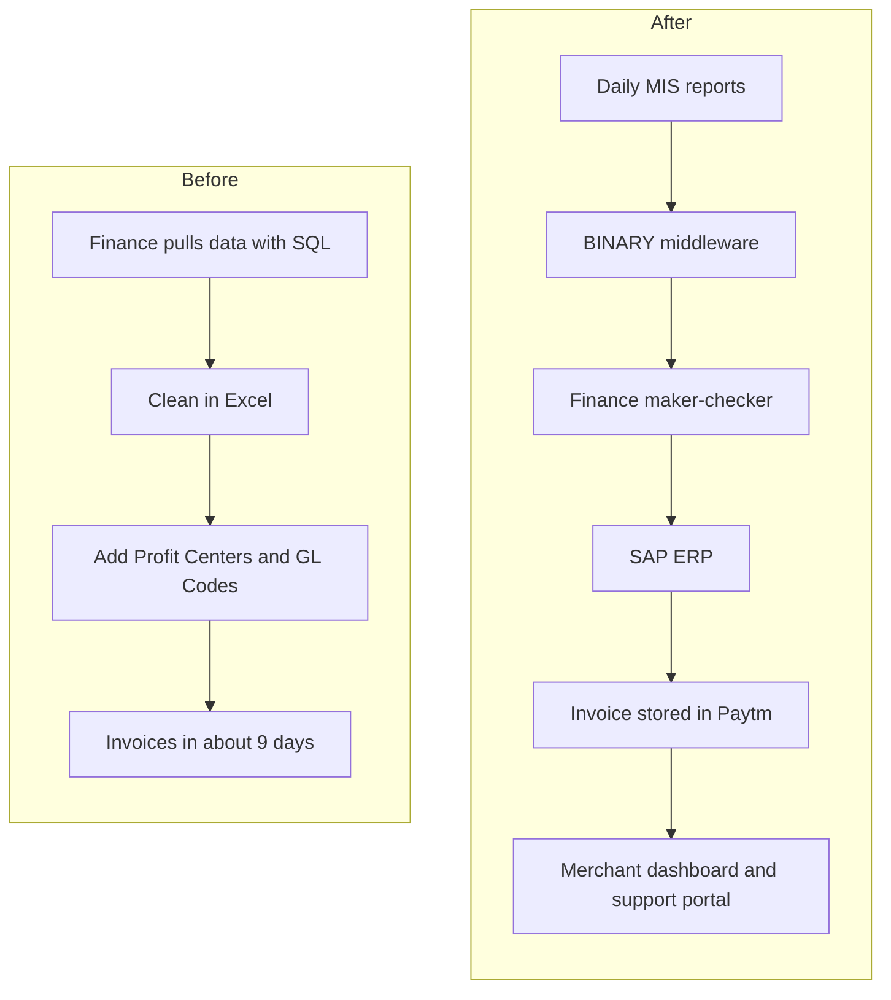
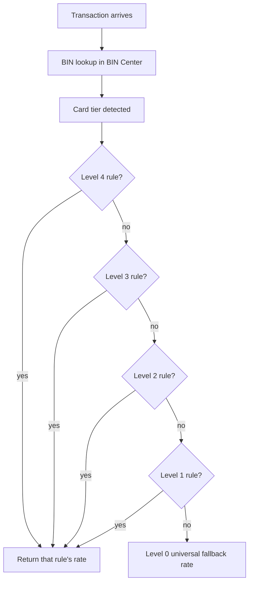

# Paytm Work Experience Story Bank

**Version 2 · October 2026** · Interview preparation · PM + AI Master Library

> Every Paytm story told once, in one fixed layout, with the numbers exactly as recorded and fast ways to find the right story under pressure.

---

## Start here

### Who I am as a PM

Know these lines cold:

> "I owned merchant platform problems end-to-end, not just UI features. Onboarding, pricing, billing, compliance, and activation all sat in my scope. Most of my work was turning manual finance or ops processes into productized systems with rules, controls, and measurable business impact. My MSCS in AI at Georgia Tech is not a pivot from PM, it gives me the technical vocabulary to design the data models, rule engines, and API contracts that engineering builds to."

### How I describe Paytm to a US interviewer

Paytm is India's largest fintech and omnichannel payment systems provider, covering point of sale hardware, software, and payment gateways for merchants, plus consumer digital banking. It is a B2B fintech and payments infrastructure company comparable to Fiserv: it sells the software and processing backbone that banks, merchants, enterprises, and fintechs use to run banking, move money, process cards, accept payments, handle bill pay, and operate point-of-sale systems.

Scale: millions of financial institution clients and merchant locations across SMB, midmarket, and enterprise segments. The backend powers consumer-facing digital banking applications alongside backend financial data management and ledger systems.

| Paytm term | How I translate it |
| --- | --- |
| Paytm for Business (P4B) | The merchant-facing app; the equivalent of Square Dashboard or Clover, an all-in-one business management system for small businesses |
| RuPay Credit Card on UPI | A government-backed payment rail, equivalent to a government-sponsored credit card network |
| Karza | India's Socure or Plaid Identity equivalent |
| GST, PAN, GSTIN | Tax IDs; EIN and State Tax ID equivalents |
| Small-merchant fee caps | Equivalent to CFPB small business protections |
| BNPL; super-premium cards | Affirm or Klarna equivalents; Amex Centurion or Sapphire Reserve equivalents |
| Axis Bank (acquirer) | Equivalent to JPMorgan Chase in this context |

### How to use this book

- **Part I** holds the ten core stories and **Part II** twelve more. A story's ID (S1 to S22) is its chapter number. Sections come in a fixed order: headline, spoken versions, the full story, numbers, follow-up questions, what to use it for, limits. Part II stories are shorter: headline, full story, numbers and limits, plus a 90-second version for S11 and S12.
- **Part III** is how I work. **Part IV** is AI in my work, each item labeled built, piloted or proposed. **Part V** is positioning.
- **Part VI** is reference: scripts, numbers, facts to reconcile, facts I still need to supply.

Say the 90-second version first. Go to the full story when the interviewer probes.

### How to tell any story

In this order: context, user or business problem, my decision, the tradeoff, the metric, the result, the learning. Do not start with internal org details. Start with why the problem mattered, then make the judgment visible, then give the result. That is the difference between sounding like someone who participated in projects and someone who owned product outcomes.

### The 10-minute pre-interview path

- [ ] Say the positioning lines above out loud.
- [ ] Read "Every story in one line" below.
- [ ] Rehearse the 90-second versions of S1, S4, S5 and the story closest to the role.
- [ ] Scan the numbers in chapter 42.
- [ ] Check chapter 43 for claims with a preferred wording.

### What's new in Version 2

- One chapter per story: live answer, script, detailed part and quick reference merged.
- Fixed story IDs: S1 to S10, plus S11 to S22.
- One question-to-story matrix instead of three selection lists.
- AI work separated into built, piloted and proposed.
- Spoken versions use the defensible wording of the Claim Integrity Ledger (Technical AI PM guide).
- Conflicting values listed once ("Facts to reconcile"); missing facts collected ("Your facts needed").

## Story finder

### By question type

| If they ask about | Lead with | Backups |
| --- | --- | --- |
| Most impactful project; a complex system built; execution | S1 | S2, S3, S6 |
| Ambiguity | S6 | S1, S2 |
| A problem nobody noticed; dive deep; metrics | S4 | S3, S6, S7 |
| A/B testing and measurement | S6 | S5, S13 |
| Revenue growth, monetization | S3 | S11 |
| A 0-to-1 product | S11 | chapter 28 |
| Discovery process, customer insight | S12 | S6, S11 |
| Product sense | S6 | S2, S12 |
| Disagree and commit | S5 | None; do not stretch one |
| Disagreement with leadership | S2 | S5, chapter 24 |
| Conflict | S5 | S21, S10, chapter 24 |
| A difficult colleague or detractor | S1 | S21 |
| Leading without authority | S3 | chapter 27 |
| Cross-functional alignment | S4 | S1, S9 |
| Leadership, team scaling | S9 | S20 |
| Technical depth | S3 | S2, S8, S4, S7 |
| Risk, compliance | S7 | S10, chapter 31 |
| A failure or a failed product | S7 | S6, chapter 25 |
| Ethics, judgment, customer trust | S10 | S7 |
| An AI product | S8 | S13, S14, Part IV |
| A customer changed your roadmap | S22 |  |
| Restructuring, doing more with less | S20 | S9 |
| Prioritization | chapter 23 | chapter 24 |
| "Were you just a program manager?" | chapter 28 | S4, S11 |
| Why hire you; why PM | chapter 38 | chapter 40 |

### Every story in one line

| ID | Story | Headline numbers |
| --- | --- | --- |
| S1 | BINARY invoicing automation | 10M invoices/month; 9 days to 1 day; team 50 to 5 |
| S2 | Salesforce to custom onboarding engine | $540K licensing eliminated; 60% less fraud |
| S3 | Pricing engine and revenue protection | $440M annual revenue; 30M merchants; $0.5M new profit |
| S4 | Interchange cost reconciliation | $320M cost center; $400K annual losses prevented |
| S5 | RuPay credit card launch on UPI | 300,000 activations a month; 3rd largest credit card option |
| S6 | Merchant retention and subscription automation | 10M+ devices; 1.3% retention lift in an A/B test |
| S7 | Compliance, AML-KYB and risk auto-upgradation | 35,000 profiles corrected; chargebacks down 60% |
| S8 | BOSS or merchant operations assistant | Handling time 12 to 3.5 minutes; 64% self-resolution |
| S9 | Team operating model after Senior PM promotion | 2 Associate PMs, 1 Data Analyst; 5 organizations |
| S10 | Ethical MDR pricing dilemma | 0.35% displayed, 0.65% charged |
| S11 | Subscription payments launch | $2M new annual revenue; 5-merchant pilot |
| S12 | Merchant payment-acceptance front end | 80% drop-off found; 300K monthly activations |
| S13 | Merchant lifecycle retention agent | 78% versus 61% 30-day retention |
| S14 | Human-in-the-loop discounted pricing campaigns | 3-5 days to 6 hours; zero fund loss incidents |
| S15 | Tool-calling layer and MCP migration | Analysis 3-5 days to 20-40 minutes |
| S16 | n8n orchestration pipelines | Finance brief from 11 AM to 8 AM |
| S17 | Grafana operational dashboards | Fallback-rate alert at 5% |
| S18 | Looker funnel analysis | One sprint fixed 60% of the drop-off |
| S19 | Central Data Store and BOSS panel | One merchant master record |
| S20 | Team restructuring and layoffs | Absorbed two PM tracks |
| S21 | Difficult colleagues | Escalations down approximately 70% |
| S22 | External client and bank changes to my roadmap | A capability for 7 more clients |

# Part I — The ten core stories

## 1. BINARY invoicing automation

### Headline

I turned a manual, Excel-based finance process into BINARY, an invoicing platform that automated 10M invoices per month. The cycle went from 9 days to 1 day and the manual team from 50 to 5, generating approximately $2.4M in annual savings.

### 30-second version

Finance had around 50 people processing invoices by hand in Excel, and a cycle took about 9 days. I mapped the workflow, separated 38 mechanical steps from 9 judgment-heavy steps, automated the mechanical ones, and kept Finance in control of exceptions through maker-checker approval. The cycle dropped to 1 day and the manual team went from 50 to 5.

### 90-second version

The clearest example of my PM style is BINARY, the invoicing automation engine.

Paytm earned revenue from several streams at once: gateway MDR, device rentals, and BNPL and EMI products, each with its own data and owning team. Finance had around 50 people pulling that data with SQL, cleaning it in Excel and building invoices by hand. A cycle took about 9 days. Nobody had productized the workflow: Finance saw it as manual operations, and engineering saw it as a finance problem, outside product scope.

I mapped the workflow end to end and separated 38 mechanical steps from 9 judgment-heavy steps. I designed a middleware layer between our data and SAP that combines every revenue stream into one invoice per merchant, and maker-checker controls for the judgment steps, so Finance held the final approval before anything reached SAP.

The result: 10M invoices automated per month, the cycle cut from 9 days to 1 day, the manual team reduced from 50 to 5 with approximately $2.4M in annual savings, and 4% lower contact-center volume. I did not just ship UI; I converted a messy business process into a governed platform.

### The full story

#### Context

- Revenue streams: Payment Gateway MDR, subscription device rentals (Soundbox, POS) and BNPL/EMI products, each a separate dataset owned by a different team.
- Finance enriched the cleaned data with Profit Centers and GL Codes. Excel refresh issues and version mismatches made it error-prone.
- Enterprise merchants had parent companies, multiple outlets and state-level tax registrations, but the system treated each outlet independently: fragmented invoices.
- Support teams shared invoices manually, adding contact center load.
- No audit trail, role-based access control, data masking in internal dashboards, maker-checker workflow or invoice visibility for merchants.
- SAP code explosion: every new service created a new SAP code for the same merchant; over 10 million redundant codes.

#### The problem as I defined it

A full invoicing platform, not just automation: multi-product revenue aggregation, enterprise billing hierarchies and tax compliance, integrated with SAP, the Pricing Engine, subscription systems and onboarding data. System rules replace human decision-making; data pipelines replace Excel. Requirements: auditability (Finance), data correctness (compliance), scalability (millions of merchants), with controls, monitoring and governance designed in from day one.

#### What I designed



*Figure 1.1 — Invoicing before and after BINARY.*

Pipeline: Onboarding > Central Data Store > Pricing Engine > Subscription Engine > BINARY Middleware > SAP ERP > Invoice > back to the Paytm Merchant Dashboard.

- **Middleware.** An SAP pre-processor between Paytm's data layer and SAP ERP. It consumed daily MIS reports, aggregated by MID x Instrument x Time, and prepared structured data for SAP.
- **Revenue aggregation.** Transaction MDR + subscription rentals + BNPL commissions in one unified invoice per merchant. This solved duplicate charging issues and captured all revenue streams.
- **Enterprise hierarchy.** Parsed Tax IDs (EIN equivalents) and state business registrations to map parent-child hierarchies. Same entity: consolidate. Multi-state: split intelligently. Served both high-touch enterprise implementations and self-service SMB launches.
- **SAP Business Partner model.** The integration created and modified Business Partners, not "customer codes". Each service was a distinct role: Payment Gateway Role, Device Rental Role (Soundbox, POS), Audio Confirmation Device Role. All charges across roles went into one invoice.
- **Finance control layer.** A Finance UI with maker-checker (approval required before SAP push), role-based access control, data masking and full audit logs. The engine did all aggregation and validation; Finance held the final approval click.
- **Merchant access.** A 24/7 invoice download portal in the merchant dashboard app and the customer support portal. Invoices generated in SAP were fetched back, stored in Paytm's system (one storehouse for all system-generated invoices) and surfaced via API.
- **Fee inputs.** User-borne convenience and platform fee data came from the pricing engine (S3) for accounting accuracy and correct tax invoicing.

#### People and decision rights

- **Finance Operations Lead:** my closest counterpart outside product. Finance owned the invoicing acceptance criteria, the SAP data standards and month-end reconciliation, and was effectively a co-owner of the requirements. Weekly joint review.
- **Who decided what:** the Finance lead had veto power on changes to SAP Business Partner role definitions or invoice line-item structure. I had decision authority on the automation pipeline, data aggregation logic and merchant-facing interface.
- **Escalations:** my manager and the Finance Director met monthly. Disagreements I could not resolve with the Finance Lead went up through them, twice: over data masking in the internal dashboard, and over the maker-checker approval threshold.
- **The Finance Director who resisted:** I co-designed the maker-checker layer around their concern rather than pushing past it. They became the system's internal champion.
- **Delivery:** I led engineers and QA teams, wrote the BRDs, PRDs, process flow diagrams and UI designs, ran sprint planning and weekly leadership reviews, and presented to engineering, analytics, finance, operations and business for sign-off.

#### Results

Also: 70% less SAP code creation, real-time financial visibility, and better merchant trust through billing transparency. Indicators: chapter 29. Dashboard: S17.

### Numbers to know cold

| Number | What it measures | Notes |
| --- | --- | --- |
| 10M | Invoices automated per month |  |
| 9 days to 1 day | Invoicing cycle time | Stated as 80% (chapter 43) |
| 50 to 5 | Manual processing team | Approximately $2.4M in annual savings |
| 38 and 9 | Mechanical and judgment-heavy steps | A 47-step process map |
| 70% | Reduction in SAP code creation |  |
| 4% | Decrease in contact-center volume | Self-serve invoice access, billing accuracy |

### Follow-up questions

**How did you win over Finance?** I redesigned the collaboration so their expertise was an asset: the engine does the work and Finance holds the approval. Give them the control lever and they become advocates.

**How did you find the 38 and the 9?** A 2-week BPM discovery exercise produced a 47-step process map.

**Was this assigned?** The project was a known company priority assigned to me. No one gave me the specifications (chapter 28).

### Use this story for

Most impactful project, execution, simplifying complexity, a complex system built, cross-functional leadership, operational excellence, measurable impact, a difficult colleague.

### Limits and what not to claim

- Say "designed" and "defined", not "built" or "engineered", for the system work (Claim Integrity Ledger, chapter 43). Finance held the vetoes listed above.

> [!IMPORTANT]
> Automate the mechanical steps, keep humans on the judgment steps, and hand the skeptical stakeholder the control lever.

## 2. Salesforce to custom onboarding engine

### Headline

I led the migration of merchant onboarding from Salesforce to a custom onboarding engine in three phases with zero downtime. It eliminated $540K in annual licensing, kept 2.5M+ merchants a year onboarding with no drop in completion rates, cut onboarding fraud by 60%, and removed 6 point-to-point integrations.

### 30-second version

Salesforce had been stretched beyond its purpose: a CRM onboarding 2.5M new merchants a year, at $540K a year in licenses, with no KYB hooks and 6 fragile downstream integrations. I defined the data model and a staged migration: shadow mode, partial cutover, then batch migration. We eliminated the licensing cost, held completion rates flat, and cut onboarding fraud by 60%.

### 90-second version

This is my systems-scaling story.

Paytm onboarded 2.5M new merchants a year through Salesforce, and it was failing in three ways. Licensing cost $540K a year with no path to reduce it as volume grew. It had no native KYB validation, no duplicate tax ID detection and no velocity checks, so fraudulent applications slipped through. And 6 fragile point-to-point integrations meant profile updates did not reach pricing, invoicing, charging or SAP, which caused incorrect fee charges.

I led the migration to a custom onboarding engine, defining the merchant data model and a Central Data Store as the single system of record that every downstream system reads through APIs. The product judgment was sequencing. A big-bang cutover on a live funnel was too risky, so we ran three phases: shadow mode, partial cutover for new signups, then batch migration of historical records, after which Salesforce was decommissioned.

We eliminated the $540K licensing cost, kept 2.5M+ merchants a year flowing with zero degradation in completion rates, and reduced onboarding fraud by 60%. The user problem was onboarding reliability, the business problem was cost and fragility, and my decision was the sequencing that let the company learn safely before shifting traffic.

### The full story

#### Context and task

Salesforce was a CRM repurposed for merchant acquisition. It lacked device provisioning, KYB orchestration and merchant lifecycle capabilities. US framing: moving from a legacy Salesforce CRM to a modern KYB-first onboarding platform with multi-acquirer routing, the kind of merchant lifecycle orchestration companies like Fiserv build for their 6 million merchant locations.

The task: lead the full migration, eliminate licensing costs, establish a single source of truth, secure the acquisition funnel against fraud, and support the full merchant lifecycle: intake, KYB verification, bank account verification, device allocation, plan selection and activation.


*Figure 2.1 — The merchant data model: profile, KYB verification, bank account verification, device deployment, plan selection, activation.*

#### What I designed

- **Central Data Store (CDS).** The system of record for merchant identity, KYB status, bank account details, commercial pricing and enabled payment instruments (S19).
- **Bidirectional API sync.** Pricing Engine, Invoicing Engine, Charging System and SAP consumed merchant data from the CDS via APIs, eliminating all 6 legacy integrations.
- **API gateway for multi-bank onboarding.** Penny drop verification, name match validation and async callback confirmation, with multi-acquirer routing: card machine requests exclusively to acquiring bank A, QR-only requests to bank B.
- **Fraud detection rules.** Duplicate EIN or business registration numbers, suspicious address clustering, and velocity checks (excessive applications from one device or IP).

#### Three-phase zero-downtime migration

| Phase | What happened | What it proved |
| --- | --- | --- |
| 1. Shadow mode | Salesforce continued onboarding while data was mirrored into the new Onboarding Engine | Schema correctness and KYB trigger accuracy, without affecting the live funnel |
| 2. Partial cutover | New signups routed directly to the Onboarding Engine; Salesforce stayed active for historical merchants | Stability under real traffic |
| 3. Batch migration | Historical records exported, cleaned by schema transformation and field normalization, imported with strict validation; one-time backfills fixed incomplete legacy profiles | Salesforce then decommissioned |

#### The timeline decision

Leadership wanted the migration in 6 weeks to stop licensing payments immediately. My engineering estimate was 18 weeks for a safe, zero-downtime migration. I did not argue the timeline. I asked what they would accept if a fast migration caused a 48-hour onboarding outage on a 2.5M merchant-a-year funnel. The lost acquisition cost they calculated exceeded the 12 weeks of additional licensing payments we would avoid, and the conversation moved from timeline to risk management. Resolution: a 14-week phased rollout. I gave back 4 weeks by parallelizing shadow mode and partial cutover.

#### Full onboarding scope

- **Intake:** profile creation with business details, tax identifiers, category, region, operating structure.
- **KYB/KYC/AML control points:** profile validation and API-backed checks; removal of manual loopholes in the legacy process.
- **Commercial setup:** merchant type, charging slabs, device plans, offer eligibility, fee configuration.
- **Provisioning:** Soundbox, card machine, gateway, subscription and other merchant-service setups.
- **Enterprise hierarchy:** national, state or outlet-level invoicing preferences from day one.
- **ERP and invoicing:** SAP Business Partner creation, roles assignment, invoice generation, merchant invoice access.
- **Profile-change sync** to billing, compliance and reporting after activation.
- **Ops tooling and governance:** maker-checker flows, exception handling, blocking and unblocking logic, auditability.
- **Activation:** the start of self-serve activation and upsell journeys in the merchant app.

#### Technical depth: data model

For companies that probe engineering depth (Fiserv, Visa, Stripe, Marqeta, FIS); skip for behavioral interviews.

The CDS had a single root entity, Merchant (MID as primary key), with explicit foreign key constraints on all related objects, replacing Salesforce's flat, denormalized records. The schema was normalized to Third Normal Form (3NF): every non-key attribute depended only on the primary key of its own table, eliminating the update anomalies behind the inconsistencies across the 6 integrations.

| Merchant to | Cardinality | Why |
| --- | --- | --- |
| DeviceDeployment | 1:N | One merchant, many devices |
| BankAccount | 1:N | Multi-bank onboarding required multiple verified accounts |
| KYBRecord | 1:1 | KYB status, Karza API response, verification timestamp |
| CommercialConfig | 1:N | Different pricing per instrument type |
| PlanSubscription | 1:N | Device plans, pricing tier, frequency, next charge date |
| EnterpriseHierarchy | 1:1, nullable | Recursive Parent MID reference for franchise and chain merchants |

EnterpriseHierarchy used a recursive self-join on MID (the adjacency-list tree pattern) to represent national > state > outlet relationships without a fixed depth limit. This let BINARY consolidate invoices at any level of the hierarchy.

#### Technical depth: keeping systems in sync

The biggest engineering challenge was not the schema but keeping the CDS and downstream systems consistent after profile changes; legacy Salesforce had no bidirectional sync. The solution was Change Data Capture (CDC): every write to the Merchant table published a change event to an internal message queue, and downstream consumers subscribed to relevant event types and applied updates asynchronously.

| Event | What it triggers |
| --- | --- |
| `MERCHANT_PROFILE_UPDATED` | Re-fetch by the Pricing and Invoicing engines |
| `KYB_STATUS_CHANGED` | Compliance review workflow |
| `INSTRUMENT_TOGGLED` | Pricing rule re-evaluation for that merchant |
| `BANK_ACCOUNT_VERIFIED` | Onboarding completion in the Charging System |

- **Idempotency keys** on every event payload: processing the same event twice (network retry, queue redelivery) made the second application a no-op. Critical for bank async callbacks, which could arrive several times before we acknowledged receipt.
- **Schema versioning:** event payload schemas were versioned (v1, v2, and so on) so new fields did not break consumers on older versions, the pattern used in Apache Avro schema registries.
- **Indexes for real query patterns:** a composite index on (merchant_id, instrument_type) on CommercialConfig for the Pricing Engine; on (device_id, next_charge_date) on PlanSubscription for the Charging System's daily CRON sweep; on (gstin, entity_type) so BINARY could detect existing Business Partners in O(log n) before creating a new SAP code. Without them, the daily sweep of 10 million devices would have needed a full table scan every run.

#### Technical depth: API gateway routing

Routing depended on several attributes at once:

- **Device type:** card machine merchants could only use acquiring bank A (exclusive processing agreement); QR-only merchants used bank B or C.
- **Merchant category (MCC):** certain high-risk MCCs were rejected by bank B but accepted by bank C with additional KYB steps.
- **Region:** merchants in specific states required state-level bank registration and routed to a regional acquiring bank.
- **Enterprise versus SMB:** enterprise merchants with parent-child hierarchies required a bank supporting consolidated settlement.

An if-else chain was not maintainable across 4 banks, 200+ MCC codes, 28 states and two merchant tiers; any change in a bank's acceptance criteria would have needed a code deployment. So routing was a predicate-based decision tree with priority-ordered evaluation, each rule stored as a structured predicate in a routing rules table.

```text
RoutingRule { rule_id, priority INT, predicate JSON, target_bank_id,
              requires_additional_kyb BOOL, fallback_bank_id }
```

```json
{ "device_type": ["CARD_MACHINE"], "mcc_range": [null, null],
  "region": ["*"], "merchant_tier": ["*"] }
```

Rules were loaded in ascending priority order and evaluated with short-circuit evaluation. The first rule whose predicate matched all merchant attributes was selected; if none matched, the `fallback_bank_id` of the lowest-priority catch-all rule was used. Structurally it is decision tree traversal with ordered branches: an explicit rule table instead of a learned tree.

Bank verification (penny drop, name match) was asynchronous: banks returned a callback webhook. Three reliability mechanisms:

- **Duplicate callbacks** (a bank could retry if we acknowledged slowly): each onboarding request got an idempotency key (hash of MID + bank_id + timestamp), checked before any state change; duplicates were dropped.
- **Missing callbacks** (a bank endpoint could be down): exponential backoff polling at 2^n seconds (2s, 4s, 8s, 16s, capped at 5 minutes), with jitter to prevent thundering-herd behavior when a bank came back online.
- **Circuit breaker:** if a bank's callback success rate dropped below 80% over a 15-minute window, the gateway stopped routing new applications to it and flagged it for ops review, so one bank outage could not block the funnel.

MSCS connection: an adjacency-list tree, publish-subscribe from distributed systems, greedy matching on an ordered rule set, and idempotency for exactly-once delivery semantics.

#### Results and learning

A single source of truth ended the data inconsistencies behind incorrect fee charges, and supported both high-touch enterprise implementations and self-service SMB launches. Shadow mode and parallel routing are critical for zero-downtime migration of a live, revenue-generating funnel; a hard cutover here would have been catastrophic.

### Numbers to know cold

| Number | What it measures | Notes |
| --- | --- | --- |
| $540K | Annual Salesforce licensing eliminated |  |
| 2.5M+ | Merchants acquired per year | Zero degradation in completion rates |
| 60% | Reduction in onboarding fraud | Automated KYB controls, velocity checks |
| 6 | Point-to-point integrations eliminated |  |
| 6, 18, 14 weeks | Leadership ask, my estimate, approved rollout |  |
| 80% over 15 minutes | Circuit breaker threshold | Bank callback success rate |

### Follow-up questions

**Who made the build-versus-extend decision?** I drove the analysis. The VP of Engineering made the architectural commitment.

**Did adding KYB checks hurt acquisition?** See the "net positive merchant" case in chapter 24.

### Use this story for

Scaling systems, migration strategy, technical judgment, risk management, product sense for onboarding, and a disagreement with leadership settled with quantified risk.

### Limits and what not to claim

- Build versus extend was the VP of Engineering's architectural commitment.
- Say "defined" and "designed" for the data model, migration strategy, routing logic and fraud rules (chapter 28).
- With Salesforce itself I worked at the product strategy layer, not as a configurator or developer.

> [!IMPORTANT]
> On a live revenue funnel, sequence the migration so the company learns safely before it shifts traffic.

## 3. Pricing engine and revenue protection

### Headline

I owned the pricing engine behind $440M in annual revenue: 30M merchants and 10B annual transactions. Data analysis on BNPL and super-premium cards unlocked $0.5M in net new annualized profit with no new merchant fees, and pricing was corrected for 700,000+ card machine merchants.

### 30-second version

At payments scale, small commercial configuration errors become large revenue and trust problems. Legacy pricing was a finance spreadsheet exercise, and a missing rule meant a $0 fee. I defined a rule-based engine with merchant-specific and instrument-specific logic, fallbacks that prevent silent zero-fee leakage, and auditability for Finance. It unlocked $0.5M in annualized profit and corrected pricing for 700,000+ card machine merchants.

### 90-second version

The pricing engine is my best example of a product where the UI is not the product. The product is the decision system that determines money movement correctly at scale.

The engine was the revenue backbone: 30M merchants, 10B annual transactions, $440M in annual revenue. The legacy setup was static configuration in spreadsheets, with no fallback logic and no way to tell instruments apart. A missing rule defaulted to a $0 fee: silent leakage on every unmatched transaction.

I defined the commercial model, instrument coverage, fallback design, reporting layer and merchant communication; engineering built what I specified. The engine evaluates rules from most specific to least specific and ends at a catch-all rate, so a missing rule no longer means a $0 fee. A Card BIN Center lets it recognize issuing bank and card tier and charge BNPL, co-branded and super-premium cards correctly. The crux was balancing flexibility for business teams with safety for engineering and reconciliation: what rules could change, who approved them, how exceptions behaved, how the business would know of leakage.

The result: silent zero-fee transactions eliminated, $0.5M in net new annualized profit found purely through data analysis, pricing corrected for 700,000+ card machine merchants, and exact fees visible to merchants in the app. Pricing became a product lever rather than a finance spreadsheet exercise.

### The full story

#### What the pricing engine is

A rule-based system supporting mid-level commercial configurations for different payment instruments (credit card, corporate card, Amex, BNPL, co-branded, UPI Credit), with a nearest-match fallback algorithm that prevents zero-fee transactions.

#### Core architecture and fallback logic

Before: static configurations with no BIN-level intelligence or instrument-level differentiation. The Central Data Store held no commercials, so merchant pricing data was disconnected from the system of record.

- **Rule engine** processing transaction metadata: card network (Visa/Mastercard), card type (corporate, international, debit, credit), issuer bank, merchant category and transaction amount. Example: IF card_network = Visa AND card_type = Corporate AND merchant_category = Electronics THEN MDR = 2.1%.
- **Nearest-match fallback:** if an exact rule is absent, the system picks the closest applicable rule through a specificity-ordered evaluation.
- **System of record:** the Central Data Store became the master commercial record feeding the Pricing Engine, Invoicing Engine, Charging System and SAP: full transparency instead of opaque pricing, and reuse through platform capabilities, APIs and shared services.
- **Instrument APIs** for activating and deactivating payment instruments; the P4B app used them to show exact percentage fees and transaction limits on the Payment Charges page (self-service instrument management).

Outcome: complete pricing transparency for merchants and fewer support escalations.

#### Differential charging for premium cards and BNPL

Before: BNPL, super-premium and co-branded cards were all charged at standard debit card rates, because the system could not identify the issuing bank or card tier. Installment plan (EMI) fees were not collected correctly for certain variants.

- SQL analysis on transaction-level data identified BNPL fee gaps and premium card margin leakage.
- An internal Card BIN Center stored the mappings. A BIN is the first 6-8 digits of a card and identifies issuing bank, card tier and network: 438857 maps to HDFC Bank Platinum. Each transaction gets a BIN lookup, and the correct differential pricing rule is applied in real time.
- I aligned card networks and 7 major card issuers to map BIN number ranges and sync differences with Banking Alliances.
- 4 new instrument types enabled: installment plan variants (BNPL/EMI), co-branded cards, UPI Credit (the Visa/MC equivalent on UPI rails) and super-premium cards.
- Instrument-level reporting columns in the revenue MIS, so Finance could see fee revenue by instrument type for the first time.
- A Leadership dashboard identifying merchants where MDR revenue was below interchange cost: human-in-the-loop review of anomalies before they compounded.
- CleverTap notifications for automated merchant SMS and email updates when commercials were updated alongside legal addendums.

#### Convenience and platform fees

The engine calculated the convenience fee and platform fee borne by the end user, and checkout pages showed the total and exact bifurcation: Item price + Convenience fee = Total payable. The same data fed BINARY (S1) for accounting accuracy and correct tax invoicing.

#### GMV tiers and limit centers

Contracts used monthly GMV-tiered pricing to incentivize high-volume merchants. Two failures meant the business paid out discounts incorrectly while still absorbing processing costs:

- Credit Cards and EMI on Credit Cards were tagged as two separate instruments. Two tiers ran on effectively the same transactions, and merchants could not aggregate volume to reach discount thresholds.
- KAM agents manually entered commercials not aligned with central rules, causing max cap violations.

What changed:

- The limit center accumulated GMV for Credit Card and EMI transactions in a single volume bucket.
- The first $20K GMV per month was charged 40bps less, to encourage device usage.
- Fallback logic defaulted to Card rates if exact rates were not present.
- The Leadership dashboard tracked the revenue and cost split across 30+ major commercial addendums.

Outcome: tiering incentives enforced natively by the system, with no reliance on manual KAM data entry.

#### Technical depth: the fallback algorithm

The technically sharpest part of my portfolio; the anchors are the BIN trie and O(1) rule evaluation.

Every transaction arrived with card_network, card_type, merchant_category_code (200+ values), instrument_type and merchant_id. The engine had to find the most specific applicable rule or the nearest less-specific match; errors leaked revenue in both directions. Rule space: ~5 card networks x ~6 card types x ~200 MCCs x ~5 instrument types = ~30,000 theoretical combinations, of which 15,000 had explicit rules configured.

| Level | Matches on | Wildcards |
| --- | --- | --- |
| 4 (exact) | card_network + card_type + MCC + instrument_type | None |
| 3 (near-exact) | card_network + card_type + instrument_type | MCC |
| 2 (partial) | card_network + card_type | instrument_type, MCC |
| 1 (network-only) | card_network | All others |
| 0 (universal fallback) | Nothing | All: the catch-all rate that prevented $0 fee transactions |



*Figure 3.1 — Rule evaluation from most specific to least specific.*

Evaluation runs from highest specificity to lowest and returns the first match: a greedy search on a specificity-ordered rule space, identical in structure to longest-prefix matching in IP routing tables.

```text
function getRate(txn):
    bin_meta = binTrie.lookup(txn.card_number[:8])
    card_type = bin_meta.card_type      // e.g. CORPORATE_CREDIT
    for level in [4, 3, 2, 1, 0]:
        rule = ruleIndex.get(card_network, card_type, txn.mcc, instrument, level)
        if rule is not None:
            return rule.rate
    return universalFallbackRate        // never null, prevents $0 fee
```

- **Rule index.** A nested hash map keyed by specificity level, then by the (card_network, card_type, MCC, instrument_type) tuple. Each level check is an O(1) hash lookup, so the worst case is 5 hash lookups regardless of the 15,000 rules. The problem looked O(n) in the number of rules but was solved as O(1) through pre-indexing by specificity: a textbook space-time trade-off.
- **BIN trie.** The BIN Center was a trie (prefix tree), not a flat hash table. BINs can be 6, 7 or 8 digits depending on the issuing network, and a flat hash table would need a separate lookup per length. A trie needs one traversal of depth equal to the BIN length (maximum 8): O(k). Walk it character by character, record a candidate at each node where card_metadata is non-null, and return the deepest match, so 6-digit and 8-digit BINs resolve in a single pass.
- **Cache.** The trie was loaded into memory at service startup (~200MB) and updated by nightly reload, eliminating database round-trips on every transaction lookup.

```text
TrieNode { digit: char, children: Map<char, TrieNode>,
           card_metadata: CardMetadata | null }
```

MSCS connection: greedy search on a constraint-ordered rule space, and a classic string-matching data structure.

### Numbers to know cold

| Number | What it measures | Notes |
| --- | --- | --- |
| $440M | Annual revenue through the engine |  |
| 30M and 10B | Merchants and annual transactions |  |
| $0.5M | Net new annualized profit | BNPL and super-premium card charging |
| 700,000+ | Card machine merchants with corrected pricing | Approximately $300K annual margin improvement (chapter 24) |
| 15,000 | Rule combinations with explicit rules | Of ~30,000 theoretical |
| 7 and 4 | Card issuers aligned; new instrument types enabled |  |
| 40bps on the first $20K | Discount on the first GMV each month |  |

### Follow-up questions

**How did you lead without authority here?** The BIN mapping needed card networks, 7 major card issuers and Banking Alliances aligned, and Banking Alliances had no obligation to prioritize my requests (chapter 27).

**How did you know when pricing was drifting?** The rule fallback rate: the share of transactions evaluated at Level 0 (chapter 29, S17).

### Use this story for

Business impact, monetization, technical product depth, a technical decision I owned, data-driven decisions, leading without authority.

### Limits and what not to claim

- Commercial agreements with banks and card networks were not mine to execute (chapter 25).
- Engineering built the engine to my specification. Say "defined" and "specified".

> [!IMPORTANT]
> The product is the decision system: it must always land on a rate, and the business must be able to see when it is wrong.

## 4. Interchange cost reconciliation

### Headline

A SQL query I ran on my own surfaced a bank overcharge, and it became an automated reconciliation system for a $320M annual cost center. It prevented $400K in annual fund losses and uncovered $300K in acquirer excess charging, plus $100K where our own system was undercharging merchants.

### 30-second version

Acquiring banks invoiced us $320M a year, and Finance could only check the top 50 merchants by hand. In SQL I found one bank had overcharged us $3,000 on a single merchant by classifying a retail debit card as corporate. I reused our commercial charging system as a shadow calculation engine that recomputes the expected cost of every transaction and reconciles it against the bank's file. It prevented $400K in annual losses.

### 90-second version

This is my strongest data story, and it started with no brief, no roadmap item and no ticket.

The acquirer invoiced Paytm $320M a year for processing: interchange, network fees and acquirer markup. There was no automated reconciliation. Finance reconciled only the top 50 merchants in Excel, and millions of merchants were never audited. Dashboards did not show a problem, because it sat between transaction records, network charges and reconciliation logic.

I did not accept the aggregate reporting at face value. A SQL grouping analysis on card and merchant ID combinations showed Axis Bank had overcharged us $3,000 for a single merchant by misclassifying a retail debit card as corporate. Extrapolated, that pointed to large unknown leakage. I took it to leadership and was assigned to build the fix.

The key decision was reuse: our existing commercial charging system became a shadow calculation engine. We mapped approximately 15,000 pricing rule combinations from the commercial agreements, calculated the expected bank cost per transaction, and reconciled it against the bank's file by transaction ID, with discrepancy reports emailed to Finance.

The result: $400K in annual fund losses prevented, $300K in acquirer excess charging uncovered, $100K found where we were undercharging merchants, and Finance's first view of net margin per transaction. If you do not calculate independently what you should be paying, you will keep overpaying indefinitely.

### The full story

#### Context

- Cost chain: customer bank > card network (Visa/Mastercard) > acquiring bank > payment gateway (Paytm PG).
- Paytm PG held FBO (For Benefit Of) accounts with the acquirer. The acquirer invoiced Paytm for interchange paid to issuing banks + network fees + acquirer markup, which made it appear as the largest cost center at $320M annually.
- The manual process relied on complex rate agreements in Excel, with no programmatic validation that invoiced rates matched the agreed commercial terms.

#### The task

Build an automated system to calculate expected interchange costs and reconcile them against acquirer-reported costs, with zero cost leakage across 10B+ annual transactions, by reusing the existing commercial charging system rather than building a new pipeline from scratch.

#### What I designed

- **Rule mapping.** Approximately 15,000 actively used pricing rule combinations: card network x card type (corporate, international, debit) x merchant category x special exceptions for high-volume clients (Flipkart, LIC).
- **Shadow calculation.** The charging system audits bank invoices line by line against internal ledgers, picking the nearest-match rule per transaction to calculate expected bank cost.
- **Coverage.** The rule engine was extended to Credit Cards, Debit Cards, BNPL and Checking Accounts.
- **Transaction-level P&L.** Cost was stored per transaction as an additional column in the revenue database; joined with the revenue report, it gave a net P&L view per transaction.
- **Daily report.** The existing Data Warehouse was enhanced to create a daily expected-cost report.
- **Rule management.** A UI and bulk-upload mechanism for the rules, with a full audit trail and maker-checker for Finance. Maker-checker was the validation gate for rule accuracy.
- **Reconciliation.** An SFTP system compared expected internal costs against actual bank MIS costs on the transaction ID, with auto-email discrepancy reports to Finance when overcharging was detected.
- **Also:** automated payouts for NetBanking cases based on the revenue-sharing model, and a Leadership dashboard with real-time visibility into processing costs by acquirer and instrument type.

#### Decisions and people

- **Reuse over rebuild.** High value, low risk on my roadmap matrix (chapter 23).
- **One data point to open the conversation.** The first query ran on a sample of 500 transactions. I extrapolated an exposure of approximately $1.3M annually, labeled as a sample-based estimate, which got the engineering sprint approved.
- **Leadership.** I built the business case and presented to engineering, analytics, finance, operations and business teams.
- **Banking Alliances** formally raised discrepancy claims with the acquiring banks, and valued it as a data-backed, relationship-deepening conversation (chapter 27).

#### What came after

The system flagged individual discrepancies but not patterns across merchants, which led to an anomaly detection layer (chapter 31). Also: agreement search used to validate the 15,000 rules (chapter 32), an emergency rule update when Axis Bank changed its classification system (S22), and a reconciliation dashboard (S17).

### Numbers to know cold

| Number | What it measures | Notes |
| --- | --- | --- |
| $320M | Annual processing cost invoiced by acquirers | See chapter 43 on its rank |
| Top 50 | Merchants Finance reconciled manually |  |
| $3,000 | The single-merchant overcharge that started it |  |
| Approximately 15,000 | Actively used pricing rule combinations |  |
| $400K | Annual fund losses prevented | By catching bank misclassifications |
| $300K and $100K | Acquirer excess charging; internal undercharging of merchants |  |

### Follow-up questions

**Was this assigned to you?** No. I discovered the problem through a SQL query, built the business case and defined the scope (chapter 28).

**How did you align five organizations?** The SQL result was the alignment tool: one concrete overcharge gave everyone the same starting fact.

### Use this story for

Dive deep, a problem nobody noticed, metrics and analytics, cross-functional alignment, self-initiated work, and "were you just a program manager?"

### Limits and what not to claim

- Banking Alliances raised the claims with banks; I supplied the evidence.
- The $300K is "uncovered". Check chapter 43 before saying "recovered".

> [!IMPORTANT]
> Calculate independently what you should be paying, or you will keep overpaying.

## 5. RuPay credit card launch on UPI

### Headline

I led the activation journey for RuPay Credit Cards on UPI across checkout and the merchant app, disagreed with leadership about how broadly to launch, then committed to their faster path with guardrails. It generated 300,000 new activations every month within 3 months of launch and became the 3rd largest credit card option on the platform.

### 30-second version

When banks began issuing RuPay Credit Cards on UPI rails, leadership wanted to launch fast because of competitive urgency. I agreed with the urgency but was concerned about checkout conversion risk from launching too broadly, so I presented the downside and pushed for a staged rollout. Leadership chose the faster path. I committed, and added monitoring and fallback controls. The launch reached 300,000 activations a month within 3 months.

### 90-second version

This is my disagree-and-commit story.

Banks had started issuing RuPay Credit Cards that worked on UPI rails, a government-backed payment rail. It was a new, fast-growing instrument, and our activation journey was broken: consumers could not use the card easily at checkout, and merchants could not find the option to enable it.

Leadership wanted a full launch immediately: a competitor had just announced a similar feature. I agreed with the strategic urgency but disagreed with launching too broadly without enough checkout behavior data, because a new instrument with no fallback could hurt conversion on every instrument. I quantified the downside, a potential conversion drop across the existing merchant base, against the upside, and pushed for a staged rollout.

Leadership chose the faster path. I committed and made their version of the decision as safe as I could: a real-time conversion-monitoring dashboard on existing instruments, and a kill switch to revert new merchants to the previous checkout flow if conversion dropped.

We launched on leadership's timeline. The guardrail never had to trigger, conversion on existing instruments held flat, and RuPay Credit Card reached 300,000 new activations a month within 3 months. The lesson: backbone before the decision, commitment after it.

### The full story

#### Context

The activation process on Paytm's website and merchant app had three major drop-off points. The task: a complete activation journey on both the checkout page and the merchant dashboard app, to capture volume from a fast-growing instrument category. I proposed the product to leadership from a market opportunity; it had no formal mandate when I began.

#### What I did

- Mapped the activation funnel: merchant enables the payment method in their dashboard > consumer sees it at checkout > first successful transaction.
- Fixed the 3 biggest funnel drop-off points identified through analytics.
- Added RuPay Credit Card as a clear, visible option on the checkout screen, with a fallback logic plan for when the issuing bank does not support the transaction.
- Specified a self-serve on/off toggle in the merchant dashboard, so merchants could opt in without contacting support.
- Ran A/B tests to find the best placement for the new option on the checkout screen.
- Worked closely with acquiring banks and the card network on backend connectivity and correct transaction routing.
- Created CleverTap analytics funnels to track cycle times at each stage: merchants enabled > consumers attempted > first success > repeat usage.

#### The disagreement

- **Leadership (the business VP):** launch immediately, full deployment across all 30M merchants. A competitor had just announced a similar feature, and every week of delay was market share at risk.
- **Me:** a staged rollout with a controlled segment first, for product quality and reversibility. We had no baseline data on how the instrument would behave at scale. I projected a 0.5% conversion drop on existing instruments across 30M merchants against a projected upside of 300K new activations.

The downside was larger on paper. Leadership still chose the faster timeline because of the competitive context, with the agreement that I could add a soft guardrail: the monitoring dashboard, and a kill switch that would auto-revert new merchants to the previous checkout flow if conversion dropped more than 0.5% in any rolling 4-hour window.

#### Result

An entirely new transaction stream created from zero. Peer-comparison nudges later lifted RuPay adoption further (chapter 33).

### Numbers to know cold

| Number | What it measures | Notes |
| --- | --- | --- |
| 300,000 | New activations every month | Within 3 months of launch; see chapter 43 |
| 3rd | Rank among credit card options on the platform |  |
| 0.5% | Projected conversion drop; also the kill-switch threshold | Rolling 4-hour window |

### Follow-up questions

**Were you wrong?** The lesson was not whether I was right about the launch strategy. Once leadership makes the call, my job is to make their version of the decision as safe as I can, not to keep re-litigating it. Strong PMs do not confuse disagreement with resistance.

**What drove adoption?** Self-service on both sides. Self-service beats sales-assisted activation at scale.

### Use this story for

Disagree and commit, launch judgment, stakeholder tension, risk-managed execution, conflict, A/B testing.

> [!IMPORTANT]
> Challenge with data before the decision; after it, make the chosen path as safe as possible.

## 6. Merchant retention and subscription automation

### Headline

I reframed a vague "improve retention" ask as a pricing and lifecycle problem for mPOS merchants, and designed a dynamic recurring charging system that automated offer-based deductions for over 10 million devices. An A/B test showed a 1.3% retention improvement: an annualized estimate of up to 120K fewer device returns.

### 30-second version

The ask, "improve merchant retention", was too vague to act on. Segmenting showed some mPOS merchants were not leaving because they disliked the product; a fixed monthly rental became economically painful when their payment volume dipped. So the fix was pricing and lifecycle design, not engagement features. We automated usage-based fee reductions and proved a 1.3% retention lift against a control group.

### 90-second version

This is my ambiguity and product sense story.

The original ask was to improve merchant retention. That is a symptom, not a problem. We had approximately 9M active mPOS devices, Soundboxes and card machines, on fixed monthly rentals. Instead of jumping to engagement features, I clustered merchants by transaction volume against hardware fees. Churn was concentrated among merchants whose volume had temporarily dipped, so the fixed rental no longer made economic sense. Cancellation reason codes and billing support tickets consistently cited fixed costs during slow months, which cross-validated the finding.

That changed the problem from generic retention to pricing and lifecycle design. The charging system made it worse: manual file uploads, no offer management (any discount needed manual calculations), rigid deductions on the 1st of every month, and silent failures with no retry and no Finance visibility when a balance was short.

I defined a dynamic recurring charging system: automated deductions, offer validation before every charge, retries at T+24h and T+48h, and fees reduced based on actual usage. To prove it I designed a strict A/B test, with support tickets as the guardrail.

The system automated offer-based deductions for over 10 million devices. The clean delta between treatment and control was a 1.3% retention improvement, which annualizes to an estimate of up to 120K fewer device returns. The right segment and problem definition changed the solution.

### The full story

#### What I designed

- **Unified data structure.** Merchant ID, Device, Plan, Price and Frequency stored on the backend.
- **Charging job.** A daily CRON job (running hourly): fetch merchant and plan details > validate CleverTap offer status > initiate the charge to the merchant's wallet > on insufficient balance, generate a partial-deduction report for Finance instead of failing silently.
- **Retry logic.** T+24h and T+48h before flagging for manual review, the equivalent of ACH return handling in the US.
- **Offers.** CleverTap integration validated active offers before each deduction, enabling dynamic offer-based billing without the manual file inserts used before.
- **Operations UI** to monitor device stats and manage offers directly on the system.

#### The experiment

- Treatment cohort: dynamic pricing, with the fee reduced based on usage. Control cohort: the legacy fixed-rate model.
- Both saw identical market conditions, seasonality and competitor activity, neutralizing external noise.
- Guardrail: support tickets, to check automated deductions were not causing billing confusion.

#### Results

Manual effort and billing failures fell sharply. With Finance I mapped retained units to protected payment volume and merchant lifetime value. 120K sounds small until you calculate 120K devices at monthly rental value. Indicators: chapter 29.

### Numbers to know cold

| Number | What it measures | Notes |
| --- | --- | --- |
| Approximately 9M | Active mPOS devices |  |
| 10M+ | Devices with automated offer-based deductions |  |
| 1.3% | Retention improvement, treatment versus control | See chapter 43 |
| 120K | Devices per year attributed to the new pricing logic | Say "annualized estimate of up to 120K fewer returns" |

### Follow-up questions

**Why an A/B test for a pricing change?** A strict control group is the only definitive way to separate true product impact from macroeconomic seasonality.

**Was this an AI system?** No. The charging system used deterministic rules, not an ML model. When marketing wanted to brand it "AI-Powered Merchant Billing", I blocked that. The agent-based retention work came later (S13).

### Use this story for

Ambiguity, product sense, customer insight, segmentation, retention, problem reframing, A/B testing; also a mistake story (early on I assumed the business label described the user problem).

### Limits and what not to claim

- The 1.3% lift belongs to the pricing and charging change that was tested. Describe the retention agent (S13) as a later, bounded extension, not part of this result.

> [!WARNING]
> **Your fact needed:** the formula behind any monthly revenue figure for the retained devices (denominator, ARPU or contribution, persistence, offer cost). Until then, do not quote one.

> [!IMPORTANT]
> The right segment and the right problem definition change the solution.

## 7. Compliance, AML-KYB and risk auto-upgradation

### Headline

I moved compliance and risk logic out of manual review and into the product: bulk KYB verification across 30M merchant profiles with 35,000 legacy profiles corrected, approximately $250K in fund losses stopped from instruments with no rate tables, and chargebacks down 60% compared with generic launches through risk-based limits.

### 30-second version

In compliance and KYB work the goal was not simply to automate approvals, but to reduce manual load while preserving trust and auditability. I treated missing documents, inconsistent merchant attributes and risk triggers as explicit product states, not edge cases. We verified 30M profiles, corrected 35,000, blocked instruments processing at a $0 fee, and replaced generic limits with risk-based limits merchants could upgrade themselves.

### 90-second version

This is my regulated-product story: compliance as a productized system, not policy paperwork.

Our systems had several gaps. A routine pricing audit showed that regulatory fee caps for small merchants (under $25K GMV/month, the equivalent of CFPB small business protections) were not enforced programmatically; they were hardcoded wrong at onboarding. Millions of merchants had badly formatted or mismatched tax IDs, causing incorrect sales tax invoicing. Some instruments (Diners Club equivalents) were configured for acceptance with no rate tables and processed at a $0 fee: approximately $250K in direct fund losses. And generic GMV limits for all new merchants had caused a spike in dispute losses and chargebacks from risky businesses.

My task was to find where system logic or profile data created regulatory or financial risk, and fix it with product controls rather than manual review. We verified 30M merchant profiles in bulk through KYB APIs, blocked the unpriced instruments until rates were configured, routed AML-flagged merchants to Compliance before activation, and replaced generic limits with a risk score, lower starting limits for high-risk merchants, and an auto-upgradation journey.

The result: 35,000 legacy profiles corrected, the fund losses stopped, commission caps enforced by the system, and chargebacks down 60% versus previous generic launches. The design had to make the next action clear for merchants, operations and risk teams while keeping approval decisions deterministic. In a high-risk environment, speed cannot outrun governance.

### The full story

#### What I did

- **Bulk KYB verification.** Karza APIs across 30M merchant profiles: tax IDs submitted in batch, profiles auto-corrected on definitive API matches.
- **Profile remediation.** Deep SQL analysis on 30M users to identify GST-PAN mismatches, invalid business identifiers and incorrectly formatted tax registrations. CleverTap notifications (push, SMS, email) asked merchants to act on unresolved corrections.
- **Unpriced instruments.** These networks were allowed and handled separately through the Preferences system, but their rates were not in the central pricing engine. A preference system at the merchant level explicitly blocked them until rates were configured, stopping the fund loss immediately.
- **AML screening.** Logic flagging merchants that matched sanctions watchlists, low-vintage IDs, abnormal Chargeback-to-Refund ratios or circular high-value transactions, routed to Compliance for manual review before activation: a human in the loop for high-risk merchants.
- **Risk-based profiling.** A merchant risk score from vintage, transactions per month, unique payers, Line of Business and past tax return volumes. New high-risk merchants got lower initial GMV limits.
- **Automated risk underwriting.** Transaction count and GMV limits per merchant based on Line of Business and vintage, to avoid losses on disputes and chargebacks.
- **Auto-upgradation journey.** Self-service plus assistive tools for servicing teams: merchants raised their GMV limits by submitting business documents, shop photographs and tax returns, and the system evaluated them and upgraded limits programmatically.
- **Commission caps.** Programmatic caps for Small versus Big merchant definitions, replacing a manual and error-prone setup.

#### The $0-fee instrument gap

No metric or alert surfaced it. Reviewing instrument configuration settings during a routine compliance audit, I noticed a category of instruments with entries in the acceptance table but not in the rate table. Years of working with payment system configurations told me that meant zero-fee processing. When I raised it as an emergency item in sprint planning, my engineering lead asked why monitoring had not caught it: "Because we never built monitoring for this specific failure mode. That is why it slipped through."

I was asking for a sprint commitment on an informed hypothesis, so I ran a quick SQL query: 847 transactions had been processed through Diners Club in the prior 30 days at a $0 fee. Intuition became a data point, and the fix was approved as an emergency P0 item.

#### The failure I owned

The generic GMV limit launch caused a chargeback spike. In its first 3 weeks revenue was up, but the chargeback dispute submission rate was rising; watching that leading indicator, we caught the problem 3 weeks before it would have hit the lagging revenue metrics. I did not blame engineering for building what I specified, or the business team for pushing for speed. I ran the post-mortem, identified the root cause in my own product decision, and specified the fix: risk-based profiling and limits.

### Numbers to know cold

| Number | What it measures | Notes |
| --- | --- | --- |
| 30M | Merchant profiles verified and analyzed |  |
| 35,000 | Legacy profiles corrected |  |
| Approximately $250K | Fund losses stopped | See chapter 43 |
| 847 | Diners Club transactions at a $0 fee in the prior 30 days | The query that got the P0 approved |
| 60% | Drop in chargebacks versus previous generic launches | Risk-based limits, automated underwriting |

### Follow-up questions

**How did you get compliance on side?** Consult before scoping, and a standing seat in sprint planning (chapter 27).

**How did the risk scoring evolve, and did KYB hurt growth?** The ML risk model and explanation layer: chapters 31 and 33. The "net positive merchant" case: chapter 24.

### Use this story for

Risk and compliance, regulated product judgment, automation boundaries, a failed product, KYB automation depth, intuition confirmed with data. Compliance as a product feature, not a policy document, is the only scalable answer.

### Limits and what not to claim

- When I found that UPI/RuPay commission caps were not being enforced, I flagged the risk to the VP of Compliance rather than fixing it quietly, because it had potential regulatory reporting implications.
- I added an AML screening step to the onboarding funnel without formally notifying the compliance team first. The reasoning was sound and the outcome correct, but I had bypassed a stakeholder with standing. I now treat any AML/KYB system change as requiring compliance team notification, even if not formal approval.
- Say explainability and auditability were product requirements. Do not say a regulator required a specific technique (chapter 43).

> [!IMPORTANT]
> Put the compliance rule inside the system; do not let speed outrun governance.

## 8. BOSS or merchant operations assistant

### Headline

BOSS-GPT is an internal assistant for the Merchant Operations team that answers ad-hoc queries from read-only tools and cites its sources. As recorded: average handling time from 12 minutes to 3.5 minutes, 64% of queries resolved without further agent action, and new-agent ramp-up from 4 weeks to 10 days.

> [!WARNING]
> **Your fact needed:** the status I can evidence for BOSS-GPT (shipped internally, piloted, or designed), with dates. Version 1 records it as shipped in Q1 2025; the Technical AI PM guide treats it as a portfolio design unless deployment records are verifiable.

### 30-second version

Operations agents were switching across merchant, transaction, settlement, pricing, dispute and SOP systems to answer repetitive but context-heavy questions. The right AI role was not to become the authority, but to interpret the question, gather missing parameters, retrieve evidence from approved systems, summarize it, and escalate when confidence or policy boundaries required it. Deterministic systems keep authority over identity, permissions and financial state. The value is speed and consistency.

### 90-second version

The strongest AI opportunity from Paytm was an internal merchant operations assistant.

The Merchant Operations team handled 800 to 1,200 ad-hoc queries a day. Why did this transaction fail? What is the settlement status for this UTR? Each meant logging into the operator panel, navigating to the right sub-section, running a query, interpreting the result and replying: 8 to 12 minutes per query. New agents took 3 to 4 weeks to become proficient, and institutional knowledge was trapped in individual agents, not in the system.

I led the product design for an assistant with a deliberately bounded role: interpret the question, collect missing parameters, call approved read-only tools, retrieve the relevant runbook or policy passage, and summarize the answer with sources and a recommended action. It runs on a self-hosted DeepSeek-family open-weight model, so merchant data stays inside our infrastructure, and reaches data only through typed, read-only tool APIs. Agents use it in Slack, merchant PII is masked in shared channels, and every interaction is logged.

For assisted queries, handling time went from 12 minutes to 3.5 minutes, 64% were fully resolved with the agent only reviewing and confirming, and new-agent ramp-up went from 4 weeks to 10 days. What I want an interviewer to hear is both ambition and restraint.

Opening line, by status: "This shipped as an internal tool for the Merchant Operations team in Q1 2025" or "This is a design I led and can walk through end to end."

### The full story

#### What BOSS is

Paytm's internal Business Operations System Stack: the umbrella for the Merchant Dashboard (business.paytm.com), the UMP (Unified Merchant Portal) and the P4B app. Merchants use it to manage API credentials, create Payment Links, monitor the transaction lifecycle (success/failure/pending/settled/refund), view settlement UTRs, handle disputes and chargebacks, configure split settlements, view bank downtime windows and download reconciliation reports. Behind it, internal operations teams have restricted access to operator tooling for risk ops, fraud review, routing configuration and support escalations.

#### The problem

Common queries: "Why did transaction TXN_XYZ fail?", "What is the settlement status for UTR 123456789?", "This merchant says they were charged the wrong MDR rate, can you verify?", "Is bank X experiencing downtime that could explain the conversion drop?" At 1,000 queries a day: 130-200 person-hours of daily ops time, in a team with high turnover.

#### Architecture as recorded in Version 1

- **Model.** Self-hosted DeepSeek V2 on Paytm's internal GPU cluster; its code and reasoning capabilities suited structured data queries, and zero merchant data left Paytm's infrastructure.
- **Tool layer.** Read-only internal APIs behind a tool-calling schema, the same pattern as the earlier layer (S15).
- **Retrieval layer.** A FAISS vector store over (1) BOSS panel user documentation (all support articles from business.paytm.com), (2) internal ops runbooks for common issue resolution, (3) RBI/NPCI regulatory guidelines for common merchant dispute scenarios, and (4) the payment failure reason code dictionary: 400+ codes with human-readable explanations and recommended merchant actions.
- **Interface.** A Slack bot in a dedicated #boss-gpt channel, responding within 8-12 seconds with a synthesized answer, cited sources and, where relevant, a recommended action.

| Tool | Returns |
| --- | --- |
| `transaction_status(txn_id)` | status, amount, instrument, timestamp, failure_reason_code |
| `settlement_query(utr)` | settlement date, amount, deductions, merchant_id |
| `mdr_verification(merchant_id, instrument, amount, date)` | applicable rate, rule_id, effective_date |
| `bank_downtime_status(bank_code, timestamp)` | downtime windows, affected_instruments, severity |
| `dispute_lifecycle(dispute_id)` | state, evidence_deadline, action_required |
| `merchant_profile(merchant_id)` | KYB status, plan, instruments, risk_score |

#### Example interactions

- **"Transaction TXN_9821 failed, merchant is asking why."** Failed at 14:23 on March 2 with reason code U69 (Issuer Timeout): the issuing bank (HDFC) did not respond within the 20-second gateway timeout window. Customer not charged; refund status "not applicable". Recommended action: advise the customer to retry. HDFC had intermittent timeouts between 14:00 and 15:30. Sources: Transaction DB, Bank Downtime log, Reason Code dictionary.
- **"Is merchant M_45892 being charged the correct MDR for their UPI transactions?"** Plan B, agreed UPI MDR 0.35% (Nov 2024 addendum, Rule ID R_2247); last 30-day average charged 0.35%; no discrepancy. UPI Credit (RuPay) is charged separately at 0.90% per the premium instrument tier. Sources: MDR Rule Engine, Merchant Profile.

#### PII handling and audit trail

- Merchant PII in tool responses (name, contact, bank details) was masked in Slack: "M_XXXXX" for merchant names in shared channels. Agents with elevated access could query the full profile in a private DM with the bot.
- Every interaction was logged: timestamp, agent ID, query text, tools called, response generated, and whether the agent took action. Traceability of any AI-assisted action on a merchant account was a compliance requirement.

#### Results as recorded

Agent NPS for internal tooling improved by 41 points; the ops team cited BOSS-GPT as the most impactful internal tool launched in 2025 and new agents used it as an always-available expert guide. Monitoring: S17.

### Numbers to know cold

| Number | What it measures | Notes |
| --- | --- | --- |
| 800-1,200 | Ad-hoc ops queries per day |  |
| 12 min to 3.5 min | Average handling time on assisted queries | Before: 8-12 minutes per query |
| 64% | Queries fully resolved without additional agent action | Agent reviewed and confirmed |
| 4 weeks to 10 days | New-agent ramp-up to full proficiency |  |
| +41 points | Agent NPS for internal tooling |  |
| 180 | Ops agents served | From the résumé, not Version 1 |

### Follow-up questions

**Did you personally build the model?** Say what I actually owned: "I led the product design and defined the requirements", meaning the bounded role, the tools, the retrieval sources, the PII rules and the audit trail.

### Use this story for

AI PM, internal tools, support efficiency, bounded agency.

### Limits and what not to claim

- Do not call it a Paytm production launch unless deployment records, dates, users and metrics are verifiable.
- Say "DeepSeek-family open-weight model" (Version 1 says V2, the résumé V3) and "typed tool APIs" or "MCP-style"; reserve "MCP-compliant" for a documented post-release migration (chapter 43).

> [!IMPORTANT]
> The AI interprets, retrieves and summarizes; deterministic systems keep authority over identity, permissions and money.

## 9. Team operating model after Senior PM promotion

### Headline

After moving from PM to Senior PM, I stood up the operating model for a portfolio of five interconnected domains: quarterly OKRs, Jira sprint planning, weekly 1-on-1s with 2 Associate PMs and 1 Data Analyst, and a single PM interface to Director/VP leadership across 5 organizations.

### 30-second version

As Senior PM my scope expanded across onboarding, pricing, billing, compliance and activation. The problem was not only roadmap execution but operating clarity across engineering, analytics, finance, operations and business. I introduced an OKR cadence, sprint planning, weekly leadership reviews and clearer ownership with my Associate PMs and data analyst. The result was not just more output but fewer alignment failures across a complex merchant platform.

### 90-second version

This is my leadership story, and it is about mechanisms, not tasks.

I was elevated from PM to Senior PM after several platform transformations. The portfolio covered five interconnected domains at once: merchant onboarding, pricing and monetization, invoicing automation, compliance and merchant UX, each with its own engineering team, data dependencies and finance stakeholders. There were no formal agile rituals, and alignment across engineering, analytics, finance, operations and business was ad hoc and fragile.

My task was to stand up a full operating model and become the single PM interface to Director and VP-level leadership for weekly business reviews.

I set a strict quarterly OKR cadence that mapped team output to business KPIs: revenue, cost savings, churn reduction. I ran sprint planning in Jira to manage engineering bandwidth, prevent scope creep and track velocity per squad. I held weekly 1-on-1s with 2 Associate PMs and 1 Data Analyst to unblock work, build autonomy and develop their PM instincts. And I ran the weekly business reviews with senior leadership.

The result: scaled team output across large cross-functional projects, with fewer alignment failures. What I learned: investing in junior PM development and enforcing rigorous rituals like sprint planning is the biggest force multiplier for product velocity. I did not just manage tasks; I created an operating system for the team.

### The full story

#### What I put in place

| Mechanism | Cadence | Purpose |
| --- | --- | --- |
| OKRs | Each quarter | Map team output to business KPIs: revenue, cost savings, churn reduction |
| Sprint planning in Jira | Weekly session | Manage engineering bandwidth, prevent scope creep, track velocity per squad |
| 1-on-1s with 2 Associate PMs and 1 Data Analyst | Weekly | Unblock work, build autonomy, develop PM instincts |
| Business reviews with Director/VP leadership | Weekly | One PM interface across all workstreams, including executive-level presentations |
| PM standup with the Associate PMs and engineering leads | Weekly | Backlog rank visible to everyone; rank changes noted with a one-sentence rationale |

#### What else I did in the role

- Gathered business requirements and authored functional specifications, use cases, process flow diagrams and UI screen designs across all workstreams.
- Led QA testing teams and developers to improve SLAs, and supported Sales in pre-sales initiatives.
- Managed full project plans across the merchant lifecycle, from discovery and scoping through build, QA and GTM.

#### Results

Team output scaled across large cross-functional projects spanning omnichannel payment systems. Version 1 also records: "All platform metrics hit on schedule with zero alignment failures across engineering, analytics, finance, and operations."

### Numbers to know cold

| Number | What it measures | Notes |
| --- | --- | --- |
| 2 and 1 | Associate PMs and Data Analyst I managed |  |
| 5 and 5 | Portfolio domains; organizations aligned |  |

### Follow-up questions

**What did you get wrong as a new Senior PM?** In the early period after my scope expanded, I occasionally pushed a requirement change into an active sprint without fully assessing the engineering impact. I learned to batch scope changes into sprint boundaries (chapter 30).

**How did you keep priorities transparent?** A shared scoring spreadsheet and a visible backlog rank (chapter 23), and a "delta document" for roadmap changes (chapter 24). For leading when the team shrank, see S20.

### Use this story for

Leadership, team scaling, operating cadence, seniority, Associate PM development, cross-functional reviews.

### Limits and what not to claim

- Say "fewer alignment failures". "Zero alignment failures" is the stronger written claim and harder to defend (chapter 43).

> [!WARNING]
> **Your fact needed:** the month and year of the Senior PM promotion, and one specific example of coaching an Associate PM.

> [!IMPORTANT]
> Create mechanisms, not just task lists: OKRs, sprint discipline, 1-on-1s and one interface to leadership.

## 10. Ethical MDR pricing dilemma

### Headline

I found that small merchants were being charged 0.65% on UPI Credit Card transactions while their Payment Charges page still showed 0.35%. I pushed, against business resistance, for correction and disclosure. The page was updated within 48 hours, a corrected notification was sent, and churn in the affected segment did not measurably increase.

### 30-second version

A pricing change for small merchants was approved and disclosed in an addendum, but the dashboard merchants actually used kept showing the old, lower rate. Finance and Business did not want to draw attention to it. I treated it as a trust problem, not just a revenue decision, and argued risk rather than ethics. With Compliance, I got the page corrected and merchants notified.

### 90-second version

This is my judgment and backbone story.

In 2023 Paytm raised the MDR on UPI Credit Card transactions for a large category of small merchants from 0.35% to 0.65%. The change went through normal governance and was disclosed in an addendum, but the Payment Charges page in the merchant dashboard was never updated. For approximately 4 months, hundreds of thousands of small merchants were charged 0.65% while their primary reference showed 0.35%. I found it in a routine audit of that page against the live pricing rules.

When I escalated, Finance and Business said the correct rates were in the addendum, we were not legally obligated to update the dashboard immediately, and telling merchants would only trigger churn and support volume. It was a coherent argument, and it was wrong.

I did not argue ethics directly; in business settings that is often dismissed as idealistic. I argued risk: regulatory exposure, the headline if a merchant found it first, and churn from a trust breach. Compliance backed the framing and we presented a joint recommendation.

After a 3-week process it was approved. The page was updated within 48 hours and a corrected notification went out. Support volume on MDR inquiries spiked 22% for 2 weeks and then normalized, and churn in the affected segment did not measurably increase. The lesson: frame the ethical case as risk, and know your audience.

### The full story

#### What happened

- The revision covered small merchants processing below a specific GMV threshold. 0.35% to 0.65% is an 86% increase in processing cost for them.
- It was approved through the normal commercial governance process, disclosed in addendum documents, and notified through CleverTap (in-app push notification and email).
- Not adequately considered: the addendum language was dense, technical and buried in a document most small merchants never read; the notification was 2 sentences long; the change appeared in transaction reports as a line item, but the Payment Charges page was not updated in real time.
- Many merchants did not notice: their volumes were too low for the absolute rupee difference to be salient.

#### How I discovered it

The page fetched commercial data from the Central Data Store, which should have been updated when the addendum was processed. It was not: a technical gap in the addendum-to-CDS sync, overlooked during the commercial change process. My immediate reaction: a consumer protection issue. Merchants were making business decisions on incorrect pricing in the primary UI they used to understand their costs.

#### The pushback

> "The correct rates are disclosed in the addendum. We are not legally obligated to update the dashboard immediately. Correcting the dashboard and proactively notifying merchants will create awareness that rates went up, which could trigger churn or support volume."

Their logic: drawing attention to the increase would be self-inflicted damage. Merchants who had not noticed would not churn; those paying close attention had already seen the addendum.

#### How I argued it

| Argument | The case |
| --- | --- |
| Regulatory exposure | The Payment Charges page is a regulatory disclosure surface. In an audit by the RBI or a consumer protection body, a 4-month gap between actual and displayed rate was a liability regardless of addendum language. Low probability, high cost |
| Trust multiplier | If a merchant found it through a transaction-level reconciliation, the story was not "rate went up per addendum" but "dashboard showed wrong price for 4 months". On social media or in the press, far more damaging than correcting it proactively |
| Long-term math | Merchant retention correlates directly with trust in the platform. A trust breach, even if legally defensible, would cost more in churn than the short-term support volume from disclosure |

Together with Compliance I recommended: (1) immediately update the Payment Charges page to current rates, (2) send a corrected notification via CleverTap acknowledging that the dashboard had displayed incorrect rates, and (3) offer affected merchants a 30-day fee adjustment credit as a goodwill gesture.

#### The outcome

Approved after a 3-week process involving legal, compliance, business and product teams, with a modified goodwill credit: it applied to merchants who explicitly raised the discrepancy with support, rather than proactively to all affected merchants.

### Numbers to know cold

| Number | What it measures | Notes |
| --- | --- | --- |
| 0.35% to 0.65% | MDR on UPI Credit Card transactions for the affected merchants | An 86% increase in processing cost |
| Approximately 4 months | Time the page showed the old rate | See chapter 43 |
| 3 weeks; 48 hours | Approval process; time to update the page |  |
| 22% for 2 weeks | Spike in support volume on MDR inquiries | Then normalized |

### Follow-up questions

**Why not just say it was unfair to merchants?** I still believe the outcome would have been different if I had led with "this is unfair to merchants" rather than "this is a regulatory and trust risk". The business team did not change its ethical position; the risk framing made the right decision the commercially defensible one.

### Use this story for

Judgment, customer obsession, long-term trust, backbone, ethics, conflict with business stakeholders.

### Limits and what not to claim

- The MDR revision itself went through normal commercial governance. My story is the display gap and the correction, not the rate decision.
- The goodwill credit was narrowed; I did not get everything I asked for.

> [!IMPORTANT]
> In fintech, ethical arguments land best when framed as risk management. Know your audience.

# Part II — More stories

## 11. Subscription payments launch

### Headline

I took recurring billing from zero to one: 60+ merchant interviews across 3 verticals, a 5-merchant pilot, then a launch that created $2M in new annual revenue.

### 90-second version

This is my 0-to-1 story, and it started with a weak quantitative signal.

Paytm had no native recurring billing facility. Online education apps, SIP investment platforms and dating apps had to use complicated manual workarounds to charge customers monthly. It was greenfield: no existing architecture, no GTM playbook, no proven demand. No merchant had explicitly asked for it, and support tickets showed no pattern.

The qualitative signal was strong. I ran 60+ merchant interviews across the three verticals, and every merchant described a manual workaround. So I told my manager: "I do not have hard demand data, but I have 60 qualitative confirmations that a specific problem exists. I am proposing we validate with a 5-merchant pilot before committing a full engineering team. The pilot costs 2 engineer-weeks. The addressable opportunity if validated is $2M+ in new annual revenue."

The pilot was approved and validated that the automated charging logic worked end to end, and the full build was approved on a data-backed business case. I created a simple, transparent pricing model, trained the sales team on the GTM for each vertical, and presented market size and success metrics to leadership.

All three target categories adopted the product, creating $2M in new annual revenue, with no engineering sprints wasted on unvalidated assumptions. For an intuition-driven bet, minimize the validation cost and maximize the information gain.

### The full story

- **Segments researched:** online education apps (monthly subscriptions), SIP/Gold investment platforms (monthly auto-debit) and dating apps (premium memberships).
- **Interviews:** covered the exact pain points with manual workarounds and what merchants would pay for a clean automated solution.
- **Pilot:** tightly controlled, the validation gate before scale.
- **Roadmap matrix:** high value, high risk: $2M potential but zero technical validation (chapter 23).
- **The task as framed:** launch India's first proper recurring billing feature on Paytm to generate net-new revenue.
- **Ownership:** the full lifecycle from idea to revenue; no one asked for it (chapter 28).

### Numbers to know cold

| Number | What it measures | Notes |
| --- | --- | --- |
| $2M | New annual revenue | All three target categories adopted |
| 60+ | Merchant interviews | Across 3 verticals |
| 5 | Merchants in the pilot | Cost: 2 engineer-weeks |

> [!IMPORTANT]
> Validate the riskiest assumption with a tiny, tightly controlled pilot before a full build. Talk to real customers early.

## 12. Merchant payment-acceptance front end

### Headline

I owned the payment-acceptance experience in the P4B app (400K merchants daily). Funnel analysis found an 80% drop-off caused by discovery friction, and a self-serve Payments Settings experience drove 300K monthly activations of newly supported instruments.

### 90-second version

This is my discovery story.

The P4B app is used by 400K merchants daily. Payment acceptance settings were buried in a legacy "My Services" page, with no self-service way to discover, activate or understand the fees of new payment methods. Activation of advanced instruments was extremely low.

I ran voice-of-customer research with 50+ merchants, segmented by business type, size and current payment methods. In parallel I built the funnel from Pulse event analytics: App Open, My Settings, Payment Charges Page, Instrument Toggle, Activation Success. The key insight was an 80% drop-off right at My Settings. That is discovery friction, not product rejection: merchants who reached the feature activated at high rates; they simply could not find it. I also analyzed the last two funnel steps separately, because discovery friction and activation friction need different fixes.

We built a dedicated Payments Settings page where merchants activate BNPL, EMI and credit card acceptance with simple toggles and see exactly what fees they pay, plus targeted nudges and risk-based GMV limits per instrument.

The result was 300K monthly activations for newly supported instruments, and chargebacks 60% lower than generic business launches because of the risk-based limits.

### The full story

#### Research

- **VoC:** 50+ merchants, segmented by business type (retail, restaurants, online sellers, services), merchant size (micro, SMB, large) and current payment methods (QR-only, card machine, gateway). Segmentation ensured representative coverage and avoided research bias.
- **Funnel:** Pulse event analytics captured merchant_id, timestamp, device OS, app version and event names.
- **Task:** DIY journeys and funnels so merchants could self-activate payment acceptance and adjacent BNPL products with less sales or support dependency, after discovery with platform partners, direct merchants and internal teams.

#### Product changes

- The Payments Settings page fetched real-time fee percentages and transaction limits from the Central Data Store via the Instrument Activation API: a self-service instrument management portal.
- The full RuPay card activation journey mapped: merchant enables the method in the dashboard > consumer sees it at checkout > first successful transaction (S5).
- Targeted CleverTap in-app nudges: merchants with QR but no card activation received automated push notifications showing the average revenue uplift from enabling cards.
- Retention campaigns for at-risk merchants (no transactions in 7+ days): automated push notifications and deep-linked how-to content.
- A proactive deactivation bottom-sheet: a merchant turning off a payment method saw educational pricing information, preventing uninformed churn.
- Risk-based profiling using merchant vintage, transactions per month, unique payers and Line of Business to set correct GMV limits per instrument.
- Validated through customer and employee feedback, data analysis and experimentation.

#### Result

A self-service path to cross-sell merchant credit and BNPL-style products from inside the core acceptance experience. See S18 for a later Looker analysis of this funnel and chapter 29 for indicators.

### Numbers to know cold

| Number | What it measures | Notes |
| --- | --- | --- |
| 400K | Merchants using the P4B app daily |  |
| 80% | Drop-off at the My Settings page | Discovery friction |
| 300K | Monthly activations for newly supported instruments |  |
| 60% | Chargeback drop versus generic business launches | Due to risk-based GMV limits |

> [!IMPORTANT]
> Event-level funnel data plus segmented VoC shows exactly where intent drops off. Discovery friction and activation friction need different fixes.

## 13. Merchant lifecycle retention agent

### Headline

I led the product design of a nightly agent that reasoned through at-risk merchants one by one and proposed a personalized retention intervention, behind a human review gate. In a 500-merchant pilot against 500 matched controls, 30-day retention was 78% versus 61%.

### The full story

#### What it is

Not a fixed workflow: for each at-risk merchant the agent decided what to look up next through read-only tools, then proposed an intervention (agentic, not orchestration; chapter 35).

#### Timeline

Discovery and scoping: September-October 2023. Engineering and initial build: November-December 2023. Internal pilot with 500 merchants: January 2024. Full rollout: February-March 2024.

#### Triggers

The agent ran nightly on merchant segments that had triggered one or more health degradation signals in the prior 24 hours: (a) 3-day transaction volume below 30% of the prior 4-week average, (b) device rental due within 7 days with wallet balance below the rental amount, (c) no transactions in 5+ days after a previously active period, (d) chargeback rate above 2% for the trailing 7 days.

#### One merchant, step by step

| Step | What the agent did | What it found |
| --- | --- | --- |
| Input | Merchant M123: "No transactions in 7 days, previously 8 txns/day average" |  |
| 1 | `fetch_merchant_profile(M123)` | Grocery, region, tenure 14 months, devices |
| 2 | `query_transaction_history(M123, days=30)` | Sharp drop from Day 22, coinciding with a new competitor store opening (from geographic cluster data) |
| 3 | `fetch_cohort_benchmark(MCC=grocery, region=tier2_delhi)` | Cohort shows a 12% average revenue drop in the same period; competitor effect confirmed |
| 4 | `check_active_offers(M123)` | No current offer applied |
| 5 | `generate_retention_intervention(context=competitive_pressure, merchant_tenure=long, instrument=soundbox_rental)` | fee_waiver_offer, personalized message, risk_score 0.12, confidence 0.87, requires_human_review false |

The merchant received a message generated from their actual business context, not a template: "We noticed your recent transactions have been lower than usual, local competition can make any month tough. We would like to offer you a 30-day Soundbox rental waiver to help you through this period. No action needed, the waiver will apply automatically."

#### The human-in-the-loop gate

Any intervention with risk_score > 0.25 or confidence < 0.75 was routed to a human reviewer queue before sending. The reviewer saw the agent's reasoning chain, the merchant context and the proposed intervention. Approve or modify, not build from scratch.

#### Infrastructure as recorded in Version 1

LangChain on Claude (via Anthropic API) for the reasoning layer; tool calling to internal read-only merchant data APIs (the S15 architecture); CleverTap for outreach delivery; Redis for agent state persistence, so the agent could be interrupted and resumed without losing context. Device plan data and wallet balance came from the Central Data Store.

#### What else the pilot showed

- Control group: the standard retention workflow (template email, no personalization, no AI reasoning).
- The waiver cost per retained merchant was lower than the cost of acquiring a replacement.
- In reviewed cases the agent's reasoning was correct but its confidence appropriately low for edge cases.
- Most surprising: a cluster of merchants at risk from a shared factor, not their own behavior. A local B2B supplier had gone out of business, affecting 40+ merchants in the same supply chain. No individual merchant signal showed it; it emerged from the agent's cohort comparison.

### Numbers to know cold

| Number | What it measures | Notes |
| --- | --- | --- |
| 500 and 500 | Pilot merchants and matched controls |  |
| 78% versus 61% | 30-day retention, agent cohort versus control | +17 percentage points |
| 82% | Offered a waiver, accepted and reactivated within 7 days |  |
| 23% and 91% | Interventions needing human review; of those, approved unmodified |  |

### Limits and what not to claim

- Separate from, and later than, the pricing A/B test in S6. Do not merge the two results.
- Say "led product design" and "typed tool APIs". Other documents name a different model and framework (chapter 43); do not name one until confirmed.

> [!IMPORTANT]
> Let the model choose the lookups; keep a human gate on risk and confidence.

## 14. Human-in-the-loop discounted pricing campaigns

### Headline

I led the product design of a staged agent workflow for promotional pricing, built around a mandatory fund loss gate. Activation went from 3-5 days to 6 hours for auto-approved campaigns, with zero fund loss incidents in 4 months of operation and 74% merchant acceptance.

### The full story

#### The old process

Paytm ran promotional pricing campaigns: temporary reductions in MDR or device rental rates to win competitive deals or retain at-risk merchants. Each required identifying candidate merchants, calculating an affordable discount, generating the offer, a 4-step approval workflow, and activation in the pricing engine. End to end: 3-5 days. By then, the merchant had sometimes already left.

#### The fund loss gate

A discount must not price below Paytm's interchange cost; that is a fund loss scenario. If a proposed discount would set the MDR within 10 bps of the interchange cost floor for ANY instrument in the merchant's mix, the entire offer goes to MANDATORY maker-checker review. It cannot be auto-approved; a pricing analyst must manually verify the calculation and approve. This single rule prevented every potential fund loss scenario in the pilot.

#### The five stages

- **Stage 1, candidate identification (nightly).** Eligibility criteria: at-risk signals (transaction velocity decline > 30% in 7 days, a competitor inquiry logged by the sales team, or a device return request submitted) and commercial eligibility (GMV above a floor threshold, account age > 6 months, no active compliance hold).
- **Stage 2, pricing safety.** For each candidate: (a) current MDR rate charged, (b) interchange cost for the merchant's transaction mix (from the reconciliation engine, S4), (c) minimum viable MDR, the floor below which Paytm loses money per transaction. Instrument-specific and merchant-specific. Output: a safe discount range, at most X bps below the current rate before hitting the fund loss floor.
- **Stage 3, offer generation.** If the discount is safely above the threshold: (a) offer terms (rate, duration, instruments covered), (b) a personalized outreach message generated from merchant context, (c) a confidence score.
- **Stage 4, approval routing.** The table below.
- **Stage 5, activation and monitoring.** On approval the agent calls the pricing engine API to activate the promotional rate, sets an expiry date, schedules a CleverTap notification and creates a monitoring record. No transaction within 5 days of the offer triggers a follow-up outreach.

| Condition | Route | SLA |
| --- | --- | --- |
| Confidence >= 0.85 AND discount safely above the fund loss floor | Auto-approve; rate activated via API, merchant notified via CleverTap | None |
| Confidence 0.70-0.85 OR discount within 15 bps of the floor | Pricing analyst, 1-click review (approve, modify, reject) | 4 hours |
| Confidence < 0.70 OR any instrument within 10 bps of the floor | Mandatory maker-checker; two pricing analysts approve independently | 24 hours |
| Technical error in the fund loss calculation | Automatic escalation to Finance; offer blocked until Finance confirms the cost calculation | Not stated |

### Numbers to know cold

| Number | What it measures | Notes |
| --- | --- | --- |
| 3-5 days to 6 hours | Campaign activation time | For auto-approved campaigns |
| 0 | Fund loss incidents | In 4 months of operation |
| 74% versus 31% | Merchant acceptance: personalized offers versus generic promotional emails |  |
| 21% | Offers that required human review | The cases where the system should have been uncertain |

> [!WARNING]
> **Your fact needed:** when this workflow ran (quarter and year), and whether it was a pilot or full operation. Version 1 mentions both "the pilot" and "4 months of operation" and gives no dates.

> [!IMPORTANT]
> Design the failsafe first: nothing near the cost floor is ever auto-approved.

## 15. Tool-calling layer and MCP migration

### Headline

An internal tool-calling layer that let an LLM answer analytics questions through read-only, pre-approved data tools, cutting ad-hoc analysis from 3-5 days to 20-40 minutes. Version 1 also records its later move to MCP servers, growing from 8 tools to 31.

### The full story

#### The tool-calling layer (Q3-Q4 2023)

- **Problem.** The analytics team was spending 3-5 days per ad-hoc analysis request. A question like "which merchant segments have the highest chargeback rate in tier-2 cities for UPI Credit transactions?" needed a data analyst to write SQL, validate the results and format a report.
- **Design.** An internal analytics assistant using a Claude (via API) or GPT-4 (via API) model, connected to read-only internal data tools through a JSON-defined tool-calling schema.
- **Middleware.** A Python layer received the model's tool-call JSON, validated parameters against a whitelist, ran the approved query on a read-replica database (never production), and returned structured JSON to the model.
- **PII controls.** Field-level access rules: merchant IDs, merchant names and individual transaction amounts masked in all tool responses, only aggregate statistics returned, and any query for individual merchant records rejected with an error.
- **Audit trail.** Every tool call was logged: timestamp, user who initiated the query, tool called, parameters passed, response returned.
- **Result.** Analytics capacity moved from routine queries to complex modeling, and business teams became more self-sufficient.

| Tool | What it does |
| --- | --- |
| `merchant_aggregate_query(segment_filters, metrics, time_range)` | Runs pre-approved aggregation queries on the merchant data warehouse |
| `transaction_cohort_analysis(instrument, merchant_category, geography, period)` | Returns cohort-level transaction statistics |
| `compliance_rule_lookup(merchant_type, instrument, transaction_type)` | Returns applicable rate caps and rules |
| `incident_history_search(merchant_id, issue_type, date_range)` | Searches the anonymized support ticket history |

#### What MCP standardizes

We wrote a custom schema for tool definitions and custom client-side parsing for tool responses; MCP provides a universal schema and a standard response format, and would have saved 4-6 weeks of engineering time on the integration layer. When I studied MCP after its release, I recognized it as formalizing the pattern we had designed. For any new AI tool integration I would use it from day one (chapter 34).

#### The MCP migration as recorded in Version 1

By January 2025 the tool-calling layer had been migrated to MCP-compliant architecture.

- **Before:** each tool had a proprietary JSON schema specific to the Python middleware. Adding one meant defining the schema, writing the handler, testing that the model called it correctly, and updating the prompt: 3-5 engineering days.
- **After:** one MCP server per data domain. Adding a tool to an existing server took 4-6 hours: a schema definition plus the handler function. The LLM client (Claude 3.5 Sonnet via API, and DeepSeek V2 for self-hosted use cases) auto-discovered tools from the server manifest.
- **Biggest practical benefit:** several AI clients pointed at the same servers with no duplicated integration code. BOSS-GPT, the compliance pre-clearance agent and the retention agent all used the same transaction server.

| Server | Tools | Notes |
| --- | --- | --- |
| `paytm-transaction-mcp-server` | Transaction status, failure reason lookup, refund status, payment instrument identification | Read-only; used by BOSS-GPT and the interchange reconciliation agent |
| `paytm-merchant-mcp-server` | Merchant profile retrieval, KYB status, commercial plan lookup, risk score retrieval | Field-level access control; PII fields masked unless the calling agent has `elevated_access=true` in its tool call context |
| `paytm-settlement-mcp-server` | UTR lookup, settlement cycle status, deduction breakdown | Used by BOSS-GPT and the Finance MIS automation agent |
| `paytm-compliance-mcp-server` | Regulatory rule lookup (RAG over RBI circulars), instrument rate cap verification, compliance status by merchant segment |  |

### Numbers to know cold

| Number | What it measures | Notes |
| --- | --- | --- |
| 3-5 days to 20-40 minutes | Ad-hoc analysis turnaround | For queries that mapped to the available tools |
| 3-5 days to 4-6 hours | Time to add a tool | Stated as a 78% reduction |
| 45% | Drop in agent error rate | Typed parameters caught mismatched inputs before the handler |
| 2 weeks to 3 days | New AI agent deployment time |  |
| 8 to 31 | Tools exposed | 31 tools across 4 servers |

### Limits and what not to claim

- For the 2023 layer say "typed tool APIs" or "MCP-style": MCP was publicly introduced on November 25, 2024, so earlier work could only be proprietary or MCP-like.
- Reserve "MCP-compliant" for the migration, and only if documented: Version 1 contradicts itself on whether it happened (chapter 43).

> [!WARNING]
> **Your fact needed:** whether the MCP migration happened during my tenure, with dates and evidence, and which named clients were running systems (the compliance pre-clearance agent is otherwise only a proposal; the other two agents are not defined in Version 1).

## 16. n8n orchestration pipelines

### Headline

Three n8n pipelines: a daily Finance brief that moved report availability from 11 AM to 8 AM, a KYB batch tracker that cut the time to spot failed verifications from 48 hours to 4 hours, and a personal job-application scorer.

### The full story

#### What n8n is

An open-source, self-hostable workflow automation platform (pronounced "n-eight-n"), the self-hosted alternative to Zapier or Make. Nodes are actions; connections define the flow. Running on our own infrastructure made it viable for sensitive financial data. These pipelines are orchestration: every run follows the same path.

#### Pipeline 1: MIS report auto-generation and distribution (Paytm, Q2 2024)

- **Problem.** The Finance team received 12 different daily reports from different systems (transaction summaries, settlement reports, interchange reconciliation results, invoice generation status), formatted differently and arriving at different times. A Finance analyst compiled them into one daily brief by hand.
- **Flow.** Scheduled trigger at 7:30 AM IST; parallel HTTP calls to 6 internal API endpoints; nodes normalizing date formats, currency units and metric names; an LLM node (Claude via API) writing a 3-paragraph daily financial brief with key metrics, anomalies and action items; a router sending a "high priority" Slack alert to the Finance Director if any metric exceeded a threshold (for example, interchange discrepancy > Rs 50,000), otherwise a standard message to the Finance team channel; an email node sending the full report to 12 distribution list members.
- **Result.** Analyst compilation time eliminated (2 hours a day saved). Three anomalies caught in the first month through threshold routing that manual compilation would have missed.

#### Pipeline 2: merchant onboarding KYB status tracking (Paytm, Q3 2024)

- **Problem.** KYB verification for bulk onboarding campaigns had no visibility: the ops team submitted 500 merchant applications to the Karza API and checked status manually 48 hours later, so failed verifications were not caught until the batch was fully processed.
- **Flow.** Webhook trigger when a batch was sent to Karza; a polling loop calling the Karza status API every 4 hours; a classifier node (VERIFIED, FAILED, PENDING); for FAILED records, a call to the internal merchant profile API to flag the merchant for manual review plus a Slack DM to the assigned ops agent with the failure reason; a Google Sheets node logging cumulative progress so the ops lead saw batch completion in real time.
- **Result.** Batch visibility went from 0% (blind until complete) to real-time monitoring.

#### Pipeline 3: job application autoscoring (pet project, 2026)

- **Problem.** As a job-seeking MSCS student I received 40-60 job application emails, LinkedIn alerts and recruiter messages a week; reviewing them took 3-4 hours.
- **Flow (self-hosted on a Digital Ocean droplet).** A Gmail trigger on subjects containing "opportunity", "application", "PM role" or "product manager"; a Claude API node scoring each opportunity 1-10 for fit with my profile and extracting company, role, tech stack, salary if mentioned, location and a one-sentence reason; a router (score >= 8: Airtable "Priority Applications" base plus Slack notification; 6-7: "Review Later" base; < 6: archived); and a Slack summary every Sunday at 9 AM.
- **Result.** 3-4 hours a week became 20 minutes (another document gives different figures; chapter 43). 94% of emails I would have pursued were in the score 6+ bucket. False negatives: 3 in the first 2 months, all roles I later confirmed were not right for me. Response rate on applications I pursued: 31%, versus an industry average of 8-12%.

> [!NOTE]
> Pipeline 3 is a personal project, not Paytm work.

## 17. Grafana operational dashboards

### Headline

I helped design Grafana dashboards for the pricing engine, BINARY, interchange reconciliation, the AI agents and the Central Data Store, and used them daily. One alert, fallback rate above 5% for 30+ minutes, was the leading indicator that caught the co-branded card gap.

### The full story

#### What Grafana is

An open-source platform for time-series and operational monitoring (Prometheus, InfluxDB, PostgreSQL, MySQL, Elasticsearch and 150+ other data sources). Looker, Tableau and Superset serve business intelligence on batch data; Grafana serves real-time system health and low-latency alerting for engineering and ops. I used both: Grafana wherever I needed real-time visibility into system behavior, and Looker or internal BI for business metrics computed on batch data (monthly revenue, churn cohorts, merchant acquisition funnel).

#### The dashboards

The pricing engine and BINARY exposed internal Prometheus metrics: request latency, error rates, queue depths, database connection pool utilization.

| Dashboard | Panels | Alert or use |
| --- | --- | --- |
| Pricing Engine Health | Rule evaluation latency (p50, p95, p99 in ms); BIN trie lookup hit/miss rate; fallback rate by day (% of transactions falling to Level 0); instrument error rate by type | Slack alert to the pricing team if fallback rate exceeded 5% for 30+ minutes |
| BINARY Invoice Processing | Daily invoice generation queue depth; SAP push success rate; maker-checker pending count; invoice generation latency by merchant segment (enterprise vs SMB) | Weekly engineering reviews; SAP push success below 98% meant immediate investigation |
| Interchange Reconciliation | Daily reconciliation completion rate (% of bank MIS files fully processed); discrepancy count by bank; discrepancy value by instrument type; auto-email alert delivery status | The primary tool for Banking Alliances to track ongoing discrepancy claims |
| Agent Monitoring (BOSS-GPT and retention agent) | Agent query response time (p50, p95); tool call success rate by tool; confidence score distribution (histogram); human review queue depth | Alert if tool call success fell below 95% for any single tool: a sign that an API change on the data source had broken the tool handler |
| CDS API Health | p50/p95/p99 latency per CDS API endpoint; error rate by error code; request volume by endpoint; database connection pool utilization | p99 > 100ms on the merchant profile API triggered a PagerDuty alert to the on-call engineer |
| CDS Data Quality | Daily count of merchants with incomplete profiles (missing KYB, bank account or commercial config); CDS-to-downstream sync failures by system (pricing engine, BINARY, SAP); CDC event processing lag | The best leading indicator of downstream operational issues |
| Instrument Activation Metrics | Real-time activations and deactivations; activation by instrument type (UPI, Credit Card, BNPL, RuPay); funnel from API call to successful activation | A spike in activation failures for one instrument was often the first sign of a bank or card network API change or outage |

#### How I used them

I reviewed the CDS dashboard every morning in a 5-minute ritual before sprint standup. Any red panel or overnight threshold breach was discussed in standup and assigned before the day's work began, instead of being discovered when a merchant or ops team member reported it 8 hours later.

### Limits and what not to claim

- Wording: I helped design these dashboards alongside the engineering team.

## 18. Looker funnel analysis

### Headline

In a BI tool proof of concept, I rebuilt the merchant activation funnel in Looker and found the 80% drop-off at My Settings was concentrated in Android users on older app versions. Engineering fixed the navigation bug in 1 sprint, solving 60% of the drop-off volume with minimal design effort.

### The full story

#### What Looker is

A business intelligence platform (now part of Google Cloud) built on a semantic modeling language, LookML: analysts define dimensions and measures once, and non-technical users explore the data with those concepts.

#### What I did

We were running a POC on Looker (alongside Zoho and Qlik Sense) to replace our internal BI tools for merchant analytics. The merchant activation funnel was the primary use case I tested.

- **Funnel:** App Open > Payment Charges Page View > Instrument Toggle Click > Activation Success. The LookML model defined each step as a dimension (with event_type as the discriminating attribute) and the funnel metric as a measure: % of merchants who completed each step within a 7-day window.
- **The cut that mattered:** slices that Pulse could not easily handle: funnel performance by merchant vintage cohort (new vs 6-month-old vs 12-month-old merchants) and by device type (Android vs iOS P4B app).
- **Finding:** a specific bug in the navigation routing for Android 9 and below, not a universal UX problem. Without Looker's dimensional slicing I would have redesigned the entire Settings page.
- **Cohort retention waterfall:** for every merchant activation week, the % of activated merchants still transacting 1, 2, 4, 8 and 12 weeks later. Activations driven by CleverTap nudges had 40% higher 8-week retention than organic activations, which confirmed the nudge program was acquiring quality engagement, not one-time activations.

#### Looker versus Pulse

- **Pulse (internal event analytics):** best for individual event tracking and simple funnels; fast, but SQL joins across event types were painful.
- **Looker:** best for cross-dimensional analysis. LookML let me join transaction data, merchant profile data and event data in a single query that would have taken 200 lines of SQL to write directly.
- **Biggest limitation of Looker:** the LookML model has to be written by a data engineer. In the POC, every new dimension needed a PR from the data engineering team, a 2-3 day delay and a significant constraint for exploratory analysis.
- **Where we landed:** Looker for defined, recurring analyses (weekly funnel reports, cohort retention); Pulse for ad-hoc exploration.

### Limits and what not to claim

- S12 describes a Payments Settings redesign for the same drop-off; this story says the Android fix avoided a full redesign. Know how the two fit together before telling both (chapter 43).

## 19. Central Data Store and BOSS panel

### Headline

The Central Data Store (CDS) was Paytm's internal merchant master record: the single source of truth for merchant identity, commercial configuration, KYB status, enabled payment instruments and device subscriptions, and the backbone of what BOSS exposed to merchants and ops teams. I tracked its health daily.

### The full story

#### What the CDS powered

- **Merchant-facing surfaces of BOSS:** the dashboard credential system (MID, Merchant Key, environment settings), the Payment Charges page (which instruments are enabled, what rates apply), the Settlement section (UTRs, cycle configuration, Settle Now eligibility), the Analytics tab (transaction performance, retention cohort data), and the Dispute management workflow (merchant KYB status determining dispute eligibility).
- **Internal systems:** the Pricing Engine (commercial config per merchant-instrument), BINARY (merchant profile, enterprise hierarchy, invoicing preferences), the Charging System (device plans, rental amounts, next charge dates), and the SAP ERP integration (Business Partner mapping, tax identifiers, invoice preferences).

#### What sits on top of it

- **Payments Settings (S12):** fetched real-time instrument status and fee structures via the Instrument Activation API, giving 400K DAU merchants self-service control without calling support.
- **BINARY (S1):** consumed merchant profiles and enterprise hierarchy data to build the correct SAP Business Partner structure and consolidate multi-outlet invoices.
- **BOSS-GPT (S8):** used the merchant-profile tool to answer ops queries about merchant status, KYB state and commercial configuration in real time.
- **Merchant Lifecycle Agent (S13):** queried device plan data and wallet balance.

#### How I tracked it

Three Grafana dashboards: CDS API Health, CDS Data Quality and Instrument Activation Metrics (S17). The design of the CDS itself (schema, CDC sync, indexes) is in S2.

## 20. Team restructuring and layoffs

### Headline

During Paytm's cost reductions I absorbed two adjacent PM tracks, presented an honest revised roadmap within two weeks of each, and protected system knowledge when two of four engineering leads left.

### The full story

#### Context

Paytm went through significant organizational changes during my tenure (2022-2025). A large IPO in November 2021 was followed by a stock price decline and investor pressure to improve unit economics, which led to multiple rounds of cost reduction across product and engineering.

#### At the product level

- **What changed:** scope consolidation. I absorbed responsibilities from two adjacent PM tracks when their owners departed during the 2023 reduction, going from owning the pricing engine to also owning the charging/subscription and compliance domains.
- **Triage:** which items were live product risks (compliance gaps, fund loss exposures), which were in-flight engineering commitments that could not be paused, and which were aspirational features that could be deprioritized?
- **Revised roadmap:** within two weeks of absorbing each domain, I presented a roadmap that reflected the new scope honestly, including items explicitly deferred for lack of bandwidth.
- **The most important thing:** honesty with stakeholders about what would not get done. Promising the same roadmap with fewer resources leads to missed commitments and lost credibility. I renegotiated commitments proactively rather than missing them quietly.

#### At the engineering level

Two of the four engineering leads I worked with closely left within 6 months of each other during 2023-2024, with incomplete knowledge transfer. Institutional knowledge of system behaviors was at risk, particularly BINARY's SAP integration and its complex edge case handling.

- **System knowledge documentation sprint:** 2 weeks in which the remaining engineers documented every non-obvious system behavior, manual workaround and edge case not in the code comments. I wrote the product-layer documentation and reviewed the technical documentation for completeness from a PM perspective. Not on any roadmap: an investment in reducing the bus factor.
- **Rotating system stewardship:** each remaining engineer became the primary contact for one system (pricing engine, BINARY, charging system, reconciliation), distributing knowledge instead of concentrating it in one person who could leave.

#### The emotional layer

Restructuring is hard on teams in ways no PM framework captures. People are anxious about their roles, grieving colleagues they liked, and unsure the new structure will work. I tried to be present for it: acknowledging it directly in team settings rather than pretending it was not happening, and being a stable point of contact for anyone uncertain.

The most important thing a PM can do during restructuring is maintain product clarity. An anxious team is reassured by a clear view of what we are building and why; the roadmap becomes an anchor of normalcy.

> [!IMPORTANT]
> Renegotiate commitments out loud; never promise the same roadmap with fewer people.

## 21. Difficult colleagues

### Headline

Three colleagues who resisted me, and what I changed each time: a Finance Director who became BINARY's champion, a Growth PM with whom a shared metric cut escalations by approximately 70%, and an engineering lead whose estimates I stopped arguing with.

### The full story

#### The Finance Director who resisted BINARY

I co-designed the maker-checker control layer around their concern rather than pushing past it. They became the system's internal champion (S1). The principle: difficult colleagues in cross-functional roles are often protecting their team's interests or expertise.

#### The Growth PM who prioritized acquisition over risk

- **Situation.** A Growth PM consistently pushed for features that maximized onboarding volume without adequate risk controls. Acquisition was their mandate, but it created risks for mine: compliance and fund safety. We were peers: neither could override the other, and both had legitimate claims on engineering capacity.
- **What I did.** I stopped arguing about individual features and asked for a joint working session to define a shared model for "net positive acquisition": a metric combining acquisition volume with the estimated downstream risk cost (chargeback rate, dispute loss, compliance intervention cost) for each merchant cohort.
- **Why it worked.** Disagreements became data disagreements rather than priority disagreements, which are easier to resolve.
- **Outcome.** A shared scoring model for merchant cohorts that both Growth and Risk/Compliance accepted. It reduced the frequency of escalations to leadership by approximately 70%. The data behind the disagreement is the KYB friction case in chapter 24.

#### The engineering lead who pushed back on every timeline

- **Situation.** One engineering lead consistently gave estimates 2x to 3x longer than comparable features elsewhere in the codebase. Not dishonesty: a risk-aversion pattern that developed after a high-pressure sprint caused a production incident.
- **What I did.** I never argued about the estimate. I asked: "What would need to be true for this to take half as long?" That usually surfaced specific, legitimate architectural concerns I could help with, by reducing scope, removing dependencies, or giving clearer specifications that reduced engineering uncertainty.
- **The message I kept sending.** "My job is to give you enough clarity that you feel confident in your estimate, not to pressure you into committing to a number that makes the business happy."
- **Outcome.** That trust-building, consistent over months, changed the dynamic from adversarial to collaborative.

> [!WARNING]
> **Your fact needed:** Version 1 says the Finance Director story is "fully covered in the Grand Master document". Add any detail S1 lacks.

> [!IMPORTANT]
> Do not overcome resistance; redesign the collaboration so their expertise is an asset rather than a blocker.

## 22. External client and bank changes to my roadmap

### Headline

Two outside parties forced roadmap changes: an enterprise client's demand for a custom invoice format, which I turned into a configurable template system that then served 7 other enterprise clients, and a bank's classification change, absorbed with 2 engineering weeks inside a 6-week notice period.

### The full story

#### Case 1: an enterprise client demanding a custom invoice format

- **The client.** A large enterprise merchant, a national retail chain with 400+ outlets, processing Rs 80 crore/month through Paytm's payment gateway. Their Finance team required invoices formatted with specific SAP transaction codes that matched their internal accounting system, different from our standard BINARY output.
- **The escalation.** The client escalated to Paytm's enterprise sales team, who escalated to my VP, who asked me to include custom invoice formatting as a Q1 priority.
- **My assessment.** A custom format for one client would need ongoing maintenance as our invoice schema evolved, and set a precedent for similar requests. The engineering cost was small (2 sprints); the precedent cost was large.
- **What I proposed and shipped.** A configurable invoice template system: a parameterized template engine where enterprise clients map our standard invoice fields to their internal SAP codes through a self-service configuration UI.
- **Result.** It took 4 sprints instead of 2, but it turned a one-off exception into a platform capability that subsequently served 7 other enterprise clients with similar requirements.
- **Lesson.** Work out whether the client is exposing a real platform gap (build the capability) or requesting a truly idiosyncratic exception (push back and offer an alternative).

#### Case 2: a bank partner's system change forced an emergency re-prioritization

- **The trigger.** Axis Bank announced a change to their transaction classification system that would affect our interchange reconciliation engine's rule matching. They gave 6 weeks' notice. It was on no roadmap.
- **The impact.** Unless we updated our 15,000 rule combinations first, the engine would generate incorrect discrepancy reports, flagging transactions as overcharged when they were correctly charged under the new classification.
- **What I did.** Dropped two lower-priority items from the sprint backlog and allocated 2 engineering weeks to the rule update. Got the new classification mapping early through Banking Alliances (the bank provided it in week 3 of the 6-week window). Ran a parallel validation test in the bank's sandbox environment before go-live.
- **The habit it created.** External dependencies (bank system changes, card network rule updates, regulatory circular changes) are a constant in payments. I maintain a quarterly "external dependency calendar" tracking all known upcoming changes from bank partners, card networks and regulatory bodies, and review it in every roadmap planning session.

### Limits and what not to claim

- I designed the solution; the business agreement with the enterprise client required VP sign-off before we committed (chapter 25).

> [!IMPORTANT]
> Decide first whether the customer is exposing a platform gap or asking for an exception.

# Part III — How I work

## 23. Prioritization framework

A three-layer system that separates roadmap-level decisions (quarterly themes and major investments) from backlog-level decisions (individual features and bugs): different problems, different tools.

### Roadmap level: Value x Risk matrix

A Value x Risk matrix rather than pure RICE scoring, because RICE treats all items as independent. In a payments platform features are deeply interdependent: building BNPL on top of broken GMV tier logic would multiply margin leakage, not add to it.

| Quadrant | What I did | Example |
| --- | --- | --- |
| High value, low risk | Immediate priority | Interchange cost reconciliation (S4): high dollar impact, the pricing engine was there to reuse, low engineering risk |
| High value, high risk | Sequenced carefully, pilot first | Recurring billing (S11): $2M potential but zero technical validation, so a 5-merchant pilot before committing the full team |
| Low value, low risk | Batched into maintenance sprints | MIS report formatting improvements |
| Low value, high risk | Killed or deferred indefinitely | Several ideas I removed from the roadmap under pressure from stakeholders; I documented why |

I reviewed the matrix quarterly with my manager and Director-level leadership. It was the artifact I used to say no with evidence rather than opinion.

### Backlog level: weighted scoring

Modified RICE plus risk, across five dimensions:

- **Revenue impact.** Direct dollar value, hard dollars preferred: "prevents $250K fund loss" beats "improves merchant experience".
- **Operational risk of not doing it.** Items with a compounding downside (compliance gaps, fund leakage, security vulnerabilities) always scored disproportionately high.
- **Engineering confidence.** A feature with 90% confidence of on-time delivery was worth more than a speculative item at 50%, even with a theoretically higher upside.
- **Strategic alignment.** Did it advance a declared OKR? If not, it needed a strong separate justification.
- **Data quality.** Estimates backed by real data (a SQL query, an A/B result, a VoC finding) scored higher than assumptions.

The scoring lived in a shared spreadsheet that engineering leads and my manager could see. With the reasoning visible before the decision, "why did you prioritize X over Y" conversations dropped significantly.

### Cycle time weighting

A feature that takes 2 weeks and unlocks $50K was worth prioritizing over one that takes 6 months and unlocks $200K: not because the math favored it, but because it freed engineering capacity for the next item sooner, compounding velocity. I called this "time-adjusted ROI"; it became a standard input to backlog scoring at the team level.

### Roadmap versus backlog

|  | Roadmap | Backlog |
| --- | --- | --- |
| Question | What are the three to five biggest bets this quarter, and why? | What does engineering build in the next two weeks? |
| Shape and audience | Themed by domain; reviewed quarterly with Director/VP leadership | Sprint-level; with engineering |
| Conversation | Business case, competitive context, dependency chain | Data contracts, acceptance criteria, risk mitigation |

The key tension: leadership sometimes wanted roadmap-level commitments on items that had not been through backlog-level validation. I put them on the roadmap as "conditional", confirmed only after a defined discovery milestone (VoC with 20 merchants, or a data pull confirming the revenue hypothesis). The team was protected from over-committing and leadership kept planning visibility.

### Capacity rules

- **Technical debt budget:** 15-20% of sprint capacity, non-negotiable in my working agreement with the engineering lead. It reduced emergency interruptions and improved feature velocity by limiting the accumulation of fragile code.
- **Big rocks versus pebbles:** big rocks were major initiatives (BINARY, interchange reconciliation) needing sustained focus over multiple sprints; pebbles were small, high-value items (instrument configuration fixes, dashboard improvements) shippable in under one sprint. I aimed for a 60/40 big rock to pebble ratio each quarter. Pebbles mattered for team morale (shipping frequency) and stakeholder confidence.

## 24. Prioritizing with senior stakeholders

### Same priority, two registers

Directors and VPs operated on a different time horizon than my team: quarterly OKR metrics, board-level narratives and competitive positioning, not individual feature correctness. The same item needed two communications.

- **To my team** I led with data, specificity and effort: "This bug is costing us $250K/year because it processes Diners Club transactions at $0 fee, fix estimate is 2 sprints."
- **To a Director or VP** I led with business impact and strategic framing: "We have a compliance exposure that is currently costing us $250K annually and creates regulatory risk. I have scheduled a fix in this sprint to close it. The fix also improves our instrument coverage which supports our goal of expanding premium card acceptance."

Neither is wrong. The senior version connects to their concerns; the team version gives engineers the technical context they need.

### Pushback cases

**The Salesforce migration timeline.** Leadership wanted 6 weeks, my estimate was 18, and we settled on a 14-week phased rollout once the cost of an outage was on the table (S2).

**Premium card launch versus the GMV tier bug.**

- **The ask.** The business team wanted to fast-track the premium card (BNPL/super-premium) launch for a quarterly revenue target. My backlog ranked the GMV tier logic bug higher, because it was causing margin leakage on 700,000+ existing card machine merchants.
- **Their pushback.** "The bug is already in production and merchants are not complaining. The premium card launch is a new revenue opportunity. Why are we delaying revenue to fix something that is working?"
- **My response.** "The tier logic bug is the reason our current revenue numbers are lower than they should be. If we launch premium cards on top of broken tier accumulation logic, we will compound the margin leakage on a much larger transaction volume. I would rather fix the foundation, then launch on top of something solid."
- **Resolution.** A 3-sprint fix-first timeline with the business team's buy-in. I documented the expected revenue recovery (correcting 700K merchants was worth approximately $300K in annual margin improvement) and committed to the premium card launch in the sprint immediately following.

**Compliance versus growth on KYB friction.**

- **The proposal.** Adding auto-verification steps (Karza API integration) to the onboarding funnel.
- **Growth's pushback.** Any friction reduces completion rates, and their targets were based on volume, not quality: "You are going to add a KYB check that fails 8% of applications and costs us 200K merchants a year. That is a massive miss on acquisition targets."
- **My response.** My analysis showed the 8% rejected were almost entirely merchants who later had high chargeback rates, dispute losses or AML flags. Acquiring them cost more in risk management than the revenue they generated. I presented a "net positive merchant" metric, adjusted for dispute cost, which showed the KYB check improved net profitable acquisition by 12%.
- **Resolution.** The Compliance team and I presented jointly to leadership. Framing it as a quality-of-acquisition metric, not a reduction in acquisition volume, got sign-off.

### How I communicated changes

- **Backlog:** rank changes noted with a one-sentence rationale in the weekly PM standup (S9).
- **Roadmap:** a "delta document", a short one-pager showing what moved, what was added, what was deferred, and why, instead of updating a spreadsheet and hoping people noticed. It went to my manager, the Director of Product, and the heads of engineering, finance and operations.
- **The rule:** I never changed a priority without explicitly acknowledging the opportunity cost. "I am moving the premium card launch to Sprint N+3. This means we will not start that until [date]. Here is my reasoning." That prevents the resentment that builds when stakeholders feel silently deprioritized.

## 25. Working with my manager, and what was outside my scope

### The operating model

My manager was a Group PM / Director of Product who owned the full merchant platform (onboarding, pricing, invoicing, compliance and merchant UX) across multiple PM tracks, of which I owned one. He was accountable to the VP of Payments.

Our structured weekly 1-on-1 (45 minutes) had three standing sections: (1) blockers needing his intervention or escalation, (2) strategic alignment (did my priorities match what he was hearing at VP/Director level), and (3) career and development feedback.

Otherwise I operated with high autonomy and did not bring him routine backlog decisions. I brought decisions with cross-team budget impact, decisions requiring legal or compliance sign-off, decisions that contradicted a leadership commitment already made publicly, and decisions where my recommendation was a "no" to a direct ask from a Director-level stakeholder.

### How I got approval on prioritization

I pre-aligned. Two to three weeks before any formal prioritization review I shared a draft and asked: "Is there anything here that will surprise the leadership team, or that contradicts something that has been committed upstream that I do not know about?" Several times that saved me from presenting a roadmap that conflicted with a VP-level commitment made in a meeting I was not in. Information asymmetry is the biggest source of prioritization conflict; proactive alignment with your manager is the cheapest fix.

When I disagreed with his input, I said so with data. He once pushed for a new merchant analytics dashboard in the Q2 roadmap because a large enterprise client had requested it. I showed that only 12% of our merchant base was enterprise-tier, the dashboard needed significant new data infrastructure, and three higher-value items would be displaced. We landed on a lightweight dashboard that met the client's core request without the full infrastructure investment.

### What I decided on my own

- All backlog-level prioritization within a confirmed sprint scope.
- Feature scope and acceptance criteria: how something was built, not whether it was built.
- API design and data contract decisions, in collaboration with engineering.
- VoC research methodology and which merchants to interview.
- Sequencing between two features of equivalent roadmap priority.
- Deferring low-priority items on the backlog for more than 60 days with no new justification.

### What needed Director or VP level

| Decision | Who decided | My part |
| --- | --- | --- |
| Any change to commercial agreements with acquiring banks or card networks | Banking Alliances and the VP of Finance executed the agreements | I could propose the commercial model |
| Anything that changed regulatory capital requirements or triggered a reporting obligation to RBI | Director/VP level | I flagged the unenforced commission caps to the VP of Compliance (S7) |
| Reallocating headcount between product teams | Director approval | Needed when a project required capacity beyond my squad's allocation |
| Any commitment to an enterprise client with a custom SLA or contractual implication | VP sign-off | I designed the solution (S22) |
| Platform architecture decisions with multi-year implications | Engineering VP and CTO | I could recommend; I drove the build-versus-extend analysis (S2) |

The one decision I made alone that should have been escalated, the AML screening step, is in the limits of S7.

## 26. Engineering coordination, intuition and data

### How I worked with engineering day to day

Two rituals: weekly sprint planning (90 minutes), where prioritization decisions were confirmed, and a daily async blockers check over Slack, where we caught execution risks early.

The engineering lead was the most important relationship I managed. I treated it as co-ownership, not client and vendor:

- I shared my prioritization scoring spreadsheet, so they could see why items were ranked as they were.
- I asked for their input on feasibility before finalizing any roadmap commitment. No surprise scope in planning.
- When they pushed back on a timeline, I did not go over their head. I asked them to help me find the scope reduction that could meet the business timeline.
- **Data contracts.** For every non-trivial feature I wrote a data contract before engineering started: what data the feature consumes, what it produces, the failure modes, and what the system does when input data is missing or malformed. That eliminated the most common source of mid-sprint surprises.

### When I used intuition, and how I justified it

- **Pattern recognition from prior work.** The $0-fee instrument gap: I asked for a sprint commitment on an informed hypothesis, then turned it into a data point with one SQL query (S7).
- **Signal detection from weak data.** The subscription payments bet: weak quantitative signal, strong qualitative signal, validated with a cheap pilot before a full build (S11).

The sequencing is the same in both: minimize the validation cost, maximize the information gain.

## 27. Cross-functional counterparts and managing upward

### My primary counterparts

Finance Operations Lead, Compliance and Risk PM, Onboarding PM, and Banking Alliances Lead.

- **Finance Operations Lead.** My closest counterpart outside product and effectively a co-owner of BINARY's requirements (S1).
- **Compliance and Risk PM.** My counterpart for the AML/KYB work and the GMV limit risk framework. Compliance had regulatory authority over any feature touching merchant identity, transaction monitoring or fund flow, so I consulted them on any backlog item with a risk or regulatory dimension before scoping it: a "yes" before scoping is vastly cheaper than a "no" after build. At its most productive, I invited the Compliance PM to sprint planning as a standing observer; they caught three potential compliance issues there that would have needed rework after build.
- **Banking Alliances Lead (non-product).** Owner of the commercial relationships with acquiring banks and card networks. For BIN mapping and interchange reconciliation I depended on them to negotiate access to BIN range data and formally raise discrepancy claims. I was a supplicant, not a peer; they had no obligation to prioritize my requests. I made the business case in their terms: identifying interchange misclassifications created a data-backed conversation with the banks, which they valued as relationship-deepening.

> [!WARNING]
> **Your fact needed:** how I worked with the Onboarding PM. Version 1 lists the role as a primary counterpart but gives no detail.

### When a counterpart could not or would not prioritize my dependency

My first move was to make the dependency cost visible to both our managers simultaneously, as a planning input rather than an escalation: "We have a dependency on X that I cannot unblock at the working level. Can you and [their manager] align on whether this should be prioritized from their side, or whether we should descope from our roadmap?" That created urgency without blame, and put the resolution at the right level instead of creating an adversarial dynamic at the working level.

## 28. Was I just a program manager?

A question I take seriously: there are PMs who manage delivery against a predefined spec, and PMs who define what should be built. I was firmly in the second category.

### I defined the problem, not just the solution

Interchange reconciliation (S4) had no product brief, roadmap item, stakeholder request or engineering ticket. I discovered the problem through a SQL query, built the business case, defined the scope and got it onto the roadmap by convincing leadership it was worth the engineering investment. A program manager executes against a defined scope; I created the scope from nothing. Recurring billing (S11) started the same way: no one asked for it.

### I owned the P&L impact, not just the delivery

My OKRs were business outcomes (revenue unlocked, cost savings, reduction in churn), not delivery metrics (shipped X features by Y date). I was accountable for whether the product delivered the outcome, not just whether it was built on time. When the generic GMV limit launch caused a chargeback spike, I owned the failure (S7).

### Systems I owned end to end

| System | What I defined |
| --- | --- |
| Pricing Engine (30M merchants, $440M revenue) | The commercial model, the instrument coverage strategy, the fallback algorithm design, the reporting layer and the merchant communication strategy. Engineering built what I specified |
| BINARY | The problem (a manual Finance process failing to scale), the solution architecture (middleware aggregation layer), the SAP Business Partner role model, the Finance control layer design and the merchant-facing portal |
| Salesforce to custom onboarding | The data model, the 3-phase migration strategy, the API gateway routing logic, the fraud detection rules and the bank-routing decision tree: product architecture, not project management of an engineering plan |
| Interchange reconciliation | Discovered the problem, defined the solution, scoped the rule engine, defined the maker-checker workflow, designed the Leadership dashboard |
| Recurring billing | Market research, customer discovery, pilot design, pricing model, GTM strategy |

### What a program manager would have done differently

Waited to be assigned a project, tracked progress against a delivery timeline, escalated when engineering was behind, and reported completion metrics. They would not have discovered the interchange overcharging through independent SQL analysis, designed a 3NF data schema for the onboarding engine, proposed reusing the commercial charging system as a shadow calculation engine, or killed a feature because the compliance risk outweighed the revenue opportunity. Those are product decisions. I made all of them.

## 29. Leading and lagging indicators

Lagging indicators measure what already happened; leading indicators measure what is about to happen. The PM's job is to know which leading indicators reliably predict the lagging outcomes that matter. In fintech many critical outcomes (fund losses, compliance failures, large-scale churn) compound silently: by the time the lagging indicator triggers, the damage is done.

### Pricing engine

- **Leading: rule fallback rate** (% of transactions evaluated at Level 0). A rising rate meant the BIN Center or rule table was not keeping pace with new card types. It caught the co-branded card gap, spiking 3 weeks before margin leakage showed in the monthly revenue report.
- **Leading: instrument configuration error count** (instruments in the acceptance table with no matching rate table entry). The Diners Club $0-fee issue was invisible in revenue data for weeks; had I been monitoring this, I would have caught it in the configuration audit.
- **Lagging: MDR revenue per transaction** by instrument type (what happened last month, not what happens next) and **margin per merchant segment** (great for strategic review, too slow for operational anomalies).

### BINARY

- **Leading: daily invoice generation failure rate** (% of merchant invoice jobs that failed before SAP push). A spike predicted a contact center volume spike 3-5 days later, when merchants did not receive invoices and called support.
- **Leading: maker-checker rejection rate.** A rising rate meant invoice data quality was degrading, usually from an upstream profile change BINARY had not handled correctly.
- **Lagging: contact center ticket volume** tagged to billing/invoicing (the ultimate outcome metric; lagged the root cause by 2-3 days) and **invoice dispute rate** (the most important lagging metric; trailed events by 10-15 days).

### Merchant UX and activation funnel

- **Leading: Payment Charges page entry rate** (% of DAU who visit the Payments Settings page). A drop predicted lower activation rates 14 days later. Monitored daily in CleverTap.
- **Leading: nudge click-through rate** for instrument activation campaigns. A decline meant the message, the timing or the offer was wrong. We adjusted campaigns within 48 hours when CTR dropped below threshold.
- **Lagging: 30-day instrument activation rate** for newly onboarded merchants (the most important outcome metric, too slow for operational decisions) and **instrument GMV per activated merchant** (the ultimate commercial outcome; trailed activation by 30-60 days).

### Subscription device charging

- **Leading: wallet balance-to-rental ratio.** A merchant whose wallet held less than 1.5x their next rental charge was statistically at high churn risk within 21 days. This was the primary trigger for the agentic retention system.
- **Leading: 7-day transaction velocity slope.** A negative slope of more than 40% from the 4-week average strongly predicted a return within 30 days, even with sufficient wallet balance.
- **Lagging: monthly device return rate** (units returned / beginning-of-month units; by the time it moved, thousands of devices had already been returned) and **quarterly churn rate by cohort** (useful for strategic planning, useless for day-to-day retention operations).

### What the two kinds mean to me

Lagging metrics tell me if the strategy is working; leading metrics tell me if the execution is working. Strategy is a monthly or quarterly conversation; execution is daily or weekly. Confuse them and you get false confidence (good lagging, bad leading: a problem is building) or a false alarm (bad lagging, good leading: fixed, but the data has not caught up). The most dangerous state is good lagging with bad leading: the generic GMV limit launch in its first 3 weeks (S7).

## 30. A typical day, and what engineering and design said about me

### A typical day as a PM at Paytm

No two days were identical, but there was a rhythm: morning for data (what happened overnight), midday for people (aligning, unblocking, deciding), afternoon for creation (PRDs, roadmap updates, stakeholder communications).

| Time | Block | What happened |
| --- | --- | --- |
| 8:00 AM | Morning data review (30 minutes) | Grafana: last night's BINARY batch, the interchange reconciliation job, any overnight alerts. CleverTap: yesterday's activation nudge open rate, click-through rate, activation conversion. Slack: ops escalations from BOSS-GPT, on-call engineering alerts. A personal BigQuery saved query (daily transaction volume, fallback rate, revenue-to-cost ratio; 5 minutes). Anything anomalous became a priority item for standup |
| 9:00 AM | Sprint standup (30 minutes) | Done yesterday, doing today, blockers. I brought one "context item": a data point or stakeholder development the team should know. I did not read out the backlog or comment on task status; that was for Jira |
| 9:30 AM | Engineering deep-dive (2-3 times a week, 45 min) | The sprint's biggest technical challenge with the engineering lead, such as the idempotency key design for the Settle Now API or the CDC event schema for the onboarding migration. I brought the business requirement, the constraint (latency target, compliance requirement) and a proposed API contract; they brought feasibility, alternatives and risk flags |
| 11:00 AM | Stakeholder sync (varies) | A typical Tuesday: 30 minutes with the Finance lead on BINARY progress and exceptions from the prior week's batch. A typical Wednesday: 20 minutes with the Compliance PM on new RBI circulars or merchant complaints with compliance dimensions. Monthly: a 60-minute roadmap review with the Director and Engineering VP |
| 1:00 PM | Maker time (2-3 hours, protected) | PRD sections, data contract definitions, competitive analysis, backlog grooming, CleverTap campaign briefs, VoC interview analysis. No meetings unless unavoidable |
| 4:00 PM | Merchant touchpoints (2-3 times a week) | A 30-minute merchant interview scheduled through account management; reading resolved support tickets for my products (10-15 a day, a leading indicator of product health); or a Design workshop on a specific UX problem |
| 5:30 PM | End-of-day wrap | Update Jira with decisions and blockers, answer pending stakeholder emails and Slacks with clear, actionable responses, and save a Grafana panel or CleverTap report as the next morning's anomaly check for any new feature |

- **A context item, for example:** "The Banking Alliances team confirmed Axis Bank will change their BIN classification format on March 15, this may affect the interchange reconciliation rule matching. Can the engineering lead flag any rules that need updating?"
- **The PM Digest.** The most important output of maker time: a weekly 1-page summary for my manager and Director of what shipped, what is blocked and why, what changed in the roadmap, and what I need from leadership. It replaced most ad-hoc update requests.

### What engineering appreciated

| What they said | What was behind it |
| --- | --- |
| "You came to us with the problem, not the solution." | I defined the outcome and constraints (latency, compliance) and asked how. They felt like architects, not implementers |
| "Your data contracts were actually usable." | Buildable without a follow-up meeting: field types, nullable flags, error codes, example payloads, before engineering started |
| "You shielded us from stakeholder noise." | Mid-sprint requests from Finance, Compliance and Business were negotiated into the next sprint or solved another way |
| "You escalated blockers fast." | Blockers needing a stakeholder decision (such as Compliance sign-off on the AML screening rule definition) were resolved within 24 hours. Fewer "waiting for PM" delays than with other PMs |
| "You never blamed Engineering when things went wrong." | Post-mortems focused on system and process failures, not individuals, so engineers surfaced early-warning signals |

### What engineering complained about

| What they said | What happened | What I changed |
| --- | --- | --- |
| "Sometimes requirements changed after the sprint started." | Mostly early after the Senior PM promotion: changes pushed into an active sprint without fully assessing the impact | Scope changes batched into sprint boundaries |
| "You sometimes brought in technical debt items without engineering input on sizing." | A few "quick tech debt cleanup" items I sized myself were significantly more work. They were right | Sizing is engineering's call |
| "The acceptance criteria could be more explicit about edge cases." | My ACs covered the happy path, not what happens when the KYB API times out, the SAP push fails halfway through a batch, or a merchant sends a duplicate idempotency key with different parameters | An "error behavior" section in all ACs |
| "You attended too many standups in the early months." | In my first 6 months as a PM I attended every squad's standup, which created dependency | 2x per week; Jira as the primary update mechanism |
| "Sometimes the 'why' was missing from tickets." | Without the why, engineers could not make informed trade-offs | A mandatory "Business Context" field in the Jira template for feature tickets |

### What design appreciated

| What they said | What was behind it |
| --- | --- |
| "You brought actual user data to design reviews." | Funnel data, heatmaps, VoC interview transcripts; not "my intuition says" |
| "You protected design time from stakeholder redesign requests." | Requests from competitive screenshots or personal taste were filtered: no user problem or metric, no request to design |
| "You wrote clear user goals, not UI specs." | "Merchants need to understand what fees they pay before activating an instrument", not "put a tooltip here" |
| "You understood accessibility constraints." | MSCS coursework on human-computer interaction gave me the vocabulary (WCAG 2.1, tap target sizes, color contrast ratios). Nobody had to explain why a 40x40 tap target mattered; I advocated accessible defaults in PRDs |
| "You ran real usability tests before finalizing designs." | For high-stakes features (Payment Settings redesign, Settle Now flow): 5-person usability tests on the Figma prototype before engineering started |

### What design complained about

| What they said | What happened | What I changed |
| --- | --- | --- |
| "You sometimes scheduled design reviews too late." | Twice a feature reached design review after the engineering architecture was committed | Designers join the architecture discussion for any feature with significant UX surface area |
| "The mobile vs desktop parity expectation was unclear." | I sometimes specified desktop and left mobile to design's judgment | Explicit mobile parity requirements in PRDs |
| "You changed the success metric after design was finalized." | Twice the primary metric changed between design and launch: a prioritization process failure, not a design failure | The primary metric is frozen in the PRD before design starts |
| "Edge case flows were sometimes underdefined." | Designers had to invent screens such as the empty state for a merchant with no settlement history | An "Edge Case States" PRD section: every empty, error and loading state |
| "Sometimes you skipped the design review for small features." | Quick changes (a tooltip, button copy, a new tab) shipped without review and created design system inconsistencies | Anything visible to users gets at least a 15-minute design review |

# Part IV — AI in my work

## 31. Using AI in regulated fintech

### How to read Part IV

Every item carries a status: **Built** (recorded in Version 1 as built at Paytm, with its date), **Piloted**, or **Proposed** (a view or design that did not run). The larger AI stories are S8, S13, S14 and S15.

> [!WARNING]
> **Your fact needed:** for each built or piloted item in Part IV, my exact role (led product design, defined requirements, partnered with data science and engineering, or built a prototype) and the evidence I could show.

### The four constraints

Fintech is one of the most data-rich but regulation-constrained environments for AI. Every promising use case runs into one of four constraints.

| Constraint | What it means | What I did about it |
| --- | --- | --- |
| PII exposure | Financial transaction data is PII under most data protection regulations. A system that ingests it cannot use third-party cloud AI APIs (OpenAI, Anthropic, Google) without explicit data processing agreements and, in some jurisdictions, customer consent | Self-hosted models for the most sensitive use cases |
| Model explainability | If a model's decision affects a merchant (deny onboarding, freeze account, flag for review), the merchant may have a legal right to an explanation. Black-box models fail this | Interpretable architectures (gradient boosting with SHAP values) or an LLM explanation layer on the model output |
| Regulatory approval | Certain uses of AI in credit decisions or AML screening require regulatory notification or approval | I consulted the compliance team before scoping any AI feature that touched credit, identity or transaction monitoring |
| Audit trail | Any AI-assisted decision in a regulated context needs a full record: the data given to the model, its output, who reviewed it, the action taken | Audit logging in every AI system from the start |

### KYB document extraction

**Status:** Built, mid-2023.

- **Problem.** During merchant onboarding, Finance teams manually extracted data from GST certificates, PAN cards and business registration documents. It was slow (2-3 days per merchant in bulk onboarding campaigns) and error-prone.
- **Design.** I scoped a document extraction pipeline using a self-hosted Donut model (an open-source document understanding transformer) fine-tuned on Indian business registration document formats. Steps: (1) document uploaded, (2) pre-processing redacts fields not needed (photo IDs, personal signatures), (3) Donut extracts structured fields (business name, registration number, address, GSTIN), (4) the Karza API validates them against government records, (5) discrepancies are flagged for human review.
- **PII handling.** The model ran on Paytm's internal GPU cluster; no document data left Paytm's infrastructure. Photos of individuals were redacted before extraction. The extracted data (business name, GSTIN) is not PII in the same category as the document itself.
- **Explainability.** Confidence scores were stored per field. Any field below 85% confidence was routed to a human reviewer with the document image and the model's extraction highlighted.
- **Result.** KYB processing time went from 2-3 days to 4-6 hours for standard documents. The human review rate dropped from 100% to 23% of documents.

Credit this pipeline only with extraction quality, review reduction and turnaround time; the 60% fraud reduction in S2 belongs to the combined KYB and risk controls.

### Merchant risk scoring

**Status:** Built, Q4 2023.

- **Problem.** Generic GMV limits applied to all new merchants caused chargeback spikes, and rule-based risk scoring (just vintage plus Line of Business) was too coarse.
- **Design.** A gradient boosting classifier (XGBoost) trained on 18 months of historical merchant data. Features: merchant vintage, unique payer count, transaction velocity, geographic cluster behavior, industry (MCC) code, KYB completeness score and device type. Output: a risk score (0-100) that determined the starting GMV limit for new merchants. The model was retrained monthly on new merchant cohort data.
- **Explainability.** SHAP values were computed for every score. For a high-risk flag the system generated a readable explanation: "Risk score elevated primarily due to: low transaction velocity for merchant category (40%), missing secondary address verification (35%), and geographic cluster high-risk flag (25%)."
- **Fairness audit.** Before production I ran a fairness audit across merchant category, geographic region and business age. It found one MCC code bias (food delivery merchants in tier-2 cities scored as higher risk because of historical dataset imbalance), corrected by rebalancing the training data.
- **Regulatory.** The Compliance team was notified before deployment. The model was classified as a "risk-based screening tool" rather than a "credit decision", which had different regulatory requirements under RBI guidelines.
- **Result.** 60% reduction in chargebacks versus generic limits. The auto-upgrade rate for legitimate high-volume merchants improved by 34%.

Say that explainability and auditability were product requirements; SHAP is a technique, not something the regulator mandates. Structured ML and policy set the score and the limit; a language model only explains validated reasons.

### Anomaly detection for interchange overcharging

**Status:** Built, Q1 2024.

- **Problem.** The 15,000-rule reconciliation system (S4) was accurate, but it only flagged individual transaction discrepancies. It could not identify patterns across merchants.
- **Design.** An isolation forest model on the reconciliation data that identified banks or MCC categories with systematically elevated discrepancy rates: misclassification policies rather than individual errors. It ran nightly on the prior 30 days. When a bank's discrepancy rate for a specific card type exceeded 2 standard deviations from the historical baseline, it alerted the Banking Alliances team with a data pack.
- **First use.** It identified that HDFC Bank had started misclassifying a specific co-branded card category as corporate after a BIN range reassignment, a change that was not in any official communication. Total overcharging: Rs 14 lakhs/month, recovered through a formal claim backed by the anomaly detection report.

## 32. Retrieval-augmented generation

### What RAG is

Retrieval-Augmented Generation: rather than relying only on trained parameters, the LLM is given relevant documents fetched from an external knowledge base at query time. Without it, the model answers from training data alone: fine for general questions, wrong for anything current, specific or private. The pipeline: chunk source documents, embed the chunks, store them in a vector database (Pinecone, Weaviate, Chroma, FAISS), retrieve the chunks nearest the question by cosine similarity, and have the LLM answer from them.

### Regulatory document Q&A for the compliance team

**Status:** Built, Q2 2023.

- **Problem.** The compliance team had to stay current on 200+ RBI circulars, Visa/Mastercard network rules and internal risk policies. A product question with a compliance dimension meant hours of manual search across all of them.
- **Design.** Documents chunked at the paragraph level (approximately 300 tokens per chunk), embedded with sentence-transformers (all-MiniLM-L6-v2, open source, run on internal hardware) and stored in a Chroma vector store. In a simple internal web app, compliance team members typed questions such as "What is the RBI limit on merchant cash advance products for small merchants?" and received answers with source citations: document name, section number and the extracted text.
- **PII handling.** Zero PII. The corpus held only public regulatory guidance and internal policy documents.
- **Guardrails.** Every answer included the retrieved source passages so the team could verify the synthesis. The LLM was instructed to say "I cannot find a definitive answer in the available documents" rather than hallucinate when no chunk was retrieved with confidence above the threshold.
- **Result.** Response time for standard regulatory questions went from 4-6 hours to 15-20 minutes. The team reported a 60% reduction in time spent on document search. Zero instances of incorrect regulatory guidance in the first 4 months of operation; all answers were verified against source documents.

### Merchant support knowledge base

**Status:** Built, Q3 2023.

- **Problem.** The merchant helpdesk handled 50,000+ support tickets per month. Approximately 35% were FAQ-type questions with standard answers, scattered across a product documentation site, an internal wiki, a Confluence space and older email threads.
- **Design.** A knowledge assistant indexing (a) the P4B product documentation site, (b) the internal support wiki, (c) resolved ticket summaries from the past 12 months, and (d) product release notes. Documents were crawled weekly (product docs) or daily (resolved tickets), chunked at the Q&A pair level for wiki content and the paragraph level for documentation, embedded with sentence-transformers, and stored in FAISS for cost efficiency at this scale.
- **PII handling.** Ticket summaries were anonymized before indexing: merchant IDs replaced with anonymized tokens, transaction amounts bucketed into ranges, business names replaced with category labels such as "retail merchant" or "restaurant".
- **Workflow.** Integrated into the helpdesk ticketing system (Freshdesk): for each new ticket, the top 3 most similar resolved tickets and relevant documentation passages were presented to the agent as a suggested response scaffold. The agent reviewed, edited and sent.
- **Result.** Average resolution time for FAQ-type tickets dropped from 18 minutes to 7 minutes. Agent satisfaction scores improved. First-contact resolution improved by 22%.

### Commercial agreement search for Banking Alliances

**Status:** Built.

> [!WARNING]
> **Your fact needed:** when this was built. Version 1 gives no date.

- **Problem.** Banking Alliances managed 40+ commercial agreements with acquiring banks, card networks and payment facilitators, each with different interchange rates, exceptions and addendums. Finding the applicable clause for a merchant-bank-instrument combination took hours.
- **Design.** A RAG system over the agreement corpus (PDF and Word documents), chunked at the clause level with a custom PDF parser that respected section headings, embedded, and stored with document metadata (bank name, agreement date, agreement type).
- **The hard part.** Agreements contain rate tables that naive chunking represents poorly. I specified a table extraction preprocessing step that converted rate tables into structured text before embedding, for example "For Visa Debit, retail merchant, domestic transaction: MDR = 0.4%, minimum Rs 0".
- **Result.** Agreement lookup time fell from 2-3 hours to 10-15 minutes. It was the first use case that directly contributed to the interchange reconciliation project: the rule engine's 15,000 rule combinations were validated against this system.

## 33. Improving merchant experience with LLMs

### The principle

Every AI intervention had to pass one test: does it make the merchant feel more capable or more confused? AI that is invisible and makes things work better is great. AI that is visible and makes merchants feel they are dealing with a system that might be wrong is dangerous in a financial context. Every system had a "fallback to human" option.

### Personalized onboarding nudges

**Status:** Built, Q2 2023.

- **Design.** A propensity model (logistic regression plus behavioral features) predicted, for each newly onboarded merchant, which payment instrument they were most likely to activate in their first 30 days, based on business type, transaction history and peer cohort behavior. The output drove personalized in-app nudges through CleverTap.
- **Examples.** A restaurant that onboarded with QR received "Your peers in food delivery are 3x more likely to see repeat customers when they enable UPI Credit Cards" with a one-tap activation flow. A jewelry store received a nudge about super-premium card acceptance.
- **The LLM part.** Each nudge message was generated by an LLM (GPT-3.5 via API) and reviewed by a copywriter before it entered the message library. This was pre-production, so no merchant PII was included; the prompt used only anonymized cohort statistics and the merchant's business category.
- **Result.** First-month instrument activation for nudge-targeted merchants improved by 38% versus a control group. RuPay Credit Card adoption increased 2x among merchants who received the peer-comparison format versus a generic feature announcement.

### Merchant risk limit explanation

**Status:** Built, Q4 2023.

When the risk-based GMV limit system set a lower limit than expected, merchants called support, and agents could not explain the model's decision. An LLM explanation layer converted the risk model's SHAP values into a natural-language template: "Your initial transaction limit has been set conservatively because: (1) your business is newly registered and we have limited transaction history to assess, and (2) businesses in your industry category typically take 2-3 months to establish a verified transaction pattern. Here is how you can request a higher limit: [auto-upgrade flow link]."

**Result.** Inbound support contacts about GMV limits fell by 45%. Merchants who understood the reason and had a clear path to increase the limit rarely called.

### Invoice error self-service with LLM triage

**Status:** Built, Q1 2024.

- **Problem.** A merchant who believed an invoice was incorrect had to call support, wait in queue, and explain the issue to an agent who often could not resolve it at tier 1. Resolution time: 3-5 days.
- **Design.** The merchant selects the invoice line item and describes the issue in free text. An LLM classifies the issue type (wrong rate applied, wrong period, missing transaction, duplicate charge), fetches the relevant transaction data, and either (a) resolves it automatically under an auto-correction policy, or (b) routes it to the right specialist team, pre-classified with the evidence assembled.
- **Result.** 55% of invoice dispute contacts were resolved without a support agent. Average resolution time for auto-correctable issues was 2 minutes, against 3-5 days before. The support agent escalation rate for invoice disputes dropped 40%.

## 34. Model Context Protocol

Model Context Protocol (MCP) is Anthropic's open standard, released in November 2024, for connecting AI models to external data sources and tools through a standardized server-client protocol. An MCP server exposes named tools (functions) that any MCP-compatible client can discover and call. MCP is to AI tools what REST is to web services: a contract that decouples the client (the AI model) from the server (the data source or tool), so each can evolve independently. Before MCP, a database, a CRM API and a document store meant three custom integrations; with MCP, three servers any compatible client can use.

**What I did with the idea:** the tool-calling layer recorded for Q3-Q4 2023, before MCP existed, and the move to MCP servers recorded for January 2025 are both in S15, with the wording to use and the contradiction I still need to resolve.

## 35. Agentic AI versus orchestration

### The distinction

- **Orchestration:** a predefined sequence of steps, fixed at design time. If you know the full sequence before running it, it is orchestration. Example: a CRON job that fetches data, validates it, aggregates it and pushes to SAP.
- **Agentic AI:** the system determines its own next action from the current context and the tools available. Example: an agent asked "find out why merchant X's chargeback rate spiked" decides on its own to query the transaction database, look up the MCC code, check the dispute reason code distribution, compare against cohort benchmarks, form a hypothesis, and check the compliance rules for a violation.

In orchestration the developer decides the sequence; in agentic AI the model does. Agentic systems are more flexible with novel situations, but less predictable and harder to audit. In my work: the retention agent is agentic behind a human review gate (S13), discount campaigns are staged agents with rule-based approval routing (S14), and the n8n pipelines and charging job are orchestration (S16, S6).

### KYB onboarding: orchestration built, agentic version proposed

- **Orchestration version. Status: Built, Q1 2023.** A fixed pipeline every merchant followed. Step 1: extract fields from uploaded KYB documents (Donut model). Step 2: validate them against the Karza API. Step 3: if validation passes, create the merchant profile. Step 4: if it fails on specific fields, route to a manual review queue.
- **Agentic version. Status: Proposed, not fully built within my tenure.** An agent that decides the next step from context. High-risk MCC code? Request additional documents first. Missing GSTIN? Check whether the merchant is below the GST registration threshold (some small merchants are legitimately not required to register). It could reason about why a document failed validation and request a specific corrected document rather than a generic re-upload.
- **Why it was not fully deployed.** Compliance required every KYB decision step to be fully auditable and explainable. Orchestration had a deterministic audit trail; the agent's reasoning chain was harder to audit under existing compliance frameworks.
- **What we deployed.** A hybrid: the orchestration pipeline for standard cases (87% of applications), with an escalation path to human review for edge cases, similar to what an agent would have routed autonomously.

> [!IMPORTANT]
> Agentic AI is not always the right choice in regulated contexts. Choose the architecture that fits the regulatory context, not the most technically sophisticated one.

## 36. More AI stories

### Chargeback response letters

**Status:** Piloted, Q4 2023.

- **Problem.** Merchants were losing chargebacks at a high rate not for lack of evidence, but because they did not know how to structure a dispute response for the assigned Visa or Mastercard reason code.
- **Design.** When a chargeback arrived, the system retrieved (1) the original transaction details, (2) the dispute reason code and its evidence requirements from a RAG system over Visa/Mastercard dispute rulebooks, (3) authentication records (3DS data, OTP verification records), and (4) prior transaction history between merchant and consumer. A self-hosted LLM (Mistral 7B) generated a response letter pre-populated with the merchant's evidence, formatted to Visa/MC submission requirements, strongest arguments first. Merchants reviewed and submitted: editing a well-reasoned first draft, not signing a blank document.
- **PII handling.** Transaction amounts, merchant names and consumer details were included because the response needed them; they stayed within Paytm's infrastructure (self-hosted LLM), and the document was encrypted at rest and in transit.
- **Result.** Pilot with 200 merchants. Dispute win rate improved from 24% to 41% for transactions where sufficient evidence existed. Merchant NPS for dispute handling improved by 28 points.

### Pricing plan explainer

**Status:** Built, Q1 2024.

- **Problem.** Paytm offered 12 different pricing plans for its payment gateway, and merchants consistently chose the wrong one for their transaction profile, often the cheapest plan that was actually more expensive for their usage.
- **Design.** When a merchant viewed the pricing page, an LLM analyzed their last 90 days of transaction data and explained: "Based on your transaction mix, 73% UPI, 18% Visa Debit, 9% Credit Card, Plan C would cost you approximately Rs 1,400/month, while your current Plan A costs you Rs 2,100/month. The difference is because Plan C has a lower flat fee for high-volume UPI merchants." Plan structures were indexed in a RAG system, so the LLM reasoned over retrieved clauses plus the merchant's statistics, not training data.
- **PII handling.** Only transaction statistics (counts, amounts, percentage mix) were in the prompt. No individual transaction records, no consumer data. Statistics are not PII.
- **Result.** Plan switch completion: 34% for merchants who saw the AI explanation versus 8% for the standard plan comparison table.

## 37. How I would deploy AI on a payments platform

**Status of this whole chapter:** Proposed. Original ideas for a platform like Paytm or Fiserv given the mandate and resources, not restatements of existing Paytm features. Impact figures are estimates.

### The core insight

Payments infrastructure is a data asset masquerading as a processing service. Most payment companies think of themselves as processing pipes; I think of them as intelligence companies that happen to process transactions. Every transaction is a signal: merchant health, consumer behavior, fraud probability, pricing opportunity. Processing is a commodity; the intelligence derived from it is the moat.

### Idea 1: merchant intelligence co-pilot (LLM + RAG)

- **Problem.** 400K merchants look at their dashboard daily and do not know what to do with the numbers. "Total GMV: Rs 4,23,000" tells a merchant nothing actionable.
- **Proposal.** A co-pilot that turns raw transaction data into a daily narrative: "Your Tuesday revenue was 23% below your 4-week Tuesday average. Most of the drop came from food delivery transactions after 7pm. Three other merchants in your neighborhood saw the same pattern, there may be a local event or competitor promotion driving this."
- **Architecture.** An LLM fine-tuned on the merchant business domain, with RAG over (a) the merchant's own transaction history, (b) anonymized cohort benchmarks, (c) geographic cluster data, (d) a knowledge base of business interpretation patterns.
- **PII protection.** Merchant-level data never leaves Paytm's infrastructure: a self-hosted LLM (LLaMA or Mistral), with field-level access control in retrieval so it sees only data the merchant has consented to share.
- **Business value.** Lower churn (merchants who understand their performance stay), higher BNPL adoption (the co-pilot recommends, for example, enabling credit card acceptance when average transaction size increased 18% last month), lower support ticket volume.

### Idea 2: compliance pre-clearance agent (agentic AI)

- **Problem.** Compliance review bottlenecks every launch: manual review against RBI guidelines, Visa/Mastercard rules and internal risk policies takes days to weeks.
- **Proposal.** An agent that runs whenever a product spec is finalized: (1) extracts the key regulatory touch points from the PRD, (2) retrieves relevant clauses via RAG over RBI circulars and card network rules, (3) generates a compliance impact assessment flagging potential issues, (4) presents a structured review for human sign-off. It accelerates compliance review rather than replacing it: the team's job shifts from working out which regulations apply (days) to confirming or overriding the agent's assessment (hours).
- **Estimated impact.** Review cycle time from 5-10 days to 1-2 days. For a team shipping 3-4 features per sprint, that could unlock 2-3 additional features per quarter.

### Idea 3: dynamic pricing recommendation engine (ML + LLM explanation layer)

- **Problem.** A fixed menu of pricing plans, but 30M merchants with radically different transaction profiles: a petrol pump doing 500 small transactions a day has a different optimal price than a jewelry store doing 5 large ones.
- **Proposal.** An ML model (gradient boosting on transaction features) recommends the optimal plan from actual usage, and an LLM explains it in natural language: the saving (for example Rs 3,200/month from Plan A to Plan B) and what peers in the same category use.
- **Revenue model and data.** Net-positive: merchants who understand their pricing stay longer and process more volume, even at slightly lower plan margins. Only the merchant's own data and anonymized cohort data are used; none is shared with other merchants.

### Idea 4: chargeback defense intelligence (LLM + transaction graph)

- **Problem.** Merchants lose chargebacks not because they are wrong, but because they do not know what evidence to submit or how to frame it; Visa and Mastercard have specific evidence requirements per dispute reason code.
- **Proposal.** The retrieval and drafting flow of the pilot in chapter 36, extended with communication records where the merchant uses Paytm's messaging features: the LLM drafts a response letter in the card network's required format, pre-populated with evidence, and the merchant reviews and submits.
- **Estimated impact.** Win rate from an industry average of ~25% to 45-50% for disputes with sufficient evidence; 60% fewer merchant support contacts on chargebacks.

> [!NOTE]
> Ideas 3 and 4 overlap with two items recorded as built or piloted in chapter 36. Be clear which one I am describing.

# Part V — Positioning

## 38. Why hire me, and what makes me different

> "Most PM candidates bring product skills or technical depth. Fewer bring both. Even fewer have done it in a regulated, high-stakes financial environment at scale. I have."

### The combination that is hard to find

- **Several complex systems at once.** I owned a $440M commercial pricing engine (S3), automated invoicing for 30 million merchants (S1), and defined a transaction-level P&L reconciliation system for a $320M cost center (S4), all at the same company, simultaneously. Not a breadth claim: evidence that I can hold multiple complex systems in my head and manage their dependencies.
- **Range from schema to GTM.** I designed a 3NF database schema, a CDC event-driven sync architecture, a trie-based BIN lookup system, a specificity-scored rule evaluation engine, a fine-tuned BERT classification model and a multi-step reasoning agent, then wrote user stories, did VoC research, ran a 5-merchant pilot and designed the GTM motion for the products those systems supported.
- **Regulated environment.** Compliance constraints were not hypothetical, and the cost of failure is measured in regulatory action and reputational damage. I know how to build with those constraints from day one, not retrofit compliance after launch.

> [!WARNING]
> **Your fact needed:** which project the fine-tuned BERT classification model belongs to. It is claimed here and on the résumé, but no story in this book describes it.

### The qualities that distinguish me

- **Intellectual honesty.** I tell stakeholders what the data says, not what they want to hear. I killed the AI-powered credit scoring feature when the fairness audit showed disparate impact, even though it was a high-revenue opportunity (told in the Technical AI PM guide).
- **Systems thinking.** BINARY works because the onboarding data model was designed to support it. The reconciliation engine works because the commercial charging system was built with reuse in mind. I design for the ecosystem, not the feature.
- **Bias toward reversible action.** Small bets over big bets: 5-merchant pilots before 30-million-merchant launches, shadow-mode migrations before hard cutovers. Not risk aversion; risk management. I ship faster because I fail smaller.
- **Technical enough to be dangerous.** I am not a software engineer, but I can read schema diagrams, evaluate ML model performance metrics, write SQL queries that find the problem, and design data contracts that eliminate mid-sprint surprises. That fluency earns engineering trust.
- **Compliance-first in a growth-first industry.** Most payment companies learn compliance the hard way. I treat it as a first-class constraint in every product decision, not a final review step. That saves months of rework and years of regulatory risk.

## 39. My first 90 days

- **Days 1-30, listen.** Read every PRD, interview every engineering and design partner, shadow customer calls, understand the competitive positioning and the current roadmap's north star.
- **Days 31-60, hypothesize.** Form 2-3 clear hypotheses about the highest-value problems not yet adequately addressed, and test them with the smallest possible experiments.
- **Days 61-90, ship one win.** Something small, validated and impactful, to establish the pattern of rapid discovery-to-delivery and show the team what working with me looks like.

## 40. Why product management, and why not ML engineering

### Why product management

The highest-leverage point in any product system is the problem definition, not the solution implementation. The best engineering in the world cannot save a product that solves the wrong problem. The most common failure in B2B financial products is not bad engineering; it is PMs who accept an incomplete problem definition because the solution is easier to specify than the problem is to understand.

At Paytm, every project I am proud of started with a problem I found rather than one I was assigned: the interchange reconciliation system, the subscription payments product, the KYB document extraction pipeline. I found the problem, built the business case, then designed the solution. That is the PM job I want to do.

The intersection of fintech infrastructure and AI is where I want to be for the next decade. Payments is moving from dumb pipes that move money to intelligent networks that understand the financial behavior of the merchants and consumers they serve. I want to be a PM at that inflection point, with the technical depth to understand the AI and the business depth to make it commercially meaningful.

### Why not ML engineering

I considered it seriously; my MSCS makes ML engineering a viable path. The honest answer is that I am more valuable as a PM.

- An ML engineer optimizes models. A PM decides which problems are worth solving with ML in the first place, and selecting the problem is worth more than optimizing the solution.
- The merchant retention agent (S13) would not have existed if an ML engineer had decided what to build. They would have built a better churn prediction model without the agentic intervention layer that drove the 17-point retention improvement.
- ML engineering pushes accuracy metrics; product management pushes business metrics. When a more accurate model solves the wrong problem, only a PM can catch and correct that divergence.
- I love the stakeholder work: running discovery sessions, building the business case that gets a project funded, designing the control layer that wins Finance adoption. That organizational intelligence is different from technical intelligence, and I want to exercise both.

# Part VI — Reference

## 41. 90-second scripts by question

Each script is the story's 90-second version. This table gives the point to land.

| Question | Story | Land on |
| --- | --- | --- |
| Your most impactful Paytm project | S1 | I can take an ambiguous internal process and turn it into a durable product system |
| Using data to find a hidden problem | S4 | I did not stop at aggregate metrics; I followed the mechanism until the business impact and system fix were clear |
| Handling ambiguity | S6 | Define the user segment, find the real pain, and let the solution follow from the problem, not the stakeholder's label |
| Disagree and commit | S5 | PMs need backbone before the decision and commitment after it |
| Leadership beyond your direct scope | S9 | I did not just manage tasks; I created an operating system for the team |
| A technical product decision you owned | S3 | I defined the product contract: what rules could change, who approved them, how exceptions behaved, how the business would know about leakage |
| A risk or compliance product | S7 | Not just automation: automation with clear boundaries, auditability and safe fallback |
| An AI-related product opportunity from Paytm | S8 | Ambition and restraint |
| Scaling a system or a migration | S2 | I sequenced the migration so the company could learn safely before shifting traffic |
| A judgment call with messy incentives | S10 | I can reason beyond the immediate metric and defend the customer |

## 42. Numbers to know cold

### The set to memorize

| Area | Numbers |
| --- | --- |
| Scale | $440M revenue; 30M merchants; 10B transactions; 3 years at Paytm |
| S1 BINARY | 10M invoices/month; 9 days to 1 day (80%); $2.4M annual savings; team 50 to 5; 4% lower contact volume |
| S2 Onboarding | $540K licensing saved; 60% fraud drop; 2.5M merchants/year; 6 integrations cut |
| S3 Pricing | $0.5M BNPL profit; 700,000+ card machine merchants corrected |
| S4 Interchange | $320M cost center; 15K rule combinations; $400K losses prevented; $300K overcharges |
| S5 RuPay | 300K monthly activations; 3rd largest credit instrument; 3 major drop-offs fixed |
| S6 Retention | 9M+ devices; 10M+ devices automated; 1.3% lift (A/B); 120K devices a year; T+24h/T+48h retries |
| S7 Compliance | 35K profiles fixed; 30M users analyzed; 60% chargeback drop; approximately $250K fund loss stopped |
| S8 BOSS-GPT | 12 min to 3.5 min; 64% self-resolution; 4 weeks to 10 days; +41 NPS points |
| S11 Subscriptions | $2M new revenue; 60+ interviews; 5-merchant pilot; 3 verticals |
| S12 Merchant app | 400K DAU; 80% drop-off found; 300K monthly activations |

Other numbers are in each story's table; wording cautions in chapter 43.

Technical anchors to describe when probed: the data model and API gateway (S2) and the fallback algorithm (S3).

## 43. Facts to reconcile

Where sources disagree, this book uses the Story Bank's value. "V1" is Version 1 of this Story Bank; "Ledger" is the Claim Integrity Ledger in the Technical AI PM guide.

### Claims with a preferred wording

| Claim | What the sources say | What this book uses |
| --- | --- | --- |
| BOSS-GPT status | V1 detailed part: shipped as an internal tool in Q1 2025, before I left in March 2025. V1 story map and script: a "concept", an "opportunity". Technical guide: a portfolio design, not a production launch unless verifiable. Résumé: shipped, under Sr. PM (Apr 2025-Dec 2025) | Bounded-assistant wording; status for me to confirm |
| BOSS model | V1: DeepSeek V2 "(released January 2025)". Résumé, Technical guide: DeepSeek V3. Ledger: V3 released December 26, 2024 | "DeepSeek-family open-weight model" |
| MCP | V1 MCP part: "We did not use MCP directly". V1 2025 part: migrated to MCP-compliant architecture by January 2025. Résumé: "MCP-compliant tool APIs". Ledger: MCP public from November 25, 2024 | "Typed tool APIs" or "MCP-style"; migration as recorded, flagged |
| 120K devices | V1: "definitively attributing 120K saved devices per year". Résumé: "prevent 120K returns/yr (~$420K/mo)". Ledger: an annualized estimate; drop the monthly figure unless the formula exists | "Annualized estimate of up to 120K fewer returns"; no monthly figure |
| Retention lift | V1: "1.3% retention improvement". Technical guide: 1.3 points | 1.3% |
| What produced the lift | V1: a rule-based charging change, A/B tested (S6); separately an agent on LangChain and Claude with its own pilot (S13). Résumé: Gradient Boosting and PU learning scoring triggering a LangGraph and RAG workflow. FAANG prep: LangChain and Gemini | S6 and S13 kept separate; no model named when spoken |
| Ownership verbs | V1: "built", "engineered" for model and infrastructure work. Ledger: "led product design", "defined requirements", "partnered with DS/engineering" | Ledger wording in spoken versions and Part IV |
| SHAP | V1: "Explainability requirement: SHAP values computed for every score". Ledger: a technique, not an RBI mandate | Explainability and auditability as product requirements |
| S9 result | V1 leadership part: "zero alignment failures". V1 story map, script: "fewer alignment failures" | "Fewer" when spoken |
| Donut and fraud | Ledger: credit Donut only with field accuracy, review reduction and turnaround; fraud reduction belongs to the combined controls | As V1, which keeps them separate |
| Risk scoring | V1: XGBoost. Technical guide also describes Gemini risk scoring. Ledger: structured ML and policy set the limit; an LLM only explains | As V1 |

### Numbers and dates that differ

| Fact | Values and where | What this book uses |
| --- | --- | --- |
| Tenure and titles | V1: 3 years at Paytm, 2022-2025, left March 2025. Résumé: PM Apr 2022-Mar 2025, Sr. PM Apr 2025-Dec 2025, "~5 years of experience". FAANG prep: 5 years PM at Paytm | V1 |
| GPA, graduation | V1, Generic guide: 3.66, graduating Spring/Summer 2026. Résumé: 3.8/4.0, Jan 2025-May 2026 | Not stated |
| RuPay activations | V1: 300,000 a month within 3 months. Résumé: 0.2M monthly. Generic guide: crossed 300K within the first quarter. V1 also gives 300K monthly for all newly supported instruments (S12) | V1 |
| Device counts | V1: approximately 9M active; "9M+"; over 10 million automated; 10 million in the daily sweep | Each kept |
| Diners Club loss | V1: approximately $250K; also "$250K/year". Generic guide: $60,000 to $70,000 per month. Technical guide: Rs ~2.1 Cr over 4 months | Approximately $250K |
| The 847 | V1: 847 transactions in 30 days at $0 fee. Technical guide: 847 instrument configurations with no pricing rule | V1 |
| The Diners Club fix | V1: blocked at merchant level, "stopping the fund loss immediately"; elsewhere "fix estimate is 2 sprints". Generic guide: 30-day advance notice plus an immediate rate-table fix, after Compliance pushback | V1 |
| Fallback and the $0 fee | V1: the Level 0 fallback "prevented $0 fee transactions", yet Diners Club processed at $0. Technical guide: the Level-0 rate "in this case was 0%" | Both kept |
| 60% chargeback drop | V1 credits risk-based GMV limits and rule-based underwriting (S7, S12) and, separately, the XGBoost model of Q4 2023 (chapter 31) | Both kept |
| Auto-upgrade | V1: rate "improved by 34%". Technical guide: "34%/quarter" | V1 |
| Small-merchant threshold | V1: under $25K GMV/month; first $20K GMV at 40bps less. Technical guide: Rs 20L in both places | V1 |
| BINARY cycle time | V1: "80%" and "9 days to 1 day", which do not match arithmetically | Both kept |
| Interchange $300K | V1: "uncovered". Generic guide: "recovered directly from the acquiring bank" | "Uncovered" |
| $320M cost | V1: "largest cost center" and "second-largest operational cost driver" | Both noted |
| Transaction rate | V1: 10B annual transactions; also "hundreds of thousands of transactions per second" (BIN cache passage) | Per-second claim not used |
| MDR display gap | V1: old rate shown "for 3 months" and "approximately 4 months"; "a 4-month process" and "a 3-week process" | 4 months shown; 3 weeks to approve |
| MDR story framing | V1 story map: a change that "could have" hurt small merchants. V1 detailed part: the change had happened; the issue was the display gap | The detailed part |
| Activation funnel fix | V1 UX part: a Payments Settings redesign. V1 Looker part: an Android 9 fix that avoided a redesign | Both told (S12, S18) |
| KYB extraction date | V1: "built mid-2023"; also an orchestration version using Donut "built earlier, Q1 2023". Portfolio brief: KYB Donut as a prototype | Both dates shown |
| Chargeback letter model | V1: Mistral 7B self-hosted. Technical guide: fine-tuned LLaMA2 | V1 |
| Proposed or built | V1 AI vision: the compliance pre-clearance agent is an "original idea". V1 MCP 2025 part: a running MCP client | Proposed (chapter 37) |
| Scoring dimensions | V1: five. Generic guide: six ("RIFSA+") | Five |
| Cadences | V1: roadmap reviewed quarterly with Director/VP, and monthly (60 minutes) in the typical day; a daily 9:00 AM standup, and "standup attendance to 2x per week" | Both kept |
| Retention trigger | V1 indicators: wallet below 1.5x the next rental. V1 agent: wallet below the rental amount, rental due within 7 days | Both kept |
| Job pipeline | V1: 3-4 hours to 20 minutes a week. Generic guide: 4 hours to 25 minutes | V1 |

### Check before saying

- **Tool calling in 2023.** V1 dates a JSON tool-calling layer on Claude or GPT-4 to Q3 2023 and a LangChain agent on Claude to late 2023. Confirm.
- **Third-party APIs and PII.** Chapter 31 says sensitive data needs self-hosted models, yet several builds used Claude or GPT via API. Know what each sent.
- **MSCS coursework at Paytm.** A design compliment credits MSCS coursework; the résumé starts the MS in January 2025.
- **Scale line.** "Millions of financial institution clients" reads like Fiserv rather than Paytm.

## 44. Your facts needed

| Where | What to supply |
| --- | --- |
| S6 | The formula behind any monthly revenue figure for retained devices |
| S8 | The status I can evidence for BOSS-GPT (shipped, piloted or designed), with dates |
| S9 | Month and year of the Senior PM promotion; one example of coaching an Associate PM |
| S14 | When the discount campaign workflow ran; pilot or full operation |
| S15 | Whether and when the MCP migration happened, with evidence; which named clients were running systems |
| S21 | Finance Director details that exist only in the "Grand Master document" |
| Chapter 27 | How I worked with the Onboarding PM |
| Chapter 31 | For each built or piloted AI item: my exact role and evidence |
| Chapter 32 | When the commercial agreement search was built |
| Chapter 38 | Which project used the fine-tuned BERT classification model |

## 45. Where each Version 1 part went

| Version 1 part | Now in |
| --- | --- |
| How to use; Parts 0, 0B, 12, 100 | Start here; Story finder; chapter 42 |
| Part 0A live answers; Part 99 scripts | Spoken versions of S1-S10; chapter 41 |
| Part 1 Product leadership | S9 |
| Part 2 Salesforce migration and deep-dives | S2 |
| Part 3 Pricing engine and deep-dive | S3 |
| Part 4 Merchant UX | S12 |
| Part 5 BINARY | S1 |
| Part 6 Compliance and risk | S7 |
| Part 7 Interchange reconciliation | S4 |
| Part 8 Retention and subscription automation | S6 |
| Part 9 Subscription payments launch | S11 |
| Part 10 RuPay activation journeys | S5 |
| Second Part 1 Prioritization framework | Chapter 23 |
| Second Part 2 Senior stakeholders | Chapter 24; timeline case in S2 |
| Part 3 My manager; Part 4 Outside my scope | Chapter 25; story limits |
| Part 5 Engineering, intuition, capacity | Chapters 26 and 23; S7, S11 |
| Second Part 6 Counterparts | Chapter 27; Finance in S1 |
| Second Part 7 Program manager question | Chapter 28 |
| Part 8 How I would deploy AI | Chapter 37 |
| Part 9 AI in regulated fintech | Chapter 31 |
| Part 10 RAG; Part 11 Merchant experience | Chapters 32 and 33 |
| Part 12 MCP; Part 8 MCP at Paytm (2025) | Chapter 34; S15 |
| Part 14 Difficult colleagues | S21; S1 |
| Part 15 Agentic AI versus orchestration | Chapter 35; S13 |
| Part 21 External client | S22 |
| Part 22 Why hire me; Part 23 Why PM | Chapters 38 to 40 |
| Part 24 AI stories A, B, C | Chapter 36 (A, B); chapter 35 (C) |
| Third Part 6 Leading and lagging indicators | Chapter 29 |
| Part 7 BOSS-GPT | S8 |
| Part 9 n8n; Part 11 Grafana; Part 12 Looker | S16; S17; S18 |
| Part 10 Discounted pricing campaigns | S14 |
| Part 26 Central Data Store | S19; dashboards in S17 |
| Part 27 Restructuring; Part 28 Ethical dilemma | S20; S10 |
| Section 6 typical day, feedback | Chapter 30 |
| Page footers (contact details, GPA) | Left out; GPA conflict in chapter 43 |
