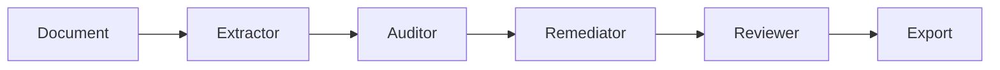
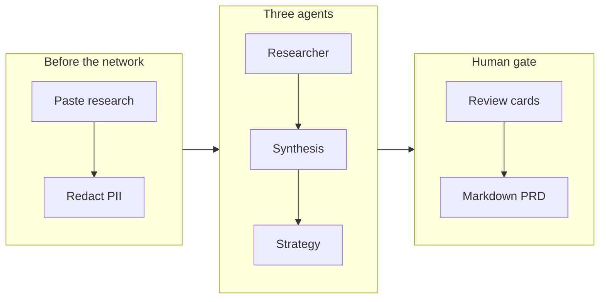
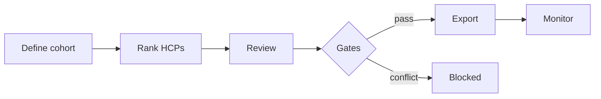
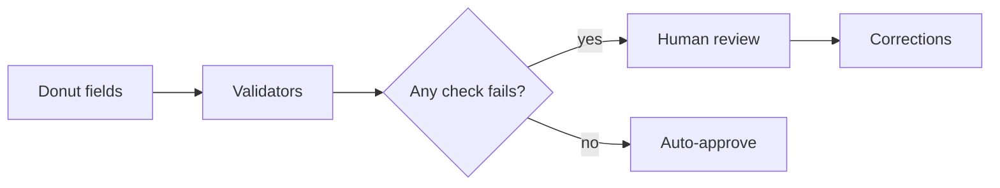
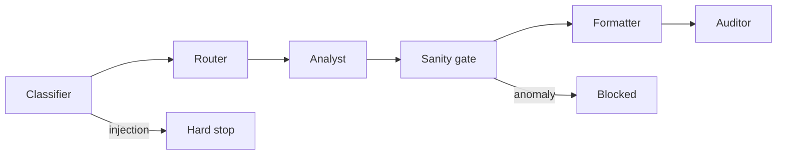

# Portfolio Interview Briefs

**Version 2 · October 2026** · Interview preparation · PM + AI Master Library

> Ten portfolio builds in one book, so I can pick the right project for the question, say it in 60 seconds, and keep every limit in view.

---

## Start here

### What this book is

These are the ten side projects I present in PM interviews. Each gets a chapter with the same layout, so the opener, the numbers, the limits and the likely questions sit in the same place every time.

Every project here is a portfolio build on synthetic data, sample data or my own browser. No brief reports users, revenue or production results. A number in a chapter is a count of what was built, a result on synthetic data, or a target, and the chapter says which.

### How to use it

1. **To choose a project,** go to the [Project finder](#project-finder). It compares all ten and maps each kind of interview question to a best project and a backup.
2. **To rehearse,** open the chapter and say the 60-second opener out loud. Then read "Risks, limits and what it is not" and "Questions I expect."
3. **To check a fact,** use the [Cheat sheet](#cheat-sheet): one row per project.
4. **Before relying on a chapter,** fill the gaps in [Your facts needed](#your-facts-needed) and settle the items in [Facts to reconcile](#facts-to-reconcile).

### The 10-minute pre-interview path

| Minute | Do this | Where |
|---|---|---|
| 0 to 2 | Pick two projects: one that fits the company's domain, one that shows a different skill | [Project finder](#project-finder) |
| 2 to 5 | Say both 60-second openers out loud | The two chapters |
| 5 to 7 | Read both caution boxes and say each "how to say it" label once | "Risks, limits and what it is not" |
| 7 to 9 | Skim both question lists. Rehearse the question I least want to be asked | "Questions I expect" |
| 9 to 10 | Read the two cheat sheet rows and the closing line below | [Cheat sheet](#cheat-sheet) |

### How each project chapter is laid out

Every chapter has the same sections in the same order: the 60-second opener; who it is for and what problem it solves; why I built it; how it works, with the 90-second demo; technical shape; decisions I would defend; what I personally owned; how I would measure it; risks, limits and what it is not; next bets; questions I expect; and a one-line takeaway.

Three things to know about that layout. The one-sentence version of every opener is in the [Cheat sheet](#cheat-sheet). In "Questions I expect," the first four questions come from the original brief and the rest are built from the chapter's facts. And in "Technical shape," "confirmed in the repository" means the fact was checked against the code or README of my public projects repository. Three projects have no code there (chapters 1, 4 and 5), so the brief is their only source.

### Three rules for every project

1. **Say what it is.** Each chapter has a caution box with the label to use, for example "portfolio review accelerator."
2. **Separate built, measured and targeted.** A count of what exists is a fact. A metric on synthetic data is a synthetic result. A target is a target.
3. **Separate demo mode from live mode.** Several projects ship a deterministic or precomputed demo path. That path is not model output, and I say so.

### What I owned, and what only I can add

The briefs give the same ownership list for all ten projects: problem framing, workflow design, system decomposition, data and demo strategy, guardrails, interface behavior, metrics, limitations, and the implementation needed to make the concept demonstrable end to end. Each chapter applies that list to its project.

The briefs also end with the same instruction: treat the first-person narrative as an interview script, keep the factual boundaries, then personalize the origin story with my actual moment of insight, collaborators and time invested. No brief contains those three things. Each chapter marks where they go.

> [!WARNING]
> **Your fact needed:** For all ten projects, one honest sentence on how the code was written: what you wrote yourself, and what an AI coding assistant or another person wrote. Interviewers ask this about every side project, and the briefs do not say.

### The closing line

The briefs give one closing line for all ten projects:

> "This project matters to me because it shows how I approach AI product work. I start with a real decision or workflow. I use a model only where it adds something. I build explicit controls around failure. And I define what evidence I would need before scaling."

> [!TIP]
> Two projects contain no model at all: the quota tracker (chapter 1) and the Masterclass (chapter 4). For those, the second sentence is the point. No model was needed, so none was used.

### What's new in Version 2

- One book replaces ten separate four-page PDFs.
- A project finder: comparison tables, an evidence table, and a matrix from question type to best project and backup.
- Every chapter follows the same section order.
- Each chapter has six or seven likely questions, with answers built only from that project's facts.
- For seven projects, technical details were confirmed against the code and README.
- A reference part: a cheat sheet, facts to reconcile, and the facts only I can supply.

## Project finder

### All ten projects at a glance

What each project is:

| Project | One line | Domain |
|---|---|---|
| 1. [Claude Free Account Quota Tracker](#1-claude-free-account-quota-tracker) | Privacy-first extension that detects Claude.ai quota banners, parses reset times and tracks local account availability | AI workflow utility / Browser extension |
| 2. [ClauseGuard](#2-clauseguard) | Three-agent contract and privacy-policy review prototype that extracts clauses, audits selected frameworks and proposes human-reviewable rewrites | LLM agents / Compliance review |
| 3. [InsightDraft](#3-insightdraft) | Three-agent studio that converts raw research into evidence-linked pain points, themes and PRD feature cards with human review | LLM agents / Product discovery |
| 4. [ML-PM Masterclass](#4-ml-pm-masterclass) | Two-volume, 619-page AI/ML technical masterclass for product managers who need mathematical depth and production judgment | AI technical education / PM operating system |
| 5. [Pulse Precision](#5-pulse-precision) | Explainable HCP audience-ranking and campaign-governance prototype with hard compliance gates and auditable overrides | Responsible ML decisioning / Pharma AdTech |
| 6. [SignalMap](#6-signalmap) | Three-agent dashboard that parses reviews, assigns themes and sentiment, and synthesizes prioritized actions | LLM agents / Product intelligence |
| 7. [KYB Donut](#7-kyb-donut) | OCR-free document-understanding prototype for five Indian KYB document types, with validation, confidence, review routing and feedback | Document AI / Fintech onboarding |
| 8. [Sentinel: Merchant Risk Scoring](#8-sentinel-merchant-risk-scoring) | End-to-end merchant risk decisioning prototype using XGBoost, SHAP-style feature contributions, deterministic compliance rules and a risk-ops dashboard | Applied ML / Fintech risk |
| 9. [PayCommander](#9-paycommander) | Deterministic-first six-agent payment analytics for card and ACH questions, with safety gates, audit traces and MIS reporting | Agentic analytics / Payments |
| 10. [SettleIQ](#10-settleiq) | Six-agent settlement intelligence interface that unifies status, payout journeys, reserve balances, rail downtime, failures, trends and chargebacks | Agentic operations / Payment settlements |

What each one demonstrates, and how it is built:

| Project | What it demonstrates | Stack |
|---|---|---|
| 1. Claude Free Account Quota Tracker | Product judgment around reliability, privacy and a changing third-party UI | Manifest V3, JavaScript, Chrome extension APIs |
| 2. ClauseGuard | Safe positioning for high-stakes AI | React, TypeScript, Vite, Tailwind, Recharts; Anthropic live mode |
| 3. InsightDraft | Containing hallucination with schemas and review UX | React, TypeScript, Vite, Tailwind; Anthropic Messages API in live mode |
| 4. ML-PM Masterclass | Disciplined technical synthesis | PDF manuscripts plus a static HTML index |
| 5. Pulse Precision | Predictive ranking inside a regulated workflow | React, Vite, Tailwind, Recharts; synthetic HCP data |
| 6. SignalMap | Raw feedback as a repeatable decision surface | React, TypeScript, Vite, Recharts, Express static host; Anthropic live mode |
| 7. KYB Donut | Learned extraction plus deterministic validation | Donut, PyTorch/Transformers, FastAPI, Celery, Redis, SQLite, MLflow, React/Vite, Docker |
| 8. Sentinel: Merchant Risk Scoring | A trained tabular ML workflow with a score-to-action policy | Python, XGBoost, FastAPI, SQLite, React/TypeScript, Docker |
| 9. PayCommander | Multi-agent orchestration without stochastic output | Python, FastAPI, Streamlit, SQLite, CSV, rapidfuzz, ReportLab |
| 10. SettleIQ | An enterprise agent workflow with validation gates | Python, Streamlit, SQLite, generated JSON registry |

### What is real in each project

Read this before any interview: what each project runs on, whether a model runs by default, and the strongest evidence I can cite.

| Project | Data | Model in the default path | Strongest evidence |
|---|---|---|---|
| 1. Quota Tracker | Local browser state | None. No AI model | Sandbox test suite completed successfully |
| 2. ClauseGuard | Sample audit or pasted document | Deterministic demo fallback. Live mode needs a key | A demonstrable three-stage review flow |
| 3. InsightDraft | Sample transcript or pasted research | Static demo mode. Live mode needs a key | A demonstrable flow with quote-linked evidence |
| 4. ML-PM Masterclass | Not applicable | None. An educational product | 619 pages in two volumes |
| 5. Pulse Precision | Synthetic HCP records | Illustrative model artifacts. No production training pipeline | A front-end prototype of the decision loop |
| 6. SignalMap | 30-review curated sample or pasted reviews | Precomputed sample path. Live mode calls Claude | A demonstrable dashboard with triage and CSV export |
| 7. KYB Donut | Generated synthetic documents | Mock extractor by default. Donut paths exist | Architecture, validators, UI and tests. Model KPIs are targets |
| 8. Sentinel | Synthetic merchants | XGBoost trained on synthetic data | Quick-run metrics on a 1,000-row synthetic test split |
| 9. PayCommander | 80+ synthetic merchants, 100K+ synthetic card rows | Deterministic. LLM hooks are optional | Six-step observer trace, reproducible answers |
| 10. SettleIQ | 110 synthetic merchants, 11,000 settlement events | Deterministic. No LLM | Local demo completed all twelve use cases |

### Which project for which question

The second column is general interview guidance, not a fact about my projects. The choices are a recommendation based on what each brief can support.

| Question type | What is being tested | Best project | Why this one | Backup |
|---|---|---|---|---|
| Product sense | Do I start from a user and a moment of need? | InsightDraft (3) | Built for one moment: a PM defending a PRD | SignalMap (6) |
| AI product judgment | Do I know where a model belongs? | ClauseGuard (2) | A review accelerator, not a certification engine | PayCommander (9) |
| Technical depth | Can I explain the architecture? | KYB Donut (7) | Synthetic data, training, inference, batch, analytics, feedback | Sentinel (8) |
| Metrics | Can I separate results from targets? | Sentinel (8) | Measured synthetic metrics and an expected-loss decision metric | ClauseGuard (2) |
| Risk and compliance | Do my controls hold when the model is wrong? | Pulse Precision (5) | Deterministic gates that block export | KYB Donut (7) |
| 0-to-1 | Can I scope a first version? | SettleIQ (10) | Twelve explicit use cases before open-ended chat | Quota Tracker (1) |
| Trade-offs | Can I name what I gave up? | PayCommander (9) | Deterministic default over LLM flexibility | SignalMap (6) |
| Failure or limits | Can I talk about what does not work? | Sentinel (8) | A weak churn model I would not ship | Quota Tracker (1) |

> [!NOTE]
> The Masterclass (4) is not an answer to "tell me about a product you built." Use it for questions about how I learn and build technical fluency.

### The competencies the briefs claim

Every brief carries the same grid of interview competencies. I treat it as a checklist of angles, not as proof.

| Competency | What the briefs say each project demonstrates |
|---|---|
| Product sense | User pain, narrow wedge, workflow opinion, human decision moment |
| Execution | System boundaries, staged rollout, quality metrics, operational feedback loop |
| Technical | Model/agent architecture, deterministic controls, data and evaluation |
| Strategy | Build vs buy, adoption path, differentiation, production hardening |
| Leadership | Cross-functional contracts across PM, engineering, data science, risk/legal/ops |

> [!CAUTION]
> The grid is identical for all ten projects, so it fits some better than others. Two projects have no model or agent architecture, and no brief names another person. I do not claim cross-functional leadership from a side project unless I can name the people.

### How the projects fit together

The briefs connect the projects in two places. PayCommander and SettleIQ are a pair: PayCommander is broad merchant payment analytics across card and ACH plus MIS, and SettleIQ is deeper settlement-operations investigation across payout journeys, rails, reserves, downtime and chargebacks. And the Masterclass demo ends by connecting the learning to Sentinel, KYB Donut or the agent products.

The README of my public projects repository adds a map for four of them, as stages of one merchant journey:

| Stage | Project |
|---|---|
| Contract and policy review | ClauseGuard |
| Merchant decisioning: onboarding and ongoing risk | Sentinel |
| Transaction analytics | PayCommander |
| Post-transaction settlement | SettleIQ |

The same README names the principles the set shares: human review, explainability, auditability, deterministic safety gates and operational observability.

# Part I — AI products

## 1. Claude Free Account Quota Tracker

*AI workflow utility / Browser extension.* Source: the brief only.

### The 60-second opener

> "I built the Claude quota tracker around a small but frequent workflow interruption. When a free account hits its message limit, the reset information disappears into the page, and users lose track of which account is available. The extension watches the Claude UI, associates each reset with the active email, and shows a local availability dashboard. It uses no backend and no analytics. This is AI-adjacent tooling, not an AI model. What it demonstrates is product judgment around reliability, privacy and a third-party UI that keeps changing."

### Who it is for and what problem it solves

**Users.** Frequent Claude.ai users managing free-account availability in Chrome or Brave.

**Problem.** Quota state is transient, account-specific and embedded in a changing web UI. Users manually remember reset times or repeatedly switch accounts.

### Why I built it

- To solve a narrow, repeated friction in an AI workflow.
- To keep email and quota metadata local by default.
- To design fallbacks for hidden account identity and evolving DOM selectors.
- To practice shipping and testing a browser extension against a third-party product surface.

> [!WARNING]
> **Your fact needed:** The moment that made you build the tracker: what you were doing when you lost track of a reset time, and what you tried first.

### How it works

1. Detect the active account from page storage and the UI.
2. Observe DOM mutations.
3. Identify rate-limit language.
4. Parse the reset date and time in the local time zone.
5. Persist the result by account in `chrome.storage.local`.
6. Render the popup: available or unavailable.
7. Recompute after the reset passes.

#### The 90-second demo

1. Load the sandbox quota state.
2. Show active account detection and reset parsing.
3. Open the popup before reset, then after reset.
4. Show that all state lives in `chrome.storage.local` and no network is used.

### Technical shape

**From the brief:** Manifest V3, JavaScript, Chrome extension APIs, MutationObserver, local storage, browser-like sandbox tests. There is no server, no analytics and no sync. The extension does not call or contain an AI model.

### Decisions I would defend

1. **No server, analytics or sync.** It reduces privacy and operational burden.
2. **Multiple selectors and compact-text scanning.** Resilience against a UI I do not control.
3. **Fall back to the last known account** when quota pages hide the email.
4. **Coalesce legacy and account records, and roll availability forward by time.**
5. **Test both DOM detection and before/after reset behavior.**

### What I personally owned

The shared ownership list, applied here: the seven-step flow, the storage and fallback design, the sandbox demo state, the measurement plan and limits, and the implementation needed to make it demonstrable end to end.

> [!WARNING]
> **Your fact needed:** Time invested in the tracker, whether anyone else contributed, and the tools you used.

### How I would measure it

A measurement plan. The brief reports no measured values.

| Layer | What I would track |
|---|---|
| North star | Correctly identified available account when the user opens the popup |
| Quality | Account-detection accuracy, reset-parse accuracy, stale-status rate |
| Operations (brief: Reliability) | Breakage after Claude UI changes, selector recovery time |
| Guardrails | Email leakage, incorrect account association, excessive host permissions |

### Risks, limits and what it is not

- It depends on Claude's DOM, storage shape and message wording, which can change without notice.
- Time parsing depends on locale and time zone, and on ambiguous copy.
- Reading page storage and email identifiers requires tight permissions and clear privacy communication.
- The extension does not call or contain an AI model.

> [!CAUTION]
> **How to say it:** an AI workflow utility, not an AI system. Be transparent that it reads Claude page state and can break when the UI changes.

### Next bets

1. Add stronger locale and time zone test cases.
2. Use stable accessibility attributes where available.
3. Add a clear delete-all-data control and a permission explainer.
4. Instrument only opt-in, privacy-preserving local diagnostics for selector failures.

### Questions I expect

**"Why include this in an AI portfolio?"** It improves an AI-product workflow and shows product and engineering execution. I label it clearly as AI-adjacent, not AI-powered.

**"What is hardest here?"** Reliability on a third-party UI: selectors, hidden identity, time language and extension lifecycle behavior.

**"How did you test it?"** The sandbox suite covers account detection, quota parsing, fallback identity, popup rendering and reset rollover. It completed successfully in the audited checkout.

**"What privacy choice matters most?"** No backend. Account emails and quota metadata remain in local extension storage.

**"What happens when Claude changes its UI?"** It can break, and that is the hardest part of the project. Today I reduce the risk with multiple selectors, compact-text scanning and the last-known-account fallback. Next I would move to stable accessibility attributes and add opt-in local diagnostics.

**"Who uses it, and why several free accounts?"** The brief does not answer this, so I need my own answer ready.

> [!WARNING]
> **Your fact needed:** How many people use the tracker (even if only you), for how long, and how many accounts it tracks. Also your honest reason for running several free accounts and how that sits with the service's terms. An interviewer at an AI company may ask.

> [!IMPORTANT]
> A small, private, tested utility on a surface I do not control. The lesson is designing for someone else's UI changing under me.

## 2. ClauseGuard

*LLM agents / Compliance review.* Sources: the brief and the repository folder `clauseguard`.

### The 60-second opener

> "I built ClauseGuard to model the repetitive part of compliance review without pretending AI can replace counsel. The workflow separates three jobs: clause extraction, framework audit and remediation. Each job hands off a strict JSON contract. The reviewer gets a risk heatmap, side-by-side evidence, and controls to accept, reject or edit. My core PM decision was positioning. The model is a review accelerator with an explicit disclaimer and a visible methodology. It is not a certification engine."

### Who it is for and what problem it solves

**Users.** Procurement, security, privacy, legal operations and vendor-risk teams.

**Problem.** Teams repeatedly map long vendor documents to the same controls and draft similar remediation language. Chat interfaces make provenance and reviewer state hard to manage.

### Why I built it

- To compress repetitive document triage while preserving professional judgment.
- To turn agent outputs into a structured review workflow, not a transcript.
- To make framework scope, confidence and methodology visible.
- To demonstrate safe positioning for high-stakes AI.

> [!WARNING]
> **Your fact needed:** Your real reason for choosing compliance review: a vendor review you sat through, or the person whose work this would have shortened.

### How it works

1. Paste a document and select the frameworks.
2. The Extractor segments the document and types each clause.
3. The Auditor returns a verdict, the rules violated, a risk level and a confidence score.
4. The Remediator drafts alternatives.
5. The reviewer accepts, rejects or edits.
6. Export the scope, findings, decisions and outstanding risks.

*Figure 2.1 — Three agents in strict sequence, then a human decision before anything is exported.*

#### The 90-second demo

1. Select two frameworks and run the sample audit.
2. Show the progressive extraction, audit and remediation stages.
3. Open a high-risk clause and compare the original to the rewrite.
4. Edit a remediation and export the outstanding-risk report.

### Technical shape

**From the brief:** React, TypeScript, Vite, Tailwind, Recharts; Anthropic live mode; deterministic demo fallback; local browser state.

**Confirmed in the repository:**

| Item | Detail |
|---|---|
| Frameworks | GDPR, HIPAA, SOC2 and CCPA, in any combination |
| Audit output | Verdict (compliant, non-compliant, needs-review), violated rules, risk level (High, Med, Low), confidence from 0 to 100 |
| Model | `claude-sonnet-4-20250514`, called directly from the browser. No backend |
| Fallback | With no key, the agents run a deterministic sample audit. If a live call fails, that agent falls back to the demo path |
| Export | A text report that states whether the analysis came from live Claude or from demo data |
| Disclaimer | Pinned banner: "For screening purposes only. Does not constitute legal advice." |

### Decisions I would defend

1. **Split extraction, judgment and rewriting.** Failures stay diagnosable.
2. **JSON-only contracts.** They support a reliable audit UI.
3. **Render progressive stage completion.** It manages latency.
4. **Keep reviewer override first-class and persistent.**
5. **Pin the legal disclaimer and limitations in-product.**

### What I personally owned

The shared ownership list, applied here: the six-step review flow, the three-agent split with JSON contracts, the demo fallback, the disclaimer and override controls, the measurement plan, and the implementation needed to make it demonstrable end to end.

> [!WARNING]
> **Your fact needed:** Time invested in ClauseGuard, whether a lawyer or compliance professional ever looked at it, and the tools you used.

### How I would measure it

A measurement plan. The brief reports no measured values.

| Layer | What I would track |
|---|---|
| North star | Reviewer minutes saved per document at equal or better issue recall |
| Quality | Clause segmentation F1, issue recall, false-positive rate, framework citation accuracy |
| Operations (brief: Workflow) | Time to accepted remediation, edit rate, unresolved high-risk findings |
| Guardrails | Missed critical clause, unsupported legal claim, overreliance, key exposure |

### Risks, limits and what it is not

- It is not legal advice or a compliance certification.
- Selected-framework prompts are not a complete or continuously updated rule engine.
- Browser-direct API keys are unsafe for shared or production environments.
- The transparent demo fallback preserves the experience, but it must never be mistaken for a real audit.
- From the repository: the scope is contract and privacy-policy text. The agents do not reason about actual data flows, vendor configuration or contractual amendments.

> [!CAUTION]
> **How to say it:** always a portfolio review accelerator, never legal advice or certification. Distinguish deterministic demo output from live model output.

### Next bets

1. Use versioned regulatory and control content with citations.
2. Move inference server-side with tenant isolation and audit retention.
3. Create attorney-reviewed benchmark documents and adversarial clauses.
4. Add redline export and reviewer agreement analytics.

### Questions I expect

**"Why not one prompt?"** One prompt entangles segmentation, legal judgment and drafting. Separate contracts make each failure observable and evaluable.

**"How do you prevent legal overclaiming?"** Product positioning, citations, scoped frameworks, human review, and a clear prohibition on treating output as certification.

> [!NOTE]
> The brief lists citations in this answer and also lists cited rule content as a next bet. Be exact about today: the Auditor returns the rules it considers violated. Versioned, cited rule content does not exist yet.

**"What is the key metric?"** Critical-issue recall at an acceptable false-positive rate, paired with reviewer time saved.

**"Would you ship the current architecture?"** No. I would first add server-side credentials, versioned rule content, citations and a lawyer-reviewed evaluation set.

**"What happens with no API key, or when the live call fails?"** The agents run a deterministic sample audit, so the flow still completes. That keeps the demo reliable. It is also a risk: demo output must never be mistaken for a real audit, so the exported report states which source produced the analysis.

**"Which frameworks, and how current are the rules?"** GDPR, HIPAA, SOC2 and CCPA. The rules live in the prompts for the selected frameworks. That is not a complete or continuously updated rule engine, so versioned regulatory content is a next bet.

**"How accurate is it?"** I do not claim an accuracy number, and the brief reports none. I would measure issue recall and false-positive rate on attorney-reviewed benchmark documents, which I have not built yet.

> [!WARNING]
> **Your fact needed:** Any check you have actually run on live ClauseGuard output: which documents, who judged the findings, and what you saw. If there is none, say so.

> [!IMPORTANT]
> ClauseGuard is a positioning decision: the model drafts and flags, the reviewer decides, and the disclaimer stays pinned in the product.

## 3. InsightDraft

*LLM agents / Product discovery.* Sources: the brief and the repository folder `insightdraft`.

### The 60-second opener

> "I built InsightDraft for the moment a PM has to defend a PRD. I did not ask one model to write a polished document. I split the job into evidence extraction, synthesis and strategy. Every pain point carries a source quote. Every theme exposes its assumptions. Every feature has a success metric and a confidence score, and low-confidence output is routed to human review. The product is designed to speed up synthesis without laundering model guesses into facts."

### Who it is for and what problem it solves

**Users.** Product managers, UX researchers, design leads and research operations teams.

**Problem.** Research synthesis is slow. Generic LLM summarization can detach claims from evidence and make weak assumptions look authoritative.

### Why I built it

- To reduce the time from raw interviews to a reviewable product brief.
- To use schemas and UX to contain hallucination, not prompt wording alone.
- To make human acceptance, rejection and editing part of the product contract.
- To show privacy by design through client-side PII redaction.

> [!WARNING]
> **Your fact needed:** The PRD you once had to defend: the review where someone asked "where did this come from?" and what you could or could not show.

### How it works

1. Paste transcripts or notes.
2. Redact PII before anything reaches the network.
3. The Researcher extracts pain points, each linked to a quote.
4. Synthesis clusters only the extracted evidence.
5. Strategy drafts features and metrics.
6. The reviewer accepts, rejects or edits.
7. Export a Markdown PRD.

*Figure 3.1 — Redaction happens before any model call, and export happens only after review.*

#### The 90-second demo

1. Paste the sample transcript and show the PII count.
2. Run the three-stage demo and inspect a source quote.
3. Open the assumptions and a low-confidence feature.
4. Edit or reject a card, then export the PRD.

### Technical shape

**From the brief:** React, TypeScript, Vite, Tailwind; Anthropic Messages API in live mode; static demo mode; local browser persistence.

**Confirmed in the repository:**

| Item | Detail |
|---|---|
| PII redaction | In the browser, before any network call. Emails, phone numbers, URLs, names, SSNs and card numbers are replaced with placeholders, and a count is shown |
| Review flag | A feature card with confidence under 70 is flagged for human review. The client re-applies the flag if the model omits it |
| Export | The Markdown PRD contains only accepted or edited cards |
| Model | `claude-sonnet-4-20250514`, called from the browser with the user's own key. No backend |

### Decisions I would defend

1. **Anchor each pain point to a verbatim quote.** A fabricated claim becomes visible to a reviewer.
2. **Force themes to list supporting evidence and assumptions.**
3. **Treat confidence as review UX, not objective probability.**
4. **Gate export through human review.** No auto-publish.
5. **Provide a no-key demo while documenting browser-direct API risk.**

### What I personally owned

The shared ownership list, applied here: the seven-step flow, the three-agent split, the static demo mode, redaction, quote anchoring and the review gate, the measurement plan, and the implementation needed to make it demonstrable end to end.

> [!WARNING]
> **Your fact needed:** Time invested in InsightDraft, whether any PM or researcher other than you has tried it, and the tools you used.

### How I would measure it

A measurement plan. The brief reports no measured values.

| Layer | What I would track |
|---|---|
| North star | Time to an evidence-backed PRD accepted by a PM reviewer |
| Quality | Faithfulness: quote-grounding accuracy and unsupported-claim rate. Coverage: share of source pain points represented in themes. Calibration: acceptance rate by confidence band, human agreement, edit distance |
| Operations | The brief names none. The nearest item is API failures, under guardrails |
| Guardrails | PII leakage, fabricated quotes, low-confidence exports, API failures |

### Risks, limits and what it is not

- Confidence is self-reported, not a calibrated probability.
- PII regex redaction can miss context-specific identifiers and can over-redact names.
- Browser-direct bring-your-own-key use exposes credentials to the local browser and faces CORS limitations.
- Demo mode uses curated outputs and is not an evaluation of model quality.

> [!CAUTION]
> **How to say it:** an evidence-centered LLM workflow with a curated demo and an optional live Anthropic mode. Do not claim the confidence scores are statistically calibrated or that regex PII removal is complete.

> [!WARNING]
> The repository README describes the scoring as "calibrated" and cites a pilot result. The brief says not to claim calibration. Use the brief's wording until this is settled in [Facts to reconcile](#facts-to-reconcile).

### Next bets

1. Move inference behind an authenticated server proxy.
2. Build an eval corpus with gold pain points and theme mappings.
3. Add quote-existence and entailment checks.
4. Integrate source lineage into Jira and Docs, and measure downstream adoption.

### Questions I expect

**"Why agents?"** Each stage has a different objective and failure mode. JSON hand-offs make provenance and debugging clearer than a single polished response.

**"Is confidence trustworthy?"** Not by itself. It is a routing signal. I would calibrate it against reviewer acceptance and unsupported-claim rates before using it operationally.

**"How do you evaluate hallucination?"** Check quote existence, entailment from quote to pain point, theme coverage, unsupported assumptions and downstream human acceptance.

**"What is the production blocker?"** Secure inference and a proper evaluation. The current browser-direct key pattern is appropriate only for a local portfolio demo.

**"How does the PII redaction work, and where does it fail?"** It runs in the browser before any network call, replaces what it finds with placeholders and shows a count. It is pattern-based, so it can miss identifiers that only make sense in context, and it can over-redact names. I do not claim it is complete.

**"What stops a PM from exporting a card nobody reviewed?"** Export goes through review by design. Low-confidence cards are flagged, and the exported PRD contains only the cards a reviewer accepted or edited.

**"Have you run it on real research?"** The brief describes only a sample transcript and a curated demo.

> [!WARNING]
> **Your fact needed:** Whether you have run InsightDraft in live mode on real interview notes, how many, and what a reviewer accepted or rejected. If only on the sample, say so.

> [!IMPORTANT]
> InsightDraft treats model output as a claim to check: every pain point shows its quote, every theme shows its assumptions, and a reviewer decides what ships.

## 4. ML-PM Masterclass

*AI technical education / PM operating system.* Source: the brief only.

### The 60-second opener

> "I built the ML-PM Masterclass because AI PM interviews often expose a gap between vocabulary and operating understanding. I wanted a reference that starts with the math: probability, linear algebra, optimization and information theory. Then it connects that math to classical ML, deep learning, LLMs, agents, MLOps, governance, commercialization and failure postmortems. The outcome is not an AI model. It is a structured learning product, and it is evidence of how I build technical fluency for product decisions."

### Who it is for and what problem it solves

**Users.** Senior PMs, AI/ML PM candidates, cross-functional product leaders, and practitioners refreshing technical foundations.

**Problem.** Most PM AI material is either too shallow to support technical trade-offs or too academic to connect to roadmap, metrics, risk and go-to-market decisions.

### Why I built it

- To close the gap between AI terminology and system-level product judgment.
- To create a reusable interview and operating reference in place of scattered notes.
- To connect equations and code to fintech and product examples.
- To build a personal technical-learning system that compounds across projects.

> [!WARNING]
> **Your fact needed:** The interview or meeting where the gap showed: the question you could name the term for but could not reason through.

### How it works

This is how I built it, in order:

1. Define a PM competency map.
2. Sequence the math prerequisites.
3. Connect the concepts to ML and LLM systems.
4. Add worked examples and NumPy snippets.
5. Layer on PM relevance and failure modes.
6. Publish two navigable PDF volumes and a landing page.

#### The 90-second demo

1. Open the table of contents and show the math-to-product progression.
2. Pick one concept, such as calibration, and explain its PM consequence.
3. Show a worked fintech example and a failure-mode section.
4. Connect the learning to Sentinel, KYB Donut or the agent products.

### Technical shape

**From the brief:** Volume 1: 171 pages. Volume 2: 448 pages. Total: 619 pages. PDF manuscripts plus a static HTML index. It is an educational product, not an AI-powered application.

### Decisions I would defend

1. **Start with first principles, not a model catalog.**
2. **Use fintech worked examples.** They make abstractions operational.
3. **Pair technical mechanisms with PM relevance boxes.**
4. **Cover production and governance, not only training.**
5. **Treat failure postmortems as core curriculum.**

### What I personally owned

The shared ownership list, applied here: the competency map and six-step build sequence, the worked examples, the PM relevance boxes and failure-mode sections, the measurement plan, and the two PDF manuscripts with their static HTML index.

> [!WARNING]
> **Your fact needed:** How long the 619 pages took, what sources you worked from, and how much of the drafting was yours versus assisted. "Authored" is the brief's word, so be ready to stand behind it.

### How I would measure it

A measurement plan. The brief reports no measured values.

| Layer | What I would track |
|---|---|
| North star (brief: Learning north star) | Ability to explain a model or system trade-off and choose a metric without notes |
| Quality (brief: Coverage) | Competency-map completion across math, modeling, serving, evaluation, governance and commercialization |
| Operations (brief: Use) | Interview question retrieval, worked-example completion, revisit rate, practice accuracy |
| Guardrails | Outdated model and provider details, and false confidence from passive reading |

### Risks, limits and what it is not

- This is an educational product, not an AI-powered application.
- Breadth can overwhelm. Interview preparation needs targeted retrieval and active practice.
- Fast-moving model, regulation and infrastructure sections require versioning.

> [!CAUTION]
> **How to say it:** authored technical curriculum and a learning system. Do not call it an AI application, and do not imply that page count alone proves expertise.

### Next bets

1. Add diagnostic assessments and role-specific learning paths.
2. Turn chapters into spaced-repetition cards and mock interview drills.
3. Version fast-changing sections with source dates.
4. Add small labs that connect metrics to product decisions.

### Questions I expect

**"Did you build an AI product here?"** No. This is an AI technical-learning product. Its portfolio value is disciplined technical synthesis and the ability to translate mechanisms into PM decisions.

**"Why 619 pages?"** The depth is intentional as a reference. For users I would add role-based paths and diagnostics so nobody must read linearly.

**"How does it help you as a PM?"** It improves the quality of my model, metric, architecture, rollout and risk conversations with engineering and data science.

**"How would you productize it?"** Start with diagnostics, a personalized path, short labs, retrieval, and evidence of skill improvement. Not simply more content.

**"Pick one concept and tell me why a PM should care."** I use calibration, because it shows up in three of my own projects. In Sentinel, a score is mapped to tiers and actions, which only makes sense if the probability behind the score is calibrated. In KYB Donut, I would not auto-approve at a threshold until confidence is calibrated on representative documents. In InsightDraft, I say plainly that the confidence score is self-reported and not calibrated.

> [!NOTE]
> General definition, not a fact about my build: a model is calibrated when its predicted probabilities match observed frequencies. Of all the cases it scores at 0.8, about 80% should turn out positive.

**"How do you keep it current?"** That is a real limit. The fast-moving sections on models, regulation and infrastructure need versioning, so my next bet is to version them with source dates.

**"How do you know it worked?"** My north star is being able to explain a trade-off and choose a metric without notes. The brief gives no evidence beyond that definition.

> [!WARNING]
> **Your fact needed:** One specific time the Masterclass changed a decision or a conversation: the topic, who you were talking to, and what you could do that you could not do before.

> [!IMPORTANT]
> The Masterclass is not a product claim. It is evidence of how I learn: from first principles to a product decision, with the failure modes included.

## 5. Pulse Precision

*Responsible ML decisioning / Pharma AdTech.* Source: the brief only.

### The 60-second opener

> "I built Pulse Precision to explore a hard AI product problem. How do you use predictive ranking in a regulated marketing workflow without turning the model into a black box nobody can challenge? The prototype ranks synthetic HCP audiences and explains what drives each score. It routes low-confidence cases to review. It blocks export on compliance conflicts. And it records every override. The product insight is that the winning experience is not the score alone. It is the decision system around the score."

### Who it is for and what problem it solves

**Users.** Pharma marketers, medical-legal-regulatory reviewers, data science teams and campaign operations.

**Problem.** Audience selection is fragmented across static segments, opaque propensities and late-stage compliance checks. Teams need lift, but also disclosure, override discipline, privacy isolation and an audit trail.

### Why I built it

- To show how predictive ranking fits inside a regulated workflow, not beside it.
- To make model uncertainty and cold-start cases visible to operators.
- To demonstrate that compliance rules must be deterministic and able to block activation.
- To turn human overrides into governed feedback, not undocumented exceptions.

> [!WARNING]
> **Your fact needed:** Why pharma marketing. The brief gives no link between this domain and your background, and "why this industry?" will be an early question.

### How it works

1. Define a deterministic cohort.
2. Rank synthetic HCP records.
3. Review low or insufficient scores.
4. Run pre-flight compliance gates.
5. Export a privacy-isolated audience and a model card.
6. Monitor quality, parity, stability and overrides.

*Figure 5.1 — Eligibility comes before prediction, low scores go to review, and a conflict at the compliance gates blocks the export.*

#### The 90-second demo

1. Open Audience Builder and explain eligibility before prediction.
2. Show the ranking reasons and one low-confidence review.
3. Override a recommendation and record the reason.
4. Trigger the compliance block, then inspect the model card and audit log.

### Technical shape

**From the brief:** React, Vite, Tailwind, Recharts; synthetic HCP data; the prototype model card describes XGBoost + isotonic calibration and TreeSHAP explanations. The repository is a front-end prototype with synthetic records and illustrative metrics. It does not contain a production training pipeline.

> [!NOTE]
> General background, not facts about my build: HCP means health care professional. An NPI is the National Provider Identifier, a 10-digit ID assigned to US health care providers. ACCME is the Accreditation Council for Continuing Medical Education, which accredits organizations that offer continuing medical education.

### Decisions I would defend

1. **Separate cohort eligibility from model scoring.** Static rules define who is eligible. The model only ranks.
2. **Exclude NPI from training and scoring**, and reveal it only in the restricted export step.
3. **Require a reason when a marketer goes against the model recommendation.**
4. **Use deterministic ACCME, parity, cooldown, saturation and cohort-size controls.**
5. **Expose calibration and ranking-quality triggers, not only AUC.**

### What I personally owned

The shared ownership list, applied here: the six-step decision loop, the synthetic HCP records and illustrative model artifacts, the compliance gates, override reasons and audit log, the measurement plan, and the front-end prototype that makes it demonstrable end to end.

> [!WARNING]
> **Your fact needed:** Time invested in Pulse Precision, whether anyone with pharma or medical-legal experience reviewed the rules, and the tools you used.

### How I would measure it

A measurement plan. Any metric shown inside the prototype is illustrative.

| Layer | What I would track |
|---|---|
| North star | Incremental qualified engagement per 1,000 eligible HCPs, subject to compliance pass rate |
| Quality (brief: Model) | Precision@K, PR-AUC, calibration error, score stability, subgroup quality |
| Operations (brief: Workflow) | Override rate, time to approved audience, export-block rate, warning-resolution time |
| Guardrails | Opt-out violations, small-cohort inference events, parity gaps, prohibited-use incidents |

### Risks, limits and what it is not

- The repository is a front-end prototype with synthetic records and illustrative metrics. It does not contain a production training pipeline.
- HCP ranking can create access and fairness concerns even without patient data.
- Human override logs can improve governance, but they can also encode marketer bias if treated as labels without review.

> [!CAUTION]
> **How to say it:** a product and governance prototype with synthetic data. Do not present the displayed AUC, PR-AUC, lift or model version as a real deployed system result.

### Next bets

1. Connect a governed feature store and an offline training and evaluation pipeline.
2. Run a shadow-mode comparison against deterministic targeting.
3. Add causal lift measurement and campaign-level holdouts.
4. Create a formal model-risk approval workflow and a retraining policy.

### Questions I expect

**"Why AI here?"** Static rules can define who is eligible, but they cannot efficiently rank many eligible HCPs by likely channel response. The model is advisory. Deterministic rules retain authority over compliance.

**"What would you validate first?"** Offline ranking lift and calibration by subgroup, then a shadow-mode campaign with holdouts. I would not optimize clicks until compliance pass rate and parity guardrails are stable.

**"Is this production ML?"** No. It is a product and governance prototype using synthetic data and illustrative model artifacts. The production next step is a governed training, validation and deployment pipeline.

**"What is the PM insight?"** The product is the decision loop: eligibility, ranking, explanation, review, block, export, monitoring and feedback. It is not merely a model endpoint.

**"The dashboard shows an AUC. Is that number real?"** No. The metrics in the prototype are illustrative, and the repository contains no production training pipeline. I show them to demonstrate what an operator would see, not as a result.

**"What happens when a marketer disagrees with the model?"** They can override, but they must record a reason, and the override is logged. That turns exceptions into governed feedback. I would not feed those logs straight back as labels, because they can encode the marketer's bias. They need review first.

**"Have you worked in pharma?"** The brief does not say.

> [!WARNING]
> **Your fact needed:** Your actual exposure to pharma marketing or medical-legal-regulatory review, if any. If none, one sentence on how you learned the compliance rules you modeled.

> [!IMPORTANT]
> In a regulated workflow the model advises and the rules decide. The product is the loop around the score, not the score.

## 6. SignalMap

*LLM agents / Product intelligence.* Sources: the brief and the repository folder `signalmap`.

### The 60-second opener

> "I built SignalMap because keyword dashboards miss meaning. Reviews about price, cancellation and value can express the same problem without sharing words. SignalMap parses messy review text. It semantically tags each review into one of seven themes, with sentiment and intensity. Then it synthesizes complaints, praises, trends and a recommended action. The output is a triage workflow a PM can use, not just a summary paragraph."

### Who it is for and what problem it solves

**Users.** Consumer and SaaS PMs, customer-insights teams, support leaders and product operations.

**Problem.** High-volume reviews are unstructured. Keyword approaches miss semantic equivalence. Manual synthesis is too slow for weekly prioritization.

### Why I built it

- To turn raw feedback into a repeatable product-decision surface.
- To separate parsing, tagging and synthesis so the structured lineage is preserved.
- To give PMs a triage state and a CSV export for downstream work.
- To demonstrate honest production-hardening trade-offs in an LLM demo.

> [!WARNING]
> **Your fact needed:** The pile of feedback that started this: which product's reviews you were reading by hand, and what a keyword search missed.

### How it works

1. Paste raw reviews.
2. The Parser normalizes id, date and text.
3. The Semantic Tagger assigns theme, sentiment, intensity and insight.
4. Synthesis rolls up complaints, praises, trend, action and priority.
5. The PM reviews the drawer and the verbatims.
6. The PM sets a triage state and exports CSV.

#### The 90-second demo

1. Load the 30-review sample.
2. Compare the bubble grid and the sentiment timeline.
3. Open Pricing or Reliability and inspect the verbatims and actions.
4. Change the triage state and export the tagged CSV.

### Technical shape

**From the brief:** React, TypeScript, Vite, Recharts, Express static host; Anthropic live mode; 30-review curated sample; local browser persistence.

**Confirmed in the repository:**

| Item | Detail |
|---|---|
| Themes | Performance, UX/Design, Pricing, Support, Reliability, Onboarding, Features |
| Tagger output | Sentiment, a sentiment score from -1.0 to 1.0, intensity (High, Med, Low), a one-sentence insight, and exactly one theme |
| Synthesis output | Per theme: top three complaints, top three praises, trend, recommended action, and a priority score from 1 to 10 |
| Model | `claude-sonnet-4-20250514`, called directly from the browser with the user's key |

> [!WARNING]
> The brief and the README both say the sample has 30 reviews. The sample in the code is larger. Check the count before saying a number in a demo. See [Facts to reconcile](#facts-to-reconcile).

### Decisions I would defend

1. **Exactly one of seven themes per review**, for a simple portfolio view.
2. **Keep verbatims accessible behind every aggregate.**
3. **An immediate sample-data path**, so evaluation does not require a key.
4. **Separate triage state from model output.**
5. **Document the server-proxy migration path** instead of hiding browser-direct risk.

### What I personally owned

The shared ownership list, applied here: the six-step flow, the split into parsing, tagging and synthesis, the curated sample, the verbatims, triage state and CSV export, the measurement plan, and the implementation needed to make it demonstrable end to end.

> [!WARNING]
> **Your fact needed:** Time invested in SignalMap, whether any PM other than you has used it on their own reviews, and the tools you used.

### How I would measure it

A measurement plan. The brief reports no measured values.

| Layer | What I would track |
|---|---|
| North star | Percentage of high-priority themes that lead to a validated product action |
| Quality (brief: Model) | Theme accuracy, sentiment MAE and correlation, actionability rating, consistency across reruns |
| Operations (brief: Workflow) | Time to weekly insight, triage completion, export and use rate, issue linkage |
| Guardrails | Minority-theme suppression, sarcasm failure, PII leakage, unstable priorities |

### Risks, limits and what it is not

- Exactly one theme per review simplifies the UX but loses multi-label nuance.
- A curated 30-review demo is not a representative evaluation corpus.
- Priority scores are model judgments and can amplify volume over business impact.
- Browser-direct credentials and local-only persistence are not production architecture.

> [!CAUTION]
> **How to say it:** explicitly distinguish the curated sample path from live Claude inference. Do not describe model-generated priority as objective product value.

### Next bets

1. Move calls to an authenticated proxy and add tenant and source ingestion.
2. Support configurable and multi-label taxonomies.
3. Build human-labeled theme and sentiment benchmarks.
4. Link themes to experiments, roadmap items and outcome tracking.

### Questions I expect

**"Why not embeddings plus clustering?"** That is a strong scale path. For v1, fixed semantic labels create stable reporting and faster review. I would compare LLM tagging against embedding clusters on accuracy, cost and taxonomy drift.

**"How would you evaluate actions?"** Have PMs rate specificity, evidence support, feasibility and expected impact. Then track whether accepted actions produce measurable outcomes.

**"What is the main bias?"** High-volume themes can dominate while severe minority issues disappear. I would add severity-weighted and segment-aware views.

**"Is sample mode AI?"** No. It is precomputed demo output. Live mode calls Claude. The distinction is documented, and I state it in the interview.

**"Why only one theme per review?"** For a simple view and stable reporting in a first version. I know what it costs: multi-label nuance is lost. Configurable and multi-label taxonomies are on my next-bets list.

**"Can I trust the priority score?"** Treat it as a model's judgment, not as product value. It can amplify volume over business impact. That is why the verbatims sit behind every aggregate and why the triage state is kept separate from the model output.

**"How accurate is the tagging?"** I do not claim a number. The brief reports none, and a curated sample is not an evaluation corpus. I would measure theme accuracy on human-labeled benchmarks, which I have not built yet.

> [!WARNING]
> **Your fact needed:** Whether you have run SignalMap in live mode on real reviews, how many, and how you judged the tags. If only on the sample, say so.

> [!IMPORTANT]
> SignalMap turns reviews into a triage queue with the verbatims behind every aggregate, and it is honest that sample mode is precomputed and priority is a model's judgment.

# Part II — Fintech and payments

## 7. KYB Donut

*Document AI / Fintech onboarding.* Sources: the brief and the repository folder `kyb-donut`.

### The 60-second opener

> "I built KYB Donut to explore where document AI can materially change merchant onboarding. The system uses a Donut design: a vision encoder and a text decoder that emit structured fields directly from document images. Then it applies deterministic checks: GSTIN checksum, PAN and CIN formats, expiry, and cross-document name matching. The product decision is not to auto-approve on model confidence alone. Critical-field failures and cross-document inconsistency always route to review."

### Who it is for and what problem it solves

**Users.** Indian fintech onboarding operations, compliance reviewers, risk teams and merchant success.

**Problem.** Manual KYB review is slow. OCR-plus-regex pipelines compound recognition, layout and extraction errors across highly variable documents.

### Why I built it

- To test an end-to-end vision-to-structure approach in place of a brittle multi-stage OCR stack.
- To combine learned extraction with deterministic regulatory identifiers.
- To design a human-review queue around confidence and field criticality.
- To show the full lifecycle: synthetic data, training, inference, batch, analytics and feedback.

> [!WARNING]
> **Your fact needed:** What made you pick document AI for onboarding as a side project, told without borrowing numbers from your work experience.

### How it works

1. Generate labeled synthetic document images.
2. Fine-tune Donut by document task prompt.
3. Upload a single image or a batch ZIP.
4. Decode structured tokens.
5. Validate critical fields and dates.
6. Compute weighted confidence.
7. Auto-approve or route to review.
8. Capture corrections.

*Figure 7.1 — Review routing in the repository. The three checks are a failed critical field, overall confidence under 0.80, and a business-name mismatch across documents.*

#### The 90-second demo

1. Upload a generated GST certificate in mock mode.
2. Inspect the fields, confidence and checksum validation.
3. Edit a failed critical field, then route or approve.
4. Show batch status, analytics and the feedback loop.

### Technical shape

**From the brief:** Donut (Swin encoder + BART decoder), PyTorch/Transformers, FastAPI, Celery, Redis, SQLite, MLflow, React/Vite, Docker.

**Confirmed in the repository:**

| Item | Detail |
|---|---|
| Documents | GST registration certificate, PAN card, Shop & Establishment certificate, Certificate of Incorporation, Udyam/MSME registration |
| Default mode | Mock: a deterministic, schema-valid extractor that needs no GPU. Donut mode loads a fine-tuned checkpoint |
| Confidence | A weighted mean of per-field confidence. Critical fields count double. A failed validation multiplies that field's confidence by 0.55 |
| Review routing | A failed critical field, overall confidence below 0.80, or business-name similarity below 0.85 across documents |
| Synthetic data | Generator default: 200 documents per type, 1,000 in all, each with JSON ground truth |

> [!NOTE]
> General background, not a fact about my build: Donut stands for Document Understanding Transformer. It was introduced by Kim et al. in "OCR-free Document Understanding Transformer" (ECCV 2022) and reads the document image without a separate OCR engine.

### Decisions I would defend

1. **One task-conditioned vision-language model across five document types.**
2. **Double-weight critical fields in overall confidence.**
3. **Apply validation penalties and cross-document checks after inference.**
4. **Support a deterministic mock extractor** for UI and QA, without claiming model quality.
5. **Keep asynchronous batch processing separate from interactive extraction.**

### What I personally owned

The shared ownership list, applied here: the eight-step flow, the split between model inference and deterministic validators, the synthetic generators and mock extractor, the review routing, targets labeled as targets, and the implementation needed to make it demonstrable end to end.

> [!WARNING]
> **Your fact needed:** Time invested in KYB Donut, the tools you used, and whether you have run the fine-tuning script on a GPU yourself.

### How I would measure it

Nothing in this table is a measured result. The brief is explicit that the model figures are targets.

| Layer | What I would track |
|---|---|
| North star | The brief names none. The closest is its product target: reduce human review to 23% at an 0.80 threshold while protecting critical-field recall |
| Quality (brief: Model targets in README) | Overall field F1 above 0.88; GSTIN exact match above 0.95. Targets, not verified production results |
| Operations (brief: Operational) | Time per document, batch completion time, correction rate, onboarding turnaround |
| Guardrails | False auto-approval, missed tampering, PII leakage, subgroup and document-type accuracy gaps |

### Risks, limits and what it is not

- Default mock mode is schema-valid but does not exercise real vision-model failure modes.
- Displayed bounding boxes are illustrative until wired to attention maps.
- Synthetic documents do not capture the full distribution of scans, languages, fraud and regional formats.
- The stated 4-6 hour onboarding and 23% review rate are product targets, not observed production impact.
- From the repository: all synthetic documents are in English. There is no regional-language support.

> [!CAUTION]
> **How to say it:** a portfolio-grade end-to-end document-AI prototype. Treat the 23% review rate, the onboarding reduction, and the F1 and exact-match figures as targets until validated on a held-out representative dataset.

> [!CAUTION]
> My work-experience stories include a KYB document extraction case that also used a Donut model. This chapter is the portfolio build on synthetic documents. Never carry a number from one into the other.

### Next bets

1. Run a full documented training and evaluation pass and publish per-field results.
2. Calibrate confidence against human-review outcomes.
3. Add tamper detection and multilingual Indic data.
4. Introduce shadow-mode onboarding and a tiered review queue.

### Questions I expect

**"Why Donut over OCR?"** It learns image, layout and structured decoding jointly. That avoids error compounding across OCR, layout parsing and NER. The trade-off is heavier training and harder interpretability.

**"Would you auto-approve at 0.80?"** Not until confidence is calibrated on representative documents and critical-field false-accept rates meet a strict threshold. The current threshold is a product hypothesis.

**"How do rules and ML interact?"** The model proposes fields and token confidence. Deterministic validators and cross-document checks can force review.

**"What is real today?"** The repository contains the end-to-end architecture, generators, training and inference paths, mock mode, validators, UI and tests. The model KPIs are targets unless a full training run is produced.

**"Where do 23% and 4 to 6 hours come from?"** They are product targets, not observed results. The 23% review rate is tied to the 0.80 confidence threshold plus critical-field validation. I treat both as targets until they are validated on a held-out representative dataset.

**"What counts as a critical field?"** The identifiers and business names, for example the GSTIN and the legal name on a GST certificate. Those count double in confidence, and a failed check on any of them always routes to review.

**"What F1 did you get?"** I have not published one. Above 0.88 overall field F1 and above 0.95 GSTIN exact match are my targets. A full documented training and evaluation pass is my first next bet.

> [!WARNING]
> **Your fact needed:** Whether a full Donut training run exists, on how many documents, and the per-field results. If you have only run mock mode, say that plainly.

> [!IMPORTANT]
> The model proposes and the validators decide. No document is auto-approved on confidence alone, and every headline number is a target until a real evaluation says otherwise.

## 8. Sentinel: Merchant Risk Scoring

*Applied ML / Fintech risk.* Sources: the brief and the repository folder `merchant-risk-scoring`.

### The 60-second opener

> "I built Sentinel to show the full product system around a tabular ML model. The model predicts merchant risk from synthetic Indian payments data. Policy rules can override it for prohibited categories, high disputes, weak KYB or new-merchant risk. The API returns a score, a tier, an action, explanations and logged overrides. My PM thesis was that a risk model is useful only when decisions are calibrated, explainable, reviewable and connected to an operator workflow."

### Who it is for and what problem it solves

**Users.** Merchant onboarding, risk operations, compliance, relationship managers and ML platform teams.

**Problem.** Rules-only reviews are slow and coarse. Black-box models are hard to defend. Teams need faster prioritization without surrendering regulatory policy or human review.

### Why I built it

- To demonstrate an actual trained tabular ML workflow, not only LLM prompting.
- To connect model output to a clear score-to-action policy.
- To show explanations and deterministic overrides in the operator UI.
- To practice the PM work of model cards, calibration, drift and staged rollout.

> [!WARNING]
> **Your fact needed:** Why you built a risk model as a side project, told as its own story and kept apart from your work-experience story on merchant risk scoring.

### How it works

1. Generate 5K/50K synthetic merchants.
2. Engineer tabular features.
3. Train an XGBoost risk model and an exploratory churn model.
4. Serve the score via FastAPI.
5. Apply business-rule overrides.
6. Return the top contributions and an action.
7. Log score history and overrides.

*Figure 8.1 — The rules run after the model, so a policy override is never softened by a probability.*

#### The 90-second demo

1. Score a normal merchant and explain the top contributions.
2. Trigger a high-dispute or prohibited-MCC override.
3. Open Merchant 360 and the score history.
4. Show the model card, the confusion matrix and the limitations.

### Technical shape

**From the brief:** Python, XGBoost, FastAPI, SQLite, React/TypeScript, Docker; Optuna and MLflow hooks; committed quick-run artifacts.

**Confirmed in the repository:**

| Item | Detail |
|---|---|
| Score to action | 0 to 30 Low: auto-approve. 31 to 55 Medium: enhanced monitoring. 56 to 75 High: manual review. 76 to 100 Critical: block and compliance escalation |
| Policy rules | Four triggers: a prohibited merchant category code, a dispute rate above 5%, a KYB score below 0.3, a merchant vintage under 30 days |
| Quick-run data | 5,000 synthetic merchants: 4,000 training rows and a 1,000-row test split, chosen at random |
| Explanations | XGBoost's native per-feature contributions (TreeSHAP) |
| Public demo | Static. It uses an in-browser deterministic mirror of the scoring logic. The full API runs locally |

### Decisions I would defend

1. **Gradient-boosted trees**, for tabular performance, CPU serving and explainability.
2. **Run policy rules after the model**, so regulation cannot be softened by probability.
3. **Keep churn exploratory and risk as the headline decision.**
4. **Use calibrated probabilities before mapping to tiers.**
5. **Plan shadow mode before auto-blocking.**

> [!WARNING]
> The fourth decision is the brief's wording. The committed model card in the repository says the score is built from raw class probabilities and that production should re-calibrate. Confirm what the build does before saying "calibrated" out loud. See [Facts to reconcile](#facts-to-reconcile).

### What I personally owned

The shared ownership list, applied here: the seven-step flow, the split into data, training, scoring API, rules layer and dashboard, the synthetic generator and quick-run artifacts, overrides with logged reasons, metrics labeled as synthetic, and the implementation needed to make it demonstrable end to end.

> [!WARNING]
> **Your fact needed:** Time invested in Sentinel, the tools you used, and whether you ran the full 50K training yourself or only the quick run.

### How I would measure it

Sentinel is the one project with measured model metrics. All of them come from the committed quick run on synthetic data.

| Measured on synthetic data | Value |
|---|---|
| Risk model, overall | 0.789 accuracy, 0.761 macro F1, 0.793 weighted F1 on a 1,000-row synthetic test split |
| Risk model, high-risk class | 0.816 precision, 0.743 recall, 0.778 F1 (113 synthetic test cases) |
| Exploratory churn model | ROC AUC about 0.556 |

The measurement plan for a real deployment:

| Layer | What I would track |
|---|---|
| North star | Loss prevented per 1,000 reviewed merchants, adjusted for false-positive cost |
| Quality | The model metrics above, measured again on real data. As the decision metric I would optimize expected loss, not accuracy alone |
| Operations | The brief names none. The nearest item is review backlog, under guardrails |
| Guardrails | Approval disparity, false blocks, calibration error, review backlog, override concentration |

### Risks, limits and what it is not

- All data and business impact figures are synthetic or modeled, not production outcomes.
- The exploratory churn model is weak in the committed quick run (ROC AUC about 0.556) and should not drive decisions.
- The synthetic class balance is easier than many real fraud and risk distributions.
- SHAP explanations describe model contribution, not causality.
- From the repository: the README carries a "Business Impact (modeled)" table showing chargeback losses down 60%, the manual review queue share down from 100% to 38%, and legitimate high-volume approvals up 34%. These are the modeled figures the brief warns about. They are not results.

> [!CAUTION]
> **How to say it:** lead with the measured synthetic test metrics and explicitly label business impact as modeled. Never imply SHAP is causal or that the model has seen real merchants.

> [!CAUTION]
> My work-experience stories include a merchant risk scoring case that also used XGBoost. This chapter is the portfolio build on synthetic merchants. Never carry a number from one into the other.

### Next bets

1. Shadow score real historical applications with delayed labels.
2. Add velocity and graph features, then test incremental lift.
3. Calibrate by merchant segment and monitor drift weekly.
4. Add adverse-action reason governance and appeal workflows.

### Questions I expect

**"Why XGBoost?"** For medium-scale structured data it offers strong performance, low-latency CPU serving, stable artifacts and per-feature contributions, without the complexity of a neural model.

**"What is the decision metric?"** Not accuracy alone. I would optimize expected loss: false-negative loss, false-positive merchant harm, review cost and compliance constraints.

**"What result is real?"** The committed quick-run artifact reports 0.761 macro F1 on a synthetic test split. The business-impact percentages are modeled hypotheses, not observed production impact.

**"What did you learn from churn?"** Its weak AUC is useful honesty. The available synthetic features do not separate churn well. I would not ship it. I would gather better labels and product-usage features first.

**"How do the rules and the model interact?"** The model scores first, and the score maps to a tier. Then the deterministic rules run and can raise the tier: prohibited category, high disputes, weak KYB, new merchant. Every override is logged. The order matters, because regulation cannot be softened by a probability.

**"Is 0.816 precision and 0.743 recall on high risk good enough?"** I cannot say from synthetic data. It depends on expected loss: what a missed high-risk merchant costs against what a false block costs a legitimate one. The real test is shadow scoring historical applications with delayed labels, before any auto-blocking.

**"Is the score calibrated?"** This is the answer I must check before the interview.

> [!WARNING]
> **Your fact needed:** Whether the build you demo applies a calibration step before the tier mapping. The brief says calibrated probabilities are used. The repository's model card says production should re-calibrate.

> [!IMPORTANT]
> Sentinel is the one project with a trained model and measured numbers, and every number is on synthetic data. I lead with the metrics, then say exactly that.

## 9. PayCommander

*Agentic analytics / Payments.* Sources: the brief and the repository folder `paycommander`.

### The 60-second opener

> "I built PayCommander around a recurring enterprise problem. Payment teams can answer operational questions, but only by jumping between dashboards, SQL, CSVs and reporting tools. A natural-language front door is valuable only if the numbers are reproducible and auditable. So I decomposed the workflow into six narrow agents: classify, route, analyze, validate, format and log. And I made the default path deterministic, so demos and operational answers are fast, offline and consistent."

### Who it is for and what problem it solves

**Users.** Payment operations, risk analysts, product managers, support teams, and leaders reviewing daily MIS.

**Problem.** Operational analytics is slow because metric definitions, merchant identifiers, card and ACH sources, and reporting live in different tools. Pure LLM stacks add cost, latency and numeric risk.

### Why I built it

- To collapse multi-tool payment investigation into one query surface.
- To demonstrate multi-agent orchestration without depending on stochastic output.
- To design prompt-injection and numeric sanity checks into the workflow.
- To make every step observable to an interviewer or operator.

> [!WARNING]
> **Your fact needed:** A real question you once had to answer by jumping between dashboards, SQL and CSVs, described without confidential detail.

### How it works

1. The classifier labels the query and runs the injection gate.
2. The router resolves date, merchant or MID, rail and metric.
3. The analyst lazy-loads a domain skill.
4. The sanity gate checks numeric plausibility.
5. The formatter creates a PM-ready answer.
6. The auditor writes the trace, latency, cost and response hash.

*Figure 9.1 — Six agents in a fixed order, with two points where the pipeline stops and logs the event.*

#### The 90-second demo

1. Ask for DoorDash authorization rate on Visa.
2. Open the six-step observer trace and show the domain skill.
3. Ask for ACH return rate to prove cross-source routing.
4. Run the injection query and show the CRITICAL audit event and the MIS report.

### Technical shape

**From the brief:** Python, FastAPI, Streamlit, SQLite, CSV, rapidfuzz, ReportLab; 80+ synthetic merchants, 100K+ synthetic card rows, seven ACH files.

**Confirmed in the repository:**

| Item | Detail |
|---|---|
| Exact counts | 85 merchant profiles; 120,000 rows in the committed card table; seven daily ACH CSVs |
| Domain skills | Five skill files: authorization rate, payment volume, decline analysis, chargeback rate, fraud signals |
| Sanity gate | Blocks an authorization rate outside 60% to 99.9%, per-merchant volume above $50M a day, negative volumes, and a return rate above 25% |
| Injection gate | Regex patterns in the classifier. A match hard-stops the query and logs a CRITICAL event |
| Public demo | Static, with deterministic answers for six preset queries. A pytest suite runs the same six through the full pipeline |

### Decisions I would defend

1. **Deterministic-first default.** LLM swap-in points are optional extension hooks.
2. **Keep domain calculations in testable skills**, not prompts.
3. **Use a separate numeric sanity gate before presentation.**
4. **Show the full observer trace**, to make routing and failures legible.
5. **Ship both a live backend path and a static recruiter-demo fallback.**

### What I personally owned

The shared ownership list, applied here: the six-step flow, the six-agent split, the synthetic data and static demo fallback, the injection gate, sanity gate and observer trace, the measurement plan, and the implementation needed to make it demonstrable end to end.

> [!WARNING]
> **Your fact needed:** Time invested in PayCommander, the tools you used, and whether any payments analyst has tried it.

### How I would measure it

A measurement plan. The brief reports no measured values.

| Layer | What I would track |
|---|---|
| North star | Median time to a trusted operational answer |
| Quality | Metric accuracy, route accuracy, MID resolution accuracy, sanity-block precision and recall |
| Operations (brief: Efficiency) | p50 and p95 latency, analyst minutes saved, cost per answer, query completion rate |
| Guardrails | Unsafe-query escape rate, untraceable answers, stale-data rate, false alerts |

### Risks, limits and what it is not

- The system is deterministic in its default mode. Calling it an autonomous LLM system would be inaccurate.
- Synthetic merchant and transaction data proves the workflow, not production data quality.
- Regex injection detection is a narrow first gate, not a complete security strategy.
- From the repository: the merchant names in the demo are recognizable brands used only as mock labels. Every name, MID, record and output is synthetic and says nothing about a real merchant's performance.
- From the repository: the "cost" in the trace is a mock token meter. No model is called.

> [!CAUTION]
> **How to say it:** deterministic multi-agent analytics with LLM-ready extension points. The repo states zero API keys and offline-by-default. Do not claim live LLM inference in the default pipeline.

### Next bets

1. Add governed LLM classification only for ambiguous long-tail queries.
2. Introduce semantic metric discovery with a curated ontology.
3. Connect read-only production sources with row-level authorization.
4. Build an evaluation set from resolved analyst tickets and SQL answers.

### Questions I expect

**"Why six agents instead of one?"** The decomposition maps to distinct failure modes and ownership: intent, routing, calculation, validation, presentation and audit. Each boundary is testable and replaceable.

**"Where is the AI?"** The architecture is agentic, but the default implementation is deterministic. That is deliberate, for reliability. LLMs are reserved for ambiguous language and formatting, once evaluations justify them.

**"How would you measure value?"** Compare time-to-answer and answer accuracy against the current SQL and dashboard workflow, segmented by query type and analyst experience.

> [!WARNING]
> **Your fact needed:** A realistic baseline for that comparison: roughly how long such a question takes in a SQL and dashboard workflow you have seen.

**"How is this different from SettleIQ?"** PayCommander is broad merchant payment analytics across card and ACH, plus MIS. SettleIQ is deeper settlement-operations investigation across payout journeys, rails, reserves, downtime and chargebacks.

**"How do you stop a wrong number reaching the user?"** Calculations live in tested skills, not in a prompt, so the same question gives the same answer. And a separate sanity gate checks plausibility before formatting. An implausible authorization rate, for example, is blocked and logged as a CRITICAL event.

**"How do you handle prompt injection?"** The classifier runs regex patterns before anything else. A match hard-stops the query and writes a CRITICAL audit entry. It is a narrow first gate, not a complete security strategy.

**"Your demo asks about DoorDash on Visa. Is that real data?"** No. Every merchant, MID and transaction is synthetic. The brand names are mock labels and say nothing about those companies.

> [!TIP]
> If I interview at a company whose name appears in the demo data, I swap the preset query before the demo.

> [!IMPORTANT]
> PayCommander's point is restraint: numbers come from tested deterministic skills, every step is traced, and an LLM gets a role only once an evaluation justifies it.

## 10. SettleIQ

*Agentic operations / Payment settlements.* Sources: the brief and the repository folder `settleiq`.

### The 60-second opener

> "I built SettleIQ to reduce the swivel-chair work of settlement operations. Today an operator checks a core banking screen, a warehouse, an outage dashboard and a helpdesk queue. With SettleIQ, the operator can ask one question and get an audit-logged answer. The key product choice was deterministic orchestration over synthetic data. The system demonstrates twelve end-to-end use cases, role-aware workflows, validation gates and clear next actions, without hiding behind a generic chatbot."

### Who it is for and what problem it solves

**Users.** Payments Ops, helpdesk, risk and product teams supporting US settlement flows.

**Problem.** Settlement investigations span merchant identity, payout events, bank rails, reserve accounts, outages and disputes. Tool switching slows resolution and creates inconsistent answers.

### Why I built it

- To unify high-frequency settlement investigations behind one interface.
- To encode rail timing and failure-code knowledge into reusable skills.
- To make safety, sanity validation and traceability visible by design.
- To demonstrate a realistic enterprise agent workflow with no external dependency.

> [!WARNING]
> **Your fact needed:** Where your knowledge of US settlement operations comes from. Your work history is in Indian payments, so expect "how do you know US rails?"

### How it works

1. Role and session context are set.
2. The classifier blocks injection and out-of-scope input.
3. The router resolves MID, phone, payout, dates and domain.
4. The analyst loads one of seven skills.
5. The validator checks anomalies.
6. The formatter adds context and a next action.
7. The logger persists the trace and a response hash.

The flow has the same shape as PayCommander's (Figure 9.1), with a session step in front. The repository documents the twelve use cases:

| Use case | What the operator asks for | Skill |
|---|---|---|
| 1 | Settlement details by MID and date range | Settlement status |
| 2 | The journey of one payout ID | Settlement status |
| 3 | Lookup by phone, with disambiguation when merchants share a number | Settlement status |
| 4 | Settlement schedule and rail timing rules | Settlement config |
| 5 | Reserve account balance | Reserve balance |
| 6 | Bank or payment-rail downtime windows | Downtime events |
| 7 | 30-day rolling trend | Trend analysis |
| 8 | Failure diagnostics with next actions | Failure analysis |
| 9 | Provisional credit status | Settlement status |
| 10 | Merchant freeze or on-hold status | Settlement status |
| 11 | Chargeback lookup by MID or transaction ID | Chargebacks |
| 12 | Prompt-injection attempt: denied and logged | Classifier gate |

#### The 90-second demo

1. Run a MID status query and inspect the trace.
2. Show the payout-ID journey and the phone disambiguation.
3. Explain an R01 failure and a rail outage, with next actions.
4. Run the injection case and display the blocked audit entry.

### Technical shape

**From the brief:** Python, Streamlit, SQLite, generated JSON registry; 110 synthetic merchants, 11,000 settlement events, 31 chargebacks, six downtime windows.

**Confirmed in the repository:**

| Item | Detail |
|---|---|
| Registry | A JSON domain registry maps each domain to a skill module. A new skill needs a registry entry and a module, with no change to the analyst |
| Roles | Ops, Helpdesk, Risk and Product, chosen at the demo sign-in |
| Validator | Critical: a single amount above $10M, or a negative reserve balance. The answer is replaced by an alert banner. A $12.5M amount is seeded so this path can be shown |
| Rails | Hard-coded timing rules for ACH, Fedwire and RTP |
| Audit | Every run logs the agent trace, latency, a mock token cost and a SHA-256 response hash |

### Decisions I would defend

1. **Build twelve explicit use cases before chasing open-ended chat coverage.**
2. **Use a domain registry**, so new skills do not require changing the analyst.
3. **Add disambiguation for shared phone numbers** instead of guessing.
4. **Block critical numeric anomalies before they reach the user.**
5. **Return an operational next step, not just an answer.**

### What I personally owned

The shared ownership list, applied here: the seven-step flow, the split into six agents, seven skills and a registry, the generated synthetic data, the injection block, validator and audit log, the measurement plan, and the implementation needed to make the twelve use cases demonstrable end to end.

> [!WARNING]
> **Your fact needed:** Time invested in SettleIQ, the tools you used, and whether anyone who works in settlement operations has reviewed the rail rules.

### How I would measure it

A measurement plan. The one thing verified is functional: the local demo completed all twelve documented use cases.

| Layer | What I would track |
|---|---|
| North star | Mean time to resolution for settlement investigations |
| Quality | Use-case success rate, merchant resolution accuracy, failure-code accuracy, validator precision |
| Operations | Ticket deflection, escalations avoided, repeat queries, SLA attainment |
| Guardrails | Unauthorized data exposure, incorrect payout action, missed critical anomaly, audit-log completeness |

### Risks, limits and what it is not

- Default mode is deterministic and synthetic. Real data access and permissions are not implemented.
- The Google sign-in is a demo whitelist, not authentication.
- Hard-coded US rail rules require an owned update process and holiday calendars.
- From the repository: storage is a single-user SQLite file, and rail timing and phone formats assume the US.

> [!CAUTION]
> **How to say it:** a verified local synthetic demo of 12 use cases. Do not claim real authentication, production data connections, or a deployed LLM in the default path.

### Next bets

1. Connect read-only settlement APIs and a warehouse semantic layer.
2. Add real RBAC, tenant isolation and field-level masking.
3. Create golden datasets from closed support tickets.
4. Use LLMs only for long-tail intent and summarization, after deterministic retrieval.

### Questions I expect

**"What did you verify?"** The local demo seeded 110 merchants and 11,000 events and completed all twelve documented use cases, including the injection block.

**"Why not use an LLM everywhere?"** Settlement answers are numeric and operationally consequential. Deterministic skills make definitions testable. An LLM should help interpret language, not invent calculations.

**"What is the hardest production problem?"** Authorization and data freshness. A correct answer for the wrong merchant, tenant or timestamp is still a severe failure.

**"What would you launch first?"** Read-only status and failure diagnostics for trained Ops users, in shadow mode, with direct links back to source systems.

**"Is the sign-in real?"** No. It looks like a Google sign-in, but it is a demo whitelist. It is not authentication, and real permissions are not implemented. Real RBAC, tenant isolation and field-level masking are on my next-bets list.

**"What does the validator catch?"** Numeric anomalies, before the answer is formatted. A single amount above $10M or a negative reserve balance is critical, and the answer is replaced with an alert. I seeded one oversized amount in the synthetic data so I can show that path.

**"You say role-aware. What does the role change?"** The role is part of the session context at the first step. I need to be exact about how far that goes.

> [!WARNING]
> **Your fact needed:** What actually differs by role in the build you demo. The repository shows the role chosen at sign-in and written to the audit log. No role-specific answers or permissions were found there.

> [!IMPORTANT]
> SettleIQ is twelve verified use cases on synthetic data, not a chatbot. Deterministic skills answer, a validator can block, and every answer ends with a next action and an audit entry.

# Part III — Reference

## Cheat sheet

One row per project. Figures come from the brief, or from the repository where marked (R).

| Project | Opener in one sentence | Three numbers | One caveat |
|---|---|---|---|
| 1. Quota Tracker | A privacy-first extension that shows which free Claude account is available | None in the brief. Say: no backend, no analytics, no sync | No AI model inside. It can break when Claude's UI changes |
| 2. ClauseGuard | A three-agent review accelerator for contracts, with a human deciding on every rewrite | 3 agents; 6-step flow; 4 frameworks (R) | Not legal advice. Demo output is not a real audit |
| 3. InsightDraft | A three-agent research-to-PRD studio where every claim shows its source quote | 3 agents; 7-step flow; review flag under 70 (R) | Confidence is self-reported. Regex PII removal is incomplete |
| 4. ML-PM Masterclass | A two-volume reference that connects ML math to PM decisions | 619 pages; 171 + 448; 2 volumes | Not an AI application. Page count is not proof |
| 5. Pulse Precision | A governance prototype where the model ranks and deterministic rules can block | 6-step flow; 5 compliance controls; per 1,000 eligible HCPs | Synthetic data. Displayed model metrics are illustrative |
| 6. SignalMap | A three-agent dashboard that turns reviews into themes and a triage queue | 3 agents; 7 themes; 30-review sample | Sample mode is precomputed. Priority is a model's judgment |
| 7. KYB Donut | A document-AI prototype where the model proposes fields and validators decide | 5 document types; 0.80 threshold; 23% review target | 23%, 4-6 hours, F1 above 0.88, GSTIN above 0.95: all targets |
| 8. Sentinel | A trained risk model on synthetic data, with rules that can override it | 0.761 macro F1; 0.816 precision, 0.743 recall on high risk; churn ROC AUC about 0.556 | Synthetic data only. Business impact is modeled |
| 9. PayCommander | A deterministic-first six-agent pipeline for card and ACH questions | 6 agents; 80+ merchants; 100K+ card rows | Deterministic by default. No live LLM inference |
| 10. SettleIQ | One question in, one audit-logged settlement answer out | 12 use cases; 110 merchants; 11,000 events | Demo sign-in. No real data access or permissions |

## Facts to reconcile

Where a brief and its repository disagree, the chapters keep the brief's wording. Settle these before relying on either.

### A brief against its repository

| Project | Fact | The brief says | The repository says |
|---|---|---|---|
| SignalMap | Size of the sample | "30-review curated sample." The README also says 30 | The sample in the code has 51 dated reviews. A code comment says 50, and the button reads "Load 50 sample reviews" |
| Sentinel | Calibration | "Use calibrated probabilities before mapping to tiers." The README says isotonic regression is layered on a held-out fold | The committed model card builds the score from raw class probabilities and says production should re-calibrate. No calibration step was found in the training or scoring code |
| ClauseGuard | Editing a rewrite | The reviewer can accept, reject or edit. The README says the same | The review controls in the code are Accept rewrite, Reject and Add note. No control that edits the rewrite text was found |
| InsightDraft | Calibrated confidence | Confidence is self-reported. Do not claim it is statistically calibrated | The README lists "calibrated confidence scoring." The in-app evaluation page cites a pilot correlation with human acceptance (Spearman 0.61, n=80, internal) |
| KYB Donut | 4-6 hours and 23% | Product targets, not observed impact | The README opens with a "Before" and "After" table: 2-3 business days becoming 4-6 hours, and 100% review becoming 23%. A note below it calls 23% a target |
| SettleIQ | "Role-aware workflows" | The opener claims role-aware workflows | The role is chosen at sign-in and written to the audit log. No role-specific routing, answers or permissions were found |
| SettleIQ | "AI-powered" | Do not claim a deployed LLM in the default path | The README's first line calls it an "AI-powered" bot. Its own limitations section says no real LLM runs in default mode |

### A brief against itself, or against my other interview documents

| Project | Fact | One place says | Another place says |
|---|---|---|---|
| ClauseGuard | Citations | "How do you prevent legal overclaiming?" lists citations as a safeguard that exists | "Next bets" and "Would you ship?" list citations as something still to add |
| KYB Donut | The same figures in a work story | This brief: 4-6 hours and 23% are targets for a synthetic-data prototype | My Technical AI PM guide says the existing claims of 8,000 labeled documents, "2-3 days to 4-6 hours" and "23% review" require evidence. The repository's generator makes 1,000 synthetic documents by default |
| KYB Donut and Sentinel | Overlap with work experience | Both briefs describe portfolio builds on synthetic data | My Story Bank has work-experience cases on Donut-based KYB extraction and on XGBoost merchant risk scoring. The two sets of facts must stay apart |

### Inside a repository: README against code

These do not contradict a brief, but they would show in a live demo.

| Project | Fact | The README says | The code says |
|---|---|---|---|
| Sentinel | Weak-KYB rule | KYB score below 0.3 forces manual review | It raises the tier to at least Medium |
| Sentinel | New-merchant rule | Vintage under 30 days adds 10 points to the score | It raises the tier to at least Medium |
| Sentinel | Prohibited categories | One merchant category code | A list of three codes |
| Sentinel | Macro F1 | A hand-off note in the folder says about 0.77 | The committed metrics file gives 0.761, as the brief does |
| SignalMap | Triage states | New, In review, Action, Resolved | Add to Roadmap, Monitor, Dismiss |
| PayCommander | LLM swap-in points | Agents 1, 2 and 5 | The environment file names agents 1 and 5, and says the build stays deterministic even when the toggle is set |

## Your facts needed

Every placeholder in the book. Each one is a fact only I can supply.

**For every project:** one honest sentence on how the code was written: what I wrote myself, and what an AI coding assistant or another person wrote.

| Chapter | In "Why I built it" | In "What I personally owned" | In "Questions I expect" |
|---|---|---|---|
| 1. Quota Tracker | The moment that made me build it | Time invested, contributors, tools | Number of users, duration of use, number of accounts; my reason for several free accounts and how it sits with the service's terms |
| 2. ClauseGuard | My real reason for choosing compliance review | Time invested, whether a lawyer or compliance professional looked at it, tools | Any check I have actually run on live output |
| 3. InsightDraft | The PRD I once had to defend | Time invested, whether another PM or researcher tried it, tools | Whether I have run it live on real research, and what a reviewer accepted |
| 4. ML-PM Masterclass | The interview or meeting where the gap showed | How long it took, sources, how much drafting was mine | One time it changed a decision or conversation |
| 5. Pulse Precision | Why pharma marketing | Time invested, whether a domain expert reviewed the rules, tools | My actual exposure to pharma or medical-legal-regulatory review |
| 6. SignalMap | The pile of feedback that started it | Time invested, whether another PM used it, tools | Whether I have run it live on real reviews, and how I judged the tags |
| 7. KYB Donut | Why document AI for onboarding, without work-story numbers | Time invested, tools, whether I ran fine-tuning on a GPU | Whether a full training run exists, and its per-field results |
| 8. Sentinel | Why a risk model as a side project, apart from the work story | Time invested, tools, whether I ran the full 50K training | Whether the demo build applies a calibration step |
| 9. PayCommander | A real multi-tool question I once had to answer | Time invested, tools, whether a payments analyst tried it | A realistic baseline for time-to-answer in the current workflow |
| 10. SettleIQ | Where my knowledge of US settlement operations comes from | Time invested, tools, whether a settlement practitioner reviewed the rail rules | What actually differs by role in the demo build |

## Coverage

### Where each section of the original briefs went

All ten briefs used the same headings, so one table covers them.

| Section in a Version 1 brief | Where it is now |
|---|---|
| Title, category line and one-sentence summary | The italic line under each chapter title; the "One line" and "Domain" columns of the Project finder |
| 60-second interview opener | "The 60-second opener" |
| Primary users; Problem and use case | "Who it is for and what problem it solves" |
| Why I built it | "Why I built it" |
| Private source reviewed | "Where each project's facts come from," below |
| End-to-end product flow | "How it works," as numbered steps, with a diagram in six chapters |
| Technical shape | "Technical shape," under "From the brief" |
| Product decisions I would defend | "Decisions I would defend" |
| What I personally owned in the portfolio build | Stated once in "Start here," then applied in each chapter |
| Metrics tree | "How I would measure it" |
| Risks and tradeoffs | "Risks, limits and what it is not" |
| Next product bets | "Next bets" |
| FAANG interview competencies this demonstrates | "The competencies the briefs claim," once, in the Project finder |
| 90-second demo sequence | "The 90-second demo," inside "How it works" |
| Likely interviewer questions | The first four questions of "Questions I expect" |
| Credibility boundary | The "How to say it" caution box in "Risks, limits and what it is not" |
| Strong closing line | "The closing line" in "Start here," once |
| Footer: date reviewed, and the instruction to personalize | The date is below. The instruction is in "What I owned, and what only I can add" |

### Where each project's facts come from

Every brief says it was prepared from the private repository state reviewed on July 14, 2026.

| Chapter | Source named in the brief | Code in my public projects repository |
|---|---|---|
| 1. Quota Tracker | `EngineeringEverday/claude-free-account-quota-tracker` | No |
| 2. ClauseGuard | `EngineeringEverday/clauseguard` | Yes, `clauseguard` |
| 3. InsightDraft | `EngineeringEverday/insightdraft` | Yes, `insightdraft` |
| 4. ML-PM Masterclass | `EngineeringEverday/ML-PM-masterclass` | No |
| 5. Pulse Precision | `EngineeringEverday/pulse-precision` | No |
| 6. SignalMap | `EngineeringEverday/signalmap` | Yes, `signalmap` |
| 7. KYB Donut | `EngineeringEverday/kyb-donut` | Yes, `kyb-donut` |
| 8. Sentinel | `EngineeringEverday/merchant-risk-scoring` | Yes, `merchant-risk-scoring` |
| 9. PayCommander | `EngineeringEverday/paycommander` | Yes, `paycommander` |
| 10. SettleIQ | `EngineeringEverday/SettleIQ` | Yes, `settleiq` |

The public projects repository also holds two projects that have no interview brief: MerchVault, and GraphLens / OpenCMS Payments. They are not covered in this book.
